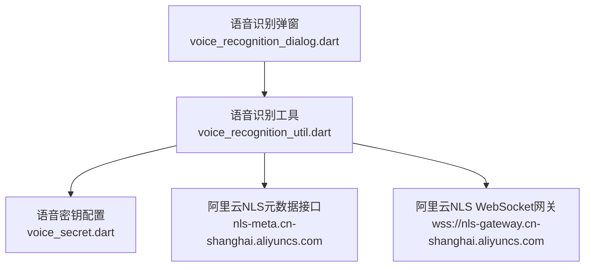
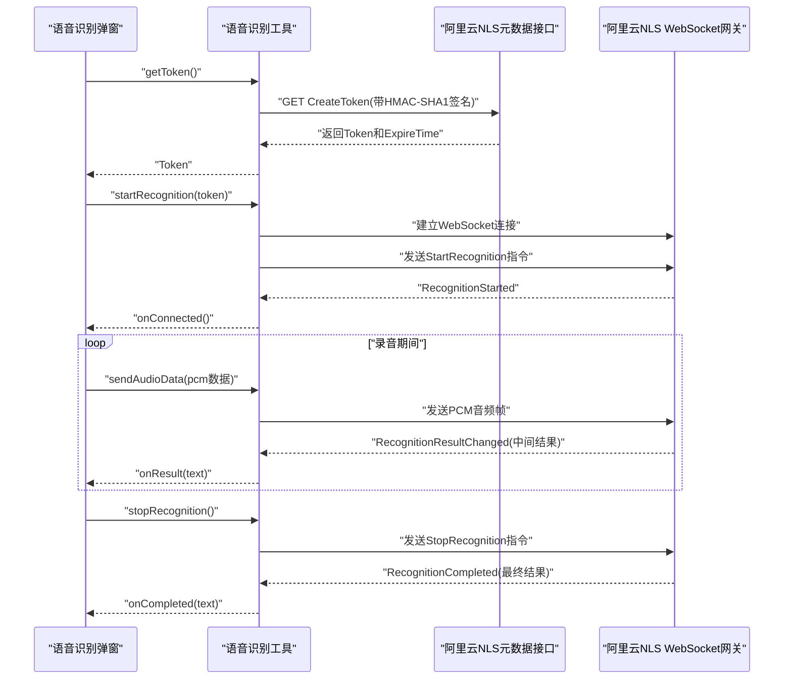
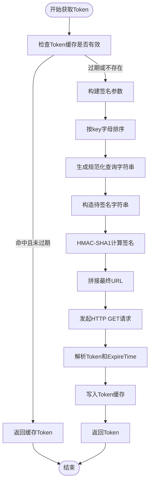
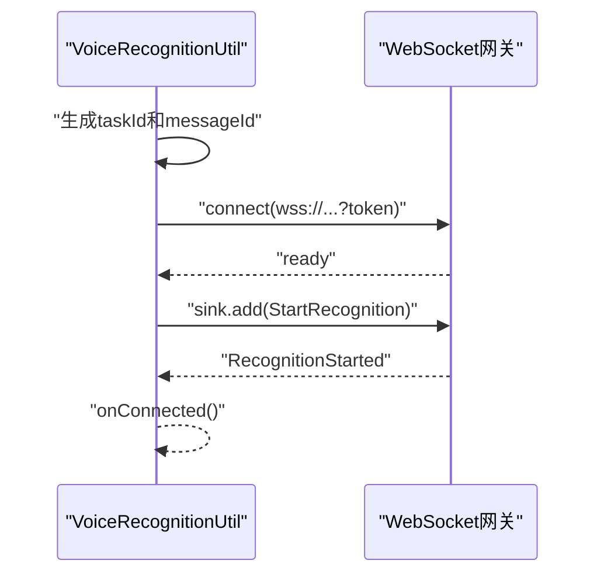
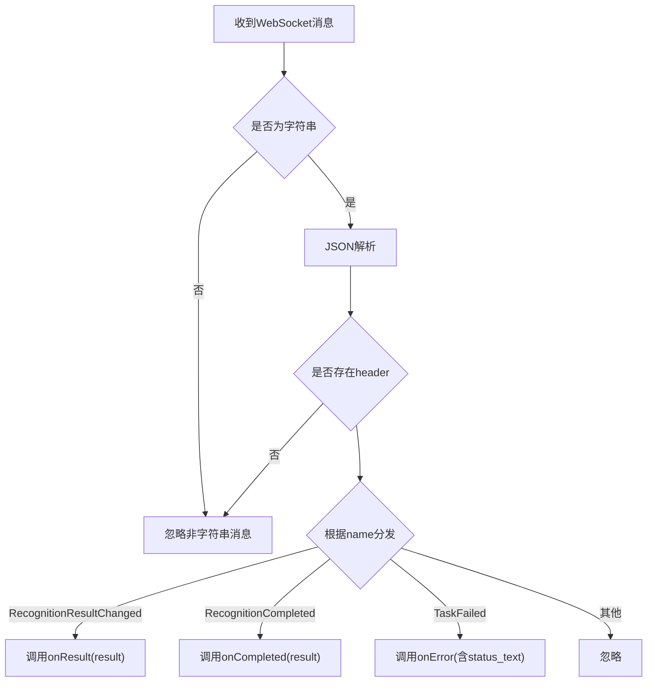
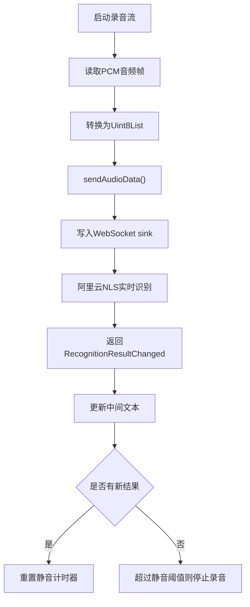
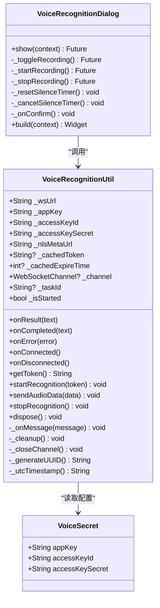

# 语音识别API

<cite>
**本文引用的文件**   
- [voice_recognition_util.dart](file://lib/util/voice_recognition_util.dart)
- [voice_secret.dart](file://lib/util/voice_secret.dart)
- [voice_secret.example.dart](file://lib/util/voice_secret.example.dart)
- [voice_recognition_dialog.dart](file://lib/widgets/voice_recognition_dialog.dart)
</cite>

## 目录
1. [简介](#简介)
2. [项目结构定位](#项目结构定位)
3. [核心组件概览](#核心组件概览)
4. [架构总览](#架构总览)
5. [详细接口说明](#详细接口说明)
6. [鉴权与Token缓存机制](#鉴权与token缓存机制)
7. [WebSocket连接与消息协议](#websocket连接与消息协议)
8. [PCM音频流式传输流程](#pcm音频流式传输流程)
9. [端到端使用示例](#端到端使用示例)
10. [依赖关系分析](#依赖关系分析)
11. [性能与稳定性建议](#性能与稳定性建议)
12. [故障排查指南](#故障排查指南)
13. [安全要求与生产部署注意事项](#安全要求与生产部署注意事项)
14. [结论](#结论)

## 简介
本文面向灵犀管店 Flutter 项目的语音识别能力，重点记录 `VoiceRecognitionUtil` 类对接阿里云 NLS（Natural Language Service）实时语音识别的完整实现。文档围绕以下目标展开：
- 说明 Token 获取、WebSocket 建立、开始识别、中间结果回调、最终结果回调、停止识别和错误处理等关键流程。
- 解释 HMAC-SHA1 签名鉴权机制、Token 缓存策略及过期管理。
- 描述 PCM 音频流式传输协议，包括采样率、格式和流式发送方式。
- 给出从 Token 获取到语音识别结束的端到端调用链路，并覆盖网络超时、WebSocket 消息解析和错误恢复思路。
- 明确 `VoiceSecret` 配置文件的安全要求和生产环境部署注意事项。

## 项目结构定位
本项目的语音识别能力集中在两个位置：
- 工具层：`lib/util/voice_recognition_util.dart`，封装阿里云 NLS 的 Token 获取、WebSocket 连接、消息解析、音频流发送和资源释放。
- UI 层：`lib/widgets/voice_recognition_dialog.dart`，负责麦克风权限申请、录音、文本展示、静音检测、格式选择和结果解析。
- 配置层：`lib/util/voice_secret.dart` 提供 AppKey、AccessKeyId、AccessKeySecret；`lib/util/voice_secret.example.dart` 作为密钥模板。

**图表来源**
- [voice_recognition_dialog.dart:1-80](file://lib/widgets/voice_recognition_dialog.dart#L1-L80)
- [voice_recognition_util.dart:1-40](file://lib/util/voice_recognition_util.dart#L1-L40)
- [voice_secret.dart:1-14](file://lib/util/voice_secret.dart#L1-L14)

**章节来源**
- [voice_recognition_util.dart:1-40](file://lib/util/voice_recognition_util.dart#L1-L40)
- [voice_recognition_dialog.dart:1-80](file://lib/widgets/voice_recognition_dialog.dart#L1-L80)
- [voice_secret.dart:1-14](file://lib/util/voice_secret.dart#L1-L14)

## 核心组件概览
- `VoiceRecognitionUtil`：封装阿里云 NLS 实时语音识别的核心逻辑，包括 Token 获取、WebSocket 生命周期、消息解析、音频流发送和错误回调。
- `VoiceRecognitionDialog`：Flutter UI 弹窗，负责录音、权限、UI 状态、静音检测、文本展示和结果解析。
- `VoiceSecret`：静态配置类，保存语音项目 AppKey 和阿里云 AccessKey 信息。

关键职责划分：
- Token 获取与鉴权：由 `VoiceRecognitionUtil.getToken` 完成。
- WebSocket 通信：由 `VoiceRecognitionUtil.startRecognition`、`sendAudioData`、`stopRecognition` 控制。
- 回调体系：`onResult`、`onCompleted`、`onError`、`onConnected`、`onDisconnected`。
- UI 交互：由 `VoiceRecognitionDialog` 管理录音、显示中间结果和最终结果。

**章节来源**
- [voice_recognition_util.dart:1-40](file://lib/util/voice_recognition_util.dart#L1-L40)
- [voice_recognition_dialog.dart:1-80](file://lib/widgets/voice_recognition_dialog.dart#L1-L80)

## 架构总览
下图展示从 UI 触发录音到阿里云 NLS 返回识别结果的端到端流程。

**图表来源**
- [voice_recognition_dialog.dart:120-220](file://lib/widgets/voice_recognition_dialog.dart#L120-L220)
- [voice_recognition_util.dart:80-170](file://lib/util/voice_recognition_util.dart#L80-L170)
- [voice_recognition_util.dart:200-347](file://lib/util/voice_recognition_util.dart#L200-L347)

## 详细接口说明

### VoiceRecognitionUtil 核心接口
- `getToken()`：静态方法，调用阿里云 NLS 元数据接口获取 Token，并进行本地缓存和过期管理。
- `startRecognition(token)`：建立 WebSocket 连接，发送 `StartRecognition` 指令，启动实时识别。
- `sendAudioData(data)`：向已建立的 WebSocket 通道发送 PCM 音频帧。
- `stopRecognition()`：发送 `StopRecognition` 指令，等待最终结果后关闭连接。
- `dispose()`：释放资源、清空回调引用。

回调接口：
- `onResult(text)`：中间识别结果回调。
- `onCompleted(text)`：最终识别结果回调。
- `onError(error)`：错误回调，包含网络连接、鉴权失败、服务端异常等。
- `onConnected()`：WebSocket 连接成功回调。
- `onDisconnected()`：WebSocket 断开回调。

**章节来源**
- [voice_recognition_util.dart:1-40](file://lib/util/voice_recognition_util.dart#L1-L40)
- [voice_recognition_util.dart:40-170](file://lib/util/voice_recognition_util.dart#L40-L170)
- [voice_recognition_util.dart:200-347](file://lib/util/voice_recognition_util.dart#L200-L347)

### VoiceRecognitionDialog 交互职责
- 请求麦克风权限。
- 调用 `VoiceRecognitionUtil.getToken` 获取 Token。
- 调用 `startRecognition` 建立 WebSocket。
- 通过 `AudioRecorder` 启动 16000Hz PCM 单声道录音流，并逐帧发送到 `sendAudioData`。
- 监听 `onResult`、`onCompleted`、`onError` 更新 UI。
- 使用静音定时器在一段时间无新结果时自动停止录音。
- 将最终或当前文本交给 `parseVoiceText` 解析为商品信息。

**章节来源**
- [voice_recognition_dialog.dart:1-200](file://lib/widgets/voice_recognition_dialog.dart#L1-L200)
- [voice_recognition_dialog.dart:201-498](file://lib/widgets/voice_recognition_dialog.dart#L201-L498)

## 鉴权与Token缓存机制

### HMAC-SHA1 签名流程
`getToken` 按照以下步骤构造并发起阿里云 NLS 元数据请求：
1. 准备参数：AccessKeyId、Action=CreateToken、Format=JSON、RegionId=cn-shanghai、SignatureMethod=HMAC-SHA1、SignatureNonce、SignatureVersion=1.0、Timestamp、Version=2019-02-28。
2. 按 key 字母排序生成规范化查询字符串。
3. 构造待签名字符串：`GET&%2F&<encodedQuery>`。
4. 使用 HMAC-SHA1 计算签名，key 为 `AccessKeySecret&`。
5. 拼接 Signature 到最终 URL。
6. 使用 Dio 发起 GET 请求，设置连接超时和接收超时。
7. 解析响应中的 `Token.Id` 和 `Token.ExpireTime`。

该实现与 Vue 端 token.js 保持一致，确保跨端鉴权行为统一。

**图表来源**
- [voice_recognition_util.dart:40-170](file://lib/util/voice_recognition_util.dart#L40-L170)

**章节来源**
- [voice_recognition_util.dart:40-170](file://lib/util/voice_recognition_util.dart#L40-L170)

### Token 缓存策略与过期管理
- 缓存字段：`_cachedToken`、`_cachedExpireTime`。
- 提前刷新：若当前时间小于 `ExpireTime - 60秒`，则直接返回缓存 Token。
- ExpireTime 单位转换：服务器返回秒级时间戳，代码中转换为毫秒时间戳存储。
- 兜底策略：若 `ExpireTime` 非数值类型，则设置为“当前时间 + 1小时”。
- 空值保护：若 Token Id 为空，返回空字符串，避免后续无效连接。

这种设计降低了频繁请求元数据接口的开销，同时减少临界过期导致的鉴权失败风险。

**章节来源**
- [voice_recognition_util.dart:40-170](file://lib/util/voice_recognition_util.dart#L40-L170)

## WebSocket连接与消息协议

### WebSocket 建立流程
`startRecognition` 的主要步骤：
1. 校验 Token 是否为空，为空则通过 `onError` 上报服务未配置。
2. 生成 `taskId` 和 `messageId`。
3. 使用 `wss://nls-gateway.cn-shanghai.aliyuncs.com/ws/v1?token=$token` 建立 WebSocket 连接。
4. 对 `ready` future 设置 8 秒超时，超时抛出 `TimeoutException`。
5. 注册消息流监听，分别处理正常消息、错误事件和连接关闭事件。
6. 发送 `StartRecognition` 指令，包含 AppKey、format=pcm、sample_rate=16000、中间结果、标点预测、反规范化、语音检测、最大静音时长等参数。
7. 成功后标记 `_isStarted=true` 并触发 `onConnected`。

**图表来源**
- [voice_recognition_util.dart:170-240](file://lib/util/voice_recognition_util.dart#L170-L240)

**章节来源**
- [voice_recognition_util.dart:170-240](file://lib/util/voice_recognition_util.dart#L170-L240)

### 消息解析与回调分发
收到 WebSocket 消息后，`_onMessage` 进行 JSON 解析并按 `header.name` 分发：
- `RecognitionStarted`：识别已开始，无需额外处理。
- `RecognitionResultChanged`：中间结果，提取 `payload.result` 并调用 `onResult`。
- `RecognitionCompleted`：最终结果，提取 `payload.result` 并调用 `onCompleted`。
- `TaskFailed`：服务端任务失败，提取 `status_text` 和 `status`，调用 `onError`。

异常路径：
- JSON 解析失败：调用 `onError` 报告“解析消息失败”。
- 消息头缺失：忽略无效消息。

**图表来源**
- [voice_recognition_util.dart:260-320](file://lib/util/voice_recognition_util.dart#L260-L320)

**章节来源**
- [voice_recognition_util.dart:260-320](file://lib/util/voice_recognition_util.dart#L260-L320)

## PCM音频流式传输流程
`VoiceRecognitionDialog` 使用 `record` 插件以 16000Hz、PCM 16bit、单声道格式启动录音流，并将每帧数据转换为 `Uint8List` 后调用 `sendAudioData` 发送给 `VoiceRecognitionUtil`。`VoiceRecognitionUtil` 直接将二进制数据写入 WebSocket sink。

关键点：
- 采样率必须与服务端期望一致（16000Hz）。
- 格式必须为 PCM，以便服务端进行实时语音识别。
- 流式传输降低延迟，适合连续对话场景。
- 静音检测：当一段时间没有新的中间结果时，自动停止录音，提升用户体验。

**图表来源**
- [voice_recognition_dialog.dart:120-220](file://lib/widgets/voice_recognition_dialog.dart#L120-L220)
- [voice_recognition_util.dart:240-260](file://lib/util/voice_recognition_util.dart#L240-L260)

**章节来源**
- [voice_recognition_dialog.dart:120-220](file://lib/widgets/voice_recognition_dialog.dart#L120-L220)
- [voice_recognition_util.dart:240-260](file://lib/util/voice_recognition_util.dart#L240-L260)

## 端到端使用示例
以下示例描述从 UI 触发录音到获得最终识别结果的完整流程，不包含具体代码内容，仅列出调用顺序和关键参数。

调用顺序：
1. 用户点击录音按钮。
2. UI 请求麦克风权限。
3. 调用 `VoiceRecognitionUtil.getToken()` 获取 Token。
4. 调用 `startRecognition(token)` 建立 WebSocket 并发送 `StartRecognition`。
5. 使用 `AudioRecorder` 启动 16000Hz PCM 单声道录音流。
6. 将每帧音频数据通过 `sendAudioData(Uint8List.fromList(data))` 发送。
7. 监听 `onResult` 实时更新中间文本。
8. 用户停止录音或检测到静音时，调用 `stopRecognition()`。
9. 收到 `onCompleted(text)` 后，使用 `parseVoiceText(text, format)` 解析商品信息。
10. 将解析结果返回给上层业务页面。

关键参数与约束：
- WebSocket 地址：`wss://nls-gateway.cn-shanghai.aliyuncs.com/ws/v1`。
- Token 通过 HTTP GET 请求 `https://nls-meta.cn-shanghai.aliyuncs.com` 获取。
- 音频格式：PCM，采样率 16000Hz，单声道。
- 识别参数：启用中间结果、标点预测、反规范化、语音检测，最大静音时长 2000ms。

**章节来源**
- [voice_recognition_dialog.dart:120-220](file://lib/widgets/voice_recognition_dialog.dart#L120-L220)
- [voice_recognition_dialog.dart:420-498](file://lib/widgets/voice_recognition_dialog.dart#L420-L498)
- [voice_recognition_util.dart:170-260](file://lib/util/voice_recognition_util.dart#L170-L260)

## 依赖关系分析

**图表来源**
- [voice_recognition_util.dart:1-347](file://lib/util/voice_recognition_util.dart#L1-L347)
- [voice_recognition_dialog.dart:1-498](file://lib/widgets/voice_recognition_dialog.dart#L1-L498)
- [voice_secret.dart:1-14](file://lib/util/voice_secret.dart#L1-L14)

**章节来源**
- [voice_recognition_util.dart:1-347](file://lib/util/voice_recognition_util.dart#L1-L347)
- [voice_recognition_dialog.dart:1-498](file://lib/widgets/voice_recognition_dialog.dart#L1-L498)
- [voice_secret.dart:1-14](file://lib/util/voice_secret.dart#L1-L14)

## 性能与稳定性建议
- Token 缓存：利用已有缓存避免频繁请求元数据接口；建议在 Token 过期前 60 秒主动刷新。
- 连接超时：WebSocket 连接设置 8 秒超时，HTTP 请求设置 10 秒连接和接收超时，防止长时间阻塞。
- 重试策略：可在 UI 层捕获 `onError`，提示用户重新连接或切换网络。
- 音频编码：保持 16000Hz PCM 单声道，避免额外编解码带来的延迟和兼容性问题。
- 静音检测：合理设置静音阈值（当前实现约 1500ms 无新结果即停止），平衡响应速度与误停概率。
- 资源释放：每次识别结束后务必调用 `stopRecognition` 和 `dispose`，避免内存泄漏和连接泄漏。

[本节为通用建议，不直接分析具体文件]

## 故障排查指南
常见问题与定位方向：
- Token 为空或服务未配置：
  - 检查 `VoiceSecret` 是否包含真实 AppKey、AccessKeyId、AccessKeySecret。
  - 确认 `getToken` 返回的 Token 是否为空。
- WebSocket 连接超时：
  - 检查设备网络是否正常。
  - 查看 `onError` 是否报告“连接超时”。
- 无法收到中间结果：
  - 确认 `sendAudioData` 是否被持续调用。
  - 检查服务端是否返回 `RecognitionResultChanged`。
- 最终结果未返回：
  - 确认是否调用 `stopRecognition`。
  - 检查是否收到 `RecognitionCompleted`。
- 鉴权失败：
  - 检查 HMAC-SHA1 签名是否正确。
  - 确认 AccessKeySecret 未被泄露或篡改。

**章节来源**
- [voice_recognition_util.dart:40-170](file://lib/util/voice_recognition_util.dart#L40-L170)
- [voice_recognition_util.dart:170-347](file://lib/util/voice_recognition_util.dart#L170-L347)
- [voice_recognition_dialog.dart:120-220](file://lib/widgets/voice_recognition_dialog.dart#L120-L220)

## 安全要求与生产部署注意事项
- 密钥文件隔离：
  - `voice_secret.dart` 应被 `.gitignore` 排除，禁止提交到版本库。
  - 部署时使用 `voice_secret.example.dart` 作为模板，替换为真实密钥。
- 最小权限原则：
  - 阿里云 AccessKey 应仅授予 NLS 相关权限，避免过宽权限导致安全风险。
- 敏感信息防护：
  - 不在日志中打印完整的 AccessKeySecret。
  - 避免在客户端暴露可用于签发任意 Token 的高权限密钥；如条件允许，可考虑后端代理 Token 获取。
- 环境变量与配置中心：
  - 生产环境建议使用配置中心或受控的环境变量注入方式，避免硬编码。
- 审计与监控：
  - 记录 Token 获取失败、WebSocket 连接失败、鉴权失败的次数与原因，便于线上监控与告警。

**章节来源**
- [voice_secret.dart:1-14](file://lib/util/voice_secret.dart#L1-L14)
- [voice_secret.example.dart:1-16](file://lib/util/voice_secret.example.dart#L1-L16)

## 结论
`VoiceRecognitionUtil` 提供了完整的阿里云 NLS 实时语音识别集成方案，涵盖 Token 鉴权、WebSocket 通信、PCM 流式传输、消息解析和错误回调。配合 `VoiceRecognitionDialog`，可实现从录音到文本解析的端到端语音录入体验。在生产环境中，应重点关注密钥安全管理、网络超时处理和资源释放，以保证系统稳定性和安全性。

[本节为总结性内容，不直接分析具体文件]