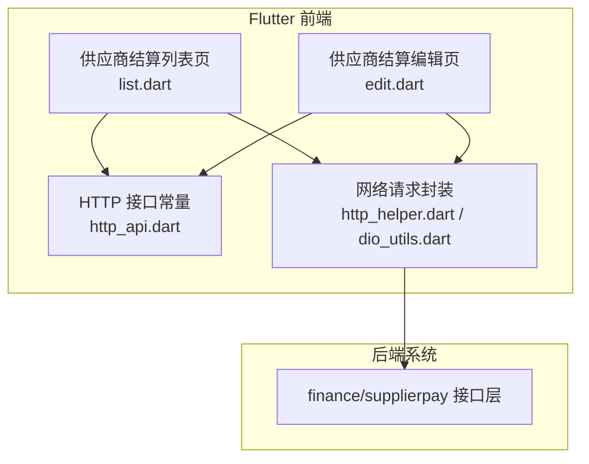
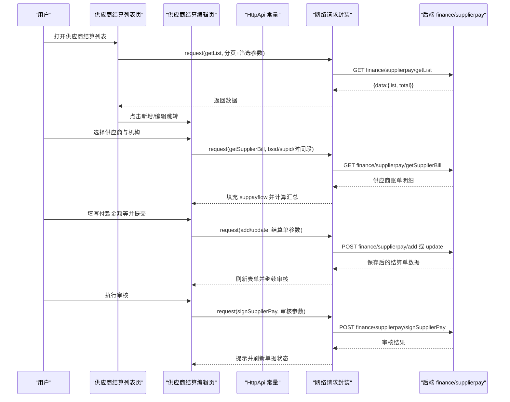
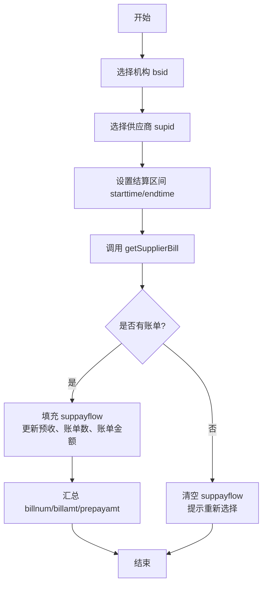
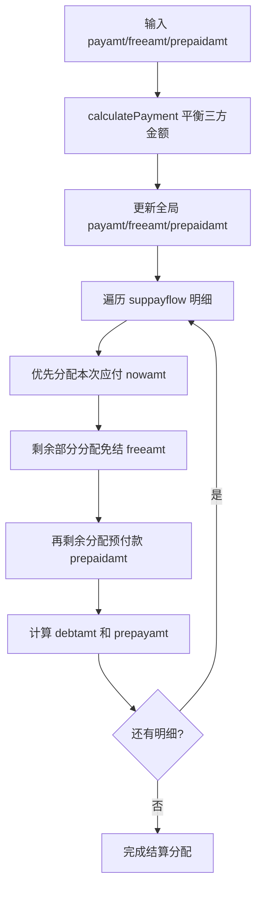
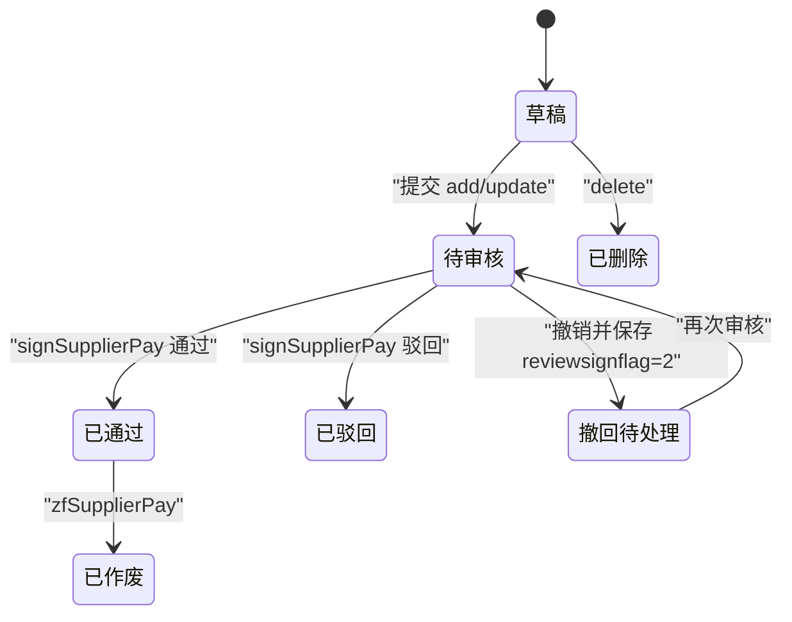

# 供应商结算API

<cite>
**本文引用的文件**   
- [lib/net/http_api.dart](file://lib/net/http_api.dart)
- [lib/pages/business/finance/supplier_pay/list.dart](file://lib/pages/business/finance/supplier_pay/list.dart)
- [lib/pages/business/finance/supplier_pay/edit.dart](file://lib/pages/business/finance/supplier_pay/edit.dart)
</cite>

## 目录
1. [简介](#简介)
2. [项目结构与定位](#项目结构与定位)
3. [核心组件总览](#核心组件总览)
4. [架构与调用链路](#架构与调用链路)
5. [供应商结算接口定义](#供应商结算接口定义)
6. [业务处理逻辑](#业务处理逻辑)
7. [状态流转与审批流程](#状态流转与审批流程)
8. [增删改查示例](#增删改查示例)
9. [错误处理与权限控制](#错误处理与权限控制)
10. [审计追踪、风险控制与对账机制](#审计追踪风险控制与对账机制)
11. [性能与使用建议](#性能与使用建议)
12. [故障排查](#故障排查)
13. [结论](#结论)

## 简介
本文件面向灵犀管店 Flutter 客户端中的“供应商结算”模块，围绕 `finance/supplierpay` 相关后端接口，整理客户端侧的完整 API 契约、业务流程、状态变更规则以及异常处理方案。文档重点覆盖以下能力：
- 供应商结算列表查询
- 结算单详情查看
- 新增和修改结算单
- 审核结算单
- 删除结算单
- 作废结算单
- 获取供应商账单并参与结算计算

同时说明结算金额如何从供应商账单中生成、分配、汇总，以及多级审批、权限校验、打印、撤回等配套行为。

## 项目结构与定位
供应商结算功能在 Flutter 项目中主要位于业务财务模块下的供应商结算页面：
- 列表页：`lib/pages/business/finance/supplier_pay/list.dart`
- 编辑页（新增/修改/审核/作废/删除/打印）：`lib/pages/business/finance/supplier_pay/edit.dart`
- 统一 HTTP 接口常量：`lib/net/http_api.dart`

**图表来源**
- [lib/pages/business/finance/supplier_pay/list.dart:150-210](file://lib/pages/business/finance/supplier_pay/list.dart#L150-L210)
- [lib/pages/business/finance/supplier_pay/edit.dart:470-540](file://lib/pages/business/finance/supplier_pay/edit.dart#L470-L540)
- [lib/net/http_api.dart:495-503](file://lib/net/http_api.dart#L495-L503)

**章节来源**
- [lib/pages/business/finance/supplier_pay/list.dart:1-60](file://lib/pages/business/finance/supplier_pay/list.dart#L1-L60)
- [lib/pages/business/finance/supplier_pay/edit.dart:1-60](file://lib/pages/business/finance/supplier_pay/edit.dart#L1-L60)
- [lib/net/http_api.dart:490-510](file://lib/net/http_api.dart#L490-L510)

## 核心组件总览
| 组件 | 职责 | 关键行为 |
|---|---|---|
| 供应商结算列表页 | 展示结算单分页列表，支持按状态、时间、机构、供应商、制单人、收款人、付款方式、银行账户、供应商对账状态筛选 | 调用 `finance/supplierpay/getList`；根据 Tab 切换状态；滚动加载更多；权限校验 |
| 供应商结算编辑页 | 新增、修改、查看、审核、作废、删除、打印结算单；加载并选择供应商账单；计算本次应付、免结金额、预付款分配 | 调用 `getinfo`、`add`、`update`、`signSupplierPay`、`delete`、`zfSupplierPay`、`getSupplierBill` |
| HTTP 接口常量 | 集中维护所有后端接口路径 | 定义 `finance/supplierpay/getList`、`getinfo`、`add`、`update`、`signSupplierPay`、`delete`、`zfSupplierPay`、`getSupplierBill` |

**章节来源**
- [lib/pages/business/finance/supplier_pay/list.dart:150-210](file://lib/pages/business/finance/supplier_pay/list.dart#L150-L210)
- [lib/pages/business/finance/supplier_pay/edit.dart:470-540](file://lib/pages/business/finance/supplier_pay/edit.dart#L470-L540)
- [lib/net/http_api.dart:495-503](file://lib/net/http_api.dart#L495-L503)

## 架构与调用链路
供应商结算的前端调用链可概括为：页面触发 → 权限校验 → 构建参数 → 调用 `request` → 解析后端响应 → 更新 UI 或进入下一步业务动作。

**图表来源**
- [lib/pages/business/finance/supplier_pay/list.dart:184-210](file://lib/pages/business/finance/supplier_pay/list.dart#L184-L210)
- [lib/pages/business/finance/supplier_pay/edit.dart:470-540](file://lib/pages/business/finance/supplier_pay/edit.dart#L470-L540)
- [lib/pages/business/finance/supplier_pay/edit.dart:820-940](file://lib/pages/business/finance/supplier_pay/edit.dart#L820-L940)
- [lib/pages/business/finance/supplier_pay/edit.dart:960-1040](file://lib/pages/business/finance/supplier_pay/edit.dart#L960-L1040)
- [lib/net/http_api.dart:495-503](file://lib/net/http_api.dart#L495-L503)

## 供应商结算接口定义

### 接口清单
| 接口名称 | 后端路径 | 用途 | 典型入参 | 典型出参 |
|---|---|---|---|---|
| getList | `finance/supplierpay/getList` | 查询供应商结算列表 | 分页、状态、时间范围、机构、供应商、制单人、收款人、付款方式、银行账户、供应商对账状态、单号搜索 | 结算单列表、总数 |
| getinfo | `finance/supplierpay/getinfo` | 查询结算单详情 | `billid` | 结算单主信息 + `suppayflow` 明细 + 审批流信息 |
| add | `finance/supplierpay/add` | 新增结算单 | 供应商、机构、结算区间、付款方式、账户、金额、明细等 | 保存后的结算单数据 |
| update | `finance/supplierpay/update` | 修改结算单 | 同 add，额外包含 `billid` | 保存后的结算单数据 |
| signSupplierPay | `finance/supplierpay/signSupplierPay` | 审核结算单 | 结算单数据 + `signflag` + `reviewremark` + 可选 `reviewsignflag` | 审核结果 |
| delete | `finance/supplierpay/delete` | 删除结算单 | `billid` | 删除结果 |
| zfSupplierPay | `finance/supplierpay/zfSupplierPay` | 作废结算单 | 结算单数据，通常含 `billid` | 作废结果 |
| getSupplierBill | `finance/supplierpay/getSupplierBill` | 获取供应商账单用于结算 | `bsid`、`supid`、时间范围 | 供应商账单明细及汇总字段 |

上述接口常量集中在 `HttpApi` 类中定义。

**章节来源**
- [lib/net/http_api.dart:495-503](file://lib/net/http_api.dart#L495-L503)

### getList：供应商结算列表
- **目的**：分页查询供应商结算单，并按状态 Tab、时间、机构、供应商、制单人、收款人、付款方式、银行账户、供应商对账状态、单号进行搜索。
- **请求方式**：由 `request` 发起，对应 `finance/supplierpay/getList`。
- **关键字段**：
  - `is_page`：是否分页。
  - `field`、`type`：排序字段和方向。
  - `page`、`pagesize`：分页参数。
  - `signflag`：状态值，前端根据 Tab 映射为待审核、已审核、已驳回或空。
  - `starttime`、`endtime`：日期范围。
  - `billno`：结算单号模糊搜索。
  - `sids`：机构 ID 数组。
  - `supid`、`createid`、`handlerid`：供应商、制单人、收款人筛选。
  - `payway`、`bankid`、`supsignflag`：付款方式、银行账户、供应商对账状态。
- **返回结构**：
  - `data.list`：结算单明细列表。
  - 列表为空时停止加载更多。

**章节来源**
- [lib/pages/business/finance/supplier_pay/list.dart:184-210](file://lib/pages/business/finance/supplier_pay/list.dart#L184-L210)

### getinfo：结算单详情
- **目的**：加载单个结算单的完整数据，包括主表信息和 `suppayflow` 明细。
- **请求方式**：`finance/supplierpay/getinfo`。
- **入参**：`billid`。
- **返回结构**：
  - 主信息：供应商、机构、业务员、银行、付款方式、结算区间、备注、金额汇总、状态等。
  - `suppayflow`：结算明细，每条明细包含账单金额、已付、免结、预付、本次应付、欠额等字段。
  - 审批流相关数据：`reviewFlowUsers`、`reviewBillFlows`、`reviewsignflag`、`reviewremark`。

**章节来源**
- [lib/pages/business/finance/supplier_pay/edit.dart:170-220](file://lib/pages/business/finance/supplier_pay/edit.dart#L170-L220)

### add：新增结算单
- **目的**：创建新的供应商结算单。
- **请求方式**：`finance/supplierpay/add`。
- **入参**：
  - 基础信息：`supid`、`supname`、`bsid`、`bstorename`、`handlerid`、`handlername`。
  - 结算信息：`startdate`、`enddate`、`remark`。
  - 支付信息：`bankid`、`bankname`、`payway`、`paywayname`。
  - 金额信息：`payamt`、`freeamt`、`prepaidamt`、`billnum`、`billamt`。
  - 明细：`suppayflow`。
  - 编辑模式需要传入 `billid`。
  - 涉及审批流时可能携带 `reviewsignflag`、`reviewremark`。
- **返回结构**：保存后的结算单数据，用于后续刷新界面和继续审核。

**章节来源**
- [lib/pages/business/finance/supplier_pay/edit.dart:820-940](file://lib/pages/business/finance/supplier_pay/edit.dart#L820-L940)

### update：修改结算单
- **目的**：修改已有结算单。
- **请求方式**：`finance/supplierpay/update`。
- **入参**：与 add 相同，但必须包含 `billid`。
- **返回结构**：同 add。

**章节来源**
- [lib/pages/business/finance/supplier_pay/edit.dart:820-940](file://lib/pages/business/finance/supplier_pay/edit.dart#L820-L940)

### signSupplierPay：审核结算单
- **目的**：对结算单执行审核操作，支持通过、驳回和多级审批。
- **请求方式**：`finance/supplierpay/signSupplierPay`。
- **入参**：
  - 当前结算单数据。
  - `signflag`：前端固定传 `0`，表示待审核单据走审核流程。
  - `reviewremark`：审批备注。
  - `reviewsignflag`：审批结果标记，通过时为 `1`，驳回为 `0`，撤回待处理为 `2`。
- **返回结构**：审核成功则刷新单据状态；失败则提示审核失败。

**章节来源**
- [lib/pages/business/finance/supplier_pay/edit.dart:960-1040](file://lib/pages/business/finance/supplier_pay/edit.dart#L960-L1040)

### delete：删除结算单
- **目的**：删除尚未生效或允许删除的结算单。
- **请求方式**：`finance/supplierpay/delete`。
- **入参**：`billid`。
- **返回结构**：删除成功后返回上一页或刷新列表。

**章节来源**
- [lib/pages/business/finance/supplier_pay/edit.dart:1080-1150](file://lib/pages/business/finance/supplier_pay/edit.dart#L1080-L1150)

### zfSupplierPay：作废结算单
- **目的**：将结算单作废，前端会将状态改为 `-1`。
- **请求方式**：`finance/supplierpay/zfSupplierPay`。
- **入参**：结算单数据，通常包含 `billid`。
- **返回结构**：作废成功则更新本地状态并提示。

**章节来源**
- [lib/pages/business/finance/supplier_pay/edit.dart:1040-1080](file://lib/pages/business/finance/supplier_pay/edit.dart#L1040-L1080)

### getSupplierBill：获取供应商账单
- **目的**：获取指定机构、供应商和时间范围内的供应商账单，作为结算明细数据来源。
- **请求方式**：`finance/supplierpay/getSupplierBill`。
- **入参**：
  - `bsid`：机构 ID。
  - `supid`：供应商 ID。
  - `starttime`、`endtime`：时间范围。
  - `is_page`：分页控制。
- **返回结构**：
  - `data`：账单明细列表。
  - 每条明细包含账单金额、已付、免结、预付、本次应付、欠额等字段。
  - 首条明细中的 `advance` 作为预收金额。
  - 汇总字段用于填充 `prepayamt`、`billnum`、`billamt` 等。

**章节来源**
- [lib/pages/business/finance/supplier_pay/edit.dart:470-540](file://lib/pages/business/finance/supplier_pay/edit.dart#L470-L540)

## 业务处理逻辑

### 对账单生成
供应商结算的对账单来自 `getSupplierBill`。前端根据选择的机构、供应商和结算区间拉取账单，并将结果写入 `_allBills` 和 `_suppayflow`。若未找到账单，会清空明细并提示重新选择供应商。

**图表来源**
- [lib/pages/business/finance/supplier_pay/edit.dart:470-540](file://lib/pages/business/finance/supplier_pay/edit.dart#L470-L540)

### 结算金额计算
结算金额计算的核心是 `_settleConfirm`。它根据用户输入的 `payamt`、`freeamt`、`prepaidamt` 进行三角平衡计算，然后将总额分配到每条账单明细的 `payamt`、`freeamt`、`prepaidamt`，最后计算每条明细的 `debtamt` 和 `prepayamt`。

**图表来源**
- [lib/pages/business/finance/supplier_pay/edit.dart:540-630](file://lib/pages/business/finance/supplier_pay/edit.dart#L540-L630)

### 审批流转
结算单支持简单审核和多级审批：
- 若无多级审批配置，仅弹出确认对话框后调用 `signSupplierPay`。
- 若有审批人员列表，则弹出审批弹窗，支持通过、驳回和备注。
- 撤回时设置 `reviewsignflag=2`，保存后直接调用审核接口保留撤回标记。

**图表来源**
- [lib/pages/business/finance/supplier_pay/edit.dart:820-940](file://lib/pages/business/finance/supplier_pay/edit.dart#L820-L940)
- [lib/pages/business/finance/supplier_pay/edit.dart:960-1040](file://lib/pages/business/finance/supplier_pay/edit.dart#L960-L1040)
- [lib/pages/business/finance/supplier_pay/edit.dart:1040-1150](file://lib/pages/business/finance/supplier_pay/edit.dart#L1040-L1150)

## 状态流转与审批流程

### 结算单状态
| 状态值 | 含义 | 前端表现 |
|---|---|---|
| `0` | 待审核 | 列表“待审核”Tab；可审核、可编辑；审核时 `signflag=0` |
| `1` | 已审核 | 列表“已审核”Tab；通常为只读 |
| `2` | 已驳回 | 列表“已驳回”Tab；可根据审批配置显示 |
| `-1` | 已作废 | 作废后前端显式设置为 `-1` |

### 审批结果标记
| 字段 | 含义 | 取值 |
|---|---|---|
| `signflag` | 结算单审核状态 | `0` 待审核、`1` 已审核、`2` 已驳回、`-1` 已作废 |
| `reviewsignflag` | 审批结果标记 | `0` 驳回、`1` 通过、`2` 撤回待处理 |
| `reviewremark` | 审批备注 | 文本 |

**章节来源**
- [lib/pages/business/finance/supplier_pay/list.dart:184-210](file://lib/pages/business/finance/supplier_pay/list.dart#L184-L210)
- [lib/pages/business/finance/supplier_pay/edit.dart:960-1040](file://lib/pages/business/finance/supplier_pay/edit.dart#L960-L1040)
- [lib/pages/business/finance/supplier_pay/edit.dart:1040-1150](file://lib/pages/business/finance/supplier_pay/edit.dart#L1040-L1150)

## 增删改查示例

### 查询列表
- 触发入口：打开供应商结算列表页。
- 参数要点：
  - 分页：`page`、`pagesize`。
  - 状态：`signflag` 由 Tab 决定。
  - 时间：`starttime`、`endtime`。
  - 筛选：`sids`、`supid`、`createid`、`handlerid`、`payway`、`bankid`、`supsignflag`、`billno`。
- 返回：`data.list` 渲染表格。

**章节来源**
- [lib/pages/business/finance/supplier_pay/list.dart:184-210](file://lib/pages/business/finance/supplier_pay/list.dart#L184-L210)

### 查看详情
- 触发入口：列表跳转编辑页，传入 `billid`。
- 参数：`billid`。
- 返回：结算单主信息 + `suppayflow` + 审批流信息。

**章节来源**
- [lib/pages/business/finance/supplier_pay/edit.dart:170-220](file://lib/pages/business/finance/supplier_pay/edit.dart#L170-L220)

### 新增结算单
- 触发入口：编辑页新增按钮。
- 前置校验：
  - 权限：`014403`。
  - 必填：供应商、机构、付款方式、付款账户、结算明细。
- 参数：`supid`、`supname`、`bsid`、`bstorename`、`handlerid`、`handlername`、`remark`、`bankid`、`bankname`、`payway`、`paywayname`、`startdate`、`enddate`、`payamt`、`freeamt`、`prepaidamt`、`suppayflow`、`billnum`、`billamt`。
- 返回：保存后的数据，并可继续执行审核。

**章节来源**
- [lib/pages/business/finance/supplier_pay/edit.dart:820-940](file://lib/pages/business/finance/supplier_pay/edit.dart#L820-L940)

### 修改结算单
- 触发入口：编辑已有结算单。
- 参数：同新增，但必须带 `billid`。
- 返回：保存后的数据。

**章节来源**
- [lib/pages/business/finance/supplier_pay/edit.dart:820-940](file://lib/pages/business/finance/supplier_pay/edit.dart#L820-L940)

### 审核结算单
- 触发入口：编辑页审核按钮。
- 前置校验：当前用户是否在审批节点。
- 参数：当前表单数据 + `signflag=0` + `reviewremark` + `reviewsignflag`。
- 返回：审核成功则刷新列表。

**章节来源**
- [lib/pages/business/finance/supplier_pay/edit.dart:960-1040](file://lib/pages/business/finance/supplier_pay/edit.dart#L960-L1040)

### 删除结算单
- 触发入口：编辑页删除菜单。
- 前置校验：权限 `014404`。
- 参数：`billid`。
- 返回：删除成功返回上一页。

**章节来源**
- [lib/pages/business/finance/supplier_pay/edit.dart:1080-1150](file://lib/pages/business/finance/supplier_pay/edit.dart#L1080-L1150)

### 作废结算单
- 触发入口：编辑页作废操作。
- 前置校验：权限 `014406`。
- 参数：结算单数据。
- 返回：作废成功，前端将 `signflag` 设为 `-1`。

**章节来源**
- [lib/pages/business/finance/supplier_pay/edit.dart:1040-1080](file://lib/pages/business/finance/supplier_pay/edit.dart#L1040-L1080)

## 错误处理与权限控制

### 权限控制
| 操作 | 权限码 | 说明 |
|---|---:|---|
| 查看供应商结算列表 | `014401` | 无权限时提示无权查看 |
| 新增供应商结算 | `014403` | 无权限时提示无权新增 |
| 删除供应商结算 | `014404` | 无权限时提示无权删除 |
| 作废供应商结算 | `014406` | 无权限时提示无权作废 |

### 常见错误场景
| 场景 | 处理方式 |
|---|---|
| 未选择供应商或机构 | 提示“请选择供应商/机构” |
| 未选择付款方式或账户 | 提示“请选择付款方式/付款账户” |
| 没有结算明细 | 提示“请选择单据” |
| 供应商没有账单 | 提示“该供应商没有账单，请重新选择” |
| 接口异常 | 捕获异常并提示 `retmsg` 或通用失败消息 |
| 审核失败 | 提示“审核失败” |
| 作废失败 | 提示“作废失败” |
| 删除失败 | 提示“删除失败” |

**章节来源**
- [lib/pages/business/finance/supplier_pay/list.dart:30-60](file://lib/pages/business/finance/supplier_pay/list.dart#L30-L60)
- [lib/pages/business/finance/supplier_pay/edit.dart:820-860](file://lib/pages/business/finance/supplier_pay/edit.dart#L820-L860)
- [lib/pages/business/finance/supplier_pay/edit.dart:470-540](file://lib/pages/business/finance/supplier_pay/edit.dart#L470-L540)
- [lib/pages/business/finance/supplier_pay/edit.dart:960-1150](file://lib/pages/business/finance/supplier_pay/edit.dart#L960-L1150)

## 审计追踪、风险控制与对账机制

### 审计追踪
- 结算单包含制单人、制单人 ID、收款人、收款人 ID、创建时间等字段，便于审计。
- 审批流提供 `reviewFlowUsers`、`reviewBillFlows`、`reviewsignflag`、`reviewremark`，用于记录谁在哪个节点进行了什么审批操作。
- 审核、作废、删除等操作均有明确的用户交互确认和 Toast 提示，便于问题回溯。

### 风险控制
- 操作前进行权限校验，避免越权操作。
- 新增/修改前校验必填字段，防止不完整数据进入系统。
- 审核时对当前用户是否属于审批节点做校验。
- 撤回操作需二次确认，避免误撤回导致审批流程重置。

### 对账机制
- 供应商账单通过 `getSupplierBill` 拉取，作为结算明细来源。
- 结算金额通过 `payamt`、`freeamt`、`prepaidamt` 三方平衡，保证每条明细的 `nowamt` 被合理分配。
- 每条明细计算 `debtamt` 表示仍欠金额，`prepayamt` 表示可用于预结算的金额。
- 汇总字段 `billnum`、`billamt`、`prepayamt` 用于对账报表和结算总额核对。

**章节来源**
- [lib/pages/business/finance/supplier_pay/edit.dart:470-540](file://lib/pages/business/finance/supplier_pay/edit.dart#L470-L540)
- [lib/pages/business/finance/supplier_pay/edit.dart:540-630](file://lib/pages/business/finance/supplier_pay/edit.dart#L540-L630)
- [lib/pages/business/finance/supplier_pay/edit.dart:820-940](file://lib/pages/business/finance/supplier_pay/edit.dart#L820-L940)

## 性能与使用建议
- 列表页使用分页加载，默认每页 20 条，滚动到底部自动加载下一页。
- 搜索框使用防抖，延迟 500ms 触发查询，减少频繁请求。
- 下拉刷新时会重新读取审批配置，动态调整“已驳回”Tab。
- 编辑页加载供应商账单时独立控制 `_billLoading`，避免新增模式下因 `_formData` 为空导致的白屏。
- 建议在批量操作或长列表场景下，服务端配合索引优化、分页限制和必要字段过滤。

**章节来源**
- [lib/pages/business/finance/supplier_pay/list.dart:150-210](file://lib/pages/business/finance/supplier_pay/list.dart#L150-L210)
- [lib/pages/business/finance/supplier_pay/edit.dart:470-540](file://lib/pages/business/finance/supplier_pay/edit.dart#L470-L540)

## 故障排查
| 现象 | 可能原因 | 处理建议 |
|---|---|---|
| 列表不显示数据 | 权限不足、筛选条件过严、接口返回空 | 检查权限码、清空筛选、查看接口响应 |
| 新增无法保存 | 缺少必填字段、无结算明细、无权限 | 补充供应商、机构、付款方式、账户和明细 |
| 供应商账单为空 | 供应商未产生账单或时间范围不对 | 调整时间范围或更换供应商 |
| 审核失败 | 审批节点不符、接口异常 | 检查当前用户是否在审批节点，查看 retmsg |
| 作废/删除失败 | 权限不足或单据不允许该操作 | 检查权限码、单据状态 |
| 结算金额分配异常 | 输入金额不合理 | 重新输入 payamt/freeamt/prepaidamt，让系统自动平衡 |

**章节来源**
- [lib/pages/business/finance/supplier_pay/list.dart:30-60](file://lib/pages/business/finance/supplier_pay/list.dart#L30-L60)
- [lib/pages/business/finance/supplier_pay/edit.dart:470-540](file://lib/pages/business/finance/supplier_pay/edit.dart#L470-L540)
- [lib/pages/business/finance/supplier_pay/edit.dart:820-940](file://lib/pages/business/finance/supplier_pay/edit.dart#L820-L940)
- [lib/pages/business/finance/supplier_pay/edit.dart:960-1150](file://lib/pages/business/finance/supplier_pay/edit.dart#L960-L1150)

## 结论
灵犀管店 Flutter 项目的供应商结算模块以 `finance/supplierpay` 为核心后端接口，前端通过列表页和编辑页实现完整的结算生命周期管理。其设计特点包括：
- 以 `getSupplierBill` 作为结算数据来源，确保结算明细有据可依。
- 通过三方金额平衡算法实现 `payamt`、`freeamt`、`prepaidamt` 的智能分配。
- 支持多级审批、撤回、作废、删除等复杂业务状态。
- 在前端完成权限校验、必填校验、错误提示和审计追踪。

在实际使用中，应重点关注权限配置、供应商账单有效性、审批流配置以及结算金额的合理性，以确保结算流程稳定可靠。