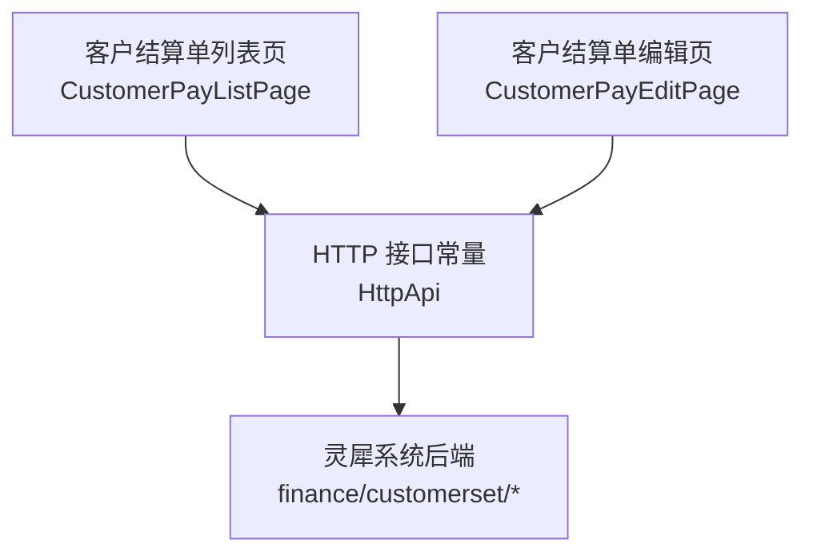
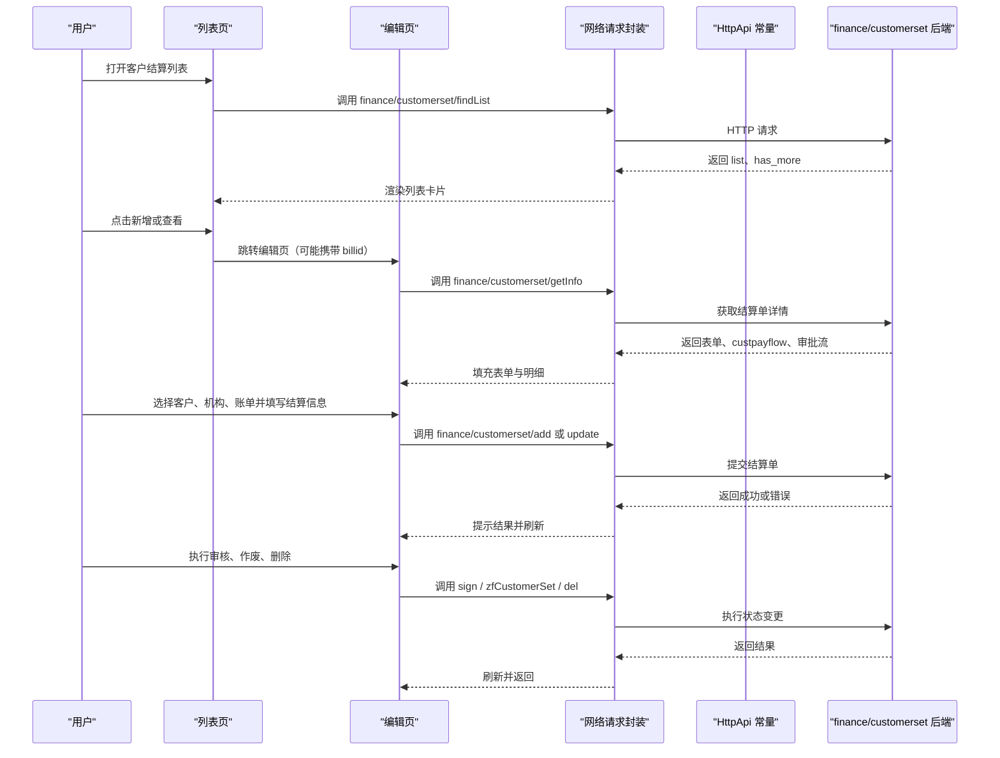
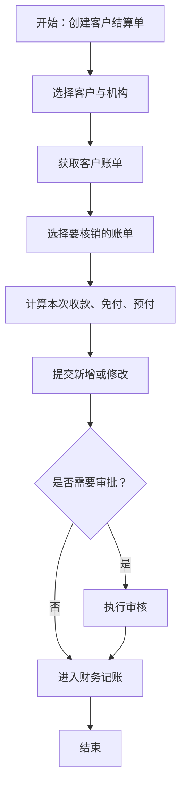
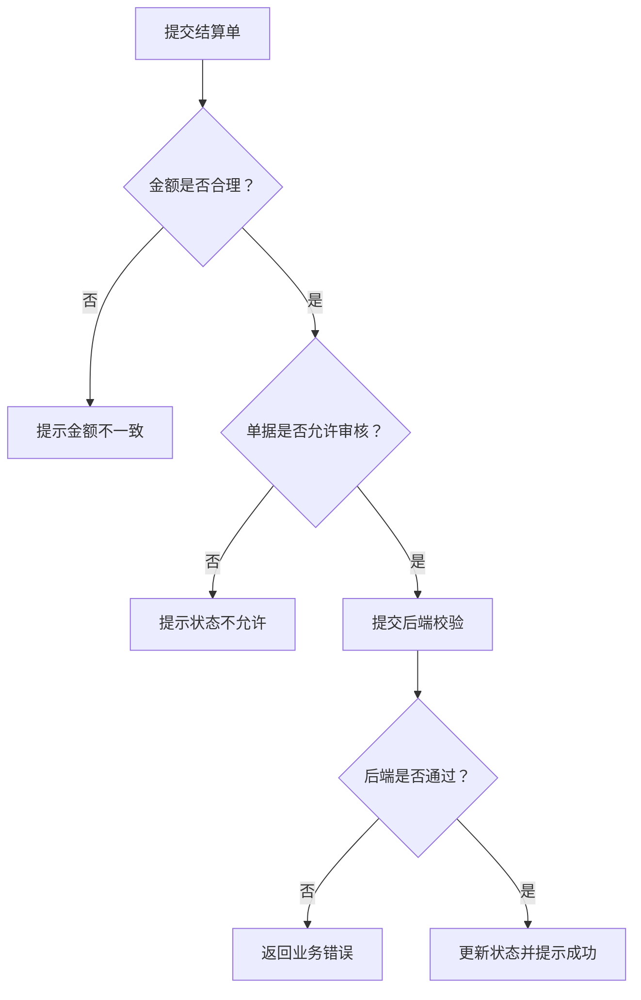
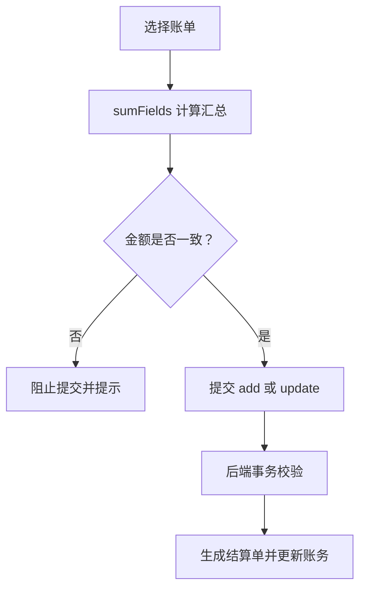

# 客户结算API

<cite>
**本文引用的文件**   
- [lib/net/http_api.dart](file://lib/net/http_api.dart)
- [lib/pages/business/finance/customer_pay/list.dart](file://lib/pages/business/finance/customer_pay/list.dart)
- [lib/pages/business/finance/customer_pay/edit.dart](file://lib/pages/business/finance/customer_pay/edit.dart)
</cite>

## 目录
1. [引言](#引言)
2. [项目结构定位](#项目结构定位)
3. [核心接口清单](#核心接口清单)
4. [架构总览](#架构总览)
5. [业务流程说明](#业务流程说明)
6. [接口详细定义](#接口详细定义)
7. [数据模型与字段说明](#数据模型与字段说明)
8. [业务规则与校验](#业务规则与校验)
9. [权限控制与合规要求](#权限控制与合规要求)
10. [异常处理与错误建议](#异常处理与错误建议)
11. [性能与一致性建议](#性能与一致性建议)
12. [排错指南](#排错指南)
13. [结论](#结论)

## 引言
本文件面向灵犀管店 Flutter 客户端中的“客户结算”功能，聚焦 `finance/customerset` 模块。文档以仓库中实际代码为依据，梳理以下目标：
- 明确客户结算的后台 API 地址、请求语义与调用位置；
- 解释销售回款、收款核销、审批流程与财务记账在客户端的表现；
- 给出新增、修改、审核、作废、删除、获取账单等操作的完整调用示例与边界条件；
- 总结数据一致性、权限控制与合规性约束；
- 提供常见问题排查思路。

## 项目结构定位
客户结算相关逻辑主要分布在以下位置：
- HTTP 接口常量集中声明于网络层；
- 列表页负责查询、筛选、分页与状态标签；
- 编辑页负责新增/修改结算单、选择客户与机构、加载客户账单、计算核销金额、触发保存、审核、反审核、作废、删除等动作；
- 列表与编辑页均通过统一的网络请求封装访问后端。

**图表来源**
- [lib/net/http_api.dart:468-595](file://lib/net/http_api.dart#L468-L595)
- [lib/pages/business/finance/customer_pay/list.dart:1-1209](file://lib/pages/business/finance/customer_pay/list.dart#L1-L1209)
- [lib/pages/business/finance/customer_pay/edit.dart:1-2632](file://lib/pages/business/finance/customer_pay/edit.dart#L1-L2632)

**章节来源**
- [lib/net/http_api.dart:468-595](file://lib/net/http_api.dart#L468-L595)
- [lib/pages/business/finance/customer_pay/list.dart:1-1209](file://lib/pages/business/finance/customer_pay/list.dart#L1-L1209)
- [lib/pages/business/finance/customer_pay/edit.dart:1-2632](file://lib/pages/business/finance/customer_pay/edit.dart#L1-L2632)

## 核心接口清单
本节仅列出仓库中已定义的 `finance/customerset` 接口。若后端未返回业务校验错误，前端不会主动拒绝提交，因此最终合法性由服务端保证。

| 操作 | HTTP 接口地址 | 页面职责 | 是否在本仓库实现调用 |
|---|---|---|---|
| 客户结算列表 | `finance/customerset/findList` | 列表查询、筛选、分页、Tab 状态 | 是 |
| 结算详情 | `finance/customerset/getInfo` | 加载结算单及明细、审批流、汇总 | 是 |
| 新增结算单 | `finance/customerset/add` | 新增并提交结算单 | 是 |
| 修改结算单 | `finance/customerset/update` | 编辑后保存 | 是 |
| 审核结算单 | `finance/customerset/sign` | 审核或撤回 | 是 |
| 删除结算单 | `finance/customerset/del` | 删除单据 | 是 |
| 作废结算单 | `finance/customerset/zfCustomerSet` | 作废单据 | 是 |
| 获取客户账单 | `finance/customerset/getCustomerBill` | 按客户和机构加载待核销账单 | 是 |

**章节来源**
- [lib/net/http_api.dart:520-545](file://lib/net/http_api.dart#L520-L545)

## 架构总览
从前端到后端，客户结算的主要交互路径如下：

**图表来源**
- [lib/pages/business/finance/customer_pay/list.dart:1-1209](file://lib/pages/business/finance/customer_pay/list.dart#L1-L1209)
- [lib/pages/business/finance/customer_pay/edit.dart:1-2632](file://lib/pages/business/finance/customer_pay/edit.dart#L1-L2632)
- [lib/net/http_api.dart:520-545](file://lib/net/http_api.dart#L520-L545)

## 业务流程说明
### 销售回款
- 销售业务产生应收账单；
- 客户结算用于将客户的应收账单与收款行为关联；
- 编辑页通过 `finance/customerset/getCustomerBill` 拉取客户账单，并在明细中选择需要核销的账单；
- 结算单的 `custpayflow` 表示结算明细，每条明细对应一笔或多笔账单核销。

### 收款核销
- 结算单包含付款账户、付款方式、收款时间、本次收款金额、免付金额、预付结算金额等字段；
- 编辑页会根据选中的账单自动计算可预付金额、剩余欠款等汇总值；
- 当用户输入本次收款金额、免付金额或预付结算金额并失焦时，会重新计算核销结果；
- 最终结算金额应满足业务上“已结金额与账单关系一致”的要求。

### 审批流程
- 列表页根据后端配置动态显示“全部、待审核、已审核、已驳回”标签；
- 编辑页加载详情时会同时加载审批人员列表和审批单列表；
- 管理员或当前审批人可执行审核或撤回；
- 审核通过后，结算单进入财务记账与对账阶段；
- 被驳回的单据可继续修改后重新提交。

### 财务记账
- 审核通过的结算单通常会被后端用于生成财务凭证；
- 作废或删除会影响后续报表与审计轨迹；
- 前端不直接写入会计科目，但会通过状态变化影响后端记账流程。

[本图为概念流程图，不对应具体源码行号]

## 接口详细定义

### 客户结算列表：findList
- 接口地址：`finance/customerset/findList`
- 调用位置：列表页初始化与滚动加载
- 主要用途：按日期范围、单号、机构、客户、制单人、经手人、付款方式、付款账户、审核状态分页查询
- 关键参数
  - `is_page`：固定传 `1`
  - `field`：排序字段，例如 `createtime`
  - `type`：排序方向，例如 `desc`
  - `page`、`pagesize`：分页参数
  - `signflag`：状态过滤，`0` 待审核、`1` 已审核、`2` 已驳回，空值表示全部
  - `starttime`、`endtime`：日期范围
  - `billno`：单号模糊搜索
  - `sids`：机构 ID 列表
  - `custid`、`createid`、`handlerid`、`payway`、`bankid`：可选筛选
- 返回结构
  - `data.list`：结算单列表
  - 列表项至少包含单号、客户、制单人、机构、已结金额、制单时间、审核状态等展示字段

**章节来源**
- [lib/pages/business/finance/customer_pay/list.dart:120-200](file://lib/pages/business/finance/customer_pay/list.dart#L120-L200)
- [lib/pages/business/finance/customer_pay/list.dart:201-240](file://lib/pages/business/finance/customer_pay/list.dart#L201-L240)
- [lib/net/http_api.dart:520-525](file://lib/net/http_api.dart#L520-L525)

### 结算详情：getInfo
- 接口地址：`finance/customerset/getInfo`
- 调用位置：编辑页加载已有结算单
- 主要用途：获取结算主表、结算明细 `custpayflow`、审批人员、审批单、汇总字段
- 关键参数
  - `billid`：结算单 ID
- 返回结构
  - `data`：结算单对象
  - `custpayflow`：结算明细数组
  - `reviewFlowUsers`：审批人员
  - `reviewBillFlows`：审批单
  - 汇总字段包括预收金额、账单数量、账单金额、本次收款、免付、预付、欠款等

**章节来源**
- [lib/pages/business/finance/customer_pay/edit.dart:220-260](file://lib/pages/business/finance/customer_pay/edit.dart#L220-L260)
- [lib/net/http_api.dart:525-527](file://lib/net/http_api.dart#L525-L527)

### 新增结算单：add
- 接口地址：`finance/customerset/add`
- 调用位置：编辑页新增模式下提交
- 主要用途：创建新的客户结算单
- 关键参数
  - 客户编号、客户名称
  - 机构编号、机构名称
  - 经手人编号、经手人姓名
  - 开始日期、结束日期
  - 收款账户、收款方式
  - 预收金额、收款时间、备注
  - `custpayflow`：结算明细
  - 汇总金额：本次收款、免付、预付结算等
- 返回值
  - 成功时返回新单号或单 ID，失败时返回业务错误信息

**章节来源**
- [lib/pages/business/finance/customer_pay/edit.dart:1-2632](file://lib/pages/business/finance/customer_pay/edit.dart#L1-L2632)
- [lib/net/http_api.dart:527-529](file://lib/net/http_api.dart#L527-L529)

### 修改结算单：update
- 接口地址：`finance/customerset/update`
- 调用位置：编辑页编辑模式下提交
- 主要用途：更新已有结算单
- 关键参数
  - `billid`：必须
  - 其他字段同新增，但需确保状态允许修改
- 返回值
  - 成功或失败的业务消息

**章节来源**
- [lib/pages/business/finance/customer_pay/edit.dart:1-2632](file://lib/pages/business/finance/customer_pay/edit.dart#L1-L2632)
- [lib/net/http_api.dart:529-531](file://lib/net/http_api.dart#L529-L531)

### 审核结算单：sign
- 接口地址：`finance/customerset/sign`
- 调用位置：编辑页执行审核或撤回
- 主要用途：将结算单状态变更为已审核、已驳回或撤回待处理
- 关键参数
  - `billid`：必须
  - 审核意见、审核人等由后端根据登录用户和审批流补充
- 返回值
  - 成功则更新单据状态；失败则返回权限或状态错误

**章节来源**
- [lib/pages/business/finance/customer_pay/edit.dart:1-2632](file://lib/pages/business/finance/customer_pay/edit.dart#L1-L2632)
- [lib/net/http_api.dart:531-533](file://lib/net/http_api.dart#L531-L533)

### 删除结算单：del
- 接口地址：`finance/customerset/del`
- 调用位置：编辑页或列表操作区
- 主要用途：物理删除或逻辑删除结算单
- 关键参数
  - `billid`：必须
- 返回值
  - 成功或失败的消息

**章节来源**
- [lib/pages/business/finance/customer_pay/edit.dart:1-2632](file://lib/pages/business/finance/customer_pay/edit.dart#L1-L2632)
- [lib/net/http_api.dart:533-535](file://lib/net/http_api.dart#L533-L535)

### 作废结算单：zfCustomerSet
- 接口地址：`finance/customerset/zfCustomerSet`
- 调用位置：编辑页执行作废
- 主要用途：将结算单标记为已作废，通常不可再参与正常核销或记账
- 关键参数
  - `billid`：必须
- 返回值
  - 成功或失败的消息

**章节来源**
- [lib/pages/business/finance/customer_pay/edit.dart:1-2632](file://lib/pages/business/finance/customer_pay/edit.dart#L1-L2632)
- [lib/net/http_api.dart:535-537](file://lib/net/http_api.dart#L535-L537)

### 获取客户账单：getCustomerBill
- 接口地址：`finance/customerset/getCustomerBill`
- 调用位置：编辑页选择客户与机构后加载账单
- 主要用途：查询客户在指定机构下的应收账单，支持按日期范围筛选
- 关键参数
  - `bsid`：机构编号
  - `custid`：客户编号
  - `starttime`、`endtime`：日期范围
  - `is_page`：仓库中传 `0`
- 返回值
  - `data` 通常为账单列表
  - 首条账单可能包含预收金额 `advance`，用于初始化结算预收金额

**章节来源**
- [lib/pages/business/finance/customer_pay/edit.dart:470-560](file://lib/pages/business/finance/customer_pay/edit.dart#L470-L560)
- [lib/net/http_api.dart:537-541](file://lib/net/http_api.dart#L537-L541)

## 数据模型与字段说明

### 结算单主表字段
| 字段名 | 含义 | 说明 |
|---|---|---|
| `billid` | 结算单 ID | 新增后由后端生成，编辑和后续操作使用 |
| `billno` | 结算单号 | 列表和详情页展示 |
| `custid` | 客户编号 | 必填 |
| `custname` | 客户名称 | 展示用 |
| `bsid` | 机构编号 | 必填 |
| `bstorename` | 机构名称 | 展示用 |
| `handlerid` | 经手人编号 | 可选 |
| `handlername` | 经手人姓名 | 展示用 |
| `startdate` | 开始日期 | 用于账单筛选 |
| `enddate` | 结束日期 | 用于账单筛选 |
| `bankid` | 收款账户编号 | 可选 |
| `bankname` | 收款账户名称 | 展示用 |
| `payway` | 收款方式编号 | 可选 |
| `paywayname` | 收款方式名称 | 展示用 |
| `advance` | 预收金额 | 来自客户账单或手动填写 |
| `paytime` | 收款时间 | 可选 |
| `remark` | 备注 | 可选 |
| `payamt` | 本次收款金额 | 必填或自动计算 |
| `freeamt` | 免付金额 | 可选 |
| `prepaidamt` | 预付结算金额 | 可选 |
| `signflag` | 审核状态 | `0` 待审核、`1` 已审核、`2` 已驳回、`-1` 已作废 |
| `reviewsignflag` | 多级审批状态 | 例如 `2` 表示撤回待处理 |

### 结算明细字段
| 字段名 | 含义 | 说明 |
|---|---|---|
| `custbillid` | 客户账单 ID | 核销账单标识 |
| `billamt` | 账单金额 | 原账单应收金额 |
| `paidamt` | 已付金额 | 历史已收部分 |
| `freetotalamt` | 累计免付金额 | 历史免付部分 |
| `prepaidtotalamt` | 累计预付金额 | 历史预付部分 |
| `nowamt` | 本次核销金额 | 当前结算单对该账单的核销额 |
| `payamt` | 本次收款分摊 | 明细层面的收款分摊 |
| `freeamt` | 本次免付分摊 | 明细层面的免付分摊 |
| `prepaidamt` | 本次预付分摊 | 明细层面的预付分摊 |
| `debtamt` | 欠款金额 | 剩余未结清金额 |
| `prepayamt` | 可预付金额 | 可用于预付结算的金额 |

### 汇总字段
| 字段名 | 含义 | 说明 |
|---|---|---|
| `billnum` | 账单数量 | 本次结算涉及的账单数 |
| `billamt` | 账单总金额 | 选中账单总额 |
| `payamt` | 本次收款合计 | 与主表 `payamt` 同步 |
| `freeamt` | 免付合计 | 与主表 `freeamt` 同步 |
| `prepaidamt` | 预付合计 | 与主表 `prepaidamt` 同步 |
| `debtamt` | 欠款合计 | 剩余欠款 |
| `prepayamt` | 可预付合计 | 可用于本次预付的金额 |

**章节来源**
- [lib/pages/business/finance/customer_pay/edit.dart:220-260](file://lib/pages/business/finance/customer_pay/edit.dart#L220-L260)
- [lib/pages/business/finance/customer_pay/edit.dart:470-560](file://lib/pages/business/finance/customer_pay/edit.dart#L470-L560)
- [lib/pages/business/finance/customer_pay/list.dart:1000-1209](file://lib/pages/business/finance/customer_pay/list.dart#L1000-L1209)

## 业务规则与校验
### 基本必填规则
- 新增结算单时必须选择机构和客户；
- 编辑模式可在审核后限制修改；
- 收款账户、收款方式、收款时间为可选字段，但建议填写以便财务入账；
- 本次收款金额、免付金额、预付结算金额之和应与结算明细汇总一致。

### 账单核销规则
- 只有属于所选客户和机构的账单才会出现在 `getCustomerBill` 返回结果中；
- 已完全核销的账单不应继续参与核销；
- 单笔账单的核销金额不应超过其剩余欠款；
- 预收金额可用于冲减应收账款，但不得重复使用；
- 免付金额通常用于促销、折扣或坏账豁免场景，需符合公司政策。

### 审核与状态规则
- 待审核状态可修改；
- 已审核状态通常禁止修改，只能执行反审核、作废或删除（取决于后端权限）；
- 已驳回状态可修改后重新提交；
- 已作废状态不再参与正常核销流程；
- 多级审批中，管理员或当前审批人才能执行审核或撤回。

[本图为概念流程图，不对应具体源码行号]

**章节来源**
- [lib/pages/business/finance/customer_pay/edit.dart:1-2632](file://lib/pages/business/finance/customer_pay/edit.dart#L1-L2632)
- [lib/pages/business/finance/customer_pay/list.dart:1-1209](file://lib/pages/business/finance/customer_pay/list.dart#L1-L1209)

## 权限控制与合规要求
### 权限点
- 查看客户结算列表需要权限码 `014501`；
- 新增客户结算需要权限码 `014502`；
- 查看结算单明细需要权限码 `014508`；
- 权限不足时，前端会提示“你无权查看客户结算”“你无权新增客户结算”“你无权查看单据明细”。

### 合规要点
- 所有结算单必须关联真实客户和机构；
- 收款账户和收款方式应从插件数据中选择，避免手工随意填写；
- 审核记录应保留审批人和审批时间；
- 作废或删除操作应留痕，便于审计；
- 多机构环境下，应严格区分 `bsid`，防止跨机构核销；
- 客户结算涉及资金，应避免重复收款、重复核销、超核销。

**章节来源**
- [lib/pages/business/finance/customer_pay/list.dart:60-80](file://lib/pages/business/finance/customer_pay/list.dart#L60-L80)
- [lib/pages/business/finance/customer_pay/list.dart:860-920](file://lib/pages/business/finance/customer_pay/list.dart#L860-L920)
- [lib/pages/business/finance/customer_pay/list.dart:960-1020](file://lib/pages/business/finance/customer_pay/list.dart#L960-L1020)

## 异常处理与错误建议
### 常见前端异常
- 列表 Tab 数量与控制器不一致：已通过动态配置与重建 `TabController` 修复；
- 加载失败：编辑页捕获异常后提示“加载失败”，并恢复加载状态；
- 无数据：列表为空时显示“暂无数据”；
- 权限不足：统一通过 `PermissionUtils` 判断并提示；
- 网络错误：依赖 `request` 封装的错误处理逻辑。

### 推荐后端错误处理
- 金额校验失败时返回明确字段，例如“本次收款金额大于剩余欠款”；
- 状态非法时返回“单据状态不允许此操作”；
- 权限不足时返回统一权限错误；
- 并发提交时应做幂等校验，避免重复生成结算单；
- 审核失败时应返回审批节点信息和原因。

**章节来源**
- [lib/pages/business/finance/customer_pay/list.dart:201-240](file://lib/pages/business/finance/customer_pay/list.dart#L201-L240)
- [lib/pages/business/finance/customer_pay/edit.dart:220-260](file://lib/pages/business/finance/customer_pay/edit.dart#L220-L260)

## 性能与一致性建议
### 性能优化
- 列表使用分页加载，默认每页 20 条；
- 下拉刷新和滚动加载更多分离；
- 筛选抽屉采用本地临时变量，确认后再提交；
- 付款方式、银行账户通过插件接口缓存一次，减少重复请求；
- 列表项使用 `RepaintBoundary` 减少重绘。

### 数据一致性
- 新增模式选择账单后会重新计算汇总金额；
- 编辑模式加载详情后同步表单字段与明细；
- 金额字段失焦时重新计算，避免用户输入导致汇总不一致；
- 提交前建议在前端做一次金额一致性校验，再由后端做最终校验。

[本图为概念流程图，不对应具体源码行号]

**章节来源**
- [lib/pages/business/finance/customer_pay/list.dart:201-240](file://lib/pages/business/finance/customer_pay/list.dart#L201-L240)
- [lib/pages/business/finance/customer_pay/list.dart:1100-1209](file://lib/pages/business/finance/customer_pay/list.dart#L1100-L1209)
- [lib/pages/business/finance/customer_pay/edit.dart:260-360](file://lib/pages/business/finance/customer_pay/edit.dart#L260-L360)

## 排错指南
### 列表不显示数据
- 检查权限码 `014501` 是否已授予；
- 检查日期范围是否正确；
- 检查机构筛选是否过窄；
- 检查后端 `finance/customerset/findList` 是否返回 `data.list`。

### 编辑页白屏或加载失败
- 检查 `billid` 是否为空；
- 检查 `finance/customerset/getInfo` 是否返回 `data`；
- 检查 `custpayflow` 是否为列表；
- 检查是否有未捕获的网络异常。

### 金额不一致
- 检查本次收款、免付、预付是否与明细汇总一致；
- 检查是否存在重复核销同一账单；
- 检查预收金额是否被重复使用；
- 检查后端返回的 `advance` 是否被正确赋值。

### 审核失败
- 检查当前用户是否在审批人员列表中；
- 检查单据状态是否允许审核；
- 检查是否有多级审批限制；
- 检查是否已作废或被删除。

**章节来源**
- [lib/pages/business/finance/customer_pay/list.dart:1-1209](file://lib/pages/business/finance/customer_pay/list.dart#L1-L1209)
- [lib/pages/business/finance/customer_pay/edit.dart:1-2632](file://lib/pages/business/finance/customer_pay/edit.dart#L1-L2632)

## 结论
灵犀管店 Flutter 项目的客户结算模块围绕 `finance/customerset` 展开，核心能力包括客户结算列表查询、结算详情加载、新增与修改结算单、审核与撤回、作废与删除，以及按客户和机构获取账单。前端通过列表页和编辑页配合网络层常量完成端到端调用，并通过权限控制和状态管理保障基本合规性。最终的数据一致性、金额合法性、审批流程和财务记账应由后端事务与权限体系兜底。在实际使用中，建议始终以后端返回的业务错误为准，并在前端做好用户体验友好的提示与重试机制。