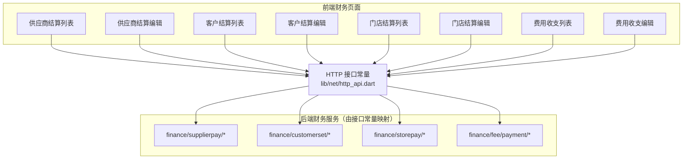
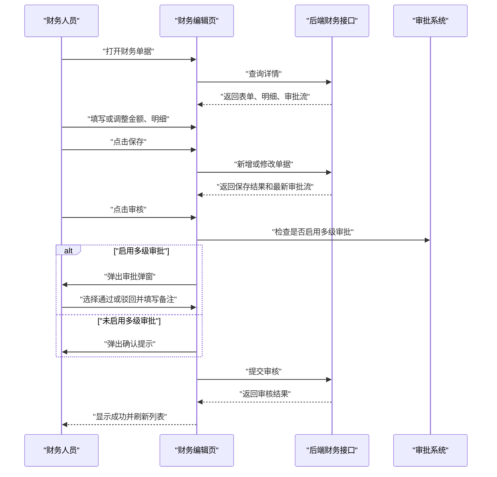
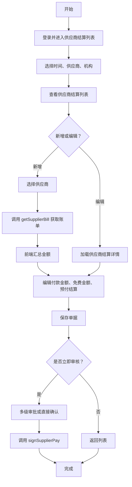
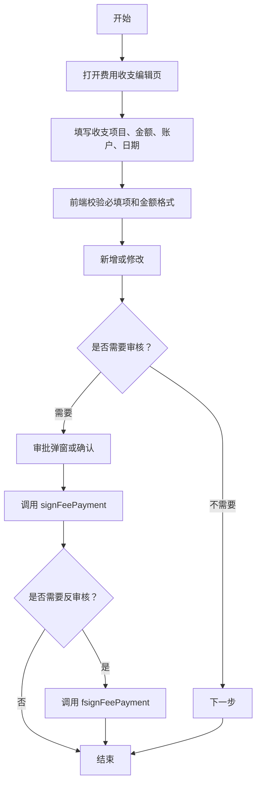

# 财务管理API

<cite>
**本文引用的文件 **
- [http_api.dart](file://lib/net/http_api.dart)
- [供应商结算列表页 list.dart](file://lib/pages/business/finance/supplier_pay/list.dart)
- [供应商结算编辑页 edit.dart](file://lib/pages/business/finance/supplier_pay/edit.dart)
- [客户结算列表页 list.dart](file://lib/pages/business/finance/customer_pay/list.dart)
- [客户结算编辑页 edit.dart](file://lib/pages/business/finance/customer_pay/edit.dart)
- [门店结算列表页 list.dart](file://lib/pages/business/finance/store_pay/list.dart)
- [门店结算编辑页 edit.dart](file://lib/pages/business/finance/store_pay/edit.dart)
- [费用收支列表页 list.dart](file://lib/pages/business/finance/cost_revenue/list.dart)
- [费用收支编辑页 edit.dart](file://lib/pages/business/finance/cost_revenue/edit.dart)
</cite>

## 目录
1. [引言](#引言)
2. [项目结构与财务模块定位](#项目结构与财务模块定位)
3. [核心财务接口总览](#核心财务接口总览)
4. [供应商结算业务](#供应商结算业务)
5. [客户结算业务](#客户结算业务)
6. [门店结算业务](#门店结算业务)
7. [费用收支业务](#费用收支业务)
8. [审批流程与审核语义](#审批流程与审核语义)
9. [数据准确性保证与对账机制](#数据准确性保证与对账机制)
10. [审计追踪与风险控制](#审计追踪与风险控制)
11. [完整工作流示例](#完整工作流示例)
12. [合规性要求](#合规性要求)
13. [性能与可维护性建议](#性能与可维护性建议)
14. [常见问题排查](#常见问题排查)
15. [结论](#结论)

## 引言
本文件面向灵犀管店 Flutter 客户端中的财务管理能力，聚焦以下四类财务单据：
- 供应商结算
- 客户结算
- 门店结算
- 费用收支

文档目标包括：
- 给出这些业务的后端 HTTP 接口定义、前端调用方式、参数结构、返回结构和状态含义。
- 解释财务单据的创建、保存、审核、反审核、作废、删除等生命周期。
- 说明多级审批配置如何影响前端交互和审核动作。
- 描述“获取账单”“汇总字段”“明细分配”“预付款”等账务处理逻辑。
- 给出数据准确性保障、对账机制、审计追踪和风险控制方案。
- 提供端到端工作流示例，帮助非技术读者理解财务业务流程。

## 项目结构与财务模块定位
Flutter 项目的财务功能位于 `lib/pages/business/finance` 下，按业务域拆分为：
- `supplier_pay`：供应商结算列表与编辑。
- `customer_pay`：客户结算列表与编辑。
- `store_pay`：门店结算列表与编辑。
- `cost_revenue`：费用收支列表与编辑。

所有后端接口路径集中在 `lib/net/http_api.dart` 中统一声明，前端页面通过 `HttpApi` 常量调用，并通过通用网络请求封装发起请求。

**图示来源**
- [http_api.dart:495-533](file://lib/net/http_api.dart#L495-L533)
- [供应商结算列表页 list.dart:184](file://lib/pages/business/finance/supplier_pay/list.dart#L184)
- [供应商结算编辑页 edit.dart:178](file://lib/pages/business/finance/supplier_pay/edit.dart#L178)
- [客户结算列表页 list.dart:183](file://lib/pages/business/finance/customer_pay/list.dart#L183)
- [客户结算编辑页 edit.dart:158](file://lib/pages/business/finance/customer_pay/edit.dart#L158)
- [门店结算列表页 list.dart:157](file://lib/pages/business/finance/store_pay/list.dart#L157)
- [门店结算编辑页 edit.dart:162](file://lib/pages/business/finance/store_pay/edit.dart#L162)
- [费用收支列表页 list.dart:182](file://lib/pages/business/finance/cost_revenue/list.dart#L182)
- [费用收支编辑页 edit.dart:126](file://lib/pages/business/finance/cost_revenue/edit.dart#L126)

**章节来源**
- [http_api.dart:495-533](file://lib/net/http_api.dart#L495-L533)

## 核心财务接口总览
财务相关接口全部以 `finance/...` 前缀暴露，分为四类：

| 业务域 | 列表查询 | 详情查询 | 新增 | 修改 | 审核 | 反审核 | 删除 | 作废 | 获取关联账单 |
|---|---|---|---|---|---|---|---|---|---|
| 供应商结算 | `finance/supplierpay/getList` | `finance/supplierpay/getinfo` | `finance/supplierpay/add` | `finance/supplierpay/update` | `finance/supplierpay/signSupplierPay` | 无 | `finance/supplierpay/delete` | `finance/supplierpay/zfSupplierPay` | `finance/supplierpay/getSupplierBill` |
| 客户结算 | `finance/customerset/findList` | `finance/customerset/getInfo` | `finance/customerset/add` | `finance/customerset/update` | `finance/customerset/sign` | 无 | `finance/customerset/del` | `finance/customerset/zfCustomerSet` | `finance/customerset/getCustomerBill` |
| 门店结算 | `finance/storepay/getList` | `finance/storepay/getinfo` | `finance/storepay/add` | `finance/storepay/update` | `finance/storepay/signStorePay` | 无 | `finance/storepay/delete` | `finance/storepay/zfStorePay` | `finance/storepay/getStoreBill` |
| 费用收支 | `finance/fee/payment/getList` | `finance/fee/payment/getinfo` | `finance/fee/payment/add` | `finance/fee/payment/update` | `finance/fee/payment/signFeePayment` | `finance/fee/payment/fsignFeePayment` | `finance/fee/payment/delete` | 无 | 无 |

上述接口常量定义见：

**章节来源**
- [http_api.dart:495-533](file://lib/net/http_api.dart#L495-L533)

## 供应商结算业务
### 接口定义
| 接口 | 方法 | 用途 | 关键参数 | 主要返回 |
|---|---|---|---|---|
| `finance/supplierpay/getList` | GET | 供应商结算列表 | `is_page`、`field`、`type`、`cond`、`page`、`pagesize`、`signflag`、`starttime`、`endtime`、`billno`、`sids`、`supid`、`createid`、`handlerid`、`payway`、`bankid` | 分页列表、各字段摘要 |
| `finance/supplierpay/getinfo` | GET | 供应商结算详情 | `billid` | 表单主表字段 + `suppayflow` 明细 + 审批流信息 |
| `finance/supplierpay/add` | POST | 新增供应商结算 | 主表字段 + `suppayflow` + `payamt` + `freeamt` + `prepaidamt` + `billnum` + `billamt` | 保存后的单据数据和审批流 |
| `finance/supplierpay/update` | POST | 修改供应商结算 | 同新增，但需带 `billid` | 保存后的单据数据和审批流 |
| `finance/supplierpay/signSupplierPay` | POST | 审核供应商结算 | 当前表单数据，含 `signflag=0`、`reviewremark`、可选 `reviewsignflag` | 审核结果 |
| `finance/supplierpay/delete` | POST | 删除供应商结算 | `billid` | 删除结果 |
| `finance/supplierpay/zfSupplierPay` | POST | 作废供应商结算 | 当前表单数据 | 作废结果 |
| `finance/supplierpay/getSupplierBill` | GET | 获取供应商未结账单 | `bsid`、`starttime`、`endtime`、`supid` | 供应商待结算账单明细 |

### 列表查询
供应商结算列表页默认加载近 30 天数据，支持按状态筛选：
- 全部：不传或空 `signflag`
- 待审核：`signflag=0`
- 已审核：`signflag=1`
- 已驳回：`signflag=2`

列表请求还携带机构过滤 `sids`、单据号模糊搜索 `billno`、供应商编码 `supid`、制单人 `createid`、经手人 `handlerid`、付款方式 `payway`、收款账户 `bankid` 等条件。

**章节来源**
- [供应商结算列表页 list.dart:184-200](file://lib/pages/business/finance/supplier_pay/list.dart#L184-L200)

### 详情与明细
供应商结算详情返回主表字段和 `suppayflow` 明细数组。编辑页会读取：
- 供应商编码、名称
- 应付门店 ID、名称
- 经手人
- 起止日期
- 收款账户、付款方式
- 预收金额、本次应付金额、免费金额、预付结算金额
- 单据数量、单据金额
- 审批流用户列表、审批记录列表

**章节来源**
- [供应商结算编辑页 edit.dart:178-210](file://lib/pages/business/finance/supplier_pay/edit.dart#L178-L210)

### 获取供应商账单
编辑页选择供应商后，调用 `getSupplierBill` 拉取该供应商在指定时间范围内的待结算账单。服务端返回账单列表后，前端计算汇总字段并初始化表单：
- `advance`：预收金额
- `prepayamt`：预付款合计
- `billnum`：单据数量
- `billamt`：单据金额
- `suppayflow`：明细列表

新增模式下，前端会把 `payamt` 初始为 `prepayamt`，并把 `freeamt` 置 0，把 `prepaidamt` 设为汇总值；明细分配不在此处自动完成，而是等待用户输入金额失焦时再计算。

**章节来源**
- [供应商结算编辑页 edit.dart:450-520](file://lib/pages/business/finance/supplier_pay/edit.dart#L450-L520)

### 保存与提交
保存时构造的参数包括：
- 供应商、门店、经手人
- 起止时间
- 付款方式、收款账户
- `payamt`、`freeamt`、`prepaidamt`
- `suppayflow` 明细
- `billnum`、`billamt`
- 若为编辑则带 `billid`
- 若存在撤回状态则带 `reviewsignflag`
- 若存在审批备注则带 `reviewremark`

新增时调用 `finance/supplierpay/add`，修改时调用 `finance/supplierpay/update`。保存成功后刷新表单和审批流数据。

**章节来源**
- [供应商结算编辑页 edit.dart:860-930](file://lib/pages/business/finance/supplier_pay/edit.dart#L860-L930)

### 审核语义
供应商结算审核使用 `finance/supplierpay/signSupplierPay`，客户端固定传入：
- `signflag=0`
- `reviewremark`：审批备注
- `reviewsignflag`：根据审批弹窗或撤回状态决定

如果启用了多级审批，且当前用户属于审批节点，则弹出审批弹窗；否则直接确认。

**章节来源**
- [供应商结算编辑页 edit.dart:995-1030](file://lib/pages/business/finance/supplier_pay/edit.dart#L995-L1030)

## 客户结算业务
### 接口定义
| 接口 | 方法 | 用途 |
|---|---|---|
| `finance/customerset/findList` | GET | 客户结算列表 |
| `finance/customerset/getInfo` | GET | 客户结算详情 |
| `finance/customerset/add` | POST | 新增客户结算 |
| `finance/customerset/update` | POST | 修改客户结算 |
| `finance/customerset/sign` | POST | 审核客户结算 |
| `finance/customerset/del` | POST | 删除客户结算 |
| `finance/customerset/zfCustomerSet` | POST | 作废客户结算 |
| `finance/customerset/getCustomerBill` | GET | 获取客户待结算账单 |

### 列表查询
客户结算列表同样支持：
- 状态筛选：全部、待审核、已审核、已驳回
- 时间范围
- 客户编码、名称
- 制单人、经手人
- 付款方式、收款账户
- 机构过滤

**章节来源**
- [客户结算列表页 list.dart:183-200](file://lib/pages/business/finance/customer_pay/list.dart#L183-L200)

### 详情与明细
客户结算详情包含主表字段和 `custpayflow` 明细。编辑页会填充：
- 客户编码、名称
- 应付门店
- 经手人
- 起止日期
- 收款账户、付款方式
- 支付时间
- 预收、本次应付、免费金额、预付结算
- 单据数量、单据金额
- 审批流用户和审批记录

**章节来源**
- [客户结算编辑页 edit.dart:158-210](file://lib/pages/business/finance/customer_pay/edit.dart#L158-L210)

### 获取客户账单
编辑页调用 `getCustomerBill`，参数包括：
- `bsid`：机构 ID
- `starttime`、`endtime`：时间范围
- `custid`：客户编码

返回账单后计算汇总字段，并在新增模式下初始化付款金额和预付结算金额。

**章节来源**
- [客户结算编辑页 edit.dart:450-520](file://lib/pages/business/finance/customer_pay/edit.dart#L450-L520)

### 保存与审核
保存参数包含 `custpayflow`、`paytime`、`payamt`、`freeamt`、`prepaidamt`、`billnum`、`billamt` 等。  
审核调用 `finance/customerset/sign`，参数语义与供应商结算一致。

**章节来源**
- [客户结算编辑页 edit.dart:850-990](file://lib/pages/business/finance/customer_pay/edit.dart#L850-L990)

## 门店结算业务
### 接口定义
| 接口 | 方法 | 用途 |
|---|---|---|
| `finance/storepay/getList` | GET | 门店结算列表 |
| `finance/storepay/getinfo` | GET | 门店结算详情 |
| `finance/storepay/add` | POST | 新增门店结算 |
| `finance/storepay/update` | POST | 修改门店结算 |
| `finance/storepay/signStorePay` | POST | 审核门店结算 |
| `finance/storepay/delete` | POST | 删除门店结算 |
| `finance/storepay/zfStorePay` | POST | 作废门店结算 |
| `finance/storepay/getStoreBill` | GET | 获取门店待结算账单 |

### 列表查询
门店结算列表支持：
- 应收门店、应付门店
- 制单人、经手人
- 付款方式、收款账户、其他付款账户
- 时间范围和单据号

**章节来源**
- [门店结算列表页 list.dart:157-190](file://lib/pages/business/finance/store_pay/list.dart#L157-L190)

### 详情与明细
门店结算详情包含主表字段和 `detaillist` 明细，字段包括：
- 应付门店 ID、名称
- 应收门店 ID、名称
- 经手人
- 起止日期
- 收款账户、付款账户
- 付款方式
- 预收、本次应付、免费金额、预付结算
- 单据数量、单据金额

**章节来源**
- [门店结算编辑页 edit.dart:162-210](file://lib/pages/business/finance/store_pay/edit.dart#L162-L210)

### 获取门店账单
编辑页调用 `getStoreBill`，参数包括：
- `bsid`：应付门店
- `sid`：应收门店
- `starttime`、`endtime`：时间范围

返回账单后计算汇总字段，并在新增模式下初始化付款金额和预付结算金额。

**章节来源**
- [门店结算编辑页 edit.dart:530-600](file://lib/pages/business/finance/store_pay/edit.dart#L530-L600)

### 保存与审核
保存参数包含 `detaillist`、`payamt`、`freeamt`、`prepaidamt`、`billnum`、`billamt` 等。  
门店结算审核调用 `finance/storepay/signStorePay`，注意客户端固定传入 `signflag=1`，这与供应商结算和客户结算的 `signflag=0` 不同，体现不同单据类型的审核语义差异。

**章节来源**
- [门店结算编辑页 edit.dart:940-1080](file://lib/pages/business/finance/store_pay/edit.dart#L940-L1080)

## 费用收支业务
### 接口定义
| 接口 | 方法 | 用途 |
|---|---|---|
| `finance/fee/payment/getList` | GET | 费用收支列表 |
| `finance/fee/payment/getinfo` | GET | 费用收支详情 |
| `finance/fee/payment/add` | POST | 新增费用收支 |
| `finance/fee/payment/update` | POST | 修改费用收支 |
| `finance/fee/payment/signFeePayment` | POST | 审核费用收支 |
| `finance/fee/payment/fsignFeePayment` | POST | 反审核费用收支 |
| `finance/fee/payment/delete` | POST | 删除费用收支 |

### 列表查询
费用收支列表支持：
- 单据类型：收入单、支出单、转账单
- 收支项目
- 制单人、经手人
- 支付方式
- 时间范围和单据号

**章节来源**
- [费用收支列表页 list.dart:182-200](file://lib/pages/business/finance/cost_revenue/list.dart#L182-L200)

### 详情与编辑
费用收支编辑页包含：
- 机构
- 单据类型
- 收支项目
- 经手人
- 付款方式
- 收款账户、其他收款账户
- 收支日期
- 金额
- 备注
- 审批流用户和审批记录

新增和修改分别调用 `finance/fee/payment/add` 和 `finance/fee/payment/update`。

**章节来源**
- [费用收支编辑页 edit.dart:126-170](file://lib/pages/business/finance/cost_revenue/edit.dart#L126-L170)

### 审核、反审核与删除
- 审核：调用 `finance/fee/payment/signFeePayment`，参数包含当前表单数据和审批备注。
- 反审核：调用 `finance/fee/payment/fsignFeePayment`，用于已审核单据的反向操作。
- 删除：调用 `finance/fee/payment/delete`，仅删除单据，不改变历史流水。

**章节来源**
- [费用收支编辑页 edit.dart:430-580](file://lib/pages/business/finance/cost_revenue/edit.dart#L430-L580)
- [费用收支编辑页 edit.dart:560-700](file://lib/pages/business/finance/cost_revenue/edit.dart#L560-L700)

## 审批流程与审核语义
### 审批配置来源
财务编辑页从详情接口返回的数据中解析两类审批数据：
- `reviewFlowUsers`：当前单据适用的审批节点人员。
- `reviewBillFlows`：已发生的审批记录。

如果 `reviewFlowUsers` 非空，说明启用多级审批；否则走简单确认流程。

### 审批权限判断
编辑页根据登录用户信息判断：
- 管理员代码等于特定值时视为管理员。
- 普通用户是否出现在 `reviewFlowUsers` 中。
- 是否为第一审批人或具备反审权限。

**章节来源**
- [供应商结算编辑页 edit.dart:60-120](file://lib/pages/business/finance/supplier_pay/edit.dart#L60-L120)
- [客户结算编辑页 edit.dart:60-120](file://lib/pages/business/finance/customer_pay/edit.dart#L60-L120)
- [门店结算编辑页 edit.dart:60-120](file://lib/pages/business/finance/store_pay/edit.dart#L60-L120)
- [费用收支编辑页 edit.dart:60-120](file://lib/pages/business/finance/cost_revenue/edit.dart#L60-L120)

### 审核流程时序

**图示来源**
- [供应商结算编辑页 edit.dart:860-1030](file://lib/pages/business/finance/supplier_pay/edit.dart#L860-L1030)
- [客户结算编辑页 edit.dart:850-990](file://lib/pages/business/finance/customer_pay/edit.dart#L850-L990)
- [门店结算编辑页 edit.dart:940-1080](file://lib/pages/business/finance/store_pay/edit.dart#L940-L1080)
- [费用收支编辑页 edit.dart:430-580](file://lib/pages/business/finance/cost_revenue/edit.dart#L430-L580)

### 审核状态字段
| 字段 | 含义 |
|---|---|
| `signflag` | 单据审核状态；不同业务可能使用不同值，例如供应商结算和客户结算使用 `0`，门店结算使用 `1` |
| `reviewsignflag` | 审批流状态；`1` 通常表示通过，`0` 表示驳回，`2` 表示撤回待处理 |
| `reviewremark` | 审批备注 |

**章节来源**
- [供应商结算编辑页 edit.dart:995-1030](file://lib/pages/business/finance/supplier_pay/edit.dart#L995-L1030)
- [门店结算编辑页 edit.dart:1058-1080](file://lib/pages/business/finance/store_pay/edit.dart#L1058-L1080)

## 数据准确性保证与对账机制
### 汇总字段
三类结算单据都包含类似的汇总字段：
- `prepayamt`：预付款合计
- `billnum`：单据数量
- `billamt`：单据金额
- `payamt`：本次应付金额
- `freeamt`：免费金额
- `prepaidamt`：预付结算金额
- `debtamt`：欠款金额
- `nowamt`：本次金额

前端在加载账单后对这些字段进行汇总，并用于初始化表单。

**章节来源**
- [供应商结算编辑页 edit.dart:450-520](file://lib/pages/business/finance/supplier_pay/edit.dart#L450-L520)
- [客户结算编辑页 edit.dart:450-520](file://lib/pages/business/finance/customer_pay/edit.dart#L450-L520)
- [门店结算编辑页 edit.dart:530-600](file://lib/pages/business/finance/store_pay/edit.dart#L530-L600)

### 明细分配机制
财务编辑页在新增模式下不会自动把总金额分配到每条明细，而是采用“失焦触发计算”的方式：
- 用户输入 `payamt`、`freeamt`、`prepaidamt`
- 输入框失去焦点时触发结算逻辑
- 将金额按规则分配到 `suppayflow`、`custpayflow` 或 `detaillist`

这种设计减少误分配风险，同时允许用户手动调整。

**章节来源**
- [供应商结算编辑页 edit.dart:120-170](file://lib/pages/business/finance/supplier_pay/edit.dart#L120-L170)
- [客户结算编辑页 edit.dart:120-170](file://lib/pages/business/finance/customer_pay/edit.dart#L120-L170)
- [门店结算编辑页 edit.dart:120-170](file://lib/pages/business/finance/store_pay/edit.dart#L120-L170)

### 预收与预付
- `advance`：上游账单或主数据中的预收金额。
- `prepayamt`：本次结算中使用的预付款总额。
- `prepaidamt`：预付结算金额，常用于冲抵应付。

新增模式下，前端会根据账单汇总设置 `payamt` 和 `prepaidamt`，但具体分配仍需用户确认。

**章节来源**
- [供应商结算编辑页 edit.dart:450-520](file://lib/pages/business/finance/supplier_pay/edit.dart#L450-L520)
- [客户结算编辑页 edit.dart:450-520](file://lib/pages/business/finance/customer_pay/edit.dart#L450-L520)
- [门店结算编辑页 edit.dart:530-600](file://lib/pages/business/finance/store_pay/edit.dart#L530-L600)

### 对账机制
财务对账主要通过以下方式实现：
1. 列表层按时间、状态、对象维度查询财务单据。
2. 编辑层通过“获取账单”接口拉取未结清业务数据。
3. 前端汇总明细金额并与实际付款金额对比。
4. 审核通过后，后端负责更新账务和凭证。
5. 反审核和作废用于纠正错误单据。

建议在后端增加：
- 单据编号唯一性校验
- 重复结算拦截
- 金额差阈值预警
- 对账不平日志

**章节来源**
- [供应商结算编辑页 edit.dart:450-520](file://lib/pages/business/finance/supplier_pay/edit.dart#L450-L520)
- [客户结算编辑页 edit.dart:450-520](file://lib/pages/business/finance/customer_pay/edit.dart#L450-L520)
- [门店结算编辑页 edit.dart:530-600](file://lib/pages/business/finance/store_pay/edit.dart#L530-L600)

## 审计追踪与风险控制
### 审计追踪
财务系统的审计追踪应覆盖：
- 谁创建了单据
- 谁修改了单据
- 谁审核或驳回了单据
- 何时撤回或反审核
- 审批备注内容
- 单据状态变化历史

前端已通过 `reviewFlowUsers` 和 `reviewBillFlows` 展示审批流和用户，建议在后续版本中：
- 在列表中展示最近一次审批人和时间
- 在详情页展示完整审批时间线
- 导出审计报告时包含审批日志

**章节来源**
- [供应商结算编辑页 edit.dart:860-930](file://lib/pages/business/finance/supplier_pay/edit.dart#L860-L930)
- [费用收支编辑页 edit.dart:560-700](file://lib/pages/business/finance/cost_revenue/edit.dart#L560-L700)

### 风险控制
建议实现以下控制点：
- 权限控制：新增、编辑、审核、反审核、删除、作废均需独立权限码。
- 状态控制：已审核单据不允许直接修改或删除。
- 金额控制：负数金额、超大金额、重复金额告警。
- 对象控制：同一供应商、客户、门店在同一时间段内避免重复结算。
- 审批控制：强制多级审批时禁止越级审核。
- 数据一致性：审核成功后刷新列表，防止本地状态与后端不一致。

**章节来源**
- [供应商结算编辑页 edit.dart:995-1030](file://lib/pages/business/finance/supplier_pay/edit.dart#L995-L1030)
- [客户结算编辑页 edit.dart:850-990](file://lib/pages/business/finance/customer_pay/edit.dart#L850-L990)
- [门店结算编辑页 edit.dart:940-1080](file://lib/pages/business/finance/store_pay/edit.dart#L940-L1080)
- [费用收支编辑页 edit.dart:430-580](file://lib/pages/business/finance/cost_revenue/edit.dart#L430-L580)

## 完整工作流示例
### 供应商结算工作流

**图示来源**
- [供应商结算列表页 list.dart:184-200](file://lib/pages/business/finance/supplier_pay/list.dart#L184-L200)
- [供应商结算编辑页 edit.dart:450-520](file://lib/pages/business/finance/supplier_pay/edit.dart#L450-L520)
- [供应商结算编辑页 edit.dart:860-1030](file://lib/pages/business/finance/supplier_pay/edit.dart#L860-L1030)

### 费用收支工作流

**图示来源**
- [费用收支编辑页 edit.dart:430-580](file://lib/pages/business/finance/cost_revenue/edit.dart#L430-L580)
- [费用收支编辑页 edit.dart:560-700](file://lib/pages/business/finance/cost_revenue/edit.dart#L560-L700)

## 合规性要求
财务系统涉及资金流动，应满足以下合规要求：
- 单据不可随意篡改：修改需重新审核。
- 审核留痕：每次审批必须记录操作人、时间和意见。
- 权限隔离：新增、编辑、审核、反审核、删除、作废分开授权。
- 数据不可丢失：删除操作应有软删除或归档机制。
- 金额精确：金额字段应采用高精度数值类型，前端格式化输出但不改变精度。
- 环境隔离：生产环境不得开放测试数据或不安全调试接口。
- 出口合规：项目已在 Info.plist 中补充出口合规豁免声明，表明跨境合规意识。

**章节来源**
- [http_api.dart:1-15](file://lib/net/http_api.dart#L1-L15)

## 性能与可维护性建议
### 列表性能
- 列表默认每页 20 条，适合移动端滚动加载。
- 建议后端对常用筛选条件建立索引，如 `createtime`、`signflag`、`supid`、`custid`、`bsid`。
- 建议支持增量查询或游标分页，避免大数据量下的全量扫描。

### 编辑页性能
- 获取账单时应限制时间范围，避免一次性拉取过多历史账单。
- 金额计算尽量在前端缓存结果，避免重复计算。
- 审批流数据应在详情接口中一并返回，减少额外请求。

### 可维护性
- 所有财务接口路径集中在 `http_api.dart`，便于统一维护和替换后端地址。
- 前端页面遵循统一的保存、审核、删除、作废流程，降低重复开发成本。
- 建议后续为每个财务模块抽取独立的 Service 层，进一步解耦 UI 与网络层。

**章节来源**
- [http_api.dart:495-533](file://lib/net/http_api.dart#L495-L533)
- [供应商结算列表页 list.dart:184-200](file://lib/pages/business/finance/supplier_pay/list.dart#L184-L200)
- [费用收支编辑页 edit.dart:430-580](file://lib/pages/business/finance/cost_revenue/edit.dart#L430-L580)

## 常见问题排查
| 问题 | 可能原因 | 处理方式 |
|---|---|---|
| 列表无数据 | 时间范围过大或过小；机构筛选过窄；权限不足 | 检查时间范围、机构选择、权限码 |
| 编辑页白屏 | 详情接口返回数据为空；`billid` 为空 | 检查传入 `billid` 和详情接口返回值 |
| 审核失败 | 审批流用户不匹配；状态不正确；权限不足 | 检查 `reviewFlowUsers`、`signflag`、权限码 |
| 金额未分配到明细 | 用户未失焦或未触发结算逻辑 | 让用户输入金额并失焦，或手动触发结算 |
| 反审核失败 | 单据不是已审核状态；权限不足 | 检查 `signflag` 和反审核权限 |
| 删除失败 | 单据已被审核或受下游业务引用 | 先反审核或联系后端解除引用 |

**章节来源**
- [供应商结算编辑页 edit.dart:860-1030](file://lib/pages/business/finance/supplier_pay/edit.dart#L860-L1030)
- [费用收支编辑页 edit.dart:560-700](file://lib/pages/business/finance/cost_revenue/edit.dart#L560-L700)

## 结论
灵犀管店 Flutter 项目的财务管理模块围绕供应商结算、客户结算、门店结算、费用收支四类单据展开。前端通过统一的 HTTP 接口常量管理接口路径，并按“列表查询—详情加载—账单拉取—金额汇总—保存—审核—反审核—删除/作废”的生命周期组织业务逻辑。

为保证财务数据的准确性和合规性，系统应重点关注：
- 明确的接口契约和状态语义
- 严格的权限控制和审批流程
- 可靠的金额汇总和明细分配机制
- 完整的审计追踪和对账能力
- 可追溯的错误处理和风险控制

在实际落地中，建议后端继续完善财务流水、凭证生成、对账报表和异常监控能力，使前端财务界面能够稳定驱动完整的企业级财务闭环。