# 费用收支API

<cite>
**本文引用的文件**   
- [http_api.dart](file://lib/net/http_api.dart)
- [list.dart](file://lib/pages/business/finance/cost_revenue/list.dart)
- [edit.dart](file://lib/pages/business/finance/cost_revenue/edit.dart)
</cite>

## 目录
1. [引言](#引言)
2. [项目结构定位](#项目结构定位)
3. [接口总览](#接口总览)
4. [业务流程说明](#业务流程说明)
5. [详细接口定义](#详细接口定义)
6. [分类管理、预算控制与成本核算示例](#分类管理预算控制与成本核算示例)
7. [内部控制、审计追踪与税务合规](#内部控制审计追踪与税务合规)
8. [依赖关系分析](#依赖关系分析)
9. [性能与可用性特征](#性能与可用性特征)
10. [故障排查指南](#故障排查指南)
11. [结论](#结论)

## 引言
本文件面向灵犀管店 Flutter 前端中的“费用收支”模块，围绕 `finance/fee/payment` 后端接口，对列表查询、详情获取、新增、修改、审核、反审核、删除等能力进行系统化说明。文档同时梳理移动端页面的调用方式、参数构造逻辑、状态流转和权限校验，帮助业务人员、产品经理和开发者理解费用收支从申请到凭证生成的端到端流程。

## 项目结构定位
费用收支功能在 Flutter 项目中由以下关键代码组织：
- 网络接口常量集中在 `lib/net/http_api.dart`，统一声明 `finance/fee/payment` 系列接口路径。
- 费用收支列表页位于 `lib/pages/business/finance/cost_revenue/list.dart`，负责筛选、分页、Tab 状态切换、跳转编辑页。
- 费用收支编辑页位于 `lib/pages/business/finance/cost_revenue/edit.dart`，负责单据表单、校验、保存、审核、反审核、撤回和删除。

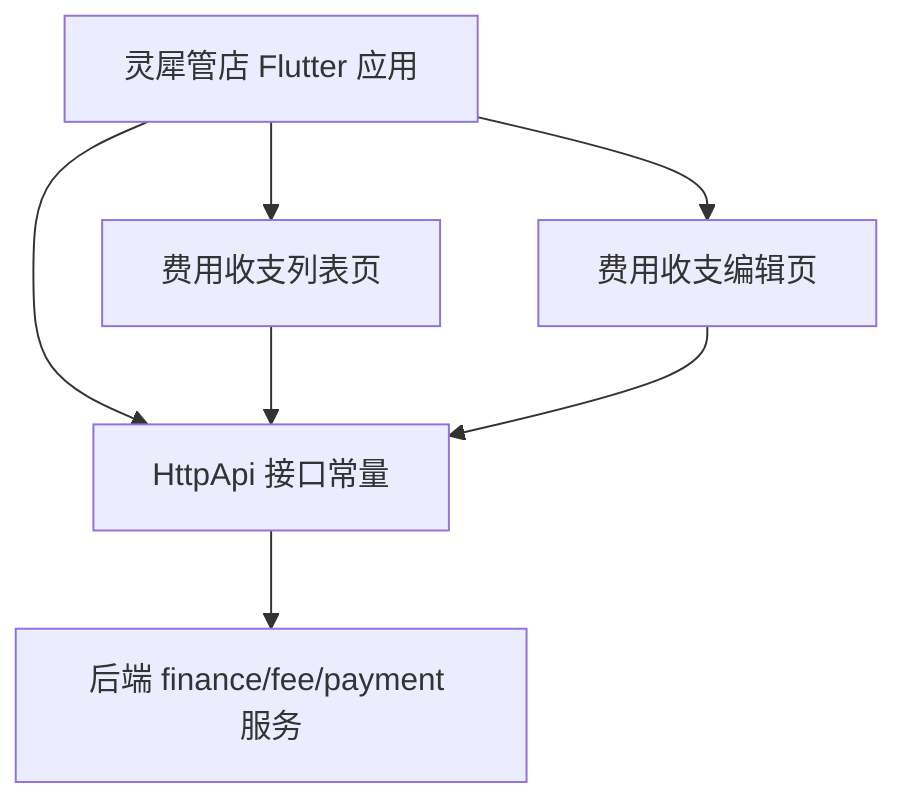

**图示来源**
- [http_api.dart:527-534](file://lib/net/http_api.dart#L527-L534)
- [list.dart:1-60](file://lib/pages/business/finance/cost_revenue/list.dart#L1-L60)
- [edit.dart:1-40](file://lib/pages/business/finance/cost_revenue/edit.dart#L1-L40)

**章节来源**
- [http_api.dart:527-534](file://lib/net/http_api.dart#L527-L534)
- [list.dart:1-60](file://lib/pages/business/finance/cost_revenue/list.dart#L1-L60)
- [edit.dart:1-40](file://lib/pages/business/finance/cost_revenue/edit.dart#L1-L40)

## 接口总览
| 接口名称 | 后端路径 | 主要用途 | 前端入口 |
|---|---|---|---|
| getList | `finance/fee/payment/getList` | 费用收支单分页列表 | 列表页加载数据 |
| getinfo | `finance/fee/payment/getinfo` | 费用收支单详情 | 编辑页加载已有单据 |
| add | `finance/fee/payment/add` | 新增费用收支单 | 编辑页新增保存 |
| update | `finance/fee/payment/update` | 修改费用收支单 | 编辑页修改保存 |
| signFeePayment | `finance/fee/payment/signFeePayment` | 审核费用收支单 | 编辑页审核操作 |
| fsignFeePayment | `finance/fee/payment/fsignFeePayment` | 反审核费用收支单 | 编辑页反审核操作 |
| delete | `finance/fee/payment/delete` | 删除费用收支单 | 编辑页删除操作 |

上述接口在 `HttpApi` 中以静态常量形式集中管理，便于统一维护、避免硬编码分散在各页面中。

**章节来源**
- [http_api.dart:527-534](file://lib/net/http_api.dart#L527-L534)

## 业务流程说明
费用收支的核心业务角色包括：
- **制单人**：创建费用或收入单据。
- **经手人**：实际发生费用或收款的人员。
- **审批人**：根据多级审批配置进行审核或驳回。
- **出纳或财务**：执行审核、反审核、作废、删除等控制性操作。

典型业务流程如下：

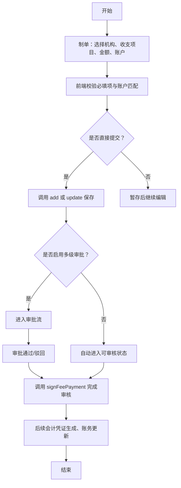

该流程图反映的是前端实现的业务意图：先保存单据，再根据审批配置触发审核；审核成功后，后端负责后续会计处理（例如凭证生成），前端通过重新加载详情或返回列表来感知状态变化。

**图示来源**
- [edit.dart:380-520](file://lib/pages/business/finance/cost_revenue/edit.dart#L380-L520)
- [edit.dart:520-700](file://lib/pages/business/finance/cost_revenue/edit.dart#L520-L700)

### 费用申请
- 用户在“新增费用收支单”中选择机构、业务类型、收支项目、经手人、金额、收支方式和账户。
- 前端对必填字段、收支方式、转入转出账户进行本地校验。
- 保存时根据是否为编辑模式调用 `add` 或 `update`。

### 支出审批
- 若配置了多级审批，保存或审核时会弹出审批弹窗，携带审批标志和备注。
- 若无审批配置，则使用简单确认对话框。
- 审核通过后，前端提示成功并刷新单据数据。

### 收入确认
- 收入单通常对应业务类型为“收入单”，需要选择转入账户。
- 列表页支持按业务类型、收支项目、时间范围、制单人、经手人和收支方式筛选，方便财务确认收入。

### 会计凭证生成
- 当前 Flutter 前端未直接实现会计凭证生成逻辑。
- 凭证生成属于后端职责，前端通过审核状态、单据详情和列表返回的数据间接体现。
- 审计日志、审批流节点等信息在编辑页的审批卡片和审批日志弹窗中展示。

**章节来源**
- [edit.dart:380-520](file://lib/pages/business/finance/cost_revenue/edit.dart#L380-L520)
- [edit.dart:520-700](file://lib/pages/business/finance/cost_revenue/edit.dart#L520-L700)
- [list.dart:1-120](file://lib/pages/business/finance/cost_revenue/list.dart#L1-L120)

## 详细接口定义

### getList：费用收支列表
- **后端路径**：`finance/fee/payment/getList`
- **请求方式**：HTTP 请求，由 `request` 封装发起。
- **主要请求参数**：
  - `datetype`：日期类型，固定为 `1`。
  - `is_page`：是否分页，固定为 `1`。
  - `field`：排序字段，固定为 `createtime`。
  - `type`：排序方向，固定为 `desc`。
  - `cond`：通用条件字符串，固定为空。
  - `page`：页码。
  - `pagesize`：每页条数，固定为 `20`。
  - `signflag`：单据状态过滤，空表示全部，`0` 表示待审核，`1` 表示已审核，`2` 表示已驳回。
  - `starttime`、`endtime`：起止时间。
  - `billno`：单据号模糊搜索。
  - `sids`：机构ID数组。
  - `billtype`：业务类型。
  - `feeitem`：收支项目。
  - `createid`：制单人。
  - `handlerid`：经手人。
  - `paytype`：收支方式。
- **响应结构**：
  - 列表数据位于 `data.list`。
  - 是否有更多数据由返回行数判断。
- **前端行为**：
  - 首次加载清空列表，后续加载追加数据。
  - 下拉加载更多。
  - 顶部 Tab 切换会重置分页并重新加载。
  - 筛选抽屉支持时间、业务类型、收支项目、制单人、经手人、收支方式。

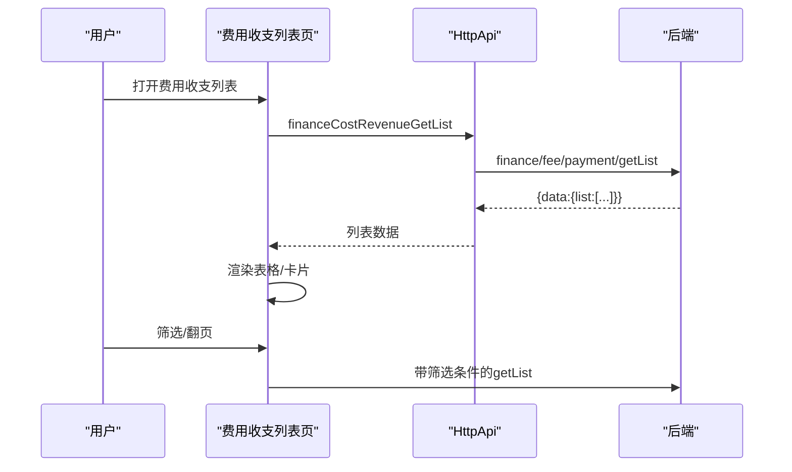

**图示来源**
- [list.dart:60-120](file://lib/pages/business/finance/cost_revenue/list.dart#L60-L120)
- [list.dart:200-260](file://lib/pages/business/finance/cost_revenue/list.dart#L200-L260)
- [http_api.dart:527](file://lib/net/http_api.dart#L527)

**章节来源**
- [list.dart:60-120](file://lib/pages/business/finance/cost_revenue/list.dart#L60-L120)
- [list.dart:200-260](file://lib/pages/business/finance/cost_revenue/list.dart#L200-L260)
- [http_api.dart:527](file://lib/net/http_api.dart#L527)

### getinfo：收支详情
- **后端路径**：`finance/fee/payment/getinfo`
- **请求参数**：
  - `billid`：单据ID。
- **响应结构**：
  - `data` 包含单据主表字段，如机构、业务类型、收支项目、经手人、支付方式、银行账户、金额、备注、时间、审核状态、审核信息等。
  - `reviewFlowUsers`：当前审批节点用户列表。
  - `reviewBillFlows`：审批流水信息，用于审批日志展示。
- **前端行为**：
  - 编辑页加载时调用详情接口。
  - 将返回数据映射到表单字段。
  - 根据 `signflag` 决定只读状态。
  - 根据 `reviewsignflag` 判断是否处于撤回待处理态。

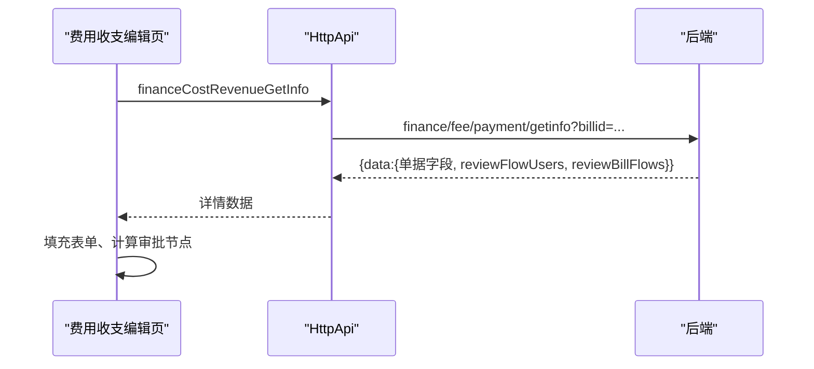

**图示来源**
- [edit.dart:80-160](file://lib/pages/business/finance/cost_revenue/edit.dart#L80-L160)
- [http_api.dart:528](file://lib/net/http_api.dart#L528)

**章节来源**
- [edit.dart:80-160](file://lib/pages/business/finance/cost_revenue/edit.dart#L80-L160)
- [http_api.dart:528](file://lib/net/http_api.dart#L528)

### add：新增收支单
- **后端路径**：`finance/fee/payment/add`
- **请求参数**：
  - `bsid`：机构ID。
  - `bstorename`：机构名称。
  - `billtype`：业务类型，`1` 收入单、`2` 支出单、`3` 转账单。
  - `feeitem`：收支项目编码。
  - `feename`：收支项目名称。
  - `handlerid`：经手人ID。
  - `handlername`：经手人姓名。
  - `remark`：备注。
  - `payamt`：收支金额。
  - `payway`：收支方式编码。
  - `payname`：收支方式名称。
  - `bankid`：转入账户ID。
  - `bankidname`：转入账户名称。
  - `bankidother`：转出账户ID。
  - `bankidothername`：转出账户名称。
  - `paytime`：收支日期时间。
- **前端行为**：
  - 新增模式下调用 `add`。
  - 保存成功后更新表单快照和审批流数据。
  - 若需要审核，则继续走审核流程。

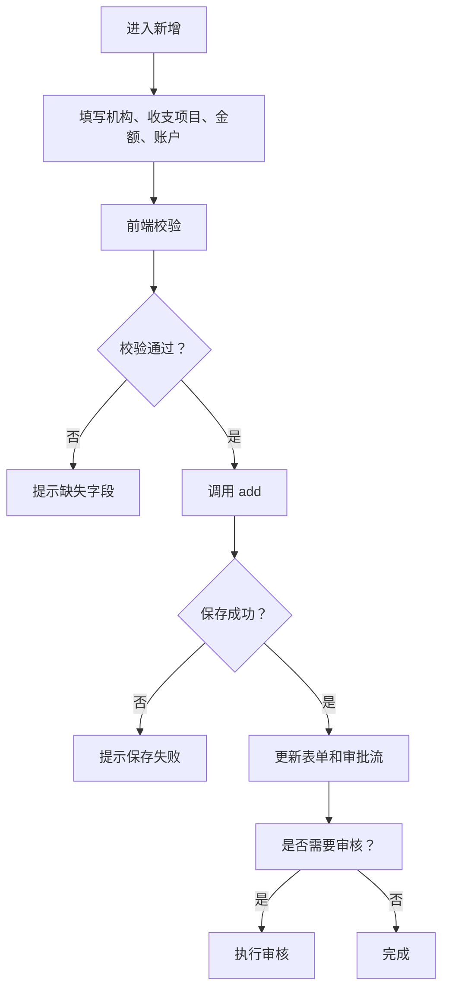

**图示来源**
- [edit.dart:300-420](file://lib/pages/business/finance/cost_revenue/edit.dart#L300-L420)
- [http_api.dart:529](file://lib/net/http_api.dart#L529)

**章节来源**
- [edit.dart:300-420](file://lib/pages/business/finance/cost_revenue/edit.dart#L300-L420)
- [http_api.dart:529](file://lib/net/http_api.dart#L529)

### update：修改收支单
- **后端路径**：`finance/fee/payment/update`
- **请求参数**：与 `add` 基本一致，额外携带 `billid`。
- **前端行为**：
  - 编辑模式下调用 `update`。
  - 权限校验使用独立权限标识。
  - 保存成功后同样更新审批流数据。

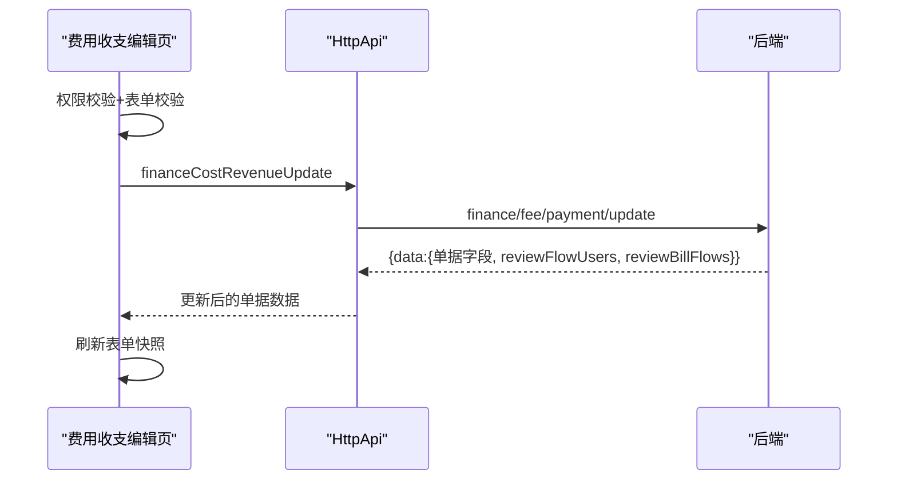

**图示来源**
- [edit.dart:380-460](file://lib/pages/business/finance/cost_revenue/edit.dart#L380-L460)
- [http_api.dart:530](file://lib/net/http_api.dart#L530)

**章节来源**
- [edit.dart:380-460](file://lib/pages/business/finance/cost_revenue/edit.dart#L380-L460)
- [http_api.dart:530](file://lib/net/http_api.dart#L530)

### signFeePayment：审核收支单
- **后端路径**：`finance/fee/payment/signFeePayment`
- **请求参数**：
  - 继承单据完整表单数据。
  - `signflag`：前端设置为 `0`。
  - `reviewremark`：审核备注。
  - `reviewsignflag`：
    - 正常审核时通常为 `1`。
    - 撤回待处理时可能为 `2`。
- **前端行为**：
  - 若启用多级审批，先弹出审批弹窗，选择通过或驳回并填写备注。
  - 若无审批配置，则弹出简单确认对话框。
  - 审核成功后提示并重新加载单据详情。

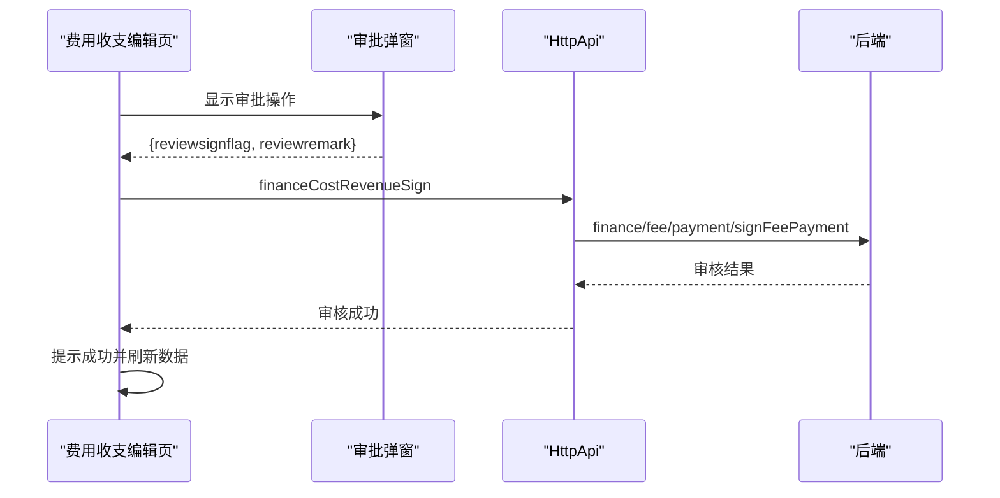

**图示来源**
- [edit.dart:460-620](file://lib/pages/business/finance/cost_revenue/edit.dart#L460-L620)
- [http_api.dart:531](file://lib/net/http_api.dart#L531)

**章节来源**
- [edit.dart:460-620](file://lib/pages/business/finance/cost_revenue/edit.dart#L460-L620)
- [http_api.dart:531](file://lib/net/http_api.dart#L531)

### fsignFeePayment：反审核收支单
- **后端路径**：`finance/fee/payment/fsignFeePayment`
- **请求参数**：
  - 携带当前单据完整表单数据。
- **前端行为**：
  - 需要“反审核费用收支单”权限。
  - 二次确认后调用接口。
  - 成功后提示并刷新数据。

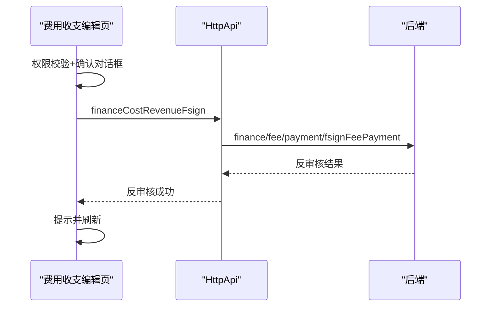

**图示来源**
- [edit.dart:620-700](file://lib/pages/business/finance/cost_revenue/edit.dart#L620-L700)
- [http_api.dart:532](file://lib/net/http_api.dart#L532)

**章节来源**
- [edit.dart:620-700](file://lib/pages/business/finance/cost_revenue/edit.dart#L620-L700)
- [http_api.dart:532](file://lib/net/http_api.dart#L532)

### delete：删除收支单
- **后端路径**：`finance/fee/payment/delete`
- **请求参数**：
  - `billid`：要删除的单据ID。
- **前端行为**：
  - 需要“删除费用收支单”权限。
  - 二次确认后调用删除接口。
  - 成功后提示并返回上一页。

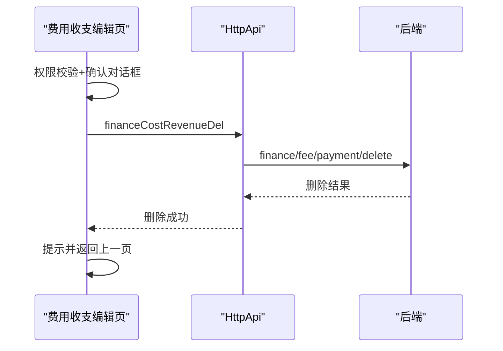

**图示来源**
- [edit.dart:650-700](file://lib/pages/business/finance/cost_revenue/edit.dart#L650-L700)
- [http_api.dart:533](file://lib/net/http_api.dart#L533)

**章节来源**
- [edit.dart:650-700](file://lib/pages/business/finance/cost_revenue/edit.dart#L650-L700)
- [http_api.dart:533](file://lib/net/http_api.dart#L533)

## 分类管理、预算控制与成本核算示例

### 费用收支分类管理
费用收支分类主要通过“收支项目”实现：
- 收支项目通过 `bi/feeitem/getList` 查询。
- 列表筛选和编辑表单都支持按收支项目编码或名称选择。
- 业务类型区分收入单、支出单、转账单，进一步细化费用性质。

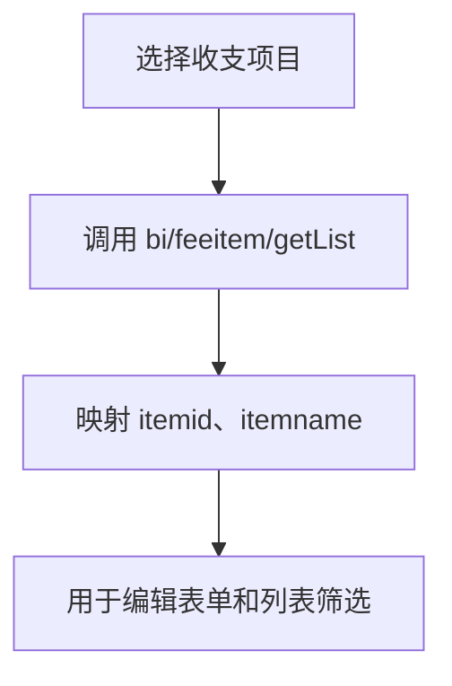

**图示来源**
- [list.dart:700-760](file://lib/pages/business/finance/cost_revenue/list.dart#L700-L760)
- [edit.dart:160-220](file://lib/pages/business/finance/cost_revenue/edit.dart#L160-L220)
- [http_api.dart:534](file://lib/net/http_api.dart#L534)

### 预算控制建议
当前 Flutter 前端未在费用收支编辑页实现预算超支拦截逻辑。建议在后端或扩展层增加：
- 按部门、项目、收支项目维度设置预算。
- 保存前检查累计费用是否超过预算。
- 超支时返回错误码，前端提示并阻止保存。

### 成本核算示例
费用收支可与以下维度结合进行成本核算：
- 按机构核算门店成本。
- 按收支项目归集费用类别。
- 按经手人统计个人费用责任。
- 按时间区间生成月度、季度、年度费用报表。

这些维度已在列表筛选和编辑表单中得到部分体现，可作为成本报表的前置输入。

**章节来源**
- [list.dart:700-760](file://lib/pages/business/finance/cost_revenue/list.dart#L700-L760)
- [edit.dart:160-220](file://lib/pages/business/finance/cost_revenue/edit.dart#L160-L220)
- [http_api.dart:534](file://lib/net/http_api.dart#L534)

## 内部控制、审计追踪与税务合规

### 内部控制要点
- **权限控制**：
  - 查看费用收支单需要权限标识。
  - 新增、编辑、审核、反审核、删除分别有独立权限标识。
- **必填校验**：
  - 机构、收支项目、金额、收支方式为必填。
  - 收入单或转账单必须选择转入账户。
  - 支出单或转账单必须选择转出账户。
- **状态控制**：
  - 已审核、已驳回、已作废单据为只读。
  - 待审核单据可继续编辑或审核。

### 审计追踪
- 编辑页详情头部展示制单时间和制单人。
- 审核通过后展示审核时间和审核人。
- 若启用多级审批，编辑页提供审批节点卡片和审批日志弹窗。
- 审批日志基于 `reviewBillFlows` 展示审批过程。

### 税务合规要求
- 费用收支单作为费用或收入的原始凭证依据，应确保：
  - 金额准确，保留小数精度。
  - 收支项目与会计科目保持一致。
  - 收支方式与银行流水匹配。
  - 审核链可追溯，防止越权修改。
- 前端不直接处理发票和税务计算，但应保证基础数据可被后端凭证系统正确消费。

**章节来源**
- [edit.dart:300-420](file://lib/pages/business/finance/cost_revenue/edit.dart#L300-L420)
- [edit.dart:680-760](file://lib/pages/business/finance/cost_revenue/edit.dart#L680-L760)
- [list.dart:1-120](file://lib/pages/business/finance/cost_revenue/list.dart#L1-L120)

## 依赖关系分析

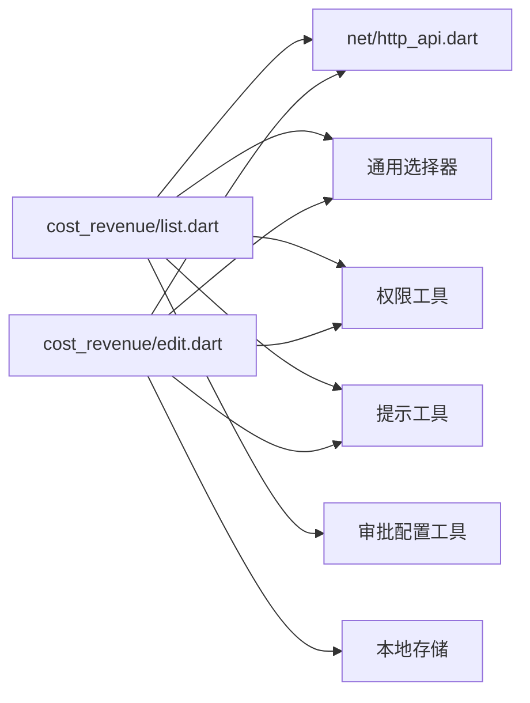

**图示来源**
- [list.dart:1-60](file://lib/pages/business/finance/cost_revenue/list.dart#L1-L60)
- [edit.dart:1-40](file://lib/pages/business/finance/cost_revenue/edit.dart#L1-L40)
- [http_api.dart:527-534](file://lib/net/http_api.dart#L527-L534)

### 组件耦合与内聚
- 列表页主要负责查询、筛选、分页和路由跳转，内聚于费用收支列表业务。
- 编辑页内聚表单逻辑、校验、保存、审核、反审核、删除和审批交互。
- `HttpApi` 作为接口契约中心，降低页面与后端路径的直接耦合。
- 辅助工具类负责权限、提示、本地存储和审批配置，提高复用性。

### 外部依赖
- 后端 `finance/fee/payment` 系列接口。
- 基础数据接口 `bi/feeitem/getList`。
- 用户接口 `sysuser/findList`。
- 支付方式接口 `bi/payway/getList`。
- 插件接口 `plugins/get`，用于获取银行账户列表。

**章节来源**
- [list.dart:1-120](file://lib/pages/business/finance/cost_revenue/list.dart#L1-L120)
- [edit.dart:1-120](file://lib/pages/business/finance/cost_revenue/edit.dart#L1-L120)
- [http_api.dart:278](file://lib/net/http_api.dart#L278)
- [http_api.dart:569](file://lib/net/http_api.dart#L569)
- [http_api.dart:527-534](file://lib/net/http_api.dart#L527-L534)

## 性能与可用性特征
- **分页加载**：列表默认每页 20 条，支持下拉加载更多。
- **防抖搜索**：搜索框输入延迟 500ms 后触发查询，减少频繁请求。
- **Tab 状态管理**：Tab 切换时重置分页，避免状态错乱。
- **本地缓存**：支付方式、银行账户等下拉数据在页面内做局部缓存，减少重复请求。
- **权限预检**：关键操作前进行权限校验，避免无效请求。

优化建议：
- 列表筛选条件较多时，可考虑服务端合并筛选，减少前端多次请求。
- 对于高频下拉数据，可引入全局缓存或持久化策略。
- 大额金额输入可增加千分位格式化和本地校验提示。

[本节为通用性能讨论，不直接分析具体代码行]

## 故障排查指南

### 常见问题
- **无法查看费用收支单**：检查是否具备查看权限，页面会在初始化时提示无权访问。
- **新增或编辑失败**：检查必填字段是否完整，尤其是机构、收支项目、金额、收支方式和账户。
- **审核失败**：检查是否属于当前审批节点审核人，确认审批备注是否填写。
- **反审核失败**：检查是否具备反审核权限，并确认单据是否允许反审核。
- **删除失败**：检查是否具备删除权限，并确认是否已二次确认。

### 调试步骤
1. 打开费用收支列表，确认接口 `finance/fee/payment/getList` 是否正常返回数据。
2. 进入编辑页，确认 `finance/fee/payment/getinfo` 能加载完整单据数据。
3. 保存时观察 `add` 或 `update` 的请求参数是否正确。
4. 审核时观察 `signFeePayment` 的 `reviewsignflag` 和 `reviewremark`。
5. 反审核和删除时观察 `fsignFeePayment` 和 `delete` 的请求参数。

### 权限相关错误
- 新增权限缺失：提示无新增权限。
- 编辑权限缺失：提示无编辑权限。
- 审核权限缺失：提示无审核权限。
- 反审核权限缺失：提示无反审核权限。
- 删除权限缺失：提示无删除权限。

**章节来源**
- [list.dart:1-60](file://lib/pages/business/finance/cost_revenue/list.dart#L1-L60)
- [edit.dart:300-700](file://lib/pages/business/finance/cost_revenue/edit.dart#L300-L700)

## 结论
费用收支模块以 `finance/fee/payment` 为核心后端接口，Flutter 前端通过列表页和编辑页实现完整的费用申请、支出审批、收入确认和审核控制流程。当前实现重点在于移动端交互、权限控制、审批流对接和数据校验；会计凭证生成和更深层的财务核算逻辑主要由后端承担。建议在后续迭代中完善预算控制、凭证联动、审计报表和税务合规校验，使费用收支真正成为门店财务闭环的重要环节。