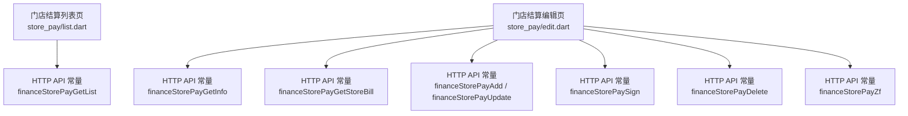
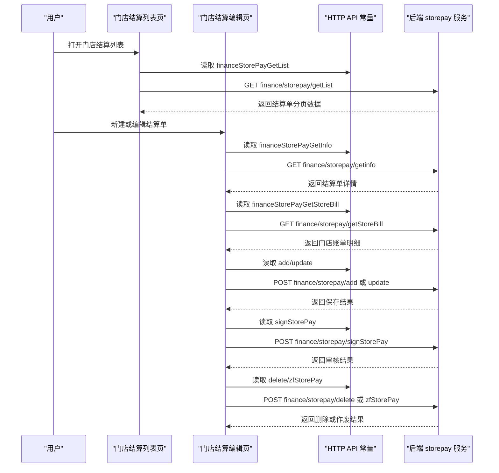
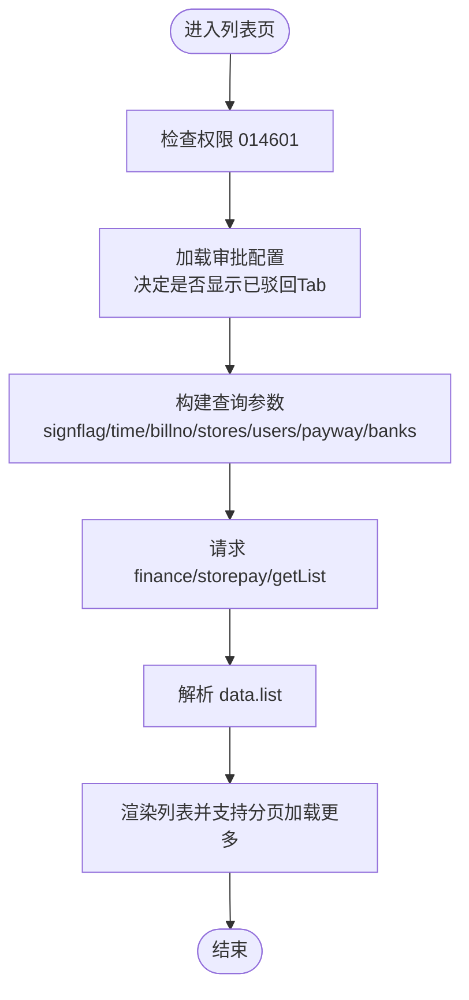
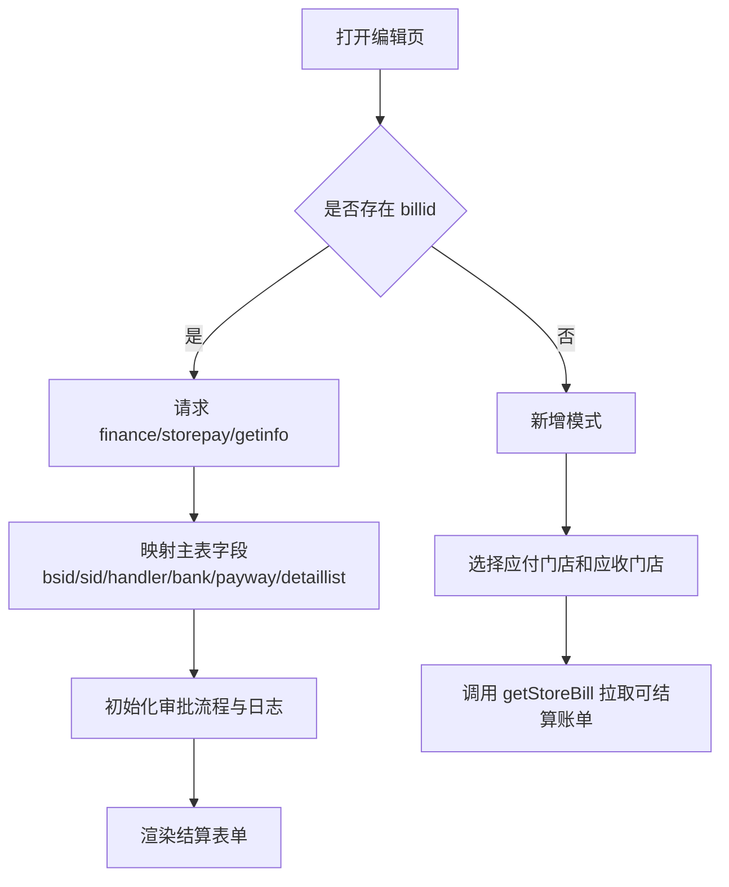
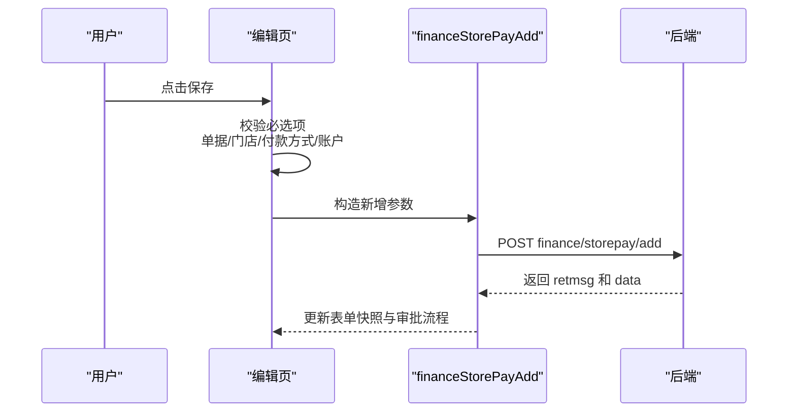
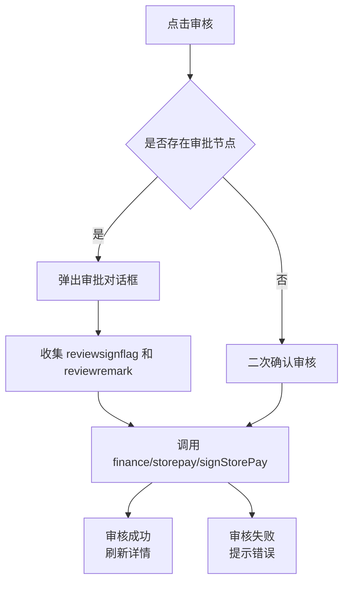
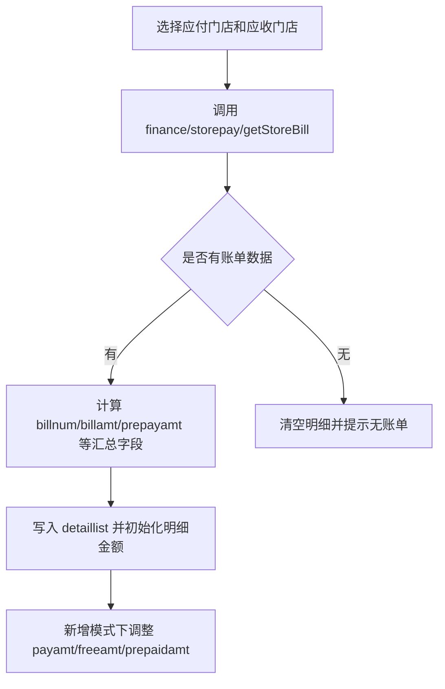
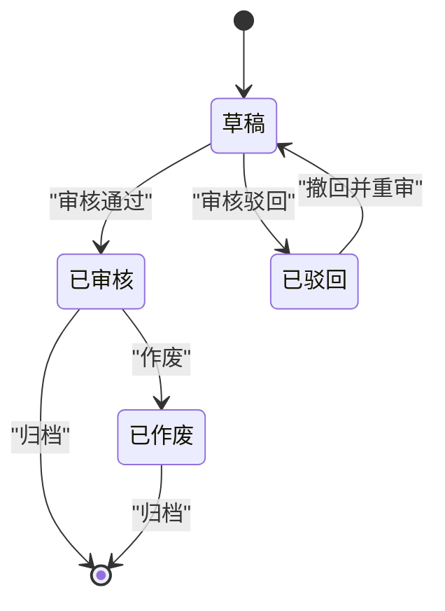
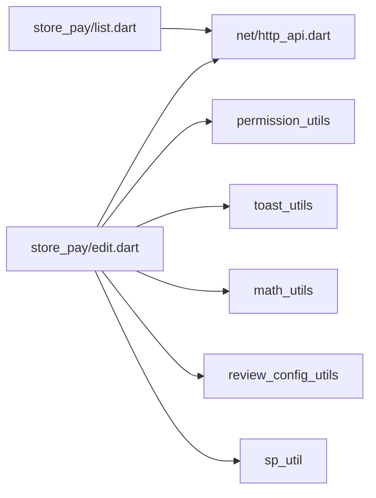

# 门店结算API

<cite>
**本文引用的文件**   
- [http_api.dart](file://lib/net/http_api.dart)
- [list.dart](file://lib/pages/business/finance/store_pay/list.dart)
- [edit.dart](file://lib/pages/business/finance/store_pay/edit.dart)
</cite>

## 目录
1. [引言](#引言)
2. [项目结构与模块定位](#项目结构与模块定位)
3. [核心接口定义](#核心接口定义)
4. [架构与调用关系](#架构与调用关系)
5. [详细接口说明](#详细接口说明)
6. [门店结算业务流程](#门店结算业务流程)
7. [批量处理、跨门店聚合与报表方案](#批量处理跨门店聚合与报表方案)
8. [资金安全控制、风险预警与多租户隔离](#资金安全控制风险预警与多租户隔离)
9. [依赖分析](#依赖分析)
10. [性能考虑](#性能考虑)
11. [故障排查指南](#故障排查指南)
12. [结论](#结论)

## 引言
本文件面向灵犀管店 Flutter 客户端中的“门店结算”业务，围绕 `finance/storepay` 模块的完整接口契约进行说明。文档基于客户端代码对后端接口的实际调用方式整理，覆盖门店结算列表查询、详情加载、新增与修改、审核、删除、作废以及门店账单获取等能力，并结合前端交互梳理门店收入汇总、费用分摊、多门店对账和资金归集的业务流程。同时给出批量处理示例、跨门店数据聚合思路、报表生成建议，以及资金安全、风险预警和多租户隔离的实现要点。

## 项目结构与模块定位
门店结算功能在 Flutter 前端由两个主要页面实现：
- 列表页：负责按状态、时间、门店、人员、账户、付款方式等条件分页查询并展示门店结算单。
- 编辑页：负责新增、查看、修改、审核、作废、删除结算单，并通过“获取门店账单”拉取可结算单据明细，完成付款金额、免付金额、预付结算金额的分配与计算。

**图表来源**  
- [list.dart:157-174](file://lib/pages/business/finance/store_pay/list.dart#L157-L174)
- [edit.dart:162-163](file://lib/pages/business/finance/store_pay/edit.dart#L162-L163)
- [edit.dart:588-597](file://lib/pages/business/finance/store_pay/edit.dart#L588-L597)
- [edit.dart:961-962](file://lib/pages/business/finance/store_pay/edit.dart#L961-L962)
- [edit.dart:1058-1066](file://lib/pages/business/finance/store_pay/edit.dart#L1058-L1066)
- [edit.dart:1164-1171](file://lib/pages/business/finance/store_pay/edit.dart#L1164-L1171)
- [edit.dart:1120-1145](file://lib/pages/business/finance/store_pay/edit.dart#L1120-L1145)

**章节来源**  
- [list.dart:1-200](file://lib/pages/business/finance/store_pay/list.dart#L1-L200)
- [edit.dart:1-200](file://lib/pages/business/finance/store_pay/edit.dart#L1-L200)
- [http_api.dart:516-524](file://lib/net/http_api.dart#L516-L524)

## 核心接口定义
所有门店结算相关接口均通过 HTTP API 常量集中声明，客户端统一使用 `request` 发起请求。

| 接口别名 | 后端路径 | 用途 | 主要调用方 |
|---|---|---|---|
| `financeStorePayGetList` | `finance/storepay/getList` | 门店结算列表 | 列表页 |
| `financeStorePayGetInfo` | `finance/storepay/getinfo` | 门店结算详情 | 编辑页 |
| `financeStorePayAdd` | `finance/storepay/add` | 新增结算单 | 编辑页（新增） |
| `financeStorePayUpdate` | `finance/storepay/update` | 修改结算单 | 编辑页（编辑） |
| `financeStorePaySign` | `finance/storepay/signStorePay` | 审核结算单 | 编辑页 |
| `financeStorePayDelete` | `finance/storepay/delete` | 删除结算单 | 编辑页 |
| `financeStorePayZf` | `finance/storepay/zfStorePay` | 作废结算单 | 编辑页 |
| `financeStorePayGetStoreBill` | `finance/storepay/getStoreBill` | 获取门店账单 | 编辑页 |

**章节来源**  
- [http_api.dart:516-524](file://lib/net/http_api.dart#L516-L524)

## 架构与调用关系
门店结算在客户端采用“页面 + HTTP API 常量 + 通用请求封装”的结构：
- 列表页只承担查询与筛选职责，最终调用 `finance/storepay/getList`。
- 编辑页承担结算单生命周期管理：查看详情、拉取门店账单、保存新增或修改、审核、作废、删除。
- 所有后端路径集中在 `HttpApi` 中维护，避免硬编码字符串散落在业务文件中。

**图表来源**  
- [list.dart:157-174](file://lib/pages/business/finance/store_pay/list.dart#L157-L174)
- [edit.dart:162-163](file://lib/pages/business/finance/store_pay/edit.dart#L162-L163)
- [edit.dart:588-597](file://lib/pages/business/finance/store_pay/edit.dart#L588-L597)
- [edit.dart:961-962](file://lib/pages/business/finance/store_pay/edit.dart#L961-L962)
- [edit.dart:1058-1066](file://lib/pages/business/finance/store_pay/edit.dart#L1058-L1066)
- [edit.dart:1164-1171](file://lib/pages/business/finance/store_pay/edit.dart#L1164-L1171)
- [edit.dart:1120-1145](file://lib/pages/business/finance/store_pay/edit.dart#L1120-L1145)

## 详细接口说明

### getList：门店结算列表
- 接口路径：`finance/storepay/getList`
- 调用场景：列表页初始化、刷新、滚动加载更多、搜索、筛选。
- 主要入参：
  - `is_page`：是否分页。
  - `field`：排序字段，如 `createtime`。
  - `type`：排序方向，如 `desc`。
  - `cond`：扩展条件字符串。
  - `page`：当前页码。
  - `pagesize`：每页数量。
  - `signflag`：状态过滤；0 表示待审核，1 表示已审核，2 表示已驳回，空值表示全部。
  - `starttime`、`endtime`：结算日期范围。
  - `billno`：结算单号模糊查询。
  - `outsid`、`insid`：应付门店、应收门店。
  - `createid`、`handlerid`：制单人、经手人。
  - `payway`、`bankid`、`bankidother`：付款方式、收款账户、付款账户。
- 返回结构：
  - `data.list`：结算单列表数组。
  - 其他分页元信息通常由服务端约定，客户端以 `rows.isNotEmpty && rows.length >= pagesize` 判断是否还有更多数据。

**图表来源**  
- [list.dart:157-174](file://lib/pages/business/finance/store_pay/list.dart#L157-L174)
- [list.dart:201-240](file://lib/pages/business/finance/store_pay/list.dart#L201-L240)

**章节来源**  
- [list.dart:157-174](file://lib/pages/business/finance/store_pay/list.dart#L157-L174)
- [list.dart:201-240](file://lib/pages/business/finance/store_pay/list.dart#L201-L240)

### getinfo：结算详情
- 接口路径：`finance/storepay/getinfo`
- 调用场景：编辑页打开已有结算单时加载。
- 主要入参：
  - `billid`：结算单ID。
- 返回结构：
  - `data`：结算单主表数据。
  - `data.detaillist`：结算明细列表，包含各原始单据的应收、实收、免付、预付、欠款等信息。
  - `data.reviewFlowUsers`、`data.reviewBillFlows`：多级审批节点与审批日志。
- 客户端行为：
  - 将主表和明细映射到表单字段。
  - 根据 `signflag` 判断是否只读。
  - 初始化审批流程用户列表和审批记录。

**图表来源**  
- [edit.dart:159-175](file://lib/pages/business/finance/store_pay/edit.dart#L159-L175)
- [edit.dart:201-240](file://lib/pages/business/finance/store_pay/edit.dart#L201-L240)

**章节来源**  
- [edit.dart:159-175](file://lib/pages/business/finance/store_pay/edit.dart#L159-L175)
- [edit.dart:201-240](file://lib/pages/business/finance/store_pay/edit.dart#L201-L240)

### add：新增结算单
- 接口路径：`finance/storepay/add`
- 调用时机：编辑页未携带 `billid` 时保存。
- 主要入参：
  - `bsid`、`bstorename`：应付门店ID和名称。
  - `sid`、`storename`：应收门店ID和名称。
  - `handlerid`、`handlername`：经手人ID和名称。
  - `startdate`、`enddate`：结算周期。
  - `bankid`、`bankname`：收款账户ID和名称。
  - `bankidother`、`bankidothername`：付款账户ID和名称。
  - `payway`、`paywayname`：付款方式ID和名称。
  - `remark`：备注。
  - `payamt`、`freeamt`、`prepaidamt`：本次付款金额、免付金额、预付结算金额。
  - `detaillist`：结算明细列表。
  - `billnum`、`billamt`：选单数量和总金额。
- 返回结构：
  - `retmsg`：提示信息。
  - `data`：保存后的结算单数据，包括审批流程信息。

**图表来源**  
- [edit.dart:900-970](file://lib/pages/business/finance/store_pay/edit.dart#L900-L970)

**章节来源**  
- [edit.dart:900-970](file://lib/pages/business/finance/store_pay/edit.dart#L900-L970)

### update：修改结算单
- 接口路径：`finance/storepay/update`
- 调用时机：编辑页存在 `billid` 时保存。
- 入参与返回结构同 `add`，额外会带上已有 `billid`。
- 客户端逻辑：
  - 复用新增时的参数组装方法。
  - 若存在 `reviewsignflag`、`reviewremark`，则一并提交，用于撤回或补充审批备注。

**章节来源**  
- [edit.dart:961-962](file://lib/pages/business/finance/store_pay/edit.dart#L961-L962)
- [edit.dart:900-970](file://lib/pages/business/finance/store_pay/edit.dart#L900-L970)

### signStorePay：审核结算单
- 接口路径：`finance/storepay/signStorePay`
- 调用时机：
  - 保存后触发审核。
  - 直接点击审核按钮触发审核。
- 主要入参：
  - 结算单完整表单数据。
  - `signflag`：固定为 `1`，表示审核操作。
  - `reviewsignflag`：审批结果，通常为 `1` 通过，`0` 驳回，`2` 撤回。
  - `reviewremark`：审批备注。
- 客户端行为：
  - 若存在多级审批节点，先弹出审批对话框收集审批意见。
  - 无审批节点时二次确认后再调用审核接口。
  - 成功后刷新详情页。

**图表来源**  
- [edit.dart:1000-1066](file://lib/pages/business/finance/store_pay/edit.dart#L1000-L1066)
- [edit.dart:1058-1066](file://lib/pages/business/finance/store_pay/edit.dart#L1058-L1066)

**章节来源**  
- [edit.dart:1000-1066](file://lib/pages/business/finance/store_pay/edit.dart#L1000-L1066)

### delete：删除结算单
- 接口路径：`finance/storepay/delete`
- 调用时机：编辑页点击删除。
- 主要入参：
  - `billid`：要删除的结算单ID。
- 客户端行为：
  - 检查权限 `014604`。
  - 二次确认后调用删除接口。
  - 成功后返回上一页。

**章节来源**  
- [edit.dart:1161-1172](file://lib/pages/business/finance/store_pay/edit.dart#L1161-L1172)

### zfStorePay：作废结算单
- 接口路径：`finance/storepay/zfStorePay`
- 调用时机：编辑页点击作废。
- 主要入参：
  - 当前结算单完整表单数据，包含 `billid` 和状态字段。
- 客户端行为：
  - 检查权限 `014606`。
  - 二次确认后调用作废接口。
  - 成功后将本地 `signflag` 置为 `-1`，表示作废。

**章节来源**  
- [edit.dart:1120-1145](file://lib/pages/business/finance/store_pay/edit.dart#L1120-L1145)

### getStoreBill：获取门店账单
- 接口路径：`finance/storepay/getStoreBill`
- 调用时机：
  - 新增模式下选择应付门店和应收门店后自动拉取。
  - 编辑模式下选择门店或切换日期范围后重新拉取。
- 主要入参：
  - `is_page`：是否分页，客户端传 `0`。
  - `bsid`：应付门店ID。
  - `sid`：应收门店ID。
  - `starttime`、`endtime`：结算日期范围。
- 返回结构：
  - `data`：门店账单明细列表。
  - 每条明细包含 `sbillid`、`billno`、`billtype`、`billamt`、`paidamt`、`nowamt`、`debtamt`、`advance` 等字段。
- 客户端行为：
  - 将账单明细写入 `_detaillist`。
  - 计算总额、总单数、预付款余额。
  - 在新增模式下，默认将本次付款金额设为预付款合计，免付金额清零，预付结算金额设为预付款分配总额。
  - 若返回为空，提示“该门店没有账单”。

**图表来源**  
- [edit.dart:588-597](file://lib/pages/business/finance/store_pay/edit.dart#L588-L597)
- [edit.dart:650-730](file://lib/pages/business/finance/store_pay/edit.dart#L650-L730)

**章节来源**  
- [edit.dart:588-597](file://lib/pages/business/finance/store_pay/edit.dart#L588-L597)
- [edit.dart:650-730](file://lib/pages/business/finance/store_pay/edit.dart#L650-L730)

## 门店结算业务流程
门店结算的核心是“两店对账、多单合并、金额分配、资金归集”：
- 应付门店：应收到结算款项的一方，通常是总部或上级机构。
- 应收门店：应支付结算款项的一方，通常是门店或下级机构。
- 结算明细：来源于配送收货单、配退发货单等业务单据，按门店维度聚合。
- 结算金额：
  - 本次付款金额 `payamt`：企业实际打款金额。
  - 免付金额 `freeamt`：协商减免部分。
  - 预付结算金额 `prepaidamt`：从预付款余额中扣除部分。
- 审批流：支持多级审批，包含通过、驳回、撤回，并记录审批日志。

**图表来源**  
- [edit.dart:1000-1066](file://lib/pages/business/finance/store_pay/edit.dart#L1000-L1066)
- [edit.dart:1120-1172](file://lib/pages/business/finance/store_pay/edit.dart#L1120-L1172)

**章节来源**  
- [edit.dart:159-175](file://lib/pages/business/finance/store_pay/edit.dart#L159-L175)
- [edit.dart:588-597](file://lib/pages/business/finance/store_pay/edit.dart#L588-L597)
- [edit.dart:900-970](file://lib/pages/business/finance/store_pay/edit.dart#L900-L970)
- [edit.dart:1000-1066](file://lib/pages/business/finance/store_pay/edit.dart#L1000-L1066)
- [edit.dart:1120-1172](file://lib/pages/business/finance/store_pay/edit.dart#L1120-L1172)

## 批量处理、跨门店聚合与报表方案

### 批量处理示例
客户端目前以“单张结算单”的生命周期为主，但列表页支持分页和筛选，可在后端或上层编排层实现批量操作：
- 批量新增：按不同应付门店、应收门店组合生成多条结算单。
- 批量审核：对同一时间段内多个结算单执行审核。
- 批量作废：对异常结算单进行批量作废。
- 批量打印：复用现有打印入口，传入多个结算单数据。

建议在前端增加“多选结算单 + 批量操作菜单”，在后端提供对应批量接口，保持幂等性和事务一致性。

### 跨门店数据聚合
门店结算天然涉及两店维度，可进一步扩展为集团级聚合：
- 按集团维度聚合应付门店与应收门店的结算总额。
- 按区域、渠道、业态维度统计结算单数量和金额。
- 按供应商、商品类别维度关联结算明细，形成业财一体化报表。
- 按预付款余额变化追踪资金占用情况。

### 报表生成方案
- 月度结算报表：统计每月结算单数量、总金额、免付总额、预付结算总额、实际付款总额。
- 门店对账报表：对比应付门店与应收门店之间的差异，识别未结清、重复结算、异常结算。
- 资金归集报表：按收款账户、付款账户统计资金流入流出，结合银行插件数据进行核对。
- 审批效率报表：统计审批节点耗时、驳回率、撤回率，辅助流程优化。

## 资金安全控制、风险预警与多租户隔离

### 资金安全控制
- 权限控制：
  - 查看门店结算需要权限 `014601`。
  - 审核需要权限 `014605`。
  - 作废需要权限 `014606`。
  - 删除需要权限 `014604`。
- 审批控制：
  - 支持多级审批，未匹配审批节点的用户无法审核。
  - 审批通过后允许撤回，撤回后需重新走审批流程。
- 数据校验：
  - 新增时必须选择应付门店、应收门店、付款方式、收款账户、付款账户。
  - 必须选择至少一条结算明细。
  - 付款金额、免付金额、预付结算金额通过前端计算逻辑保持一致性。

### 风险预警
- 负向指标预警：
  - 免付金额过大。
  - 预付结算金额超过预付款余额。
  - 结算单长期未审核或频繁驳回。
- 异常交易预警：
  - 同一门店短时间内多次大额结算。
  - 收款账户与付款账户频繁变更。
  - 结算金额与原始单据金额差异较大。
- 流程风险预警：
  - 审批节点缺失或审批人不在当前节点。
  - 审核后立即作废。
  - 撤回后再次审核仍被驳回。

### 多租户隔离机制
- 租户隔离基础：
  - 登录时选择门店，后续请求携带当前门店上下文。
  - 结算单明细来自指定应付门店和应收门店，天然具备门店维度隔离。
- 推荐增强点：
  - 后端所有 `finance/storepay/*` 接口强制按当前登录租户和授权门店过滤。
  - 列表和详情返回数据前做租户ID校验。
  - 审批流和用户权限按租户隔离。
  - 报表和导出功能限制只能查看本租户和本授权门店的数据。

## 依赖分析

**图表来源**  
- [list.dart:1-30](file://lib/pages/business/finance/store_pay/list.dart#L1-L30)
- [edit.dart:1-30](file://lib/pages/business/finance/store_pay/edit.dart#L1-L30)
- [http_api.dart:516-524](file://lib/net/http_api.dart#L516-L524)

**章节来源**  
- [list.dart:1-30](file://lib/pages/business/finance/store_pay/list.dart#L1-L30)
- [edit.dart:1-30](file://lib/pages/business/finance/store_pay/edit.dart#L1-L30)
- [http_api.dart:516-524](file://lib/net/http_api.dart#L516-L524)

## 性能考虑
- 列表分页：客户端默认 `pagesize=20`，并在滚动到底部时自动加载下一页，适合移动端体验。
- 防抖搜索：搜索输入框使用 500ms 防抖，减少频繁请求。
- 账单拉取优化：
  - 新增模式下选择门店后自动拉取账单，避免用户手动点击。
  - 弹窗内支持本地筛选和排序，减少后端压力。
- 审批流程缓存：审批用户和审批日志从详情接口一次性返回，避免重复请求。
- 推荐优化：
  - 对高频查询字段建立索引，如 `createtime`、`signflag`、`bsid`、`sid`。
  - 对门店账单接口增加缓存策略，避免重复拉取相同门店和日期的账单。
  - 对批量审核、批量作废提供异步任务接口，避免长事务阻塞。

## 故障排查指南
- 列表无数据：
  - 检查权限 `014601` 是否授予。
  - 检查时间范围和筛选条件是否过严。
  - 检查后端 `finance/storepay/getList` 是否正常返回。
- 详情加载失败：
  - 检查 `billid` 是否正确。
  - 检查后端 `finance/storepay/getinfo` 是否返回 `detaillist`。
- 门店账单为空：
  - 检查应付门店和应收门店是否都选择。
  - 检查日期范围是否正确。
  - 检查后端 `finance/storepay/getStoreBill` 是否返回空列表。
- 审核失败：
  - 检查是否属于当前审批节点。
  - 检查 `signflag` 是否为 `1`。
  - 检查 `reviewsignflag` 和 `reviewremark` 是否符合后端要求。
- 作废或删除失败：
  - 检查权限 `014606`、`014604`。
  - 检查结算单状态是否允许作废或删除。
  - 检查后端返回的 `retmsg`。

**章节来源**  
- [list.dart:157-174](file://lib/pages/business/finance/store_pay/list.dart#L157-L174)
- [edit.dart:159-175](file://lib/pages/business/finance/store_pay/edit.dart#L159-L175)
- [edit.dart:588-597](file://lib/pages/business/finance/store_pay/edit.dart#L588-L597)
- [edit.dart:900-970](file://lib/pages/business/finance/store_pay/edit.dart#L900-L970)
- [edit.dart:1000-1066](file://lib/pages/business/finance/store_pay/edit.dart#L1000-L1066)
- [edit.dart:1120-1172](file://lib/pages/business/finance/store_pay/edit.dart#L1120-L1172)

## 结论
灵犀管店 Flutter 项目的门店结算模块以 `finance/storepay` 为核心，通过列表页和编辑页共同实现结算单的查询、创建、修改、审核、作废、删除以及门店账单拉取。其业务重点在于两店对账、多单合并、金额分配与审批控制，同时在客户端实现了权限校验、审批流程、金额计算和基础风控提示。未来可在此基础上扩展批量处理能力、跨门店聚合分析和更完善的资金安全与多租户隔离机制，从而支撑更大规模的多门店连锁结算场景。