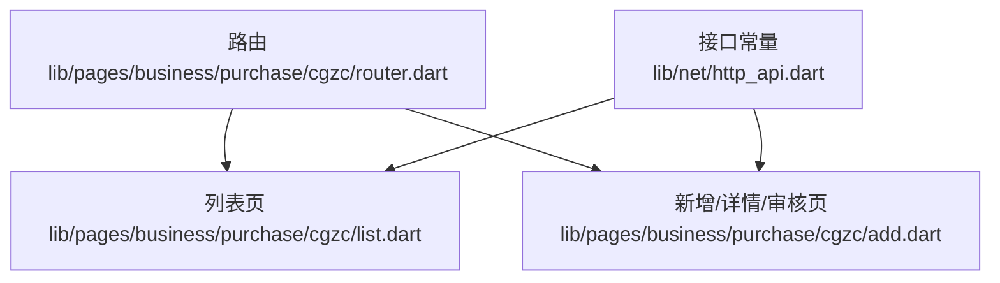
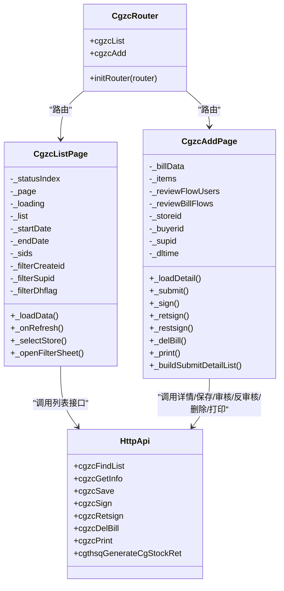
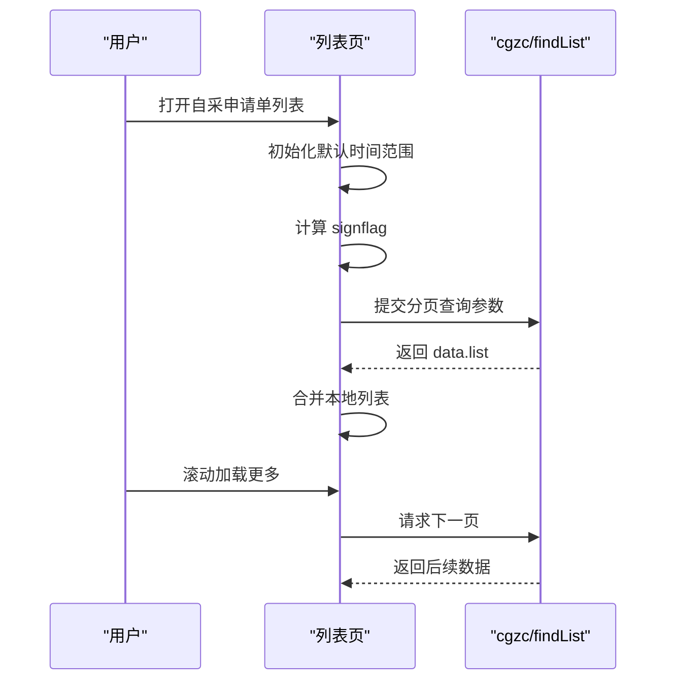
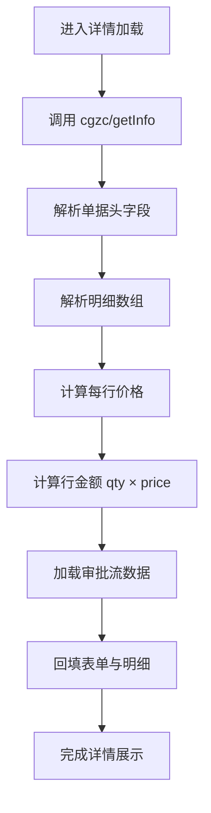
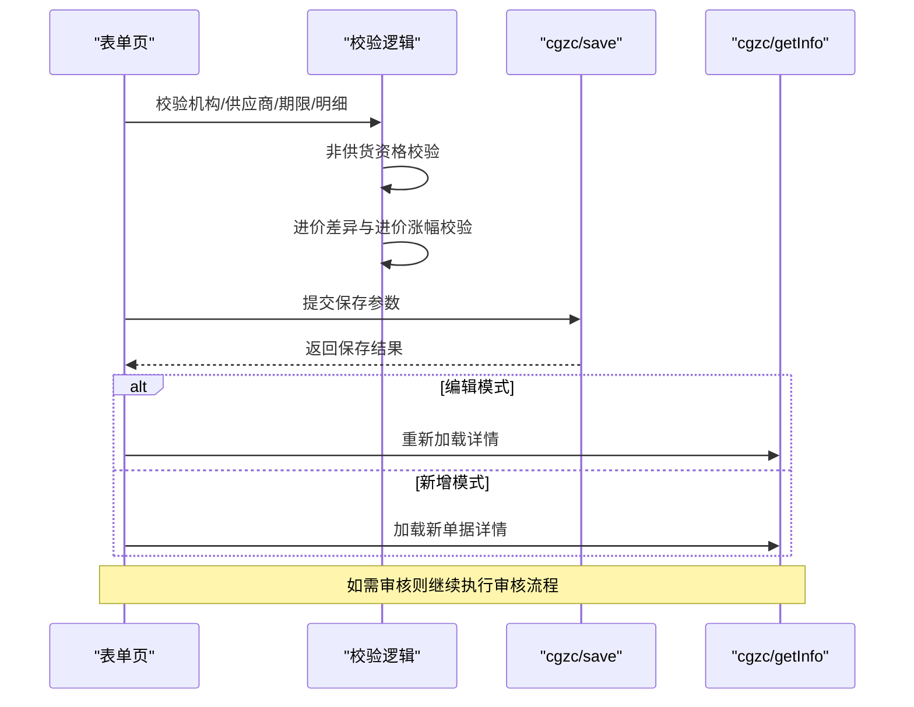
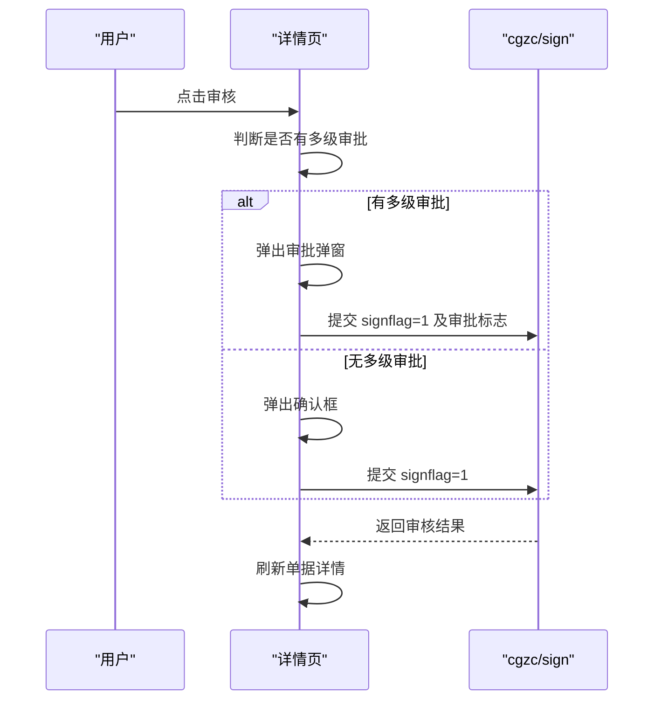
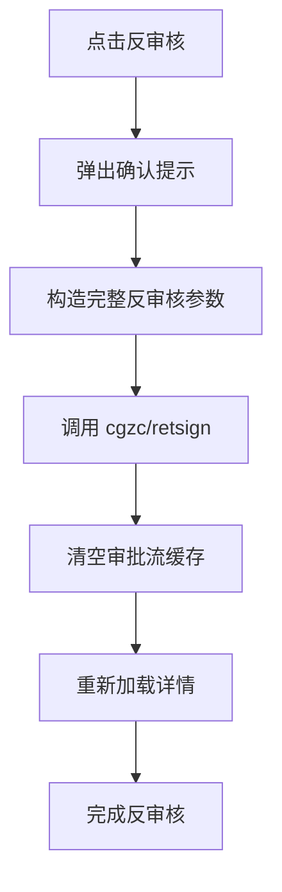
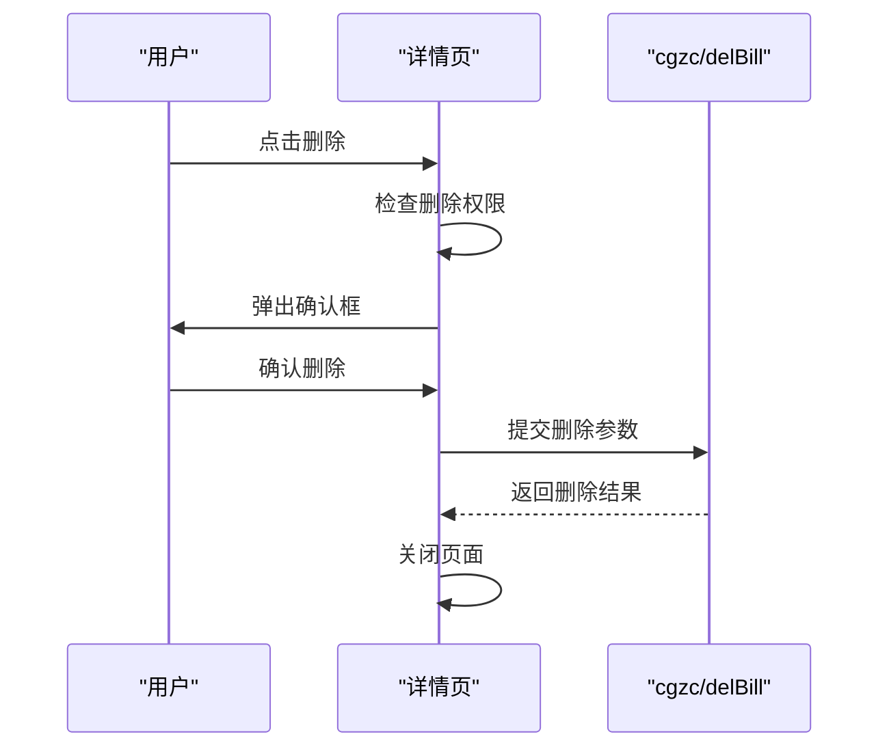
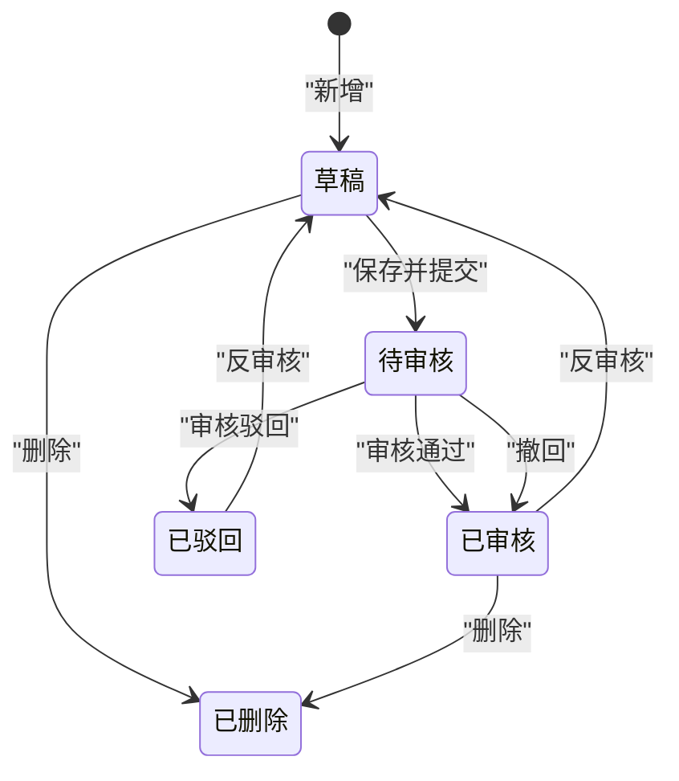

# 自采申请单API

<cite>
**本文引用的文件**   
- [lib/net/http_api.dart](file://lib/net/http_api.dart)
- [lib/pages/business/purchase/cgzc/list.dart](file://lib/pages/business/purchase/cgzc/list.dart)
- [lib/pages/business/purchase/cgzc/add.dart](file://lib/pages/business/purchase/cgzc/add.dart)
- [lib/pages/business/purchase/cgzc/router.dart](file://lib/pages/business/purchase/cgzc/router.dart)
</cite>

## 目录
1. [引言](#引言)
2. [项目结构与入口](#项目结构与入口)
3. [核心接口清单](#核心接口清单)
4. [系统架构与组件关系](#系统架构与组件关系)
5. [接口详细规范](#接口详细规范)
6. [自采审批流程与业务规则](#自采审批流程与业务规则)
7. [数据模型与字段说明](#数据模型与字段说明)
8. [异常处理与权限控制](#异常处理与权限控制)
9. [性能优化建议](#性能优化建议)
10. [常见问题排查](#常见问题排查)
11. [结论](#结论)

## 引言
本文面向灵犀管店 Flutter 端中的“自采申请单”功能，基于前端代码对后端 `cgzc/*` 系列接口进行逆向整理和规范化说明。文档覆盖以下接口：

| 接口名称 | 前端常量 | 用途 |
|---|---|---|
| 自采申请列表查询 | `cgzc/findList` | 分页查询自采申请单，支持状态、时间、机构、供应商等筛选 |
| 申请详情获取 | `cgzc/getInfo` | 获取单据头、明细、附件及多级审批信息 |
| 申请保存 | `cgzc/save` | 新增或编辑自采申请单 |
| 申请审核 | `cgzc/sign` | 将待审核单据改为已审核，或执行撤回 |
| 反审核 | `cgzc/retsign` | 将已审核单据回退到未审核状态 |
| 删除单据 | `cgzc/delBill` | 删除自采申请单 |
| 打印单据 | `airprint/setWxPrintRw` | 调用统一打印能力打印自采申请单 |
| 生成采购退货单 | `cgzc/generateCgStockRet` | 由自采申请单生成采购退货相关单据（前端声明了该常量） |

这些接口在前端被封装为静态字符串常量，并由统一的网络请求方法发起；页面侧的列表页负责查询与筛选，详情页负责编辑、审核、反审核、删除、打印以及批量操作。

**章节来源**
- [lib/net/http_api.dart:110-120](file://lib/net/http_api.dart#L110-L120)

## 项目结构与入口
自采申请单属于采购模块下的独立业务子模块，路由注册位于 `lib/pages/business/purchase/cgzc/router.dart`，具体页面位于同目录下的 `list.dart` 与 `add.dart`。

**图示来源**
- [lib/pages/business/purchase/cgzc/router.dart:1-25](file://lib/pages/business/purchase/cgzc/router.dart#L1-L25)
- [lib/pages/business/purchase/cgzc/list.dart:1-60](file://lib/pages/business/purchase/cgzc/list.dart#L1-L60)
- [lib/pages/business/purchase/cgzc/add.dart:1-80](file://lib/pages/business/purchase/cgzc/add.dart#L1-L80)
- [lib/net/http_api.dart:110-120](file://lib/net/http_api.dart#L110-L120)

### 路由定义
路由类 `CgzcRouter` 定义两个路径：

| 路由常量 | 路径 | 对应页面 |
|---|---|---|
| `cgzcList` | `/purchase/cgzc/list` | `CgzcListPage` |
| `cgzcAdd` | `/purchase/cgzc/add` | `CgzcAddPage` |

列表页进入时默认设置三个标签：全部、待审核、已审核；当后台配置开启“已驳回”审批类型时，动态增加第四个标签。

**章节来源**
- [lib/pages/business/purchase/cgzc/router.dart:1-25](file://lib/pages/business/purchase/cgzc/router.dart#L1-L25)
- [lib/pages/business/purchase/cgzc/list.dart:20-120](file://lib/pages/business/purchase/cgzc/list.dart#L20-L120)

## 核心接口清单
所有 `cgzc` 相关接口均集中在 `HttpApi` 中，作为前后端契约的前端侧入口。

| 前端常量名 | 接口地址 | 主要调用方 | 主要用途 |
|---|---|---|---|
| `cgzcFindList` | `cgzc/findList` | 列表页 | 查询自采申请单列表 |
| `cgzcGetInfo` | `cgzc/getInfo` | 新增/详情页 | 获取单据详情 |
| `cgzcSave` | `cgzc/save` | 新增/详情页 | 保存新增或编辑的自采申请单 |
| `cgzcSign` | `cgzc/sign` | 新增/详情页 | 审核、撤回 |
| `cgzcRetsign` | `cgzc/retsign` | 新增/详情页 | 反审核 |
| `cgzcDelBill` | `cgzc/delBill` | 新增/详情页 | 删除单据 |
| `cgzcPrint` | `airprint/setWxPrintRw` | 新增/详情页 | 打印单据 |
| `cgthsqGenerateCgStockRet` | `cgzc/generateCgStockRet` | 采购退货生成逻辑声明处 | 生成采购退货单 |

**章节来源**
- [lib/net/http_api.dart:110-120](file://lib/net/http_api.dart#L110-L120)

## 系统架构与组件关系
自采申请单在 Flutter 端的职责划分如下：

**图示来源**
- [lib/pages/business/purchase/cgzc/router.dart:1-25](file://lib/pages/business/purchase/cgzc/router.dart#L1-L25)
- [lib/pages/business/purchase/cgzc/list.dart:1-120](file://lib/pages/business/purchase/cgzc/list.dart#L1-L120)
- [lib/pages/business/purchase/cgzc/add.dart:1-120](file://lib/pages/business/purchase/cgzc/add.dart#L1-L120)
- [lib/net/http_api.dart:110-120](file://lib/net/http_api.dart#L110-L120)

## 接口详细规范

### cgzc/findList：自采申请列表查询

#### 触发位置
列表页 `_loadData` 方法在初始化、下拉刷新、滚动加载更多、切换 Tab、搜索和筛选后调用。

#### 请求方式
通过通用 `request` 方法发送 HTTP 请求，接口地址为 `cgzc/findList`。

#### 请求参数

| 参数名 | 类型 | 必填 | 说明 |
|---|---|---|---|
| `is_page` | 数值 | 是 | 固定传 `1`，表示使用分页模式 |
| `cond` | 字符串 | 否 | 通用条件字段，当前默认空串 |
| `field` | 字符串 | 是 | 排序字段，当前固定 `createtime` |
| `type` | 字符串 | 是 | 排序方向，当前固定 `desc` |
| `page` | 数值 | 是 | 当前页码 |
| `pagesize` | 数值 | 是 | 每页条数，固定 `20` |
| `billno` | 字符串 | 否 | 单据号模糊搜索 |
| `datetype` | 数值 | 是 | 日期类型，固定 `1` |
| `billtype` | 字符串 | 是 | 单据类型，固定 `1`，表示自采申请单 |
| `signflag` | 字符串 | 否 | 审核状态：空=全部，`0`=待审核，`1`=已审核，`2`=已驳回 |
| `buyerid` | 字符串 | 否 | 采购人 ID，当前固定空串 |
| `signid` | 字符串 | 否 | 审核人 ID，当前固定空串 |
| `starttime` | 字符串 | 是 | 开始时间，格式为 `yyyy-MM-dd 00:00:00` |
| `endtime` | 字符串 | 是 | 结束时间，格式为 `yyyy-MM-dd 23:59:59` |
| `sids` | 数组 | 否 | 机构 ID 列表，选择机构时传入单个值 |
| `createid` | 字符串 | 否 | 创建人 ID，来自筛选抽屉 |
| `supid` | 字符串 | 否 | 供应商 ID，来自筛选抽屉 |
| `dhflag` | 字符串 | 否 | 收货状态，来自筛选抽屉 |

#### 状态映射
列表页根据 Tab 索引计算 `signflag`：

| Tab 含义 | 索引 | `signflag` |
|---|---:|---:|
| 全部 | `0` | 空串 |
| 待审核 | `1` | `0` |
| 已审核 | `2` | `1` |
| 已驳回 | `3` | `2` |

#### 响应结构
前端解析 `result['data']`，再取其中的 `list` 数组；若第一页则替换本地列表，否则追加。

| 返回层级 | 字段 | 类型 | 说明 |
|---|---|---|---|
| 顶层 | `data` | 对象 | 接口主数据 |
| 数据层 | `list` | 数组 | 自采申请单行数据 |

#### 分页行为
- 初始加载第 1 页。
- 滚动到底部且仍有更多数据时递增页码继续加载。
- 若返回行数小于每页数量，则认为无更多数据。
- 下拉刷新会重置页码、清空列表并重新加载。

**图示来源**
- [lib/pages/business/purchase/cgzc/list.dart:60-160](file://lib/pages/business/purchase/cgzc/list.dart#L60-L160)
- [lib/pages/business/purchase/cgzc/list.dart:201-240](file://lib/pages/business/purchase/cgzc/list.dart#L201-L240)

**章节来源**
- [lib/pages/business/purchase/cgzc/list.dart:60-240](file://lib/pages/business/purchase/cgzc/list.dart#L60-L240)

### cgzc/getInfo：申请详情获取

#### 触发位置
新增/详情页在编辑模式下进入时调用 `_loadDetail`，内部调用 `cgzc/getInfo`。

#### 请求参数
详情请求直接使用页面传入的单据数据对象，通常包含单据编号、单据 ID 等标识字段。

#### 响应字段
前端从 `result['data']` 中读取单据头、明细、附件、审批流等信息，并回填表单。

| 返回字段 | 类型 | 说明 |
|---|---|---|
| `storename` | 字符串 | 自采机构名称 |
| `bsid` 或 `storeid` | 数值或字符串 | 自采机构 ID |
| `storetype` | 数值或字符串 | 机构类型 |
| `buyerid` | 字符串 | 采购人 ID |
| `buyername` | 字符串 | 采购人姓名 |
| `remark` | 字符串 | 备注 |
| `fileLists` | 数组 | 附件列表 |
| `billsupid` 或 `supid` | 字符串 | 供应商 ID |
| `supname` | 字符串 | 供应商名称 |
| `dltime` | 字符串 | 收货期限 |
| `validdate` | 字符串 | 收货期限兼容字段 |
| `detaillist` | 数组 | 商品明细 |
| `reviewFlowUsers` | 数组 | 多级审批人员列表 |
| `reviewBillFlows` | 数组 | 单据审批记录 |
| `signflag` | 字符串 | 审核状态 |
| `reviewsignflag` | 字符串 | 多级审批标志 |

#### 价格与金额回填逻辑
- 明细行优先使用 `cgprice`，不存在时使用 `price`。
- 金额按 `qty × price` 重算，保留三位小数。
- 旧进价 `oldprice` 存在兜底策略：未审核时优先 `inprice`，已审核时优先 `oldprice`。

**图示来源**
- [lib/pages/business/purchase/cgzc/add.dart:280-430](file://lib/pages/business/purchase/cgzc/add.dart#L280-L430)

**章节来源**
- [lib/pages/business/purchase/cgzc/add.dart:280-430](file://lib/pages/business/purchase/cgzc/add.dart#L280-L430)

### cgzc/save：申请保存

#### 触发位置
新增/详情页 `_submit` 方法在表单校验通过后调用 `cgzc/save`。

#### 前置校验
- 新增需要权限 `011402`。
- 编辑需要权限 `011403`。
- 必须选择自采机构、供应商、收货期限。
- 新增时必须通过表单校验。
- 至少有一条有效商品明细。
- 每条明细数量大于零。
- 非供货资格商品校验。
- 进价不一致、进价超过原进价两倍校验。

#### 请求参数

| 参数类别 | 参数名 | 类型 | 说明 |
|---|---|---|---|
| 基础字段 | `name` | 字符串 | 单据名称，新增为空串 |
| 基础字段 | `signflag` | 数值 | 审核状态，新增默认为 `0` |
| 基础字段 | `billtype` | 字符串 | 单据类型，固定 `1` |
| 汇总字段 | `billqty` | 数值 | 合计数量 |
| 汇总字段 | `billamt` | 数值 | 合计金额 |
| 明细字段 | `detaillist` | 数组 | 商品明细列表 |
| 附件字段 | `fileLists` | 数组 | 附件列表 |
| 备注字段 | `remark` | 字符串 | 备注 |
| 机构字段 | `bsid` | 数值或字符串 | 自采机构 ID |
| 机构字段 | `storename` | 字符串 | 自采机构名称 |
| 采购人字段 | `buyerid` | 字符串 | 采购人 ID |
| 采购人字段 | `buyername` | 字符串 | 采购人姓名 |
| 供应商字段 | `supid` | 字符串 | 供应商 ID |
| 供应商字段 | `billsupid` | 字符串 | 供应商 ID 兼容字段 |
| 供应商字段 | `supname` | 字符串 | 供应商名称 |
| 日期字段 | `validdate` | 字符串 | 收货期限 |
| 日期字段 | `dltime` | 字符串 | 收货期限兼容字段 |

#### 明细构造逻辑
`_buildSubmitDetailList` 会：

1. 同步所有行的金额。
2. 将数量格式化为一位小数。
3. 将价格格式化为两位小数。
4. 将金额格式化为三位小数。
5. 写入商品名称、ID、单位、规格、旧进价等字段。
6. 根据是否已审核决定旧进价取值优先级。

#### 响应处理
- 编辑模式：用返回数据重新加载详情。
- 新增模式：更新新单据 ID，随后加载详情。
- 如果保存后需要审核，则继续走 `_doSignAfterSave`。

**图示来源**
- [lib/pages/business/purchase/cgzc/add.dart:520-640](file://lib/pages/business/purchase/cgzc/add.dart#L520-L640)
- [lib/pages/business/purchase/cgzc/add.dart:1073-1130](file://lib/pages/business/purchase/cgzc/add.dart#L1073-L1130)

**章节来源**
- [lib/pages/business/purchase/cgzc/add.dart:520-640](file://lib/pages/business/purchase/cgzc/add.dart#L520-L640)
- [lib/pages/business/purchase/cgzc/add.dart:1073-1130](file://lib/pages/business/purchase/cgzc/add.dart#L1073-L1130)

### cgzc/sign：申请审核

#### 触发位置
- 新增保存成功后可自动进入审核。
- 详情页手动点击审核按钮。
- “撤回”操作也复用同一接口，但会设置特殊标志。

#### 权限要求
审核操作需要权限 `011405`。

#### 请求参数
审核参数以完整单据对象为基础，补充以下字段：

| 参数名 | 值 | 说明 |
|---|---|---|
| `signflag` | `1` | 标记为已审核 |
| `billtype` | `1` | 自采申请单类型 |
| `reviewremark` | 字符串 | 审批备注 |
| `reviewsignflag` | 数值 | 多级审批标志，正常审核为 `1`，撤回为 `2`，驳回保持不变 |

#### 多级审批行为
- 若存在审批人员列表，先弹出审批弹窗，用户选择通过或驳回。
- 管理员或当前审批节点用户才能执行审核。
- 若无多级审批配置，则弹出简单确认对话框。

#### 撤回语义
撤回通过再次调用 `cgzc/sign`，并将 `reviewsignflag` 设置为 `2`，同时保持 `signflag` 为 `1`，表示单据处于审核态但需重新处理审批步骤。

**图示来源**
- [lib/pages/business/purchase/cgzc/add.dart:640-740](file://lib/pages/business/purchase/cgzc/add.dart#L640-L740)

**章节来源**
- [lib/pages/business/purchase/cgzc/add.dart:640-740](file://lib/pages/business/purchase/cgzc/add.dart#L640-L740)

### cgzc/retsign：反审核

#### 触发位置
详情页 `_retsign` 方法调用 `cgzc/retsign`。

#### 前置提示
- 普通反审核：提示“确定反审核单据吗”。
- 若存在审批流：提示“反审核单据后，所有审批步骤需重新处理”。

#### 请求参数构造
前端以完整单据对象为基础，补齐以下关键参数，避免后端写入审批流表时出现空值：

| 参数名 | 填充规则 | 说明 |
|---|---|---|
| `billtype` | 固定 `1` | 自采申请单类型 |
| `billdate` | 缺失时填入当天 | 单据日期 |
| `billid` | 使用单据 ID 或新单据 ID | 单据主键 |
| `billtypeid` | 缺失时填 `0503` | 单据类型编码 |
| `detaillist` | 缺失时重建明细 | 商品明细 |

#### 响应处理
- 显示反审结果消息。
- 清空本地审批流缓存。
- 重新加载单据详情。

**图示来源**
- [lib/pages/business/purchase/cgzc/add.dart:740-810](file://lib/pages/business/purchase/cgzc/add.dart#L740-L810)

**章节来源**
- [lib/pages/business/purchase/cgzc/add.dart:740-810](file://lib/pages/business/purchase/cgzc/add.dart#L740-L810)

### cgzc/delBill：删除单据

#### 触发位置
详情页 `_delBill` 方法调用 `cgzc/delBill`。

#### 权限要求
删除需要权限 `011404`。

#### 请求参数
以完整单据对象为基础，补充 `billtype = 1`。

#### 响应处理
删除成功后显示提示并返回上一页。

**图示来源**
- [lib/pages/business/purchase/cgzc/add.dart:880-920](file://lib/pages/business/purchase/cgzc/add.dart#L880-L920)

**章节来源**
- [lib/pages/business/purchase/cgzc/add.dart:880-920](file://lib/pages/business/purchase/cgzc/add.dart#L880-L920)

## 自采审批流程与业务规则

### 自采申请与普通采购的区别
从前端实现可以看出，“自采申请单”具有以下特征：

1. **单据类型固定**：`billtype` 固定为 `1`，与普通采购订单、计划、其他入库等区分。
2. **关联机构**：每个自采申请绑定一个自采机构 `bsid`，体现门店或分支机构自行采购的业务场景。
3. **关联供应商**：明确选择供应商 `supid`，用于价格查询、供货资格校验和成本核算。
4. **审批控制**：支持多级审批，审批通过后进入采购执行阶段。
5. **成本字段**：明细包含进价、旧进价、采购价等，便于成本对比和审计。
6. **收货期限**：有 `dltime` / `validdate` 字段，用于约束到货时间。
7. **可生成下游单据**：声明了 `cgzc/generateCgStockRet`，表明自采申请可能参与采购退货等供应链下游单据生成。

普通采购通常走标准采购订单流程，而自采申请更偏向“门店或分支机构因业务需要自行发起采购申请”，其特殊地位体现在：

- 更接近终端业务场景，如门店缺货、临时促销、紧急补货。
- 强调审批控制和预算控制，防止无序自采造成成本失控。
- 与供应商价格、库存、供货资格强关联。

### 审批流程
前端实现的审批流程包括：

1. **申请提交**：填写机构、供应商、商品明细、备注、收货期限。
2. **校验拦截**：非供货资格商品、进价差异、进价翻倍等校验。
3. **保存单据**：生成或更新自采申请单。
4. **多级审批**：根据后台配置弹出审批弹窗，支持通过、驳回、撤回。
5. **审核通过**：单据状态变为已审核，进入采购执行阶段。
6. **反审核**：已审核单据可反审核，恢复为未审核状态。
7. **删除单据**：未审核或允许删除的单据可删除。

**图示来源**
- [lib/pages/business/purchase/cgzc/add.dart:640-810](file://lib/pages/business/purchase/cgzc/add.dart#L640-L810)

**章节来源**
- [lib/pages/business/purchase/cgzc/add.dart:640-810](file://lib/pages/business/purchase/cgzc/add.dart#L640-L810)

### 生成逻辑
自采申请单的生成逻辑包括：

- 新增时默认 `signflag=0`、`billtype=1`。
- 保存前汇总数量和金额。
- 明细按商品行构造，包含产品 ID、名称、数量、价格、金额、单位、规格、旧进价等。
- 支持语音识别选品、扫码枪选品、批量选择、批量删除。
- 支持附件上传。
- 支持收货期限默认值，默认值为当前时间加上配置天数，未配置时默认 90 天。

### 成本核算
成本核算主要体现在：

- 商品明细价格优先使用采购进价 `cgprice`，其次使用档案价 `price`。
- 金额按 `qty × price` 计算，保留三位小数。
- 旧进价 `oldprice` 用于历史进价对比。
- 进价不一致时触发 `cgProductPriceNotSellPriceFlag` 校验。
- 进价高于原进价两倍时触发 `cgInPriceHeightSellPriceFlag` 校验。
- 供应商或机构切换后批量刷新商品价格，影响成本和库存数量。

### 供应商选择
供应商选择影响：

- 价格查询接口会携带 `billsupid`。
- 非供货资格商品校验会比对商品行中的 `supid` 与当前选择的供应商。
- 价格刷新接口会携带 `supid`。
- 保存时会同时发送 `supid` 和 `billsupid`，保证后端兼容性。

**章节来源**
- [lib/pages/business/purchase/cgzc/add.dart:520-640](file://lib/pages/business/purchase/cgzc/add.dart#L520-L640)
- [lib/pages/business/purchase/cgzc/add.dart:1073-1250](file://lib/pages/business/purchase/cgzc/add.dart#L1073-L1250)

## 数据模型与字段说明

### 单据头关键字段
| 字段 | 类型 | 说明 |
|---|---|---|
| `billid` | 字符串 | 单据 ID |
| `billno` | 字符串 | 单据号 |
| `billtype` | 字符串 | 单据类型，自采申请单为 `1` |
| `bsid` | 数值或字符串 | 自采机构 ID |
| `storename` | 字符串 | 自采机构名称 |
| `storetype` | 数值或字符串 | 机构类型 |
| `buyerid` | 字符串 | 采购人 ID |
| `buyername` | 字符串 | 采购人姓名 |
| `supid` | 字符串 | 供应商 ID |
| `billsupid` | 字符串 | 供应商 ID 兼容字段 |
| `supname` | 字符串 | 供应商名称 |
| `dltime` | 字符串 | 收货期限 |
| `validdate` | 字符串 | 收货期限兼容字段 |
| `remark` | 字符串 | 备注 |
| `signflag` | 字符串 | 审核状态：0=待审核，1=已审核，2=已驳回 |
| `reviewsignflag` | 字符串 | 多级审批标志 |
| `reviewremark` | 字符串 | 审批备注 |
| `billqty` | 数值 | 合计数量 |
| `billamt` | 数值 | 合计金额 |

### 明细行关键字段
| 字段 | 类型 | 说明 |
|---|---|---|
| `prodid` | 字符串 | 商品 ID |
| `productid` | 字符串 | 商品 ID 兼容字段 |
| `productname` | 字符串 | 商品名称 |
| `prodname` | 字符串 | 商品名称兼容字段 |
| `barcode` | 字符串 | 条码 |
| `selfbarcode` | 字符串 | 自采条码兼容字段 |
| `qty` | 数值 | 数量，一位小数 |
| `price` | 数值 | 单价，两位小数 |
| `amt` | 数值 | 行金额，三位小数 |
| `unit` | 字符串 | 单位 |
| `size` | 字符串 | 规格 |
| `unitonlyid` | 字符串 | 单位 ID |
| `sizeonlyid` | 字符串 | 规格 ID |
| `inprice` | 数值 | 当前进价 |
| `oldprice` | 数值 | 历史进价 |
| `cgprice` | 数值 | 采购进价 |
| `stockqty` | 数值 | 库存数量 |

### 审批流关键字段
| 字段 | 类型 | 说明 |
|---|---|---|
| `reviewFlowUsers` | 数组 | 审批人员列表 |
| `reviewBillFlows` | 数组 | 审批记录列表 |
| `userid` | 字符串 | 审批人 ID |
| `index` | 数值或字符串 | 审批顺序 |

**章节来源**
- [lib/pages/business/purchase/cgzc/add.dart:280-430](file://lib/pages/business/purchase/cgzc/add.dart#L280-L430)
- [lib/pages/business/purchase/cgzc/add.dart:1073-1130](file://lib/pages/business/purchase/cgzc/add.dart#L1073-L1130)

## 异常处理与权限控制

### 权限控制
前端在多个关键动作中使用权限校验：

| 动作 | 权限码 | 说明 |
|---|---:|---|
| 查看自采申请单列表 | `011401` | 列表访问控制 |
| 新增自采申请单 | `011402` | 新增控制 |
| 编辑自采申请单 | `011403` | 编辑控制 |
| 删除自采申请单 | `011404` | 删除控制 |
| 审核自采申请单 | `011405` | 审核控制 |
| 反审核自采申请单 | `011406` | 撤回/反审核控制 |

### 常见异常处理
- 无权限：弹出提示“你无权操作自采申请单，请在后台修改权限”。
- 未选择机构：提示“请选择自采机构”。
- 未选择供应商：提示“请选择供应商”。
- 未选择收货期限：提示“请选择收货期限”。
- 未选择商品：提示“请选择商品”。
- 数量为 0：提示“请填写数量”。
- 非供货资格商品：弹出对话框，可选择移除不合规商品后继续保存。
- 进价差异或进价翻倍：弹出进价校验对话框，可选择继续保存或取消。
- 网络错误：列表加载失败时置为无更多数据，避免无限重试。
- 详情加载失败：仅隐藏加载状态，不清空已有表单数据。

### 未保存修改保护
详情页在返回时会检测表单快照，若存在未保存修改且单据处于可保存态，则弹出“确认保存吗”对话框。

**章节来源**
- [lib/pages/business/purchase/cgzc/list.dart:100-140](file://lib/pages/business/purchase/cgzc/list.dart#L100-L140)
- [lib/pages/business/purchase/cgzc/add.dart:520-640](file://lib/pages/business/purchase/cgzc/add.dart#L520-L640)
- [lib/pages/business/purchase/cgzc/add.dart:430-520](file://lib/pages/business/purchase/cgzc/add.dart#L430-L520)

## 性能优化建议

### 列表查询优化
- 使用分页加载，每页固定 20 条，避免一次性拉取大量数据。
- 搜索输入采用防抖 500ms，减少频繁请求。
- Tab 切换时重置分页，避免状态错乱。
- 下拉刷新时重新评估审批配置，确保“已驳回”标签动态正确。

### 详情与价格刷新优化
- 供应商或机构切换后批量刷新商品价格，避免逐行请求。
- 金额计算集中处理，失焦后重算，避免中间态计入合计。
- 明细行复用原始数据，减少重复解析。

### 审批交互优化
- 多级审批弹窗不可屏蔽，避免误触导致审批状态丢失。
- 审核、反审核、删除等操作均有二次确认。
- 审批流数据加载后更新本地状态，避免重复请求。

### 移动端体验优化
- PDA 扫码枪回车事件统一处理，避免键盘遮挡。
- 语音识别结果逐项匹配商品，未匹配项单独提示。
- 返回拦截未保存修改，减少误操作损失。

**章节来源**
- [lib/pages/business/purchase/cgzc/list.dart:20-120](file://lib/pages/business/purchase/cgzc/list.dart#L20-L120)
- [lib/pages/business/purchase/cgzc/add.dart:1130-1250](file://lib/pages/business/purchase/cgzc/add.dart#L1130-L1250)

## 常见问题排查

### 问题一：列表没有“已驳回”标签
**现象**：后台已开启审批，但列表仍只有三个标签。  
**原因**：前端依赖审批配置动态判断是否显示“已驳回”标签。  
**排查**：
- 确认后台已启用自采申请单的“已驳回”审批类型。
- 确认下拉刷新时调用了 `_refreshReviewConfig`。
- 检查 `ReviewConfigUtils.shouldShowRejectedTab('自采申请单')` 返回值。

**章节来源**
- [lib/pages/business/purchase/cgzc/list.dart:60-120](file://lib/pages/business/purchase/cgzc/list.dart#L60-L120)

### 问题二：保存后无法看到新单据 ID
**现象**：新增保存成功，但页面没有跳转到新单据。  
**原因**：后端返回数据中缺少 `billid`。  
**排查**：
- 检查 `cgzc/save` 返回的 `data.billid`。
- 确认前端是否在新增成功后调用 `_loadDetail`。
- 确认是否因权限不足或校验失败提前返回。

**章节来源**
- [lib/pages/business/purchase/cgzc/add.dart:596-640](file://lib/pages/business/purchase/cgzc/add.dart#L596-L640)

### 问题三：审核时报“不属于当前审批节点”
**现象**：点击审核后提示“您不属于当前审批节点的审核人”。  
**原因**：多级审批配置中当前用户不在第一个审批节点。  
**排查**：
- 检查 `reviewFlowUsers` 是否为空。
- 检查 `_bolHandleT` 判断逻辑。
- 确认当前登录用户 ID 是否与审批人一致。
- 确认是否管理员用户 `userCode=1001`。

**章节来源**
- [lib/pages/business/purchase/cgzc/add.dart:120-200](file://lib/pages/business/purchase/cgzc/add.dart#L120-L200)
- [lib/pages/business/purchase/cgzc/add.dart:640-700](file://lib/pages/business/purchase/cgzc/add.dart#L640-L700)

### 问题四：反审核后审批日志未清空
**现象**：反审核后本地仍显示旧的审批流数据。  
**原因**：反审核成功后应清空审批流缓存。  
**排查**：
- 检查 `_retsign` 中是否清空 `_reviewFlowUsers` 和 `_reviewBillFlows`。
- 检查是否重新加载详情。

**章节来源**
- [lib/pages/business/purchase/cgzc/add.dart:740-810](file://lib/pages/business/purchase/cgzc/add.dart#L740-L810)

### 问题五：删除后页面未返回
**现象**：删除成功但页面仍在详情页。  
**原因**：删除成功后应调用 `Navigator.pop(context, true)`。  
**排查**：
- 检查 `_delBill` 的回调处理。
- 检查是否有权限拦截提前返回。

**章节来源**
- [lib/pages/business/purchase/cgzc/add.dart:880-920](file://lib/pages/business/purchase/cgzc/add.dart#L880-L920)

## 结论
自采申请单是灵犀管店供应链中一种特殊的采购申请形态，适用于门店或分支机构自主发起的采购需求。前端通过 `cgzc/findList`、`cgzc/getInfo`、`cgzc/save`、`cgzc/sign`、`cgzc/retsign`、`cgzc/delBill` 等接口，完成了从列表查询、详情编辑、保存、审核、反审核到删除的完整闭环。

其核心业务价值在于：

- 将采购需求前置到申请阶段，配合审批流程实现预算控制。
- 通过供应商、价格、库存、供货资格等字段支撑成本核算。
- 通过机构维度区分不同业务主体的自采行为。
- 通过多级审批和反审核机制保障单据流转可控。
- 通过打印、附件、语音选品、扫码枪等能力提升移动端操作效率。

在实际对接后端时，应重点关注：

1. 接口地址与前端常量保持一致。
2. 单据类型 `billtype=1` 必须稳定。
3. 审核状态 `signflag` 与审批标志 `reviewsignflag` 语义清晰。
4. 明细金额、数量、价格精度与前端一致。
5. 权限码与业务角色映射准确。
6. 审批流配置与前端动态渲染逻辑对齐。