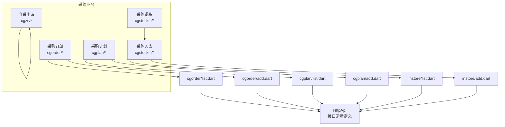
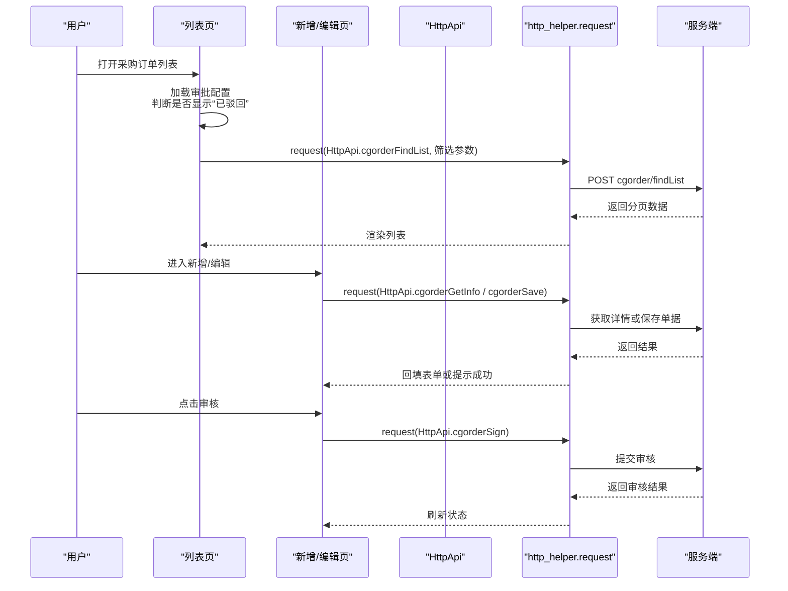
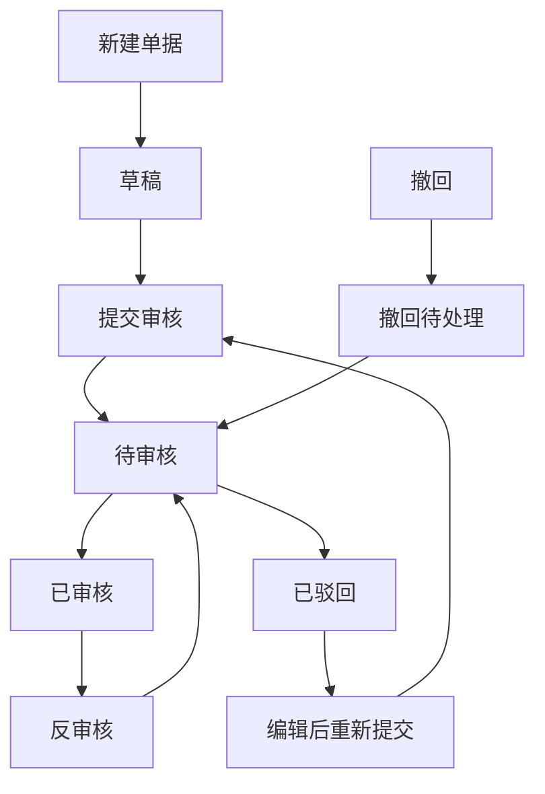
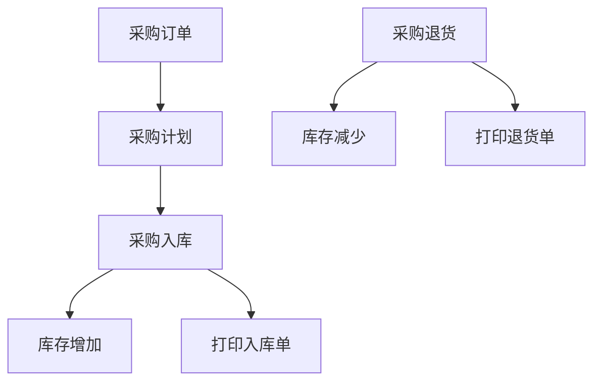
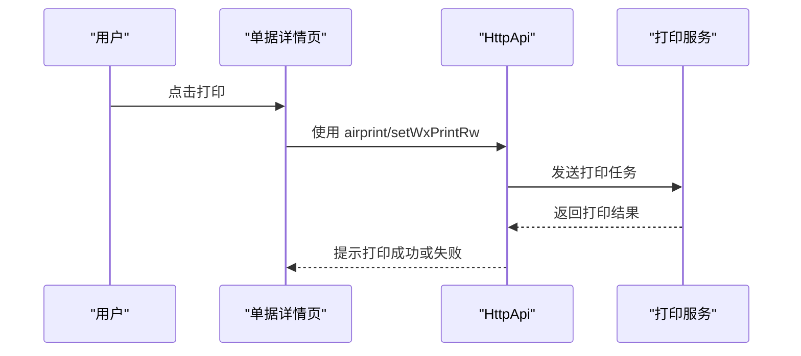

# 采购管理API

<cite>
**本文引用的文件**   
- [lib/net/http_api.dart](file://lib/net/http_api.dart)
- [lib/pages/business/purchase/cgorder/list.dart](file://lib/pages/business/purchase/cgorder/list.dart)
- [lib/pages/business/purchase/cgorder/add.dart](file://lib/pages/business/purchase/cgorder/add.dart)
- [lib/pages/business/purchase/cgplan/list.dart](file://lib/pages/business/purchase/cgplan/list.dart)
- [lib/pages/business/purchase/cgplan/add.dart](file://lib/pages/business/purchase/cgplan/add.dart)
- [lib/pages/business/purchase/instore/list.dart](file://lib/pages/business/purchase/instore/list.dart)
- [lib/pages/business/purchase/instore/add.dart](file://lib/pages/business/purchase/instore/add.dart)
</cite>

## 目录
1. [简介](#简介)
2. [项目结构与范围](#项目结构与范围)
3. [核心接口总览](#核心接口总览)
4. [架构与调用链路](#架构与调用链路)
5. [详细接口规范](#详细接口规范)
6. [单据状态与审批流程](#单据状态与审批流程)
7. [库存联动机制](#库存联动机制)
8. [打印功能说明](#打印功能说明)
9. [异常处理与错误码约定](#异常处理与错误码约定)
10. [性能优化建议](#性能优化建议)
11. [最佳实践](#最佳实践)
12. [常见问题排查](#常见问题排查)
13. [结论](#结论)

## 简介
本文件为灵犀管店 Flutter 端“采购管理”业务模块的 API 文档，覆盖采购订单、采购计划、采购入库（含审核）、采购退货、自采申请等业务流程。文档从前端请求入口出发，结合 `HttpApi` 常量定义与页面实现，归纳接口路径、参数结构、响应字段、业务含义和状态流转，并给出库存联动、审批流程和打印能力的说明。

需要特别说明的是：本项目是客户端实现，后端接口的具体校验规则、库存扣增逻辑、审批路由策略由服务端决定；本文仅记录客户端侧可见的接口契约、参数传递方式及行为约定。

## 项目结构与范围
采购相关代码集中在 `lib/pages/business/purchase/` 下，按单据类型划分目录：
- `cgorder`：采购订货单（采购订单）
- `cgplan`：采购计划单
- `instore`：采购入库单（包含审核、反审核、打印）
- `cgth`：采购退货单（复用 `cgstockin/*` 接口）
- `cgthsq`：退货申请单（通过 `cgzc/generateCgStockRet` 生成退货入库）
- `cgzc`：自采申请单
- `cgother` / `cgothercd`：其他采购类单据（不在本次重点范围）

所有网络接口路径在 `lib/net/http_api.dart` 中集中声明，便于统一维护。

**图表来源**
- [lib/net/http_api.dart:1-200](file://lib/net/http_api.dart#L1-L200)
- [lib/pages/business/purchase/cgorder/list.dart:1-200](file://lib/pages/business/purchase/cgorder/list.dart#L1-L200)
- [lib/pages/business/purchase/cgorder/add.dart:1-200](file://lib/pages/business/purchase/cgorder/add.dart#L1-L200)
- [lib/pages/business/purchase/cgplan/list.dart:1-200](file://lib/pages/business/purchase/cgplan/list.dart#L1-L200)
- [lib/pages/business/purchase/cgplan/add.dart:1-200](file://lib/pages/business/purchase/cgplan/add.dart#L1-L200)
- [lib/pages/business/purchase/instore/list.dart:1-200](file://lib/pages/business/purchase/instore/list.dart#L1-L200)
- [lib/pages/business/purchase/instore/add.dart:1-200](file://lib/pages/business/purchase/instore/add.dart#L1-L200)

**章节来源**
- [lib/net/http_api.dart:1-200](file://lib/net/http_api.dart#L1-L200)
- [lib/pages/business/purchase/cgorder/list.dart:1-200](file://lib/pages/business/purchase/cgorder/list.dart#L1-L200)
- [lib/pages/business/purchase/cgplan/list.dart:1-200](file://lib/pages/business/purchase/cgplan/list.dart#L1-L200)
- [lib/pages/business/purchase/instore/list.dart:1-200](file://lib/pages/business/purchase/instore/list.dart#L1-L200)

## 核心接口总览
以下表格汇总采购相关核心接口。实际字段以服务端为准，客户端主要负责构造请求、展示数据和处理常见交互。

| 业务 | 接口常量 | 实际路径 | 用途 | 关键动作 |
| --- | --- | --- | --- | --- |
| 采购订单列表 | `cgorderFindList` | `cgorder/findList` | 查询采购订单分页列表 | 按单号、供应商、经手人、时间、审核状态筛选 |
| 采购订单详情 | `cgorderGetInfo` | `cgorder/getInfo` | 获取采购订单详情 | 新增编辑回填、查看 |
| 采购订单保存 | `cgorderSave` | `cgorder/save` | 新增或编辑采购订单 | 提交明细、附件、备注 |
| 采购订单审核 | `cgorderSign` | `cgorder/sign` | 审核通过 | 更新审核状态 |
| 采购订单反审核 | `cgorderRetsign` | `cgorder/retsign` | 反审核 | 回退审核状态 |
| 采购订单删除 | `cgorderDelBill` | `cgorder/delBill` | 删除单据 | 删除前需权限校验 |
| 采购订单停用 | `cgorderStop` | `cgorder/stop` | 停用单据 | 限制后续操作 |
| 采购订单打印 | `cgorderPrint` | `airprint/setWxPrintRw` | 调用打印服务 | 传入单据信息 |
| 采购计划列表 | `cgplanFindList` | `cgplan/findList` | 查询采购计划分页列表 | 按单号、创建人、时间、审核状态筛选 |
| 采购计划详情 | `cgplanGetInfo` | `cgplan/getInfo` | 获取采购计划详情 | 新增编辑回填 |
| 采购计划保存 | `cgplanSave` | `cgplan/save` | 新增或编辑采购计划 | 提交机构、经手人、商品明细 |
| 采购计划审核 | `cgplanSign` | `cgplan/sign` | 审核通过 | 更新审核状态 |
| 采购计划反审核 | `cgplanRetsign` | `cgplan/retsign` | 反审核 | 回退审核状态 |
| 采购计划删除 | `cgplanDelBill` | `cgplan/delBill` | 删除单据 | 删除前需权限校验 |
| 采购计划打印 | `cgplanPrint` | `airprint/setWxPrintRw` | 调用打印服务 | 传入单据信息 |
| 采购入库列表 | `purchaseInstoreList` | `cgstockin/findList` | 查询采购入库分页列表 | 按单号、仓库、供应商、时间、审核状态筛选 |
| 采购入库详情 | `purchaseInstoreGetInfo` | `cgstockin/getInfo` | 获取采购入库详情 | 新增编辑回填 |
| 采购入库保存 | `purchaseInstoreSave` | `cgstockin/save` | 新增或编辑采购入库 | 提交仓库、供应商、商品批次、进价 |
| 采购入库审核 | `purchaseInstoreSign` | `cgstockin/sign` | 审核通过 | 可能联动库存增加 |
| 采购入库反审核 | `purchaseInstoreRetsign` | `cgstockin/retsign` | 反审核 | 可能联动库存减少 |
| 采购入库删除 | `purchaseInstoreDelBill` | `cgstockin/delBill` | 删除单据 | 删除前需权限校验 |
| 采购入库打印 | `purchaseInstorePrint` | `airprint/setWxPrintRw` | 调用打印服务 | 传入单据信息 |
| 采购退货 | `cgth*` | `cgstockin/*` | 退货列表、详情、保存、审核、反审核、删除、打印 | 与采购入库共用 `cgstockin` 接口 |
| 自采申请 | `cgzc*` | `cgzc/*` | 自采申请列表、详情、保存、审核、反审核、删除、打印 | 可生成采购退货 |
| 退货申请转退货入库 | `cgthsqGenerateCgStockRet` | `cgzc/generateCgStockRet` | 将退货申请转为退货入库 | 触发退货入库流程 |

**章节来源**
- [lib/net/http_api.dart:1-200](file://lib/net/http_api.dart#L1-L200)

## 架构与调用链路
客户端采用“页面 + 网络工具 + 接口常量”的结构：
- `HttpApi` 提供全局接口常量，避免硬编码字符串分散在各页面。
- 各业务页面通过 `request` 发起网络请求，封装了通用请求头、鉴权、重试、错误提示等。
- 列表页通常先加载审批配置，动态决定是否显示“已驳回”标签；然后按 Tab 状态拼接 `signflag` 参数调用列表接口。
- 新增/编辑页根据是否已有 `billid` 区分新增或编辑模式，并在提交时携带对应动作。

**图表来源**
- [lib/pages/business/purchase/cgorder/list.dart:1-200](file://lib/pages/business/purchase/cgorder/list.dart#L1-L200)
- [lib/pages/business/purchase/cgorder/add.dart:1-200](file://lib/pages/business/purchase/cgorder/add.dart#L1-L200)
- [lib/net/http_api.dart:1-200](file://lib/net/http_api.dart#L1-L200)

**章节来源**
- [lib/pages/business/purchase/cgorder/list.dart:1-200](file://lib/pages/business/purchase/cgorder/list.dart#L1-L200)
- [lib/pages/business/purchase/cgorder/add.dart:1-200](file://lib/pages/business/purchase/cgorder/add.dart#L1-L200)
- [lib/net/http_api.dart:1-200](file://lib/net/http_api.dart#L1-L200)

## 详细接口规范

### 采购订单接口

#### 采购订单列表
- **接口路径**：`cgorder/findList`
- **请求方法**：POST
- **常用请求参数**
  - `is_page`：固定传 `1`，表示分页模式
  - `cond`：通用搜索条件，通常为空字符串
  - `field`：排序字段，如 `createtime`
  - `type`：排序方向，如 `desc`
  - `page`：当前页码
  - `billno`：单据编号模糊搜索
  - `datetype`：日期类型标识，通常为 `1`
  - `signflag`：审核状态，`0` 待审核、`1` 已审核、`2` 已驳回、空为全部
  - `supid`：供应商ID
  - `buyerid`：经手人ID
  - `sids`：机构ID集合
  - `starttime`、`endtime`：起止时间
- **典型响应结构**
  - `data.list`：订单列表数组
  - `data.total`：总条数（具体以服务端为准）
- **业务要点**
  - 列表页会根据“待审核”“已审核”“已驳回”Tab 自动设置 `signflag`
  - 首次进入会加载审批配置，若后台开启审批则显示“已驳回”Tab
  - 权限不足时会提示“无权查看采购订货”，但不会阻断列表加载失败后的兜底逻辑

**章节来源**
- [lib/pages/business/purchase/cgorder/list.dart:1-200](file://lib/pages/business/purchase/cgorder/list.dart#L1-L200)
- [lib/net/http_api.dart:1-200](file://lib/net/http_api.dart#L1-L200)

#### 采购订单详情
- **接口路径**：`cgorder/getInfo`
- **用途**：用于新增时默认值填充、编辑时回填单据数据、查看时展示完整信息
- **典型参数**
  - 通常包含单据主键，例如 `billid`
- **典型响应**
  - 返回订单头信息与明细数组，供表单回填
- **业务要点**
  - 新增模式会读取本地登录信息，如机构、经手人、审批用户
  - 编辑模式下会计算单据是否已审核、是否被驳回、是否处于撤回待处理态

**章节来源**
- [lib/pages/business/purchase/cgorder/add.dart:1-200](file://lib/pages/business/purchase/cgorder/add.dart#L1-L200)
- [lib/net/http_api.dart:1-200](file://lib/net/http_api.dart#L1-L200)

#### 采购订单保存
- **接口路径**：`cgorder/save`
- **用途**：新增或编辑采购订单
- **典型请求参数**
  - 单据头：供应商、机构、经手人、备注、单据编号等
  - 明细数组：商品、数量、单价、金额、批号等
  - 附件数组：文件列表
- **典型响应**
  - 新增成功后返回新单据ID，用于后续编辑跳转
- **业务要点**
  - 新增与编辑使用同一接口，服务端根据是否存在 `billid` 判断
  - 提交前会做表单快照，退出时检测未保存修改
  - 支持扫码枪输入条码，自动匹配商品

**章节来源**
- [lib/pages/business/purchase/cgorder/add.dart:1-200](file://lib/pages/business/purchase/cgorder/add.dart#L1-L200)
- [lib/net/http_api.dart:1-200](file://lib/net/http_api.dart#L1-L200)

#### 采购订单审核、反审核、删除、停用、打印
- **审核**：`cgorder/sign`
- **反审核**：`cgorder/retsign`
- **删除**：`cgorder/delBill`
- **停用**：`cgorder/stop`
- **打印**：`airprint/setWxPrintRw`
- **业务要点**
  - 审核通过后，单据状态变为已审核
  - 反审核用于撤销审核结果
  - 删除前通常需要权限校验
  - 打印走统一打印服务，传入单据信息即可

**章节来源**
- [lib/pages/business/purchase/cgorder/add.dart:1-200](file://lib/pages/business/purchase/cgorder/add.dart#L1-L200)
- [lib/net/http_api.dart:1-200](file://lib/net/http_api.dart#L1-L200)

### 采购计划接口

#### 采购计划列表
- **接口路径**：`cgplan/findList`
- **请求参数**
  - 与采购订单列表类似，包括分页、单号、时间、审核状态
  - 额外支持创建人筛选 `createid`
- **业务要点**
  - 同样根据审批配置动态显示“已驳回”Tab
  - 权限控制码为 `011201`

**章节来源**
- [lib/pages/business/purchase/cgplan/list.dart:1-200](file://lib/pages/business/purchase/cgplan/list.dart#L1-L200)
- [lib/net/http_api.dart:1-200](file://lib/net/http_api.dart#L1-L200)

#### 采购计划详情与保存
- **详情**：`cgplan/getInfo`
- **保存**：`cgplan/save`
- **业务要点**
  - 新增模式会从本地存储加载机构、经手人默认值
  - 支持扫码枪、批量选择、附件上传
  - 支持多级审批，按钮可见性由审批用户和角色决定

**章节来源**
- [lib/pages/business/purchase/cgplan/add.dart:1-200](file://lib/pages/business/purchase/cgplan/add.dart#L1-L200)
- [lib/net/http_api.dart:1-200](file://lib/net/http_api.dart#L1-L200)

#### 采购计划审核、反审核、删除、打印
- **审核**：`cgplan/sign`
- **反审核**：`cgplan/retsign`
- **删除**：`cgplan/delBill`
- **打印**：`airprint/setWxPrintRw`

**章节来源**
- [lib/net/http_api.dart:1-200](file://lib/net/http_api.dart#L1-L200)

### 采购入库接口

#### 采购入库列表
- **接口路径**：`cgstockin/findList`
- **请求参数**
  - 分页、单号、时间、审核状态
  - 仓库、供应商、创建人、退货状态、付款状态等
- **业务要点**
  - 权限控制码为 `011701`
  - 列表页会记录操作审计日志

**章节来源**
- [lib/pages/business/purchase/instore/list.dart:1-200](file://lib/pages/business/purchase/instore/list.dart#L1-L200)
- [lib/net/http_api.dart:1-200](file://lib/net/http_api.dart#L1-L200)

#### 采购入库详情与保存
- **详情**：`cgstockin/getInfo`
- **保存**：`cgstockin/save`
- **业务要点**
  - 新增模式自动拉取当前机构的默认仓库
  - 支持参考原单（如采购订单）
  - 支持商品批次、进价校验、扫码枪、附件
  - 支持多级审批与撤回

**章节来源**
- [lib/pages/business/purchase/instore/add.dart:1-300](file://lib/pages/business/purchase/instore/add.dart#L1-L300)
- [lib/net/http_api.dart:1-200](file://lib/net/http_api.dart#L1-L200)

#### 采购入库审核、反审核、删除、打印
- **审核**：`cgstockin/sign`
- **反审核**：`cgstockin/retsign`
- **删除**：`cgstockin/delBill`
- **打印**：`airprint/setWxPrintRw`

**章节来源**
- [lib/net/http_api.dart:1-200](file://lib/net/http_api.dart#L1-L200)

### 采购退货与自采申请

#### 采购退货
- **接口前缀**：`cgstockin/*`
- **列表**：`cgstockin/findList`
- **详情**：`cgstockin/getInfo`
- **保存**：`cgstockin/save`
- **审核**：`cgstockin/sign`
- **反审核**：`cgstockin/retsign`
- **删除**：`cgstockin/delBill`
- **打印**：`airprint/setWxPrintRw`
- **业务说明**：Flutter 端将采购退货与采购入库共用 `cgstockin` 接口，以保持与 Vue 端一致。

**章节来源**
- [lib/net/http_api.dart:1-200](file://lib/net/http_api.dart#L1-L200)

#### 自采申请
- **列表**：`cgzc/findList`
- **详情**：`cgzc/getInfo`
- **保存**：`cgzc/save`
- **审核**：`cgzc/sign`
- **反审核**：`cgzc/retsign`
- **删除**：`cgzc/delBill`
- **打印**：`airprint/setWxPrintRw`
- **特殊能力**：可通过 `cgzc/generateCgStockRet` 将退货申请转换为退货入库。

**章节来源**
- [lib/net/http_api.dart:1-200](file://lib/net/http_api.dart#L1-L200)

## 单据状态与审批流程

### 审核状态约定
多个采购单据共享类似的状态语义：
- `signflag = 0`：待审核
- `signflag = 1`：已审核
- `signflag = 2`：已驳回
- 空值或未传：全部

部分单据还支持撤回流程：
- `reviewsignflag = 2`：撤回待处理态

**图表来源**
- [lib/pages/business/purchase/cgorder/add.dart:1-200](file://lib/pages/business/purchase/cgorder/add.dart#L1-L200)
- [lib/pages/business/purchase/cgplan/add.dart:1-200](file://lib/pages/business/purchase/cgplan/add.dart#L1-L200)
- [lib/pages/business/purchase/instore/add.dart:1-300](file://lib/pages/business/purchase/instore/add.dart#L1-L300)

### 审批流程
- 列表页会通过 `ReviewConfigUtils.shouldShowRejectedTab` 动态判断是否显示“已驳回”Tab
- 新增/编辑页会加载审批流用户，控制“保存”“审核”“反审核”“撤回”等操作按钮的可见性
- 管理员或审批流中的用户才具备相应操作权限
- 不同单据类型的审批名称不同，例如“采购订货单”“采购计划单”“采购入库单”

**章节来源**
- [lib/pages/business/purchase/cgorder/list.dart:1-200](file://lib/pages/business/purchase/cgorder/list.dart#L1-L200)
- [lib/pages/business/purchase/cgplan/list.dart:1-200](file://lib/pages/business/purchase/cgplan/list.dart#L1-L200)
- [lib/pages/business/purchase/instore/list.dart:1-200](file://lib/pages/business/purchase/instore/list.dart#L1-L200)
- [lib/pages/business/purchase/cgorder/add.dart:1-200](file://lib/pages/business/purchase/cgorder/add.dart#L1-L200)
- [lib/pages/business/purchase/cgplan/add.dart:1-200](file://lib/pages/business/purchase/cgplan/add.dart#L1-L200)
- [lib/pages/business/purchase/instore/add.dart:1-300](file://lib/pages/business/purchase/instore/add.dart#L1-L300)

## 库存联动机制
- 采购入库审核通常与库存增加相关，反审核则可能减少库存。
- 采购退货审核通常与库存减少相关，反审核则可能恢复库存。
- 采购订单和采购计划本身不直接改变库存，它们更多是计划与指令单据；真正影响库存的关键节点通常在入库、出库、退货、盘盈盘亏等业务单据上。
- 入库新增时会尝试自动选择默认仓库，并过滤入库仓库标志，保证入库方向正确。

**图表来源**
- [lib/pages/business/purchase/instore/add.dart:1-300](file://lib/pages/business/purchase/instore/add.dart#L1-L300)
- [lib/net/http_api.dart:1-200](file://lib/net/http_api.dart#L1-L200)

**章节来源**
- [lib/pages/business/purchase/instore/add.dart:1-300](file://lib/pages/business/purchase/instore/add.dart#L1-L300)
- [lib/net/http_api.dart:1-200](file://lib/net/http_api.dart#L1-L200)

## 打印功能说明
采购相关单据的打印统一走 `airprint/setWxPrintRw` 接口。该接口不是业务单据接口，而是打印服务接口。

- 触发时机：用户点击“打印”按钮
- 入参：通常包含单据类型、单据编号、单据头与明细等信息
- 输出：由服务端对接打印机或微信打印服务

**图表来源**
- [lib/net/http_api.dart:1-200](file://lib/net/http_api.dart#L1-L200)

**章节来源**
- [lib/net/http_api.dart:1-200](file://lib/net/http_api.dart#L1-L200)

## 异常处理与错误码约定
客户端对异常的处理主要包括：
- 权限不足：弹出提示，但不一定中断后续逻辑
- 网络请求失败：通过 `http_helper.request` 统一处理
- 表单校验失败：在新增/编辑页进行本地校验
- 审批配置变化：动态调整“已驳回”Tab 和操作按钮
- 扫码输入异常：通过防抖、键盘隐藏、焦点控制等方式降低 PDA 扫码问题

服务端返回的具体错误码和错误消息以服务端为准；客户端一般会将结果中的 `data` 或错误信息展示给用户。

**章节来源**
- [lib/pages/business/purchase/cgorder/list.dart:1-200](file://lib/pages/business/purchase/cgorder/list.dart#L1-L200)
- [lib/pages/business/purchase/cgplan/list.dart:1-200](file://lib/pages/business/purchase/cgplan/list.dart#L1-L200)
- [lib/pages/business/purchase/instore/list.dart:1-200](file://lib/pages/business/purchase/instore/list.dart#L1-L200)
- [lib/pages/business/purchase/cgorder/add.dart:1-200](file://lib/pages/business/purchase/cgorder/add.dart#L1-L200)
- [lib/pages/business/purchase/cgplan/add.dart:1-200](file://lib/pages/business/purchase/cgplan/add.dart#L1-L200)
- [lib/pages/business/purchase/instore/add.dart:1-300](file://lib/pages/business/purchase/instore/add.dart#L1-L300)

## 性能优化建议
- 分页加载：列表页使用 `page`、`hasMore`、滚动到底部加载更多，避免一次性加载全部数据
- 防抖搜索：搜索框使用防抖定时器，减少频繁请求
- 权限前置校验：进入页面先校验权限，避免无效请求
- 审批配置缓存：审批配置变化时才重建 TabController，避免频繁重建
- 扫码防抖：PDA 扫码枪注入字符极快，使用 150ms 到 300ms 防抖避免重复查询
- 默认值异步回填：仓库、默认机构等异步加载完成后重建表单快照，避免误判脏数据
- 分页字段稳定：保持 `field=createtime`、`type=desc`，确保列表顺序稳定

**章节来源**
- [lib/pages/business/purchase/cgorder/list.dart:1-200](file://lib/pages/business/purchase/cgorder/list.dart#L1-L200)
- [lib/pages/business/purchase/cgplan/list.dart:1-200](file://lib/pages/business/purchase/cgplan/list.dart#L1-L200)
- [lib/pages/business/purchase/instore/list.dart:1-200](file://lib/pages/business/purchase/instore/list.dart#L1-L200)
- [lib/pages/business/purchase/cgorder/add.dart:1-200](file://lib/pages/business/purchase/cgorder/add.dart#L1-L200)
- [lib/pages/business/purchase/cgplan/add.dart:1-200](file://lib/pages/business/purchase/cgplan/add.dart#L1-L200)
- [lib/pages/business/purchase/instore/add.dart:1-300](file://lib/pages/business/purchase/instore/add.dart#L1-L300)

## 最佳实践
- 统一使用 `HttpApi` 中的常量，不要在各页面硬编码接口路径
- 列表页始终通过 `signflag` 控制审核状态筛选
- 新增/编辑页区分新增与编辑模式，避免重复生成单据ID
- 提交前建立表单快照，防止误弹窗提示未保存
- 扫码输入同时监听键盘事件和文本变化，兼顾硬件扫码器和软键盘
- 打印功能统一走 `airprint/setWxPrintRw`，不自行拼接打印协议
- 库存相关操作只应在入库、出库、退货等有明确库存影响的单据上进行

**章节来源**
- [lib/net/http_api.dart:1-200](file://lib/net/http_api.dart#L1-L200)
- [lib/pages/business/purchase/cgorder/add.dart:1-200](file://lib/pages/business/purchase/cgorder/add.dart#L1-L200)
- [lib/pages/business/purchase/cgplan/add.dart:1-200](file://lib/pages/business/purchase/cgplan/add.dart#L1-L200)
- [lib/pages/business/purchase/instore/add.dart:1-300](file://lib/pages/business/purchase/instore/add.dart#L1-L300)

## 常见问题排查
| 现象 | 可能原因 | 排查建议 |
| --- | --- | --- |
| 列表没有“已驳回”Tab | 后台未开启审批或无驳回数据 | 检查审批配置，确认业务类型是否启用审批 |
| 点击审核无反应 | 当前用户不在审批流或无权限 | 检查审批用户列表和当前用户角色 |
| 扫码枪重复触发 | 防抖失效或软键盘干扰 | 检查扫码防抖时间、焦点控制和键盘隐藏逻辑 |
| 默认仓库为空 | 当前机构为区域中心或无入库仓库 | 检查机构类型和仓库入库标志 |
| 打印失败 | 打印服务不可用或参数缺失 | 检查打印接口调用参数和网络状态 |
| 权限提示但列表仍可加载 | 权限校验失败但未阻断请求 | 检查权限码和后端权限配置 |

**章节来源**
- [lib/pages/business/purchase/cgorder/list.dart:1-200](file://lib/pages/business/purchase/cgorder/list.dart#L1-L200)
- [lib/pages/business/purchase/cgplan/list.dart:1-200](file://lib/pages/business/purchase/cgplan/list.dart#L1-L200)
- [lib/pages/business/purchase/instore/list.dart:1-200](file://lib/pages/business/purchase/instore/list.dart#L1-L200)
- [lib/pages/business/purchase/instore/add.dart:1-300](file://lib/pages/business/purchase/instore/add.dart#L1-L300)

## 结论
灵犀管店 Flutter 端的采购管理模块以 `HttpApi` 为中心，围绕采购订单、采购计划、采购入库、采购退货、自采申请等单据构建完整的前端调用链。接口路径清晰、状态语义统一、审批流程可配置、打印能力统一接入。库存联动主要由入库、退货等单据驱动，订单和计划更多承担计划与指令作用。

在实际集成时，应重点关注：
- 使用统一的接口常量
- 正确处理审核状态与审批配置
- 合理处理扫码、权限、分页和打印
- 将库存变更边界放在明确的库存单据上
- 与服务端对齐字段命名和状态语义