# 采购计划单API

<cite>
**本文引用的文件**
- [http_api.dart](file://lib/net/http_api.dart)
- [list.dart](file://lib/pages/business/purchase/cgplan/list.dart)
- [add.dart](file://lib/pages/business/purchase/cgplan/add.dart)
- [router.dart](file://lib/pages/business/purchase/cgplan/router.dart)
</cite>

## 目录
1. [简介](#简介)
2. [项目结构与入口](#项目结构与入口)
3. [核心接口总览](#核心接口总览)
4. [业务流程与状态模型](#业务流程与状态模型)
5. [详细接口规范](#详细接口规范)
6. [数据模型与计算逻辑](#数据模型与计算逻辑)
7. [关联关系与执行跟踪](#关联关系与执行跟踪)
8. [依赖与调用链分析](#依赖与调用链分析)
9. [性能与体验特征](#性能与体验特征)
10. [最佳实践](#最佳实践)
11. [常见问题与错误处理](#常见问题与错误处理)
12. [结论](#结论)

## 简介
本文件面向灵犀管店 Flutter 客户端中的“采购计划单”能力，围绕以下后端接口进行完整说明：
- cgplan/findList：采购计划列表查询
- cgplan/getInfo：计划详情获取
- cgplan/save：计划保存（新增或编辑）
- cgplan/sign：计划审核
- cgplan/retsign：计划反审核
- cgplan/delBill：删除单据

文档重点包括：
- 接口参数、返回结构、权限控制与错误处理
- 创建、编辑、审核、反审核、撤回的业务流程
- 数量与金额计算、供应商/机构匹配、价格策略
- 采购计划与后续采购订单的关联关系及执行跟踪思路
- 批量操作、智能补货建议、计划调整优化等实用指南

## 项目结构与入口
采购计划功能位于业务模块 `lib/pages/business/purchase/cgplan`，包含两个页面：
- 列表页：`CgplanListPage`，负责筛选、分页、状态 Tab 和跳转
- 详情页/新增页：`CgplanAddPage`，负责详情加载、表单校验、保存、审核、反审核、删除、打印与多级审批

路由定义在 `router.dart`，暴露两个路由：
- `/purchase/cgplan/list`
- `/purchase/cgplan/add`

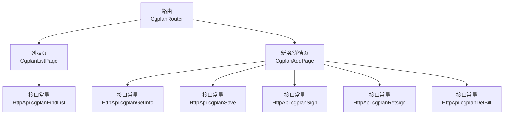

**图表来源**
- [router.dart:1-25](file://lib/pages/business/purchase/cgplan/router.dart#L1-L25)
- [http_api.dart:140-170](file://lib/net/http_api.dart#L140-L170)

**章节来源**
- [router.dart:1-25](file://lib/pages/business/purchase/cgplan/router.dart#L1-L25)

## 核心接口总览
| 接口 | 方法定位 | 主要用途 | 关键权限 | 典型入参字段 | 典型返回字段 |
|---|---|---|---|---|---|
| cgplan/findList | 列表查询 | 分页检索采购计划，支持状态、时间、门店、制单人、单号模糊 | 查看权限 `011201` | is_page、cond、field、type、page、billno、datetype、signflag、buyerid、signid、starttime、endtime、sids、createid | data.list、分页信息 |
| cgplan/getInfo | 详情获取 | 加载计划头信息与明细、附件、审批流 | 查看权限 | billid 等业务主键（由调用方传入） | storename、buyername、remark、detaillist、fileLists、reviewFlowUsers、reviewBillFlows |
| cgplan/save | 保存 | 新增或更新采购计划 | 新增 `011202` / 编辑 `011203` | bsid、storename、buyerid、buyername、remark、detaillist、fileLists、billqty、billamt、signflag | retmsg、data.billid |
| cgplan/sign | 审核 | 将计划置为已审核，进入可执行阶段 | 审核权限 `011205` | 完整单据对象 + signflag=1、reviewsignflag、reviewremark | retmsg |
| cgplan/retsign | 反审核 | 将已审核计划回退到未审核态 | 反审核权限（含管理员兜底） | 完整单据对象，必要时补充 billdate、billtypeid、detaillist | retmsg |
| cgplan/delBill | 删除 | 删除计划单据 | 删除权限 `011204` | 完整单据对象 | retmsg |

上述接口的字符串常量统一维护在 `HttpApi` 中，前端通过 `request(HttpApi.xxx, params)` 发起。

**章节来源**
- [http_api.dart:140-170](file://lib/net/http_api.dart#L140-L170)
- [list.dart:150-210](file://lib/pages/business/purchase/cgplan/list.dart#L150-L210)
- [add.dart:380-470](file://lib/pages/business/purchase/cgplan/add.dart#L380-L470)
- [add.dart:490-600](file://lib/pages/business/purchase/cgplan/add.dart#L490-L600)
- [add.dart:700-840](file://lib/pages/business/purchase/cgplan/add.dart#L700-L840)

## 业务流程与状态模型
### 状态语义
- signflag=0：未审核（草稿）
- signflag=1：已审核（可执行）
- signflag=2：已驳回（需重新处理）
- reviewsignflag=2：撤回待处理（多级审批场景下可撤回并重新走审批）

### 流程概览
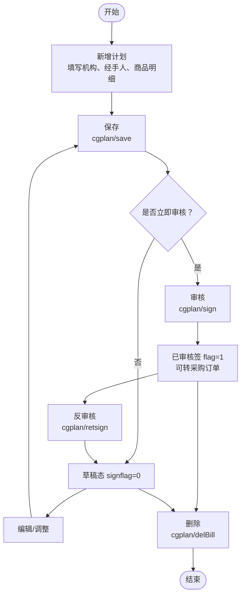

该流程对应前端：
- 新增/编辑后调用 `cgplan/save`
- 审核调用 `cgplan/sign`
- 反审核调用 `cgplan/retsign`
- 删除调用 `cgplan/delBill`

**章节来源**
- [add.dart:380-470](file://lib/pages/business/purchase/cgplan/add.dart#L380-L470)
- [add.dart:490-600](file://lib/pages/business/purchase/cgplan/add.dart#L490-L600)
- [add.dart:700-840](file://lib/pages/business/purchase/cgplan/add.dart#L700-L840)

## 详细接口规范

### cgplan/findList：采购计划列表查询
- 触发位置：列表页 `_loadData`
- 核心行为：
  - 根据 Tab 状态设置 signflag：全部为空、待审核为 `0`、已审核为 `1`、已驳回为 `2`
  - 支持按单号 billno、时间范围 starttime/endtime、机构 sids、制单人 createid 过滤
  - 分页参数 is_page、page、field、type
- 权限校验：`011201`
- 返回结构：data.list 为行集合，每行包含计划基本信息与 signflag

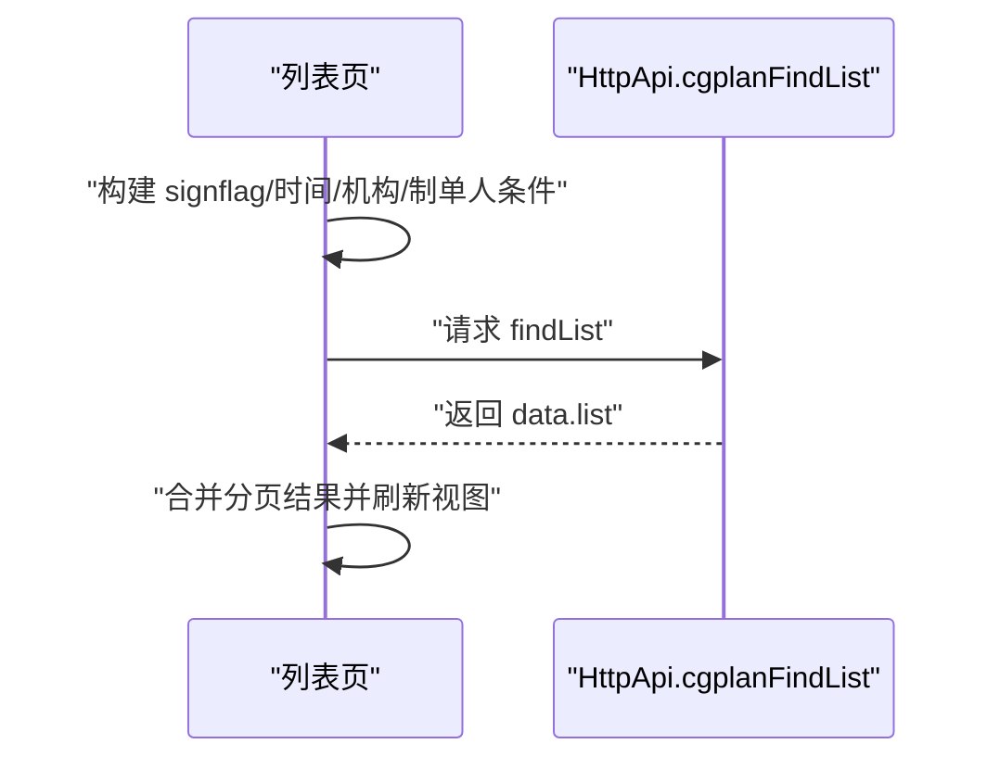

**图表来源**
- [list.dart:150-210](file://lib/pages/business/purchase/cgplan/list.dart#L150-L210)

**章节来源**
- [list.dart:150-210](file://lib/pages/business/purchase/cgplan/list.dart#L150-L210)

### cgplan/getInfo：计划详情获取
- 触发位置：编辑模式下 `_loadDetail`
- 核心行为：
  - 回填 storename、buyername、remark、bsid/storeid、buyerid/buyername
  - 解析 reviewFlowUsers、reviewBillFlows 用于审批展示
  - 解析 detaillist 为前端 _DetailRow 列表，并根据 cgprice 优先规则计算 price 与 amt
- 返回关键字段：
  - 头信息：storename、buyername、remark、bsid/storeid、buyerid、signflag
  - 明细：productname/name、prodid/productid、barcode/selfbarcode、qty、price、cgprice、amt
  - 审批：reviewFlowUsers、reviewBillFlows
  - 附件：fileLists

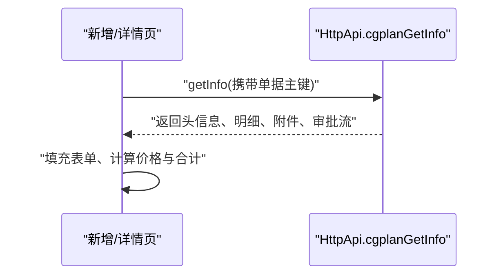

**图表来源**
- [add.dart:230-310](file://lib/pages/business/purchase/cgplan/add.dart#L230-L310)

**章节来源**
- [add.dart:230-310](file://lib/pages/business/purchase/cgplan/add.dart#L230-L310)

### cgplan/save：计划保存
- 触发位置：新增/编辑页 `_submit`
- 权限：
  - 新增：`011202`
  - 编辑：`011203`
- 校验规则：
  - 必须选择采购机构
  - 至少有一行商品明细
  - 每行数量必须大于 0
- 参数构造：
  - 头：bsid、storename、buyerid、buyername、remark、signflag
  - 明细：detaillist（由 `_buildSubmitDetailList` 生成）
  - 汇总：billqty、billamt
  - 附件：fileLists
- 返回：
  - retmsg：提示消息
  - data：保存后的单据对象，可能包含 billid 与新审批流数据

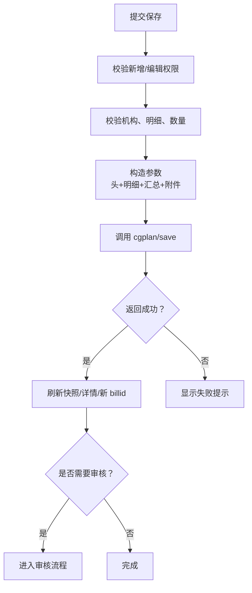

**图表来源**
- [add.dart:380-470](file://lib/pages/business/purchase/cgplan/add.dart#L380-L470)
- [add.dart:1200-1260](file://lib/pages/business/purchase/cgplan/add.dart#L1200-L1260)

**章节来源**
- [add.dart:380-470](file://lib/pages/business/purchase/cgplan/add.dart#L380-L470)
- [add.dart:1200-1260](file://lib/pages/business/purchase/cgplan/add.dart#L1200-L1260)

### cgplan/sign：计划审核
- 触发位置：
  - 保存后立即审核：`_doSignAfterSave`
  - 直接审核：`_sign`
- 权限：`011205`
- 行为：
  - 若配置多级审批且当前用户属于审批节点，弹出审批弹窗
  - 无多级审批时弹出确认框
  - 最终构造 signflag=1、reviewsignflag、reviewremark，调用 cgplan/sign
- 特殊场景：
  - 撤回待处理：reviewsignflag=2 时保持撤回状态
  - 驳回：reviewsignflag=0 时保持驳回状态

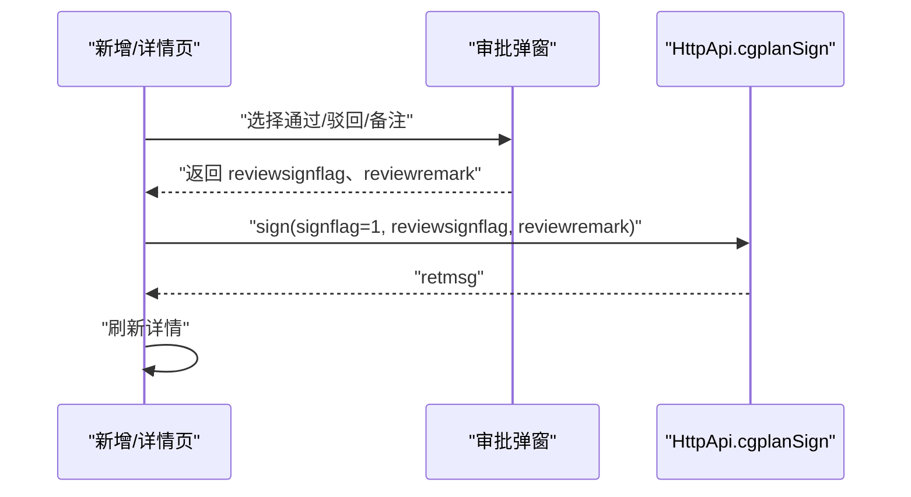

**图表来源**
- [add.dart:490-560](file://lib/pages/business/purchase/cgplan/add.dart#L490-L560)
- [add.dart:700-840](file://lib/pages/business/purchase/cgplan/add.dart#L700-L840)

**章节来源**
- [add.dart:490-560](file://lib/pages/business/purchase/cgplan/add.dart#L490-L560)
- [add.dart:700-840](file://lib/pages/business/purchase/cgplan/add.dart#L700-L840)

### cgplan/retsign：计划反审核
- 触发位置：`_retsign`
- 权限：管理员或审批流允许的反审人员
- 行为：
  - 构造完整单据对象
  - 兜底补充 billdate、billid、billtypeid、detaillist
  - 调用 cgplan/retsign，成功后清空本地审批流并重新加载详情

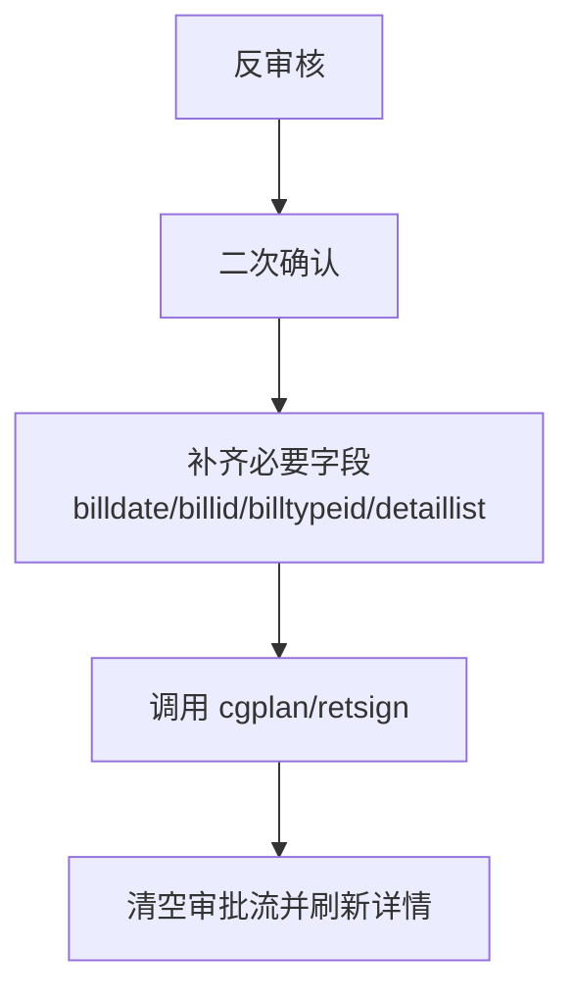

**图表来源**
- [add.dart:530-580](file://lib/pages/business/purchase/cgplan/add.dart#L530-L580)

**章节来源**
- [add.dart:530-580](file://lib/pages/business/purchase/cgplan/add.dart#L530-L580)

### cgplan/delBill：删除单据
- 触发位置：`_delBill`
- 权限：`011204`
- 行为：
  - 二次确认后发送完整单据对象
  - 成功后提示并返回列表

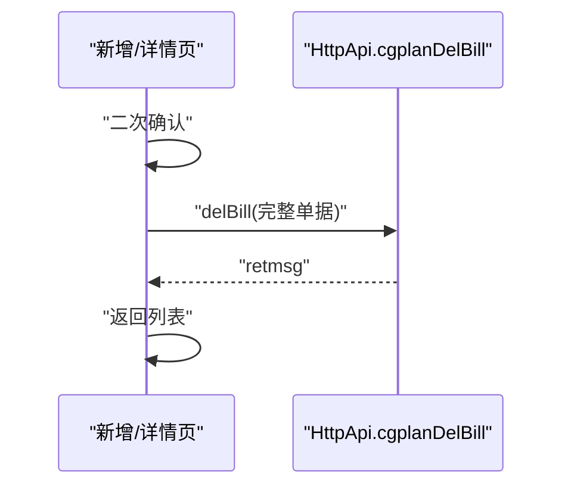

**图表来源**
- [add.dart:580-620](file://lib/pages/business/purchase/cgplan/add.dart#L580-L620)

**章节来源**
- [add.dart:580-620](file://lib/pages/business/purchase/cgplan/add.dart#L580-L620)

## 数据模型与计算逻辑

### 头信息模型
| 字段 | 类型 | 说明 |
|---|---|---|
| billid | 字符串 | 单据主键 |
| bsid / storeid | 数值或字符串 | 采购机构ID |
| storename | 字符串 | 采购机构名称 |
| buyerid / buyername | 字符串 | 经手人ID与姓名 |
| remark | 字符串 | 备注 |
| signflag | 数字 | 0=未审核，1=已审核，2=已驳回 |
| reviewsignflag | 数字 | 多级审批状态，2=撤回待处理，0=驳回，1=通过 |
| reviewremark | 字符串 | 审批备注 |
| billqty | 数值 | 计划总数量 |
| billamt | 数值 | 计划总金额 |
| fileLists | 数组 | 附件列表 |
| detaillist | 数组 | 商品明细 |

### 明细行模型
| 字段 | 类型 | 说明 |
|---|---|---|
| prodid / productid | 字符串 | 商品ID |
| productname / name | 字符串 | 商品名称 |
| barcode / selfbarcode | 字符串 | 条码 |
| qty | 数值 | 数量 |
| price | 数值 | 单价 |
| cgprice | 数值 | 采购价（优先级高于档案进价） |
| amt | 数值 | 金额=数量×单价 |
| unit / size / unitonlyid / sizeonlyid | 字符串 | 单位与规格标识 |

### 价格与数量计算规则
- 明细单价优先使用采购价 cgprice；当 cgprice 为 0 或空时，回退到档案进价 price
- 行金额始终由 qty × price 重算
- 提交前统一格式化 qty（保留1位小数）、price（保留2位小数）、amt（保留3位小数）
- 合计 billqty 为所有明细 qty 之和，billamt 为所有明细 amt 之和并进行舍入

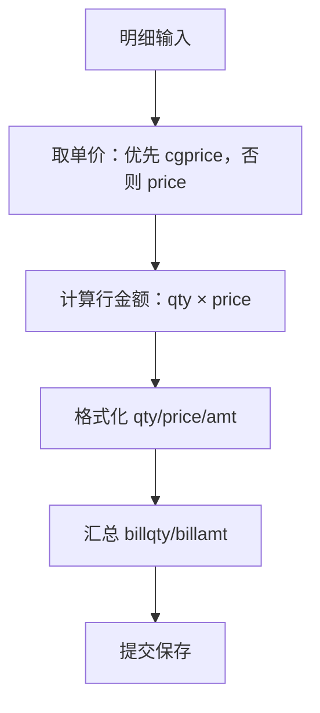

**图表来源**
- [add.dart:230-310](file://lib/pages/business/purchase/cgplan/add.dart#L230-L310)
- [add.dart:1200-1260](file://lib/pages/business/purchase/cgplan/add.dart#L1200-L1260)

**章节来源**
- [add.dart:230-310](file://lib/pages/business/purchase/cgplan/add.dart#L230-L310)
- [add.dart:1200-1260](file://lib/pages/business/purchase/cgplan/add.dart#L1200-L1260)

## 关联关系与执行跟踪

### 与采购订单的关系
- 采购计划单作为上游需求计划，通常由计划审核后转化为采购订单进行实际采购执行
- 虽然本仓库未直接实现“从计划单生成采购订单”的界面逻辑，但计划单的 signflag=1 表示已进入可执行阶段，可作为下游订单生成的依据
- 建议在后台或扩展层建立“计划单→订单”的映射关系，以便跟踪：
  - 计划单 billid 与订单 billid 的对应关系
  - 已下单数量、已入库数量、未执行数量
  - 计划变更时的差异对比与预警

### 计划执行状态跟踪机制
- 前端通过 signflag 与 reviewsignflag 表达计划生命周期：
  - 草稿：signflag=0
  - 审核通过：signflag=1
  - 驳回：signflag=2
  - 撤回待处理：reviewsignflag=2
- 列表页通过 signflag 分类显示“待审核/已审核/已驳回”，便于追踪
- 详情页通过 reviewFlowUsers、reviewBillFlows 展示多级审批节点与日志

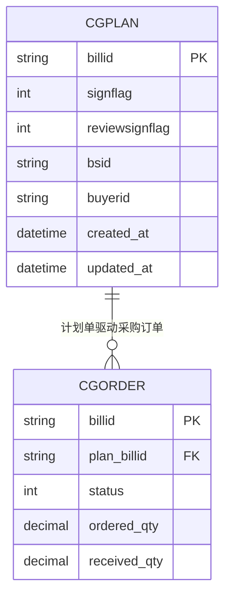

该图为概念建模，用于说明计划与订单的关联方向，不直接对应具体代码文件。

## 依赖与调用链分析

### 前端组件依赖
- 列表页依赖：
  - HttpApi.cgplanFindList
  - 权限工具 PermissionUtils
  - 日期选择器与筛选抽屉
- 新增/详情页依赖：
  - HttpApi.cgplanGetInfo、cgplanSave、cgplanSign、cgplanRetsign、cgplanDelBill
  - 权限工具 PermissionUtils
  - 扫码与商品查询：productGetList
  - 审批配置：reviewTypeConfig/getNewBillSignUser

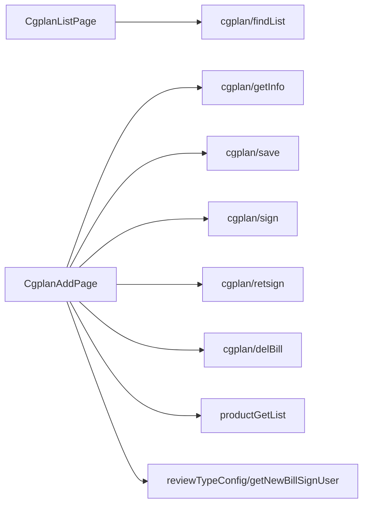

**图表来源**
- [list.dart:150-210](file://lib/pages/business/purchase/cgplan/list.dart#L150-L210)
- [add.dart:230-310](file://lib/pages/business/purchase/cgplan/add.dart#L230-L310)
- [add.dart:380-470](file://lib/pages/business/purchase/cgplan/add.dart#L380-L470)
- [add.dart:530-620](file://lib/pages/business/purchase/cgplan/add.dart#L530-L620)
- [add.dart:700-840](file://lib/pages/business/purchase/cgplan/add.dart#L700-L840)
- [add.dart:2180-2320](file://lib/pages/business/purchase/cgplan/add.dart#L2180-L2320)

**章节来源**
- [list.dart:150-210](file://lib/pages/business/purchase/cgplan/list.dart#L150-L210)
- [add.dart:230-310](file://lib/pages/business/purchase/cgplan/add.dart#L230-L310)
- [add.dart:380-470](file://lib/pages/business/purchase/cgplan/add.dart#L380-L470)
- [add.dart:530-620](file://lib/pages/business/purchase/cgplan/add.dart#L530-L620)
- [add.dart:700-840](file://lib/pages/business/purchase/cgplan/add.dart#L700-L840)
- [add.dart:2180-2320](file://lib/pages/business/purchase/cgplan/add.dart#L2180-L2320)

## 性能与体验特征
- 列表分页：通过滚动到底部自动加载更多，避免一次性加载全量数据
- 搜索防抖：搜索输入延迟 500ms 再请求，减少频繁网络请求
- 审批配置动态 Tab：根据后台审批配置决定是否显示“已驳回”Tab，避免 UI 与数据不一致
- 表单快照：新增/编辑模式记录表单快照，返回时检测未保存修改并提示
- 扫码体验：
  - 支持红外扫码枪连续输入，150ms 防抖触发条码解析
  - 条码命中多条时跳转选品页，一条时直接插入明细
  - 复合去重：同一商品不同包装/规格视为不同行，避免重复覆盖

[本节为通用性能说明，不直接分析具体代码文件]

## 最佳实践

### 采购计划创建与编辑
- 明确采购机构与经手人，确保价格与库存查询上下文正确
- 使用扫码或选品组件添加明细，注意单位与规格区分
- 优先检查采购价 cgprice；如无则回退到档案进价 price
- 保存前校验数量大于 0，避免无效计划

### 审核与反审核
- 已审核计划才可转为采购订单；未审核计划应先保存并审核
- 多级审批时，仅当前审批节点人员可进行审批操作
- 反审核前应评估对下游订单的影响，必要时先暂停或取消关联订单

### 批量操作
- 列表页支持按状态、时间、机构、制单人组合筛选，便于批量导出与分析
- 新增/编辑页支持批量选择与批量删除明细行，提升录入效率

### 智能补货建议
- 利用产品查询接口 productGetList，结合门店库存、销售趋势、安全库存策略，生成补货建议
- 建议将补货建议以预填明细形式呈现，再由人工确认与调整

### 计划调整优化
- 对已审核计划进行修改时，应重新走审核流程，确保版本一致
- 对频繁变更的计划，建议增加备注与变更记录，便于审计与复盘

[本节为通用实践建议，不直接分析具体代码文件]

## 常见问题与错误处理

### 权限相关
- 查看列表无数据：检查权限 `011201`
- 无法新增：检查权限 `011202`
- 无法编辑：检查权限 `011203`
- 无法删除：检查权限 `011204`
- 无法审核：检查权限 `011205`
- 无法反审核：检查是否为管理员或审批流允许的反审人员

### 数据校验
- “请选择采购机构”：头信息缺失 bsid/storeid
- “请选择商品”：明细为空
- “请填写数量”：某行 qty=0 或未填
- “未查询到该商品”：扫码或选品未命中任何商品

### 审批问题
- “您不属于当前审批节点的审核人”：当前用户不在 reviewFlowUsers 中
- 审批弹窗未出现：未配置多级审批或用户为管理员
- 撤回后仍需重新审批：reviewsignflag=2 表示撤回待处理，需重新走审批流程

### 网络与异常
- 列表加载失败：捕获异常后将 hasMore 置为 false，停止分页
- 详情加载失败：loading 状态恢复，避免界面卡死
- 保存/审核/反审核/删除失败：统一显示 retmsg 提示，并保持当前页面数据不变

**章节来源**
- [list.dart:150-210](file://lib/pages/business/purchase/cgplan/list.dart#L150-L210)
- [add.dart:380-470](file://lib/pages/business/purchase/cgplan/add.dart#L380-L470)
- [add.dart:490-620](file://lib/pages/business/purchase/cgplan/add.dart#L490-L620)
- [add.dart:700-840](file://lib/pages/business/purchase/cgplan/add.dart#L700-L840)
- [add.dart:2180-2320](file://lib/pages/business/purchase/cgplan/add.dart#L2180-L2320)

## 结论
灵犀管店 Flutter 的采购计划单模块通过清晰的接口分层与页面职责划分，实现了从计划创建、编辑、审核到反审核、删除的全链路管理。前端在权限控制、审批流程、价格策略、扫码体验等方面提供了完善的交互支撑。建议在后台或扩展层完善“计划单→采购订单”的关联与执行跟踪，并结合库存与销售数据引入智能补货建议，进一步提升计划准确性与采购效率。