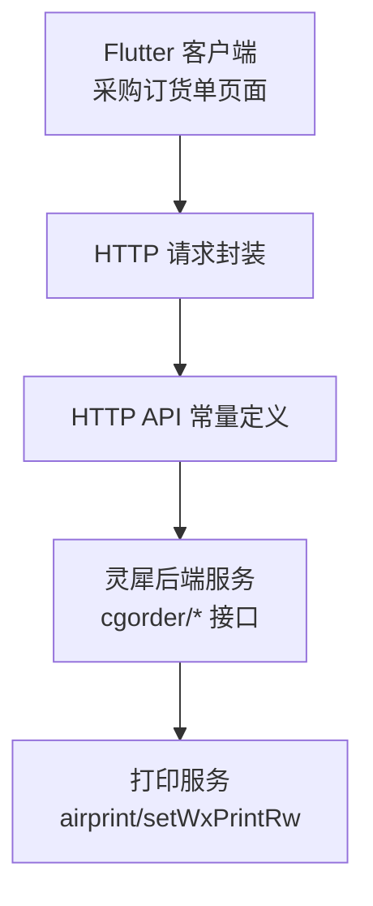
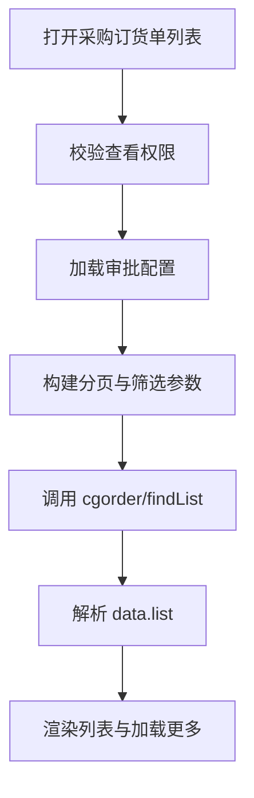
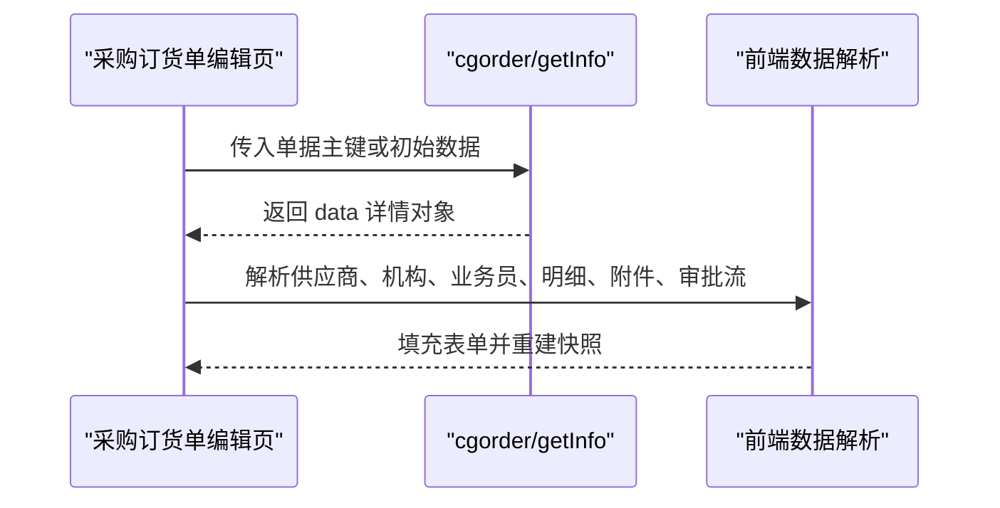
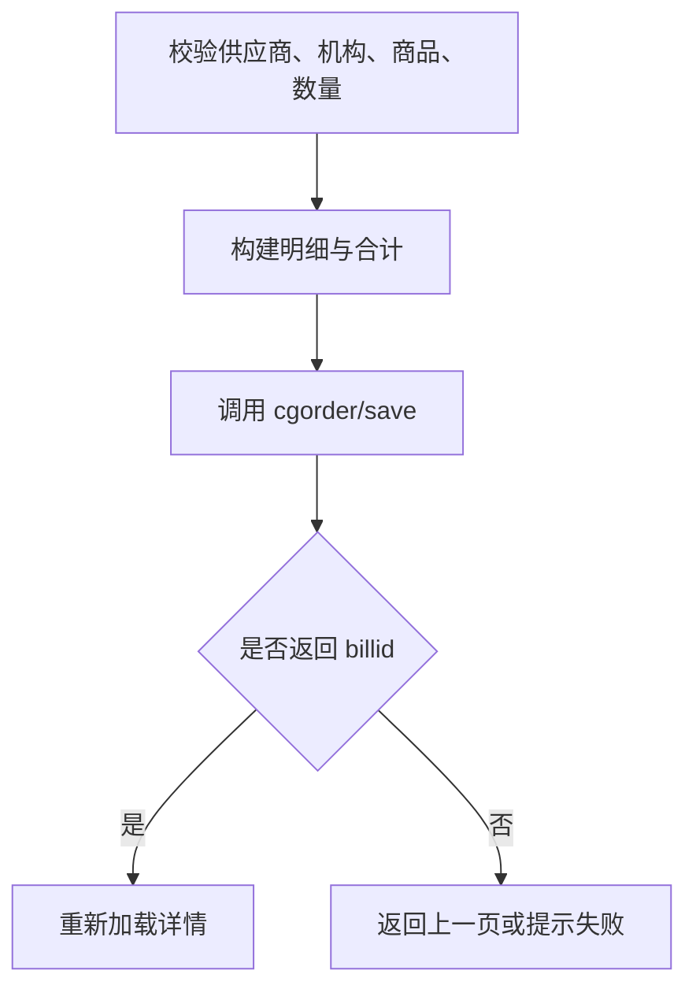
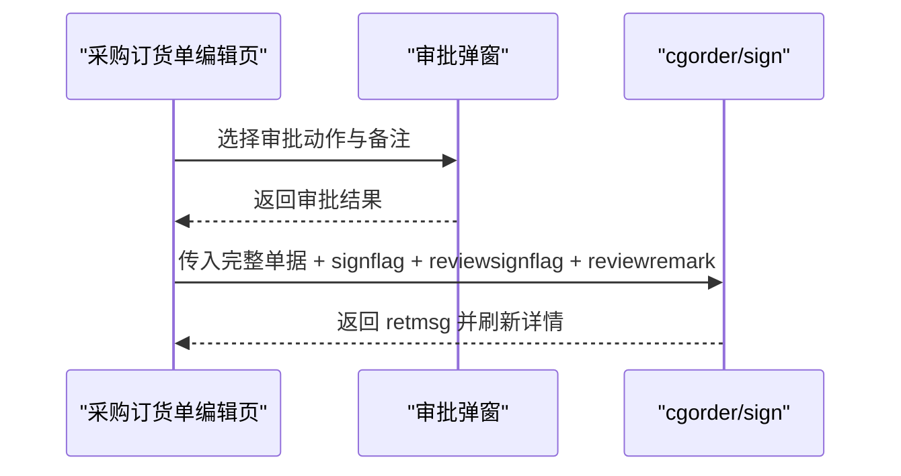
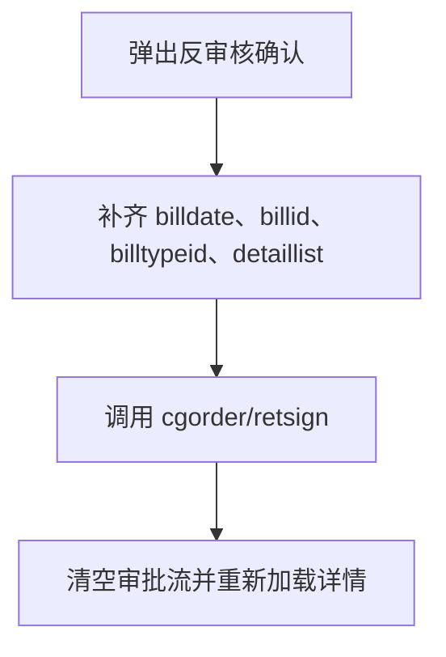
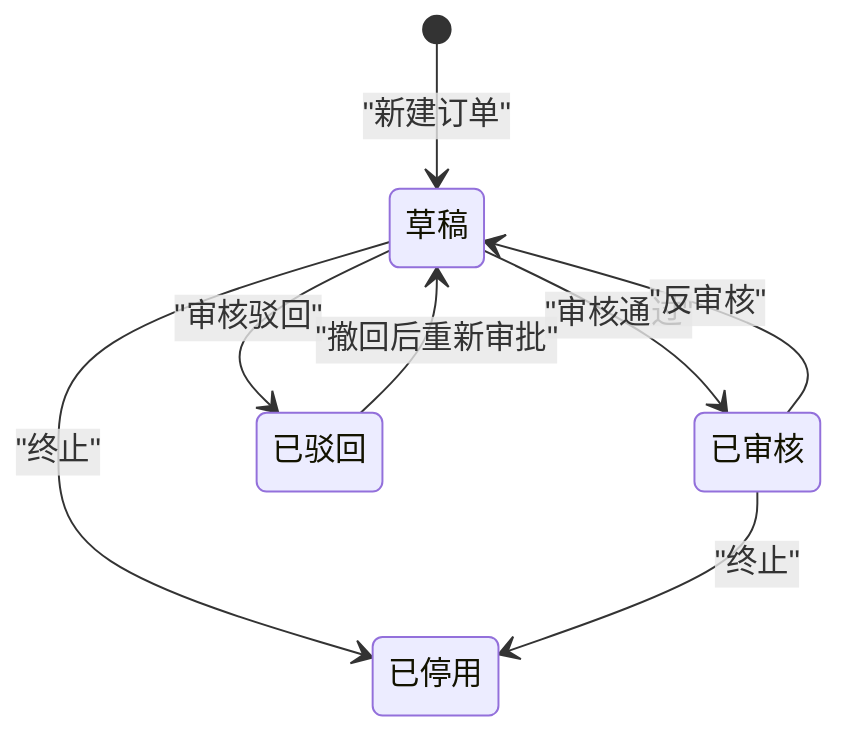
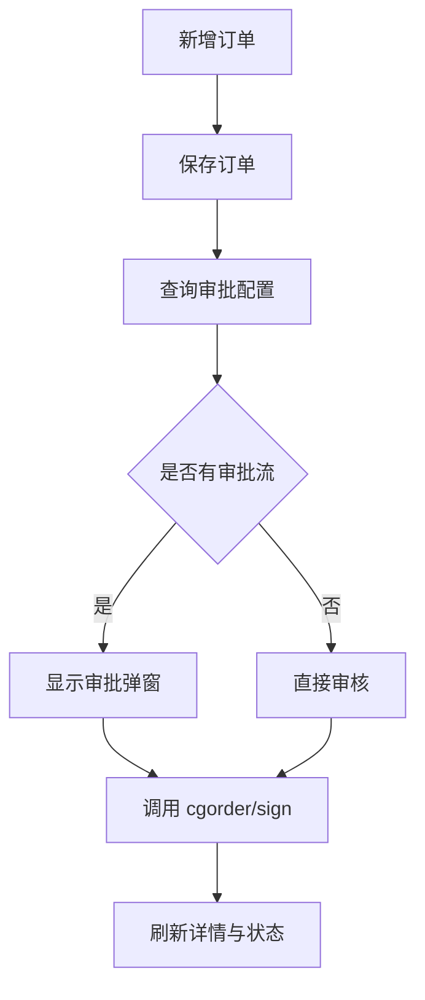

# 采购订货单API

<cite>
**本文引用的文件**   
- [http_api.dart](file://lib/net/http_api.dart)
- [list.dart](file://lib/pages/business/purchase/cgorder/list.dart)
- [add.dart](file://lib/pages/business/purchase/cgorder/add.dart)
</cite>

## 目录
1. [文档目标与适用范围](#文档目标与适用范围)
2. [系统边界与基础约定](#系统边界与基础约定)
3. [采购订货单业务模型](#采购订货单业务模型)
4. [接口总览](#接口总览)
5. [接口详细规范](#接口详细规范)
6. [状态流转与审批流程](#状态流转与审批流程)
7. [打印功能与库存联动说明](#打印功能与库存联动说明)
8. [典型业务场景与最佳实践](#典型业务场景与最佳实践)
9. [异常处理与权限规则](#异常处理与权限规则)
10. [常见问题排查](#常见问题排查)
11. [结论](#结论)

## 文档目标与适用范围
本文面向灵犀管店 Flutter 客户端中“采购订货单”功能的后端 API 调用方，重点覆盖以下能力：
- 查询采购订货单列表。
- 获取采购订货单详情。
- 保存新增或编辑后的订单。
- 提交审核、反审核、删除单据、终止停用。
- 打印订单。
- 结合多级审批配置控制可编辑性、可审核性与撤回逻辑。

本文不假设后端返回字段的具体枚举值，只依据 Flutter 前端实际构造的请求参数和页面行为，给出稳定、可复用的接口契约。

## 系统边界与基础约定
- 所有采购订货单相关接口均通过统一的 HTTP 请求方法发起，最终调用 `HttpApi` 中定义的字符串常量。
- 基础服务地址由全局网络配置提供；当前仓库中采购订货单使用的基础路径前缀为云端环境。
- 统一响应结构由通用网络层封装，业务接口通常以 `data` 承载业务数据，以 `retmsg` 承载提示信息。

**图示来源** 
- [http_api.dart:1-200](file://lib/net/http_api.dart#L1-L200)
- [add.dart:757-760](file://lib/pages/business/purchase/cgorder/add.dart#L757-L760)

**章节来源**
- [http_api.dart:1-200](file://lib/net/http_api.dart#L1-L200)

## 采购订货单业务模型
采购订货单是门店向供应商发起的采购计划单据，核心概念如下：
- 单据头信息包括供应商、订货机构、业务员、备注、单据编号、创建时间等。
- 单据明细包含商品、数量、进价、赠品数量、金额、包装换算件数、备注等。
- 单据状态用于表达草稿、已提交、已审核、已驳回、已停用等业务含义。
- 单据可能参与多级审批流，审批通过后才会进入正式业务状态。

| 概念 | 说明 |
|---|---|
| 供应商 | 订货对象，必填项之一。 |
| 订货机构 | 接收采购货物的门店或机构，必填项之一。 |
| 业务员 | 可选的业务负责人。 |
| 单据明细 | 至少包含商品、数量、单价、金额等字段。 |
| 审批流 | 根据机构与单据类型动态配置是否显示待审核、已驳回等 Tab。 |

**章节来源**
- [list.dart:1-120](file://lib/pages/business/purchase/cgorder/list.dart#L1-L120)
- [add.dart:280-360](file://lib/pages/business/purchase/cgorder/add.dart#L280-L360)

## 接口总览
本节列出采购订货单涉及的 API 常量及职责。

| 接口常量 | URL 片段 | 主要用途 | 调用位置 |
|---|---|---|---|
| `cgorder/findList` | `cgorder/findList` | 查询采购订货单列表 | 列表页加载数据 |
| `cgorder/getInfo` | `cgorder/getInfo` | 获取采购订货单详情 | 编辑/新增页加载已有单据 |
| `cgorder/save` | `cgorder/save` | 保存新增或编辑的订单 | 新增页保存、保存并审核 |
| `cgorder/sign` | `cgorder/sign` | 提交审核、撤回 | 详情页审核、撤回 |
| `cgorder/retsign` | `cgorder/retsign` | 反审核 | 详情页反审核 |
| `cgorder/delBill` | `cgorder/delBill` | 删除单据 | 详情页删除 |
| `cgorder/stop` | `cgorder/stop` | 终止停用 | 详情页终止 |
| `airprint/setWxPrintRw` | `airprint/setWxPrintRw` | 打印单据 | 详情页打印 |

**章节来源**
- [http_api.dart:120-170](file://lib/net/http_api.dart#L120-L170)

## 接口详细规范

### 采购订单列表查询：cgorder/findList
- **业务目的**：分页查询采购订货单列表，支持按单号、供应商、业务员、机构、时间范围和状态筛选。
- **HTTP 方法**：由通用请求方法发起，实际为后端列表查询接口。
- **URL 路径**：`cgorder/findList`
- **请求参数**

| 字段 | 类型 | 是否必填 | 说明 |
|---|---|---:|---|
| `is_page` | 数值 | 否 | 固定传 `1`，表示启用分页。 |
| `cond` | 字符串 | 否 | 通用条件字段，当前未使用。 |
| `field` | 字符串 | 否 | 排序字段，当前传 `createtime`。 |
| `type` | 字符串 | 否 | 排序方向，当前传 `desc`。 |
| `page` | 数值 | 否 | 页码，从 `1` 开始递增。 |
| `billno` | 字符串 | 否 | 按单据编号模糊搜索。 |
| `datetype` | 数值 | 否 | 日期类型标识，当前传 `1`。 |
| `signflag` | 字符串 | 否 | 状态过滤：空表示全部；`0` 表示待审核；`1` 表示已审核；`2` 表示已驳回。 |
| `supid` | 字符串 | 否 | 供应商 ID。 |
| `buyerid` | 字符串 | 否 | 业务员 ID。 |
| `sids` | 数组 | 否 | 机构 ID 列表。 |
| `starttime` | 字符串 | 否 | 开始时间，格式为 `YYYY-MM-DD 00:00:00`。 |
| `endtime` | 字符串 | 否 | 结束时间，格式为 `YYYY-MM-DD 23:59:59`。 |

- **响应结构**
  - `data.list`：订单列表数组。
  - 其他分页信息（如总数）由后端返回，前端按 `list` 是否为空判断是否还有更多数据。

- **状态映射**
  - 列表 Tab 中的“待审核”对应 `signflag=0`。
  - “已审核”对应 `signflag=1`。
  - “已驳回”对应 `signflag=2`，且该 Tab 是否显示由审批配置决定。

**图示来源** 
- [list.dart:140-210](file://lib/pages/business/purchase/cgorder/list.dart#L140-L210)
- [list.dart:210-260](file://lib/pages/business/purchase/cgorder/list.dart#L210-L260)

**章节来源**
- [list.dart:1-260](file://lib/pages/business/purchase/cgorder/list.dart#L1-L260)

### 订单详情获取：cgorder/getInfo
- **业务目的**：加载采购订货单的完整详情，用于编辑、修改、审核、反审核、删除、终止、打印等操作。
- **HTTP 方法**：由通用请求方法发起。
- **URL 路径**：`cgorder/getInfo`
- **请求参数**
  - 直接复用当前单据对象作为参数，包含 `billid` 等关键主键字段。
  - 新增模式下也可能传入初始表单数据，再由服务端回写完整详情。
- **响应结构**
  - `data` 为订单详情对象，包含：
    - 单据头：供应商名称、机构名称、业务员、备注、单据编号、时间、状态等。
    - 明细数组 `detaillist`：商品、数量、进价、赠品数量、金额、包装件数等。
    - 附件列表 `fileLists`。
    - 审批相关数据：`reviewFlowUsers`、`reviewBillFlows`。
    - 新增成功后返回的 `billid` 等关键字段。

- **字段处理要点**
  - 明细价格优先使用已保存价格，若为空则回退到最新采购价。
  - 金额由数量乘以单价重新计算。
  - 件数由数量除以包装数得到。
  - 利润率和折扣率会根据价格和成本进行计算。

**图示来源** 
- [add.dart:280-360](file://lib/pages/business/purchase/cgorder/add.dart#L280-L360)

**章节来源**
- [add.dart:280-360](file://lib/pages/business/purchase/cgorder/add.dart#L280-L360)

### 订单保存：cgorder/save
- **业务目的**：保存新增或编辑后的采购订货单。
- **HTTP 方法**：由通用请求方法发起。
- **URL 路径**：`cgorder/save`
- **请求参数**

| 字段 | 类型 | 是否必填 | 说明 |
|---|---|---:|---|
| `name` | 字符串 | 否 | 单据名称或标题，默认空串。 |
| `startdate` | 字符串 | 否 | 开始日期，默认空串。 |
| `enddate` | 字符串 | 否 | 结束日期，默认空串。 |
| `signflag` | 数值 | 否 | 单据状态，新增时通常为 `0`。 |
| `fileLists` | 数组 | 否 | 附件列表。 |
| `billqty` | 数值 | 是 | 单据总数量，由明细汇总。 |
| `billamt` | 数值 | 是 | 单据总金额，由明细金额汇总后四舍五入。 |
| `detaillist` | 数组 | 是 | 订单明细数组。 |
| `remark` | 字符串 | 否 | 备注。 |
| `supname` | 字符串 | 否 | 供应商名称。 |
| `supid` | 字符串 | 否 | 供应商 ID。 |
| `bsid` | 字符串或数值 | 否 | 机构 ID。 |
| `storename` | 字符串 | 否 | 机构名称。 |
| `storetype` | 字符串或数值 | 否 | 机构类型。 |
| `buyerid` | 字符串 | 否 | 业务员 ID。 |
| `buyername` | 字符串 | 否 | 业务员名称。 |

- **响应结构**
  - `retmsg`：提示信息。
  - `data`：保存后的订单详情，包含新 `billid`。

- **业务规则**
  - 新增模式会先初始化默认参数，再写入明细合计与表单字段。
  - 编辑模式会复用已有单据对象，仅更新修改后的明细和附件。
  - 保存成功后，如果返回了新 `billid`，会重新加载详情。

**图示来源** 
- [add.dart:540-620](file://lib/pages/business/purchase/cgorder/add.dart#L540-L620)
- [add.dart:926-1000](file://lib/pages/business/purchase/cgorder/add.dart#L926-L1000)

**章节来源**
- [add.dart:540-620](file://lib/pages/business/purchase/cgorder/add.dart#L540-L620)
- [add.dart:926-1000](file://lib/pages/business/purchase/cgorder/add.dart#L926-L1000)

### 订单审核：cgorder/sign
- **业务目的**：将采购订货单提交审核；在多级审批配置下，也可执行撤回操作。
- **HTTP 方法**：由通用请求方法发起。
- **URL 路径**：`cgorder/sign`
- **请求参数**
  - 以当前完整单据对象为基础，追加或修改以下字段：
    - `signflag`：设置为 `1`，表示审核通过。
    - `reviewsignflag`：根据审批结果设置，通常为 `1`；撤回时为 `2`；保持原值时为 `0`。
    - `reviewremark`：审批备注。
  - 撤回时会额外设置：
    - `reviewsignflag=2`
    - `reviewremark=""`
    - `signflag=1`

- **响应结构**
  - `retmsg`：提示信息。
  - 成功后通常会刷新详情，使前端 UI 与后端状态一致。

- **业务规则**
  - 无多级审批时，先弹出确认框，再调用审核接口。
  - 有审批流时，弹出审批弹窗，用户选择通过或驳回并填写备注。
  - 撤回适用于已驳回状态，确认后会将单据状态重置为需要重新审批。

**图示来源** 
- [add.dart:678-710](file://lib/pages/business/purchase/cgorder/add.dart#L678-L710)
- [add.dart:780-860](file://lib/pages/business/purchase/cgorder/add.dart#L780-L860)
- [add.dart:996-1020](file://lib/pages/business/purchase/cgorder/add.dart#L996-L1020)

**章节来源**
- [add.dart:678-710](file://lib/pages/business/purchase/cgorder/add.dart#L678-L710)
- [add.dart:780-860](file://lib/pages/business/purchase/cgorder/add.dart#L780-L860)
- [add.dart:996-1020](file://lib/pages/business/purchase/cgorder/add.dart#L996-L1020)

### 订单反审核：cgorder/retsign
- **业务目的**：对已审核单据执行反审核，使其回到可编辑或待处理状态。
- **HTTP 方法**：由通用请求方法发起。
- **URL 路径**：`cgorder/retsign`
- **请求参数**
  - 以完整单据对象为基础，确保关键字段存在：
    - `billdate`：单据日期，缺失时自动补当天。
    - `billid`：单据 ID。
    - `billtypeid`：单据类型，代码为 `0502`。
    - `detaillist`：明细数组，缺失时由前端重新构建。

- **响应结构**
  - `retmsg`：提示信息。
  - 成功后清空本地审批流缓存并重新加载详情。

- **业务规则**
  - 反审核前会弹出确认框。
  - 对缺失关键字段做兜底补充，避免写入审批流表时出现空值。

**图示来源** 
- [add.dart:678-710](file://lib/pages/business/purchase/cgorder/add.dart#L678-L710)

**章节来源**
- [add.dart:678-710](file://lib/pages/business/purchase/cgorder/add.dart#L678-L710)

### 删除单据：cgorder/delBill
- **业务目的**：删除采购订货单。
- **HTTP 方法**：由通用请求方法发起。
- **URL 路径**：`cgorder/delBill`
- **请求参数**
  - 直接传入当前完整单据对象，服务端根据主键删除。
- **响应结构**
  - `retmsg`：提示信息。
  - 成功后返回上一页。

- **业务规则**
  - 删除前必须弹出确认框。
  - 删除成功即关闭当前页面。

**章节来源**
- [add.dart:712-740](file://lib/pages/business/purchase/cgorder/add.dart#L712-L740)

### 停用订单：cgorder/stop
- **业务目的**：终止采购订货单，使其不再继续后续业务处理。
- **HTTP 方法**：由通用请求方法发起。
- **URL 路径**：`cgorder/stop`
- **请求参数**
  - 以完整单据对象为基础。
  - 前端会将 `detaillist` 置为空数组后再调用。
- **响应结构**
  - 成功后提示“终止成功”，并返回上一页。

- **业务规则**
  - 终止前会弹出确认框。
  - 终止后不再要求明细数据，因此前端主动清空明细。

**章节来源**
- [add.dart:740-757](file://lib/pages/business/purchase/cgorder/add.dart#L740-L757)

### 打印订单：airprint/setWxPrintRw
- **业务目的**：调用统一打印服务，输出采购订货单。
- **HTTP 方法**：由通用请求方法发起。
- **URL 路径**：`airprint/setWxPrintRw`
- **请求参数**

| 字段 | 类型 | 是否必填 | 说明 |
|---|---|---:|---|
| `menuid` | 字符串 | 是 | 菜单标识，采购订货单打印传 `050201`。 |
| `data` | 对象 | 是 | 完整的订单详情对象。 |

- **响应结构**
  - `retmsg`：打印提示信息。

**章节来源**
- [add.dart:757-760](file://lib/pages/business/purchase/cgorder/add.dart#L757-L760)

## 状态流转与审批流程

### 状态定义
| 状态值 | 前端含义 | 说明 |
|---|---|---|
| `0` | 草稿或未审核 | 新建订单默认状态。 |
| `1` | 已审核 | 审核通过后可进入后续采购业务。 |
| `2` | 已驳回 | 审批被拒绝，支持撤回后重新走审批。 |

### 状态流转图

**图示来源** 
- [list.dart:150-210](file://lib/pages/business/purchase/cgorder/list.dart#L150-L210)
- [add.dart:678-710](file://lib/pages/business/purchase/cgorder/add.dart#L678-L710)
- [add.dart:740-757](file://lib/pages/business/purchase/cgorder/add.dart#L740-L757)

### 审批流程
- 审批配置通过 `reviewTypeConfig/getNewBillSignUser` 与审批相关工具类控制。
- 当存在审批流时：
  - 新增订单保存后，会重新拉取审批人员与审批节点。
  - 用户若属于当前审批节点，才可继续审核。
  - 不支持当前审批节点的用户会被提示“不属于当前审批节点的审核人”。
- 已驳回状态下支持撤回，撤回后所有审批步骤需重新处理。

**图示来源** 
- [add.dart:780-860](file://lib/pages/business/purchase/cgorder/add.dart#L780-L860)
- [add.dart:926-1020](file://lib/pages/business/purchase/cgorder/add.dart#L926-L1020)

**章节来源**
- [add.dart:780-860](file://lib/pages/business/purchase/cgorder/add.dart#L780-L860)
- [add.dart:926-1020](file://lib/pages/business/purchase/cgorder/add.dart#L926-L1020)

## 打印功能与库存联动说明

### 打印功能
- 打印入口为 `airprint/setWxPrintRw`。
- 采购订货单打印菜单 ID 为 `050201`。
- 传入参数为完整订单详情对象。
- 前端仅展示打印成功或失败的提示，不关心具体打印机实现细节。

### 与库存系统的联动
- 当前仓库中，采购订货单本身并不直接调用库存入库接口。
- 库存入库相关接口位于 `cgstockin/*`，例如 `cgstockin/findList`、`cgstockin/save`、`cgstockin/sign` 等。
- 这意味着采购订货单更偏向“计划与审批”阶段，而实际库存变动由采购入库单完成。
- 若需要在订货单审核后联动库存，应以后端业务规则为准，前端仅负责单据状态与审批流程。

**章节来源**
- [http_api.dart:20-60](file://lib/net/http_api.dart#L20-L60)
- [http_api.dart:120-170](file://lib/net/http_api.dart#L120-L170)
- [add.dart:757-760](file://lib/pages/business/purchase/cgorder/add.dart#L757-L760)

## 典型业务场景与最佳实践

### 新建订单
1. 选择供应商与订货机构。
2. 添加商品明细，填写数量、进价、赠品数量。
3. 可选择保存或直接保存并审核。
4. 若开启多级审批，保存后进入审批弹窗。
5. 审批通过后订单状态变为已审核。

**注意事项**
- 供应商、订货机构、商品、数量为必填。
- 金额由系统根据数量与单价计算。
- 保存成功后若返回 `billid`，应重新加载详情，避免使用不完整数据继续操作。

**章节来源**
- [add.dart:926-1000](file://lib/pages/business/purchase/cgorder/add.dart#L926-L1000)

### 修改订单
1. 进入订单详情。
2. 根据当前状态判断是否允许编辑。
3. 修改供应商、机构、业务员、备注或明细。
4. 点击保存，系统重新计算合计金额。
5. 若已审核，需要先反审核再修改。

**注意事项**
- 已审核订单不可编辑。
- 明细价格优先保留已保存价格，避免被旧采购价覆盖。
- 修改完成后建议重建表单快照，防止误判未保存变更。

**章节来源**
- [add.dart:280-360](file://lib/pages/business/purchase/cgorder/add.dart#L280-L360)
- [add.dart:540-620](file://lib/pages/business/purchase/cgorder/add.dart#L540-L620)

### 审核订单
1. 校验审核权限。
2. 若无审批流，弹出简单确认框。
3. 若有审批流，弹出审批弹窗并填写备注。
4. 调用 `cgorder/sign`，设置 `signflag=1`。
5. 成功后刷新详情。

**注意事项**
- 审批流中非当前节点用户不能审核。
- 撤回操作会使已驳回单据回到草稿待审态。

**章节来源**
- [add.dart:678-710](file://lib/pages/business/purchase/cgorder/add.dart#L678-L710)
- [add.dart:780-860](file://lib/pages/business/purchase/cgorder/add.dart#L780-L860)
- [add.dart:996-1020](file://lib/pages/business/purchase/cgorder/add.dart#L996-L1020)

### 退货申请与关联说明
- 当前仓库中，退货申请单与采购退货单分别有自己的接口集合。
- 采购订货单不是退货申请单的直接来源。
- 若需要从自采申请单生成采购退货单，前端使用了 `cgzc/generateCgStockRet`。
- 因此，“退货申请”不应理解为直接修改采购订货单，而是通过退货相关单据完成。

**章节来源**
- [http_api.dart:170-210](file://lib/net/http_api.dart#L170-L210)

## 异常处理与权限规则

### 权限控制
| 操作 | 权限标识 | 说明 |
|---|---|---|
| 查看采购订货单列表 | `011301` | 无权限时提示无权查看。 |
| 删除采购订货单 | `011304` | 无权限时提示无权删除。 |
| 审核采购订货单 | `011305` | 无权限时提示无权审核。 |
| 反审核采购订货单 | `011306` | 撤回相关权限校验。 |

### 常见异常与处理
| 异常场景 | 前端处理方式 |
|---|---|
| 无查看权限 | 列表页提示无权查看，不加载数据。 |
| 无删除权限 | 删除操作提前返回。 |
| 无审核权限 | 审核操作提前返回。 |
| 非审批节点用户 | 提示不属于当前审批节点的审核人。 |
| 明细数量为 `0` | 保存时提示请填写数量。 |
| 未选择供应商或机构 | 保存并审核时提示缺少必填项。 |
| 网络异常 | 列表加载失败时停止加载更多，并恢复加载状态。 |

**章节来源**
- [list.dart:100-140](file://lib/pages/business/purchase/cgorder/list.dart#L100-L140)
- [add.dart:678-710](file://lib/pages/business/purchase/cgorder/add.dart#L678-L710)
- [add.dart:712-740](file://lib/pages/business/purchase/cgorder/add.dart#L712-L740)
- [add.dart:926-1000](file://lib/pages/business/purchase/cgorder/add.dart#L926-L1000)

## 常见问题排查
1. **列表没有已驳回 Tab**  
   已驳回 Tab 由审批配置决定。若后台未开启相应审批类型，不会显示该 Tab。

2. **订单无法编辑**  
   已审核订单不可编辑；如果处于审批流的第一级以外，也可能限制编辑。

3. **审核失败但前端仍显示成功**  
   前端依赖后端返回的 `retmsg` 展示提示，真正状态以重新加载详情为准。

4. **反审核时报关键字段缺失**  
   前端会对 `billdate`、`billid`、`billtypeid`、`detaillist` 做兜底补充；若仍失败，检查后端对必填字段的校验规则。

5. **打印无响应**  
   打印依赖 `airprint/setWxPrintRw` 与外部打印服务；前端只负责组装 `menuid` 与 `data`。

**章节来源**
- [list.dart:1-120](file://lib/pages/business/purchase/cgorder/list.dart#L1-L120)
- [add.dart:280-360](file://lib/pages/business/purchase/cgorder/add.dart#L280-L360)
- [add.dart:757-760](file://lib/pages/business/purchase/cgorder/add.dart#L757-L760)

## 结论
灵犀管店 Flutter 项目的采购订货单 API 围绕 `cgorder/findList`、`cgorder/getInfo`、`cgorder/save`、`cgorder/sign`、`cgorder/retsign`、`cgorder/delBill`、`cgorder/stop` 和打印接口展开。前端实现了较完整的权限校验、状态过滤、多级审批、反审核、删除与终止能力，同时与采购入库、退货申请、打印服务等模块解耦。

在实际对接后端时，应以本文件列出的请求参数结构和业务规则为准，尤其注意：
- 列表查询的状态码与 Tab 映射。
- 保存时必须传递有效的明细与合计。
- 审核与反审核依赖完整单据对象。
- 审批流会影响可编辑性与可审核性。
- 采购订货单不等于库存入库单，库存联动由采购入库单承担。