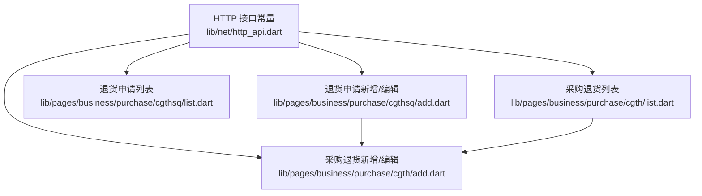
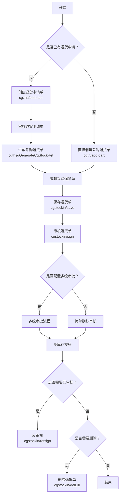
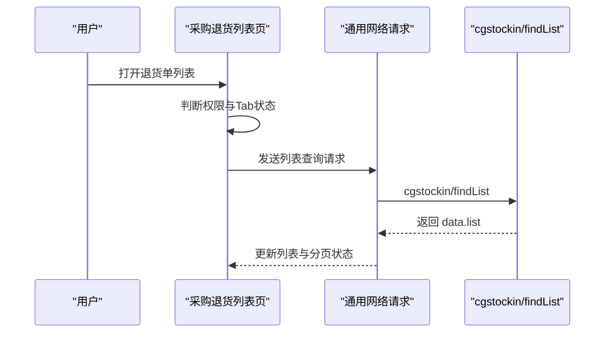
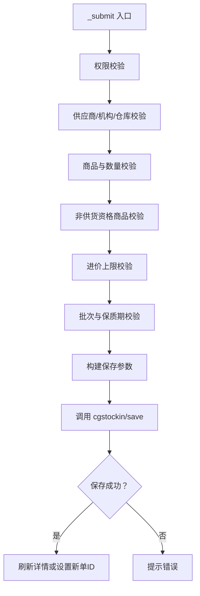
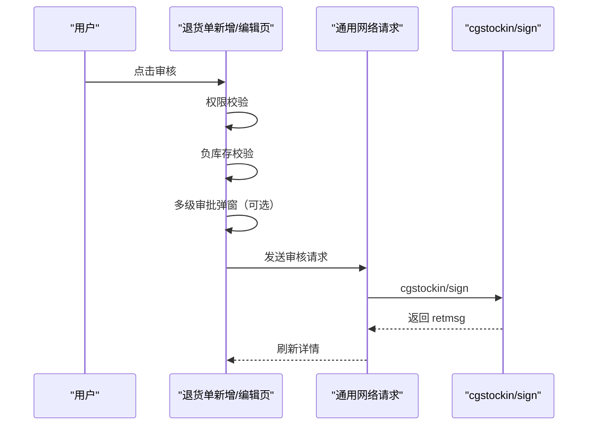
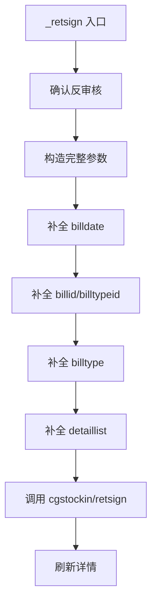
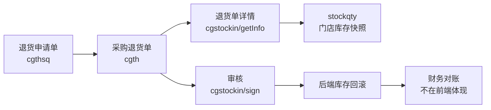
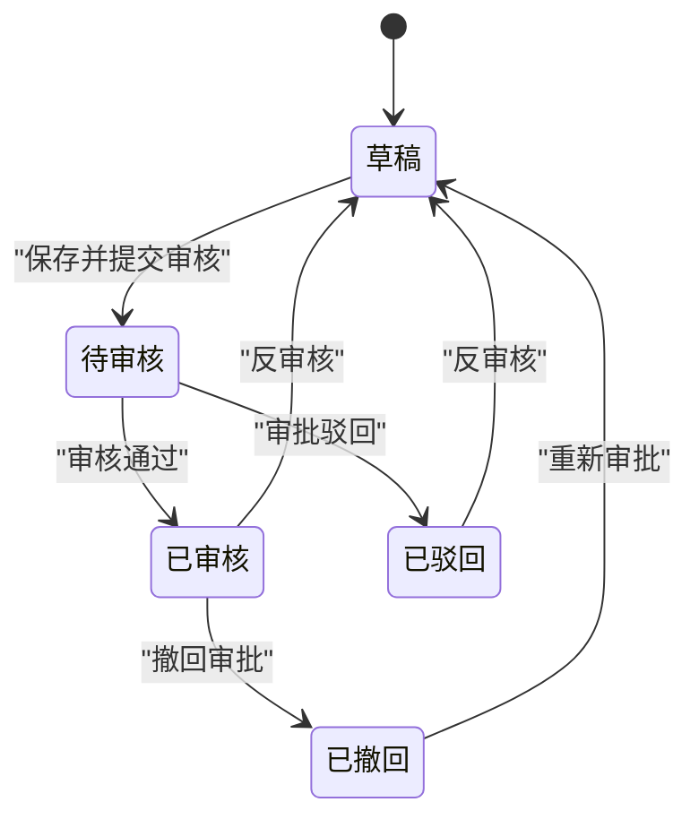
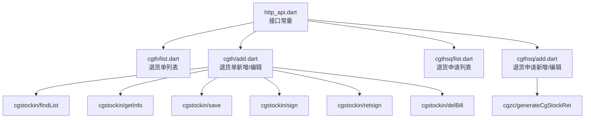

# 采购退货单API

<cite>
**本文引用的文件**   
- [http_api.dart](file://lib/net/http_api.dart)
- [cgth/list.dart](file://lib/pages/business/purchase/cgth/list.dart)
- [cgth/add.dart](file://lib/pages/business/purchase/cgth/add.dart)
- [cgthsq/list.dart](file://lib/pages/business/purchase/cgthsq/list.dart)
- [cgthsq/add.dart](file://lib/pages/business/purchase/cgthsq/add.dart)
</cite>

## 目录
1. [简介](#简介)
2. [项目结构与职责划分](#项目结构与职责划分)
3. [接口总览](#接口总览)
4. [采购退货业务流程](#采购退货业务流程)
5. [接口详细规范](#接口详细规范)
6. [与采购单、退货申请单及库存的关系](#与采购单退货申请单及库存的关系)
7. [财务对账与退款处理说明](#财务对账与退款处理说明)
8. [标准化操作流程](#标准化操作流程)
9. [依赖关系分析](#依赖关系分析)
10. [性能与健壮性建议](#性能与健壮性建议)
11. [常见问题排查](#常见问题排查)
12. [结论](#结论)

## 简介
本文面向灵犀管店 Flutter 客户端中的“采购退货”业务，围绕后端 `cgstockin/` 系列接口，整理出采购退货单的完整 API 规范与业务说明。重点包括：

- 退货单列表查询：`cgstockin/findList`
- 退货单详情获取：`cgstockin/getInfo`
- 退货单保存：`cgstockin/save`
- 退货单审核：`cgstockin/sign`
- 退货单反审核：`cgstockin/retsign`
- 退货单删除：`cgstockin/delBill`

同时结合 Flutter 页面实现，解释退货申请、质检评估、数量确认、审批流程、仓库收货、库存回滚等关键业务环节在客户端侧的表现形式和校验逻辑。需要特别说明的是：Flutter 前端主要承担表单维护、校验、状态控制和调用；真正的库存回滚、财务对账、退款执行由服务端完成，前端文档只能基于现有代码中可见的校验与数据字段进行推断，不应把服务端未暴露的能力描述为前端能力。

## 项目结构与职责划分
从当前代码结构看，采购退货相关功能集中在以下位置：

| 模块 | 路径 | 职责 |
|---|---|---|
| HTTP 接口常量定义 | `lib/net/http_api.dart` | 集中声明所有后端接口地址，包括采购入库、采购退货、采购计划、退货申请等 |
| 采购退货列表页 | `lib/pages/business/purchase/cgth/list.dart` | 查询退货单列表、筛选、分页、状态 Tab |
| 采购退货新增/编辑页 | `lib/pages/business/purchase/cgth/add.dart` | 退货单表单、商品明细、价格重算、批次校验、审核、反审核、删除 |
| 退货申请列表页 | `lib/pages/business/purchase/cgthsq/list.dart` | 退货申请单列表，作为退货业务的上游来源之一 |
| 退货申请新增/编辑页 | `lib/pages/business/purchase/cgthsq/add.dart` | 退货申请单维护，并支持生成采购退货单 |

**图表来源**
- [http_api.dart:40-120](file://lib/net/http_api.dart#L40-L120)
- [cgth/list.dart:1-60](file://lib/pages/business/purchase/cgth/list.dart#L1-L60)
- [cgth/add.dart:1-60](file://lib/pages/business/purchase/cgth/add.dart#L1-L60)
- [cgthsq/list.dart:1-60](file://lib/pages/business/purchase/cgthsq/list.dart#L1-L60)
- [cgthsq/add.dart:1-60](file://lib/pages/business/purchase/cgthsq/add.dart#L1-L60)

**章节来源**
- [http_api.dart:40-120](file://lib/net/http_api.dart#L40-L120)
- [cgth/list.dart:1-120](file://lib/pages/business/purchase/cgth/list.dart#L1-L120)
- [cgth/add.dart:1-220](file://lib/pages/business/purchase/cgth/add.dart#L1-L220)
- [cgthsq/list.dart:1-120](file://lib/pages/business/purchase/cgthsq/list.dart#L1-L120)
- [cgthsq/add.dart:1-220](file://lib/pages/business/purchase/cgthsq/add.dart#L1-L220)

## 接口总览
采购退货单在后端统一使用 `cgstockin/` 前缀。Flutter 客户端通过 `HttpApi` 中的常量引用这些接口，并在退货单列表和新增/编辑页面中发起请求。

| 业务动作 | 后端接口 | Flutter 常量 | 主要调用方 | 核心用途 |
|---|---|---|---|---|
| 退货单列表查询 | `cgstockin/findList` | `cgthFindList` | `PurchaseCgthListPage` | 分页查询退货单，支持按单据号、供应商、创建人、仓库、时间、审核状态筛选 |
| 退货单详情获取 | `cgstockin/getInfo` | `cgthGetInfo` | `PurchaseCgthAddPage` | 加载退货单头信息和明细行 |
| 退货单保存 | `cgstockin/save` | `cgthSave` | `PurchaseCgthAddPage._submit` | 新增或修改退货单 |
| 退货单审核 | `cgstockin/sign` | `cgthSign` | `PurchaseCgthAddPage._doSign` | 将退货单审核通过 |
| 退货单反审核 | `cgstockin/retsign` | `cgthRetsign` | `PurchaseCgthAddPage._retsign` | 撤销已审核退货单 |
| 退货单删除 | `cgstockin/delBill` | `cgthDelBill` | `PurchaseCgthAddPage._delBill` | 删除退货单 |

另外，退货申请单走另一组接口，但会参与退货业务链路：

| 业务动作 | 后端接口 | Flutter 常量 | 说明 |
|---|---|---|---|
| 退货申请单列表 | `cgzc/findList` | `cgzcFindList` | 退货申请列表 |
| 退货申请单详情 | `cgzc/getInfo` | `cgzcGetInfo` | 退货申请详情 |
| 退货申请单保存 | `cgzc/save` | `cgzcSave` | 新增或编辑退货申请 |
| 退货申请单审核 | `cgzc/sign` | `cgzcSign` | 审核退货申请 |
| 退货申请单反审核 | `cgzc/retsign` | `cgzcRetsign` | 反审核退货申请 |
| 生成退货单 | `cgzc/generateCgStockRet` | `cgthsqGenerateCgStockRet` | 从退货申请生成采购退货单 |

**章节来源**
- [http_api.dart:40-120](file://lib/net/http_api.dart#L40-L120)
- [cgth/list.dart:200-260](file://lib/pages/business/purchase/cgth/list.dart#L200-L260)
- [cgth/add.dart:920-1010](file://lib/pages/business/purchase/cgth/add.dart#L920-L1010)
- [cgth/add.dart:1054-1073](file://lib/pages/business/purchase/cgth/add.dart#L1054-L1073)
- [cgth/add.dart:1184-1233](file://lib/pages/business/purchase/cgth/add.dart#L1184-L1233)
- [cgth/add.dart:1329-1355](file://lib/pages/business/purchase/cgth/add.dart#L1329-L1355)
- [cgthsq/add.dart:520-600](file://lib/pages/business/purchase/cgthsq/add.dart#L520-L600)

## 采购退货业务流程
采购退货在客户端中表现为两条主链路：

1. **直接创建采购退货单**：用户在采购退货新增页面填写供应商、机构、仓库、商品明细，保存后进入审核流程。
2. **先创建退货申请，再生成采购退货单**：用户先在退货申请单中选择商品和数量，审核后生成采购退货单，再进入退货单审核流程。

**图表来源**
- [cgthsq/add.dart:520-600](file://lib/pages/business/purchase/cgthsq/add.dart#L520-L600)
- [cgth/add.dart:749-1010](file://lib/pages/business/purchase/cgth/add.dart#L749-L1010)
- [cgth/add.dart:1016-1106](file://lib/pages/business/purchase/cgth/add.dart#L1016-L1106)
- [cgth/add.dart:1108-1183](file://lib/pages/business/purchase/cgth/add.dart#L1108-L1183)
- [cgth/add.dart:1184-1233](file://lib/pages/business/purchase/cgth/add.dart#L1184-L1233)
- [cgth/add.dart:1329-1355](file://lib/pages/business/purchase/cgth/add.dart#L1329-L1355)

### 退货原因分类
在当前 Flutter 代码中，退货单表单包含备注字段，但没有看到独立的“退货原因分类”选择器或枚举。因此：

- 如果系统要求记录退货原因，应优先在服务端扩展退货原因分类字段，并在 Flutter 前端补充对应选择控件。
- 当前前端可用 `remark` 字段记录退货原因，但这属于非结构化文本，不适合做严格分类统计。
- 退货申请单同样以备注为主，也没有发现专门的退货原因分类组件。

### 商品质量检测
Flutter 前端没有独立的“质量检测结果”字段。不过，退货单新增/编辑页面具备以下与质量相关的控制点：

- 批次管理：可录入批次号、生产日期、有效期。
- 保质期商品批次校验：根据登录参数开启强制批次录入。
- 非供货资格商品校验：当商品供应商与退货单供应商不一致时，可按策略提示或移除。
- 进价上限校验：在某些用户权限下禁止提高进价。
- 负库存校验：审核前检查退货数量是否超过门店库存。

这些校验更接近“数据完整性与库存一致性”，不能等同于完整的质检报告。若业务需要质检等级、质检人员、质检结论等，应在服务端建模，并在前端增加相应 UI。

### 退货数量确认
退货数量确认主要由退货单明细行的 `qty` 字段完成。前端提交时会：

- 过滤空商品行；
- 校验每条明细的数量；
- 计算总数量、总金额、销售金额；
- 将明细转为后端要求的 `detaillist`；
- 审核前进行负库存校验。

### 退款处理
当前 Flutter 文件中没有看到明确的“退款金额”“退款账户”“退款方式”等字段。退货单提交数据中包含：

- `billamt`：退货总金额；
- `billsellamt`：退货销售金额；
- `freeamt`：草稿默认值为 0；
- `giftqty` / `presentqty`：赠品数量。

这些字段用于退货价值计算，但不能直接证明存在独立退款流程。退款通常属于财务模块；当前代码中存在供应商付款、门店收款等财务页面，但未在退货单页面中看到直接触发退款的逻辑。

**章节来源**
- [cgth/add.dart:749-920](file://lib/pages/business/purchase/cgth/add.dart#L749-L920)
- [cgth/add.dart:920-1010](file://lib/pages/business/purchase/cgth/add.dart#L920-L1010)
- [cgth/add.dart:1108-1183](file://lib/pages/business/purchase/cgth/add.dart#L1108-L1183)
- [cgth/add.dart:1815-1845](file://lib/pages/business/purchase/cgth/add.dart#L1815-L1845)

## 接口详细规范

### 退货单列表查询：`cgstockin/findList`
该接口由采购退货列表页调用，主要用于分页查询退货单，并根据 Tab 状态传入不同审核标志。

| 属性 | 值 |
|---|---|
| 接口名称 | `cgstockin/findList` |
| Flutter 常量 | `HttpApi.cgthFindList` |
| 调用方 | `PurchaseCgthListPage` |
| 请求方法 | 由通用网络请求封装发送 |
| 典型请求参数 | `is_page=1`、`page`、`billno`、`datetype=3`、`signflag`、`supid`、`createid`、`counterid`、`sids`、`billtype=2`、`starttime`、`endtime` |
| 响应结构 | 返回 `data.list`，为空时使用兜底列表 |
| 分页行为 | 首次替换列表，后续追加；无更多数据时停止加载 |

#### 参数说明
| 参数 | 类型 | 必填 | 说明 |
|---|---|---|---|
| `is_page` | 数字 | 是 | 是否分页，列表固定为 `1` |
| `page` | 数字 | 是 | 当前页码 |
| `billno` | 字符串 | 否 | 单据号模糊搜索 |
| `datetype` | 字符串 | 是 | 日期类型，列表固定为 `3` |
| `signflag` | 字符串 | 否 | 审核状态：待审核 `0`、已审核 `1`、已驳回 `2` |
| `supid` | 字符串 | 否 | 供应商 ID |
| `createid` | 字符串 | 否 | 创建人 ID |
| `counterid` | 字符串 | 否 | 仓库 ID |
| `sids` | 数组 | 否 | 机构 ID 列表 |
| `billtype` | 数字 | 是 | 单据类型，退货单为 `2` |
| `starttime` | 字符串 | 是 | 开始时间 |
| `endtime` | 字符串 | 是 | 结束时间 |

#### 状态映射
| Tab | signflag | 含义 |
|---|---:|---|
| 全部 | 空 | 不限制审核状态 |
| 待审核 | `0` | 仅显示待审核退货单 |
| 已审核 | `1` | 仅显示已审核退货单 |
| 已驳回 | `2` | 仅在后台开启“已驳回”Tab 时显示 |

**图表来源**
- [cgth/list.dart:1-120](file://lib/pages/business/purchase/cgth/list.dart#L1-L120)
- [cgth/list.dart:200-260](file://lib/pages/business/purchase/cgth/list.dart#L200-L260)

**章节来源**
- [cgth/list.dart:1-260](file://lib/pages/business/purchase/cgth/list.dart#L1-L260)
- [http_api.dart:40-120](file://lib/net/http_api.dart#L40-L120)

### 退货单详情获取：`cgstockin/getInfo`
详情接口由退货单新增/编辑页面在编辑模式下调用，用于加载退货单头信息和明细行。

| 属性 | 值 |
|---|---|
| 接口名称 | `cgstockin/getInfo` |
| Flutter 常量 | `HttpApi.cgthGetInfo` |
| 调用方 | `PurchaseCgthAddPage._loadDetail` |
| 典型入参 | 当前编辑单据的数据对象，至少包含 `billid` |
| 返回字段 | 头信息、供应商、机构、仓库、业务员、备注、原单号、原单ID、明细行、附件、审批流信息 |

#### 关键字段
| 字段 | 类型 | 说明 |
|---|---|---|
| `billid` | 字符串 | 退货单 ID |
| `supid` / `supname` | 字符串 | 供应商 ID 与名称 |
| `bsid` / `storeid` / `storename` | 字符串或数字 | 机构 ID 与名称 |
| `storetype` | 数字 | 机构类型，用于判断区域中心 |
| `counterid` / `countername` | 字符串 | 退货仓库 ID 与名称 |
| `countertype` | 数字 | 仓库存储方式 |
| `buyerid` / `buyername` | 字符串 | 业务员 |
| `remark` | 字符串 | 备注 |
| `refbillno` / `refbillid` | 字符串 | 原单号与原单 ID |
| `refbilltype` | 数字 | 原单类型 |
| `detaillist` | 数组 | 退货明细行 |
| `fileLists` | 数组 | 附件 |
| `reviewFlowUsers` / `reviewBillFlows` | 数组 | 审批流与审批日志 |
| `signflag` | 字符串 | 审核状态：`0` 未审、`1` 已审、`2` 已驳回 |
| `reviewsignflag` | 字符串 | 审批状态：可能表示撤回等中间状态 |

**章节来源**
- [cgth/add.dart:201-590](file://lib/pages/business/purchase/cgth/add.dart#L201-L590)
- [http_api.dart:40-120](file://lib/net/http_api.dart#L40-L120)

### 退货单保存：`cgstockin/save`
保存接口用于新增或修改退货单。前端会在保存前完成供应商、机构、仓库、商品明细、数量、批次、进价等多项校验。

| 属性 | 值 |
|---|---|
| 接口名称 | `cgstockin/save` |
| Flutter 常量 | `HttpApi.cgthSave` |
| 调用方 | `PurchaseCgthAddPage._submit` |
| 请求体 | 退货单头信息 + `detaillist` + `fileLists` |
| 成功响应 | `data.billid` 为新单 ID，编辑模式返回最新详情 |

#### 前置校验
| 校验项 | 规则 |
|---|---|
| 权限 | 新增需权限 `011902`，编辑需权限 `011903` |
| 供应商 | 未审核单据必须选择供应商 |
| 机构 | 必须选择退货机构 |
| 仓库 | 未审核单据必须选择退货仓库 |
| 商品 | 至少保留一条有效商品行 |
| 数量 | 数量与赠品数量不能同时为 0 |
| 非供货资格商品 | 根据配置提示或移除 |
| 进价 | 部分用户不允许提高进价 |
| 批次 | 根据登录参数可能要求批次与有效期同时录入 |
| 保质期商品 | 可能强制要求批次 |

#### 保存参数
| 参数 | 类型 | 说明 |
|---|---|---|
| `billid` | 字符串 | 编辑时携带 |
| `billdate` | 字符串 | 单据日期，新增时包含时分秒 |
| `billtype` | 数字 | 退货单固定为 `2` |
| `signflag` | 数字 | 新增时通常为 `0` |
| `freeamt` | 数字 | 草稿默认 `0` |
| `status` | 数字 | 新增时设置为 `3` |
| `supid` / `supname` | 字符串 | 供应商 |
| `bsid` / `storeid` / `storename` / `storetype` | 字符串或数字 | 机构信息 |
| `buyerid` / `buyername` | 字符串 | 业务员 |
| `counterid` / `countername` | 字符串 | 退货仓库 |
| `remark` | 字符串 | 备注 |
| `fileLists` | 数组 | 附件 |
| `refbilltype` | 数字 | 原单类型 |
| `refbillno` / `refbillid` | 字符串 | 原单号与原单 ID |
| `billqty` | 数字 | 总数量 |
| `billamt` | 数字 | 总金额 |
| `billsellamt` | 数字 | 退货销售金额 |
| `detaillist` | 数组 | 明细行 |

#### 明细行关键字段
| 字段 | 类型 | 说明 |
|---|---|---|
| `prodid` / `productid` | 字符串 | 商品 ID |
| `productname` / `prodname` | 字符串 | 商品名称 |
| `qty` | 数字 | 退货数量 |
| `price` | 数字 | 单价 |
| `amt` | 数字 | 行金额 |
| `giftqty` / `presentqty` | 数字 | 赠品数量 |
| `batchno` | 字符串 | 批次号 |
| `birthdate` / `validdate` | 字符串 | 生产日期与有效期 |
| `unit` / `size` | 字符串 | 单位与规格 |
| `unitonlyid` / `sizeonlyid` | 字符串 | 单位与规格 ID |
| `remark` | 字符串 | 行备注 |

**图表来源**
- [cgth/add.dart:749-920](file://lib/pages/business/purchase/cgth/add.dart#L749-L920)
- [cgth/add.dart:920-1010](file://lib/pages/business/purchase/cgth/add.dart#L920-L1010)
- [cgth/add.dart:1815-1845](file://lib/pages/business/purchase/cgth/add.dart#L1815-L1845)

**章节来源**
- [cgth/add.dart:749-1010](file://lib/pages/business/purchase/cgth/add.dart#L749-L1010)
- [cgth/add.dart:1815-1845](file://lib/pages/business/purchase/cgth/add.dart#L1815-L1845)

### 退货单审核：`cgstockin/sign`
审核接口用于将退货单标记为已审核。前端会先进行权限校验和负库存校验，再根据是否配置多级审批决定交互流程。

| 属性 | 值 |
|---|---|
| 接口名称 | `cgstockin/sign` |
| Flutter 常量 | `HttpApi.cgthSign` |
| 调用方 | `_doSign` |
| 权限 | `011905` |
| 审核前校验 | 负库存校验 |
| 审批模式 | 支持多级审批弹窗 |

#### 审核参数
| 参数 | 类型 | 说明 |
|---|---|---|
| `signflag` | 数字 | 审核通过设为 `1` |
| `reviewremark` | 字符串 | 审批备注 |
| `reviewsignflag` | 数字 | 审批状态：非驳回和非撤回时设为 `1` |
| 其他字段 | 继承自当前单据对象 | 前端传递完整 `_billData` |

#### 负库存校验逻辑
负库存校验根据 `stocksaleflag` 或登录参数中的 `storageNotEnoughFlag` 决定：

- 允许警告模式时可继续审核；
- 阻止模式下必须修改数量或删除商品；
- 校验规则为：某商品 `stockqty < qty`。

**图表来源**
- [cgth/add.dart:1016-1106](file://lib/pages/business/purchase/cgth/add.dart#L1016-L1106)
- [cgth/add.dart:1108-1183](file://lib/pages/business/purchase/cgth/add.dart#L1108-L1183)
- [cgth/add.dart:1054-1073](file://lib/pages/business/purchase/cgth/add.dart#L1054-L1073)

**章节来源**
- [cgth/add.dart:1016-1106](file://lib/pages/business/purchase/cgth/add.dart#L1016-L1106)
- [cgth/add.dart:1108-1183](file://lib/pages/business/purchase/cgth/add.dart#L1108-L1183)

### 退货单反审核：`cgstockin/retsign`
反审核用于撤销已审核退货单。前端会弹出确认提示，并在多级审批场景下提醒审批步骤需重新处理。

| 属性 | 值 |
|---|---|
| 接口名称 | `cgstockin/retsign` |
| Flutter 常量 | `HttpApi.cgthRetsign` |
| 调用方 | `_retsign` |
| 入参 | 完整退货单对象，必要时补全关键字段 |
| 返回 | `retmsg`，成功后刷新详情 |

#### 反审核参数补全逻辑
前端在构造反审核参数时，会确保以下字段存在：

| 字段 | 处理方式 |
|---|---|
| `billdate` | 缺失则使用当前日期 |
| `billid` | 缺失则使用 `_newBillid` |
| `billtypeid` | 缺失则使用 `0507` |
| `billtype` | 缺失则使用 `2` |
| `detaillist` | 缺失或为空则重建明细列表 |

**图表来源**
- [cgth/add.dart:1184-1233](file://lib/pages/business/purchase/cgth/add.dart#L1184-L1233)

**章节来源**
- [cgth/add.dart:1184-1233](file://lib/pages/business/purchase/cgth/add.dart#L1184-L1233)

### 退货单删除：`cgstockin/delBill`
删除接口用于删除退货单，需要权限 `011904`，并在删除前弹出确认框。

| 属性 | 值 |
|---|---|
| 接口名称 | `cgstockin/delBill` |
| Flutter 常量 | `HttpApi.cgthDelBill` |
| 调用方 | `_delBill` |
| 权限 | `011904` |
| 入参 | 当前退货单对象 |
| 成功后行为 | 提示删除成功并返回上一页 |

**章节来源**
- [cgth/add.dart:1329-1355](file://lib/pages/business/purchase/cgth/add.dart#L1329-L1355)

## 与采购单、退货申请单及库存的关系

### 与退货申请单的关系
退货申请单是退货业务的上游单据。Flutter 中退货申请新增/编辑页面支持：

- 选择机构和业务员；
- 添加退货商品、数量、价格；
- 保存退货申请；
- 审核退货申请；
- 反审核退货申请；
- 从退货申请生成采购退货单。

生成退货单时调用 `cgzc/generateCgStockRet`，成功后展示生成结果对话框并刷新详情。

### 与原采购单的关系
退货单详情页包含原单号 `refbillno` 与原单 ID `refbillid`，以及原单类型 `refbilltype`。这表明退货单可以关联某个原始单据。但当前 Flutter 文件中没有看到直接查询“原采购单详情”的专用调用；原单信息主要通过退货单详情接口返回。

需要注意：

- `refbilltype=1` 表示原单可能是采购入库单；
- `refbilltype=2` 表示原单可能是退货申请单；
- 真正关联哪个采购单、能否跨单退货、退货比例限制等逻辑应由服务端控制。

### 库存回滚机制
Flutter 前端不会直接操作库存表。它只负责：

- 从详情接口读取商品的 `stockqty`；
- 在审核前比较 `stockqty` 与退货数量；
- 在库存不足时给出警告或阻止审核；
- 调用后端接口后刷新单据详情。

实际库存回滚由后端在审核通过后执行。前端无法保证本地看到的库存就是最终库存，也不应把前端校验误认为库存事务的最终保障。

**图表来源**
- [cgthsq/add.dart:520-600](file://lib/pages/business/purchase/cgthsq/add.dart#L520-L600)
- [cgth/add.dart:1108-1183](file://lib/pages/business/purchase/cgth/add.dart#L1108-L1183)

**章节来源**
- [cgthsq/add.dart:520-600](file://lib/pages/business/purchase/cgthsq/add.dart#L520-L600)
- [cgth/add.dart:1108-1183](file://lib/pages/business/purchase/cgth/add.dart#L1108-L1183)

## 财务对账与退款处理说明
当前 Flutter 代码中：

- 退货单包含 `billamt`、`billsellamt`、`freeamt` 等金额字段；
- 退货单没有独立的“退款金额”“退款账户”“退款流水号”字段；
- 退货单保存和审核不涉及供应商付款或门店收款页面的直接联动；
- 财务对账和退款更可能由后端在退货单审核后同步到财务模块。

因此，文档中关于“与财务系统的对账逻辑”只能给出如下保守结论：

1. 退货单金额字段可用于财务参考；
2. 前端不直接发起退款；
3. 若退货单审核触发财务应付冲减或退款，应视为服务端业务规则；
4. 若需要前端参与退款确认，应在退货单详情或财务页面中新增对应字段和交互。

**章节来源**
- [cgth/add.dart:920-1010](file://lib/pages/business/purchase/cgth/add.dart#L920-L1010)
- [cgth/add.dart:1815-1845](file://lib/pages/business/purchase/cgth/add.dart#L1815-L1845)

## 标准化操作流程

### 退货申请
1. 进入退货申请新增页面。
2. 选择退货机构、业务员。
3. 添加退货商品、数量、价格。
4. 如需批量生成退货单，先保存并审核退货申请。
5. 点击生成退货单，查看生成结果。

注意事项：
- 退货申请数量不能为空；
- 退货申请保存后会重建表单快照，避免误判未保存修改；
- 退货申请支持多级审批、反审核、撤回。

### 质检评估
当前前端没有质检表单。建议在业务上明确：

- 质检结论是否影响退货数量；
- 质检不合格商品是否允许部分退货；
- 质检结果是否记录在退货单明细中；
- 质检责任人和质检时间是否必填。

### 审批处理
退货单审核支持两种模式：

- 简单确认：无多级审批时弹出确认框；
- 多级审批：根据 `reviewFlowUsers` 弹出审批弹窗，并传递 `reviewsignflag` 和 `reviewremark`。

反审核时，若存在审批日志，前端会提示“所有审批步骤需重新处理”。

### 仓库收货
Flutter 退货单新增/编辑页会自动选择退货仓库：

- 区域中心机构不赋值默认仓库；
- 优先选择 `retflag==1` 且按 `countertype` 排序的第一个仓库；
- 若无退货仓库，则回退到第一个仓库。

这体现了退货仓库与普通入库仓库的区别。

**图表来源**
- [cgth/add.dart:1016-1106](file://lib/pages/business/purchase/cgth/add.dart#L1016-L1106)
- [cgth/add.dart:1184-1268](file://lib/pages/business/purchase/cgth/add.dart#L1184-L1268)

**章节来源**
- [cgthsq/add.dart:520-600](file://lib/pages/business/purchase/cgthsq/add.dart#L520-L600)
- [cgth/add.dart:749-1010](file://lib/pages/business/purchase/cgth/add.dart#L749-L1010)
- [cgth/add.dart:1016-1268](file://lib/pages/business/purchase/cgth/add.dart#L1016-L1268)

## 依赖关系分析

**图表来源**
- [http_api.dart:40-120](file://lib/net/http_api.dart#L40-L120)
- [cgth/list.dart:200-260](file://lib/pages/business/purchase/cgth/list.dart#L200-L260)
- [cgth/add.dart:920-1010](file://lib/pages/business/purchase/cgth/add.dart#L920-L1010)
- [cgth/add.dart:1054-1073](file://lib/pages/business/purchase/cgth/add.dart#L1054-L1073)
- [cgth/add.dart:1184-1233](file://lib/pages/business/purchase/cgth/add.dart#L1184-L1233)
- [cgth/add.dart:1329-1355](file://lib/pages/business/purchase/cgth/add.dart#L1329-L1355)
- [cgthsq/add.dart:520-600](file://lib/pages/business/purchase/cgthsq/add.dart#L520-L600)

**章节来源**
- [http_api.dart:40-120](file://lib/net/http_api.dart#L40-L120)
- [cgth/list.dart:200-260](file://lib/pages/business/purchase/cgth/list.dart#L200-L260)
- [cgth/add.dart:920-1355](file://lib/pages/business/purchase/cgth/add.dart#L920-L1355)
- [cgthsq/add.dart:520-600](file://lib/pages/business/purchase/cgthsq/add.dart#L520-L600)

## 性能与健壮性建议
结合现有实现，采购退货单相关页面已经具备一定健壮性设计：

- 列表使用分页加载，避免一次性拉取全部数据；
- 搜索输入有防抖；
- 详情页加载完成后重建表单快照，减少误触退出提示；
- 保存、审核、反审核、删除等操作都有状态标记，防止重复提交；
- 多权限点通过权限工具类校验；
- 多级审批数据解析时对 null 和异常类型做保护。

建议进一步优化：

- 列表接口失败时明确区分网络错误与服务端错误；
- 反审核参数补全逻辑可提取为统一函数；
- 退货原因分类、质检结果等字段若由服务端新增，应同步在前端增加校验和格式化；
- 财务退款字段若由后端新增，应在退货单详情中展示并对账差异进行提示。

## 常见问题排查

| 问题 | 可能原因 | 排查建议 |
|---|---|---|
| 列表查不到退货单 | 权限不足、筛选条件过严、时间范围错误 | 检查权限 `011901`、`signflag`、时间范围 |
| 新增退货单提示未选择供应商/机构/仓库 | 未审核单据必填字段未填 | 在保存前检查头部必填项 |
| 保存时报商品为空 | 明细行中没有有效商品 | 检查商品 ID 和商品名称 |
| 保存时报数量为 0 | 数量与赠品数量都为 0 | 至少填写一项数量 |
| 审核被拒绝或提示库存不足 | 退货数量超过门店库存 | 调整数量或删除商品 |
| 反审核失败 | 缺少 `billdate`、`billid`、`billtypeid` 等字段 | 检查前端参数补全逻辑 |
| 删除退货单失败 | 权限不足或单据状态不允许删除 | 检查权限 `011904` |
| 生成退货单失败 | 退货申请尚未审核或数据不完整 | 先审核退货申请再执行生成 |

**章节来源**
- [cgth/list.dart:1-260](file://lib/pages/business/purchase/cgth/list.dart#L1-L260)
- [cgth/add.dart:749-1010](file://lib/pages/business/purchase/cgth/add.dart#L749-L1010)
- [cgth/add.dart:1108-1233](file://lib/pages/business/purchase/cgth/add.dart#L1108-L1233)
- [cgth/add.dart:1329-1355](file://lib/pages/business/purchase/cgth/add.dart#L1329-L1355)
- [cgthsq/add.dart:520-600](file://lib/pages/business/purchase/cgthsq/add.dart#L520-L600)

## 结论
灵犀管店 Flutter 项目的采购退货单功能以 `cgstockin/` 系列接口为核心，配合退货申请单形成完整的退货业务闭环。前端主要负责：

- 退货单列表查询；
- 退货单新增、编辑、审核、反审核、删除；
- 退货申请维护与生成退货单；
- 供应商、机构、仓库、商品、批次、进价、库存等前端校验；
- 多级审批交互。

真正的库存回滚、财务对账、退款执行由服务端完成。前端文档应谨慎区分“前端可见校验”和“服务端业务结果”。若未来需要更强的退货质量管理、财务对账可视化、退款追踪能力，应在服务端扩展字段，并在 Flutter 前端补充对应表单、校验和展示逻辑。