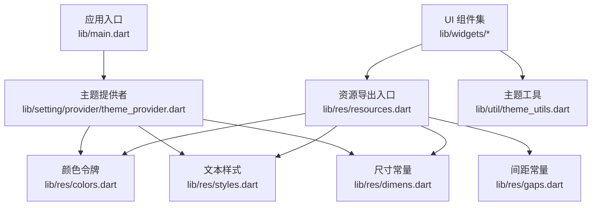
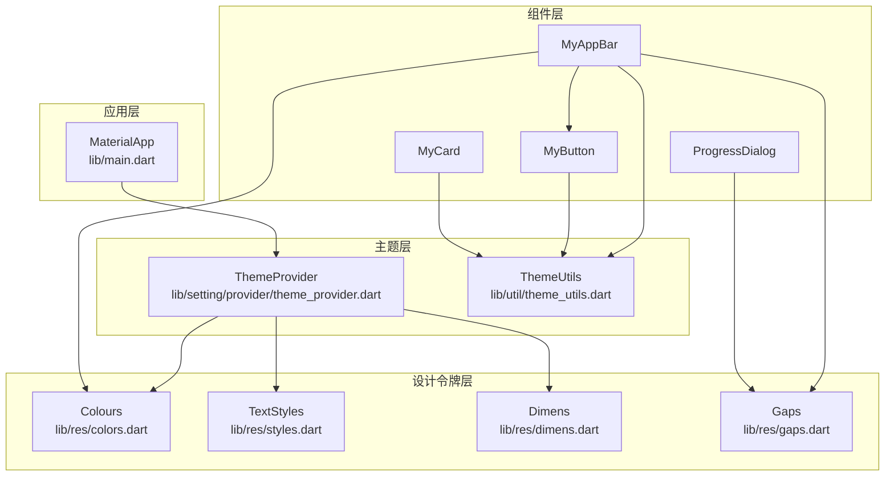
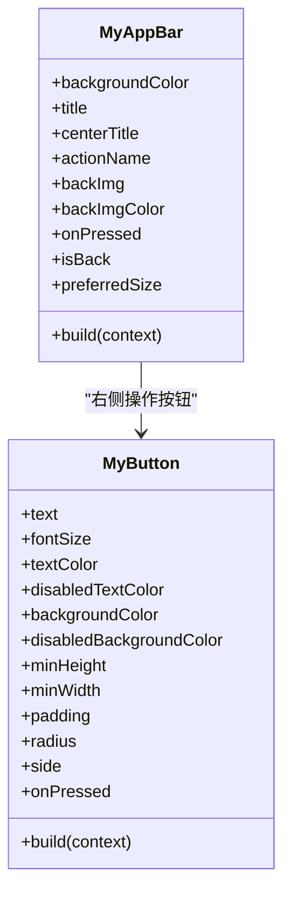
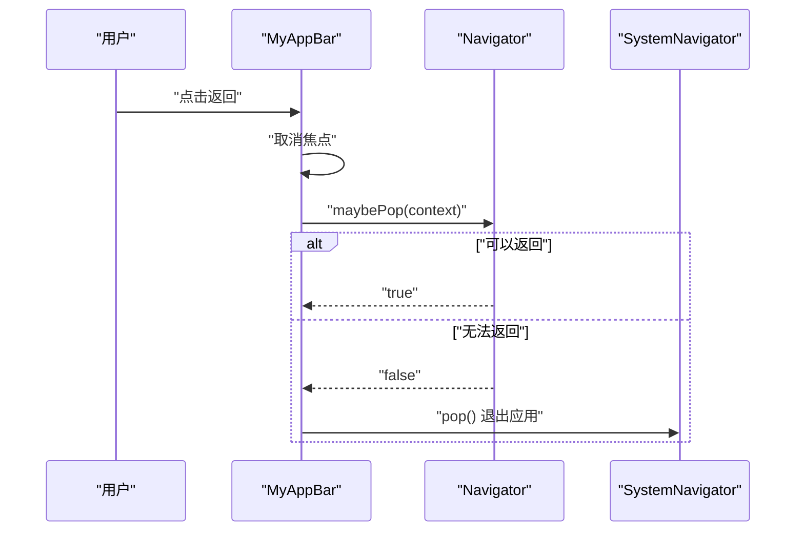
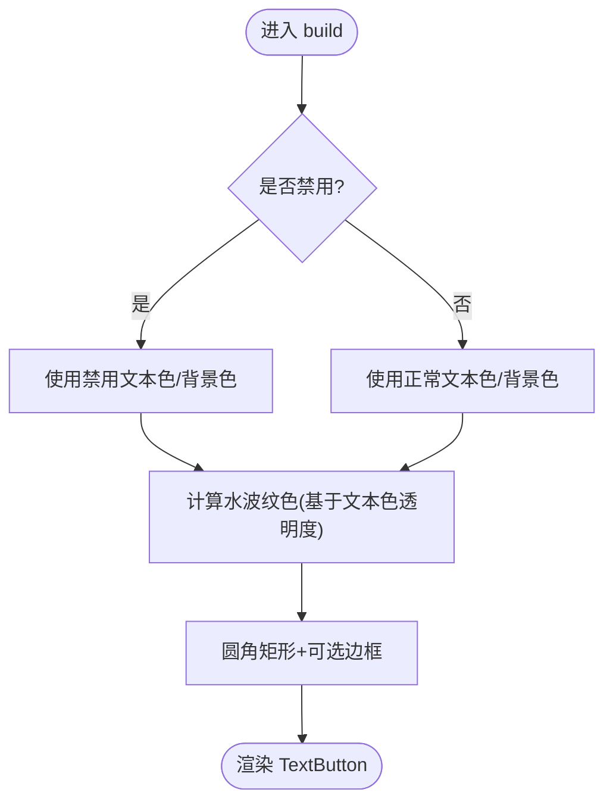
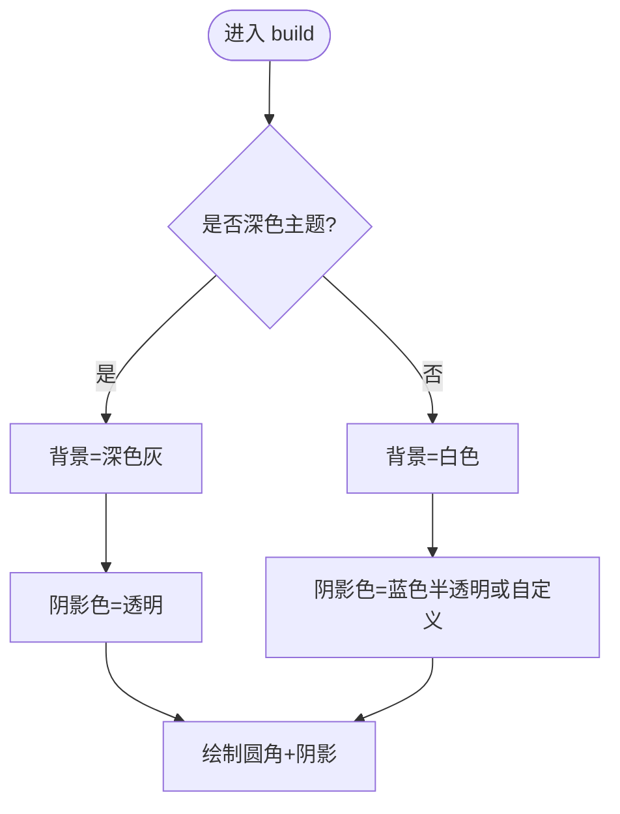
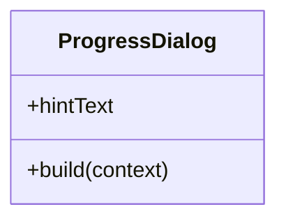
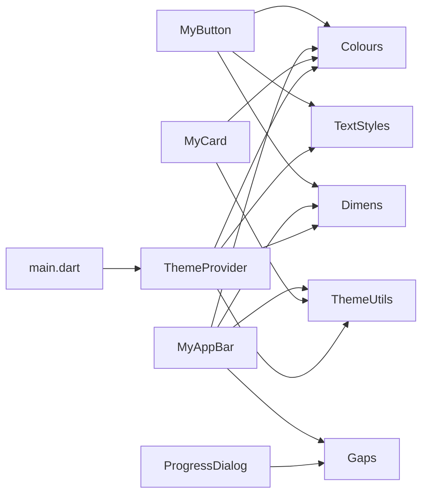

# UI组件库

<cite>
**本文引用的文件**   
- [lib/widgets/my_app_bar.dart](file://lib/widgets/my_app_bar.dart)
- [lib/widgets/my_button.dart](file://lib/widgets/my_button.dart)
- [lib/widgets/progress_dialog.dart](file://lib/widgets/progress_dialog.dart)
- [lib/widgets/my_card.dart](file://lib/widgets/my_card.dart)
- [lib/res/colors.dart](file://lib/res/colors.dart)
- [lib/res/styles.dart](file://lib/res/styles.dart)
- [lib/res/dimens.dart](file://lib/res/dimens.dart)
- [lib/res/gaps.dart](file://lib/res/gaps.dart)
- [lib/res/resources.dart](file://lib/res/resources.dart)
- [lib/util/theme_utils.dart](file://lib/util/theme_utils.dart)
- [lib/setting/provider/theme_provider.dart](file://lib/setting/provider/theme_provider.dart)
- [lib/main.dart](file://lib/main.dart)
- [pubspec.yaml](file://pubspec.yaml)
</cite>

## 目录
1. [引言](#引言)
2. [项目结构](#项目结构)
3. [核心组件](#核心组件)
4. [架构总览](#架构总览)
5. [详细组件分析](#详细组件分析)
6. [依赖关系分析](#依赖关系分析)
7. [性能与体验](#性能与体验)
8. [样式覆盖与主题系统](#样式覆盖与主题系统)
9. [响应式布局规范](#响应式布局规范)
10. [无障碍访问支持](#无障碍访问支持)
11. [组件组合模式与最佳实践](#组件组合模式与最佳实践)
12. [质量检查标准](#质量检查标准)
13. [故障排查指南](#故障排查指南)
14. [结语](#结语)

## 引言
本文件为灵犀管店 Flutter 项目的 UI 组件库文档，聚焦以下目标：
- 统一使用自定义组件：MyAppBar、MyButton、ProgressDialog、MyCard。
- 规范主题系统（颜色、文本样式、尺寸、间距）和资源管理。
- 明确响应式布局原则与可访问性支持。
- 提供组件组合模式、样式覆盖方法与质量检查清单，帮助前端开发者获得一致、高质量、可维护的视觉体验。

## 项目结构
UI 相关代码主要分布在以下目录：
- lib/widgets：业务级通用 UI 组件（如 AppBar、按钮、卡片、加载弹框等）。
- lib/res：设计令牌（颜色、尺寸、间距、文本样式），以及资源导出入口。
- lib/util：主题工具扩展（深色模式判断、状态栏样式等）。
- lib/setting/provider：主题提供者（应用级主题配置、持久化）。
- lib/main.dart：应用启动与全局 Material App 配置。
- pubspec.yaml：Flutter 工程依赖与资源声明。

**图表来源**
- [lib/main.dart](file://lib/main.dart)
- [lib/setting/provider/theme_provider.dart](file://lib/setting/provider/theme_provider.dart)
- [lib/res/resources.dart](file://lib/res/resources.dart)
- [lib/util/theme_utils.dart](file://lib/util/theme_utils.dart)

**章节来源**
- [lib/widgets/my_app_bar.dart:1-110](file://lib/widgets/my_app_bar.dart#L1-L110)
- [lib/widgets/my_button.dart:1-75](file://lib/widgets/my_button.dart#L1-L75)
- [lib/widgets/progress_dialog.dart:1-44](file://lib/widgets/progress_dialog.dart#L1-L44)
- [lib/widgets/my_card.dart:1-36](file://lib/widgets/my_card.dart#L1-L36)
- [lib/res/resources.dart:1-12](file://lib/res/resources.dart#L1-L12)
- [lib/util/theme_utils.dart:1-52](file://lib/util/theme_utils.dart#L1-L52)
- [lib/setting/provider/theme_provider.dart:1-88](file://lib/setting/provider/theme_provider.dart#L1-L88)
- [lib/main.dart](file://lib/main.dart)
- [pubspec.yaml](file://pubspec.yaml)

## 核心组件
本节对四个关键 UI 组件进行属性、事件与行为说明。

### MyAppBar（自定义顶部导航条）
- 职责：封装页面标题、返回按钮与右侧操作按钮；处理状态栏图标明暗适配；提供语义节点与无障碍标签。
- 关键属性
  - backgroundColor：背景色，未设置时从上下文获取 Scaffold 背景色。
  - title / centerTitle：标题文本，centerTitle 为空则左对齐，否则居中。
  - actionName / onPressed：右侧操作按钮文案与点击回调。
  - backImg / backImgColor：返回图标路径与颜色，默认跟随主题图标色。
  - isBack：是否显示返回按钮。
- 行为与交互
  - 点击返回：先取消焦点，尝试 Navigator.maybePop；若无法返回则调用 SystemNavigator.pop 退出应用。
  - 状态栏样式：根据背景亮度自动选择亮/暗图标样式。
  - 无障碍：标题区域包裹 Semantics，并标记 header。
- 尺寸：固定高度 48。

**章节来源**
- [lib/widgets/my_app_bar.dart:1-110](file://lib/widgets/my_app_bar.dart#L1-L110)

### MyButton（主按钮）
- 职责：统一的圆角按钮，支持正常/禁用状态的文本与背景色切换。
- 关键属性
  - text：按钮文案。
  - fontSize：字号，默认使用设计令牌。
  - textColor / disabledTextColor：正常与禁用文本色。
  - backgroundColor / disabledBackgroundColor：正常与禁用背景色。
  - minHeight / minWidth：最小尺寸，minWidth 默认为全宽。
  - padding / radius / side：内边距、圆角半径、边框。
  - onPressed：必填点击回调。
- 行为与交互
  - 通过 MaterialStateProperty 区分 enabled/disabled 状态的颜色与水波纹。
  - 形状为圆角矩形，侧边可选边框。

**章节来源**
- [lib/widgets/my_button.dart:1-75](file://lib/widgets/my_button.dart#L1-L75)

### ProgressDialog（加载中弹框）
- 职责：展示圆形进度指示与提示文字，以半透明遮罩呈现。
- 关键属性
  - hintText：提示文案。
- 行为与外观
  - 容器尺寸固定宽高，深色半透明背景，圆角。
  - 使用 CupertinoActivityIndicator 作为进度指示器。

**章节来源**
- [lib/widgets/progress_dialog.dart:1-44](file://lib/widgets/progress_dialog.dart#L1-L44)

### MyCard（内容卡片）
- 职责：承载内容块，提供背景色与阴影，适配深浅主题。
- 关键属性
  - child：子组件。
  - color：背景色，默认随主题变化。
  - shadowColor：阴影色，浅色主题默认蓝色半透明阴影，深色主题透明。
- 行为与外观
  - 圆角 + 底部阴影，背景色在深浅主题下分别取值。

**章节来源**
- [lib/widgets/my_card.dart:1-36](file://lib/widgets/my_card.dart#L1-L36)

## 架构总览
UI 组件层依赖设计与主题基础设施，形成清晰的分层：
- 设计令牌层：colors、styles、dimens、gaps。
- 主题层：ThemeProvider 输出 ThemeData；ThemeUtils 提供运行时主题判断与系统栏样式。
- 组件层：MyAppBar、MyButton、MyCard、ProgressDialog 等基于设计令牌与主题构建。
- 应用层：main.dart 装配 Provider、MaterialApp 与全局 Toast。

**图表来源**
- [lib/main.dart](file://lib/main.dart)
- [lib/setting/provider/theme_provider.dart:1-88](file://lib/setting/provider/theme_provider.dart#L1-L88)
- [lib/util/theme_utils.dart:1-52](file://lib/util/theme_utils.dart#L1-L52)
- [lib/res/colors.dart:1-46](file://lib/res/colors.dart#L1-L46)
- [lib/res/styles.dart:1-76](file://lib/res/styles.dart#L1-L76)
- [lib/res/dimens.dart:1-19](file://lib/res/dimens.dart#L1-L19)
- [lib/res/gaps.dart:1-48](file://lib/res/gaps.dart#L1-L48)
- [lib/widgets/my_app_bar.dart:1-110](file://lib/widgets/my_app_bar.dart#L1-L110)
- [lib/widgets/my_button.dart:1-75](file://lib/widgets/my_button.dart#L1-L75)
- [lib/widgets/progress_dialog.dart:1-44](file://lib/widgets/progress_dialog.dart#L1-L44)
- [lib/widgets/my_card.dart:1-36](file://lib/widgets/my_card.dart#L1-L36)

## 详细组件分析

### MyAppBar 类关系与构建流程

**图表来源**
- [lib/widgets/my_app_bar.dart:1-110](file://lib/widgets/my_app_bar.dart#L1-L110)
- [lib/widgets/my_button.dart:1-75](file://lib/widgets/my_button.dart#L1-L75)

#### 返回逻辑时序图

**图表来源**
- [lib/widgets/my_app_bar.dart:45-73](file://lib/widgets/my_app_bar.dart#L45-L73)

**章节来源**
- [lib/widgets/my_app_bar.dart:1-110](file://lib/widgets/my_app_bar.dart#L1-L110)

### MyButton 状态样式流程

**图表来源**
- [lib/widgets/my_button.dart:27-75](file://lib/widgets/my_button.dart#L27-L75)

**章节来源**
- [lib/widgets/my_button.dart:1-75](file://lib/widgets/my_button.dart#L1-L75)

### MyCard 外观决策流程

**图表来源**
- [lib/widgets/my_card.dart:13-36](file://lib/widgets/my_card.dart#L13-L36)

**章节来源**
- [lib/widgets/my_card.dart:1-36](file://lib/widgets/my_card.dart#L1-L36)

### ProgressDialog 结构

**图表来源**
- [lib/widgets/progress_dialog.dart:1-44](file://lib/widgets/progress_dialog.dart#L1-L44)

**章节来源**
- [lib/widgets/progress_dialog.dart:1-44](file://lib/widgets/progress_dialog.dart#L1-L44)

## 依赖关系分析
- 组件对设计令牌的依赖
  - MyButton：依赖 Colours、TextStyles、Dimens。
  - MyAppBar：依赖 Colours、Dimens、ThemeUtils、Gaps。
  - MyCard：依赖 Colours、ThemeUtils。
  - ProgressDialog：依赖 Gaps。
- 主题与系统层
  - ThemeProvider：集中输出 ThemeData，包含 primaryColor、colorScheme、indicatorColor、scaffoldBackgroundColor、canvasColor、textSelectionTheme、textTheme、inputDecorationTheme、appBarTheme、dividerTheme、cupertinoOverrideTheme、pageTransitionsTheme、visualDensity。
  - ThemeUtils：提供 isDark、getIconColor、getStickyHeaderColor、getDialogTextFieldColor、getKeyboardActionsColor，以及 light/dark 的系统栏样式常量。
- 应用装配
  - main.dart：创建 MyApp，注入 Provider、OKToast、MaterialApp 本地化、全局系统栏样式与文字缩放策略。

**图表来源**
- [lib/widgets/my_button.dart:1-75](file://lib/widgets/my_button.dart#L1-L75)
- [lib/widgets/my_app_bar.dart:1-110](file://lib/widgets/my_app_bar.dart#L1-L110)
- [lib/widgets/my_card.dart:1-36](file://lib/widgets/my_card.dart#L1-L36)
- [lib/widgets/progress_dialog.dart:1-44](file://lib/widgets/progress_dialog.dart#L1-L44)
- [lib/res/colors.dart:1-46](file://lib/res/colors.dart#L1-L46)
- [lib/res/styles.dart:1-76](file://lib/res/styles.dart#L1-L76)
- [lib/res/dimens.dart:1-19](file://lib/res/dimens.dart#L1-L19)
- [lib/res/gaps.dart:1-48](file://lib/res/gaps.dart#L1-L48)
- [lib/util/theme_utils.dart:1-52](file://lib/util/theme_utils.dart#L1-L52)
- [lib/setting/provider/theme_provider.dart:1-88](file://lib/setting/provider/theme_provider.dart#L1-L88)
- [lib/main.dart](file://lib/main.dart)

**章节来源**
- [lib/setting/provider/theme_provider.dart:1-88](file://lib/setting/provider/theme_provider.dart#L1-L88)
- [lib/util/theme_utils.dart:1-52](file://lib/util/theme_utils.dart#L1-L52)
- [lib/main.dart](file://lib/main.dart)

## 性能与体验
- 避免不必要的重建
  - 将静态设计令牌（Colours、Dimens、Gaps）保持 const，减少重建。
  - 为复杂子树添加合理 key，但避免过度使用。
- 图片与资源
  - 使用项目提供的 LoadAssetImage 包装，确保一致性（参见 resources.dart 导出的 Images）。
- 系统栏与滚动
  - AppBar 已处理状态栏图标明暗；main.dart 中全局应用 AnnotatedRegion 与 MediaQuery 文字缩放策略，保证一致性与可读性。
- 列表与长页面
  - 结合项目中的 my_refresh_list、sliver_app_bar_delegate 等组件优化滚动体验（参考目录结构）。

[本节为通用建议，不直接分析具体文件]

## 样式覆盖与主题系统

### 颜色体系（Colours）
- 主色：app_main / dark_app_main。
- 背景：bg_color / dark_bg_color、material_bg / dark_material_bg、bg_gray / dark_bg_gray、bg_gray_ / dark_bg_gray_。
- 文本：text / dark_text、text_gray / dark_text_gray、text_disabled / dark_text_disabled。
- 线条：line / dark_line。
- 强调：red / dark_red、orange、gradient_blue、shadow_blue。

**章节来源**
- [lib/res/colors.dart:1-46](file://lib/res/colors.dart#L1-L46)

### 文本样式（TextStyles）
- 统一字号：font_sp12~font_sp18，加粗与常规体。
- 灰色系列：textGray14、textDarkGray14、textGray12、textDarkGray12。
- 基础文本：text、textDark，采用 alphabetic baseline 提升对齐稳定性。
- 提示文本：textHint14。

**章节来源**
- [lib/res/styles.dart:1-76](file://lib/res/styles.dart#L1-L76)

### 尺寸与间距（Dimens/Gaps）
- 字号：font_sp10~font_sp18。
- 间距：gap_dp4~gap_dp50。
- Gaps 提供 hGap/vGap 常量与 line/vLine/empty，便于统一排版。

**章节来源**
- [lib/res/dimens.dart:1-19](file://lib/res/dimens.dart#L1-L19)
- [lib/res/gaps.dart:1-48](file://lib/res/gaps.dart#L1-L48)

### 主题提供者（ThemeProvider）
- 输出 ThemeData，关闭 Material3（useMaterial3: false）。
- 色彩：primaryColor、colorScheme、indicatorColor。
- 背景：scaffoldBackgroundColor、canvasColor。
- 选择与光标：textSelectionTheme。
- 文本主题：titleMedium/bodyMedium/titleSmall。
- 输入框：inputDecorationTheme hintStyle。
- 顶部栏：appBarTheme（无阴影、背景色、统一系统栏样式）。
- 分隔线：dividerTheme（颜色、厚度、间距）。
- Cupertino 覆盖：cupertinoOverrideTheme。
- 过渡：pageTransitionsTheme（Web 上禁用动画）。
- 密度：visualDensity.standard。

**章节来源**
- [lib/setting/provider/theme_provider.dart:1-88](file://lib/setting/provider/theme_provider.dart#L1-L88)

### 主题工具（ThemeUtils）
- isDark(context)：判断当前主题。
- getIconColor(context)：图标色。
- getStickyHeaderColor/getDialogTextFieldColor/getKeyboardActionsColor：场景化背景色。
- light/dark：系统栏样式常量。
- BuildContext 扩展：isDark、backgroundColor、dialogBackgroundColor。

**章节来源**
- [lib/util/theme_utils.dart:1-52](file://lib/util/theme_utils.dart#L1-L52)

## 响应式布局规范
- 屏幕宽度自适应
  - 使用 Flexible、Expanded、FractionallyAlignedSizedBox 等组件实现弹性布局。
  - 对于卡片网格或横向列表，优先使用 Wrap、ListView.builder、SliverList。
- 字体与行高
  - 遵循 TextStyles，避免硬编码字号；必要时使用 Dimens.font_sp*。
- 间距与留白
  - 使用 Gaps.hGap*/vGap* 统一水平/垂直间距，保持节奏感。
- 安全区域与系统栏
  - 所有页面外层包裹 SafeArea；AppBar 内部已处理 SafeArea。
- 深色模式
  - 所有背景与文本必须通过 Colours.* 与 ThemeUtils 获取，禁止硬编码颜色。
- 图像与图标
  - 使用项目提供的 LoadAssetImage 或 Images 常量，确保多分辨率与主题一致性。

[本节为通用规范，不直接分析具体文件]

## 无障碍访问支持
- MyAppBar
  - 标题区域使用 Semantics(header: true, namesRoute: true)，有助于读屏器识别页面标题与路由信息。
  - 返回按钮 tooltip 设置为“Back”，辅助说明操作含义。
- 其他建议
  - 为可交互控件提供 semanticsLabel。
  - 为图片提供 semanticLabel 或替代文本。
  - 确保对比度符合 WCAG 建议（使用 Colours 与 TextStyles 通常可满足要求）。

**章节来源**
- [lib/widgets/my_app_bar.dart:74-110](file://lib/widgets/my_app_bar.dart#L74-L110)

## 组件组合模式与最佳实践

### 典型页面头部组合
- 使用 MyAppBar 作为页面头部，设置 title 或 centerTitle。
- 需要右侧操作时，传入 actionName 与 onPressed。
- 通过 backgroundColor 控制背景，使与页面整体风格一致。
- 当不需要返回按钮时，设置 isBack=false。

**章节来源**
- [lib/widgets/my_app_bar.dart:1-110](file://lib/widgets/my_app_bar.dart#L1-L110)

### 表单与操作区组合
- 使用 MyCard 包裹表单区块，提供背景与阴影。
- 使用 MyButton 作为提交或确认按钮，根据业务状态启用/禁用。
- 使用 Gaps 控制元素间间距，保持视觉节奏。

**章节来源**
- [lib/widgets/my_card.dart:1-36](file://lib/widgets/my_card.dart#L1-L36)
- [lib/widgets/my_button.dart:1-75](file://lib/widgets/my_button.dart#L1-L75)
- [lib/res/gaps.dart:1-48](file://lib/res/gaps.dart#L1-L48)

### 异步操作与反馈
- 发起网络请求前，使用 showDialog 展示 ProgressDialog。
- 请求完成或失败后，及时 dismiss 弹框并给出 Toast 提示（项目使用 OKToast）。

**章节来源**
- [lib/widgets/progress_dialog.dart:1-44](file://lib/widgets/progress_dialog.dart#L1-L44)
- [lib/main.dart](file://lib/main.dart)

## 质量检查标准
- 设计令牌
  - 所有颜色、字号、间距均来自 Colours、TextStyles、Dimens、Gaps。
  - 禁止在业务代码中硬编码颜色与尺寸。
- 主题一致性
  - 深色模式下所有背景与文本均通过 ThemeUtils 或 Colours 获取。
  - 使用 ThemeProvider 输出的 ThemeData，避免局部覆盖造成不一致。
- 组件使用
  - 页面头部统一使用 MyAppBar。
  - 按钮统一使用 MyButton。
  - 内容区块使用 MyCard。
  - 加载态使用 ProgressDialog。
- 可访问性
  - 可交互控件具备语义描述。
  - 图片具有语义标签或替代文本。
- 性能
  - 避免在 build 中进行昂贵计算。
  - 合理使用 const、Key、ReorderableList 等优化手段。
- 资源管理
  - 图片与字体在 pubspec.yaml 中正确声明。
  - 使用 LoadAssetImage 或 Images 常量。

**章节来源**
- [lib/res/resources.dart:1-12](file://lib/res/resources.dart#L1-L12)
- [pubspec.yaml](file://pubspec.yaml)

## 故障排查指南
- 状态栏图标不可见
  - 检查 MyAppBar 的 backgroundColor 是否为深色；深色背景会切换到亮色图标样式。
  - 检查 ThemeProvider 的 appBarTheme.systemOverlayStyle 是否被覆盖。
- 按钮文本颜色异常
  - 确认是否在禁用状态下传入了正确的 disabledTextColor/disabledBackgroundColor。
  - 检查是否在深色模式下使用了错误的颜色常量。
- 卡片阴影不明显或过深
  - 浅色主题默认使用蓝色半透明阴影；如需自定义，传入 shadowColor。
  - 深色主题默认阴影透明，如需可见阴影，请传入合适的 shadowColor。
- 加载弹框遮挡内容
  - 确认在合适时机 show/hide 弹框，避免长时间阻塞交互。
- 主题切换无效
  - 检查 ThemeProvider 的 setTheme 是否被调用，以及 SpUtil 是否成功持久化主题值。
  - 确认 MaterialApp 的 themeMode 来自 provider.getThemeMode()。

**章节来源**
- [lib/widgets/my_app_bar.dart:21-110](file://lib/widgets/my_app_bar.dart#L21-L110)
- [lib/widgets/my_button.dart:15-75](file://lib/widgets/my_button.dart#L15-L75)
- [lib/widgets/my_card.dart:13-36](file://lib/widgets/my_card.dart#L13-L36)
- [lib/widgets/progress_dialog.dart:1-44](file://lib/widgets/progress_dialog.dart#L1-L44)
- [lib/setting/provider/theme_provider.dart:1-88](file://lib/setting/provider/theme_provider.dart#L1-L88)

## 结语
通过统一的组件与主题系统，灵犀管店 Flutter 项目在视觉上保持一致、在可维护性与可访问性上达到较高水准。建议在新增页面与功能时，严格遵循本规范，持续沉淀与设计令牌对齐的高质量 UI 资产。