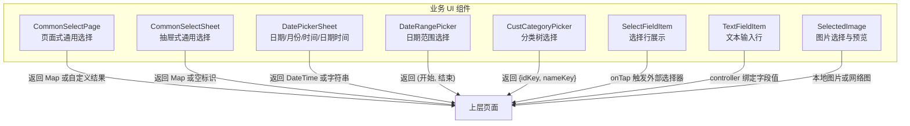
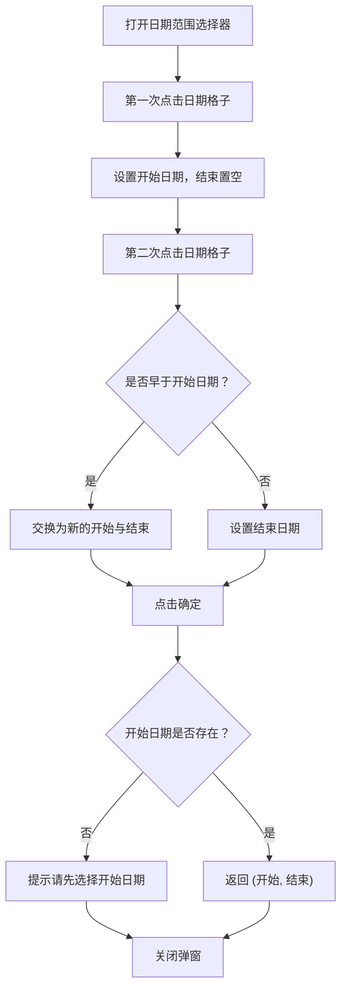
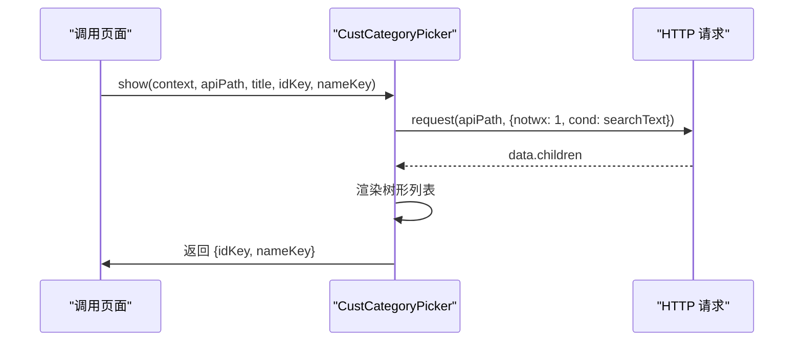
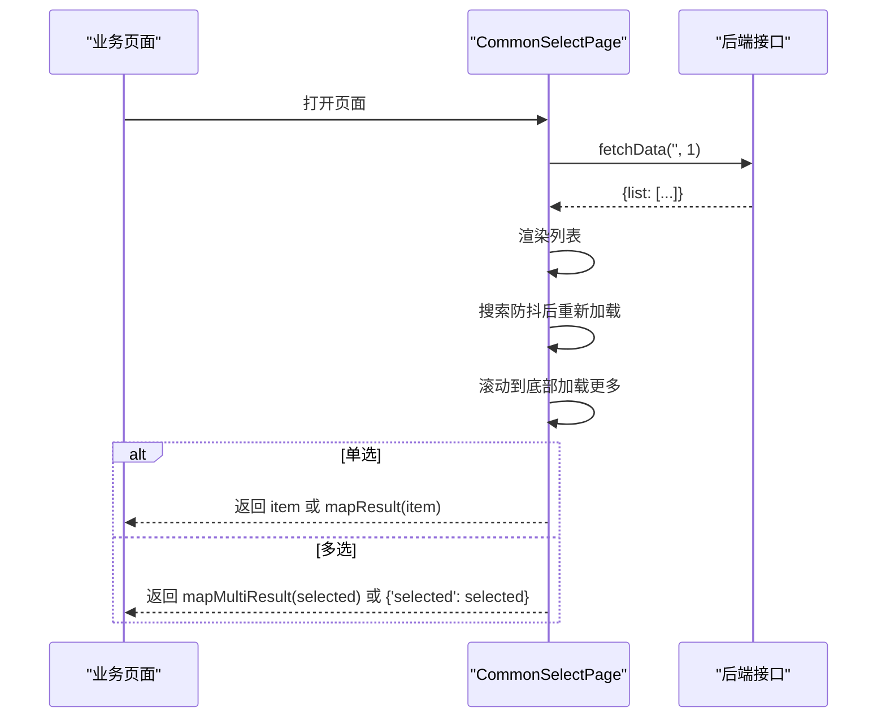
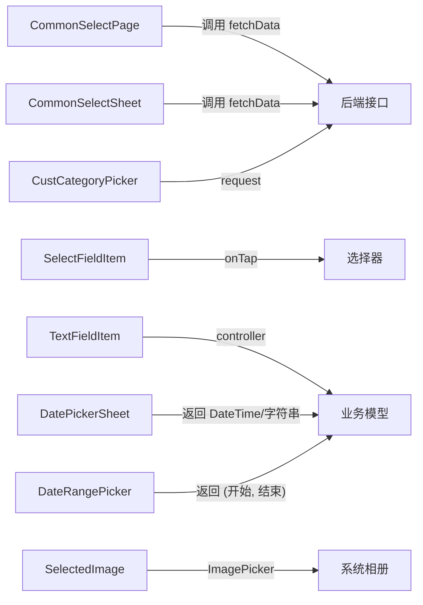

# 业务组件

<cite>
**本文引用的文件**   
- [common_select_page.dart](file://lib/widgets/common_select_page.dart)
- [common_select_sheet.dart](file://lib/widgets/common_select_sheet.dart)
- [date_picker_sheet.dart](file://lib/widgets/date_picker_sheet.dart)
- [date_range_picker.dart](file://lib/widgets/date_range_picker.dart)
- [cust_category_picker.dart](file://lib/widgets/cust_category_picker.dart)
- [select_field_item.dart](file://lib/widgets/select_field_item.dart)
- [text_field_item.dart](file://lib/widgets/text_field_item.dart)
- [selected_image.dart](file://lib/widgets/selected_image.dart)
</cite>

## 目录
1. [简介](#简介)
2. [项目结构中的业务组件定位](#项目结构中的业务组件定位)
3. [核心组件总览](#核心组件总览)
4. [架构与交互模型](#架构与交互模型)
5. [组件详解](#组件详解)
6. [依赖关系分析](#依赖关系分析)
7. [性能与可维护性建议](#性能与可维护性建议)
8. [常见问题与排错](#常见问题与排错)
9. [结论](#结论)

## 简介
本文件面向灵犀管店 Flutter 项目的零售业务开发者，系统化梳理并文档化以下通用业务 UI 组件：
- 通用选择器：CommonSelectPage、CommonSelectSheet
- 日期与时间选择器：DatePickerSheet（统一日期/月份/时间/日期时间选择函数）、DateRangePicker（日期范围选择）
- 分类选择器：CustCategoryPicker
- 表单输入组件：SelectFieldItem、TextFieldItem
- 图片选择器：SelectedImage

这些组件围绕“数据驱动 + 回调返回 + 底部弹窗或页面导航”的统一模式构建，适合对接后端分页列表、树形分类、表单校验和媒体上传等常见零售场景。

## 项目结构中的业务组件定位
业务 UI 组件集中在 `lib/widgets` 目录下，属于应用层展示组件，不直接持有复杂业务状态，而是通过参数、回调和 Future 返回值与上层页面解耦：
- CommonSelectPage：以完整页面形式提供搜索、分页、单选或多选结果。
- CommonSelectSheet：以底部抽屉形式提供单选或“全部”选项的选择体验。
- DatePickerSheet：以一组便捷函数暴露日期、月份、时间、日期时间的统一选择器。
- DateRangePicker：以底部日历弹窗提供起止日期范围选择。
- CustCategoryPicker：以底部树形分类选择器支持客户分类或商品分类。
- SelectFieldItem、TextFieldItem：表单行级展示与输入控件。
- SelectedImage：封装图片选择、预览、Hero 过渡和平台权限提示。



[无图表来源；该图为概念结构示意]

## 核心组件总览
本节按业务语义分组说明各组件的职责、数据绑定方式、回调机制和扩展点。

### 通用选择器：CommonSelectPage
- 业务语义：用于从后端拉取可搜索的分页列表，支持单选或批量多选，并以“编码+名称”的形式展示。
- 数据绑定：
  - 通过 `fetchData(searchText, page)` 获取原始接口响应，内部约定包含 `list` 字段作为数据源。
  - `nameField` 控制显示名称字段，`codeField` 控制显示编码字段。
- 回调机制：
  - 单选：点击条目后，若提供 `mapResult(item)`，则调用转换后 pop 返回；否则直接返回原始条目。
  - 多选：底部确认按钮返回 `mapMultiResult(selected)`；未提供时默认返回 `{'selected': selected}`。
- 状态管理：
  - 内部维护 `_list`、`_page`、`_loading`、`_hasMore`、`_searchText`、多选索引集合 `_selectedIndices`。
  - 搜索框输入 300ms 防抖；滚动到底部加载更多。
- 扩展点：
  - 可通过 `mapResult`、`mapMultiResult` 把后端原始对象转换为上层业务需要的数据结构。
  - 可通过配置 `multiSelect` 切换单选/多选行为。

**章节来源**
- [common_select_page.dart:1-200](file://lib/widgets/common_select_page.dart#L1-L200)
- [common_select_page.dart:201-342](file://lib/widgets/common_select_page.dart#L201-L342)

### 通用选择器：CommonSelectSheet
- 业务语义：以底部抽屉弹出选择列表，适合移动端半屏操作，强调“编码+名称”的 Radio 单选体验。
- 数据绑定：
  - 同样通过 `fetchData(searchText, page)` 获取 `result['list']`。
  - 支持 `showAll` 展示“全部”选项；`initialSelectedId` 用于打开时回显选中项。
  - `idField`、`nameField`、`codeField` 分别控制唯一标识、名称和编码字段。
- 回调机制：
  - 单选条目点击后延迟关闭并返回 `mapResult(item)`，未提供则返回原始条目。
  - “全部”选项返回空 id 和空 name，也可通过 `mapResult` 转换。
- 状态管理：
  - 内部维护 `_list`、`_page`、`_loading`、`_hasMore`、`_searchText`、当前选中 id `_selectedId`。
  - 支持搜索防抖与滚动分页加载；支持深色主题适配。
- 静态方法：
  - 提供 `CommonSelectSheet.show(context, ...)` 快捷入口，统一封装 `showModalBottomSheet`。

**章节来源**
- [common_select_sheet.dart:1-200](file://lib/widgets/common_select_sheet.dart#L1-L200)
- [common_select_sheet.dart:201-401](file://lib/widgets/common_select_sheet.dart#L201-L401)

### 日期与时间选择器：DatePickerSheet
- 业务语义：为全应用提供统一的日期、月份、时间和日期时间选择器，自动适配深浅色主题。
- 主要函数：
  - `showCommonDatePicker(initial, title)`：选择年/月/日，返回 `DateTime?`。
  - `showCommonMonthPicker(initial)`：选择年/月，返回 `DateTime?`，调用方需自行计算起止日期。
  - `showCommonTimePicker(initial)`：选择时/分/秒，返回 `"HH:mm:ss"?`。
  - `showCommonDateTimePicker(initial)`：选择年/月/日 时/分/秒，返回格式化字符串或 null。
- 交互特点：
  - 基于 CupertinoPicker 三列/六列滚轮，首尾有取消/确定按钮。
  - 日期选择会动态限制当月最大天数；时间选择固定范围。
- 使用示例路径：
  - 日期选择：参考文件头注释中的用法示例。
  - 月份选择：参考文件头注释中的用法示例。
  - 时间与日期时间选择：参考文件后半部分函数注释中的用法示例。

**章节来源**
- [date_picker_sheet.dart:1-200](file://lib/widgets/date_picker_sheet.dart#L1-L200)
- [date_picker_sheet.dart:201-446](file://lib/widgets/date_picker_sheet.dart#L201-L446)

### 日期范围选择器：DateRangePicker
- 业务语义：以底部日历弹窗实现“第一次点击开始日期，第二次点击结束日期”的区间选择逻辑。
- 返回值：`(DateTime, DateTime)?`，即 `(start, end)`；未选择开始时会提示先选开始日期。
- 状态管理：
  - 维护 `_viewMonth`、`_start`、`_end`。
  - 提供“本日”快捷定位到当前日期，并把范围重置为当天。
- 视觉风格：
  - 品牌蓝主色，圆角卡片样式，固定 6 行日历网格保证高度稳定。
  - 今日以边框高亮，已选区间以背景高亮。
- 错误处理：
  - 未选择开始日期时，通过 SnackBar 提示用户。



**图表来源**
- [date_range_picker.dart:1-200](file://lib/widgets/date_range_picker.dart#L1-L200)
- [date_range_picker.dart:201-310](file://lib/widgets/date_range_picker.dart#L201-L310)

**章节来源**
- [date_range_picker.dart:1-200](file://lib/widgets/date_range_picker.dart#L1-L200)
- [date_range_picker.dart:201-310](file://lib/widgets/date_range_picker.dart#L201-L310)

### 分类选择器：CustCategoryPicker
- 业务语义：底部弹出树形分类选择器，适用于客户分类或商品分类；返回 `{idKey, nameKey}`。
- 数据绑定：
  - 通过静态 `show(...)` 传入 `apiPath`、`title`、`idKey`、`nameKey`，默认使用客户分类接口。
  - 内部调用 `request(apiPath, {...})`，期望返回 `data.children` 作为树节点。
- 交互特性：
  - 顶部搜索框实时过滤，下拉列表支持展开/收起子节点。
  - 提供“全部分类”占位项，选中表示清空分类。
  - 底部“确定”按钮返回所选分类 id 与名称。
- 状态管理：
  - `_list` 保存树节点，`_expandedIds` 记录展开节点集合。
  - `_selectedId` 与 `_selectedName` 记录当前选中分类。
- 错误处理：
  - 请求异常时仅关闭 loading，不做额外中断提示。



**图表来源**
- [cust_category_picker.dart:1-200](file://lib/widgets/cust_category_picker.dart#L1-L200)
- [cust_category_picker.dart:201-296](file://lib/widgets/cust_category_picker.dart#L201-L296)

**章节来源**
- [cust_category_picker.dart:1-200](file://lib/widgets/cust_category_picker.dart#L1-L200)
- [cust_category_picker.dart:201-296](file://lib/widgets/cust_category_picker.dart#L201-L296)

### 表单输入组件：SelectFieldItem 与 TextFieldItem
- SelectFieldItem：
  - 用于表单中“选择型字段”的展示行，左侧标签支持必填星号标记，右侧显示已选值或提示文字，带右箭头。
  - 点击触发 `onTap`，由上层页面打开选择器（如 CommonSelectPage、CommonSelectSheet、CustCategoryPicker）。
  - 支持 `required`、`enabled`、`labelWidth` 等配置。
- TextFieldItem：
  - 用于文本输入行，支持键盘类型、提示文案、FocusNode 绑定。
  - 根据 `keyboardType` 自动附加数字或纯数字输入格式化器。
  - 通过 `controller` 与上层状态绑定，便于提交前统一校验。

典型组合流程：
- 选择型字段：SelectFieldItem 的 `onTap` 打开 CommonSelectSheet/CustCategoryPicker，选择完成后更新字段值并刷新 UI。
- 文本型字段：TextFieldItem 的 controller 绑定业务模型字段，提交前进行长度、格式等校验。

**章节来源**
- [select_field_item.dart:1-100](file://lib/widgets/select_field_item.dart#L1-L100)
- [text_field_item.dart:1-73](file://lib/widgets/text_field_item.dart#L1-L73)

### 图片选择器：SelectedImage
- 业务语义：点击图片打开相册选择一张图片，支持 Hero 动画和图片尺寸定制。
- 数据绑定：
  - `url` 表示已有图片地址，未选择时显示占位图。
  - 选择成功后内部生成 `ImageProvider`，并在 Web 与非 Web 分支分别处理。
- 回调与状态：
  - 组件内部维护 `_imageProvider` 和 `pickedFile`，选择后 setState 刷新。
  - 对外没有显式回调，上层可通过控制器或外部状态同步 URL。
- 错误处理：
  - 捕获 `MissingPluginException` 提示平台不支持。
  - 其他异常提示权限不足，无法打开相册。

**章节来源**
- [selected_image.dart:1-97](file://lib/widgets/selected_image.dart#L1-L97)

## 架构与交互模型
所有业务组件遵循统一的交互契约：
- 数据驱动：组件通过回调或 Future 获取数据，而不是直接耦合具体 API。
- 结果返回：多数选择器通过 Navigator.pop 返回结构化数据（Map、DateTime、元组等）。
- 展示抽象：列表、树、日历、滚轮等展示细节封装在组件内部，调用方只关心输入输出。

```mermaid
classDiagram
  class CommonSelectPage {
    +String title
    +String searchHint
    +Future fetchData(searchText, page)
    +String nameField
    +String codeField
    +bool multiSelect
    +mapResult(item)
    +mapMultiResult(selected)
  }

  class CommonSelectSheet {
    +String title
    +String searchHint
    +Future fetchData(searchText, page)
    +String nameField
    +String codeField
    +String idField
    +bool showAll
    +String initialSelectedId
    +mapResult(item)
    +static show(context, ...)
  }

  class CustCategoryPicker {
    +String initialId
    +String apiPath
    +String title
    +String idKey
    +String nameKey
    +static show(context, ...)
  }

  class DatePickerSheet {
    +showCommonDatePicker(initial, title)
    +showCommonMonthPicker(initial)
    +showCommonTimePicker(initial)
    +showCommonDateTimePicker(initial)
  }

  class DateRangePicker {
    +showDateRangeCalendarPicker(context, initialStart, initialEnd)
  }

  class SelectFieldItem {
    +String label
    +String value
    +String hint
    +VoidCallback onTap
    +bool required
    +bool enabled
    +double labelWidth
  }

  class TextFieldItem {
    +TextEditingController controller
    +String title
    +String hintText
    +TextInputType keyboardType
    +FocusNode focusNode
  }

  class SelectedImage {
    +String url
    +String heroTag
    +double size
  }

  CommonSelectPage --> "返回 Map" : "pop"
  CommonSelectSheet --> "返回 Map" : "pop"
  CustCategoryPicker --> "返回 {idKey, nameKey}" : "pop"
  DatePickerSheet --> "返回 DateTime 或字符串" : "pop"
  DateRangePicker --> "返回 (开始, 结束)" : "pop"
  SelectFieldItem --> "触发外部选择器" : "onTap"
  TextFieldItem --> "绑定字段值" : "controller"
  SelectedImage --> "本地或网络图片" : "ImageProvider"
```

**图表来源**
- [common_select_page.dart:1-200](file://lib/widgets/common_select_page.dart#L1-L200)
- [common_select_sheet.dart:1-200](file://lib/widgets/common_select_sheet.dart#L1-L200)
- [cust_category_picker.dart:1-200](file://lib/widgets/cust_category_picker.dart#L1-L200)
- [date_picker_sheet.dart:1-200](file://lib/widgets/date_picker_sheet.dart#L1-L200)
- [date_range_picker.dart:1-200](file://lib/widgets/date_range_picker.dart#L1-L200)
- [select_field_item.dart:1-100](file://lib/widgets/select_field_item.dart#L1-L100)
- [text_field_item.dart:1-73](file://lib/widgets/text_field_item.dart#L1-L73)
- [selected_image.dart:1-97](file://lib/widgets/selected_image.dart#L1-L97)

## 组件详解

### CommonSelectPage：页面式通用选择器
- 适用场景：需要全屏选择列表、支持搜索分页、可能多选的业务页面。
- 关键能力：
  - 搜索框 300ms 防抖，重置分页和选中状态。
  - 滚动到底部自动加载下一页。
  - 单选立即返回；多选通过底部确认按钮返回。
  - 列表项显示 `[编码]名称`，提升可读性。
- 与后端对接建议：
  - `fetchData` 返回的 Map 应包含 `list` 数组；每条记录至少包含 `nameField` 与 `codeField`。
  - 若后端返回 `has_more`，可在外层封装一层适配器，让 CommonSelectSheet 复用相同策略。



**图表来源**
- [common_select_page.dart:1-200](file://lib/widgets/common_select_page.dart#L1-L200)
- [common_select_page.dart:201-342](file://lib/widgets/common_select_page.dart#L201-L342)

**章节来源**
- [common_select_page.dart:1-200](file://lib/widgets/common_select_page.dart#L1-L200)
- [common_select_page.dart:201-342](file://lib/widgets/common_select_page.dart#L201-L342)

### CommonSelectSheet：抽屉式通用选择器
- 适用场景：移动端半屏快速选择，强调 Radio 单选和“全部”选项。
- 关键能力：
  - `showAll` 显示“全部”，返回空 id 与空 name。
  - `initialSelectedId` 支持打开时回显。
  - 深色主题下颜色自适应。
  - 提供静态 `show` 方法简化调用。
- 与后端对接建议：
  - 确保 `fetchData` 返回的 `result['list']` 包含 `idField`、`nameField`、`codeField`。
  - 若后端分页标志不是 `has_more`，可在外层封装适配器。

**章节来源**
- [common_select_sheet.dart:1-200](file://lib/widgets/common_select_sheet.dart#L1-L200)
- [common_select_sheet.dart:201-401](file://lib/widgets/common_select_sheet.dart#L201-L401)

### DatePickerSheet：统一日期时间选择器
- 适用场景：报表筛选、订单查询、库存统计等需要日期、月份、时间或日期时间的场景。
- 设计要点：
  - 日期选择器返回 `DateTime`，调用方可根据业务计算起止日期。
  - 时间选择器和日期时间选择器返回字符串，便于直接传给后端。
  - 所有选择器均适配深浅色主题，避免重复实现。
- 集成建议：
  - 在表单中，将日期时间选择结果格式化后写入业务模型字段。
  - 对“本月”等场景，使用 `showCommonMonthPicker`，再计算月初月末。

**章节来源**
- [date_picker_sheet.dart:1-200](file://lib/widgets/date_picker_sheet.dart#L1-L200)
- [date_picker_sheet.dart:201-446](file://lib/widgets/date_picker_sheet.dart#L201-L446)

### DateRangePicker：日期范围选择器
- 适用场景：需要直观选择起止日期的报表、流水、盘点等业务。
- 交互规则：
  - 首次点击设为开始日期，再次点击设为结束日期；若再次点击则重新开始选择。
  - 点击确定时校验开始日期存在。
- 视觉规范：
  - 品牌蓝主色，圆形日期按钮，区间内日期浅蓝填充。
  - 本周/本月常用辅助操作可通过上层页面扩展。

**章节来源**
- [date_range_picker.dart:1-200](file://lib/widgets/date_range_picker.dart#L1-L200)
- [date_range_picker.dart:201-310](file://lib/widgets/date_range_picker.dart#L201-L310)

### CustCategoryPicker：分类树选择器
- 适用场景：客户分类、商品分类等树形维度筛选。
- 数据模型约定：
  - 接口返回 `data.children`，每个节点至少包含 `typeid`、`name`、`code`。
  - 可通过 `apiPath`、`idKey`、`nameKey` 灵活切换到不同分类接口。
- 扩展建议：
  - 如需多级联动，可在 `_buildTreeItem` 基础上增加异步懒加载子节点。
  - 如需多选，可增加勾选状态集合和批量返回逻辑。

**章节来源**
- [cust_category_picker.dart:1-200](file://lib/widgets/cust_category_picker.dart#L1-L200)
- [cust_category_picker.dart:201-296](file://lib/widgets/cust_category_picker.dart#L201-L296)

### SelectFieldItem 与 TextFieldItem：表单行组件
- SelectFieldItem：
  - 适合“选择型字段”，例如选择门店、供应商、仓库、业务员等。
  - 推荐与 CommonSelectPage/CommonSelectSheet/CustCategoryPicker 配合使用。
- TextFieldItem：
  - 适合“输入型字段”，例如备注、数量、金额等。
  - 数字键盘类型会自动附加数字格式化器，减少非法输入。

**章节来源**
- [select_field_item.dart:1-100](file://lib/widgets/select_field_item.dart#L1-L100)
- [text_field_item.dart:1-73](file://lib/widgets/text_field_item.dart#L1-L73)

### SelectedImage：图片选择器
- 适用场景：头像、商品图、凭证图等单图上传前的预览与选择。
- 注意事项：
  - Web 平台路径处理与非 Web 平台不同，组件已做分支处理。
  - 若出现权限问题，组件会给出 Toast 提示。
- 集成建议：
  - 选择成功后将本地路径或上传后的 URL 写入业务模型。
  - 如需多图，可在上层封装多图选择器并复用 SelectedImage 的预览样式。

**章节来源**
- [selected_image.dart:1-97](file://lib/widgets/selected_image.dart#L1-L97)

## 依赖关系分析
- 组件之间低耦合：
  - CommonSelectPage 与 CommonSelectSheet 共享“搜索+分页+编码+名称”的通用交互模式，但一个走页面导航，一个走底部抽屉。
  - CustCategoryPicker 独立负责树形分类，不依赖通用选择器。
  - DatePickerSheet 与 DateRangePicker 各自封装日期相关交互，互不依赖。
  - SelectFieldItem 和 TextFieldItem 是展示层基础组件，由业务页面组合使用。
  - SelectedImage 依赖 image_picker 和工具类，但不依赖业务模块。
- 外部依赖：
  - 分类选择器依赖 HTTP 请求封装。
  - 图片选择器依赖 ImagePicker、设备工具、主题工具、Toast 工具。



[无图表来源；该图为概念依赖示意]

**章节来源**
- [common_select_page.dart:1-200](file://lib/widgets/common_select_page.dart#L1-L200)
- [common_select_sheet.dart:1-200](file://lib/widgets/common_select_sheet.dart#L1-L200)
- [cust_category_picker.dart:1-200](file://lib/widgets/cust_category_picker.dart#L1-L200)
- [selected_image.dart:1-97](file://lib/widgets/selected_image.dart#L1-L97)

## 性能与可维护性建议
- 列表性能：
  - CommonSelectPage 和 CommonSelectSheet 都使用 ListView.builder，适合长列表；建议在业务侧避免频繁重建 widget。
  - 搜索防抖时间为 300ms，可减少不必要请求；若后端接口较慢，可适当延长。
- 分页策略：
  - CommonSelectSheet 依赖 `has_more` 字段判断是否有更多数据；CommonSelectPage 默认以列表是否为空判断。
  - 建议在后端统一分页标志，或在业务层封装适配器。
- 主题一致性：
  - DatePickerSheet 已适配深浅色主题；其他组件多为硬编码颜色，建议在后续迭代中抽取主题变量。
- 可测试性：
  - 所有选择器均通过 Future 返回值暴露结果，便于在单元测试中 mock fetchData 或 request。
- 可维护性：
  - 建议将 CommonSelectPage 与 CommonSelectSheet 的共同逻辑抽离为基类或混合类，减少重复代码。
  - 建议将表单校验逻辑集中到业务页面，而不是下沉到展示组件。

[本节为通用建议，不涉及具体文件分析]

## 常见问题与排错
- 选择列表为空：
  - 检查 `fetchData` 返回的 `list` 是否为空数组；确认后端分页接口是否正常。
  - 对于 CommonSelectSheet，确认 `has_more` 是否正确返回。
- 多选结果不符合预期：
  - 检查是否提供 `mapMultiResult`，以及返回结构是否符合上层业务模型。
- 分类选择器无法加载：
  - 检查 `apiPath` 是否正确，后端返回结构是否为 `data.children`。
  - 确认网络请求封装是否成功，异常时仅关闭 loading，不会弹错提示。
- 图片选择失败：
  - Web 平台可能不支持相册选择；组件会提示平台不支持。
  - 非 Web 平台若无权限，组件会提示权限不足。
- 日期范围未选择完成：
  - 必须至少选择开始日期；否则点击确定会提示先选择开始日期。

**章节来源**
- [common_select_sheet.dart:201-401](file://lib/widgets/common_select_sheet.dart#L201-L401)
- [cust_category_picker.dart:201-296](file://lib/widgets/cust_category_picker.dart#L201-L296)
- [selected_image.dart:1-97](file://lib/widgets/selected_image.dart#L1-L97)
- [date_range_picker.dart:201-310](file://lib/widgets/date_range_picker.dart#L201-L310)

## 结论
灵犀管店的业务 UI 组件库围绕“选择、输入、日期、图片”四类高频场景，提供了标准化、可复用的 Flutter 组件。它们以数据回调和 Future 返回值为核心契约，既保证了与后端接口的解耦，也便于在不同业务页面中组合使用。未来可继续完善主题一致性、分页标志统一、多选分类支持和表单校验集中化，进一步提升组件的一致性与可维护性。