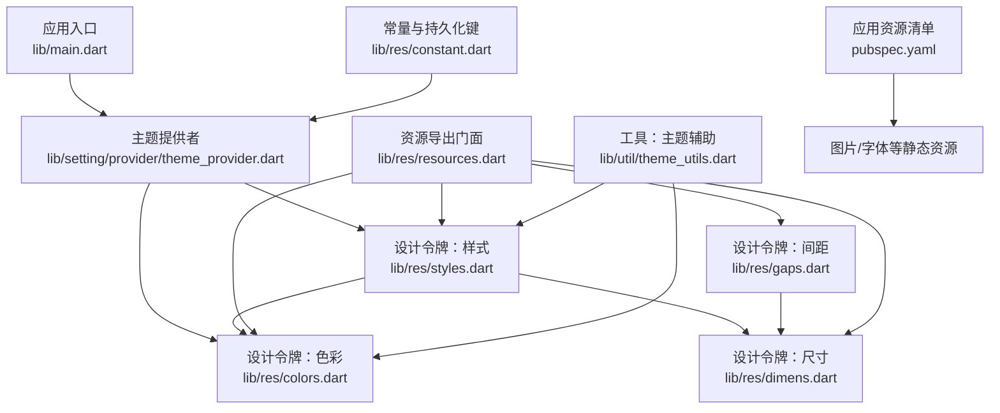
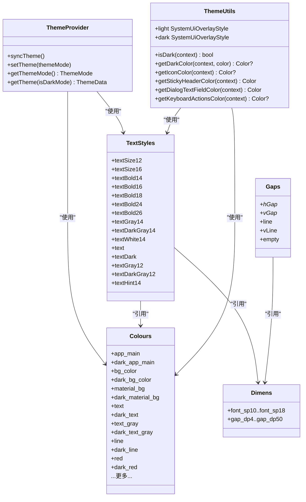
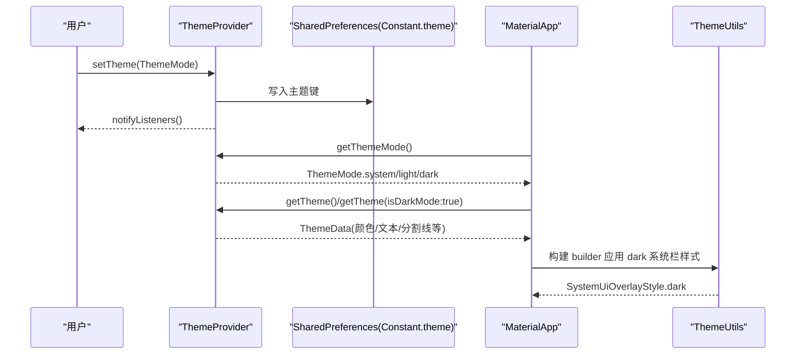
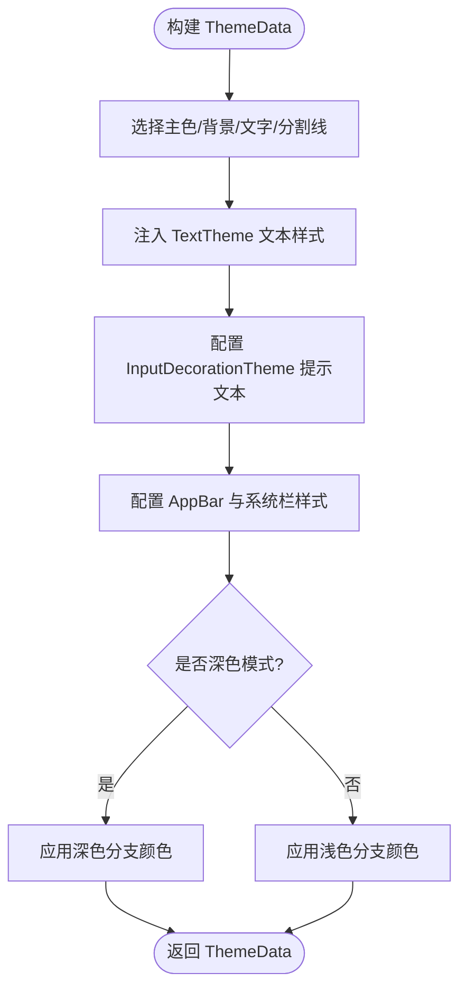
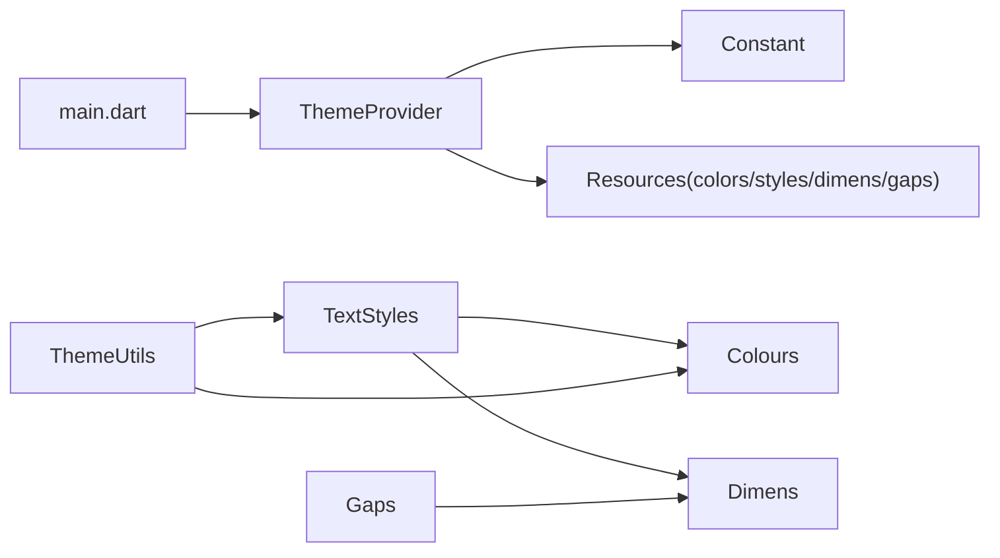

# 主题系统

<cite>
**本文引用的文件**   
- [lib/res/colors.dart](file://lib/res/colors.dart)
- [lib/res/styles.dart](file://lib/res/styles.dart)
- [lib/res/resources.dart](file://lib/res/resources.dart)
- [lib/res/constant.dart](file://lib/res/constant.dart)
- [lib/res/dimens.dart](file://lib/res/dimens.dart)
- [lib/res/gaps.dart](file://lib/res/gaps.dart)
- [lib/util/theme_utils.dart](file://lib/util/theme_utils.dart)
- [lib/setting/provider/theme_provider.dart](file://lib/setting/provider/theme_provider.dart)
- [lib/main.dart](file://lib/main.dart)
- [pubspec.yaml](file://pubspec.yaml)
</cite>

## 目录
1. [引言](#引言)
2. [项目结构](#项目结构)
3. [核心组件](#核心组件)
4. [架构总览](#架构总览)
5. [详细组件分析](#详细组件分析)
6. [依赖关系分析](#依赖关系分析)
7. [性能与可维护性](#性能与可维护性)
8. [故障排查指南](#故障排查指南)
9. [结论](#结论)
10. [附录：设计规范与扩展指南](#附录设计规范与扩展指南)

## 引言
本文件系统性梳理灵犀管店 Flutter 项目的主题系统，覆盖色彩体系、样式规范、资源管理、常量定义、尺寸规范与间距系统。文档同时说明深色模式切换机制、主题继承体系、样式优先级规则，并提供颜色语义化命名建议、字体层级、响应式适配方案、主题定制与品牌色替换方法，以及国际化支持要点，帮助设计师与开发者建立统一视觉语言与可扩展的主题接口。

## 项目结构
主题相关代码集中在以下模块：
- 设计令牌层：colors.dart、dimens.dart、gaps.dart、styles.dart、resources.dart
- 运行时主题：theme_provider.dart、theme_utils.dart
- 应用入口与全局配置：main.dart
- 业务常量与存储键：constant.dart
- 字体与静态资源声明：pubspec.yaml

图示来源
- [lib/main.dart:1-200](file://lib/main.dart#L1-L200)
- [lib/setting/provider/theme_provider.dart:1-88](file://lib/setting/provider/theme_provider.dart#L1-L88)
- [lib/res/resources.dart:1-12](file://lib/res/resources.dart#L1-L12)
- [lib/res/colors.dart:1-46](file://lib/res/colors.dart#L1-L46)
- [lib/res/styles.dart:1-76](file://lib/res/styles.dart#L1-L76)
- [lib/res/dimens.dart:1-19](file://lib/res/dimens.dart#L1-L19)
- [lib/res/gaps.dart:1-48](file://lib/res/gaps.dart#L1-L48)
- [lib/util/theme_utils.dart:1-52](file://lib/util/theme_utils.dart#L1-L52)
- [lib/res/constant.dart:1-54](file://lib/res/constant.dart#L1-L54)
- [pubspec.yaml:1-153](file://pubspec.yaml#L1-L153)

章节来源
- [lib/main.dart:1-200](file://lib/main.dart#L1-L200)
- [pubspec.yaml:1-153](file://pubspec.yaml#L1-L153)

## 核心组件
- 色彩体系（Colours）：集中管理浅色与深色两套主色、背景、文字、线条、状态与渐变，提供对称的 dark_ 前缀变量，便于在深色模式下直接映射。
- 样式规范（TextStyles）：基于 Dimens 字号与 Colours 颜色，封装常用 TextStyle，包括标题、正文、灰色文本、提示文本等，统一 textBaseline 保证对齐一致性。
- 尺寸规范（Dimens）：以 sp 为单位定义字号，以 dp 为单位定义间距刻度，作为所有 UI 尺寸的单一事实来源。
- 间距系统（Gaps）：将间距刻度封装为 Widget（水平/垂直分隔、分割线、空占位），避免散落 SizedBox 和 Divider 调用。
- 资源门面（Resources）：统一导出 colors、dimens、gaps、styles，并聚合部分图标资源加载逻辑。
- 主题提供者（ThemeProvider）：根据持久化配置生成 ThemeData，负责 Material/Cupertino 主题、颜色、文本、输入框、AppBar、分割线等。
- 主题工具（ThemeUtils）：提供 isDark、系统栏样式、页面内动态颜色选择等辅助能力，并为 BuildContext 扩展 isDark 与常见背景色。
- 常量（Constant）：统一管理存储键，其中 theme 键用于保存用户主题选择；同时包含运行环境判断、登录与扫码等业务常量。

章节来源
- [lib/res/colors.dart:1-46](file://lib/res/colors.dart#L1-L46)
- [lib/res/styles.dart:1-76](file://lib/res/styles.dart#L1-L76)
- [lib/res/dimens.dart:1-19](file://lib/res/dimens.dart#L1-L19)
- [lib/res/gaps.dart:1-48](file://lib/res/gaps.dart#L1-L48)
- [lib/res/resources.dart:1-12](file://lib/res/resources.dart#L1-L12)
- [lib/setting/provider/theme_provider.dart:1-88](file://lib/setting/provider/theme_provider.dart#L1-L88)
- [lib/util/theme_utils.dart:1-52](file://lib/util/theme_utils.dart#L1-L52)
- [lib/res/constant.dart:1-54](file://lib/res/constant.dart#L1-L54)

## 架构总览
主题系统采用“设计令牌 + 主题提供者 + 运行时工具”的分层结构。设计令牌提供稳定、无副作用的颜色与尺寸常量；主题提供者将令牌组合成 ThemeData；运行时工具根据当前上下文动态计算颜色或系统栏样式。

图示来源
- [lib/setting/provider/theme_provider.dart:1-88](file://lib/setting/provider/theme_provider.dart#L1-L88)
- [lib/util/theme_utils.dart:1-52](file://lib/util/theme_utils.dart#L1-L52)
- [lib/res/styles.dart:1-76](file://lib/res/styles.dart#L1-L76)
- [lib/res/colors.dart:1-46](file://lib/res/colors.dart#L1-L46)
- [lib/res/dimens.dart:1-19](file://lib/res/dimens.dart#L1-L19)
- [lib/res/gaps.dart:1-48](file://lib/res/gaps.dart#L1-L48)

## 详细组件分析

### 色彩体系（Colours）
- 设计目标：为浅色与深色模式分别定义对称颜色，确保主题切换时视觉一致且对比度合理。
- 关键分组：
  - 主色：app_main / dark_app_main，用于主要交互元素与强调。
  - 背景：bg_color / dark_bg_color，material_bg / dark_material_bg，bg_gray / dark_bg_gray 等，区分页面级、卡片级与灰阶背景。
  - 文字：text / dark_text，text_gray / dark_text_gray，text_disabled / dark_text_disabled 等，表达可读性与禁用态。
  - 状态：red / dark_red 表示错误/警示；orange、gradient_blue、shadow_blue 用于强调与图表阴影。
  - 边框与分割：line / dark_line，配合 Gaps.line 使用。
- 使用建议：
  - 业务组件应优先使用 Colours 中的语义色，而非硬编码十六进制值。
  - 新增颜色需同时补充 dark_ 对应项，保持明暗模式一致性。

章节来源
- [lib/res/colors.dart:1-46](file://lib/res/colors.dart#L1-L46)

### 样式规范（TextStyles）
- 设计目标：通过固定字号与颜色组合，统一文本层级，减少重复 TextStyle 构造。
- 关键约定：
  - 字号来源于 Dimens.font_sp*，保证跨组件一致。
  - 正文字体设置 textBaseline.alphabetic，避免行高错位导致的视觉抖动。
  - 提供标题加粗、灰色文本、提示文本等常用变体，并在深色模式通过 ThemeProvider 的 TextTheme 注入到全局。
- 使用建议：
  - 列表与表单中优先复用 TextStyles.text / textDark / textGray12 等。
  - 如需特殊强调，建议在 TextStyles 新增类，而不是在页面内临时创建 TextStyle。

章节来源
- [lib/res/styles.dart:1-76](file://lib/res/styles.dart#L1-L76)

### 尺寸规范（Dimens）
- 设计目标：将字号与间距抽象为常量，避免散落魔法数字。
- 字号：font_sp10 ~ font_sp18，按阅读层级递增。
- 间距：gap_dp4 ~ gap_dp50，遵循 4dp/8dp 网格体系。
- 使用建议：
  - 所有尺寸都应从 Dimens 获取，禁止硬编码数值。
  - 新增尺寸应保持与现有刻度的比例关系。

章节来源
- [lib/res/dimens.dart:1-19](file://lib/res/dimens.dart#L1-L19)

### 间距系统（Gaps）
- 设计目标：将间距与分割线封装为 Widget，提升布局可读性与复用性。
- 能力：
  - 水平/垂直间距：hGap*/vGap*，直接插入布局树。
  - 分割线：line（Divider）、vLine（VerticalDivider）。
  - 空占位：empty，替代 SizedBox.shrink。
- 使用建议：
  - 列表项之间、按钮与文本之间统一使用 Gaps.*，避免不一致的留白。

章节来源
- [lib/res/gaps.dart:1-48](file://lib/res/gaps.dart#L1-L48)

### 资源管理（Resources）
- 设计目标：提供统一导出入口，屏蔽内部实现细节，便于后续扩展（如按需导出、别名导出）。
- 能力：
  - 导出 colors、dimens、gaps、styles。
  - 聚合基础图标加载（示例中箭头图标）。
- 使用建议：
  - 业务模块优先从 resources.dart 导入所需资源，降低耦合。

章节来源
- [lib/res/resources.dart:1-12](file://lib/res/resources.dart#L1-L12)

### 常量定义（Constant）
- 设计目标：集中管理运行环境标志、存储键、业务常量，避免字符串散落。
- 关键点：
  - Constant.theme 是主题模式的持久化键，供 ThemeProvider 读取与写入。
  - 其他键涵盖登录、扫码、OSS 图片地址等，体现业务与主题的解耦。
- 使用建议：
  - 新增存储键必须写进 Constant，避免重复字符串与拼写错误。

章节来源
- [lib/res/constant.dart:1-54](file://lib/res/constant.dart#L1-L54)

### 深色模式切换机制
深色模式由 ThemeProvider 与本地持久化共同驱动，整体流程如下：

图示来源
- [lib/setting/provider/theme_provider.dart:1-88](file://lib/setting/provider/theme_provider.dart#L1-L88)
- [lib/main.dart:1-200](file://lib/main.dart#L1-L200)
- [lib/util/theme_utils.dart:1-52](file://lib/util/theme_utils.dart#L1-L52)
- [lib/res/constant.dart:1-54](file://lib/res/constant.dart#L1-L54)

章节来源
- [lib/setting/provider/theme_provider.dart:1-88](file://lib/setting/provider/theme_provider.dart#L1-L88)
- [lib/main.dart:1-200](file://lib/main.dart#L1-L200)

### 主题继承体系与样式优先级
- 继承链：
  - ThemeData 由 ThemeProvider.getTheme 生成，包含 primaryColor、colorScheme、scaffoldBackgroundColor、canvasColor、textTheme、inputDecorationTheme、appBarTheme、dividerTheme、cupertinoOverrideTheme 等。
  - TextStyles 被注入到 TextTheme.titleMedium/bodyMedium/titleSmall，从而覆盖默认文本样式。
  - 全局 AppBar 使用统一的 systemOverlayStyle，确保页面级状态栏图标一致性。
- 优先级规则：
  - 组件局部传入的样式属性优先于全局 TextTheme。
  - 页面级 MediaQuery 的 textScaler 被强制为 noScaling，避免系统字体缩放影响主题表现。
  - 深色模式通过 ThemeData.brightness 与 isDarkMode 参数决定颜色分支。

图示来源
- [lib/setting/provider/theme_provider.dart:1-88](file://lib/setting/provider/theme_provider.dart#L1-L88)
- [lib/main.dart:1-200](file://lib/main.dart#L1-L200)

章节来源
- [lib/setting/provider/theme_provider.dart:1-88](file://lib/setting/provider/theme_provider.dart#L1-L88)
- [lib/main.dart:1-200](file://lib/main.dart#L1-L200)

### 资源管理与字体
- 静态资源：pubspec.yaml 中声明 assets/data、assets/images、assets/svg 等目录，包含订单暗黑图、登录图、商品图等。
- 字体：项目声明了 RobotoThin 字体族，但具体字体文件未在提供的结构中展示；主题文本样式未显式指定 fontFamily，因此实际字体由系统或父级主题决定。
- 使用建议：
  - 若需要品牌字体，应在 pubspec.yaml 注册字体族，并在 TextStyles 或 TextTheme 中统一指定。

章节来源
- [pubspec.yaml:1-153](file://pubspec.yaml#L1-L153)

## 依赖关系分析
主题系统的依赖方向清晰：
- main.dart 引入 ThemeProvider，并通过 MultiProvider 暴露给全局。
- ThemeProvider 依赖 Constant 读取/写入主题键，依赖 Resources 导出的设计令牌。
- TextStyles 依赖 Colours 与 Dimens。
- Gaps 依赖 Dimens。
- ThemeUtils 依赖 Colours 与 Resources，并输出系统栏样式。

图示来源
- [lib/main.dart:1-200](file://lib/main.dart#L1-L200)
- [lib/setting/provider/theme_provider.dart:1-88](file://lib/setting/provider/theme_provider.dart#L1-L88)
- [lib/res/resources.dart:1-12](file://lib/res/resources.dart#L1-L12)
- [lib/res/styles.dart:1-76](file://lib/res/styles.dart#L1-L76)
- [lib/res/colors.dart:1-46](file://lib/res/colors.dart#L1-L46)
- [lib/res/dimens.dart:1-19](file://lib/res/dimens.dart#L1-L19)
- [lib/res/gaps.dart:1-48](file://lib/res/gaps.dart#L1-L48)
- [lib/util/theme_utils.dart:1-52](file://lib/util/theme_utils.dart#L1-L52)

## 性能与可维护性
- 性能
  - ThemeData 在 ThemeProvider 中集中生成，避免在组件树中重复构造。
  - 全局 MediaQuery 设置 textScaler.noScaling，减少因系统字体缩放引起的重排与重建。
  - 使用 ChangeNotifierProvider 与 Consumer 精确订阅主题变更，降低无关重建。
- 可维护性
  - 设计令牌集中管理，新增颜色或字号只需修改一处。
  - 通过 Constant.theme 解耦主题存储键，避免散落的字符串。
  - 统一系统栏样式与文本基线，降低页面级差异带来的维护成本。

[本节为通用指导，不直接分析具体文件]

## 故障排查指南
- 主题不生效
  - 检查 Constant.theme 的值是否为 'Light' 或 'Dark'；非预期值会回退到系统模式。
  - 确认 ThemeProvider.setTheme 已调用并触发 notifyListeners。
- 深色模式下文字不可读
  - 检查组件是否直接使用硬编码颜色，而非 Colours 中的语义色。
  - 确认 TextTheme 的 titleMedium/bodyMedium 是否正确注入 TextStyles.textDark。
- 状态栏图标颜色异常
  - 确认 MaterialApp.builder 中 AnnotatedRegion 使用了 ThemeUtils.dark。
  - 检查是否存在覆盖 systemOverlayStyle 的 AppBar 配置。
- 字体显示异常
  - 确认 pubspec.yaml 中 fonts 配置正确，并已执行 flutter pub get。
  - 若自定义字体未生效，检查是否在 TextTheme 或 TextStyles 中指定 fontFamily。

章节来源
- [lib/res/constant.dart:1-54](file://lib/res/constant.dart#L1-L54)
- [lib/setting/provider/theme_provider.dart:1-88](file://lib/setting/provider/theme_provider.dart#L1-L88)
- [lib/main.dart:1-200](file://lib/main.dart#L1-L200)
- [lib/util/theme_utils.dart:1-52](file://lib/util/theme_utils.dart#L1-L52)
- [pubspec.yaml:1-153](file://pubspec.yaml#L1-L153)

## 结论
本项目主题系统通过设计令牌、主题提供者与工具函数形成清晰分层，既保证了浅色/深色模式的统一外观，又提供了良好的扩展点。借助 Constant.theme 与 ThemeProvider，主题可在应用启动时恢复并保持全局一致；通过 TextStyles、Dimens、Gaps、Colours，界面元素具备一致的视觉节奏与可维护性。未来可通过引入自定义字体、完善字体层级与扩展颜色语义，进一步提升品牌一致性与可访问性。

[本节为总结性内容，不直接分析具体文件]

## 附录：设计规范与扩展指南

### 颜色语义化命名规范（建议）
- 主色与强调：primary、secondary、accent
- 背景：background、surface、overlay、elevated
- 文字：onPrimary、onBackground、onSurface、disabled
- 状态：error、warning、success、info
- 说明：当前 Colours 使用 app_main/dark_app_main、text/dark_text、line/dark_line 等命名；建议逐步迁移到更语义化的名称，同时保留旧名作为兼容。

[本节为通用建议，不直接分析具体文件]

### 字体层级定义（建议）
- 标题层级：H1/H2/H3/H4，对应不同字号与字重。
- 正文层级：Body/Large/Small，对应主要阅读文本与次要信息。
- 辅助文本：Caption/Meta，用于标签、时间戳、统计数值等。
- 当前实现：TextStyles 提供 textSize12/16 与 bold 系列，Dimens 提供字号刻度；建议进一步收敛为 H1~H4、Body、Caption 等统一命名，并在 TextTheme 中集中注入。

[本节为通用建议，不直接分析具体文件]

### 响应式布局的尺寸适配方案
- 基础单位：Dimens 中的 sp/dp 常量作为唯一尺寸来源。
- 断点策略：建议在 dimens.dart 中按屏幕宽度（sm/md/lg/xl）提供多组间距与字号，或使用响应式工具类计算。
- 约束：当前应用通过 MediaQuery.textScaler.noScaling 抑制系统字体缩放；如需更大字号体验，应在主题层提供可配置的 scale 因子。

[本节为通用建议，不直接分析具体文件]

### 主题定制指南
- 新增主题色：在 Colours 中添加语义色，并确保浅色/深色配对；在 ThemeProvider 的 colorScheme 或业务组件中使用。
- 新增文本样式：在 TextStyles 中新增类，并在 TextTheme 中注入，使全局生效。
- 新增间距：在 Dimens 中新增刻度，并在 Gaps 中封装 hGap/vGap。
- 切换主题模式：调用 ThemeProvider.setTheme(ThemeMode.light/dark/system)。

章节来源
- [lib/res/colors.dart:1-46](file://lib/res/colors.dart#L1-L46)
- [lib/res/styles.dart:1-76](file://lib/res/styles.dart#L1-L76)
- [lib/res/dimens.dart:1-19](file://lib/res/dimens.dart#L1-L19)
- [lib/res/gaps.dart:1-48](file://lib/res/gaps.dart#L1-L48)
- [lib/setting/provider/theme_provider.dart:1-88](file://lib/setting/provider/theme_provider.dart#L1-L88)

### 品牌色替换方法
- 替换主色：修改 Colours.app_main 与 Colours.dark_app_main。
- 同步更新：确保 ThemeProvider 的 primaryColor、indicatorColor、colorScheme.secondary 使用该主色；如有图表、进度条、选中态等组件，也需同步替换。
- 验证对比度：更换后检查文字与背景的对比度，确保无障碍可达。

章节来源
- [lib/res/colors.dart:1-46](file://lib/res/colors.dart#L1-L46)
- [lib/setting/provider/theme_provider.dart:1-88](file://lib/setting/provider/theme_provider.dart#L1-L88)

### 国际化支持
- 当前 MaterialApp 已启用 GlobalMaterialLocalizations、GlobalWidgetsLocalizations、GlobalCupertinoLocalizations，supportedLocales 仅包含 zh_CN。
- 主题相关文案（如设置页标题、提示语）应通过 i18n 资源加载，避免硬编码中文。
- 若后续增加英文或其他语言，需在 supportedLocales 中追加，并在本地化文件中提供对应翻译。

章节来源
- [lib/main.dart:1-200](file://lib/main.dart#L1-L200)