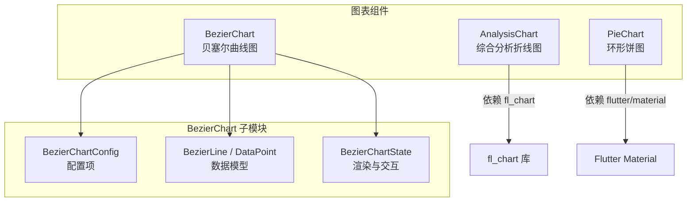
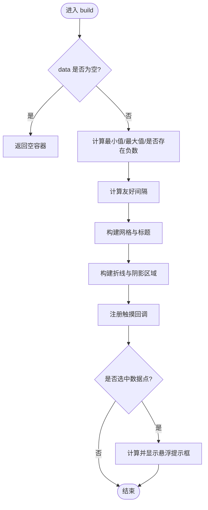
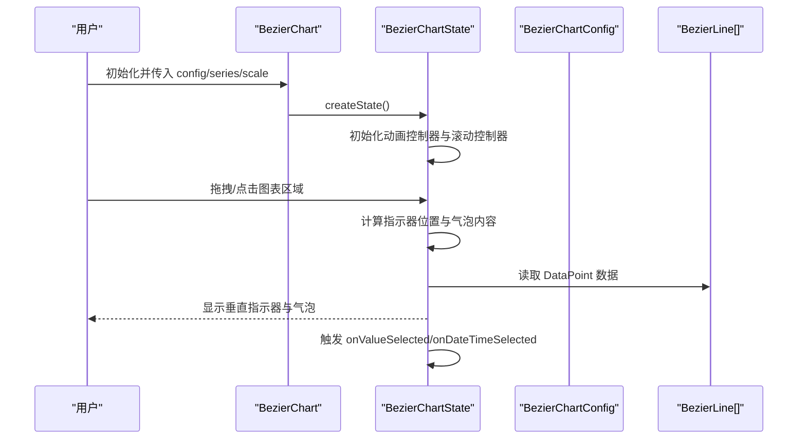
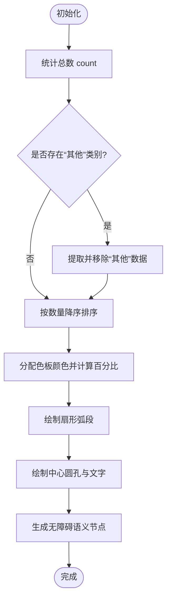
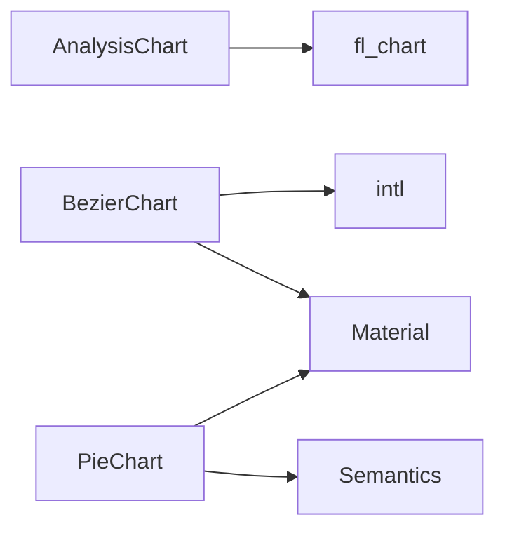

# 图表组件

<cite>
**本文引用的文件**   
- [lib/widgets/analysis_chart.dart](file://lib/widgets/analysis_chart.dart)
- [lib/widgets/bezier_chart/bezier_chart.dart](file://lib/widgets/bezier_chart/bezier_chart.dart)
- [lib/widgets/bezier_chart/bezier_chart_config.dart](file://lib/widgets/bezier_chart/bezier_chart_config.dart)
- [lib/widgets/bezier_chart/bezier_line.dart](file://lib/widgets/bezier_chart/bezier_line.dart)
- [lib/widgets/bezier_chart/bezier_chart_widget.dart](file://lib/widgets/bezier_chart/bezier_chart_widget.dart)
- [lib/widgets/pie_chart/pie_chart.dart](file://lib/widgets/pie_chart/pie_chart.dart)
- [lib/widgets/pie_chart/pie_data.dart](file://lib/widgets/pie_chart/pie_data.dart)
- [lib/pages/data/businessReport/businessAnalysis/subpage/sp_bill_page.dart](file://lib/pages/data/businessReport/businessAnalysis/subpage/sp_bill_page.dart)
- [lib/pages/data/businessReport/businessAnalysis/subpage/pffx_page.dart](file://lib/pages/data/businessReport/businessAnalysis/subpage/pffx_page.dart)
- [lib/pages/data/businessReport/businessAnalysis/subpage/lsfx_page.dart](file://lib/pages/data/businessReport/businessAnalysis/subpage/lsfx_page.dart)
- [lib/pages/data/businessReport/businessAnalysis/subpage/kdfx_page.dart](file://lib/pages/data/businessReport/businessAnalysis/subpage/kdfx_page.dart)
- [lib/pages/data/member/addVipAnalysis/add_vip_analysis_page.dart](file://lib/pages/data/member/addVipAnalysis/add_vip_analysis_page.dart)
- [lib/pages/home/widgets/trend_card.dart](file://lib/pages/home/widgets/trend_card.dart)
</cite>

## 目录
1. [引言](#引言)
2. [项目结构](#项目结构)
3. [核心组件](#核心组件)
4. [架构总览](#架构总览)
5. [详细组件分析](#详细组件分析)
6. [依赖分析](#依赖分析)
7. [性能与大数据优化](#性能与大数据优化)
8. [选型指南与最佳实践](#选型指南与最佳实践)
9. [故障排查](#故障排查)
10. [结论](#结论)

## 引言
本文件为灵犀管店 Flutter 项目的数据分析可视化组件提供完整的技术文档，覆盖以下三类图表：
- AnalysisChart：综合分析折线图，适合趋势、对比等连续型数据展示。
- BezierChart：贝塞尔曲线图（基于自定义实现），适合日期尺度或自定义刻度的平滑曲线图表。
- PieChart：环形饼图，适合占比与分类分布展示。

文档面向数据分析师与前端开发者，说明数据结构、配置选项、样式定制、交互行为、渲染性能与内存管理策略，并提供报表场景下的选型建议与实现范例路径。

## 项目结构
图表组件集中在 lib/widgets 下，按功能分目录组织：
- analysis_chart.dart：通用分析折线图。
- bezier_chart/：贝塞尔曲线图及其配置、数据点模型与主控件。
- pie_chart/：环形饼图与数据模型。



**图示来源**
- [lib/widgets/analysis_chart.dart:1-258](file://lib/widgets/analysis_chart.dart#L1-L258)
- [lib/widgets/bezier_chart/bezier_chart.dart:1-7](file://lib/widgets/bezier_chart/bezier_chart.dart#L1-L7)
- [lib/widgets/bezier_chart/bezier_chart_config.dart:1-150](file://lib/widgets/bezier_chart/bezier_chart_config.dart#L1-L150)
- [lib/widgets/bezier_chart/bezier_line.dart:1-86](file://lib/widgets/bezier_chart/bezier_line.dart#L1-L86)
- [lib/widgets/pie_chart/pie_chart.dart:1-251](file://lib/widgets/pie_chart/pie_chart.dart#L1-L251)

**章节来源**
- [lib/widgets/analysis_chart.dart:1-258](file://lib/widgets/analysis_chart.dart#L1-L258)
- [lib/widgets/bezier_chart/bezier_chart_config.dart:1-150](file://lib/widgets/bezier_chart/bezier_chart_config.dart#L1-L150)
- [lib/widgets/bezier_chart/bezier_line.dart:1-86](file://lib/widgets/bezier_chart/bezier_line.dart#L1-L86)
- [lib/widgets/pie_chart/pie_chart.dart:1-251](file://lib/widgets/pie_chart/pie_chart.dart#L1-L251)

## 核心组件
本节概述三个图表组件的职责、输入输出与关键特性。

- AnalysisChart
  - 职责：以平滑曲线呈现一组带标签的数值序列，支持点击选中、浮层提示、自适应 Y 轴刻度。
  - 输入：数据列表、值标签、线条颜色、底部标签显示策略、可选 tooltip 标签、数值精度与后缀。
  - 输出：可交互折线区域、坐标网格、Y 轴格式化文本、悬浮提示框。
  - 依赖：fl_chart 的 LineChart 系列 API。

- BezierChart
  - 职责：基于自定义实现的贝塞尔曲线图表，支持多种时间尺度（小时/周/月/年）与自定义数值刻度，提供垂直指示器、气泡信息、缩放与滚动、聚合计算等能力。
  - 输入：BezierChartConfig、BezierChartScale、BezierChartAggregation、X 轴数据、Series 列表、回调等。
  - 输出：可滚动的曲线视图、坐标轴、指示器、气泡信息。
  - 依赖：intl、Material、内部 scroll 与绘图逻辑。

- PieChart
  - 职责：绘制环形饼图，自动排序并按固定色板着色，中心显示总量与名称，支持动画。
  - 输入：PieData 列表与名称。
  - 输出：环形扇形、百分比标签、中心文案、无障碍语义节点。
  - 依赖：flutter/material、应用主题工具类。

**章节来源**
- [lib/widgets/analysis_chart.dart:1-258](file://lib/widgets/analysis_chart.dart#L1-L258)
- [lib/widgets/bezier_chart/bezier_chart_widget.dart:1-200](file://lib/widgets/bezier_chart/bezier_chart_widget.dart#L1-L200)
- [lib/widgets/pie_chart/pie_chart.dart:1-251](file://lib/widgets/pie_chart/pie_chart.dart#L1-L251)

## 架构总览
图表组件整体采用“轻量 Widget + 数据模型”的结构，AnalysisChart 基于第三方库封装；BezierChart 与 PieChart 为自绘实现，具备更强的可定制性。

```mermaid
classDiagram
  class AnalysisChart {
    +data
    +valueLabel
    +lineColor
    +showAllBottomLabels
    +tooltipLabels
    +valueDecimals
    +valueSuffix
    +build()
  }

  class BezierChart {
    +config
    +bezierChartScale
    +bezierChartAggregation
    +series
    +onValueSelected
    +onDateTimeSelected
    +build()
  }

  class BezierChartConfig {
    +showVerticalIndicator
    +bubbleIndicatorColor
    +displayYAxis
    +stepsYAxis
    +pinchZoom
    +contentWidth
    +...更多配置
  }

  class BezierLine {
    +lineColor
    +lineStrokeWidth
    +data
    +label
  }

  class DataPoint {
    +value
    +xAxis
  }

  class PieChart {
    +data
    +name
    +colorList
    +build()
  }

  class PieData {
    +color
    +percentage
    +number
    +name
  }

  AnalysisChart -->|"使用"| FL : "fl_chart"
  BezierChart --> BezierChartConfig
  BezierChart --> BezierLine
  BezierLine --> DataPoint
  PieChart --> PieData
```

**图示来源**
- [lib/widgets/analysis_chart.dart:1-258](file://lib/widgets/analysis_chart.dart#L1-L258)
- [lib/widgets/bezier_chart/bezier_chart_config.dart:1-150](file://lib/widgets/bezier_chart/bezier_chart_config.dart#L1-L150)
- [lib/widgets/bezier_chart/bezier_line.dart:1-86](file://lib/widgets/bezier_chart/bezier_line.dart#L1-L86)
- [lib/widgets/pie_chart/pie_chart.dart:1-251](file://lib/widgets/pie_chart/pie_chart.dart#L1-L251)

## 详细组件分析

### AnalysisChart：综合分析折线图
- 数据格式
  - data：数组，每项包含 label 与 value。
  - tooltipLabels：可选，与 data 同长度，用于浮层显示的替代标签。
- 关键配置
  - lineColor：折线与主要视觉元素颜色。
  - showAllBottomLabels：是否显示全部 X 轴标签。
  - valueDecimals/valueSuffix：数值精度与单位后缀。
- 渲染逻辑要点
  - 自动计算 Y 轴范围并生成友好间隔；对负数区间单独处理零线。
  - 通过 fl_chart 的 LineChart、LineTouchData、BarAreaData 组合绘制曲线、阴影区与触摸反馈。
  - 点击选中点后，根据当前点位置计算悬浮提示框坐标，并限制在容器范围内。
- 交互行为
  - 点击数据点切换选中状态，显示/隐藏悬浮提示框。
  - 悬浮提示框内容包含数值、单位与对应标签。
- 性能特征
  - 基于 fl_chart 的 Canvas 绘制，数据量较大时仍保持流畅。
  - 通过 applyCutOffY 控制阴影裁剪，避免多余绘制。
- 常见问题与建议
  - 空数据直接返回空容器，避免无效布局。
  - 若需大量数据，建议分页加载或在服务端聚合后再传入组件。



**图示来源**
- [lib/widgets/analysis_chart.dart:1-258](file://lib/widgets/analysis_chart.dart#L1-L258)

**章节来源**
- [lib/widgets/analysis_chart.dart:1-258](file://lib/widgets/analysis_chart.dart#L1-L258)

### BezierChart：贝塞尔曲线图
- 数据与模型
  - BezierLine：每条曲线由若干 DataPoint 组成，DataPoint 包含 xAxis（double 或 DateTime）与 value。
  - MissingValueBuilder：在缺失数据时返回默认值，用于时间尺度的填充。
- 配置项（BezierChartConfig）
  - 指示器：是否显示垂直指示器、颜色、宽度、固定位置、全高。
  - 气泡：颜色、标题/值/标签样式、数值格式化。
  - 坐标轴：是否显示 Y 轴、步长、起始非零值、文本样式。
  - 交互：捏合缩放、滚动物理属性、更新气泡触发方式（长按或单击）。
  - 其他：背景色/渐变、X 轴竖线、无值数据点显示、Footer 高度等。
- 交互流程
  - 用户拖拽/点击产生垂直指示器与气泡信息。
  - 根据当前尺度（小时/周/月/年/自定义）聚合数据并渲染曲线。
  - 支持 onValueSelected/onDateTimeSelected 回调通知当前选中值。
- 关键实现要点
  - 内置水平滚动与捏合缩放；当 contentWidth 大于可视宽度时启用滚动。
  - 针对 CUSTOM 尺度校验 xAxisCustomValues 单调递增且长度匹配 series。
  - 使用 AnimationController 驱动入场动画，配合 ScrollController 管理滚动位置。



**图示来源**
- [lib/widgets/bezier_chart/bezier_chart_widget.dart:1-200](file://lib/widgets/bezier_chart/bezier_chart_widget.dart#L1-L200)
- [lib/widgets/bezier_chart/bezier_chart_config.dart:1-150](file://lib/widgets/bezier_chart/bezier_chart_config.dart#L1-L150)
- [lib/widgets/bezier_chart/bezier_line.dart:1-86](file://lib/widgets/bezier_chart/bezier_line.dart#L1-L86)

**章节来源**
- [lib/widgets/bezier_chart/bezier_chart_widget.dart:1-200](file://lib/widgets/bezier_chart/bezier_chart_widget.dart#L1-L200)
- [lib/widgets/bezier_chart/bezier_chart_config.dart:1-150](file://lib/widgets/bezier_chart/bezier_chart_config.dart#L1-L150)
- [lib/widgets/bezier_chart/bezier_line.dart:1-86](file://lib/widgets/bezier_chart/bezier_line.dart#L1-L86)

### PieChart：环形饼图
- 数据格式
  - PieData：包含 name、number、percentage、color。
- 渲染逻辑要点
  - 构造阶段汇总总数 count，并对数据进行排序与百分比计算。
  - 特殊处理“其他”类别（索引 10）：将其从列表中移除后重新插入，统一灰阶配色。
  - 使用 CustomPainter 绘制扇形弧段与中心圆孔，并在每个扇形中心绘制百分比文本。
  - 提供无障碍语义节点，便于读屏器播报各扇形的占比。
- 交互与动画
  - 使用 AnimationController 与 CurvedAnimation 驱动入场动画。
  - 数据变化时重置动画，确保每次数据更新都有动效。
- 样式定制
  - colorList：预置色板，按数量降序分配颜色。
  - 中心区域名称与总量文案可通过 widget.name 与 count 控制。



**图示来源**
- [lib/widgets/pie_chart/pie_chart.dart:1-251](file://lib/widgets/pie_chart/pie_chart.dart#L1-L251)
- [lib/widgets/pie_chart/pie_data.dart:1-16](file://lib/widgets/pie_chart/pie_data.dart#L1-L16)

**章节来源**
- [lib/widgets/pie_chart/pie_chart.dart:1-251](file://lib/widgets/pie_chart/pie_chart.dart#L1-L251)
- [lib/widgets/pie_chart/pie_data.dart:1-16](file://lib/widgets/pie_chart/pie_data.dart#L1-L16)

## 依赖分析
- AnalysisChart
  - 外部依赖：fl_chart 的 LineChart、LineChartData、LineTouchData、BarAreaData、FlSpot 等。
  - 内部依赖：Flutter Material 的 Color、TextStyle、GestureDetector 等。
- BezierChart
  - 外部依赖：intl（日期与数值格式化）、Material。
  - 内部依赖：BezierChartConfig、BezierLine、DataPoint、my_single_child_scroll_view。
- PieChart
  - 外部依赖：Material、Semantics。
  - 内部依赖：PieData、应用资源与主题工具。



**图示来源**
- [lib/widgets/analysis_chart.dart:1-258](file://lib/widgets/analysis_chart.dart#L1-L258)
- [lib/widgets/bezier_chart/bezier_chart_widget.dart:1-200](file://lib/widgets/bezier_chart/bezier_chart_widget.dart#L1-L200)
- [lib/widgets/pie_chart/pie_chart.dart:1-251](file://lib/widgets/pie_chart/pie_chart.dart#L1-L251)

**章节来源**
- [lib/widgets/analysis_chart.dart:1-258](file://lib/widgets/analysis_chart.dart#L1-L258)
- [lib/widgets/bezier_chart/bezier_chart_widget.dart:1-200](file://lib/widgets/bezier_chart/bezier_chart_widget.dart#L1-L200)
- [lib/widgets/pie_chart/pie_chart.dart:1-251](file://lib/widgets/pie_chart/pie_chart.dart#L1-L251)

## 性能与大数据优化
- AnalysisChart
  - 优点：fl_chart 底层优化良好，适合中等规模数据；阴影裁剪减少绘制开销。
  - 优化建议：
    - 对超长序列进行采样或聚合（例如将分钟级数据聚合为小时级）。
    - 控制 tooltip 与选中态只在必要时存在，避免频繁 setState。
    - 若需要静态展示，考虑缓存截图或使用 RepaintBoundary 隔离重绘。
- BezierChart
  - 优点：内置滚动与缩放，适合时间维度浏览；可配置捏合缩放。
  - 优化建议：
    - 合理设置 horizontalSpacing 与 contentWidth，避免过多数据点导致卡顿。
    - 使用 MissingValueBuilder 填充缺失点，避免断线导致的额外计算。
    - 在大数据场景关闭不必要的坐标轴与竖线显示，降低绘制复杂度。
- PieChart
  - 优点：自绘实现，动画可控；对少量分类数据表现良好。
  - 优化建议：
    - 分类过多时合并尾部为“其他”，减少绘制扇形数量。
    - 使用 RepaintBoundary 包裹 AnimatedBuilder，减少无关区域重绘。
    - 避免在 didUpdateWidget 中做昂贵计算，提前在业务层预处理数据。

[本节为通用性能指导，不直接分析具体代码文件]

## 选型指南与最佳实践
- 选择原则
  - 趋势与对比（连续型数据）：优先 AnalysisChart。
  - 时间序列与多尺度浏览：优先 BezierChart。
  - 占比与分布（分类数据）：优先 PieChart。
- 典型报表场景
  - 销售趋势与品类对比：AnalysisChart（单/多系列）+ 顶部指标卡。
  - 日/周/月营收走势：BezierChart（HOURLY/WEEKLY/MONTHLY/YEARLY）+ 缩放与聚合。
  - 渠道占比与TOP N：PieChart（含“其他”合并）。
- 交互设计建议
  - 提供清晰的选中态与提示框，标注单位与时间范围。
  - 在大屏上开启更宽的 spacing 与更大的触控区域，提升可操作性。
- 数据准备建议
  - 服务端聚合后再下发，客户端仅做轻量转换与展示。
  - 统一数值格式与时间格式，避免在 UI 层重复格式化。

[本节为概念性指导，不直接分析具体代码文件]

## 故障排查
- AnalysisChart
  - 现象：Y 轴刻度异常或负数显示不正确。
    - 原因：数据范围过小或全为零。
    - 处理：组件已处理全零情况，检查数据是否包含有效范围；必要时在业务层调整数据范围。
  - 现象：悬浮提示框溢出屏幕。
    - 原因：未限制提示框边界。
    - 处理：组件已通过 clamp 限制左右位置；检查父容器尺寸与 LayoutBuilder 返回值。
- BezierChart
  - 现象：CUSTOM 尺度报错 xAxisCustomValues 未排序或长度不匹配。
    - 原因：传入的 X 轴值不是严格递增或与 series 长度不一致。
    - 处理：在业务层保证单调递增并同步长度。
  - 现象：捏合缩放无效。
    - 原因：config.pinchZoom 被关闭或手势冲突。
    - 处理：开启 pinchZoom，并确保外层无手势拦截。
- PieChart
  - 现象：“其他”类别未显示或占比错误。
    - 原因：数据未放在预期索引或 number 为 0。
    - 处理：确保“其他”位于末尾，且 number 正确累计。
  - 现象：动画重复触发导致闪烁。
    - 原因：didUpdateWidget 中数据引用变化。
    - 处理：稳定数据引用，避免不必要的重建。

**章节来源**
- [lib/widgets/analysis_chart.dart:1-258](file://lib/widgets/analysis_chart.dart#L1-L258)
- [lib/widgets/bezier_chart/bezier_chart_widget.dart:1-200](file://lib/widgets/bezier_chart/bezier_chart_widget.dart#L1-L200)
- [lib/widgets/pie_chart/pie_chart.dart:1-251](file://lib/widgets/pie_chart/pie_chart.dart#L1-L251)

## 结论
AnalysisChart、BezierChart 与 PieChart 分别覆盖了趋势分析、时间序列浏览与占比分布三大常见数据可视化场景。它们以轻量 Widget 形态提供丰富的配置与交互能力，同时兼顾性能与可维护性。建议在业务层做好数据聚合与格式化处理，在 UI 层专注渲染与交互体验；结合本指南中的选型与优化策略，可为灵犀管店的数据报表提供一致、高性能、易扩展的可视化基础。

[本节为总结性内容，不直接分析具体代码文件]