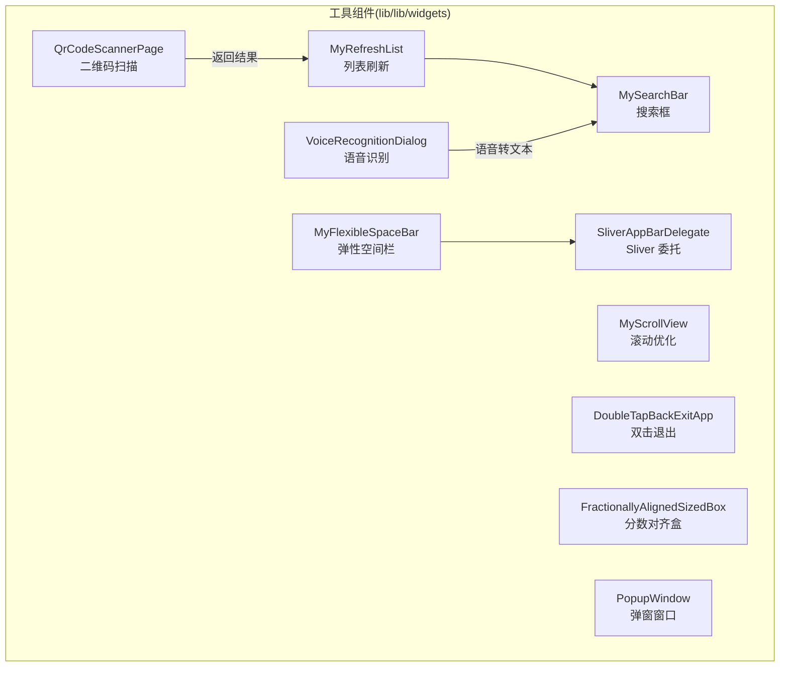
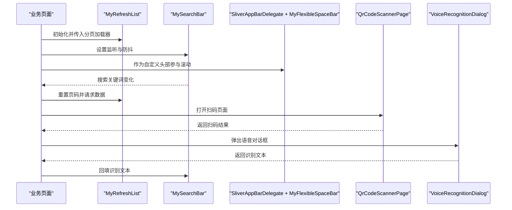
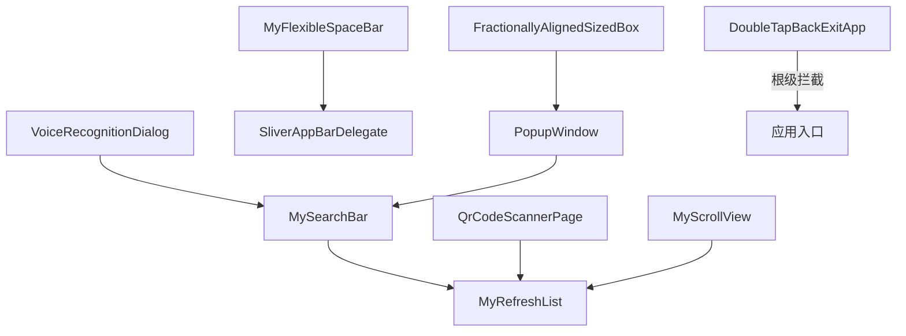

# 工具组件

<cite>
**本文引用的文件**   
- [my_refresh_list.dart](file://lib/lib/widgets/my_refresh_list.dart)
- [my_scroll_view.dart](file://lib/lib/widgets/my_scroll_view.dart)
- [my_search_bar.dart](file://lib/lib/widgets/my_search_bar.dart)
- [my_flexible_space_bar.dart](file://lib/lib/widgets/my_flexible_space_bar.dart)
- [sliver_app_bar_delegate.dart](file://lib/lib/widgets/sliver_app_bar_delegate.dart)
- [double_tap_back_exit_app.dart](file://lib/lib/widgets/double_tap_back_exit_app.dart)
- [fractionally_aligned_sized_box.dart](file://lib/lib/widgets/fractionally_aligned_sized_box.dart)
- [popup_window.dart](file://lib/lib/widgets/popup_window.dart)
- [qr_code_scanner_page.dart](file://lib/lib/widgets/qr_code_scanner_page.dart)
- [voice_recognition_dialog.dart](file://lib/lib/widgets/voice_recognition_dialog.dart)
</cite>

## 目录
1. [简介](#简介)
2. [项目结构](#项目结构)
3. [核心组件](#核心组件)
4. [架构总览](#架构总览)
5. [组件详解](#组件详解)
6. [依赖分析](#依赖分析)
7. [性能注意事项](#性能注意事项)
8. [故障排查指南](#故障排查指南)
9. [结论](#结论)

## 简介
本文件为灵犀管店 Flutter 项目的“工具类 UI 组件”文档，聚焦于提升开发效率的基础设施组件。内容覆盖列表刷新、滚动优化、搜索框、弹性空间栏、Sliver 委托、双击退出、分数对齐盒、弹窗窗口、二维码扫描、语音识别等能力。每个组件均说明使用场景、关键配置项与性能特点，并给出组合使用的最佳实践与常见问题解决方案，帮助开发者快速集成、稳定复用。

## 项目结构
这些工具组件统一位于 `lib/lib/widgets` 目录下，按职责拆分为独立 Dart 文件，便于按需引用和替换：

[本图为概念性结构示意，不直接映射具体代码实现]

## 核心组件
- MyRefreshList：封装上拉下拉刷新与分页加载，减少业务页重复样板代码。
- MyScrollView：提供可配置的滚动容器，统一滚动行为与性能开关。
- MySearchBar：统一的搜索输入控件，支持防抖、清空、图标与回调。
- MyFlexibleSpaceBar：配合 Sliver 头部，实现标题、副标题与图片的折叠伸缩效果。
- SliverAppBarDelegate：控制 SliverAppBar 在不同滚动阶段的样式与行为。
- DoubleTapBackExitApp：双击返回键退出应用，提升移动端体验一致性。
- FractionallyAlignedSizedBox：基于相对比例的定位与尺寸扩展组件，简化复杂布局。
- PopupWindow：轻量级悬浮弹窗容器，支持位置、遮罩与交互事件。
- QrCodeScannerPage：全屏二维码/条码扫描页面，封装权限与相机生命周期。
- VoiceRecognitionDialog：语音识别对话框，采集语音并回传识别结果。

**章节来源**
- [my_refresh_list.dart:1-200](file://lib/lib/widgets/my_refresh_list.dart#L1-L200)
- [my_scroll_view.dart:1-200](file://lib/lib/widgets/my_scroll_view.dart#L1-L200)
- [my_search_bar.dart:1-200](file://lib/lib/widgets/my_search_bar.dart#L1-L200)
- [my_flexible_space_bar.dart:1-200](file://lib/lib/widgets/my_flexible_space_bar.dart#L1-L200)
- [sliver_app_bar_delegate.dart:1-200](file://lib/lib/widgets/sliver_app_bar_delegate.dart#L1-L200)
- [double_tap_back_exit_app.dart:1-200](file://lib/lib/widgets/double_tap_back_exit_app.dart#L1-L200)
- [fractionally_aligned_sized_box.dart:1-200](file://lib/lib/widgets/fractionally_aligned_sized_box.dart#L1-L200)
- [popup_window.dart:1-200](file://lib/lib/widgets/popup_window.dart#L1-L200)
- [qr_code_scanner_page.dart:1-200](file://lib/lib/widgets/qr_code_scanner_page.dart#L1-L200)
- [voice_recognition_dialog.dart:1-200](file://lib/lib/widgets/voice_recognition_dialog.dart#L1-L200)

## 架构总览
下图展示典型页面中工具组件的组合关系与数据流向：

[本图为概念流程示意，不直接映射具体代码实现]

## 组件详解

### MyRefreshList（列表刷新）
- 使用场景
  - 需要支持下拉刷新、上拉加载更多、空态与错误态的长列表页面。
  - 希望将分页逻辑与 UI 刷新解耦，减少样板代码。
- 关键能力
  - 下拉刷新回调与完成状态通知。
  - 上拉加载更多回调与结束状态控制。
  - 空态、加载中、错误态的统一占位视图。
  - 是否允许自动加载下一页、是否显示底部加载指示。
- 常用配置要点
  - 列表数据源与构建器。
  - 分页参数：当前页、每页大小、是否有更多数据。
  - 刷新/加载回调：由业务层发起网络请求并更新数据。
  - 滚动控制器：用于手动触发或同步滚动位置。
- 性能特点
  - 仅在必要时重建列表项，避免全量重绘。
  - 结合虚拟列表机制，降低大列表内存占用。
  - 建议在分页回调中使用增量更新，避免整表刷新。
- 组合建议
  - 与 MySearchBar 联动：搜索时重置页码并重新加载首屏。
  - 与 QrCodeScannerPage 联动：扫码后以扫码结果为搜索词触发刷新。

**章节来源**
- [my_refresh_list.dart:1-200](file://lib/lib/widgets/my_refresh_list.dart#L1-L200)

### MyScrollView（滚动优化）
- 使用场景
  - 需要对滚动行为进行统一控制的页面，如禁用惯性、调整阻尼、限制滚动范围等。
- 关键能力
  - 统一的滚动容器，便于在多处复用一致的滚动体验。
  - 可选的性能开关，例如关闭不必要的动画或重建。
- 常用配置要点
  - 是否启用惯性滚动、滚动阻尼、物理回弹。
  - 滚动方向、是否反向滚动、滚动偏移控制。
  - 子组件懒加载与缓存策略（若内部封装了相关特性）。
- 性能特点
  - 通过减少不必要的 rebuild 与绘制，提高滑动帧率。
  - 在大页面中优先使用它替代默认 Scrollable，以获得一致性能基线。
- 组合建议
  - 作为 MyRefreshList 的外层容器，确保滚动行为一致。
  - 与 SliverAppBarDelegate 搭配，实现复杂的头部折叠效果。

**章节来源**
- [my_scroll_view.dart:1-200](file://lib/lib/widgets/my_scroll_view.dart#L1-L200)

### MySearchBar（搜索框）
- 使用场景
  - 列表页顶部搜索、筛选条件输入、扫码或语音结果的回填。
- 关键能力
  - 统一的输入框外观与行为，支持前缀图标、后缀操作按钮。
  - 文本变更回调、清空按钮、输入校验与提示。
  - 防抖输入，减少频繁刷新带来的性能压力。
- 常用配置要点
  - 初始文本、占位符、键盘类型、输入格式化。
  - 防抖延迟、最大输入长度、是否允许清空。
  - 搜索回调与清空回调。
- 性能特点
  - 防抖机制避免高频 rebuild。
  - 建议使用局部 setState 或响应式状态管理，仅更新搜索相关区域。
- 组合建议
  - 与 MyRefreshList 联动：改变搜索词时重置分页并刷新。
  - 与 VoiceRecognitionDialog 联动：语音识别后将文本回填到搜索框。

**章节来源**
- [my_search_bar.dart:1-200](file://lib/lib/widgets/my_search_bar.dart#L1-L200)

### MyFlexibleSpaceBar（弹性空间栏）
- 使用场景
  - 需要随滚动收缩的头部，包含主标题、副标题、背景图等。
- 关键能力
  - 与 SliverAppBar 配合，提供标题、副标题、图片区域的折叠动画。
  - 支持不同展开比例下的样式切换。
- 常用配置要点
  - 主标题、副标题、背景图或自定义头部内容。
  - 展开时的布局约束与缩放行为。
- 性能特点
  - 仅在滚动区间内计算布局，避免无意义绘制。
  - 图片资源建议使用缓存与合适尺寸，减少解码开销。
- 组合建议
  - 与 SliverAppBarDelegate 共同定义头部在不同滚动阶段的行为。
  - 与 MyScrollView 搭配，保证整体滚动体验一致。

**章节来源**
- [my_flexible_space_bar.dart:1-200](file://lib/lib/widgets/my_flexible_space_bar.dart#L1-L200)

### SliverAppBarDelegate（Sliver 委托）
- 使用场景
  - 需要精细控制 SliverAppBar 在不同滚动区间的样式、高度与透明度。
- 关键能力
  - 根据滚动偏移计算头部样式，实现渐进式折叠与透明渐变。
  - 统一头部行为，避免在各页面重复实现相同逻辑。
- 常用配置要点
  - 初始高度、收起高度、滚动阈值、样式过渡函数。
  - 是否固定底部阴影、是否隐藏导航按钮等。
- 性能特点
  - 委托计算尽量轻量，避免在每次滚动回调中进行昂贵操作。
  - 推荐对颜色、阴影等属性做最小化更新。
- 组合建议
  - 与 MyFlexibleSpaceBar 配合，形成完整的头部折叠方案。
  - 与 MyScrollView 搭配，保证滚动曲线一致。

**章节来源**
- [sliver_app_bar_delegate.dart:1-200](file://lib/lib/widgets/sliver_app_bar_delegate.dart#L1-L200)

### DoubleTapBackExitApp（双击退出）
- 使用场景
  - 移动端常见的“双击返回键退出应用”，提升用户预期一致性。
- 关键能力
  - 拦截系统返回事件，两次点击间隔内触发退出。
  - 可配置提示文案与退出时机。
- 常用配置要点
  - 时间间隔、提示信息、是否启用全局监听。
- 性能特点
  - 轻量事件监听，几乎无额外渲染开销。
- 组合建议
  - 通常包裹在根路由或顶层页面，无需与其他组件耦合。

**章节来源**
- [double_tap_back_exit_app.dart:1-200](file://lib/lib/widgets/double_tap_back_exit_app.dart#L1-L200)

### FractionallyAlignedSizedBox（分数对齐盒）
- 使用场景
  - 需要按父容器比例定位或拉伸的子组件，如百分比宽度、相对居中。
- 关键能力
  - 通过比例值精确控制宽高与对齐方式。
  - 适合动态屏幕尺寸下保持视觉一致性。
- 常用配置要点
  - 宽度比例、高度比例、对齐策略。
- 性能特点
  - 布局阶段计算比例，不会造成额外绘制负担。
- 组合建议
  - 常用于弹窗、卡片、图表等需要自适应宽高的组件内部。

**章节来源**
- [fractionally_aligned_sized_box.dart:1-200](file://lib/lib/widgets/fractionally_aligned_sized_box.dart#L1-L200)

### PopupWindow（弹窗窗口）
- 使用场景
  - 需要轻量悬浮窗、菜单、选择器等场景，且不希望走完整页面跳转。
- 关键能力
  - 支持相对于锚点定位、遮罩层、点击外部关闭、层级控制。
  - 可承载任意子组件，适配复杂内容。
- 常用配置要点
  - 定位模式、偏移量、遮罩透明度、是否允许滚动穿透。
  - 打开/关闭回调、生命周期清理。
- 性能特点
  - 仅在打开时构建子树，关闭时销毁，避免常驻渲染。
- 组合建议
  - 与 MySearchBar 的后缀按钮联动，弹出筛选或历史搜索。
  - 与 QrCodeScannerPage 的结果展示联动，弹出详情预览。

**章节来源**
- [popup_window.dart:1-200](file://lib/lib/widgets/popup_window.dart#L1-L200)

### QrCodeScannerPage（二维码扫描）
- 使用场景
  - 商品扫码、订单扫码、库存盘点等需要调用摄像头扫码的场景。
- 关键能力
  - 全屏扫码页面，封装相机权限、摄像头生命周期与结果回调。
  - 支持常见二维码与条码格式识别。
- 常用配置要点
  - 扫码成功回调、失败处理、闪光灯控制、是否自动对焦。
  - 是否允许返回上一页、是否展示扫描框引导。
- 性能特点
  - 相机流仅在页面存在时运行，进入后台或销毁时释放资源。
  - 建议在低性能设备上关闭不必要的特效以降低卡顿。
- 组合建议
  - 扫码成功后将结果回填到 MySearchBar 或直接驱动 MyRefreshList 刷新。

**章节来源**
- [qr_code_scanner_page.dart:1-200](file://lib/lib/widgets/qr_code_scanner_page.dart#L1-L200)

### VoiceRecognitionDialog（语音识别）
- 使用场景
  - 通过语音输入快速填写搜索词或表单字段。
- 关键能力
  - 打开即开始录音，结束时将识别文本通过回调返回。
  - 提供录音中状态、失败重试、权限提示等基础能力。
- 常用配置要点
  - 识别成功回调、取消/失败回调、录音时长限制。
  - 是否自动填充到指定输入框。
- 性能特点
  - 录音与识别过程异步执行，避免阻塞 UI 线程。
  - 注意麦克风权限与平台差异，做好异常回退。
- 组合建议
  - 与 MySearchBar 联动：识别完成后自动回填搜索词并触发查询。
  - 与 MyRefreshList 联动：回填后自动重置分页并加载数据。

**章节来源**
- [voice_recognition_dialog.dart:1-200](file://lib/lib/widgets/voice_recognition_dialog.dart#L1-L200)

## 依赖分析
这些工具组件之间呈松耦合关系，主要通过回调与状态流转协作：

[本图为概念依赖示意，不直接映射具体代码实现]

**章节来源**
- [my_refresh_list.dart:1-200](file://lib/lib/widgets/my_refresh_list.dart#L1-L200)
- [my_search_bar.dart:1-200](file://lib/lib/widgets/my_search_bar.dart#L1-L200)
- [voice_recognition_dialog.dart:1-200](file://lib/lib/widgets/voice_recognition_dialog.dart#L1-L200)
- [qr_code_scanner_page.dart:1-200](file://lib/lib/widgets/qr_code_scanner_page.dart#L1-L200)
- [my_flexible_space_bar.dart:1-200](file://lib/lib/widgets/my_flexible_space_bar.dart#L1-L200)
- [sliver_app_bar_delegate.dart:1-200](file://lib/lib/widgets/sliver_app_bar_delegate.dart#L1-L200)
- [my_scroll_view.dart:1-200](file://lib/lib/widgets/my_scroll_view.dart#L1-L200)
- [popup_window.dart:1-200](file://lib/lib/widgets/popup_window.dart#L1-L200)
- [fractionally_aligned_sized_box.dart:1-200](file://lib/lib/widgets/fractionally_aligned_sized_box.dart#L1-L200)
- [double_tap_back_exit_app.dart:1-200](file://lib/lib/widgets/double_tap_back_exit_app.dart#L1-L200)

## 性能注意事项
- 列表刷新
  - 使用分页加载，避免一次性拉取大量数据。
  - 在搜索或筛选变更后重置页码，避免旧数据污染。
- 滚动优化
  - 使用 MyScrollView 统一管理滚动行为，减少不一致导致的抖动。
  - 避免在滚动回调中进行昂贵计算；如需实时反馈，请节流或防抖。
- 搜索输入
  - 开启防抖，防止频繁刷新导致卡顿。
  - 将搜索状态与列表状态分离，缩小 rebuild 范围。
- 头部折叠
  - 图片等资源需缓存并使用合适分辨率，避免解码放大。
  - SliverAppBarDelegate 的计算应保持轻量，避免阻塞滚动。
- 弹窗与定位
  - PopupWindow 仅在打开时构建，避免常驻渲染。
  - FractionallyAlignedSizedBox 的比例计算应在布局阶段完成。
- 扫码与语音
  - 相机流与录音需在页面销毁时释放，避免资源泄漏。
  - 在低端设备关闭非必要特效，保障流畅度。

[本节为通用性能建议，不直接分析具体文件]

## 故障排查指南
- 列表不刷新
  - 检查搜索词变更后是否重置了页码与“是否有更多数据”标志。
  - 确认刷新回调是否正确更新了数据源并触发了 UI 刷新。
- 搜索卡顿时
  - 确认已启用防抖，并避免在搜索回调中执行耗时任务。
  - 将搜索相关的 UI 拆分到更小作用域，减少无关重建。
- 扫码无结果或闪退
  - 检查相机权限是否授予；在 Android/iOS 上分别处理权限申请。
  - 确认扫码回调未被多次注册或未及时释放。
- 语音识别无输出
  - 检查麦克风权限与平台兼容性。
  - 确认录音结束回调与异常分支均有处理。
- 头部折叠不流畅
  - 检查 SliverAppBarDelegate 的计算逻辑是否过于复杂。
  - 确保背景图片或大图已被缓存，避免滚动中解码。
- 弹窗遮挡或层级问题
  - 调整 PopupWindow 的层级与定位偏移，确保不被其他浮层覆盖。
  - 避免在弹窗打开期间触发全屏组件（如扫码）的冲突。

**章节来源**
- [my_refresh_list.dart:1-200](file://lib/lib/widgets/my_refresh_list.dart#L1-L200)
- [my_search_bar.dart:1-200](file://lib/lib/widgets/my_search_bar.dart#L1-L200)
- [qr_code_scanner_page.dart:1-200](file://lib/lib/widgets/qr_code_scanner_page.dart#L1-L200)
- [voice_recognition_dialog.dart:1-200](file://lib/lib/widgets/voice_recognition_dialog.dart#L1-L200)
- [sliver_app_bar_delegate.dart:1-200](file://lib/lib/widgets/sliver_app_bar_delegate.dart#L1-L200)
- [popup_window.dart:1-200](file://lib/lib/widgets/popup_window.dart#L1-L200)

## 结论
以上工具组件覆盖了灵犀管店项目中常见的列表、滚动、搜索、头部折叠、扫码与语音等高频场景。通过统一的封装与约定，团队可以快速复用、保持一致体验，并在分页、防抖、权限与资源释放等方面获得稳定的性能基线。建议在新页面中优先组合这些组件，逐步沉淀业务模板，进一步提升开发与维护效率。