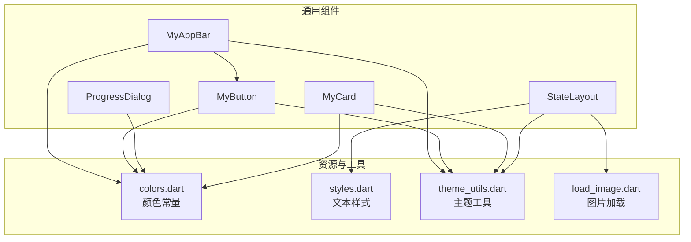
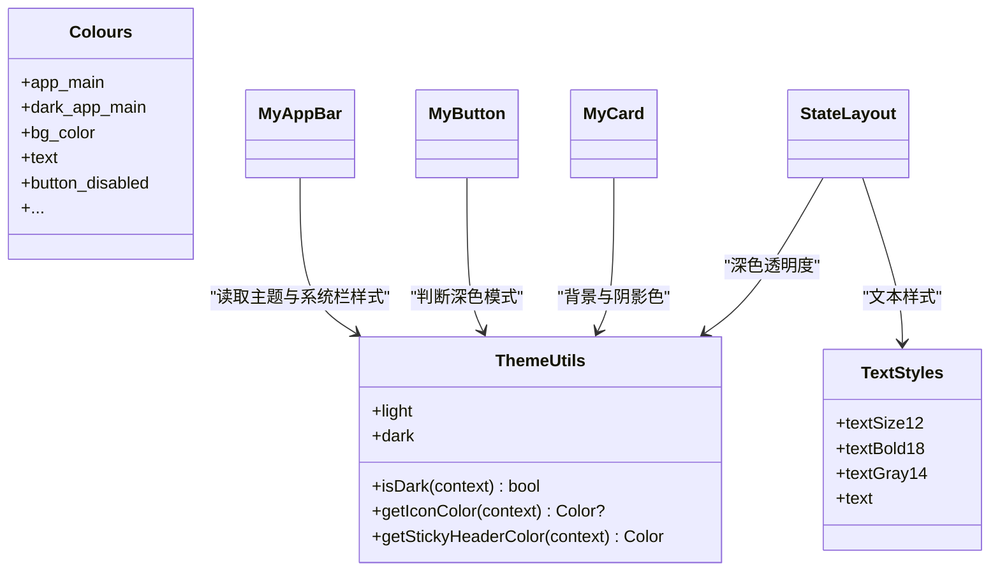
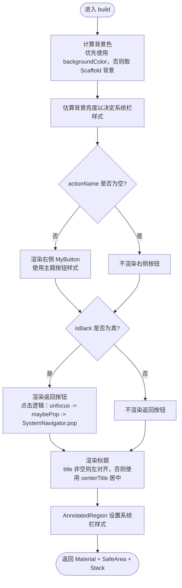
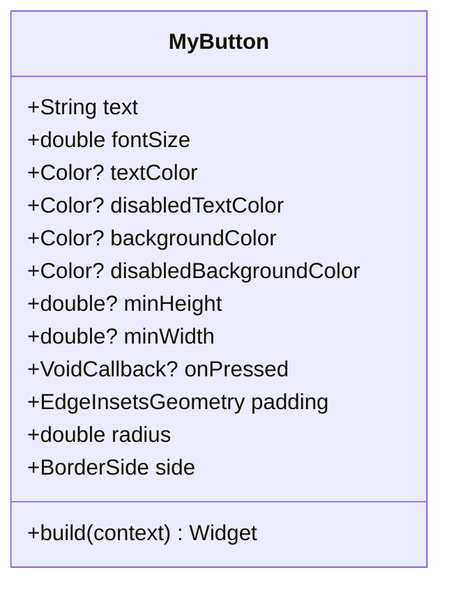
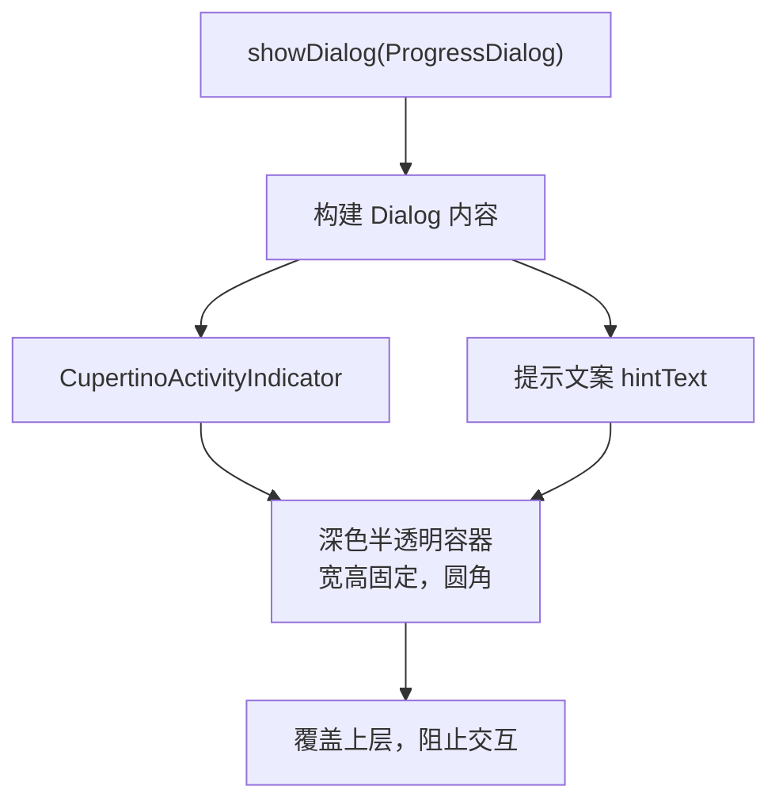
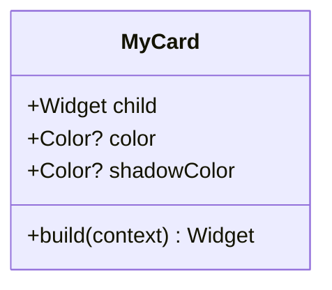
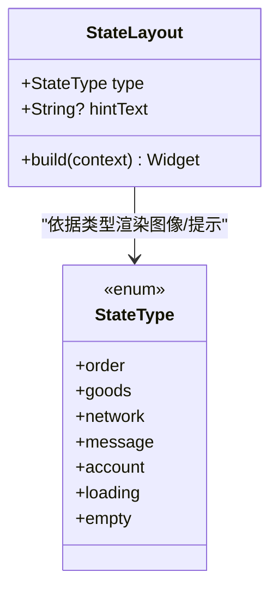
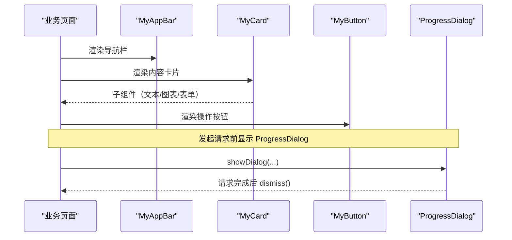
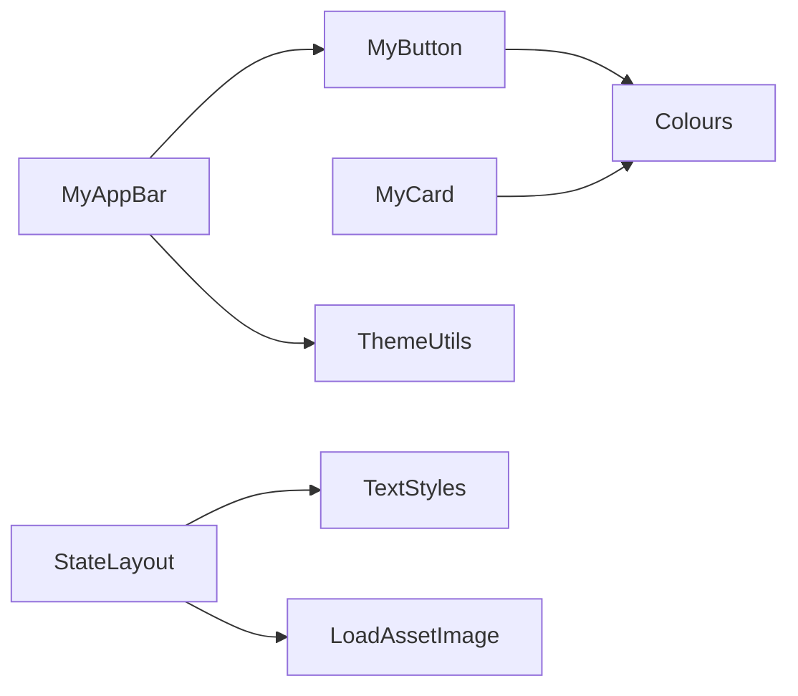

# 通用组件

<cite>
**本文引用的文件**   
- [my_app_bar.dart](file://lib/widgets/my_app_bar.dart)
- [my_button.dart](file://lib/widgets/my_button.dart)
- [progress_dialog.dart](file://lib/widgets/progress_dialog.dart)
- [my_card.dart](file://lib/widgets/my_card.dart)
- [state_layout.dart](file://lib/widgets/state_layout.dart)
- [colors.dart](file://lib/res/colors.dart)
- [styles.dart](file://lib/res/styles.dart)
- [theme_utils.dart](file://lib/util/theme_utils.dart)
- [load_image.dart](file://lib/widgets/load_image.dart)
</cite>

## 目录
1. [简介](#简介)
2. [项目结构定位](#项目结构定位)
3. [核心组件总览](#核心组件总览)
4. [架构与主题体系](#架构与主题体系)
5. [详细组件分析](#详细组件分析)
6. [组件组合与嵌套模式](#组件组合与嵌套模式)
7. [依赖关系分析](#依赖关系分析)
8. [性能与可访问性](#性能与可访问性)
9. [主题适配、深色模式与无障碍](#主题适配深色模式与无障碍)
10. [使用示例与最佳实践](#使用示例与最佳实践)
11. [故障排查](#故障排查)
12. [结论](#结论)

## 简介
本文聚焦灵犀管店 Flutter 项目中的通用 UI 组件，包括自定义导航栏 MyAppBar、统一按钮 MyButton、加载对话框 ProgressDialog、卡片容器 MyCard 和状态页面 StateLayout。文档从构造参数、默认值、事件处理、定制方式、组合模式到主题适配与无障碍支持进行系统化说明，帮助开发者快速掌握这些可复用的 UI 构建块，并遵循一致的质量标准。

## 项目结构定位
这些通用组件位于 lib/widgets 目录下，颜色与样式资源在 lib/res 下，主题工具在 lib/util 下：
- 组件：MyAppBar、MyButton、ProgressDialog、MyCard、StateLayout
- 资源：Colours（颜色）、TextStyles（文本样式）
- 工具：ThemeUtils（主题与系统栏适配）、BuildContext 扩展（isDark、backgroundColor）
- 图片：LoadImage / LoadAssetImage（供 StateLayout 等使用）

**图表来源**
- [my_app_bar.dart:1-110](file://lib/widgets/my_app_bar.dart#L1-L110)
- [my_button.dart:1-75](file://lib/widgets/my_button.dart#L1-L75)
- [progress_dialog.dart:1-44](file://lib/widgets/progress_dialog.dart#L1-L44)
- [my_card.dart:1-36](file://lib/widgets/my_card.dart#L1-L36)
- [state_layout.dart:1-75](file://lib/widgets/state_layout.dart#L1-L75)
- [colors.dart:1-46](file://lib/res/colors.dart#L1-L46)
- [styles.dart:1-76](file://lib/res/styles.dart#L1-L76)
- [theme_utils.dart:1-52](file://lib/util/theme_utils.dart#L1-L52)
- [load_image.dart:1-94](file://lib/widgets/load_image.dart#L1-L94)

**章节来源**
- [my_app_bar.dart:1-110](file://lib/widgets/my_app_bar.dart#L1-L110)
- [my_button.dart:1-75](file://lib/widgets/my_button.dart#L1-L75)
- [progress_dialog.dart:1-44](file://lib/widgets/progress_dialog.dart#L1-L44)
- [my_card.dart:1-36](file://lib/widgets/my_card.dart#L1-L36)
- [state_layout.dart:1-75](file://lib/widgets/state_layout.dart#L1-L75)

## 核心组件总览
- MyAppBar：自定义导航栏，提供标题、居中标题、右侧操作按钮、返回图标、背景色、返回控制等能力，自动适配状态栏颜色与图标明暗。
- MyButton：统一按钮样式，支持文本、字号、前景/背景色、禁用态颜色、尺寸、圆角、描边、点击回调等。
- ProgressDialog：全屏半透明遮罩的加载提示框，包含进度指示器与提示文案。
- MyCard：带阴影与圆角的卡片容器，自动适配浅色/深色背景。
- StateLayout：统一的状态页占位组件，支持多种业务状态与加载态，内置文案与图标映射。

**章节来源**
- [my_app_bar.dart:1-110](file://lib/widgets/my_app_bar.dart#L1-L110)
- [my_button.dart:1-75](file://lib/widgets/my_button.dart#L1-L75)
- [progress_dialog.dart:1-44](file://lib/widgets/progress_dialog.dart#L1-L44)
- [my_card.dart:1-36](file://lib/widgets/my_card.dart#L1-L36)
- [state_layout.dart:1-75](file://lib/widgets/state_layout.dart#L1-L75)

## 架构与主题体系
- 颜色体系由 Colours 集中定义，区分亮色与深色语义，如主色、背景、文字、禁用态等。
- TextStyles 提供常用文本样式，保证字体大小、粗细与颜色的一致性。
- ThemeUtils 封装了根据当前主题获取系统栏样式、图标颜色、背景色的方法；同时为 BuildContext 提供 isDark 与 backgroundColor 便捷扩展。
- 组件通过 ThemeUtils 与 BuildContext 扩展感知主题，实现统一的视觉风格。

**图表来源**
- [colors.dart:1-46](file://lib/res/colors.dart#L1-L46)
- [styles.dart:1-76](file://lib/res/styles.dart#L1-L76)
- [theme_utils.dart:1-52](file://lib/util/theme_utils.dart#L1-L52)
- [my_app_bar.dart:1-110](file://lib/widgets/my_app_bar.dart#L1-L110)
- [my_button.dart:1-75](file://lib/widgets/my_button.dart#L1-L75)
- [my_card.dart:1-36](file://lib/widgets/my_card.dart#L1-L36)
- [state_layout.dart:1-75](file://lib/widgets/state_layout.dart#L1-L75)

**章节来源**
- [colors.dart:1-46](file://lib/res/colors.dart#L1-L46)
- [styles.dart:1-76](file://lib/res/styles.dart#L1-L76)
- [theme_utils.dart:1-52](file://lib/util/theme_utils.dart#L1-L52)

## 详细组件分析

### MyAppBar（自定义导航栏）
- 职责：渲染标题区域、返回按钮、可选右侧操作按钮，并自动设置系统状态栏覆盖样式。
- 关键属性
  - backgroundColor：导航栏背景色；未指定时取 Scaffold 背景色。
  - title：左侧标题文本。
  - centerTitle：当 title 为空时，作为居中标题显示。
  - actionName：右侧操作按钮文案。
  - backImg：返回图标路径；backImgColor：返回图标颜色；未指定时使用主题图标色。
  - onPressed：右侧操作按钮点击回调。
  - isBack：是否显示返回按钮。
- 行为与交互
  - 点击返回：先 unfocus 输入框，再尝试 Navigator.maybePop；若无法返回则调用 SystemNavigator.pop。
  - 右侧按钮：使用 MyButton 渲染，并在 ButtonTheme 中设定最小宽度与内边距。
  - 系统栏样式：根据背景亮度估算选择亮/暗系统栏样式。
- 无障碍
  - 标题区域包裹 Semantics，声明 namesRoute 与 header，便于读屏识别。
- 推荐用法
  - 需要居中或左对齐标题时，分别传入 centerTitle 或 title。
  - 需要在导航栏右侧放置操作按钮时，传入 actionName 与 onPressed。
  - 关闭返回逻辑时，将 isBack 设为 false。

**图表来源**
- [my_app_bar.dart:1-110](file://lib/widgets/my_app_bar.dart#L1-L110)

**章节来源**
- [my_app_bar.dart:1-110](file://lib/widgets/my_app_bar.dart#L1-L110)

### MyButton（统一按钮样式）
- 职责：提供一致的按钮外观与交互反馈，支持启用/禁用状态的颜色切换。
- 关键属性
  - text：按钮文案。
  - fontSize：文字字号。
  - textColor：启用时文字颜色；未指定时按主题自动选择。
  - disabledTextColor：禁用时文字颜色；未指定时按主题自动选择。
  - backgroundColor：启用时背景色；未指定时按主题自动选择。
  - disabledBackgroundColor：禁用时背景色；未指定时按主题自动选择。
  - minHeight / minWidth：最小尺寸；任一为空则不强制最小尺寸。
  - padding：内边距。
  - radius：圆角半径。
  - side：边框描边。
  - onPressed：点击回调。
- 行为与交互
  - 通过 ButtonStyle 与 MaterialStateProperty.resolveWith 动态解析不同状态下的前景色、背景色、水波纹、尺寸、形状与边框。
  - 禁用态颜色与启用态颜色均会根据 isDark 自动选择对应颜色常量。
- 推荐用法
  - 统一业务按钮样式时，优先使用 MyButton 而非直接复用 TextButton。
  - 需要无边框或特殊边框时，通过 side 配置 BorderSide。
  - 需要固定最小宽高时，同时传入 minWidth 与 minHeight。

**图表来源**
- [my_button.dart:1-75](file://lib/widgets/my_button.dart#L1-L75)

**章节来源**
- [my_button.dart:1-75](file://lib/widgets/my_button.dart#L1-L75)

### ProgressDialog（加载对话框）
- 职责：展示全局加载中提示，避免用户误操作。
- 关键属性
  - hintText：提示文案；默认为空字符串。
- 行为与交互
  - 基于 Dialog 实现，背景为透明 Material。
  - 内部 Container 固定宽高，深色半透明背景，圆角 8dp。
  - 内容区包含 CupertinoActivityIndicator 与提示文案。
- 推荐用法
  - 在网络请求或耗时操作前 showDialog 展示；完成或失败后 dismiss。
  - hintText 建议简短明确，如“加载中”“提交中”。

**图表来源**
- [progress_dialog.dart:1-44](file://lib/widgets/progress_dialog.dart#L1-L44)

**章节来源**
- [progress_dialog.dart:1-44](file://lib/widgets/progress_dialog.dart#L1-L44)

### MyCard（卡片容器）
- 职责：为子组件提供统一圆角、背景与阴影的卡片容器。
- 关键属性
  - child：子组件。
  - color：背景色；未指定时在深色模式下使用深色背景，否则使用白色。
  - shadowColor：阴影颜色；未指定时在深色模式下为透明，浅色模式下使用蓝色阴影。
- 行为与渲染
  - 使用 DecoratedBox 绘制圆角矩形背景与阴影。
  - 阴影偏移与模糊半径固定，确保一致的层级感。
- 推荐用法
  - 列表项、信息区块、数据面板等场景推荐使用 MyCard 包裹。
  - 需要取消阴影时可显式传入透明阴影色。

**图表来源**
- [my_card.dart:1-36](file://lib/widgets/my_card.dart#L1-L36)

**章节来源**
- [my_card.dart:1-36](file://lib/widgets/my_card.dart#L1-L36)

### StateLayout（状态页面）
- 职责：统一展示不同业务状态或加载态，减少重复占位布局。
- 关键属性
  - type：状态类型枚举，包含 order、goods、network、message、account、loading、empty。
  - hintText：覆盖默认提示文案；未指定时使用枚举对应文案。
- 行为与渲染
  - loading 状态：显示进度指示器。
  - 其他非 empty 状态：加载本地状态图片，并根据主题调整透明度。
  - empty 状态：仅显示提示文案。
  - 使用 LoadAssetImage 加载本地静态图，并通过 TextStyles 与 Dimens 保持一致排版。
- 推荐用法
  - 列表为空、无网络、暂无消息等场景使用 StateLayout 替代手写占位 UI。
  - 可通过 hintText 覆盖默认文案以适配具体业务上下文。

**图表来源**
- [state_layout.dart:1-75](file://lib/widgets/state_layout.dart#L1-L75)

**章节来源**
- [state_layout.dart:1-75](file://lib/widgets/state_layout.dart#L1-L75)

## 组件组合与嵌套模式
- AppBar + Card + Button：典型详情页顶部导航、中部卡片内容与底部操作按钮的组合。
- List + StateLayout：列表数据未就绪或为空时，用 StateLayout 替换 ListView 的子项。
- Dialog + MyButton：弹窗确认或取消操作，按钮样式保持统一。
- Page + MyAppBar + StateLayout：页面主体在加载、空数据、错误等状态下切换。

**图表来源**
- [my_app_bar.dart:1-110](file://lib/widgets/my_app_bar.dart#L1-L110)
- [my_card.dart:1-36](file://lib/widgets/my_card.dart#L1-L36)
- [my_button.dart:1-75](file://lib/widgets/my_button.dart#L1-L75)
- [progress_dialog.dart:1-44](file://lib/widgets/progress_dialog.dart#L1-L44)

## 依赖关系分析
- 组件对资源的依赖
  - MyButton、MyCard、MyAppBar 依赖 Colours 提供的主色、背景与禁用色。
  - StateLayout 依赖 TextStyles 与 Dimens（通过 styles.dart 间接引用）。
  - MyAppBar 依赖 ThemeUtils 的系统栏样式与图标色。
- 组件间的耦合
  - MyAppBar 内嵌 MyButton 作为右侧操作入口，形成弱耦合的组合关系。
  - StateLayout 依赖 LoadAssetImage 渲染静态图，属于外部工具组件。
- 潜在风险
  - 主题色变更需同步更新 Colours 常量，避免组件视觉不一致。
  - 状态图资源路径与 StateType 索引必须保持一致，否则会显示错位或空白。

**图表来源**
- [my_button.dart:1-75](file://lib/widgets/my_button.dart#L1-L75)
- [my_card.dart:1-36](file://lib/widgets/my_card.dart#L1-L36)
- [my_app_bar.dart:1-110](file://lib/widgets/my_app_bar.dart#L1-L110)
- [state_layout.dart:1-75](file://lib/widgets/state_layout.dart#L1-L75)
- [colors.dart:1-46](file://lib/res/colors.dart#L1-L46)
- [styles.dart:1-76](file://lib/res/styles.dart#L1-L76)
- [theme_utils.dart:1-52](file://lib/util/theme_utils.dart#L1-L52)
- [load_image.dart:1-94](file://lib/widgets/load_image.dart#L1-L94)

**章节来源**
- [my_button.dart:1-75](file://lib/widgets/my_button.dart#L1-L75)
- [my_card.dart:1-36](file://lib/widgets/my_card.dart#L1-L36)
- [my_app_bar.dart:1-110](file://lib/widgets/my_app_bar.dart#L1-L110)
- [state_layout.dart:1-75](file://lib/widgets/state_layout.dart#L1-L75)

## 性能与可访问性
- 性能
  - MyButton 使用 TextButton 与 ButtonStyle，避免复杂自定义绘制，性能良好。
  - MyCard 使用 DecoratedBox 绘制阴影，开销较小，适合大量列表项使用。
  - StateLayout 仅在状态切换时重建，图片加载由 LoadAssetImage 负责。
- 可访问性
  - MyAppBar 标题区域使用 Semantics 标注 header 与 namesRoute，提升读屏体验。
  - 返回按钮提供 tooltip，便于辅助功能与调试。
  - 图片通过 LoadAssetImage 的 excludeFromSemantics 忽略装饰性图片语义，避免干扰读屏。

**章节来源**
- [my_app_bar.dart:1-110](file://lib/widgets/my_app_bar.dart#L1-L110)
- [load_image.dart:1-94](file://lib/widgets/load_image.dart#L1-L94)

## 主题适配、深色模式与无障碍
- 主题适配
  - 颜色：所有组件通过 Colours 的亮/深色常量切换主题，保证一致性。
  - 文本：TextStyles 提供主题化文本样式，配合 Dimens 统一字号与行高。
  - 系统栏：MyAppBar 根据背景亮度选择 light/dark 系统栏样式。
- 深色模式
  - MyButton：启用/禁用状态的前景色与背景色均按 isDark 自动选择。
  - MyCard：背景与阴影色在深色模式下自动切换为深灰与透明阴影。
  - StateLayout：非空状态图片在深色模式下降低透明度，避免刺眼。
- 无障碍
  - 语义：MyAppBar 标题区域添加 Semantics；按钮具备 tooltip；图片忽略语义。
  - 对比度：Colours 提供高对比度的文字与禁用色，保障可读性。

**章节来源**
- [colors.dart:1-46](file://lib/res/colors.dart#L1-L46)
- [styles.dart:1-76](file://lib/res/styles.dart#L1-L76)
- [theme_utils.dart:1-52](file://lib/util/theme_utils.dart#L1-L52)
- [my_button.dart:1-75](file://lib/widgets/my_button.dart#L1-L75)
- [my_card.dart:1-36](file://lib/widgets/my_card.dart#L1-L36)
- [state_layout.dart:1-75](file://lib/widgets/state_layout.dart#L1-L75)
- [my_app_bar.dart:1-110](file://lib/widgets/my_app_bar.dart#L1-L110)

## 使用示例与最佳实践

### 使用 MyAppBar
- 基本用法：设置 title 与可选 actionName，onPressed 处理右侧操作。
- 居中标题：title 留空，传入 centerTitle 实现居中。
- 隐藏返回：isBack 设为 false，适用于首页或不需要返回的场景。
- 自定义背景：backgroundColor 用于强调品牌色或业务分区。

参考路径
- [my_app_bar.dart:1-110](file://lib/widgets/my_app_bar.dart#L1-L110)

### 使用 MyButton
- 基础按钮：传入 text 与 onPressed。
- 禁用态：onPressed 为 null 时自动进入禁用态，颜色由主题决定。
- 自定义尺寸：同时设置 minWidth 与 minHeight 以固定按钮大小。
- 自定义边框：通过 side 传入 BorderSide 实现描边按钮。

参考路径
- [my_button.dart:1-75](file://lib/widgets/my_button.dart#L1-L75)

### 使用 ProgressDialog
- 显示：showDialog 展示 ProgressDialog，hintText 提示当前操作。
- 隐藏：异步任务完成后调用 Navigator.of(context).pop() 关闭。
- 注意事项：避免长时间阻塞 UI，结合 Loading 状态与防抖策略。

参考路径
- [progress_dialog.dart:1-44](file://lib/widgets/progress_dialog.dart#L1-L44)

### 使用 MyCard
- 包裹内容：将任意 Widget 作为 child 放入 MyCard。
- 自定义背景：color 可覆盖默认背景色。
- 取消阴影：shadowColor 传透明色以去除阴影效果。

参考路径
- [my_card.dart:1-36](file://lib/widgets/my_card.dart#L1-L36)

### 使用 StateLayout
- 列表空态：type 设置为 empty 或对应的业务类型，如 order/goods/network。
- 覆盖提示文案：传入 hintText 以适配具体业务语境。
- 加载态：type 设置为 loading，等待数据准备完成后切换到真实内容。

参考路径
- [state_layout.dart:1-75](file://lib/widgets/state_layout.dart#L1-L75)

## 故障排查
- 返回按钮无效
  - 检查 isBack 是否被设为 false。
  - 检查父级路由是否可 pop；必要时保留 SystemNavigator.pop 兜底。
- 右侧按钮样式异常
  - 确认 actionName 已传入且 onPressed 已绑定。
  - 如需调整按钮尺寸，可在外层包裹合适的约束容器。
- 主题颜色不生效
  - 确认 Colours 中的亮/深色常量是否正确设置。
  - 检查是否使用了 context.isDark 分支。
- 状态图不显示
  - 核对 StateType 与图片路径索引是否一致。
  - 确认 assets 已正确声明并重启应用。
- 无障碍读屏异常
  - 检查标题区域是否包裹 Semantics。
  - 避免装饰性图片参与语义树。

**章节来源**
- [my_app_bar.dart:1-110](file://lib/widgets/my_app_bar.dart#L1-L110)
- [state_layout.dart:1-75](file://lib/widgets/state_layout.dart#L1-L75)
- [colors.dart:1-46](file://lib/res/colors.dart#L1-L46)

## 结论
上述通用组件构成了灵犀管店项目的 UI 基座：MyAppBar 规范导航与系统栏，MyButton 统一交互与外观，ProgressDialog 提供一致的加载反馈，MyCard 提供稳定卡片容器，StateLayout 统一状态表达。借助 Colours、TextStyles 与 ThemeUtils，组件具备良好的主题适配与深色模式支持，同时在可访问性方面提供了必要的语义与对比度保障。建议在业务开发中优先复用这些组件，以保持界面一致性与可维护性。