# WMS仓储模块

<cite>
**本文引用的文件**   
- [lib/pages/business/wms/launch/router.dart](file://lib/pages/business/wms/launch/router.dart)
- [lib/pages/business/wms/launch/list.dart](file://lib/pages/business/wms/launch/list.dart)
- [lib/pages/business/wms/launch/search.dart](file://lib/pages/business/wms/launch/search.dart)
- [lib/pages/business/wms/launch/detail.dart](file://lib/pages/business/wms/launch/detail.dart)
- [lib/pages/business/wms/launch/edit.dart](file://lib/pages/business/wms/launch/edit.dart)
- [lib/pages/business/wms/receive/router.dart](file://lib/pages/business/wms/receive/router.dart)
- [lib/pages/business/wms/receive/list.dart](file://lib/pages/business/wms/receive/list.dart)
- [lib/pages/business/wms/receive/edit.dart](file://lib/pages/business/wms/receive/edit.dart)
- [lib/pages/business/wms/receive/pro_edit.dart](file://lib/pages/business/wms/receive/pro_edit.dart)
- [lib/pages/business/wms/receive/pallet_edit.dart](file://lib/pages/business/wms/receive/pallet_edit.dart)
- [lib/pages/business/wms/restock/router.dart](file://lib/pages/business/wms/restock/router.dart)
- [lib/pages/business/wms/restock/list.dart](file://lib/pages/business/wms/restock/list.dart)
- [lib/pages/business/wms/restock/detail.dart](file://lib/pages/business/wms/restock/detail.dart)
- [lib/pages/business/wms/stockQuery/router.dart](file://lib/pages/business/wms/stockQuery/router.dart)
- [lib/pages/business/wms/stockQuery/list.dart](file://lib/pages/business/wms/stockQuery/list.dart)
- [lib/pages/business/wms/stockQuery/move_goods.dart](file://lib/pages/business/wms/stockQuery/move_goods.dart)
- [lib/pages/business/wms/wmsSet/router.dart](file://lib/pages/business/wms/wmsSet/router.dart)
- [lib/pages/business/wms/wmsSet/page.dart](file://lib/pages/business/wms/wmsSet/page.dart)
- [lib/net/http_api.dart](file://lib/net/http_api.dart)
- [lib/net/http_helper.dart](file://lib/net/http_helper.dart)
- [lib/components/select/select_location.dart](file://lib/components/select/select_location.dart)
- [lib/components/select/select_product.dart](file://lib/components/select/select_product.dart)
- [lib/util/math_utils.dart](file://lib/util/math_utils.dart)
- [lib/util/toast_utils.dart](file://lib/util/toast_utils.dart)
- [lib/util/permission_utils.dart](file://lib/util/permission_utils.dart)
- [lib/widgets/qr_code_scanner_page.dart](file://lib/widgets/qr_code_scanner_page.dart)
</cite>

## 目录
1. [引言](#引言)
2. [项目结构](#项目结构)
3. [核心功能概览](#核心功能概览)
4. [架构总览](#架构总览)
5. [详细组件分析](#详细组件分析)
6. [依赖关系分析](#依赖关系分析)
7. [标准化仓储作业流程](#标准化仓储作业流程)
8. [效率优化策略](#效率优化策略)
9. [条码扫描集成与移动端适配](#条码扫描集成与移动端适配)
10. [与库存、采购销售的数据同步机制](#与库存采购销售的数据同步机制)
11. [性能考量](#性能考量)
12. [问题排查指南](#问题排查指南)
13. [结论](#结论)

## 引言
WMS仓储模块围绕“上架、收货、补货、库存查询、仓储设置”五大能力构建，覆盖从入库质检到出库拣货、从托盘扫码到货位调拨的完整仓储作业链。该模块在 Flutter 端通过路由组织页面，以统一的 HTTP API 常量集中管理接口地址，并复用商品选择、货位选择、数学计算、权限校验、扫码和提示等通用能力。

## 项目结构
WMS 模块位于 `lib/pages/business/wms` 下，按业务子域划分目录：

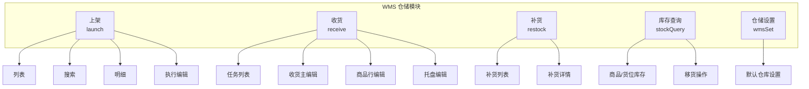

**图表来源**
- [lib/pages/business/wms/launch/router.dart:1-17](file://lib/pages/business/wms/launch/router.dart#L1-L17)
- [lib/pages/business/wms/receive/router.dart:1-17](file://lib/pages/business/wms/receive/router.dart#L1-L17)
- [lib/pages/business/wms/restock/router.dart:1-17](file://lib/pages/business/wms/restock/router.dart#L1-L17)
- [lib/pages/business/wms/stockQuery/router.dart:1-17](file://lib/pages/business/wms/stockQuery/router.dart#L1-L17)
- [lib/pages/business/wms/wmsSet/router.dart:1-17](file://lib/pages/business/wms/wmsSet/router.dart#L1-L17)

**章节来源**
- [lib/pages/business/wms/launch/router.dart:1-17](file://lib/pages/business/wms/launch/router.dart#L1-L17)
- [lib/pages/business/wms/receive/router.dart:1-17](file://lib/pages/business/wms/receive/router.dart#L1-L17)
- [lib/pages/business/wms/restock/router.dart:1-17](file://lib/pages/business/wms/restock/router.dart#L1-L17)
- [lib/pages/business/wms/stockQuery/router.dart:1-17](file://lib/pages/business/wms/stockQuery/router.dart#L1-L17)
- [lib/pages/business/wms/wmsSet/router.dart:1-17](file://lib/pages/business/wms/wmsSet/router.dart#L1-L17)

## 核心功能概览
- 上架管理：支持按单据和按商品两种模式查看待上架任务，支持托盘码批量带出明细，进入上架执行页完成货位分配与保存。
- 收货管理：提供收货任务列表、任务详情、商品行编辑、托盘编辑；支持托盘自动带出货位、批次/有效期管理、删除行、扫码添加商品等。
- 补货管理：根据商品待补数量生成补货建议，选择移出货位后提交补货单。
- 库存查询：支持商品维度与货位维度库存查询，支持移货调整货位。
- 仓储设置：设置默认仓库，并在库存查询中作为默认仓库初始化。

**章节来源**
- [lib/pages/business/wms/launch/list.dart:1-200](file://lib/pages/business/wms/launch/list.dart#L1-L200)
- [lib/pages/business/wms/receive/list.dart:1-200](file://lib/pages/business/wms/receive/list.dart#L1-L200)
- [lib/pages/business/wms/restock/list.dart:1-200](file://lib/pages/business/wms/restock/list.dart#L1-L200)
- [lib/pages/business/wms/stockQuery/list.dart:1-200](file://lib/pages/business/wms/stockQuery/list.dart#L1-L200)
- [lib/pages/business/wms/wmsSet/page.dart:1-200](file://lib/pages/business/wms/wmsSet/page.dart#L1-L200)

## 架构总览
WMS 模块采用“页面路由 + 统一 API 常量 + 通用组件/工具”的分层结构：

- 路由层：每个子模块提供 Router，定义 Fluro 路由路径并指向主列表或主页面。
- 页面层：列表页负责分页加载、筛选、扫码快捷条件；详情页/编辑页承载具体业务表单与校验。
- 数据层：所有网络请求通过 `HttpApi` 常量 + `http_helper.request` 发起，返回统一结构。
- 通用能力：商品选择器、货位选择器、扫码页面、数学工具、权限工具、Toast 提示。

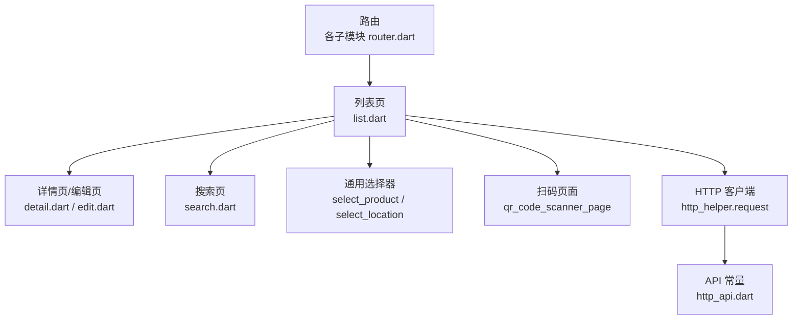

**图表来源**
- [lib/pages/business/wms/launch/router.dart:1-17](file://lib/pages/business/wms/launch/router.dart#L1-L17)
- [lib/pages/business/wms/launch/list.dart:1-200](file://lib/pages/business/wms/launch/list.dart#L1-L200)
- [lib/net/http_api.dart:195-226](file://lib/net/http_api.dart#L195-L226)
- [lib/net/http_helper.dart:1-50](file://lib/net/http_helper.dart#L1-L50)

**章节来源**
- [lib/net/http_api.dart:195-226](file://lib/net/http_api.dart#L195-L226)
- [lib/net/http_helper.dart:1-50](file://lib/net/http_helper.dart#L1-L50)

## 详细组件分析

### 上架管理（Launch）
上架模块包含列表、搜索、明细和执行四个页面：

- 列表页：按“按单据/按商品”两个 Tab 展示待上架任务，支持滚动分页、按门店过滤、扫码快速过滤商品条码、扫托盘码批量带出明细。
- 搜索页：防抖输入，按单据模式传 `billno`，按商品模式传 `cond`；点击按单据跳转明细，按商品直接跳执行页。
- 明细页：根据 `billflag` 调用不同上游单据详情接口，合并 `detaillist` 与 `mergeDetails`，计算合计上架数，并透传托盘分组数据给执行页。
- 执行页：加载货位号列表，支持选择目标货位；支持托盘码批量处理；提交时按托盘或单据分组保存。

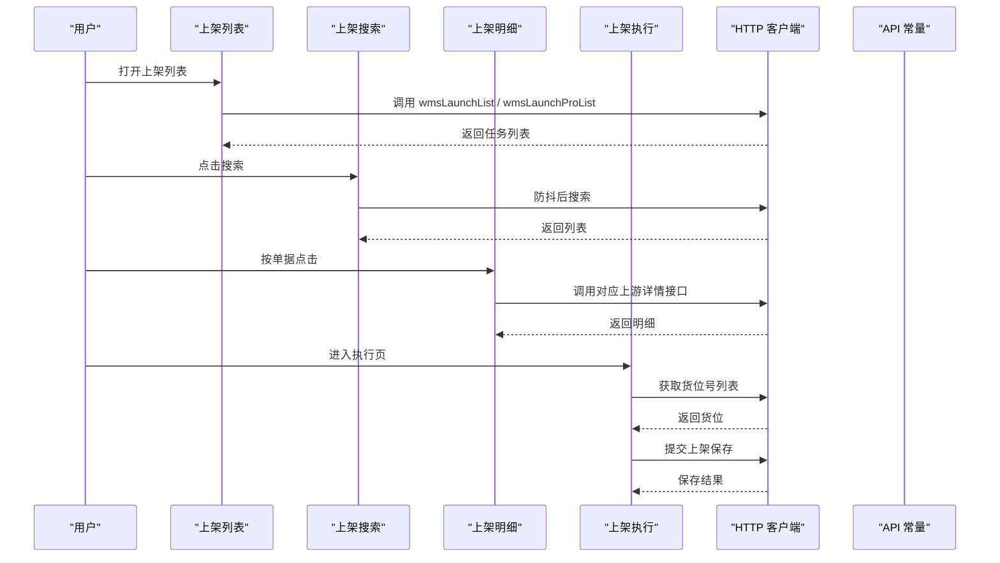

**图表来源**
- [lib/pages/business/wms/launch/list.dart:1-200](file://lib/pages/business/wms/launch/list.dart#L1-L200)
- [lib/pages/business/wms/launch/search.dart:1-200](file://lib/pages/business/wms/launch/search.dart#L1-L200)
- [lib/pages/business/wms/launch/detail.dart:1-200](file://lib/pages/business/wms/launch/detail.dart#L1-L200)
- [lib/pages/business/wms/launch/edit.dart:1-200](file://lib/pages/business/wms/launch/edit.dart#L1-L200)
- [lib/net/http_api.dart:203-209](file://lib/net/http_api.dart#L203-L209)

**章节来源**
- [lib/pages/business/wms/launch/list.dart:1-200](file://lib/pages/business/wms/launch/list.dart#L1-L200)
- [lib/pages/business/wms/launch/search.dart:1-200](file://lib/pages/business/wms/launch/search.dart#L1-L200)
- [lib/pages/business/wms/launch/detail.dart:1-200](file://lib/pages/business/wms/launch/detail.dart#L1-L200)
- [lib/pages/business/wms/launch/edit.dart:1-200](file://lib/pages/business/wms/launch/edit.dart#L1-L200)
- [lib/net/http_api.dart:203-209](file://lib/net/http_api.dart#L203-L209)

### 收货管理（Receive）
收货模块由任务列表、任务主编辑、商品行编辑、托盘编辑组成：

- 任务列表：支持按状态筛选、日期范围、供应商、创建人、商品名称等多维筛选；分页加载收货任务。
- 任务主编辑：聚合商品明细与托盘分组，展示“待收货/部分收货/已收货”状态；支持托盘码自动带出货位。
- 商品行编辑：维护批次、有效期、货位、托盘码；支持新增/删除行，限制每行最大收货数。
- 托盘编辑：维护托盘内商品集合，支持删除行、扫码添加商品、托盘码变更自动带出货位。

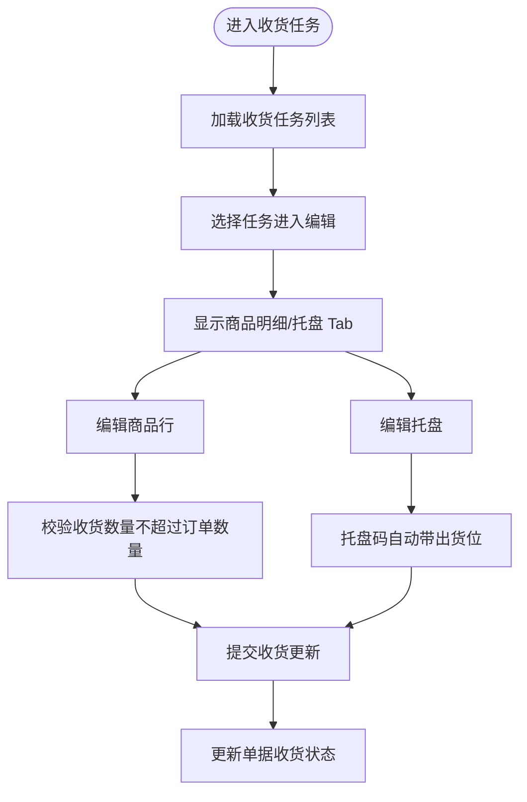

**图表来源**
- [lib/pages/business/wms/receive/list.dart:1-200](file://lib/pages/business/wms/receive/list.dart#L1-L200)
- [lib/pages/business/wms/receive/edit.dart:1-200](file://lib/pages/business/wms/receive/edit.dart#L1-L200)
- [lib/pages/business/wms/receive/pro_edit.dart:1-200](file://lib/pages/business/wms/receive/pro_edit.dart#L1-L200)
- [lib/pages/business/wms/receive/pallet_edit.dart:1-200](file://lib/pages/business/wms/receive/pallet_edit.dart#L1-L200)
- [lib/net/http_api.dart:195-201](file://lib/net/http_api.dart#L195-L201)

**章节来源**
- [lib/pages/business/wms/receive/list.dart:1-200](file://lib/pages/business/wms/receive/list.dart#L1-L200)
- [lib/pages/business/wms/receive/edit.dart:1-200](file://lib/pages/business/wms/receive/edit.dart#L1-L200)
- [lib/pages/business/wms/receive/pro_edit.dart:1-200](file://lib/pages/business/wms/receive/pro_edit.dart#L1-L200)
- [lib/pages/business/wms/receive/pallet_edit.dart:1-200](file://lib/pages/business/wms/receive/pallet_edit.dart#L1-L200)
- [lib/net/http_api.dart:195-201](file://lib/net/http_api.dart#L195-L201)

### 补货管理（Restock）
补货模块由补货列表与补货详情构成：

- 补货列表：支持按货位、商品筛选，分页加载需补货商品；点击卡片进入补货详情。
- 补货详情：展示商品当前库存、最大库存、待补数量；选择移出货位后输入补货数量，校验可用库存与待补数，提交补货单。

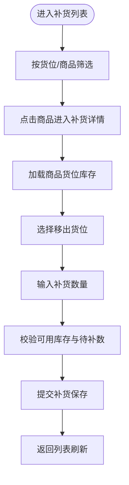

**图表来源**
- [lib/pages/business/wms/restock/list.dart:1-200](file://lib/pages/business/wms/restock/list.dart#L1-L200)
- [lib/pages/business/wms/restock/detail.dart:1-200](file://lib/pages/business/wms/restock/detail.dart#L1-L200)
- [lib/net/http_api.dart:213-217](file://lib/net/http_api.dart#L213-L217)

**章节来源**
- [lib/pages/business/wms/restock/list.dart:1-200](file://lib/pages/business/wms/restock/list.dart#L1-L200)
- [lib/pages/business/wms/restock/detail.dart:1-200](file://lib/pages/business/wms/restock/detail.dart#L1-L200)
- [lib/net/http_api.dart:213-217](file://lib/net/http_api.dart#L213-L217)

### 库存查询（StockQuery）
库存查询模块提供商品维度与货位维度库存查询，以及移货操作：

- 库存列表：切换“商品库存/货位库存”Tab，先选仓库再选商品或货位号，触发相应库存接口。
- 移货页：从现有货位向新货位移货，输入移货数量并校验不超过可用库存，提交移动库存接口。

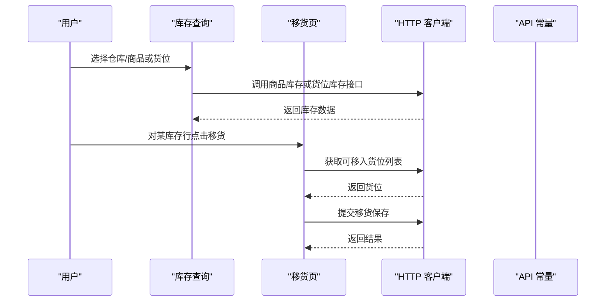

**图表来源**
- [lib/pages/business/wms/stockQuery/list.dart:1-200](file://lib/pages/business/wms/stockQuery/list.dart#L1-L200)
- [lib/pages/business/wms/stockQuery/move_goods.dart:1-200](file://lib/pages/business/wms/stockQuery/move_goods.dart#L1-L200)
- [lib/net/http_api.dart:219-222](file://lib/net/http_api.dart#L219-L222)

**章节来源**
- [lib/pages/business/wms/stockQuery/list.dart:1-200](file://lib/pages/business/wms/stockQuery/list.dart#L1-L200)
- [lib/pages/business/wms/stockQuery/move_goods.dart:1-200](file://lib/pages/business/wms/stockQuery/move_goods.dart#L1-L200)
- [lib/net/http_api.dart:219-222](file://lib/net/http_api.dart#L219-L222)

### 仓储设置（WMS Set）
仓储设置用于配置默认仓库，供库存查询等场景初始化使用：

- 加载设置：调用设置获取接口，反查仓库名称。
- 选择仓库：调用仓库列表接口，支持搜索分页。
- 保存设置：立即保存默认仓库 ID。

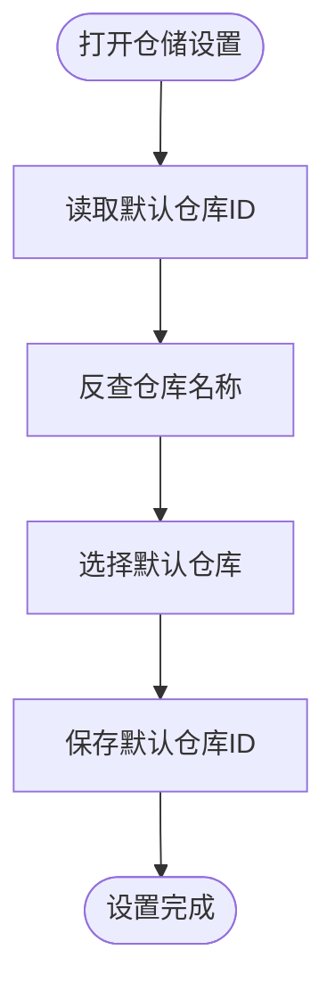

**图表来源**
- [lib/pages/business/wms/wmsSet/page.dart:1-200](file://lib/pages/business/wms/wmsSet/page.dart#L1-L200)
- [lib/net/http_api.dart:224-226](file://lib/net/http_api.dart#L224-L226)

**章节来源**
- [lib/pages/business/wms/wmsSet/page.dart:1-200](file://lib/pages/business/wms/wmsSet/page.dart#L1-L200)
- [lib/net/http_api.dart:224-226](file://lib/net/http_api.dart#L224-L226)

## 依赖关系分析
WMS 模块对外依赖主要包括：

- 路由：Fluro Router 与各子模块 Router 类。
- 网络：`http_helper.request` 与 `http_api.dart` 中的 API 常量。
- 选择器：`select_product.dart`、`select_location.dart`。
- 工具：`math_utils.dart`、`toast_utils.dart`、`permission_utils.dart`。
- 扫码：`qr_code_scanner_page.dart`。

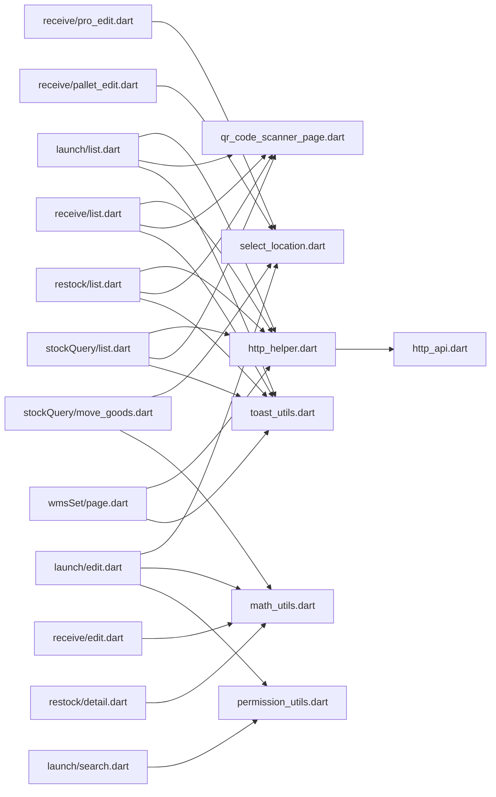

**图表来源**
- [lib/pages/business/wms/launch/list.dart:1-200](file://lib/pages/business/wms/launch/list.dart#L1-L200)
- [lib/pages/business/wms/receive/list.dart:1-200](file://lib/pages/business/wms/receive/list.dart#L1-L200)
- [lib/pages/business/wms/restock/list.dart:1-200](file://lib/pages/business/wms/restock/list.dart#L1-L200)
- [lib/pages/business/wms/stockQuery/list.dart:1-200](file://lib/pages/business/wms/stockQuery/list.dart#L1-L200)
- [lib/pages/business/wms/wmsSet/page.dart:1-200](file://lib/pages/business/wms/wmsSet/page.dart#L1-L200)
- [lib/net/http_api.dart:195-226](file://lib/net/http_api.dart#L195-L226)
- [lib/net/http_helper.dart:1-50](file://lib/net/http_helper.dart#L1-L50)
- [lib/components/select/select_location.dart:1-50](file://lib/components/select/select_location.dart#L1-L50)
- [lib/components/select/select_product.dart:1-50](file://lib/components/select/select_product.dart#L1-L50)
- [lib/util/math_utils.dart:1-50](file://lib/util/math_utils.dart#L1-L50)
- [lib/util/toast_utils.dart:1-50](file://lib/util/toast_utils.dart#L1-L50)
- [lib/util/permission_utils.dart:1-50](file://lib/util/permission_utils.dart#L1-L50)
- [lib/widgets/qr_code_scanner_page.dart:1-50](file://lib/widgets/qr_code_scanner_page.dart#L1-L50)

**章节来源**
- [lib/net/http_api.dart:195-226](file://lib/net/http_api.dart#L195-L226)
- [lib/net/http_helper.dart:1-50](file://lib/net/http_helper.dart#L1-L50)

## 标准化仓储作业流程
结合本模块的实现，标准化仓储作业流程如下：

1. **入库准备**  
   - 在“收货任务列表”中筛选并打开收货任务。  
   - 在“商品行编辑”中填写批次、有效期、货位、托盘码，控制每行收货数量不超过订单数量。  
   - 在“托盘编辑”中维护托盘内商品，支持扫码添加、托盘码自动带出货位。

2. **收货质检**  
   - 在收货主编辑页查看“待收货/部分收货/已收货”状态。  
   - 完成托盘与商品行的确认后提交收货更新，系统同步库存。

3. **上架作业**  
   - 在上架任务列表中按单据或按商品查看待上架任务。  
   - 进入上架执行页选择目标货位，托盘码批量带出明细，提交上架保存。

4. **补货作业**  
   - 在补货列表中选择需补货商品，进入补货详情。  
   - 选择移出货位，输入补货数量，校验可用库存与待补数后提交补货。

5. **库存查询与调拨**  
   - 在库存查询中选择仓库，按商品或货位查看库存。  
   - 对需要调整的库存行执行移货，选择移入货位并提交。

6. **仓储设置**  
   - 在“仓储设置”中配置默认仓库，后续库存查询等场景将使用该默认仓库。

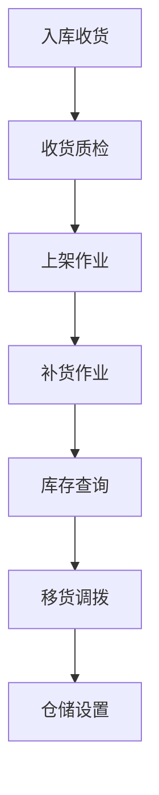

[本图为概念流程图，不映射具体代码文件]

## 效率优化策略
- **分页与防抖**：列表普遍采用分页加载，搜索输入使用防抖减少无效请求。
- **托盘码批量处理**：上架与收货均支持托盘码批量带出明细，减少重复录入。
- **默认值回退**：商品名、价格、金额、货位号等字段存在多处回退逻辑，减少空值导致的交互异常。
- **权限前置校验**：关键入口通过权限工具提前拦截，避免无效操作。
- **本地信息缓存**：门店信息与用户权限从本地存储读取，降低重复解析开销。

[本节为通用指导，不直接分析具体文件]

## 条码扫描集成与移动端适配
- **扫码入口统一**：多个页面通过扫码页面组件触发扫码，并将结果回填到搜索框、托盘码、商品条码等字段。
- **扫码校验反馈**：空码提示“请扫描正确条码”，未找到商品时给出明确提示。
- **托盘码自动带出货位**：收货托盘编辑根据托盘码映射自动填充货位，提升扫码效率。
- **移动端适配**：页面使用 Material/Cupertino 控件，适配手机竖屏；复杂列表使用滚动控制器实现加载更多。

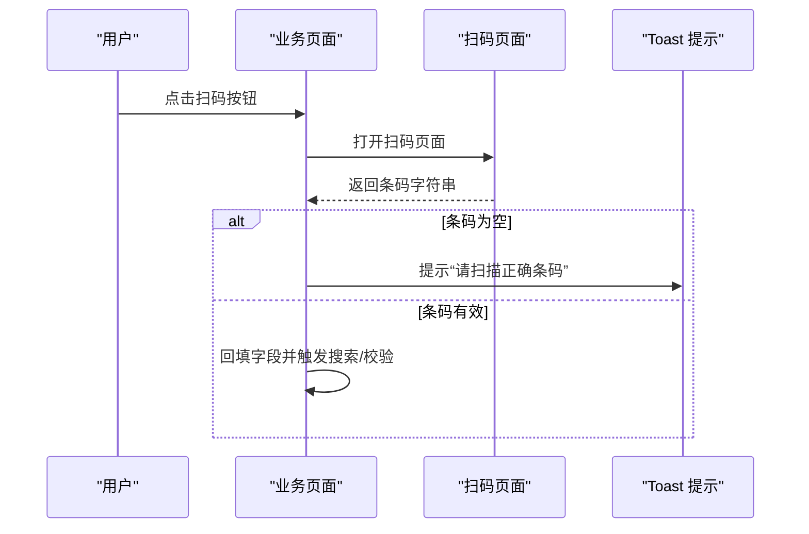

**图表来源**
- [lib/widgets/qr_code_scanner_page.dart:1-50](file://lib/widgets/qr_code_scanner_page.dart#L1-L50)
- [lib/pages/business/wms/launch/list.dart:1-200](file://lib/pages/business/wms/launch/list.dart#L1-L200)
- [lib/pages/business/wms/receive/pallet_edit.dart:1-200](file://lib/pages/business/wms/receive/pallet_edit.dart#L1-L200)
- [lib/util/toast_utils.dart:1-50](file://lib/util/toast_utils.dart#L1-L50)

**章节来源**
- [lib/widgets/qr_code_scanner_page.dart:1-50](file://lib/widgets/qr_code_scanner_page.dart#L1-L50)
- [lib/pages/business/wms/launch/list.dart:1-200](file://lib/pages/business/wms/launch/list.dart#L1-L200)
- [lib/pages/business/wms/receive/pallet_edit.dart:1-200](file://lib/pages/business/wms/receive/pallet_edit.dart#L1-L200)
- [lib/util/toast_utils.dart:1-50](file://lib/util/toast_utils.dart#L1-L50)

## 与库存、采购销售的数据同步机制
WMS 模块通过调用不同上游单据详情接口与库存接口，与库存、采购、销售等业务形成数据联动：

- **上架明细来源**：根据单据类型调用采购入库、批发退货、调拨入库、配退收货等详情接口，获取明细后进入上架执行。
- **收货任务来源**：通过收货任务接口获取任务列表与详情，更新收货数量后同步库存。
- **补货库存来源**：补货详情调用商品货位库存接口，依据可用库存与待补数生成补货建议。
- **库存查询与移货**：商品库存与货位库存接口提供查询数据，移货接口更新库存分布。
- **仓储设置联动**：默认仓库设置影响库存查询的默认仓库选择。

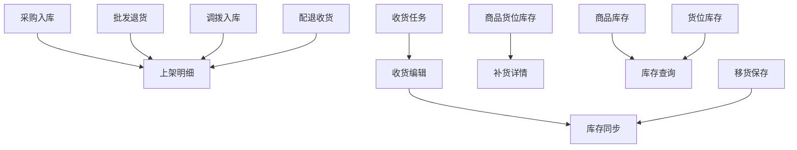

**图表来源**
- [lib/pages/business/wms/launch/detail.dart:1-200](file://lib/pages/business/wms/launch/detail.dart#L1-L200)
- [lib/pages/business/wms/receive/edit.dart:1-200](file://lib/pages/business/wms/receive/edit.dart#L1-L200)
- [lib/pages/business/wms/restock/detail.dart:1-200](file://lib/pages/business/wms/restock/detail.dart#L1-L200)
- [lib/pages/business/wms/stockQuery/list.dart:1-200](file://lib/pages/business/wms/stockQuery/list.dart#L1-L200)
- [lib/net/http_api.dart:195-226](file://lib/net/http_api.dart#L195-L226)

**章节来源**
- [lib/pages/business/wms/launch/detail.dart:1-200](file://lib/pages/business/wms/launch/detail.dart#L1-L200)
- [lib/pages/business/wms/receive/edit.dart:1-200](file://lib/pages/business/wms/receive/edit.dart#L1-L200)
- [lib/pages/business/wms/restock/detail.dart:1-200](file://lib/pages/business/wms/restock/detail.dart#L1-L200)
- [lib/pages/business/wms/stockQuery/list.dart:1-200](file://lib/pages/business/wms/stockQuery/list.dart#L1-L200)
- [lib/net/http_api.dart:195-226](file://lib/net/http_api.dart#L195-L226)

## 性能考量
- **分页加载**：列表页统一使用 `_page`、`_hasMore`、`_loading` 控制分页与加载态，避免一次性加载大数据。
- **滚动监听**：通过 `ScrollController` 监听滚动到底部触发下一页，提升长列表体验。
- **防抖搜索**：搜索输入使用定时器防抖，减少频繁请求。
- **请求序号保护**：上架搜索等场景使用递增序号避免旧请求覆盖新结果。
- **状态隔离**：Tab 切换时清空数据并重新加载，避免脏数据累积。

[本节为通用指导，不直接分析具体文件]

## 问题排查指南
- **无权限访问**：部分页面入口会检查权限，若提示无权请在后台修改权限或使用具备权限账号登录。
- **扫码结果为空**：确认扫码页面返回是否为空，空码会提示“请扫描正确条码”。
- **托盘码未带出货位**：检查托盘码与货位映射是否正确；若托盘码为空则不会自动带出。
- **收货数量超限**：每行收货数量不能超过订单剩余数量，系统会在新增行或提交前进行校验。
- **补货数量无效**：补货数量必须大于 0，且不能超过移出货位可用库存与商品待补数。
- **移货数量无效**：移货数量必须大于 0，且不能超过源货位可用库存。
- **默认仓库未生效**：确认仓储设置是否成功保存；库存查询会尝试读取默认仓库。

**章节来源**
- [lib/pages/business/wms/launch/search.dart:1-200](file://lib/pages/business/wms/launch/search.dart#L1-L200)
- [lib/pages/business/wms/receive/pro_edit.dart:1-200](file://lib/pages/business/wms/receive/pro_edit.dart#L1-L200)
- [lib/pages/business/wms/receive/pallet_edit.dart:1-200](file://lib/pages/business/wms/receive/pallet_edit.dart#L1-L200)
- [lib/pages/business/wms/restock/detail.dart:1-200](file://lib/pages/business/wms/restock/detail.dart#L1-L200)
- [lib/pages/business/wms/stockQuery/move_goods.dart:1-200](file://lib/pages/business/wms/stockQuery/move_goods.dart#L1-L200)
- [lib/pages/business/wms/wmsSet/page.dart:1-200](file://lib/pages/business/wms/wmsSet/page.dart#L1-L200)

## 结论
WMS 仓储模块以清晰的页面分层与统一的 API 管理支撑了上架、收货、补货、库存查询与仓储设置的核心能力。通过托盘码批量处理、扫码自动化、分页与防抖优化，以及与库存、采购、销售等上游业务的接口联动，形成了完整的仓储作业闭环。在实际使用中，应重点关注权限校验、扫码结果有效性、数量校验与默认仓库配置，以确保仓储作业准确高效。