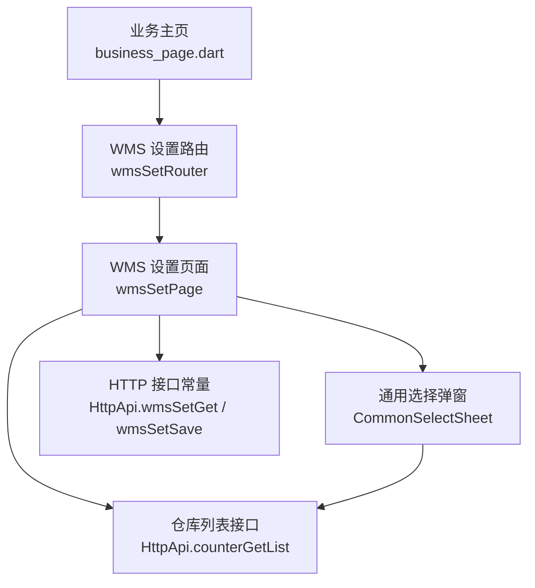
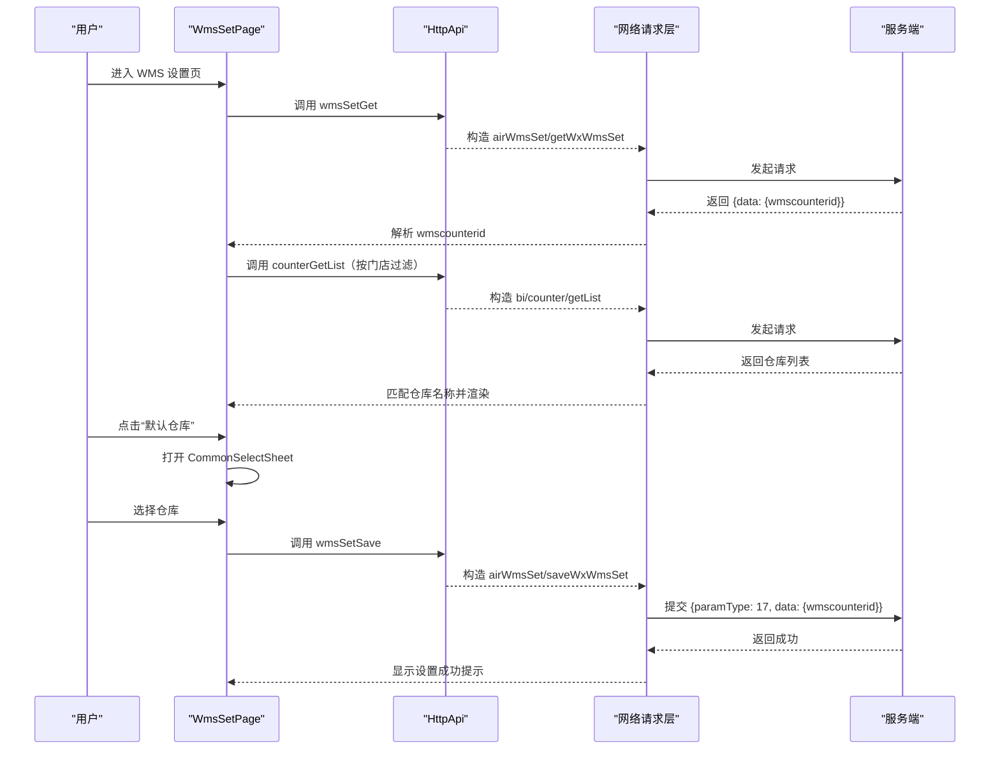
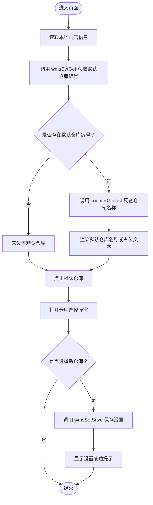
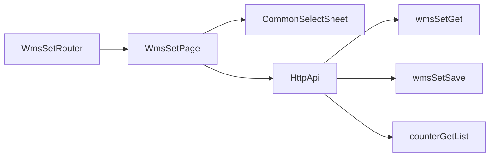

# 仓储设置

<cite>
**本文引用的文件**   
- [lib/pages/business/wms/wmsSet/page.dart](file://lib/pages/business/wms/wmsSet/page.dart)
- [lib/pages/business/wms/wmsSet/router.dart](file://lib/pages/business/wms/wmsSet/router.dart)
- [lib/routers/routers.dart](file://lib/routers/routers.dart)
- [lib/net/http_api.dart](file://lib/net/http_api.dart)
- [lib/pages/business/wms/stockQuery/list.dart](file://lib/pages/business/wms/stockQuery/list.dart)
- [lib/components/select/common_select_sheet.dart](file://lib/components/select/common_select_sheet.dart)
</cite>

## 目录
1. [引言](#引言)
2. [项目结构定位](#项目结构定位)
3. [核心组件](#核心组件)
4. [架构总览](#架构总览)
5. [详细组件分析](#详细组件分析)
6. [依赖关系分析](#依赖关系分析)
7. [性能与一致性考虑](#性能与一致性考虑)
8. [故障排查指南](#故障排查指南)
9. [结论](#结论)

## 引言
本文件围绕 WMS 仓储模块中的“仓储设置”功能，说明当前代码库中已实现的全局配置管理能力。重点包括：
- 默认仓库选择与保存
- 仓储设置页面入口、路由与数据流
- 与其他 WMS 业务页面对默认仓库的协同使用方式
- 基于现有实现的版本管理、热更新、权限控制和数据备份恢复现状与建议

需要特别说明的是：当前仓库中“仓储设置”功能聚焦于“默认仓库”这一项全局配置；尚未实现完整的仓库参数设置、作业流程配置、权限分配、版本管理、配置热更新和多仓库差异化配置等扩展能力。这些内容在本文档中以“现状说明 + 设计建议”的方式给出，便于后续迭代完善。

## 项目结构定位
“仓储设置”位于 WMS 子模块下，由独立的路由器和页面组成，并通过统一路由表注册到应用导航中。其调用链路贯穿 UI 层、网络接口定义层与共享选择器组件。

**图示来源**
- [lib/pages/business/wms/wmsSet/router.dart:1-17](file://lib/pages/business/wms/wmsSet/router.dart#L1-L17)
- [lib/pages/business/wms/wmsSet/page.dart:1-209](file://lib/pages/business/wms/wmsSet/page.dart#L1-L209)
- [lib/routers/routers.dart:30-30](file://lib/routers/routers.dart#L30-L30)
- [lib/routers/routers.dart:144-144](file://lib/routers/routers.dart#L144-L144)
- [lib/net/http_api.dart:224-226](file://lib/net/http_api.dart#L224-L226)

**章节来源**
- [lib/pages/business/wms/wmsSet/router.dart:1-17](file://lib/pages/business/wms/wmsSet/router.dart#L1-L17)
- [lib/routers/routers.dart:30-30](file://lib/routers/routers.dart#L30-L30)
- [lib/routers/routers.dart:144-144](file://lib/routers/routers.dart#L144-L144)

## 核心组件
- WMS 设置页面：负责加载当前默认仓库、打开仓库选择弹窗、保存默认仓库。
- WMS 设置路由：将 `/wms/set` 路由映射到设置页面。
- HTTP 接口常量：集中定义 WMS 设置获取、保存和仓库列表接口地址。
- 库存查询页面对默认仓库的使用：演示其他 WMS 页面如何读取默认仓库并校验可选项。

**章节来源**
- [lib/pages/business/wms/wmsSet/page.dart:11-209](file://lib/pages/business/wms/wmsSet/page.dart#L11-L209)
- [lib/pages/business/wms/wmsSet/router.dart:1-17](file://lib/pages/business/wms/wmsSet/router.dart#L1-L17)
- [lib/net/http_api.dart:224-226](file://lib/net/http_api.dart#L224-L226)
- [lib/pages/business/wms/stockQuery/list.dart:60-150](file://lib/pages/business/wms/stockQuery/list.dart#L60-L150)

## 架构总览
下图展示“仓储设置”在 Flutter 端的典型交互流程：用户进入页面后，先拉取服务器端 WMS 设置，再根据当前门店信息反查仓库名称；用户通过通用选择器选定仓库后，立即提交设置变更。

**图示来源**
- [lib/pages/business/wms/wmsSet/page.dart:47-131](file://lib/pages/business/wms/wmsSet/page.dart#L47-L131)
- [lib/net/http_api.dart:44-44](file://lib/net/http_api.dart#L44-L44)
- [lib/net/http_api.dart:224-226](file://lib/net/http_api.dart#L224-L226)

## 详细组件分析

### WMS 设置页面：WmsSetPage
职责概述：
- 从本地存储读取当前门店信息，用于筛选仓库范围。
- 从服务端获取当前 WMS 设置，解析出默认仓库编号。
- 根据默认仓库编号和门店范围反查仓库名称，用于界面展示。
- 提供“默认仓库”配置项，点击后弹出仓库选择器。
- 选择完成后立即保存默认仓库编号。

关键行为与边界：
- 初始化时同时执行本地门店信息加载与 WMS 设置加载。
- 若服务端的 `wmscounterid` 为空，则不覆盖本地状态，避免误清空。
- 仓库选择弹窗支持搜索，并按门店、仓库类型、是否停用等条件过滤。
- 保存时携带固定 `paramType: 17`，并以 `{wmscounterid}` 作为实际数据体。
- 保存过程中使用防抖标志 `_saving`，防止重复提交。

**图示来源**
- [lib/pages/business/wms/wmsSet/page.dart:29-131](file://lib/pages/business/wms/wmsSet/page.dart#L29-L131)

**章节来源**
- [lib/pages/business/wms/wmsSet/page.dart:11-209](file://lib/pages/business/wms/wmsSet/page.dart#L11-L209)

### WMS 设置路由：WmsSetRouter
职责概述：
- 定义路由路径 `/wms/set`。
- 将路由映射到 `WmsSetPage`。
- 由主路由表注册该提供者，使 WMS 设置入口可被业务主页访问。

要点：
- 路由类实现统一路由提供者接口，便于集中管理。
- 路由路径简洁，符合 WMS 子模块命名风格。

**章节来源**
- [lib/pages/business/wms/wmsSet/router.dart:1-17](file://lib/pages/business/wms/wmsSet/router.dart#L1-L17)
- [lib/routers/routers.dart:30-30](file://lib/routers/routers.dart#L30-L30)
- [lib/routers/routers.dart:144-144](file://lib/routers/routers.dart#L144-L144)

### HTTP 接口常量：HttpApi
职责概述：
- 集中维护 WMS 相关接口地址，避免分散字符串常量。
- 包含 WMS 设置获取、保存和仓库列表接口。

当前与仓储设置直接相关的接口：
- `airWmsSet/getWxWmsSet`：获取 WMS 设置。
- `airWmsSet/saveWxWmsSet`：保存 WMS 设置。
- `bi/counter/getList`：仓库列表接口，常用于默认仓库名称反查与选择。

**章节来源**
- [lib/net/http_api.dart:44-44](file://lib/net/http_api.dart#L44-L44)
- [lib/net/http_api.dart:224-226](file://lib/net/http_api.dart#L224-L226)

### 默认仓库在其他 WMS 页面的使用：库存查询页
库存查询页展示了默认仓库如何在业务场景中生效：
- 初始化时调用 `wmsSetGet` 并传入特定 `type=31`，以获取默认仓库编号。
- 根据门店范围调用 `counterGetList`，过滤掉零售仓，仅保留常温、冷藏、冷冻等仓库类型。
- 如果默认仓库不在可选范围内，会清空已选仓库，避免无效默认值影响查询结果。
- 用户手动切换仓库后，不再用异步默认仓库覆盖用户选择。

这说明“默认仓库”不仅是设置页的配置项，也是其他 WMS 页面查询行为的基线。

**章节来源**
- [lib/pages/business/wms/stockQuery/list.dart:60-150](file://lib/pages/business/wms/stockQuery/list.dart#L60-L150)

## 依赖关系分析
WMS 设置功能的依赖关系如下：

**图示来源**
- [lib/pages/business/wms/wmsSet/router.dart:1-17](file://lib/pages/business/wms/wmsSet/router.dart#L1-L17)
- [lib/pages/business/wms/wmsSet/page.dart:1-209](file://lib/pages/business/wms/wmsSet/page.dart#L1-L209)
- [lib/net/http_api.dart:44-44](file://lib/net/http_api.dart#L44-L44)
- [lib/net/http_api.dart:224-226](file://lib/net/http_api.dart#L224-L226)

耦合与内聚性：
- 页面与路由解耦：路由只负责跳转，页面承载完整业务逻辑。
- 页面与接口解耦：通过 `HttpApi` 常量集中暴露接口，便于替换和测试。
- 页面与选择器解耦：通过 `CommonSelectSheet` 复用仓库选择交互。

潜在风险：
- 页面同时承担加载、选择、保存逻辑，复杂度较高，未来可按 Presenter/Provider 分层拆分。
- 默认仓库与服务端返回结构强绑定，需保证接口契约稳定。

**章节来源**
- [lib/pages/business/wms/wmsSet/page.dart:11-209](file://lib/pages/business/wms/wmsSet/page.dart#L11-L209)
- [lib/net/http_api.dart:224-226](file://lib/net/http_api.dart#L224-L226)

## 性能与一致性考虑
- 网络请求顺序：先获取默认仓库编号，再反查仓库名称，减少无效渲染。
- 防重复保存：通过 `_saving` 标志阻止连续提交。
- 状态同步：选择仓库后立即保存，确保设置与展示一致，避免“页面卸载才保存”带来的延迟感。
- 可选仓库校验：库存查询页对默认仓库进行可选项校验，防止无效默认值污染业务查询。

优化建议：
- 对仓库列表结果做轻量缓存，减少重复反查。
- 将默认仓库读取封装为统一服务，供多个 WMS 页面复用。
- 对保存操作增加失败重试与明确错误提示。

[本节为通用性能讨论，不直接分析具体文件]

## 故障排查指南
常见问题与处理建议：
- 无法进入 WMS 设置页：检查主路由表是否正确注册 `WmsSetRouter`，以及路由路径是否为 `/wms/set`。
- 页面加载后无默认仓库：确认服务端 `wmsSetGet` 返回的 `wmscounterid` 是否为空。
- 默认仓库名称未显示：检查 `counterGetList` 是否返回匹配的仓库记录，注意门店范围和仓库类型过滤。
- 保存后仍显示旧仓库：检查 `wmsSetSave` 是否成功返回，以及前端是否重新拉取最新设置。
- 库存查询页默认仓库无效：确认默认仓库是否为零售仓；若是，库存查询页会主动清空默认仓库。

定位依据：
- 路由注册位置与路径定义。
- 页面初始化、仓库选择、保存逻辑。
- 库存查询页对默认仓库的二次校验逻辑。

**章节来源**
- [lib/routers/routers.dart:30-30](file://lib/routers/routers.dart#L30-L30)
- [lib/routers/routers.dart:144-144](file://lib/routers/routers.dart#L144-L144)
- [lib/pages/business/wms/wmsSet/page.dart:47-131](file://lib/pages/business/wms/wmsSet/page.dart#L47-L131)
- [lib/pages/business/wms/stockQuery/list.dart:60-150](file://lib/pages/business/wms/stockQuery/list.dart#L60-L150)

## 结论
当前代码库中的“仓储设置”实现了 WMS 全局配置的核心起点——默认仓库的选择与保存，并与库存查询等业务页面形成一致的数据预期。其优点是职责清晰、交互直观、与现有路由和网络层集成良好。

尚未实现但可作为后续迭代方向的能力包括：
- 仓储规则定义：例如入库、出库、拣货、盘点等规则开关与优先级。
- 作业流程自定义：可视化流程节点、审批环节、任务分发策略。
- 用户权限分配机制：角色、菜单、按钮级权限与仓库级数据隔离。
- 版本管理与配置热更新：配置变更的版本号、灰度发布与客户端热更新。
- 多仓库差异化配置：按仓库维度继承、覆盖全局配置。
- 数据备份与恢复：导出配置快照、导入恢复、冲突解决策略。

建议在新增能力时保持以下原则：
- 继续以 `HttpApi` 集中管理接口常量。
- 将复杂状态提升到 Provider 或 Service 层，降低页面耦合。
- 对所有默认值、可选值进行显式校验，避免无效配置污染业务。
- 对关键配置变更引入版本号和审计日志，便于回溯与恢复。

[本节为总结性内容，不直接分析具体文件]