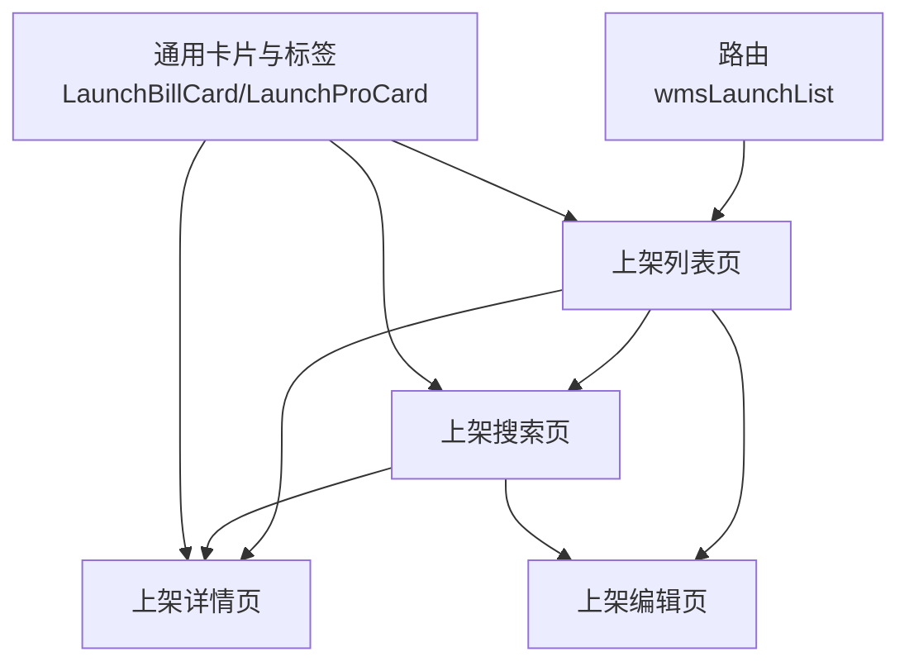
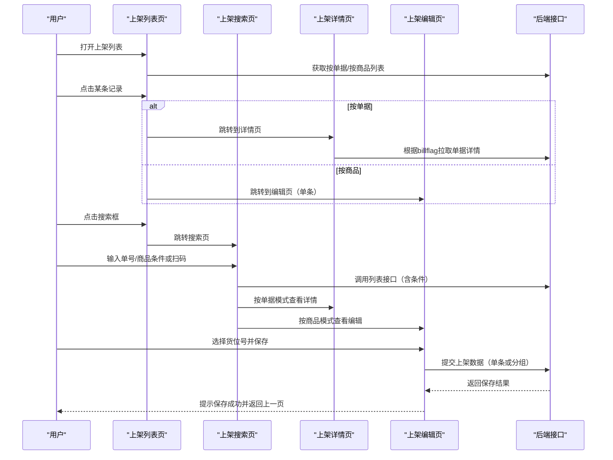
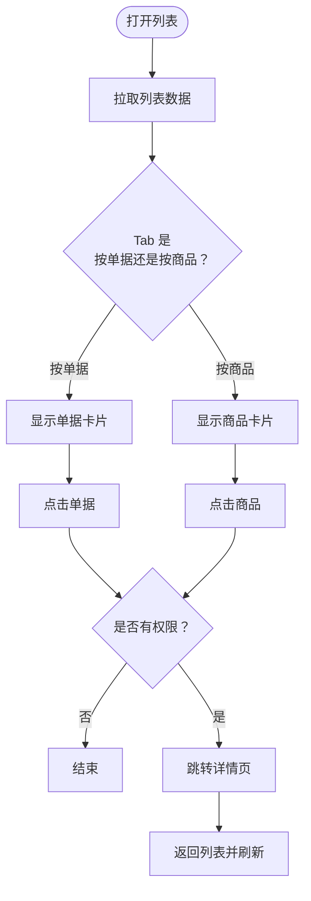
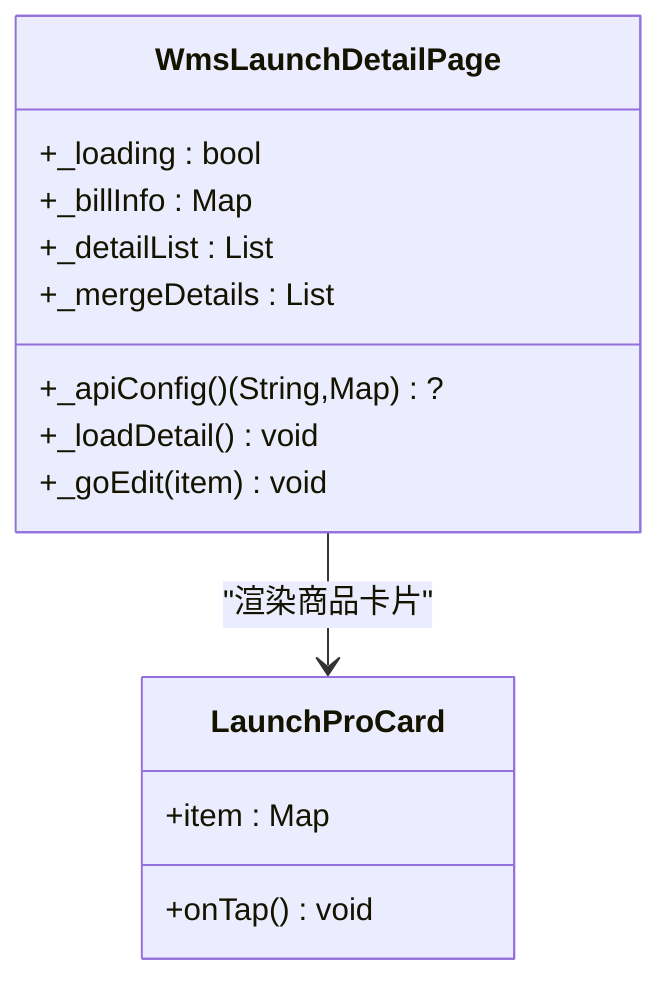
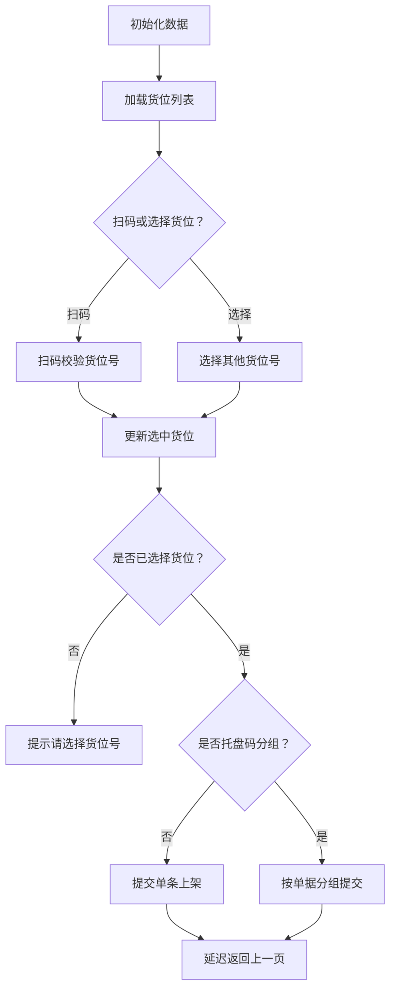
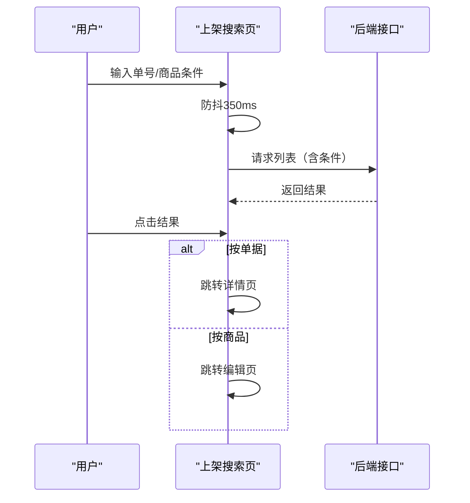
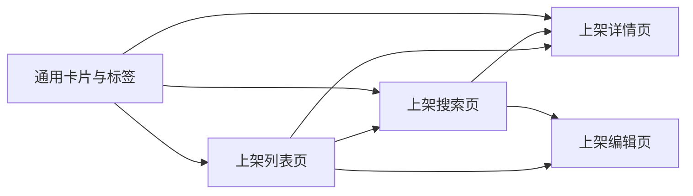

# 出库管理

<cite>
**本文引用的文件**   
- [lib/pages/business/wms/launch/router.dart](file://lib/pages/business/wms/launch/router.dart)
- [lib/pages/business/wms/launch/common.dart](file://lib/pages/business/wms/launch/common.dart)
- [lib/pages/business/wms/launch/list.dart](file://lib/pages/business/wms/launch/list.dart)
- [lib/pages/business/wms/launch/detail.dart](file://lib/pages/business/wms/launch/detail.dart)
- [lib/pages/business/wms/launch/edit.dart](file://lib/pages/business/wms/launch/edit.dart)
- [lib/pages/business/wms/launch/search.dart](file://lib/pages/business/wms/launch/search.dart)
</cite>

## 目录
1. [简介](#简介)
2. [项目结构](#项目结构)
3. [核心组件](#核心组件)
4. [架构总览](#架构总览)
5. [详细组件分析](#详细组件分析)
6. [依赖关系分析](#依赖关系分析)
7. [性能与效率优化](#性能与效率优化)
8. [异常处理与故障排查](#异常处理与故障排查)
9. [结论](#结论)

## 简介
本仓库中的 WMS 仓储模块以“上架”业务为核心，对应文档目标中的“出库管理”语境，这里将“上架”视为出库链路中从待上架库存到正式库位落地的关键作业环节。其完整业务流程包括：
- 创建：上游采购入库、批发退货、调拨入库、配退收货等单据生成待上架任务；
- 审核：列表与搜索页对任务进行筛选与确认；
- 拣货：通过托盘码或商品条码定位待上架明细；
- 包装：托盘/批次维度聚合商品，便于扫码批量处理；
- 发货/上架：选择货位号并完成保存，提交后端并返回。

当前代码实现了 WMS 上架相关的四张页面与路由：
- 上架列表页：按单据/按商品双视图，支持下拉刷新、分页加载、条件搜索、托盘扫码；
- 上架详情页：展示单据基础信息与商品明细；
- 上架编辑页：绑定货位、扫码校验、批量保存；
- 上架搜索页：按单号或商品条件批量查找。

## 项目结构
WMS 上架相关代码集中在 `lib/pages/business/wms/launch` 目录下，采用“页面 + 共享组件 + 路由”的扁平组织方式：
- `router.dart`：定义 WMS 上架路由入口；
- `common.dart`：提供按单据/按商品的卡片 UI 和类型标签映射；
- `list.dart`：上架列表主页面；
- `detail.dart`：上架单据详情；
- `edit.dart`：上架执行与保存；
- `search.dart`：批量搜索页。

图示来源
- [lib/pages/business/wms/launch/router.dart:1-17](file://lib/pages/business/wms/launch/router.dart#L1-L17)
- [lib/pages/business/wms/launch/list.dart:1-479](file://lib/pages/business/wms/launch/list.dart#L1-L479)
- [lib/pages/business/wms/launch/detail.dart:1-281](file://lib/pages/business/wms/launch/detail.dart#L1-L281)
- [lib/pages/business/wms/launch/edit.dart:1-742](file://lib/pages/business/wms/launch/edit.dart#L1-L742)
- [lib/pages/business/wms/launch/search.dart:1-334](file://lib/pages/business/wms/launch/search.dart#L1-L334)
- [lib/pages/business/wms/launch/common.dart:1-185](file://lib/pages/business/wms/launch/common.dart#L1-L185)

章节来源
- [lib/pages/business/wms/launch/router.dart:1-17](file://lib/pages/business/wms/launch/router.dart#L1-L17)

## 核心组件
- 路由提供者
  - 暴露 WMS 上架列表路由常量，使用 Fluro 注册处理器，直接返回上架列表页。
- 通用卡片与标签
  - `launchBillTypeLabel`、`launchBillSourceLabel`：将后端 billflag 映射为中文类型与来源名称；
  - `LaunchBillCard`：按单据卡片，展示来源+品名、单号、制单人、制单时间；
  - `LaunchProCard`：按商品卡片，展示商品名+规格、单号、待上架数。
- 数据与权限
  - 列表页、搜索页、编辑页均从本地存储读取门店信息作为查询条件；
  - 列表与搜索点击前检查权限标识，未授权时阻止跳转。
- 扫码集成
  - 统一使用扫码页组件进行条码扫描，并在成功回调后填充搜索条件或直接进入编辑流程。

章节来源
- [lib/pages/business/wms/launch/router.dart:1-17](file://lib/pages/business/wms/launch/router.dart#L1-L17)
- [lib/pages/business/wms/launch/common.dart:1-185](file://lib/pages/business/wms/launch/common.dart#L1-L185)
- [lib/pages/business/wms/launch/list.dart:1-479](file://lib/pages/business/wms/launch/list.dart#L1-L479)
- [lib/pages/business/wms/launch/search.dart:1-334](file://lib/pages/business/wms/launch/search.dart#L1-L334)
- [lib/pages/business/wms/launch/edit.dart:1-742](file://lib/pages/business/wms/launch/edit.dart#L1-L742)

## 架构总览
WMS 上架功能的前端流程围绕“列表 → 详情/编辑 → 搜索”展开，并通过扫码能力贯穿各页面。

图示来源
- [lib/pages/business/wms/launch/list.dart:1-479](file://lib/pages/business/wms/launch/list.dart#L1-L479)
- [lib/pages/business/wms/launch/detail.dart:1-281](file://lib/pages/business/wms/launch/detail.dart#L1-L281)
- [lib/pages/business/wms/launch/edit.dart:1-742](file://lib/pages/business/wms/launch/edit.dart#L1-L742)
- [lib/pages/business/wms/launch/search.dart:1-334](file://lib/pages/business/wms/launch/search.dart#L1-L334)

## 详细组件分析

### 上架列表页
- 双 Tab 视图
  - 按单据：按制单时间倒序；
  - 按商品：按单号排序。
- 分页与下拉刷新
  - 使用滚动监听触发下一页请求，首次请求清空列表，后续追加；
  - 下拉刷新重置页码并重新拉取。
- 条件搜索
  - 列表页内置搜索框仅用于回显；实际搜索逻辑在搜索页完成；
  - 切换 Tab 会清空搜索条件并重新拉取数据。
- 扫码集成
  - 按商品模式可在搜索框内点击扫码图标，扫码结果作为商品条件；
  - 悬浮按钮支持扫托盘码，调用托盘码查询接口后直接进入编辑页。
- 权限控制
  - 点击单据/商品条目前检查权限标识，未授权则不跳转。

图示来源
- [lib/pages/business/wms/launch/list.dart:1-479](file://lib/pages/business/wms/launch/list.dart#L1-L479)

章节来源
- [lib/pages/business/wms/launch/list.dart:1-479](file://lib/pages/business/wms/launch/list.dart#L1-L479)

### 上架详情页
- 单据信息
  - 展示来源+品名、单号、制单人、制单时间与单据类型标签；
  - 根据 `billflag` 动态选择详情接口，并合并父级信息。
- 商品明细
  - 展示 `detaillist` 与 `mergeDetails`，统一注入 `lunchqty` 与 `billno`；
  - 统计待上架数量总和。
- 交互行为
  - 点击商品行进入编辑页，携带相同托盘码的原始明细与聚合明细；
  - 无明细时展示空状态。

图示来源
- [lib/pages/business/wms/launch/detail.dart:1-281](file://lib/pages/business/wms/launch/detail.dart#L1-L281)
- [lib/pages/business/wms/launch/common.dart:1-185](file://lib/pages/business/wms/launch/common.dart#L1-L185)

章节来源
- [lib/pages/business/wms/launch/detail.dart:1-281](file://lib/pages/business/wms/launch/detail.dart#L1-L281)

### 上架编辑页
- 初始化与数据准备
  - 接收上一页面传入的完整数据，包含 `sumlunchqty`、`detaillist`、`mergeDetails` 等；
  - 提取货位号、托盘码、初始货位 ID，并补充商品价格与金额字段。
- 货位选择
  - 支持扫码校验货位号；若不存在则提示未查询到；
  - 支持从货位选择器选择其他位号，并去重插入列表顶部；
  - 选中货位同步更新查询参数与 UI。
- 保存逻辑
  - 普通模式：组装单个订单参数并提交；
  - 托盘码分组模式：按 `billid` 分组逐单计算数量与金额后批量提交；
  - 成功后延迟返回，并根据来源 Tab 决定返回层数。
- 权限与表单校验
  - 保存前检查上架确认权限；
  - 必填货位号校验。

图示来源
- [lib/pages/business/wms/launch/edit.dart:1-742](file://lib/pages/business/wms/launch/edit.dart#L1-L742)

章节来源
- [lib/pages/business/wms/launch/edit.dart:1-742](file://lib/pages/business/wms/launch/edit.dart#L1-L742)

### 上架搜索页
- 搜索模式
  - 按单据模式：输入单号，调用列表接口并传 `billno`；
  - 按商品模式：输入条码/品名/自编码，传 `cond`；
  - 支持扫码快捷输入。
- 防抖与分页
  - 输入防抖 350ms，避免频繁请求；
  - 支持上拉加载更多。
- 结果交互
  - 按单据模式：点击跳转到详情页；
  - 按商品模式：点击跳转到编辑页，携带商品维度的明细与汇总数据。

图示来源
- [lib/pages/business/wms/launch/search.dart:1-334](file://lib/pages/business/wms/launch/search.dart#L1-L334)

章节来源
- [lib/pages/business/wms/launch/search.dart:1-334](file://lib/pages/business/wms/launch/search.dart#L1-L334)

## 依赖关系分析
- 页面依赖
  - 列表页依赖详情页与编辑页；
  - 搜索页依赖详情页与编辑页；
  - 详情页与编辑页依赖通用卡片与标签。
- 外部依赖
  - HTTP 请求封装、路由导航、本地存储、权限检查、工具类、扫码页组件等由上层基础设施提供。

图示来源
- [lib/pages/business/wms/launch/list.dart:1-479](file://lib/pages/business/wms/launch/list.dart#L1-L479)
- [lib/pages/business/wms/launch/detail.dart:1-281](file://lib/pages/business/wms/launch/detail.dart#L1-L281)
- [lib/pages/business/wms/launch/edit.dart:1-742](file://lib/pages/business/wms/launch/edit.dart#L1-L742)
- [lib/pages/business/wms/launch/search.dart:1-334](file://lib/pages/business/wms/launch/search.dart#L1-L334)
- [lib/pages/business/wms/launch/common.dart:1-185](file://lib/pages/business/wms/launch/common.dart#L1-L185)

章节来源
- [lib/pages/business/wms/launch/list.dart:1-479](file://lib/pages/business/wms/launch/list.dart#L1-L479)
- [lib/pages/business/wms/launch/detail.dart:1-281](file://lib/pages/business/wms/launch/detail.dart#L1-L281)
- [lib/pages/business/wms/launch/edit.dart:1-742](file://lib/pages/business/wms/launch/edit.dart#L1-L742)
- [lib/pages/business/wms/launch/search.dart:1-334](file://lib/pages/business/wms/launch/search.dart#L1-L334)
- [lib/pages/business/wms/launch/common.dart:1-185](file://lib/pages/business/wms/launch/common.dart#L1-L185)

## 性能与效率优化
- 列表渲染优化
  - 使用 `cacheExtent` 预渲染区域减少滚动抖动；
  - 使用 `RepaintBoundary` 包裹卡片项降低重复绘制。
- 分页与增量更新
  - 首屏清空再追加，后续追加以减少内存抖动；
  - 通过 `_requestSeq` 避免旧响应覆盖新响应。
- 搜索体验
  - 搜索页输入防抖 350ms，减少无效请求；
  - 列表页搜索框仅用于回显，实际搜索在独立页面完成，职责清晰。
- 扫码与批量处理
  - 托盘码分组场景下，服务端已按单据分组，前端展平明细用于展示，同时保留分组数据以便批量提交；
  - 保存成功后延迟返回，给用户反馈时间，提升操作流畅度。

[本节为通用性能建议，不直接分析具体文件]

## 异常处理与故障排查
- 权限问题
  - 列表与搜索页点击前检查权限标识，未授权时阻止跳转；
  - 编辑页保存前检查上架确认权限，未授权提示修改后台权限。
- 扫码失败
  - 扫码结果为空时提示“请扫描正确条码”或“扫描失败，请重试”；
  - 货位号扫码后若未查询到货位，提示“未查询到该货位号”。
- 数据为空
  - 托盘码查询无数据时提示“未找到该托盘的上架数据”；
  - 列表与详情页在无数据时展示空状态。
- 网络与请求
  - 列表与搜索页在 catch 分支设置 `_hasMore=false` 并关闭 loading；
  - 详情页加载失败时关闭 loading 并允许用户继续操作。

章节来源
- [lib/pages/business/wms/launch/list.dart:1-479](file://lib/pages/business/wms/launch/list.dart#L1-L479)
- [lib/pages/business/wms/launch/detail.dart:1-281](file://lib/pages/business/wms/launch/detail.dart#L1-L281)
- [lib/pages/business/wms/launch/edit.dart:1-742](file://lib/pages/business/wms/launch/edit.dart#L1-L742)
- [lib/pages/business/wms/launch/search.dart:1-334](file://lib/pages/business/wms/launch/search.dart#L1-L334)

## 结论
WMS 上架模块在当前代码中以清晰的页面分工与统一的扫码集成支撑了从待上架任务发现、检索、校验到最终上架保存的全流程。其设计特点包括：
- 双 Tab 视图兼顾按单据与按商品两种作业视角；
- 托盘码分组与单条保存并存，适配不同仓库作业习惯；
- 扫码能力贯穿列表、搜索、编辑各环节，提升移动端作业效率；
- 完善的权限控制与错误提示保障操作的合规性与可诊断性。

若需进一步扩展至完整的出库生命周期（如出库单创建、审核、拣货、包装、发货），可在现有上架流程基础上增加前置出库单管理与下游出库交接节点，并保持扫码、权限与分页等一致的用户体验。