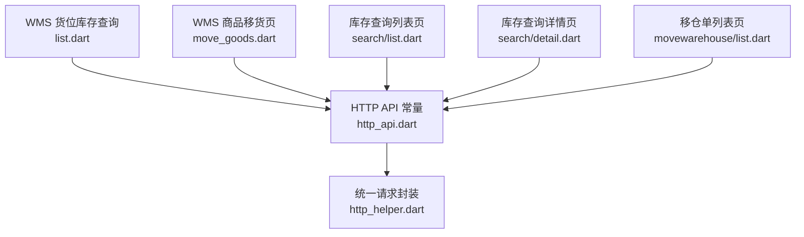
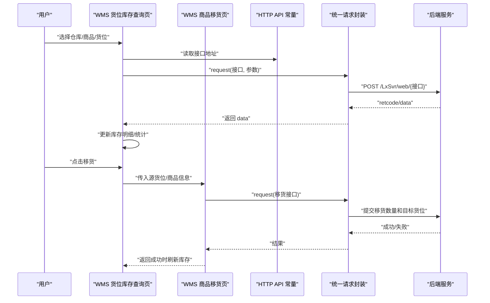
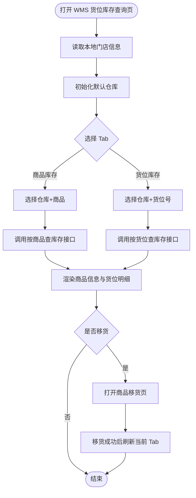
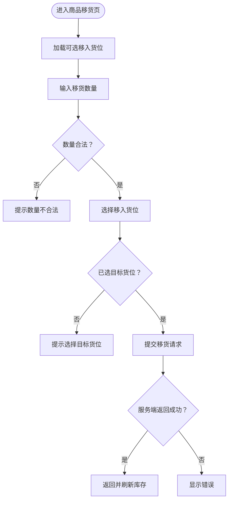
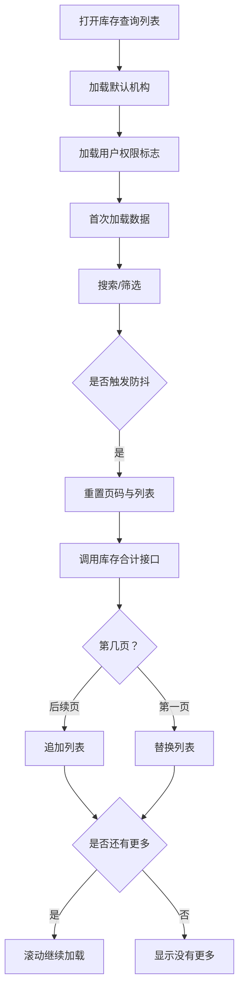
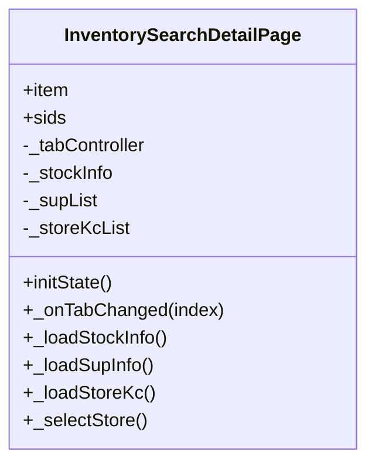
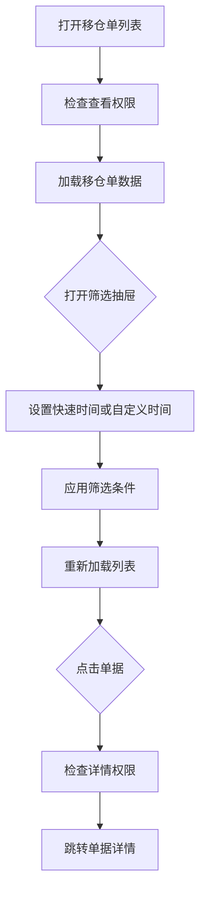
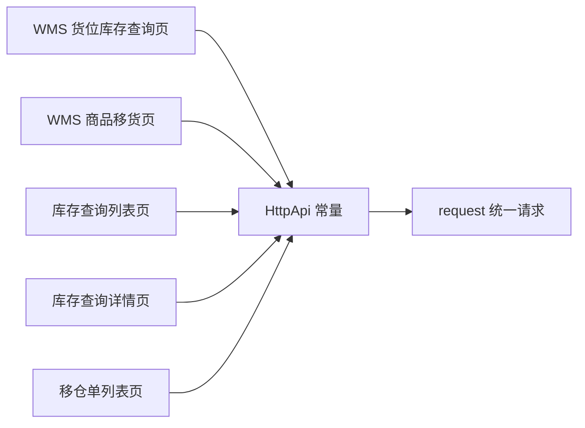

# 库存查询

<cite>
**本文引用的文件**   
- [WMS 货位库存查询列表](file://lib/pages/business/wms/stockQuery/list.dart)
- [WMS 商品移货页](file://lib/pages/business/wms/stockQuery/move_goods.dart)
- [WMS 库存查询路由](file://lib/pages/business/wms/stockQuery/router.dart)
- [库存查询列表页](file://lib/pages/business/inventory/search/list.dart)
- [库存查询详情页](file://lib/pages/business/inventory/search/detail.dart)
- [移仓单列表页](file://lib/pages/business/inventory/movewarehouse/list.dart)
- [HTTP API 常量](file://lib/net/http_api.dart)
- [统一请求封装](file://lib/net/http_helper.dart)
</cite>

## 目录
1. [引言](#引言)
2. [项目结构](#项目结构)
3. [核心功能范围](#核心功能范围)
4. [架构总览](#架构总览)
5. [详细组件分析](#详细组件分析)
6. [依赖关系分析](#依赖关系分析)
7. [性能与大数据分页](#性能与大数据分页)
8. [实时性与一致性](#实时性与一致性)
9. [库存锁定与并发控制](#库存锁定与并发控制)
10. [库存分析与异常检测建议](#库存分析与异常检测建议)
11. [故障排查指南](#故障排查指南)
12. [结论](#结论)

## 引言
本文面向 WMS 仓储模块的库存查询能力，聚焦以下目标：
- 实时库存查询：按仓库、商品、批次、货位维度查看当前库存。
- 库存变动追踪：通过库存查询详情、库存移动（移仓）单据和位置变更记录理解库存变化来源。
- 库存调拨：说明库间调拨在“库存查询”与“移仓单”两个入口中的定位与差异。
- 数据一致性：解释前端如何与后端接口协作保证库存数据一致。
- 性能优化：总结现有分页、防抖、懒加载等策略，并提出进一步优化建议。
- 报表与分析：给出库存周转率计算、库存异常检测的可落地实践。

## 项目结构
本仓库为 Flutter 移动端应用，库存相关代码分布在业务页面层与网络层：
- WMS 专用库存查询：`lib/pages/business/wms/stockQuery/`
- 通用库存查询与详情：`lib/pages/business/inventory/search/`
- 库存调拨（移仓）单据：`lib/pages/business/inventory/movewarehouse/`
- 网络接口定义与请求封装：`lib/net/`

**图表来源**
- [WMS 货位库存查询列表:1-200](file://lib/pages/business/wms/stockQuery/list.dart#L1-L200)
- [WMS 商品移货页:1-200](file://lib/pages/business/wms/stockQuery/move_goods.dart#L1-L200)
- [库存查询列表页:1-200](file://lib/pages/business/inventory/search/list.dart#L1-L200)
- [库存查询详情页:1-200](file://lib/pages/business/inventory/search/detail.dart#L1-L200)
- [移仓单列表页:1-200](file://lib/pages/business/inventory/movewarehouse/list.dart#L1-L200)
- [HTTP API 常量:1-200](file://lib/net/http_api.dart#L1-L200)
- [统一请求封装:1-200](file://lib/net/http_helper.dart#L1-L200)

**章节来源**
- [WMS 货位库存查询列表:1-200](file://lib/pages/business/wms/stockQuery/list.dart#L1-L200)
- [库存查询列表页:1-200](file://lib/pages/business/inventory/search/list.dart#L1-L200)
- [移仓单列表页:1-200](file://lib/pages/business/inventory/movewarehouse/list.dart#L1-L200)
- [HTTP API 常量:1-200](file://lib/net/http_api.dart#L1-L200)
- [统一请求封装:1-200](file://lib/net/http_helper.dart#L1-L200)

## 核心功能范围
| 功能 | 主要页面/组件 | 关键职责 | 对应实现文件 |
|---|---|---|---|
| 实时库存查询 | WMS 货位库存查询列表 | 选择仓库、商品或货位号，展示库存明细；支持从商品库存或货位库存两种视角切换 | [WMS 货位库存查询列表](file://lib/pages/business/wms/stockQuery/list.dart) |
| 库存移动（库内移货） | WMS 商品移货页 | 从源货位移出指定数量到目标货位，校验数量与可选货位 | [WMS 商品移货页](file://lib/pages/business/wms/stockQuery/move_goods.dart) |
| 库存查询与统计 | 库存查询列表页 | 多条件筛选仓库、分类、供应商、品牌，显示零库存开关，分页加载 | [库存查询列表页](file://lib/pages/business/inventory/search/list.dart) |
| 库存详情与机构库存 | 库存查询详情页 | 展示商品库存信息、供应商价格、按机构汇总库存，并支持展开仓库级库存 | [库存查询详情页](file://lib/pages/business/inventory/search/detail.dart) |
| 库存调拨（移仓） | 移仓单列表页 | 查看待审核、已审核、已驳回的移仓单据，支持时间范围、制单人筛选 | [移仓单列表页](file://lib/pages/business/inventory/movewarehouse/list.dart) |
| 网络层 | HTTP API 常量、统一请求封装 | 定义接口路径、组装公共参数、处理登录态、错误日志与提示 | [HTTP API 常量](file://lib/net/http_api.dart), [统一请求封装](file://lib/net/http_helper.dart) |

**章节来源**
- [WMS 货位库存查询列表:1-200](file://lib/pages/business/wms/stockQuery/list.dart#L1-L200)
- [WMS 商品移货页:1-200](file://lib/pages/business/wms/stockQuery/move_goods.dart#L1-L200)
- [库存查询列表页:1-200](file://lib/pages/business/inventory/search/list.dart#L1-L200)
- [库存查询详情页:1-200](file://lib/pages/business/inventory/search/detail.dart#L1-L200)
- [移仓单列表页:1-200](file://lib/pages/business/inventory/movewarehouse/list.dart#L1-L200)

## 架构总览
库存查询能力由“页面层 + 网络层”组成：
- 页面层负责用户交互、筛选条件构建、分页状态管理、UI 渲染。
- 网络层负责统一请求构造、鉴权、响应解析、错误处理与日志记录。

**图表来源**
- [WMS 货位库存查询列表:201-655](file://lib/pages/business/wms/stockQuery/list.dart#L201-L655)
- [WMS 商品移货页:201-536](file://lib/pages/business/wms/stockQuery/move_goods.dart#L201-L536)
- [HTTP API 常量:1-200](file://lib/net/http_api.dart#L1-L200)
- [统一请求封装:1-200](file://lib/net/http_helper.dart#L1-L200)

## 详细组件分析

### WMS 货位库存查询页
该页面提供两种库存视角：
- 商品库存：选择仓库后选择商品，展示该商品在各货位的库存明细及总库存。
- 货位库存：选择仓库后选择货位号，展示该货位上的商品库存明细。

关键流程包括：
- 初始化默认仓库：从本地设置读取 WMS 仓库 ID，再拉取仓库列表填充名称。
- 切换 Tab 清空旧数据并按条件自动查询。
- 选择仓库、商品、货位号时携带必要筛选参数调用后端接口。
- 成功后渲染商品卡片、批次信息、货位明细卡片。
- 进入移货页时，根据当前 Tab 补充商品与货位信息。

**图表来源**
- [WMS 货位库存查询列表:1-200](file://lib/pages/business/wms/stockQuery/list.dart#L1-L200)
- [WMS 货位库存查询列表:201-655](file://lib/pages/business/wms/stockQuery/list.dart#L201-L655)

**章节来源**
- [WMS 货位库存查询列表:1-200](file://lib/pages/business/wms/stockQuery/list.dart#L1-L200)
- [WMS 货位库存查询列表:201-655](file://lib/pages/business/wms/stockQuery/list.dart#L201-L655)

### WMS 商品移货页
该页面用于将某个商品从源货位移出部分数量到目标货位。
- 输入校验：移货数量必须大于 0，且不能超过可用库存。
- 目标货位：可下拉已有可选货位，也可新增货位号；排除收货暂存区域和源货位。
- 保存逻辑：组装出库/入库货位编码、批次号、数量、金额等信息后调用移货接口。
- 返回逻辑：成功则提示并返回上一页，由父页面根据当前 Tab 刷新库存。

**图表来源**
- [WMS 商品移货页:1-200](file://lib/pages/business/wms/stockQuery/move_goods.dart#L1-L200)
- [WMS 商品移货页:201-536](file://lib/pages/business/wms/stockQuery/move_goods.dart#L201-L536)

**章节来源**
- [WMS 商品移货页:1-200](file://lib/pages/business/wms/stockQuery/move_goods.dart#L1-L200)
- [WMS 商品移货页:201-536](file://lib/pages/business/wms/stockQuery/move_goods.dart#L201-L536)

### 库存查询列表页
该页面承担更通用的库存查询任务，支持多维度筛选和分页：
- 筛选维度：仓库、商品分类、供应商、品牌、是否显示零库存。
- 搜索框：支持关键词搜索，带防抖延迟。
- 分页加载：滚动到底部加载更多，每页固定条数。
- 权限控制：成本价展示受用户权限字段影响。

**图表来源**
- [库存查询列表页:1-200](file://lib/pages/business/inventory/search/list.dart#L1-L200)
- [库存查询列表页:201-580](file://lib/pages/business/inventory/search/list.dart#L201-L580)

**章节来源**
- [库存查询列表页:1-200](file://lib/pages/business/inventory/search/list.dart#L1-L200)
- [库存查询列表页:201-580](file://lib/pages/business/inventory/search/list.dart#L201-L580)

### 库存查询详情页
该页面承接列表页的商品项，提供更丰富的库存信息：
- 商品信息：零售价、库存量、库存单价、库存金额、未税价格等，成本类字段受权限控制。
- 供应商信息：按供应商展示经销方式与进价。
- 机构库存：按机构维度展示库存，并可展开仓库级库存明细。

**图表来源**
- [库存查询详情页:1-200](file://lib/pages/business/inventory/search/detail.dart#L1-L200)
- [库存查询详情页:201-613](file://lib/pages/business/inventory/search/detail.dart#L201-L613)

**章节来源**
- [库存查询详情页:1-200](file://lib/pages/business/inventory/search/detail.dart#L1-L200)
- [库存查询详情页:201-613](file://lib/pages/business/inventory/search/detail.dart#L201-L613)

### 移仓单列表页
该页面展示库存调拨（移仓）单据，而不是直接执行库内移货：
- 状态筛选：全部、待审核、已审核、已驳回。
- 时间范围：快速时间标签与自定义日期范围。
- 单据信息：机构、单号、移出仓库、移入仓库、制单人、制单时间。
- 权限控制：查看列表、查看详情、新增移仓单均需要相应权限。

**图表来源**
- [移仓单列表页:1-200](file://lib/pages/business/inventory/movewarehouse/list.dart#L1-L200)
- [移仓单列表页:201-526](file://lib/pages/business/inventory/movewarehouse/list.dart#L201-L526)
- [移仓单列表页:527-750](file://lib/pages/business/inventory/movewarehouse/list.dart#L527-L750)

**章节来源**
- [移仓单列表页:1-200](file://lib/pages/business/inventory/movewarehouse/list.dart#L1-L200)
- [移仓单列表页:201-526](file://lib/pages/business/inventory/movewarehouse/list.dart#L201-L526)
- [移仓单列表页:527-750](file://lib/pages/business/inventory/movewarehouse/list.dart#L527-L750)

## 依赖关系分析
页面层依赖网络层提供的统一请求方法与接口常量，避免在业务页面中直接拼接 URL 或处理鉴权逻辑。

**图表来源**
- [WMS 货位库存查询列表:1-200](file://lib/pages/business/wms/stockQuery/list.dart#L1-L200)
- [WMS 商品移货页:1-200](file://lib/pages/business/wms/stockQuery/move_goods.dart#L1-L200)
- [库存查询列表页:1-200](file://lib/pages/business/inventory/search/list.dart#L1-L200)
- [库存查询详情页:1-200](file://lib/pages/business/inventory/search/detail.dart#L1-L200)
- [移仓单列表页:1-200](file://lib/pages/business/inventory/movewarehouse/list.dart#L1-L200)
- [HTTP API 常量:1-200](file://lib/net/http_api.dart#L1-L200)
- [统一请求封装:1-200](file://lib/net/http_helper.dart#L1-L200)

**章节来源**
- [HTTP API 常量:1-200](file://lib/net/http_api.dart#L1-L200)
- [统一请求封装:1-200](file://lib/net/http_helper.dart#L1-L200)

## 性能与大数据分页
现有实现已在多个页面采用分页、防抖、懒加载等策略：
- 库存查询列表页使用 `_page`、`_hasMore`、`_loading` 控制分页，并在滚动到底部时加载更多。
- 搜索输入使用定时器防抖，减少频繁请求。
- WMS 库存查询页与移货页使用 `cacheExtent` 提升滚动性能。
- 列表项使用 `RepaintBoundary` 降低局部重绘开销。

建议进一步优化：
- 对库存查询列表页增加去重合并策略，避免多次追加导致内存增长。
- 对大列表启用虚拟滚动或长列表优化组件，尤其当后端返回大量 SKU 行时。
- 对热点商品库存详情引入短期缓存，避免频繁重复请求。
- 对库存移动操作增加乐观更新，先更新 UI，失败时回滚并提示。

[本节为通用性能建议，不直接分析具体文件]

## 实时性与一致性
当前前端库存查询主要通过“用户操作触发网络请求”的方式获取最新数据，而非 WebSocket 或轮询推送。
- 实时性来源：每次筛选、切换 Tab、进入移货页、移货成功后刷新列表。
- 一致性保障：页面只负责拼装参数并渲染数据；库存增减、锁定、事务由后端接口保证。
- 风险点：若用户在移动设备离线或网络抖动时操作，可能出现短暂不一致；应结合重试、超时与错误提示。

建议：
- 在库存移动成功后，先刷新当前库存列表，再刷新关联的库存查询列表。
- 对关键库存变更事件建立本地消息队列，在网络恢复后补发操作日志。
- 对高频查询增加弱缓存：例如 3~5 秒内相同参数的查询返回上次结果，但写入操作后强制失效。

[本节为通用一致性与实时性建议，不直接分析具体文件]

## 库存锁定与并发控制
从现有前端代码看，库存锁定机制并未在前端显式实现，而是通过后端接口完成：
- 页面侧只进行数量校验与必填校验。
- 真正扣减库存、生成移货记录、更新批次与位置信息应由后端事务保证。
- 并发访问控制（如多人同时移货同一货位）应在后端加锁或使用原子更新。

前端可补充的控制点：
- 移货保存按钮增加防重复提交，避免短时间内重复提交。
- 对同一商品的多次移货操作做简单排队，避免 UI 状态混乱。
- 对库存不足、货位不可用等错误进行明确提示，引导用户修正。

**章节来源**
- [WMS 商品移货页:201-536](file://lib/pages/business/wms/stockQuery/move_goods.dart#L201-L536)
- [统一请求封装:1-200](file://lib/net/http_helper.dart#L1-L200)

## 库存分析与异常检测建议
虽然当前仓库中没有专门的库存分析报表页面，但可以基于现有数据模型提出如下最佳实践：

| 指标 | 数据来源 | 计算方法 | 应用场景 |
|---|---|---|---|
| 库存周转率 | 销售出库量、期初库存、期末库存 | 周转率 = 期间销售成本 / 平均库存 | 评估库存效率，识别滞销品 |
| 缺货率 | 订单需求、可用库存 | 缺货次数 / 总需求次数 | 发现供应链瓶颈 |
| 超储率 | 实际库存、安全库存上限 | 超储天数占比或超储金额占比 | 控制积压资金 |
| 批次效期预警 | 批次号、生产日期、有效期 | 当前日期接近或超过有效期阈值 | 防止过期损耗 |
| 负库存异常 | 库存快照、出入库流水 | 库存 < 0 的记录数 | 排查系统错误或流程漏洞 |

实施建议：
- 使用库存查询详情页中的库存金额、库存单价、未税金额等字段，结合历史快照计算周转率。
- 使用库存查询列表页的分类、供应商、品牌维度，输出 ABC 分类与异常商品清单。
- 将移仓单、移货记录作为库存变动审计依据，配合报表分析调拨合理性。

[本节为通用分析与异常检测建议，不直接分析具体文件]

## 故障排查指南
常见排查方向：
- 登录态失效：统一请求封装会识别特定 retcode 并跳转登录页；若频繁出现，检查 token 与 store/user 本地缓存。
- 接口报错：所有请求会记录到日志系统，包含 URL、参数摘要、响应摘要；优先查看 crash_log 分类。
- 权限问题：移仓单列表、详情、新增等操作均有权限判断；无权限时应提示并阻止操作。
- 数据为空：检查筛选条件是否过严，或后端返回数据结构是否为空。

建议的排查步骤：
1. 确认当前选择的仓库、商品、货位是否正确。
2. 检查是否有筛选条件导致结果为空。
3. 查看网络请求是否成功，retcode 是否为 0。
4. 若是移货失败，检查移货数量、目标货位、批次号、金额是否完整。
5. 若是库存不一致，核对移仓单状态与库存移动记录。

**章节来源**
- [统一请求封装:1-200](file://lib/net/http_helper.dart#L1-L200)
- [移仓单列表页:1-200](file://lib/pages/business/inventory/movewarehouse/list.dart#L1-L200)
- [移仓单列表页:527-750](file://lib/pages/business/inventory/movewarehouse/list.dart#L527-L750)

## 结论
WMS 库存查询模块以页面驱动为主：用户通过仓库、商品、货位等维度发起查询，前端负责筛选、分页与展示，后端负责库存真实计算与事务一致性。库存移动与库存调拨分别对应“库内移货”和“库间移仓”两类场景：前者用于同一仓库内的货位调整，后者用于跨仓库调拨单据管理。当前实现具备良好的基础结构与可维护性，未来可在实时推送、缓存策略、并发控制、数据分析等方面进一步增强，以提升用户体验与库存准确性。