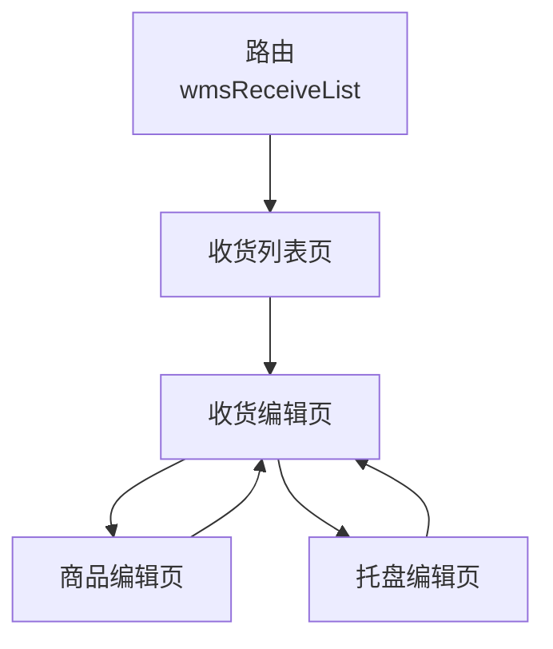
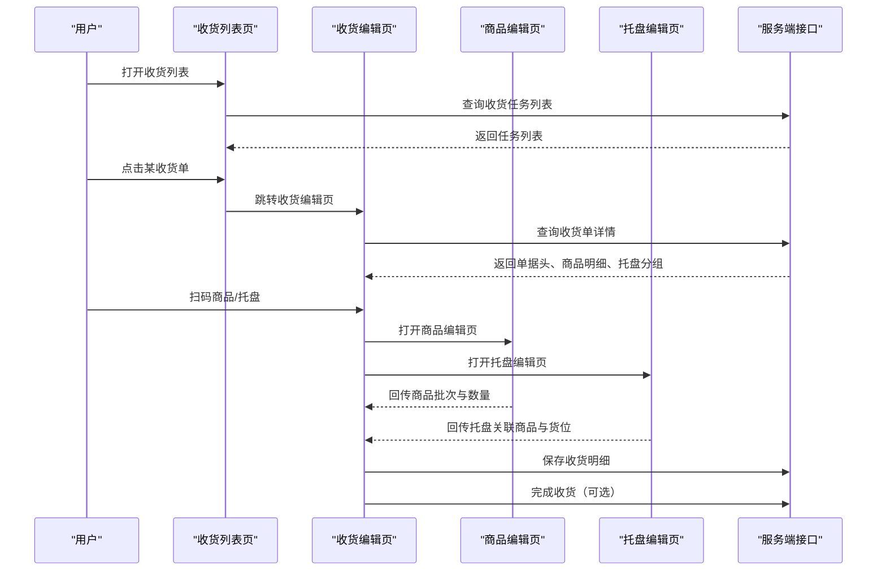
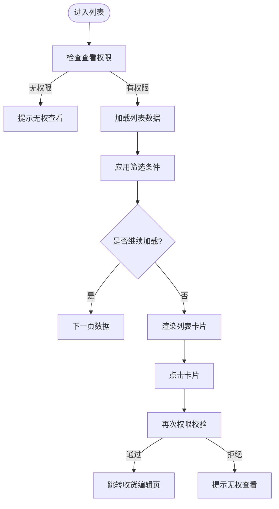
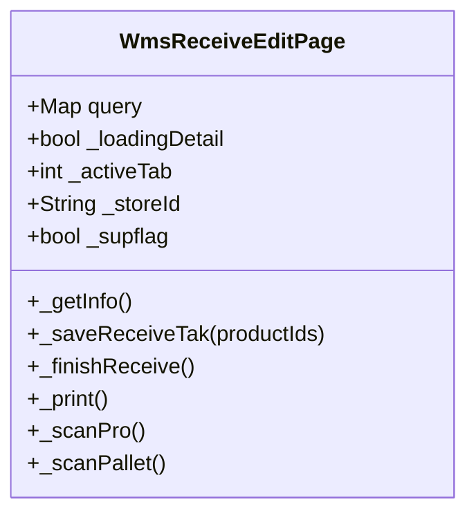
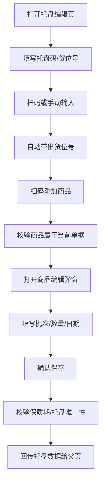
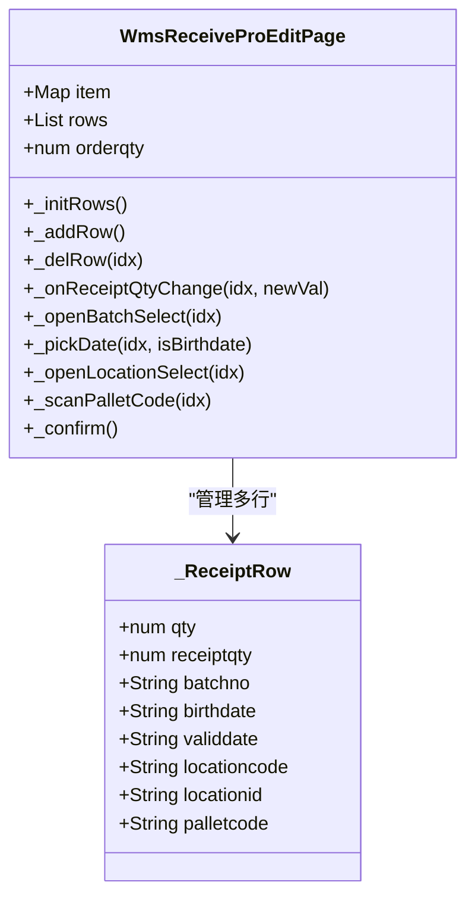
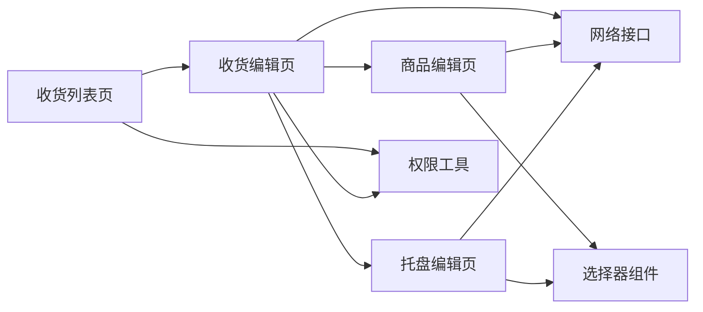

# 收货管理

<cite>
**本文引用的文件**   
- [router.dart](file://lib/pages/business/wms/receive/router.dart)
- [list.dart](file://lib/pages/business/wms/receive/list.dart)
- [edit.dart](file://lib/pages/business/wms/receive/edit.dart)
- [pallet_edit.dart](file://lib/pages/business/wms/receive/pallet_edit.dart)
- [pro_edit.dart](file://lib/pages/business/wms/receive/pro_edit.dart)
</cite>

## 目录
1. [引言](#引言)
2. [项目结构](#项目结构)
3. [核心组件](#核心组件)
4. [架构总览](#架构总览)
5. [详细组件分析](#详细组件分析)
6. [依赖关系分析](#依赖关系分析)
7. [性能考虑](#性能考虑)
8. [异常处理与排查](#异常处理与排查)
9. [结论](#结论)

## 引言
本文面向 WMS 仓储模块的“收货管理”功能，围绕收货订单从到货登记到上架入库的全流程进行说明。重点覆盖以下业务环节：
- 到货登记：通过采购收货单进入收货作业，支持按单号、供应商等条件筛选。
- 质检验收：保质期商品需填写批次号、生产日期与有效日期，系统自动计算有效日期并校验必填项。
- 数量核对：限制每行及合计收货数不超过订货数，防止超额收货。
- 上架入库：托盘码与货位号绑定，批量或逐个商品录入后统一保存并提交完成收货。

同时文档对以下页面进行逐层解析：
- 收货列表页：订单管理与状态跟踪。
- 收货编辑页：单据头信息与明细汇总。
- 托盘编辑页：批量入库操作。
- 商品编辑页：单个商品多批次入库处理。

## 项目结构
WMS 收货模块位于 `lib/pages/business/wms/receive` 下，采用 Flutter 页面+路由的组织方式，核心文件如下：
- `router.dart`：定义收货列表路由。
- `list.dart`：收货任务列表、筛选、分页与卡片展示。
- `edit.dart`：收货主编辑页，包含单据头、商品明细、托盘分组、扫码、保存、完成收货与打印。
- `pallet_edit.dart`：托盘级批量入库编辑，含条码扫描、删除模式、子商品编辑弹窗。
- `pro_edit.dart`：商品级入库编辑，支持多批次行、数量步进器、批次选择、货位与托盘码绑定。

图示来源
- [router.dart:5-17](file://lib/pages/business/wms/receive/router.dart#L5-L17)
- [list.dart:15-40](file://lib/pages/business/wms/receive/list.dart#L15-L40)
- [edit.dart:23-54](file://lib/pages/business/wms/receive/edit.dart#L23-L54)
- [pallet_edit.dart:15-56](file://lib/pages/business/wms/receive/pallet_edit.dart#L15-L56)
- [pro_edit.dart:14-38](file://lib/pages/business/wms/receive/pro_edit.dart#L14-L38)

章节来源
- [router.dart:1-17](file://lib/pages/business/wms/receive/router.dart#L1-L17)
- [list.dart:1-120](file://lib/pages/business/wms/receive/list.dart#L1-L120)
- [edit.dart:1-120](file://lib/pages/business/wms/receive/edit.dart#L1-L120)
- [pallet_edit.dart:1-60](file://lib/pages/business/wms/receive/pallet_edit.dart#L1-L60)
- [pro_edit.dart:1-60](file://lib/pages/business/wms/receive/pro_edit.dart#L1-L60)

## 核心组件
- 收货列表页：提供待收货/已收货 Tab、时间范围筛选、供应商/商品/制单人筛选、分页加载与点击跳转详情。
- 收货编辑页：展示单据信息、商品明细与托盘分组；支持扫码定位商品/托盘；提交明细保存；校验全部收货完成后“完成收货”；支持打印。
- 托盘编辑页：维护托盘码、货位号、关联商品；支持扫码添加当前单据内商品；批量删除；确认时回传完整托盘数据。
- 商品编辑页：维护一个商品的多个收货批次行；支持批次选择、日期选择、货位与托盘码绑定；严格校验数量、重复与一致性。

章节来源
- [list.dart:15-120](file://lib/pages/business/wms/receive/list.dart#L15-L120)
- [edit.dart:23-120](file://lib/pages/business/wms/receive/edit.dart#L23-L120)
- [pallet_edit.dart:15-120](file://lib/pages/business/wms/receive/pallet_edit.dart#L15-L120)
- [pro_edit.dart:14-120](file://lib/pages/business/wms/receive/pro_edit.dart#L14-L120)

## 架构总览
收货管理的控制流由“列表 → 编辑 → 子编辑（商品/托盘）”构成，所有写入最终汇聚至收货编辑页统一保存，并在满足条件后调用完成收货接口。

图示来源
- [list.dart:840-920](file://lib/pages/business/wms/receive/list.dart#L840-L920)
- [edit.dart:240-360](file://lib/pages/business/wms/receive/edit.dart#L240-L360)
- [edit.dart:601-720](file://lib/pages/business/wms/receive/edit.dart#L601-L720)
- [edit.dart:720-780](file://lib/pages/business/wms/receive/edit.dart#L720-L780)
- [pallet_edit.dart:576-740](file://lib/pages/business/wms/receive/pallet_edit.dart#L576-L740)
- [pro_edit.dart:597-680](file://lib/pages/business/wms/receive/pro_edit.dart#L597-L680)

## 详细组件分析

### 收货列表页
职责
- 权限校验：无权限则提示不可查看。
- 筛选：快速时间标签、自定义起止日期、供应商、商品多选、制单人。
- 分页：滚动到底部加载更多，支持下拉刷新。
- 状态：Tab 切换“全部/待收货/已收货”，使用 signflag 控制。
- 导航：点击卡片跳转收货编辑页，并在返回时刷新列表。

关键实现要点
- 列表请求参数包括 page、billno、signflag、sids/sidsname、starttime/endtime 以及供应商、商品、制单人筛选条件。
- 列表卡片显示供应商、单号、制单人、制单时间、收货数/订货数，并按 signflag 与 billreceiptqty 判断状态。
- 点击卡片前再次做权限校验，避免越权访问。

图示来源
- [list.dart:60-120](file://lib/pages/business/wms/receive/list.dart#L60-L120)
- [list.dart:201-500](file://lib/pages/business/wms/receive/list.dart#L201-L500)
- [list.dart:801-920](file://lib/pages/business/wms/receive/list.dart#L801-L920)

章节来源
- [list.dart:15-120](file://lib/pages/business/wms/receive/list.dart#L15-L120)
- [list.dart:201-500](file://lib/pages/business/wms/receive/list.dart#L201-L500)
- [list.dart:801-1065](file://lib/pages/business/wms/receive/list.dart#L801-L1065)

### 收货编辑页
职责
- 加载单据详情：单据头、商品明细、托盘分组、备注。
- 状态计算：根据 signflag 与 receiptqty/billqty 判断“待收货/部分收货/已收货”。
- 扫码入口：商品码与托盘码分别定位到对应编辑页。
- 明细保存：将 detaillist 格式化后提交，保留删除标记 delidlist。
- 完成收货：若所有商品均有收货数且大于 0，则允许提交完成收货。
- 打印：传入菜单 ID 与单据数据执行打印。

关键实现要点
- 详情字段兼容 name/productname、sid/outsid 等多来源字段，保证 bsid 不丢失。
- 多规格商品以 productid + barcode/code 作为唯一规格键，避免串数据。
- 保存时按 productIds 增量提交，减少不必要的数据量。
- 完成收货前校验是否存在未收货商品，成功后返回并刷新列表。

图示来源
- [edit.dart:23-120](file://lib/pages/business/wms/receive/edit.dart#L23-L120)
- [edit.dart:240-360](file://lib/pages/business/wms/receive/edit.dart#L240-L360)
- [edit.dart:360-420](file://lib/pages/business/wms/receive/edit.dart#L360-L420)
- [edit.dart:420-520](file://lib/pages/business/wms/receive/edit.dart#L420-L520)
- [edit.dart:601-780](file://lib/pages/business/wms/receive/edit.dart#L601-L780)
- [edit.dart:901-1000](file://lib/pages/business/wms/receive/edit.dart#L901-L1000)

章节来源
- [edit.dart:1-120](file://lib/pages/business/wms/receive/edit.dart#L1-L120)
- [edit.dart:240-780](file://lib/pages/business/wms/receive/edit.dart#L240-L780)
- [edit.dart:901-1000](file://lib/pages/business/wms/receive/edit.dart#L901-L1000)

### 托盘编辑页
职责
- 维护托盘码与货位号：支持手动输入与扫码；当托盘码变更时自动带出货位号。
- 商品管理：扫码添加当前单据内的商品；支持删除模式勾选删除。
- 子商品编辑：每个商品打开底部弹窗，填写批次、数量、生产日期、有效日期。
- 校验与回传：校验托盘码、保质期必填、托盘码与货位唯一性，确认后回传完整 items 给父页。

关键实现要点
- 扫码添加商品前先查询商品，再校验该商品属于当前收货单。
- 同一托盘码不能关联不同货位号，全局与页面内均校验。
- 新增未完成项在取消编辑时自动清理。

图示来源
- [pallet_edit.dart:60-120](file://lib/pages/business/wms/receive/pallet_edit.dart#L60-L120)
- [pallet_edit.dart:120-220](file://lib/pages/business/wms/receive/pallet_edit.dart#L120-L220)
- [pallet_edit.dart:220-300](file://lib/pages/business/wms/receive/pallet_edit.dart#L220-L300)
- [pallet_edit.dart:576-740](file://lib/pages/business/wms/receive/pallet_edit.dart#L576-L740)
- [pallet_edit.dart:740-900](file://lib/pages/business/wms/receive/pallet_edit.dart#L740-L900)

章节来源
- [pallet_edit.dart:1-120](file://lib/pages/business/wms/receive/pallet_edit.dart#L1-L120)
- [pallet_edit.dart:201-300](file://lib/pages/business/wms/receive/pallet_edit.dart#L201-L300)
- [pallet_edit.dart:576-900](file://lib/pages/business/wms/receive/pallet_edit.dart#L576-L900)

### 商品编辑页
职责
- 初始化收货行：优先使用 batchlist，否则生成一行；继承上一行的批次与货位信息。
- 数量控制：每行收货数受限于剩余可收数量，合计不能超过订货数。
- 批次与日期：支持选择批次并回填生产日期/有效日期；保质期商品自动计算有效日期。
- 货位与托盘：支持选择货位号与扫码/手动输入托盘码，并自动带出货位号。
- 校验与回传：校验托盘码必填、生产日期必填、批次必填、收货总数限制、重复行、托盘与货位一致性。

关键实现要点
- 多规格商品通过 productid + barcode/code 精准匹配，避免串规格。
- 自定义步进器 `_Stepper` 支持手动输入与加减，失焦/回车时统一格式并触发更新。
- 回传数据包含 barcode/code/size/unit 与 batchlist，供父页精确合并。

图示来源
- [pro_edit.dart:14-120](file://lib/pages/business/wms/receive/pro_edit.dart#L14-L120)
- [pro_edit.dart:201-360](file://lib/pages/business/wms/receive/pro_edit.dart#L201-L360)
- [pro_edit.dart:360-520](file://lib/pages/business/wms/receive/pro_edit.dart#L360-L520)
- [pro_edit.dart:597-680](file://lib/pages/business/wms/receive/pro_edit.dart#L597-L680)
- [pro_edit.dart:680-1020](file://lib/pages/business/wms/receive/pro_edit.dart#L680-L1020)

章节来源
- [pro_edit.dart:1-120](file://lib/pages/business/wms/receive/pro_edit.dart#L1-L120)
- [pro_edit.dart:201-520](file://lib/pages/business/wms/receive/pro_edit.dart#L201-L520)
- [pro_edit.dart:597-1020](file://lib/pages/business/wms/receive/pro_edit.dart#L597-L1020)

## 依赖关系分析
- 页面间依赖：
  - 列表页依赖编辑页用于查看详情与后续操作。
  - 编辑页依赖商品编辑页与托盘编辑页完成明细与批量入库。
- 外部能力依赖：
  - 扫码：通过通用二维码扫描页获取条码。
  - 选择器：批次、货位、供应商、商品、制单人等选择器组件。
  - 网络：HTTP API 用于列表、详情、保存、完成收货与打印。
  - 权限：基于权限码控制查看、操作与打印。

图示来源
- [list.dart:15-40](file://lib/pages/business/wms/receive/list.dart#L15-L40)
- [edit.dart:23-54](file://lib/pages/business/wms/receive/edit.dart#L23-L54)
- [pallet_edit.dart:15-56](file://lib/pages/business/wms/receive/pallet_edit.dart#L15-L56)
- [pro_edit.dart:14-38](file://lib/pages/business/wms/receive/pro_edit.dart#L14-L38)

章节来源
- [list.dart:15-120](file://lib/pages/business/wms/receive/list.dart#L15-L120)
- [edit.dart:23-120](file://lib/pages/business/wms/receive/edit.dart#L23-L120)
- [pallet_edit.dart:15-120](file://lib/pages/business/wms/receive/pallet_edit.dart#L15-L120)
- [pro_edit.dart:14-120](file://lib/pages/business/wms/receive/pro_edit.dart#L14-L120)

## 性能考虑
- 列表分页与滚动：
  - 使用滚动监听在接近底部时加载下一页，避免一次性加载过多数据。
  - 下拉刷新重置页码与列表，确保筛选变更后数据正确。
- 界面渲染优化：
  - 列表与详情页使用 `cacheExtent` 提升长列表滑动流畅度。
  - 使用 `RepaintBoundary` 包裹卡片，减少不必要的重绘。
- 数据同步优化：
  - 保存时使用指定 productIds 增量提交，减少 payload 大小。
  - 多规格商品通过规格键精准匹配，避免全表扫描导致的性能问题。
- 扫码与选择器：
  - 扫码结果先本地空值校验，再进行网络查询，减少无效请求。
  - 选择器仅在必要时弹出，降低交互开销。

[本节为通用性能建议，不直接分析具体代码文件]

## 异常处理与排查
常见问题与处理方式
- 权限不足：
  - 列表查看、完成收货、打印等操作均需权限校验；无权限时提示用户在后台修改权限。
- 数据缺失：
  - 仓库信息缺失时提示刷新页面重试，避免因 bsid 为空导致保存失败。
- 扫码无效：
  - 扫码结果为空或商品不在当前单据时，给出明确提示，引导重新扫描。
- 校验失败：
  - 保质期商品批次号/生产日期必填。
  - 托盘码与货位号冲突或重复。
  - 收货数超过订货数或存在收货数为 0 的行。
  - 重复收货行（批次+货位+托盘码相同）。
- 保存与完成收货：
  - 保存成功后移除已提交的删除标记，并刷新详情。
  - 完成收货前检查是否有待收货商品，成功后返回并刷新列表。

章节来源
- [list.dart:60-120](file://lib/pages/business/wms/receive/list.dart#L60-L120)
- [list.dart:840-920](file://lib/pages/business/wms/receive/list.dart#L840-L920)
- [edit.dart:240-360](file://lib/pages/business/wms/receive/edit.dart#L240-L360)
- [edit.dart:601-780](file://lib/pages/business/wms/receive/edit.dart#L601-L780)
- [pallet_edit.dart:220-300](file://lib/pages/business/wms/receive/pallet_edit.dart#L220-L300)
- [pallet_edit.dart:740-900](file://lib/pages/business/wms/receive/pallet_edit.dart#L740-L900)
- [pro_edit.dart:360-520](file://lib/pages/business/wms/receive/pro_edit.dart#L360-L520)
- [pro_edit.dart:597-680](file://lib/pages/business/wms/receive/pro_edit.dart#L597-L680)

## 结论
本收货管理模块通过清晰的页面分层与严格的表单校验，实现了从到货登记到上架入库的完整闭环。其特点包括：
- 以采购收货单为中心，串联商品与托盘两个维度的入库操作。
- 以条码扫描为核心输入方式，提高作业效率与准确性。
- 以保质期管理为抓手，强化批次与有效期管控。
- 以权限控制与异常提示为保障，确保作业合规与用户体验。

在实际使用中，建议遵循以下标准操作流程：
- 先在收货列表筛选并打开目标收货单。
- 在商品明细或托盘分组中逐项录入批次、数量、货位与托盘码。
- 完成所有商品收货后再执行“完成收货”。
- 如需打印，使用打印按钮输出收货凭证。

[本节为总结性内容，不直接分析具体代码文件]