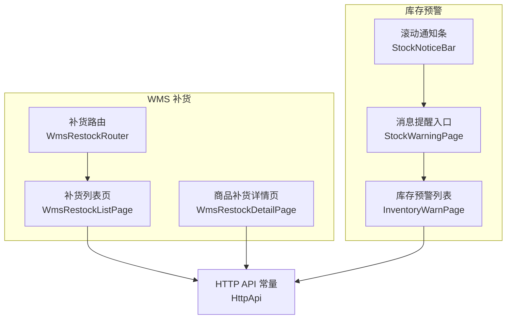
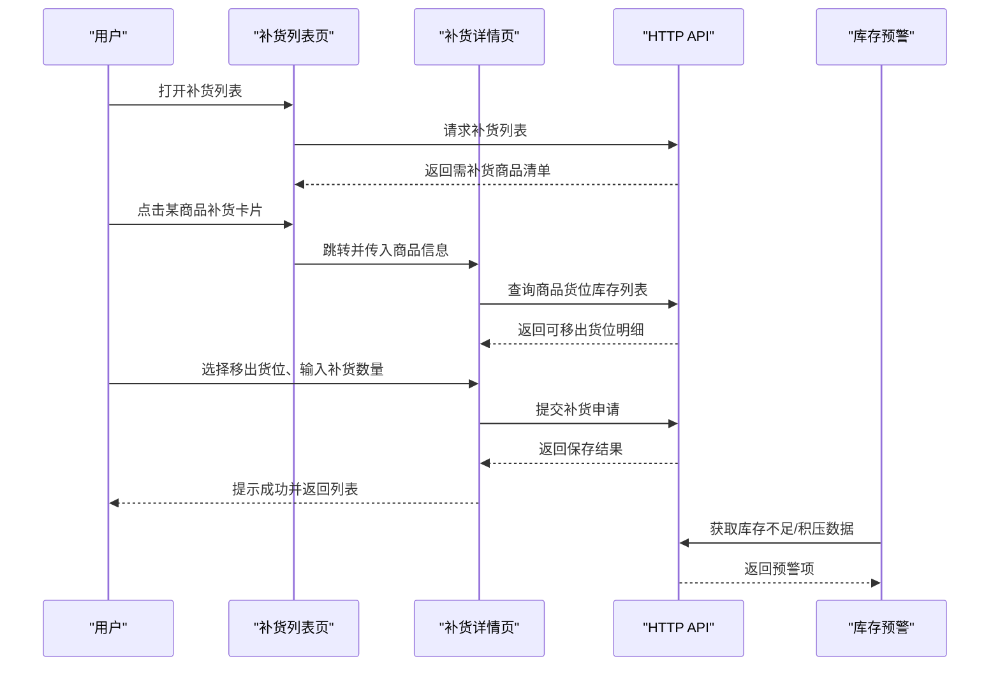
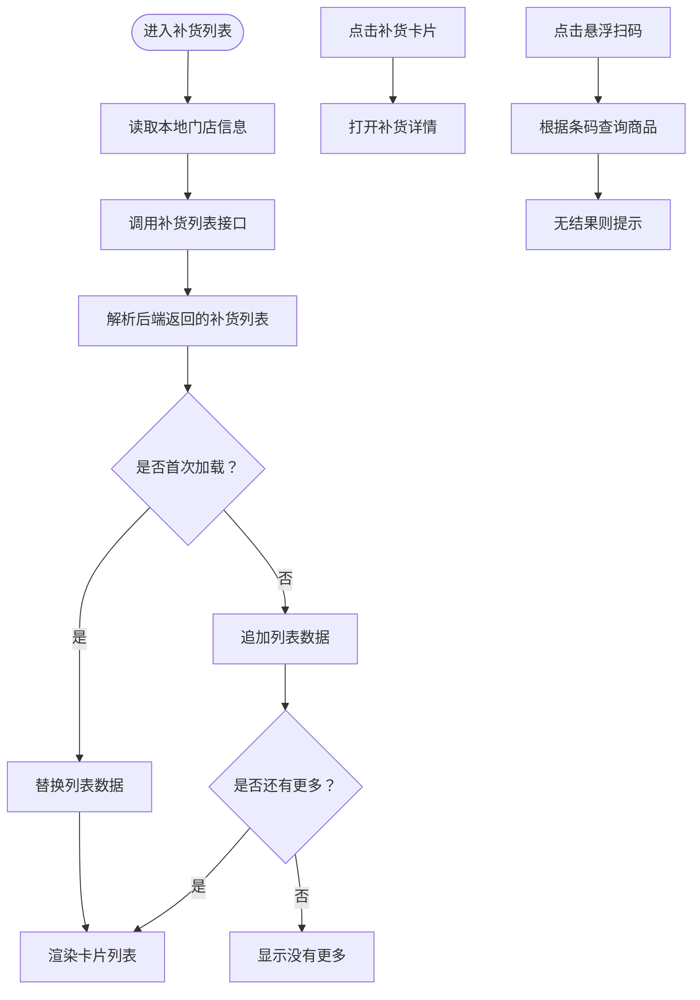
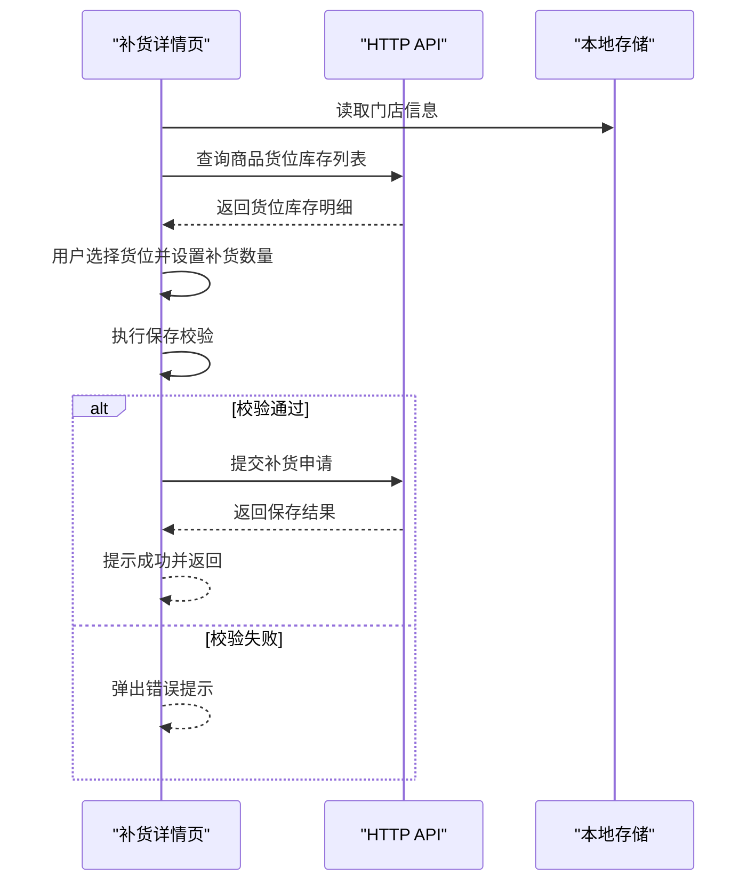
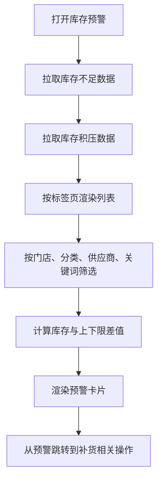
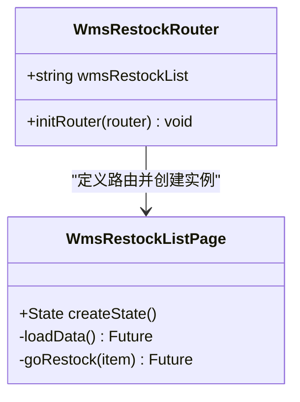
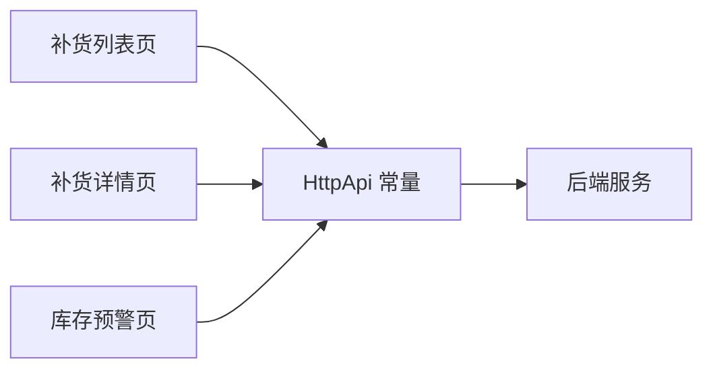

# 补货管理

<cite>
**本文引用的文件**   
- [lib/pages/business/wms/restock/list.dart](file://lib/pages/business/wms/restock/list.dart)
- [lib/pages/business/wms/restock/detail.dart](file://lib/pages/business/wms/restock/detail.dart)
- [lib/pages/business/wms/restock/router.dart](file://lib/pages/business/wms/restock/router.dart)
- [lib/net/http_api.dart](file://lib/net/http_api.dart)
- [lib/pages/data/inventory/inventoryWarn/inventory_warn_page.dart](file://lib/pages/data/inventory/inventoryWarn/inventory_warn_page.dart)
- [lib/pages/home/custom/stock_warning_page.dart](file://lib/pages/home/custom/stock_warning_page.dart)
- [lib/pages/home/widgets/stock_notice_bar.dart](file://lib/pages/home/widgets/stock_notice_bar.dart)
</cite>

## 目录
1. [引言](#引言)
2. [项目结构定位](#项目结构定位)
3. [核心组件](#核心组件)
4. [架构总览](#架构总览)
5. [详细组件分析](#详细组件分析)
6. [依赖关系分析](#依赖关系分析)
7. [性能与可用性考量](#性能与可用性考量)
8. [排错指南](#排错指南)
9. [结论](#结论)
10. [附录：补货优化与库存周转建议](#附录补货优化与库存周转建议)

## 引言
本文件围绕 WMS 仓储模块的“补货管理”功能，梳理现有前端实现中涉及的自动补货数据展示、手动补货申请流程、库存预警联动和页面交互。需要特别说明的是：仓库内未发现后端补货算法或策略配置代码；补货需求数量、安全库存上限、最大库存等关键数据由服务端接口返回，客户端主要负责筛选、展示、校验与提交。因此，本文对“自动补货算法”的描述以“客户端如何消费后端补货数据”为准，不臆造未实现的计算逻辑。

## 项目结构定位
补货相关的前端实现集中在 WMS 子模块下，并与库存预警模块形成上下游联动：

图示来源
- [lib/pages/business/wms/restock/router.dart:1-17](file://lib/pages/business/wms/restock/router.dart#L1-L17)
- [lib/pages/business/wms/restock/list.dart:1-475](file://lib/pages/business/wms/restock/list.dart#L1-L475)
- [lib/pages/business/wms/restock/detail.dart:1-571](file://lib/pages/business/wms/restock/detail.dart#L1-L571)
- [lib/pages/data/inventory/inventoryWarn/inventory_warn_page.dart:1-438](file://lib/pages/data/inventory/inventoryWarn/inventory_warn_page.dart#L1-L438)
- [lib/pages/home/custom/stock_warning_page.dart:1-213](file://lib/pages/home/custom/stock_warning_page.dart#L1-L213)
- [lib/pages/home/widgets/stock_notice_bar.dart:1-92](file://lib/pages/home/widgets/stock_notice_bar.dart#L1-L92)
- [lib/net/http_api.dart:214-217](file://lib/net/http_api.dart#L214-L217)
- [lib/net/http_api.dart:334-335](file://lib/net/http_api.dart#L334-L335)

章节来源
- [lib/pages/business/wms/restock/router.dart:1-17](file://lib/pages/business/wms/restock/router.dart#L1-L17)

## 核心组件
- 补货列表页：负责按拣货位、商品维度拉取补货任务，分页加载并支持扫码快速查询。
- 补货详情页：展示商品信息、待补货数、可移出货位库存明细，完成补货数量选择与保存。
- 库存预警模块：提供库存不足、库存积压等预警列表，是自动补货需求的重要数据来源之一。
- HTTP API 常量：集中定义补货列表、补货保存、库存预警等后端接口路径。

章节来源
- [lib/pages/business/wms/restock/list.dart:1-475](file://lib/pages/business/wms/restock/list.dart#L1-L475)
- [lib/pages/business/wms/restock/detail.dart:1-571](file://lib/pages/business/wms/restock/detail.dart#L1-L571)
- [lib/pages/data/inventory/inventoryWarn/inventory_warn_page.dart:1-438](file://lib/pages/data/inventory/inventoryWarn/inventory_warn_page.dart#L1-L438)
- [lib/net/http_api.dart:214-217](file://lib/net/http_api.dart#L214-L217)
- [lib/net/http_api.dart:334-335](file://lib/net/http_api.dart#L334-L335)

## 架构总览
补货管理的端到端流程如下：

图示来源
- [lib/pages/business/wms/restock/list.dart:80-115](file://lib/pages/business/wms/restock/list.dart#L80-L115)
- [lib/pages/business/wms/restock/detail.dart:60-85](file://lib/pages/business/wms/restock/detail.dart#L60-L85)
- [lib/pages/business/wms/restock/detail.dart:120-170](file://lib/pages/business/wms/restock/detail.dart#L120-L170)
- [lib/pages/data/inventory/inventoryWarn/inventory_warn_page.dart:30-45](file://lib/pages/data/inventory/inventoryWarn/inventory_warn_page.dart#L30-L45)

## 详细组件分析

### 补货列表页
补货列表页承担以下职责：
- 从本地存储读取当前门店标识，作为补货范围过滤条件。
- 提供拣货位与商品两个筛选条件，筛选后重新拉取数据。
- 分页加载补货任务，兼容后端返回结构中 list 为数组或嵌套数组两种情况。
- 悬浮扫码按钮支持通过条码反查商品，为空时给出提示。
- 点击补货卡片进入补货详情页，返回后刷新列表。

关键行为说明：
- 列表请求参数包含分页、门店、拣货位、商品等过滤字段，确保只拉取当前业务范围内的补货任务。
- 列表项卡片展示商品名称规格、条码、库存、拣货位、最大储存量及补货数。
- 下拉刷新与滚动加载更多共同维护 `_list`、`_page`、`_hasMore` 状态。

图示来源
- [lib/pages/business/wms/restock/list.dart:28-60](file://lib/pages/business/wms/restock/list.dart#L28-L60)
- [lib/pages/business/wms/restock/list.dart:60-115](file://lib/pages/business/wms/restock/list.dart#L60-L115)
- [lib/pages/business/wms/restock/list.dart:201-310](file://lib/pages/business/wms/restock/list.dart#L201-L310)
- [lib/pages/business/wms/restock/list.dart:310-475](file://lib/pages/business/wms/restock/list.dart#L310-L475)

章节来源
- [lib/pages/business/wms/restock/list.dart:1-475](file://lib/pages/business/wms/restock/list.dart#L1-L475)

### 补货详情页
补货详情页用于执行一次具体的补货操作，核心流程包括：
- 展示商品信息，包括库存、最大储存量、拣货位、最后上架时间等。
- 展示待补货数，并提供补货数量步进器与手动输入框。
- 加载商品在当前门店下的货位库存明细，供用户选择“移出货位”。
- 保存前进行多重校验：必须选择货位、补货数量大于 0、不超过移出货位可用库存、不超过待补货数。
- 提交补货申请，成功后返回上一页并刷新列表。

图示来源
- [lib/pages/business/wms/restock/detail.dart:20-45](file://lib/pages/business/wms/restock/detail.dart#L20-L45)
- [lib/pages/business/wms/restock/detail.dart:60-85](file://lib/pages/business/wms/restock/detail.dart#L60-L85)
- [lib/pages/business/wms/restock/detail.dart:120-170](file://lib/pages/business/wms/restock/detail.dart#L120-L170)

章节来源
- [lib/pages/business/wms/restock/detail.dart:1-571](file://lib/pages/business/wms/restock/detail.dart#L1-L571)

### 库存预警与补货联动
库存预警模块负责展示“库存不足”和“库存积压”两类预警，并为补货需求提供数据依据：
- 库存不足对应“库存下限”低于当前库存差值。
- 库存积压对应“库存上限”被超过。
- 首页消息提醒聚合多种预警类型，其中“库存不足”会跳转到库存预警列表。
- 滚动通知条用于在首页区域滚动展示库存相关提醒，点击可进入消息提醒页面。

图示来源
- [lib/pages/data/inventory/inventoryWarn/inventory_warn_page.dart:15-45](file://lib/pages/data/inventory/inventoryWarn/inventory_warn_page.dart#L15-L45)
- [lib/pages/data/inventory/inventoryWarn/inventory_warn_page.dart:201-438](file://lib/pages/data/inventory/inventoryWarn/inventory_warn_page.dart#L201-L438)
- [lib/pages/home/custom/stock_warning_page.dart:10-80](file://lib/pages/home/custom/stock_warning_page.dart#L10-L80)
- [lib/pages/home/widgets/stock_notice_bar.dart:10-92](file://lib/pages/home/widgets/stock_notice_bar.dart#L10-L92)

章节来源
- [lib/pages/data/inventory/inventoryWarn/inventory_warn_page.dart:1-438](file://lib/pages/data/inventory/inventoryWarn/inventory_warn_page.dart#L1-L438)
- [lib/pages/home/custom/stock_warning_page.dart:1-213](file://lib/pages/home/custom/stock_warning_page.dart#L1-L213)
- [lib/pages/home/widgets/stock_notice_bar.dart:1-92](file://lib/pages/home/widgets/stock_notice_bar.dart#L1-L92)

### 路由与入口
补货模块通过 Fluro 路由注册补货列表入口，便于从 WMS 主菜单或其他页面导航进入：

图示来源
- [lib/pages/business/wms/restock/router.dart:1-17](file://lib/pages/business/wms/restock/router.dart#L1-L17)
- [lib/pages/business/wms/restock/list.dart:1-30](file://lib/pages/business/wms/restock/list.dart#L1-L30)

章节来源
- [lib/pages/business/wms/restock/router.dart:1-17](file://lib/pages/business/wms/restock/router.dart#L1-L17)

## 依赖关系分析
补货管理与库存预警都依赖统一的 HTTP API 常量，避免硬编码接口地址：

图示来源
- [lib/pages/business/wms/restock/list.dart:80-115](file://lib/pages/business/wms/restock/list.dart#L80-L115)
- [lib/pages/business/wms/restock/detail.dart:60-85](file://lib/pages/business/wms/restock/detail.dart#L60-L85)
- [lib/pages/data/inventory/inventoryWarn/inventory_warn_page.dart:30-45](file://lib/pages/data/inventory/inventoryWarn/inventory_warn_page.dart#L30-L45)
- [lib/net/http_api.dart:214-217](file://lib/net/http_api.dart#L214-L217)
- [lib/net/http_api.dart:334-335](file://lib/net/http_api.dart#L334-L335)

章节来源
- [lib/net/http_api.dart:214-217](file://lib/net/http_api.dart#L214-L217)
- [lib/net/http_api.dart:334-335](file://lib/net/http_api.dart#L334-L335)

## 性能与可用性考量
- 分页与滚动加载：补货列表和库存预警均采用分页加载，避免一次性拉取大量数据造成卡顿。
- 列表渲染优化：使用 `cacheExtent`、`RepaintBoundary` 减少不必要的重绘。
- 空态与加载中状态：列表为空、加载中、没有更多数据均有明确 UI 反馈，提升用户体验。
- 防抖搜索：库存预警页对关键词输入做防抖处理，减少频繁刷新。
- 移动端交互：补货详情页采用底部固定操作栏，方便单手操作。

[本节为通用性能建议，不直接分析具体代码行]

## 排错指南
常见问题与处理思路：
- 补货列表无数据：检查是否选择了正确的拣货位或商品；确认本地门店信息是否已正确写入；查看后端接口返回是否为空。
- 扫码无法找到商品：确认扫描条码是否正确，后端是否返回匹配商品。
- 补货保存失败：检查是否选择了移出货位；补货数量是否为正数；是否超过移出货位可用库存；是否超过待补货数。
- 库存预警不更新：确认网络请求是否成功；检查筛选条件是否过严；核对后端返回的预警类型是否在白名单内。

章节来源
- [lib/pages/business/wms/restock/list.dart:201-260](file://lib/pages/business/wms/restock/list.dart#L201-L260)
- [lib/pages/business/wms/restock/detail.dart:120-170](file://lib/pages/business/wms/restock/detail.dart#L120-L170)
- [lib/pages/home/custom/stock_warning_page.dart:20-80](file://lib/pages/home/custom/stock_warning_page.dart#L20-L80)

## 结论
当前 WMS 补货管理在前端实现了补货任务展示、补货详情编辑与保存、以及库存预警数据的展示与联动。自动补货的核心计算（如安全库存阈值、补货需求生成）位于后端，客户端负责消费这些结果并引导用户完成补货申请。若希望进一步自动化，可在后端补充补货策略引擎，并在前端增加补货计划制定、执行跟踪与供应商协同能力。

[本节为总结性内容，不直接分析具体代码行]

## 附录：补货优化与库存周转建议
由于后端补货算法未在仓库中出现，以下建议基于现有数据结构与业务流程提出，供产品与后端团队参考：

- 安全库存与补货触发：
  - 结合库存预警中的“库存下限”，当实时库存低于安全库存时自动生成补货需求。
  - 将“最大储存量”作为单次补货数量的上限，避免超储。
- 补货需求生成：
  - 基于历史销量、到货周期、促销计划等因素，动态调整补货数量。
  - 合并相同供应商或相同仓库的补货需求，降低采购与物流成本。
- 供应商选择机制：
  - 优先选择有供货协议、价格优势且交期稳定的供应商。
  - 引入供应商评分与缺货率指标，辅助系统自动分配订单。
- 补货计划与执行跟踪：
  - 将补货申请转化为补货计划单，跟踪审批、下单、到货、入库各节点。
  - 在补货详情页增加执行进度展示，例如“已申请/已审批/已发货/已入库”。
- 库存周转率提升：
  - 对滞销品设定更低的安全库存，对畅销品提高补货频率。
  - 定期清理长期不动销商品，减少无效库存占用。
- 与库存预警联动：
  - 将库存不足预警直接关联到补货申请入口，缩短响应时间。
  - 对库存积压预警提供一键转促销或调拨的建议动作。

[本节为概念性建议，不涉及具体源码实现]