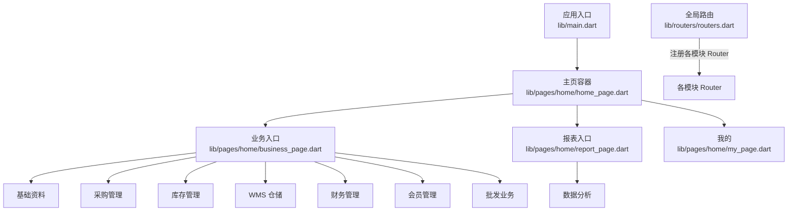
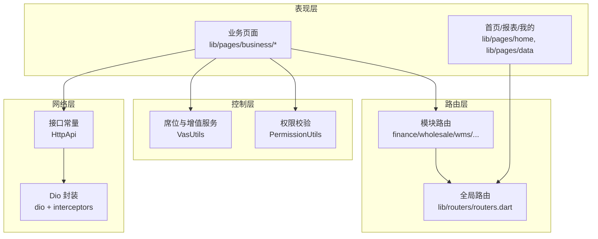
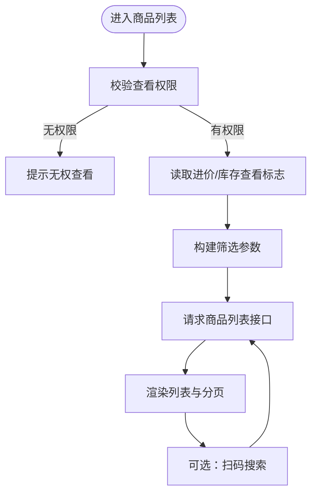
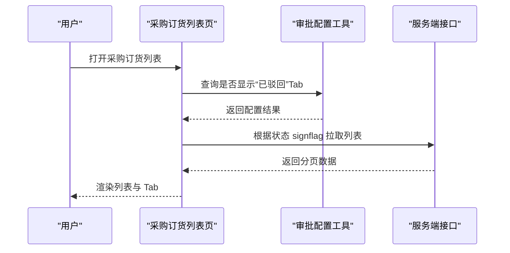
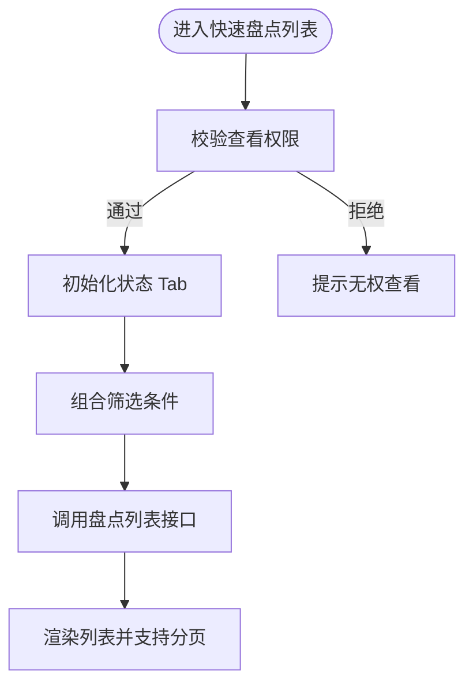
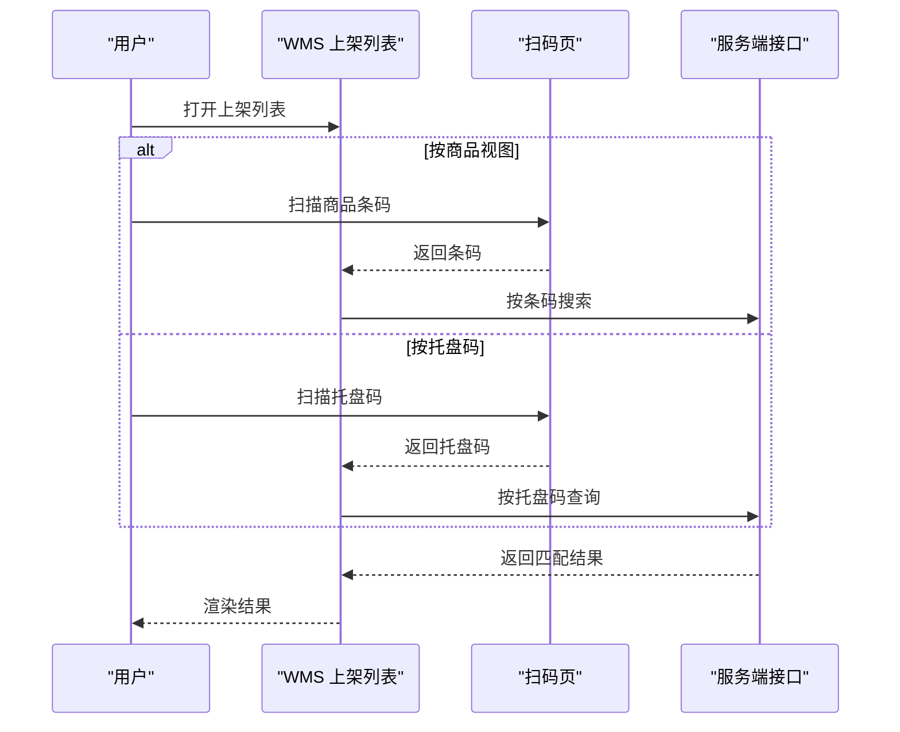
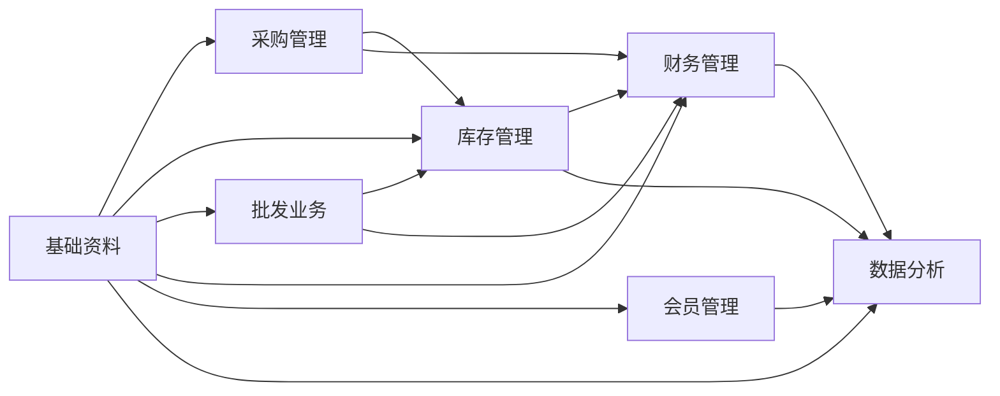
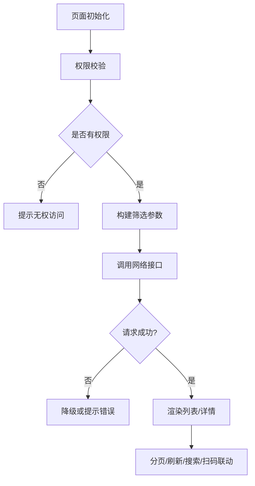

# 业务模块

<cite>
**本文引用的文件**   
- [lib/main.dart](file://lib/main.dart)
- [pubspec.yaml](file://pubspec.yaml)
- [README.md](file://README.md)
- [lib/pages/home/home_page.dart](file://lib/pages/home/home_page.dart)
- [lib/pages/home/business_page.dart](file://lib/pages/home/business_page.dart)
- [lib/routers/routers.dart](file://lib/routers/routers.dart)
- [lib/pages/business/basis/commodity/list.dart](file://lib/pages/business/basis/commodity/list.dart)
- [lib/pages/business/purchase/cgorder/list.dart](file://lib/pages/business/purchase/cgorder/list.dart)
- [lib/pages/business/inventory/quickcheck/list.dart](file://lib/pages/business/inventory/quickcheck/list.dart)
- [lib/pages/business/wms/launch/list.dart](file://lib/pages/business/wms/launch/list.dart)
- [lib/pages/business/finance/router.dart](file://lib/pages/business/finance/router.dart)
- [lib/pages/business/wholesale/router.dart](file://lib/pages/business/wholesale/router.dart)
- [lib/pages/data/businessReport/businessAnalysis/business_analysis_router.dart](file://lib/pages/data/businessReport/businessAnalysis/business_analysis_router.dart)
</cite>

## 目录
1. [引言](#引言)
2. [项目结构](#项目结构)
3. [核心组件](#核心组件)
4. [架构总览](#架构总览)
5. [详细模块分析](#详细模块分析)
6. [依赖与数据流分析](#依赖与数据流分析)
7. [性能与可维护性](#性能与可维护性)
8. [排错指南](#排错指南)
9. [结论](#结论)
10. [附录：模块选择与扩展指南](#附录模块选择与扩展指南)

## 引言
本文件面向灵犀管店 Flutter 项目的业务模块，目标是在不深入具体实现细节的前提下，帮助开发者快速理解八大业务域的整体架构、模块关系、数据流转与流程衔接点。这些业务域包括：基础资料、采购管理、库存管理、WMS 仓储、财务管理、会员管理、批发业务、数据分析。文档同时提供业务流程图、模块交互图以及模块选择与扩展方法，便于进行业务分析与功能开发。

## 项目结构
仓库采用 Flutter 工程结构，业务页面集中在 `lib/pages` 下，按“首页、业务、报表、我的”四大 Tab 组织；路由统一由 Fluro 管理，每个业务模块自注册路由器；网络层基于 Dio 封装，权限、席位与增值服务控制入口可见性与功能可用范围。

图表来源
- [lib/main.dart:1-204](file://lib/main.dart#L1-L204)
- [lib/pages/home/home_page.dart:1-184](file://lib/pages/home/home_page.dart#L1-L184)
- [lib/pages/home/business_page.dart:1-200](file://lib/pages/home/business_page.dart#L1-L200)
- [lib/routers/routers.dart:1-176](file://lib/routers/routers.dart#L1-L176)

章节来源
- [lib/main.dart:1-204](file://lib/main.dart#L1-L204)
- [pubspec.yaml:1-153](file://pubspec.yaml#L1-L153)
- [README.md:1-210](file://README.md#L1-L210)

## 核心组件
- 应用启动与主题初始化：在应用入口中完成日志、推送、Dio 拦截器、路由初始化，并判断登录态决定首页是登录页还是主应用。
- 主页容器：提供四个底部 Tab（首页、业务、报表、我的），负责切换时刷新权限与版本信息。
- 业务入口：聚合所有业务模块入口卡片，根据权限、席位与增值服务（如 WMS）控制可见性。
- 路由中心：集中注册各模块的 Fluro 路由器，模块内部再定义各自子路由。

章节来源
- [lib/main.dart:1-204](file://lib/main.dart#L1-L204)
- [lib/pages/home/home_page.dart:1-184](file://lib/pages/home/home_page.dart#L1-L184)
- [lib/pages/home/business_page.dart:1-200](file://lib/pages/home/business_page.dart#L1-L200)
- [lib/routers/routers.dart:1-176](file://lib/routers/routers.dart#L1-L176)

## 架构总览
从整体看，应用采用“Tab 容器 + 业务模块 + 统一路由 + 统一网络”的分层模式：
- 表现层：以页面 Widget 为主，列表页普遍具备分页、搜索、筛选、扫码等能力。
- 路由层：Fluro 统一管理，各模块实现 IRouterProvider 自注册。
- 服务层：通过 Dio 封装发起 HTTP 请求，返回结构化数据供 UI 消费。
- 权限与版本控制：通过权限码、席位信息与增值服务开关控制菜单可见性和功能可用性。

图表来源
- [lib/routers/routers.dart:1-176](file://lib/routers/routers.dart#L1-L176)
- [lib/pages/business/finance/router.dart:1-48](file://lib/pages/business/finance/router.dart#L1-L48)
- [lib/pages/business/wholesale/router.dart:1-54](file://lib/pages/business/wholesale/router.dart#L1-L54)
- [lib/pages/home/business_page.dart:1-200](file://lib/pages/home/business_page.dart#L1-L200)

## 详细模块分析

### 基础资料
- 职责：维护商品分类、商品档案、价格策略、打印模板等基础数据，为其他业务模块提供主数据支撑。
- 典型页面：商品列表、分类管理等。
- 关键行为：
  - 列表支持分页、搜索、扫码、多条件筛选。
  - 使用权限码控制查看与编辑权限。
  - 读取本地用户信息中的进价/库存查看标志位，影响展示字段。

图表来源
- [lib/pages/business/basis/commodity/list.dart:1-200](file://lib/pages/business/basis/commodity/list.dart#L1-L200)

章节来源
- [lib/pages/business/basis/commodity/list.dart:1-200](file://lib/pages/business/basis/commodity/list.dart#L1-L200)

### 采购管理
- 职责：覆盖采购订单、计划、入库、退货、暂收、其他出入库等采购全流程。
- 典型页面：采购订货单列表、采购入库列表等。
- 关键行为：
  - 列表支持按状态分 Tab（全部、待审核、已审核、已驳回）。
  - “已驳回”Tab 动态显示，依据审批配置决定。
  - 结合门店、供应商、采购员等维度筛选，并支持时间范围查询。

图表来源
- [lib/pages/business/purchase/cgorder/list.dart:1-200](file://lib/pages/business/purchase/cgorder/list.dart#L1-L200)

章节来源
- [lib/pages/business/purchase/cgorder/list.dart:1-200](file://lib/pages/business/purchase/cgorder/list.dart#L1-L200)

### 库存管理
- 职责：处理盘点、移动、其他出入库、成本调整、库存查询等库存变动与查询。
- 典型页面：快速盘点、移动仓、其他出入库、成本调整等。
- 关键行为：
  - 列表页通常具备状态 Tab、时间范围、门店筛选、创建人筛选。
  - 支持扫码、分页加载、下拉刷新。
  - 通过权限码控制查看与操作。

图表来源
- [lib/pages/business/inventory/quickcheck/list.dart:1-200](file://lib/pages/business/inventory/quickcheck/list.dart#L1-L200)

章节来源
- [lib/pages/business/inventory/quickcheck/list.dart:1-200](file://lib/pages/business/inventory/quickcheck/list.dart#L1-L200)

### WMS 仓储
- 职责：提供仓储作业相关的上架、收货、补货、库存查询、WMS 设置等功能。
- 典型页面：上架列表、收货列表、补货列表、库存查询等。
- 关键行为：
  - 上架列表支持按单据与按商品两个视图。
  - 支持托盘码扫描、条码搜索、门店过滤。
  - 入口受增值服务开关（verid 711）与门店类型限制。

图表来源
- [lib/pages/business/wms/launch/list.dart:1-200](file://lib/pages/business/wms/launch/list.dart#L1-L200)

章节来源
- [lib/pages/business/wms/launch/list.dart:1-200](file://lib/pages/business/wms/launch/list.dart#L1-L200)

### 财务管理
- 职责：管理供应商付款、客户收款、门店收款、成本收入等业务财务单据。
- 典型页面：供应商付款、客户收款、门店收款、成本收入等列表与编辑页。
- 路由组织：FinanceRouter 定义统一的财务路由集合，便于跨模块跳转与参数传递。

章节来源
- [lib/pages/business/finance/router.dart:1-48](file://lib/pages/business/finance/router.dart#L1-L48)

### 会员管理
- 职责：包含会员账户、提现、银行卡、城市选择、会员等级、积分、充值、VIP 支付等。
- 路由组织：AccountRouter 管理会员相关路由，Withdrawal 系列页面提供完整的提现流程。

章节来源
- [lib/pages/business/member/account_router.dart:1-49](file://lib/pages/business/member/account_router.dart#L1-L49)

### 批发业务
- 职责：覆盖批发客户管理、批发订单、销售、退货及汇总统计。
- 典型页面：批发订单列表/编辑/搜索、销售列表/编辑/搜索、退货列表/编辑/搜索、订单汇总、收款汇总等。
- 路由组织：WholesaleRouter 统一暴露批发模块路由，便于跨模块导航。

章节来源
- [lib/pages/business/wholesale/router.dart:1-54](file://lib/pages/business/wholesale/router.dart#L1-L54)

### 数据分析
- 职责：提供经营分析、现金流、现金统计、收银监控、异常监控、ABC 分析、销售率分析等数据报表。
- 典型页面：BusinessAnalysisPage 及其子分析页（零售、库存、批发、会员、渠道、采购、毛利、业绩、商品等）。
- 路由组织：BusinessAnalysisRouter 将各类分析页注册到全局路由。

章节来源
- [lib/pages/data/businessReport/businessAnalysis/business_analysis_router.dart:1-39](file://lib/pages/data/businessReport/businessAnalysis/business_analysis_router.dart#L1-L39)

## 依赖与数据流分析

### 模块间依赖关系
- 基础资料被采购、库存、WMS、批发、财务、会员、数据分析等多个模块引用，作为主数据源。
- 采购、批发、库存共同影响库存数量与成本，最终体现在财务与数据分析模块。
- WMS 与库存、采购、批发存在协同作业关系，例如收货、上架影响库存与成本。
- 会员管理与批发、零售等交易场景关联，影响客户维度与促销分析。

图表来源
- [lib/pages/home/business_page.dart:1-200](file://lib/pages/home/business_page.dart#L1-L200)
- [lib/pages/business/basis/commodity/list.dart:1-200](file://lib/pages/business/basis/commodity/list.dart#L1-L200)
- [lib/pages/business/purchase/cgorder/list.dart:1-200](file://lib/pages/business/purchase/cgorder/list.dart#L1-L200)
- [lib/pages/business/inventory/quickcheck/list.dart:1-200](file://lib/pages/business/inventory/quickcheck/list.dart#L1-L200)
- [lib/pages/business/wms/launch/list.dart:1-200](file://lib/pages/business/wms/launch/list.dart#L1-L200)
- [lib/pages/business/finance/router.dart:1-48](file://lib/pages/business/finance/router.dart#L1-L48)
- [lib/pages/business/wholesale/router.dart:1-54](file://lib/pages/business/wholesale/router.dart#L1-L54)
- [lib/pages/data/businessReport/businessAnalysis/business_analysis_router.dart:1-39](file://lib/pages/data/businessReport/businessAnalysis/business_analysis_router.dart#L1-L39)

### 数据流转模式
- 列表类页面普遍遵循“权限校验 → 构建筛选 → 请求接口 → 渲染分页”的数据流。
- 审批流程相关页面通过审批配置动态决定“已驳回”Tab 的显示。
- 扫码作为通用输入方式，在商品、WMS 等页面中用于快速检索。
- 权限码与本地用户标志位共同决定字段可见性与功能入口。

图表来源
- [lib/pages/business/basis/commodity/list.dart:1-200](file://lib/pages/business/basis/commodity/list.dart#L1-L200)
- [lib/pages/business/purchase/cgorder/list.dart:1-200](file://lib/pages/business/purchase/cgorder/list.dart#L1-L200)
- [lib/pages/business/inventory/quickcheck/list.dart:1-200](file://lib/pages/business/inventory/quickcheck/list.dart#L1-L200)
- [lib/pages/business/wms/launch/list.dart:1-200](file://lib/pages/business/wms/launch/list.dart#L1-L200)

## 性能与可维护性
- 列表页普遍采用分页加载与防抖搜索，减少频繁请求与重绘。
- 权限与席位控制放在入口处统一处理，避免在各子页面重复计算。
- 路由模块化注册，新增模块只需实现 IRouterProvider 并在路由中心添加即可。
- 网络层通过 Dio 拦截器统一处理认证、Token 刷新、日志与适配，降低业务耦合。

[本节为通用指导，不直接分析具体文件]

## 排错指南
- 权限问题：若页面提示无权查看，检查对应权限码是否配置正确，确认当前用户角色与菜单权限。
- 功能受限：基础版席位可能隐藏常用功能区，部分功能灰显，需升级专业版或白名单授权。
- WMS 入口不可见：检查门店类型与增值服务 verid 711 是否开通，确保 BusinessPage 中 WMS 开关逻辑生效。
- 报表与分析页异常：检查路由是否正确注册，确认 BusinessAnalysisRouter 与 CashFlow/CashStatistics 等 Router 已加入全局路由。

章节来源
- [lib/pages/home/business_page.dart:1-200](file://lib/pages/home/business_page.dart#L1-L200)
- [lib/routers/routers.dart:1-176](file://lib/routers/routers.dart#L1-L176)

## 结论
灵犀管店 Flutter 项目的业务模块以清晰的 Tab 容器组织、模块化路由与统一网络层为基础，围绕基础资料主数据展开采购、库存、WMS、财务、会员、批发与数据分析等业务闭环。权限、席位与增值服务机制保证了不同门店与版本的功能差异化。通过本文提供的架构图、流程图与模块说明，开发者可以快速定位特定业务功能并进行扩展开发。

[本节为总结性内容，不直接分析具体文件]

## 附录：模块选择与扩展指南

### 模块选择指南
- 需要维护主数据：选择“基础资料”，重点关注商品分类与商品档案。
- 需要处理进货与入库：选择“采购管理”，关注订单、入库、退货等单据。
- 需要盘点与库存调整：选择“库存管理”，关注盘点、移动仓、其他出入库。
- 需要仓储作业：选择“WMS 仓储”，关注上架、收货、补货、库存查询。
- 需要资金与损益：选择“财务管理”，关注应收应付与成本收入。
- 需要会员与钱包：选择“会员管理”，关注账户、提现、充值、VIP 支付。
- 需要批发交易：选择“批发业务”，关注订单、销售、退货与汇总。
- 需要经营与指标：选择“数据分析”，关注各类报表与分析。

### 开发扩展方法
- 新增业务模块：
  - 在 `lib/pages/business/<module>` 下创建页面与 Router。
  - 实现 IRouterProvider，并在 `lib/routers/routers.dart` 中注册。
  - 在 BusinessPage 中添加入口卡片，并根据权限与增值服务控制可见性。
- 新增列表页：
  - 遵循“权限校验 → 筛选 → 分页 → 渲染”的统一数据流。
  - 复用日期选择、门店选择、扫码等通用组件。
- 接入审批流程：
  - 参考采购订货单，使用 ReviewConfigUtils 动态控制“已驳回”Tab。
- 接入权限控制：
  - 使用 PermissionUtils.checkPermission 控制页面可见与操作。
- 接入席位与增值服务：
  - 通过 VasUtils 获取席位与增值服务信息，控制功能入口与版本差异。

章节来源
- [lib/pages/home/business_page.dart:1-200](file://lib/pages/home/business_page.dart#L1-L200)
- [lib/routers/routers.dart:1-176](file://lib/routers/routers.dart#L1-L176)
- [lib/pages/business/purchase/cgorder/list.dart:1-200](file://lib/pages/business/purchase/cgorder/list.dart#L1-L200)