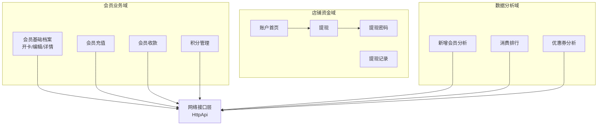
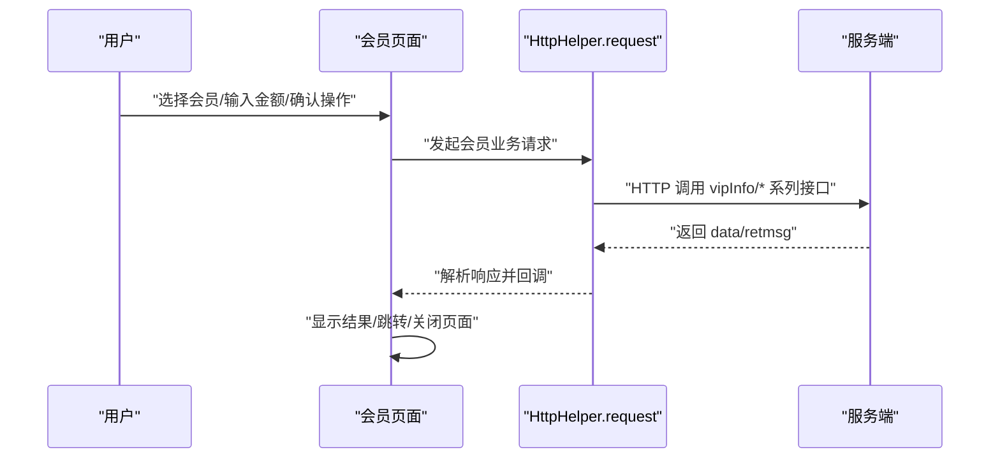
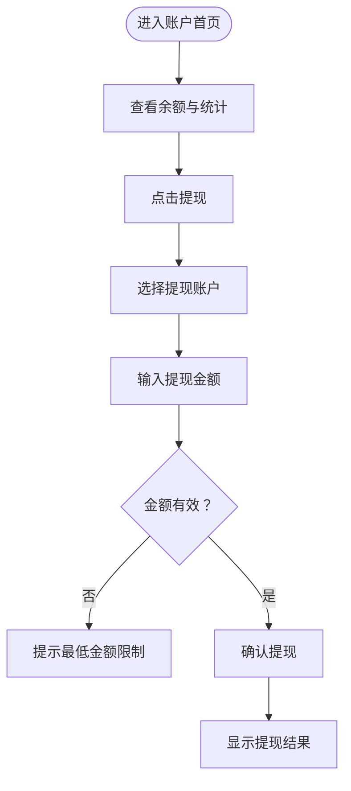
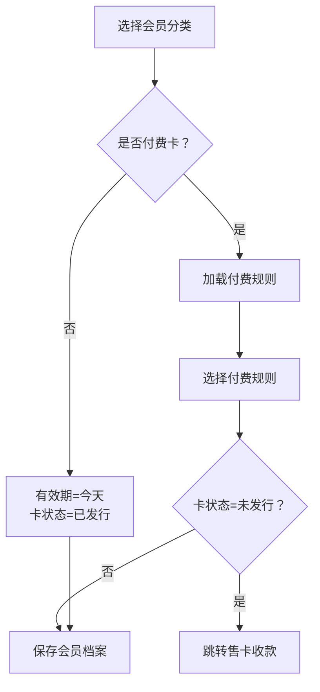
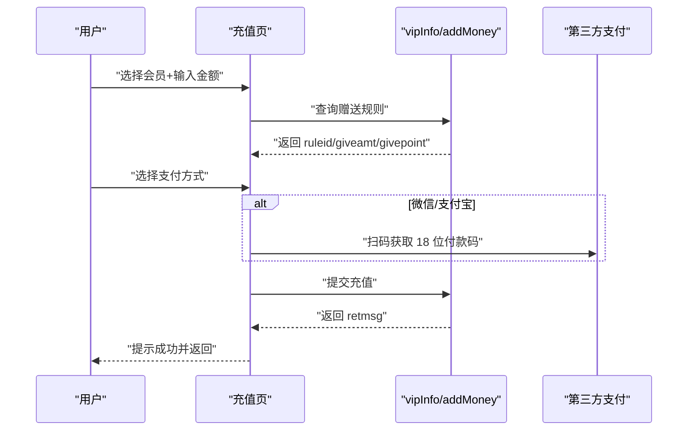
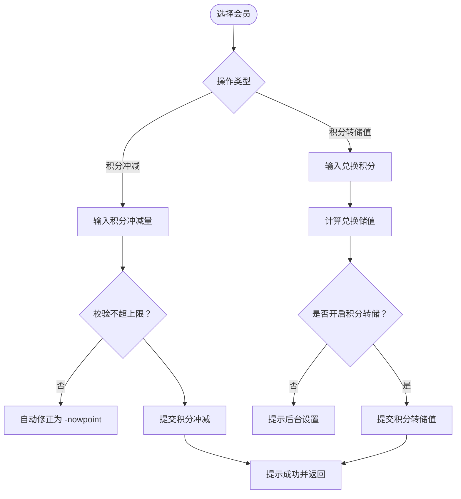
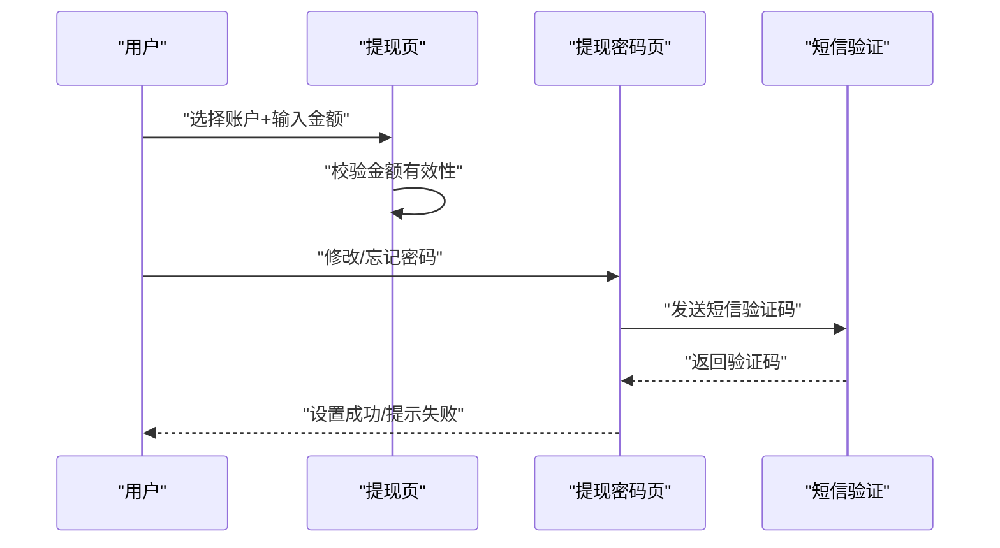
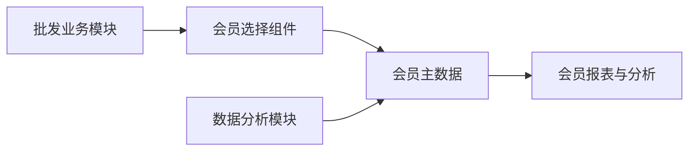
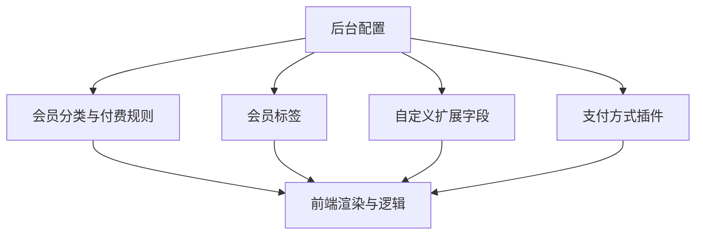

# 会员管理模块

<cite>
**本文引用的文件**   
- [account_router.dart](file://lib/pages/business/member/account_router.dart)
- [account_page.dart](file://lib/pages/business/member/page/account_page.dart)
- [withdrawal_page.dart](file://lib/pages/business/member/page/withdrawal_page.dart)
- [withdrawal_password_page.dart](file://lib/pages/business/member/page/withdrawal_password_page.dart)
- [add.dart](file://lib/pages/business/members/basic/add.dart)
- [detail.dart](file://lib/pages/business/members/basic/detail.dart)
- [pay.dart](file://lib/pages/business/members/basic/pay.dart)
- [recharge_edit.dart](file://lib/pages/business/members/recharge/recharge_edit.dart)
- [point_edit.dart](file://lib/pages/business/members/point/point_edit.dart)
- [vippay_edit.dart](file://lib/pages/business/members/vippay/vippay_edit.dart)
- [http_api.dart](file://lib/net/http_api.dart)
</cite>

## 目录
1. [引言](#引言)
2. [项目结构定位](#项目结构定位)
3. [核心功能总览](#核心功能总览)
4. [架构与数据流](#架构与数据流)
5. [会员账户管理](#会员账户管理)
6. [会员档案、开卡与会员卡设置](#会员档案开卡与会员卡设置)
7. [余额充值、收款与积分体系](#余额充值收款与积分体系)
8. [提现流程与安全机制](#提现流程与安全机制)
9. [与批发业务和数据分析的共享机制](#与批发业务和数据分析的共享机制)
10. [隐私保护、安全验证与异常处理](#隐私保护安全验证与异常处理)
11. [运营与营销技术支持](#运营与营销技术支持)
12. [性能与可维护性建议](#性能与可维护性建议)
13. [故障排查指南](#故障排查指南)
14. [结论](#结论)

## 引言
本文件面向灵犀管店 Flutter 项目的会员管理模块，聚焦以下目标：
- 说明会员账户管理、余额充值、会员收款、积分操作、提现等核心页面与流程。
- 描述会员体系的完整架构：会员注册、分类与付费规则、积分累积、等级提升及权益联动。
- 解释会员数据的隐私保护措施、安全验证机制和异常处理策略。
- 说明与批发业务、数据分析模块之间的会员数据共享方式。
- 提供会员运营与营销活动的技术支撑方案，包括会员标签、扩展字段、支付方式、业务员归集和数据报表入口。

## 项目结构定位
会员相关代码分布在两个主要区域：
- `lib/pages/business/member`：店铺侧“资金管理”下的会员账户与提现能力，包括账户首页、提现、提现密码、提现记录、提现账户管理等路由与页面。
- `lib/pages/business/members`：会员业务主域，包括会员基础档案、会员充值、会员收款、积分管理、会员支付等。
- `lib/pages/data/member`：会员数据分析报表入口，如新增会员分析、消费排行、优惠券分析等。

**图示来源**
- [account_router.dart:1-49](file://lib/pages/business/member/account_router.dart#L1-L49)
- [account_page.dart:1-126](file://lib/pages/business/member/page/account_page.dart#L1-L126)
- [http_api.dart:575-588](file://lib/net/http_api.dart#L575-L588)

**章节来源**
- [account_router.dart:1-49](file://lib/pages/business/member/account_router.dart#L1-L49)
- [account_page.dart:1-126](file://lib/pages/business/member/page/account_page.dart#L1-L126)

## 核心功能总览
- 会员注册与档案管理：支持新增会员、编辑会员、查看会员详情，包含会员分类、会员卡号、基本信息、标签、自定义扩展字段、有效期、生日类型等。
- 会员卡设置：会员分类列表、付费卡分类及付费规则、卡状态控制、有效期计算。
- 余额充值：选择会员、输入金额、自动匹配赠送规则、选择支付方式（含微信/支付宝扫码）、提交充值。
- 会员收款：使用会员卡余额进行收款，限制不超过当前余额，支持业务员与备注。
- 积分管理：支持积分冲减、积分转储值，按会员分类配置自动或手动兑换储值。
- 提现管理：账户余额、提现金额、提现方式选择、提现密码设置与短信验证。

**章节来源**
- [add.dart:1-700](file://lib/pages/business/members/basic/add.dart#L1-L700)
- [detail.dart:1-200](file://lib/pages/business/members/basic/detail.dart#L1-L200)
- [pay.dart:1-200](file://lib/pages/business/members/basic/pay.dart#L1-L200)
- [recharge_edit.dart:1-200](file://lib/pages/business/members/recharge/recharge_edit.dart#L1-L200)
- [point_edit.dart:1-200](file://lib/pages/business/members/point/point_edit.dart#L1-L200)
- [vippay_edit.dart:1-200](file://lib/pages/business/members/vippay/vippay_edit.dart#L1-L200)
- [withdrawal_page.dart:1-200](file://lib/pages/business/member/page/withdrawal_page.dart#L1-L200)
- [withdrawal_password_page.dart:1-79](file://lib/pages/business/member/page/withdrawal_password_page.dart#L1-L79)

## 架构与数据流
会员模块采用前端页面驱动的网络调用架构：
- 页面负责用户交互、表单校验、权限判断、UI 状态。
- 通过统一 HTTP 接口常量集中管理后端 API。
- 充值、售卡、收款、积分操作均通过请求返回消息提示结果并跳转或关闭页面。

**图示来源**
- [recharge_edit.dart:201-300](file://lib/pages/business/members/recharge/recharge_edit.dart#L201-L300)
- [vippay_edit.dart:120-200](file://lib/pages/business/members/vippay/vippay_edit.dart#L120-L200)
- [point_edit.dart:201-320](file://lib/pages/business/members/point/point_edit.dart#L201-L320)
- [http_api.dart:575-588](file://lib/net/http_api.dart#L575-L588)

## 会员账户管理
账户管理是店铺侧资金管理入口，提供账户概览、提现、提现记录、提现密码等快捷入口。该模块与会员充值/收款/积分等业务共同构成会员资金闭环。

- 账户首页展示当前余额、累计结算金额、累计发放佣金等关键指标，并提供提现、提现记录、提现密码导航。
- 提现页允许选择提现账户、输入金额、选择转出方式，并进行简单金额有效性校验。
- 提现密码页提供修改密码与忘记密码流程，忘记密码需要短信验证。

**图示来源**
- [account_page.dart:1-126](file://lib/pages/business/member/page/account_page.dart#L1-L126)
- [withdrawal_page.dart:1-200](file://lib/pages/business/member/page/withdrawal_page.dart#L1-L200)

**章节来源**
- [account_page.dart:1-126](file://lib/pages/business/member/page/account_page.dart#L1-L126)
- [withdrawal_page.dart:1-200](file://lib/pages/business/member/page/withdrawal_page.dart#L1-L200)
- [withdrawal_password_page.dart:1-79](file://lib/pages/business/member/page/withdrawal_password_page.dart#L1-L79)
- [account_router.dart:1-49](file://lib/pages/business/member/account_router.dart#L1-L49)

## 会员档案、开卡与会员卡设置
会员档案模块覆盖会员开卡、编辑、详情查看以及会员分类与付费规则设置。

### 会员开卡与编辑
- 新增会员时默认选择第一个会员分类，并自动生成会员卡号。
- 编辑模式加载会员详情与附属数据（标签、副卡等），支持自定义扩展字段必填校验。
- 根据会员分类决定卡状态与有效期；付费卡需进入收款流程后发卡。
- 手机号格式校验、身份证号自动识别生日、公历/农历生日切换。

**图示来源**
- [add.dart:201-400](file://lib/pages/business/members/basic/add.dart#L201-L400)
- [pay.dart:1-200](file://lib/pages/business/members/basic/pay.dart#L1-L200)

### 会员详情
- 并行加载会员信息、附属数据与自定义扩展字段。
- 支持跳转到会员编辑与副卡列表。
- 展示会员头部卡片、余额、标签、详细信息等。

**章节来源**
- [add.dart:1-700](file://lib/pages/business/members/basic/add.dart#L1-L700)
- [detail.dart:1-200](file://lib/pages/business/members/basic/detail.dart#L1-L200)
- [http_api.dart:575-588](file://lib/net/http_api.dart#L575-L588)

## 余额充值、收款与积分体系
### 余额充值
- 选择会员后输入充值金额，失焦时格式化并按金额拉取赠送规则。
- 支持选择支付方式；微信支付与支付宝需要扫描 18 位付款码。
- 提交充值请求，生成 16 位随机单号，成功后延迟返回上一页。

**图示来源**
- [recharge_edit.dart:1-200](file://lib/pages/business/members/recharge/recharge_edit.dart#L1-L200)
- [recharge_edit.dart:201-300](file://lib/pages/business/members/recharge/recharge_edit.dart#L201-L300)
- [http_api.dart:585-588](file://lib/net/http_api.dart#L585-L588)

### 会员收款
- 使用会员卡余额收款，输入金额不得超过当前余额。
- 固定 payid=02、opertype=8，提交 vipCardPay 对象。
- 支持选择业务员与备注，成功后返回上一页。

**章节来源**
- [vippay_edit.dart:1-200](file://lib/pages/business/members/vippay/vippay_edit.dart#L1-L200)
- [http_api.dart:588](file://lib/net/http_api.dart#L588)

### 积分管理
- 支持积分冲减与积分转储值两种操作。
- 冲减输入失焦校验，保证不低于负值下限。
- 转储值按会员分类配置自动或手动兑换储值，若未开启则提示后台设置。
- 提交积分操作请求，生成 16 位单号，返回 retmsg 提示。

**图示来源**
- [point_edit.dart:1-200](file://lib/pages/business/members/point/point_edit.dart#L1-L200)
- [point_edit.dart:201-565](file://lib/pages/business/members/point/point_edit.dart#L201-L565)
- [http_api.dart:585](file://lib/net/http_api.dart#L585)

## 提现流程与安全机制
提现模块提供账户余额提现、提现密码设置与短信验证流程。

- 提现页支持选择提现账户、输入金额、选择转出方式，并限制单笔与单日限额提示。
- 提现密码页提供修改密码与忘记密码选项，忘记密码需要短信验证。
- 提现流程在 UI 层完成基本金额校验，后续实际提现由后端服务处理。

**图示来源**
- [withdrawal_page.dart:1-200](file://lib/pages/business/member/page/withdrawal_page.dart#L1-L200)
- [withdrawal_password_page.dart:1-79](file://lib/pages/business/member/page/withdrawal_password_page.dart#L1-L79)

**章节来源**
- [withdrawal_page.dart:1-200](file://lib/pages/business/member/page/withdrawal_page.dart#L1-L200)
- [withdrawal_password_page.dart:1-79](file://lib/pages/business/member/page/withdrawal_password_page.dart#L1-L79)

## 与批发业务和数据分析的共享机制
会员数据在批发业务与数据分析模块中复用：
- 批发业务中的客户管理与订单模块可能引用会员选择组件，复用会员列表与搜索能力。
- 数据分析模块提供新增会员分析、消费排行、优惠券分析等报表，依赖会员交易与积分流水。

[此图为概念图，不直接映射具体源码文件]

**章节来源**
- [http_api.dart:575-588](file://lib/net/http_api.dart#L575-L588)

## 隐私保护、安全验证与异常处理
### 隐私保护
- 会员档案中包含姓名、手机号、身份证号、地址等敏感信息，前端仅用于展示与必要校验。
- 身份证号输入自动识别生日，避免额外录入敏感信息。
- 会员详情页与列表页应遵循最小化展示原则，避免不必要的敏感字段暴露。

### 安全验证
- 支付方式选择过滤支持会员充值的支付方式，微信支付与支付宝要求扫描 18 位付款码。
- 提现密码修改与忘记密码流程引入短信验证，增强账户安全性。
- 各业务操作前检查会员卡状态，挂失、作废、过期等无效状态禁止操作。

### 异常处理
- 所有网络请求通过统一 request 方法封装，错误消息由后端 retmsg 或网络层统一提示。
- 页面在提交过程中禁用按钮，防止重复提交。
- 充值、收款、积分等操作完成后延迟返回上一页，提升用户体验。

**章节来源**
- [recharge_edit.dart:201-300](file://lib/pages/business/members/recharge/recharge_edit.dart#L201-L300)
- [vippay_edit.dart:120-200](file://lib/pages/business/members/vippay/vippay_edit.dart#L120-L200)
- [point_edit.dart:201-320](file://lib/pages/business/members/point/point_edit.dart#L201-L320)
- [withdrawal_password_page.dart:1-79](file://lib/pages/business/member/page/withdrawal_password_page.dart#L1-L79)

## 运营与营销技术支持
- 会员分类与付费规则：支持多分类与付费卡规则配置，便于不同等级会员享受差异化权益。
- 会员标签：通过附属数据加载标签列表，支持多选标签，用于精准营销与人群细分。
- 自定义扩展字段：支持文本型扩展字段与必填校验，满足个性化会员信息采集需求。
- 支付方式扩展：通过插件接口动态加载支付方式，支持未来新增支付渠道。
- 业务员归集：充值与收款支持选择业务员，便于业绩归集与提成核算。

**图示来源**
- [add.dart:201-400](file://lib/pages/business/members/basic/add.dart#L201-L400)
- [recharge_edit.dart:1-200](file://lib/pages/business/members/recharge/recharge_edit.dart#L1-L200)

**章节来源**
- [add.dart:201-400](file://lib/pages/business/members/basic/add.dart#L201-L400)
- [recharge_edit.dart:1-200](file://lib/pages/business/members/recharge/recharge_edit.dart#L1-L200)

## 性能与可维护性建议
- 减少重复网络请求：会员详情已并发加载多个接口，建议在状态管理中缓存会员基础数据，避免频繁刷新。
- 列表分页与懒加载：会员列表与分类列表应使用分页参数，降低首屏压力。
- 图片资源优化：会员卡背景图使用远程图片，建议增加本地降级与缓存策略。
- 权限控制前置：将权限判断下沉到公共组件或路由守卫，减少页面内重复逻辑。
- 错误提示统一：统一使用 Toast 或全局错误对话框，避免分散的错误处理。

[本节为通用建议，不涉及具体源码分析]

## 故障排查指南
- 充值失败：
  - 检查会员卡状态是否为有效状态。
  - 检查支付方式是否支持会员充值。
  - 检查微信支付/支付宝是否已正确扫描 18 位付款码。
- 收款失败：
  - 检查输入金额是否超过当前余额。
  - 检查会员卡状态是否有效。
- 积分操作失败：
  - 检查是否具备相应权限。
  - 检查积分冲减是否超出当前积分。
  - 检查是否开启积分转储值功能。
- 提现问题：
  - 检查提现金额是否符合最低限制。
  - 检查提现密码是否已设置且短信验证是否通过。

**章节来源**
- [recharge_edit.dart:201-300](file://lib/pages/business/members/recharge/recharge_edit.dart#L201-L300)
- [vippay_edit.dart:120-200](file://lib/pages/business/members/vippay/vippay_edit.dart#L120-L200)
- [point_edit.dart:201-320](file://lib/pages/business/members/point/point_edit.dart#L201-L320)
- [withdrawal_page.dart:1-200](file://lib/pages/business/member/page/withdrawal_page.dart#L1-L200)
- [withdrawal_password_page.dart:1-79](file://lib/pages/business/member/page/withdrawal_password_page.dart#L1-L79)

## 结论
灵犀管店 Flutter 项目的会员管理模块围绕会员档案、会员卡设置、余额充值、会员收款、积分管理和提现等核心功能展开，形成完整的会员资金与权益闭环。模块通过统一的网络接口层与清晰的页面职责划分，实现了良好的可扩展性与可维护性。同时，结合会员标签、扩展字段、支付方式插件与业务员归集，为会员运营与营销活动提供了坚实的技术支撑。在实际使用中，应重点关注敏感信息保护、安全验证与异常处理，确保会员数据的安全与业务流程的稳定性。