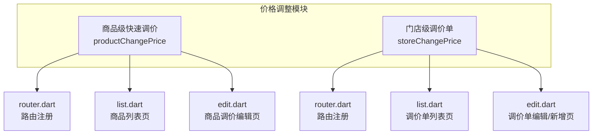
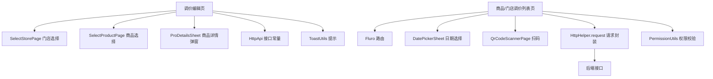
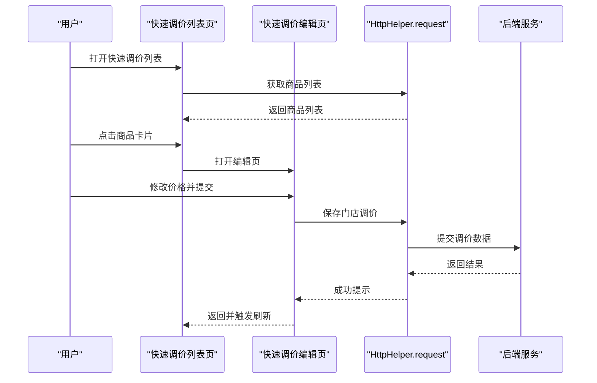
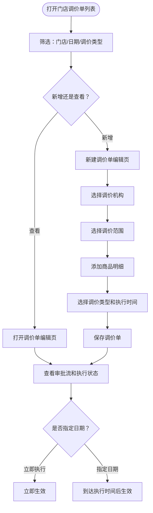
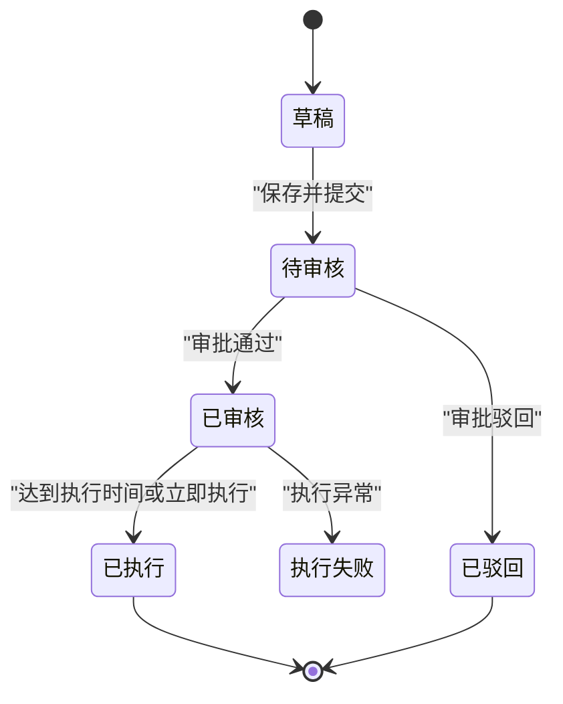
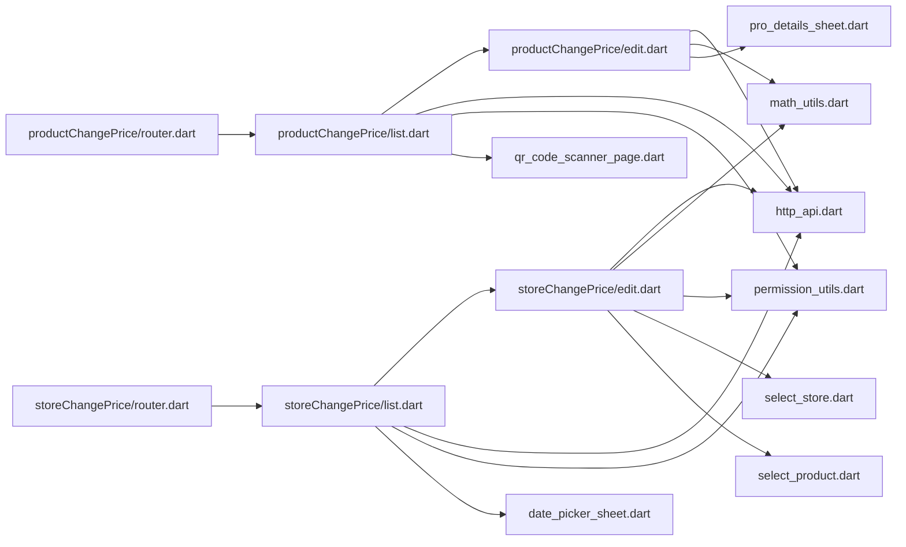

# 价格调整

<cite>
**本文引用的文件**
- [lib/pages/business/basis/productChangePrice/router.dart](file://lib/pages/business/basis/productChangePrice/router.dart)
- [lib/pages/business/basis/productChangePrice/list.dart](file://lib/pages/business/basis/productChangePrice/list.dart)
- [lib/pages/business/basis/productChangePrice/edit.dart](file://lib/pages/business/basis/productChangePrice/edit.dart)
- [lib/pages/business/basis/storeChangePrice/router.dart](file://lib/pages/business/basis/storeChangePrice/router.dart)
- [lib/pages/business/basis/storeChangePrice/list.dart](file://lib/pages/business/basis/storeChangePrice/list.dart)
- [lib/pages/business/basis/storeChangePrice/edit.dart](file://lib/pages/business/basis/storeChangePrice/edit.dart)
- [lib/net/http_api.dart](file://lib/net/http_api.dart)
- [lib/components/select/select_store.dart](file://lib/components/select/select_store.dart)
- [lib/components/select/select_product.dart](file://lib/components/select/select_product.dart)
- [lib/components/pro_details_sheet.dart](file://lib/components/pro_details_sheet.dart)
- [lib/widgets/date_picker_sheet.dart](file://lib/widgets/date_picker_sheet.dart)
- [lib/widgets/qr_code_scanner_page.dart](file://lib/widgets/qr_code_scanner_page.dart)
- [lib/util/math_utils.dart](file://lib/util/math_utils.dart)
- [lib/util/permission_utils.dart](file://lib/util/permission_utils.dart)
- [lib/util/toast_utils.dart](file://lib/util/toast_utils.dart)
</cite>

## 目录
1. [引言](#引言)
2. [项目结构定位](#项目结构定位)
3. [核心功能总览](#核心功能总览)
4. [系统架构与数据流](#系统架构与数据流)
5. [商品级价格调整：快速调价](#商品级价格调整快速调价)
6. [门店级价格调整：门店调价单](#门店级价格调整门店调价单)
7. [审批流程、生效时间与批量操作](#审批流程生效时间与批量操作)
8. [与采购、销售等业务模块的联动](#与采购销售等业务模块的联动)
9. [依赖关系分析](#依赖关系分析)
10. [性能与体验特征](#性能与体验特征)
11. [常见问题排查](#常见问题排查)
12. [最佳实践与风险控制建议](#最佳实践与风险控制建议)
13. [结论](#结论)

## 引言
本文件面向灵犀管店 Flutter 应用中的“价格调整”能力，聚焦两个子功能：
- 商品级价格调整：即“快速调价”，用于对单个商品当前门店下的多种价格进行直接修改。
- 门店级价格调整：即“门店调价单”，以单据形式对指定门店或渠道的商品价格进行调整，支持审批、生效时间控制和明细批量管理。

文档将说明两个功能的业务流程、界面交互、权限控制、审批状态、生效时间策略、批量操作方式，以及与采购、销售等上下游业务的数据联动关系，并给出可操作的实现参考路径和风险控制建议。

## 项目结构定位
价格调整功能位于业务基础资料目录下，分为两套路由和页面：
- 商品级快速调价：`lib/pages/business/basis/productChangePrice`
- 门店级调价单：`lib/pages/business/basis/storeChangePrice`

**图表来源**
- [lib/pages/business/basis/productChangePrice/router.dart:1-17](file://lib/pages/business/basis/productChangePrice/router.dart#L1-L17)
- [lib/pages/business/basis/productChangePrice/list.dart:1-200](file://lib/pages/business/basis/productChangePrice/list.dart#L1-L200)
- [lib/pages/business/basis/productChangePrice/edit.dart:1-200](file://lib/pages/business/basis/productChangePrice/edit.dart#L1-L200)
- [lib/pages/business/basis/storeChangePrice/router.dart:1-17](file://lib/pages/business/basis/storeChangePrice/router.dart#L1-L17)
- [lib/pages/business/basis/storeChangePrice/list.dart:1-200](file://lib/pages/business/basis/storeChangePrice/list.dart#L1-L200)
- [lib/pages/business/basis/storeChangePrice/edit.dart:1-200](file://lib/pages/business/basis/storeChangePrice/edit.dart#L1-L200)

**章节来源**
- [lib/pages/business/basis/productChangePrice/router.dart:1-17](file://lib/pages/business/basis/productChangePrice/router.dart#L1-L17)
- [lib/pages/business/basis/storeChangePrice/router.dart:1-17](file://lib/pages/business/basis/storeChangePrice/router.dart#L1-L17)

## 核心功能总览
| 功能 | 入口路由 | 主要界面 | 适用场景 | 关键能力 |
|---|---|---|---|---|
| 商品级快速调价 | `/basis/productChangePrice/list` | 商品列表 + 单品价格编辑 | 针对某个商品在当前门店下直接改价 | 按条码/品名/自编码搜索、扫码、分类筛选、多价格字段编辑、保存后刷新 |
| 门店级调价单 | `/basis/storeChangePrice/list` | 调价单列表 + 单据编辑/新增 | 针对门店或渠道范围批量调价，需要审批和生效时间控制 | 待审核/已审核/已驳回标签、日期范围筛选、调价类型、调价范围、执行时间、批量明细、审批流 |

商品级快速调价更偏“即时改价”，适合小范围、低风险的单价修正；门店级调价单更偏“计划性调价”，适合促销、调价周期、渠道差异化定价等复杂场景。

**章节来源**
- [lib/pages/business/basis/productChangePrice/router.dart:1-17](file://lib/pages/business/basis/productChangePrice/router.dart#L1-L17)
- [lib/pages/business/basis/storeChangePrice/router.dart:1-17](file://lib/pages/business/basis/storeChangePrice/router.dart#L1-L17)
- [lib/pages/business/basis/productChangePrice/list.dart:1-200](file://lib/pages/business/basis/productChangePrice/list.dart#L1-L200)
- [lib/pages/business/basis/storeChangePrice/list.dart:1-200](file://lib/pages/business/basis/storeChangePrice/list.dart#L1-L200)

## 系统架构与数据流
价格调整涉及前端页面、公共选择组件、网络接口封装和本地权限工具：

**图表来源**
- [lib/pages/business/basis/productChangePrice/list.dart:1-200](file://lib/pages/business/basis/productChangePrice/list.dart#L1-L200)
- [lib/pages/business/basis/productChangePrice/edit.dart:1-200](file://lib/pages/business/basis/productChangePrice/edit.dart#L1-L200)
- [lib/pages/business/basis/storeChangePrice/list.dart:1-200](file://lib/pages/business/basis/storeChangePrice/list.dart#L1-L200)
- [lib/pages/business/basis/storeChangePrice/edit.dart:1-200](file://lib/pages/business/basis/storeChangePrice/edit.dart#L1-L200)
- [lib/components/select/select_store.dart](file://lib/components/select/select_store.dart)
- [lib/components/select/select_product.dart](file://lib/components/select/select_product.dart)
- [lib/components/pro_details_sheet.dart](file://lib/components/pro_details_sheet.dart)
- [lib/widgets/date_picker_sheet.dart](file://lib/widgets/date_picker_sheet.dart)
- [lib/widgets/qr_code_scanner_page.dart](file://lib/widgets/qr_code_scanner_page.dart)
- [lib/net/http_api.dart](file://lib/net/http_api.dart)

## 商品级价格调整：快速调价
### 业务流程
1. 进入“快速调价”列表页，默认加载当前门店相关商品。
2. 可通过以下维度筛选商品：
   - 文本框输入条码、品名或自编码；
   - 扫码按钮调用扫码页，返回条码后自动搜索；
   - 门店筛选，支持全部门店或指定门店；
   - 分类筛选，跳转分类列表选择类目。
3. 点击商品卡片进入“快速调价”编辑页。
4. 在编辑页查看商品信息，并可打开商品详情弹窗修改单位或规格。
5. 编辑零售价、进货价、会员价、批发价、配送价、最低售价等多个价格字段。
6. 保存时提交商品标识、条码、名称、单位、规格及所有价格字段到后端接口。
7. 保存成功后返回列表并刷新列表。

**图表来源**
- [lib/pages/business/basis/productChangePrice/list.dart:1-200](file://lib/pages/business/basis/productChangePrice/list.dart#L1-L200)
- [lib/pages/business/basis/productChangePrice/edit.dart:1-200](file://lib/pages/business/basis/productChangePrice/edit.dart#L1-L200)
- [lib/net/http_api.dart:54](file://lib/net/http_api.dart#L54)
- [lib/net/http_api.dart:483](file://lib/net/http_api.dart#L483)

### 界面与操作要点
- 列表页提供下拉刷新、滚动分页、扫码搜索、分类筛选和门店筛选。
- 编辑页展示商品图片、名称、规格、条码，以及原价格和新价格两列输入。
- 商品详情弹窗支持修改单位和规格，并在变更后同步更新价格输入框。
- 保存按钮具备防重复提交保护，失败时由拦截器统一提示。

**章节来源**
- [lib/pages/business/basis/productChangePrice/list.dart:1-200](file://lib/pages/business/basis/productChangePrice/list.dart#L1-L200)
- [lib/pages/business/basis/productChangePrice/list.dart:201-543](file://lib/pages/business/basis/productChangePrice/list.dart#L201-L543)
- [lib/pages/business/basis/productChangePrice/edit.dart:1-200](file://lib/pages/business/basis/productChangePrice/edit.dart#L1-L200)
- [lib/pages/business/basis/productChangePrice/edit.dart:201-451](file://lib/pages/business/basis/productChangePrice/edit.dart#L201-L451)

### 代码级实现要点
- 列表页使用 `HttpApi.productGetList` 拉取商品列表，参数包含分页、搜索条件、分类和门店。
- 编辑页使用 `HttpApi.productUpdateStoreprice` 提交调价数据，包括商品标识、条码、名称、单位、规格、变更类型和多价格字段。
- 价格格式化使用 `MathUtils.formatDecimal(2, value)` 保证两位小数显示。
- 权限控制通过 `PermissionUtils.checkPermission('010401')` 判断是否允许查看和编辑快速调价。

**章节来源**
- [lib/pages/business/basis/productChangePrice/list.dart:1-200](file://lib/pages/business/basis/productChangePrice/list.dart#L1-L200)
- [lib/pages/business/basis/productChangePrice/edit.dart:1-200](file://lib/pages/business/basis/productChangePrice/edit.dart#L1-L200)
- [lib/net/http_api.dart:54](file://lib/net/http_api.dart#L54)
- [lib/net/http_api.dart:483](file://lib/net/http_api.dart#L483)
- [lib/util/math_utils.dart](file://lib/util/math_utils.dart)
- [lib/util/permission_utils.dart](file://lib/util/permission_utils.dart)

## 门店级价格调整：门店调价单
### 业务流程
1. 进入“门店调价单”列表页，默认展示近 30 天的调价单。
2. 列表页顶部提供标签切换：全部、待审核、已审核、已驳回。
3. 支持门店筛选、搜索、快速时间标签、自定义日期范围和调价类型筛选。
4. 点击新增按钮进入“门店调价单”编辑页，或点击已有单据查看详情。
5. 编辑页维护单据基本信息、调价机构、调价渠道、调价类型、执行时间和调价范围。
6. 通过商品选择器或扫码枪添加商品明细，支持批量删除。
7. 保存单据后，根据审批配置决定是否进入审批流；审批通过后单据生效，按执行时间执行调价。
8. 列表页可查看调价单的创建人、创建时间、执行状态等信息。

**图表来源**
- [lib/pages/business/basis/storeChangePrice/list.dart:1-200](file://lib/pages/business/basis/storeChangePrice/list.dart#L1-L200)
- [lib/pages/business/basis/storeChangePrice/edit.dart:1-200](file://lib/pages/business/basis/storeChangePrice/edit.dart#L1-L200)

### 界面与操作要点
- 列表页支持下拉刷新、滚动分页、Tab 切换审核状态、搜索、门店选择、快速时间标签、自定义日期范围和调价类型筛选。
- 编辑页支持：
  - 单据编号、创建人、创建时间只读展示；
  - 调价机构选择；
  - 调价渠道：线下调价、商城调价、商城/线下同步；
  - 调价类型：立即执行调价、指定日期调价；
  - 执行时间：当类型为指定日期时，需选择日期和时间；
  - 调价范围：进价、零售价、最低零售价、会员价、批发价、配送价、商城零售价等；
  - 商品明细：支持扫码枪输入、商品选择、批量删除；
  - 审批流：查看审批节点和用户，控制审核、撤回等操作；
  - 权限控制：进价和配送价的查看和勾选受用户权限控制。

**章节来源**
- [lib/pages/business/basis/storeChangePrice/list.dart:1-200](file://lib/pages/business/basis/storeChangePrice/list.dart#L1-L200)
- [lib/pages/business/basis/storeChangePrice/list.dart:201-515](file://lib/pages/business/basis/storeChangePrice/list.dart#L201-L515)
- [lib/pages/business/basis/storeChangePrice/edit.dart:1-200](file://lib/pages/business/basis/storeChangePrice/edit.dart#L1-L200)
- [lib/pages/business/basis/storeChangePrice/edit.dart:201-599](file://lib/pages/business/basis/storeChangePrice/edit.dart#L201-L599)

### 代码级实现要点
- 列表页使用 `HttpApi.storeChangePriceFindList` 获取调价单列表，参数包含分页、搜索条件、审核状态、门店、开始结束时间和调价类型。
- 编辑页新增时使用 `HttpApi.storeChangePriceSave` 保存单据；查看时通过 `HttpApi.storeChangePriceGetInfo` 获取单据完整数据。
- 调价范围通过 `priceOptionsDef` 定义原价字段与新价格字段的映射，并根据用户权限禁用某些选项。
- 审批流通过 `_reviewFlowUsers` 和 `_reviewBillFlows` 解析后端返回的审批用户和单据审批记录。
- 执行时间通过日期选择器和时间选择器组合为完整时间字符串。

**章节来源**
- [lib/net/http_api.dart:545](file://lib/net/http_api.dart#L545)
- [lib/net/http_api.dart:547](file://lib/net/http_api.dart#L547)
- [lib/pages/business/basis/storeChangePrice/list.dart:1-200](file://lib/pages/business/basis/storeChangePrice/list.dart#L1-L200)
- [lib/pages/business/basis/storeChangePrice/edit.dart:1-200](file://lib/pages/business/basis/storeChangePrice/edit.dart#L1-L200)
- [lib/pages/business/basis/storeChangePrice/edit.dart:201-599](file://lib/pages/business/basis/storeChangePrice/edit.dart#L201-L599)

## 审批流程、生效时间与批量操作
### 审批流程
- 门店调价单支持多级审批，编辑页会读取当前用户的审批角色和审批节点。
- 列表页通过 `signflag` 区分单据状态：待审核、已审核、已驳回。
- 编辑页通过 `_reviewFlowUsers` 和 `_reviewBillFlows` 展示审批人员与审批历史。
- 新增单据时，若当前机构配置了审批签字要求，会根据用户 ID 控制是否允许审核。

**图表来源**
- [lib/pages/business/basis/storeChangePrice/list.dart:1-200](file://lib/pages/business/basis/storeChangePrice/list.dart#L1-L200)
- [lib/pages/business/basis/storeChangePrice/edit.dart:1-200](file://lib/pages/business/basis/storeChangePrice/edit.dart#L1-L200)

### 生效时间控制
- 调价类型支持“立即执行调价”和“指定日期调价”。
- 当选择“指定日期调价”时，编辑页要求选择日期和时间，形成完整的执行时间。
- 列表筛选支持按“调价类型”过滤，便于区分立即执行和指定日期调价的单据。
- 执行状态字段用于展示调价单是否已执行、执行失败等。

**章节来源**
- [lib/pages/business/basis/storeChangePrice/edit.dart:1-200](file://lib/pages/business/basis/storeChangePrice/edit.dart#L1-L200)
- [lib/pages/business/basis/storeChangePrice/edit.dart:201-599](file://lib/pages/business/basis/storeChangePrice/edit.dart#L201-L599)
- [lib/pages/business/basis/storeChangePrice/list.dart:1-200](file://lib/pages/business/basis/storeChangePrice/list.dart#L1-L200)

### 批量操作能力
- 门店调价单支持批量添加商品明细，可通过商品选择器或扫码枪逐条添加。
- 支持批量删除选中明细，便于清理错误录入。
- 商品级快速调价是单品调价，不支持跨商品批量，但可在一个商品内同时修改多个价格字段。

**章节来源**
- [lib/pages/business/basis/storeChangePrice/edit.dart:1-200](file://lib/pages/business/basis/storeChangePrice/edit.dart#L1-L200)
- [lib/pages/business/basis/productChangePrice/edit.dart:1-200](file://lib/pages/business/basis/productChangePrice/edit.dart#L1-L200)

## 与采购、销售等业务模块的联动
价格调整不是孤立功能，它与采购和销售业务存在天然数据联动：
- 与采购模块联动：
  - 商品进货价变化会影响采购成本核算；
  - 门店调价单中“进价”作为调价范围之一，可能影响后续采购入库成本展示和成本差异分析。
- 与销售模块联动：
  - 零售价、会员价、批发价、配送价、最低零售价直接影响销售开单、收银、会员折扣和批发报价；
  - 门店调价单中的“商城零售价”会与线上商城价格联动，影响电商端销售价格。
- 与库存、财务模块联动：
  - 价格变动会影响库存成本重估、毛利分析和财务报表；
  - 门店调价单的审批和执行状态有助于审计和追溯。

虽然具体采购和销售页面的价格计算逻辑不在本次价格调整源码范围内，但从调价范围的字段设计可以看出，系统已将进价、零售价、会员价、批发价、配送价、商城零售价等关键价格纳入统一管理。

**章节来源**
- [lib/pages/business/basis/storeChangePrice/edit.dart:1-200](file://lib/pages/business/basis/storeChangePrice/edit.dart#L1-L200)
- [lib/pages/business/basis/productChangePrice/edit.dart:1-200](file://lib/pages/business/basis/productChangePrice/edit.dart#L1-L200)

## 依赖关系分析
价格调整模块依赖多个公共组件和工具：
- 路由层：Fluro 路由分别注册商品级和门店级调价入口。
- 网络层：`HttpApi` 提供接口常量，`HttpHelper.request` 负责请求封装。
- 组件层：
  - `SelectStorePage`：门店选择；
  - `SelectProductPage`：商品选择；
  - `ProDetailsSheet`：商品详情弹窗，用于修改单位、规格和价格信息；
  - `DatePickerSheet`：日期和时间选择；
  - `QrCodeScannerPage`：扫码获取条码。
- 工具层：
  - `MathUtils`：数字格式化；
  - `PermissionUtils`：权限校验；
  - `ToastUtils`：提示消息。

**图表来源**
- [lib/pages/business/basis/productChangePrice/router.dart:1-17](file://lib/pages/business/basis/productChangePrice/router.dart#L1-L17)
- [lib/pages/business/basis/productChangePrice/list.dart:1-200](file://lib/pages/business/basis/productChangePrice/list.dart#L1-L200)
- [lib/pages/business/basis/productChangePrice/edit.dart:1-200](file://lib/pages/business/basis/productChangePrice/edit.dart#L1-L200)
- [lib/pages/business/basis/storeChangePrice/router.dart:1-17](file://lib/pages/business/basis/storeChangePrice/router.dart#L1-L17)
- [lib/pages/business/basis/storeChangePrice/list.dart:1-200](file://lib/pages/business/basis/storeChangePrice/list.dart#L1-L200)
- [lib/pages/business/basis/storeChangePrice/edit.dart:1-200](file://lib/pages/business/basis/storeChangePrice/edit.dart#L1-L200)
- [lib/net/http_api.dart](file://lib/net/http_api.dart)
- [lib/util/math_utils.dart](file://lib/util/math_utils.dart)
- [lib/util/permission_utils.dart](file://lib/util/permission_utils.dart)
- [lib/components/pro_details_sheet.dart](file://lib/components/pro_details_sheet.dart)
- [lib/components/select/select_store.dart](file://lib/components/select/select_store.dart)
- [lib/components/select/select_product.dart](file://lib/components/select/select_product.dart)
- [lib/widgets/date_picker_sheet.dart](file://lib/widgets/date_picker_sheet.dart)
- [lib/widgets/qr_code_scanner_page.dart](file://lib/widgets/qr_code_scanner_page.dart)

## 性能与体验特征
- 列表页普遍采用滚动分页，避免一次性加载大量数据。
- 列表页支持下拉刷新，保证数据新鲜度。
- 搜索框具备防抖处理，减少频繁请求。
- 商品图片和价格使用本地缓存与格式化，提升渲染稳定性。
- 批量操作和审批流程通过状态字段和权限控制降低误操作风险。

[本节为通用性能讨论，不直接分析具体文件]

## 常见问题排查
| 问题现象 | 可能原因 | 排查建议 |
|---|---|---|
| 无法打开快速调价 | 缺少权限 `010401` | 检查后台角色权限，确认是否赋予快速调价查看和编辑权限 |
| 保存快速调价失败 | 接口返回错误或权限不足 | 查看拦截器提示，检查商品标识、条码、价格字段是否为空 |
| 门店调价单无法审核 | 当前用户不是审批节点或单据已审核 | 检查 `_reviewFlowUsers` 中的审批用户和单据状态 |
| 指定日期调价未生效 | 执行时间未设置或尚未到达 | 检查编辑页执行时间是否填写，并确认当前时间是否晚于执行时间 |
| 进价或配送价不可勾选 | 用户无进价或配送价查看权限 | 检查用户权限字段 `inpriceflag`、`pspriceflag` |
| 商品列表为空 | 筛选条件过严或无数据 | 尝试清空门店、分类和搜索条件，重新加载 |

**章节来源**
- [lib/pages/business/basis/productChangePrice/list.dart:1-200](file://lib/pages/business/basis/productChangePrice/list.dart#L1-L200)
- [lib/pages/business/basis/productChangePrice/edit.dart:1-200](file://lib/pages/business/basis/productChangePrice/edit.dart#L1-L200)
- [lib/pages/business/basis/storeChangePrice/list.dart:1-200](file://lib/pages/business/basis/storeChangePrice/list.dart#L1-L200)
- [lib/pages/business/basis/storeChangePrice/edit.dart:1-200](file://lib/pages/business/basis/storeChangePrice/edit.dart#L1-L200)
- [lib/pages/business/basis/storeChangePrice/edit.dart:201-599](file://lib/pages/business/basis/storeChangePrice/edit.dart#L201-L599)

## 最佳实践与风险控制建议
### 商品级快速调价最佳实践
- 仅对小范围、低风险的价格修正使用快速调价，例如个别商品零售价微调。
- 修改前核对商品条码、名称、规格和单位，避免误改其他商品。
- 多价格字段修改时，优先确认零售价、会员价、批发价对销售的影响。
- 保存后立即返回列表核对最新价格，确保前端展示与后端一致。

### 门店级调价单最佳实践
- 大范围调价、促销调价、渠道差异化定价应使用门店调价单。
- 明确调价渠道：线下、商城或同步，避免线上线下价格不一致。
- 合理选择调价类型：紧急调价用立即执行，计划性调价用指定日期。
- 严格设置执行时间，避免在营业时间高峰突然改价造成订单结算异常。
- 通过审批流程控制调价权限，防止未经授权的大规模改价。
- 调价范围应最小化，仅勾选必要的价格类型，降低副作用。
- 使用批量明细管理提高录入效率，同时注意批量删除前的二次确认。

### 风险控制建议
- 权限隔离：快速调价和门店调价单分别使用不同权限码，避免越权操作。
- 审批留痕：所有调价单保留创建人、创建时间、审批人和审批意见。
- 执行审计：记录调价单的执行状态和执行时间，便于事后追溯。
- 价格一致性：谨慎使用“商城/线下同步”，确保前后端价格策略一致。
- 敏感价格保护：对进价、配送价等敏感价格增加查看和修改权限控制。

[本节为通用最佳实践与风险控制建议，不直接分析具体文件]

## 结论
灵犀管店的价格调整功能通过“商品级快速调价”和“门店级调价单”两个层次，覆盖了从单品即时改价到门店范围计划性调价的全场景需求。商品级快速调价简洁直接，适合日常小幅度价格修正；门店级调价单则提供了审批、生效时间、调价范围、批量明细等完整能力，更适合正式调价流程。两者共同支撑采购、销售、库存、财务等业务环节的价格一致性，并通过权限控制和审批机制保障价格变动的安全性和可审计性。

在实际使用中，建议遵循“小额即时、大额计划”的原则，结合权限、审批和执行时间策略，确保价格调整既高效又可控。

[本节为总结性内容，不直接分析具体文件]