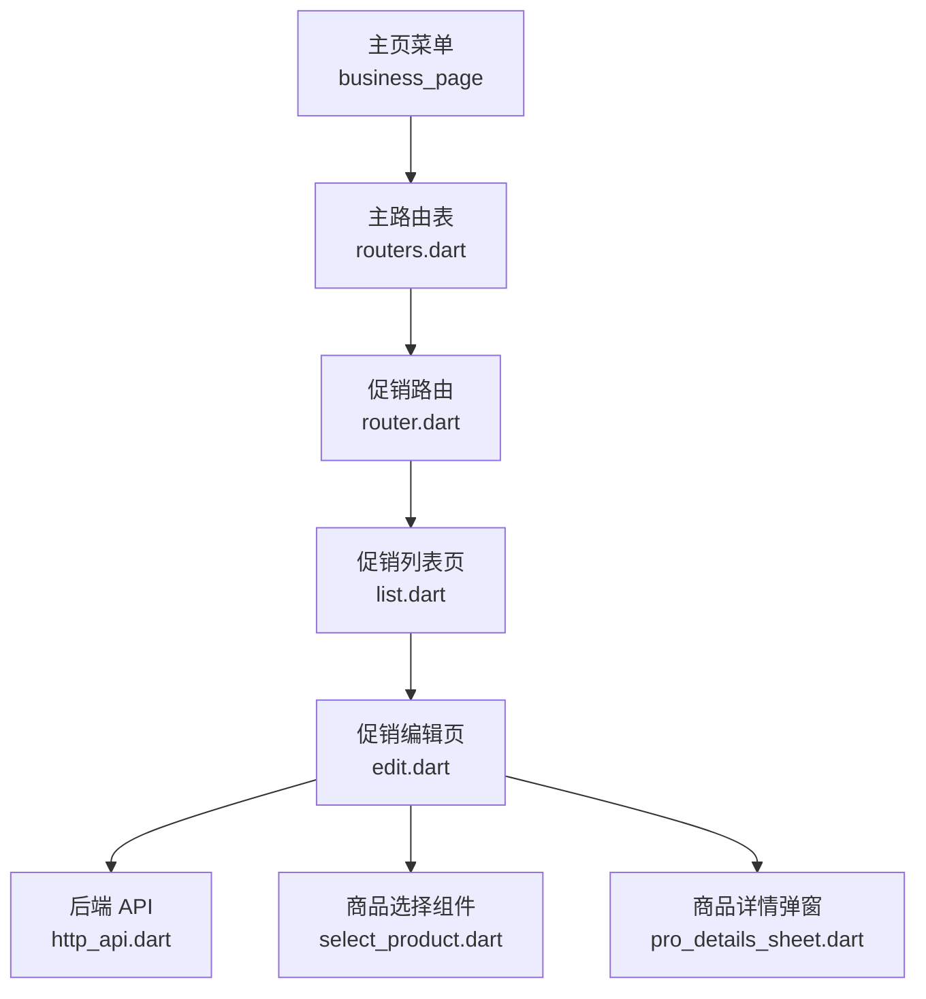
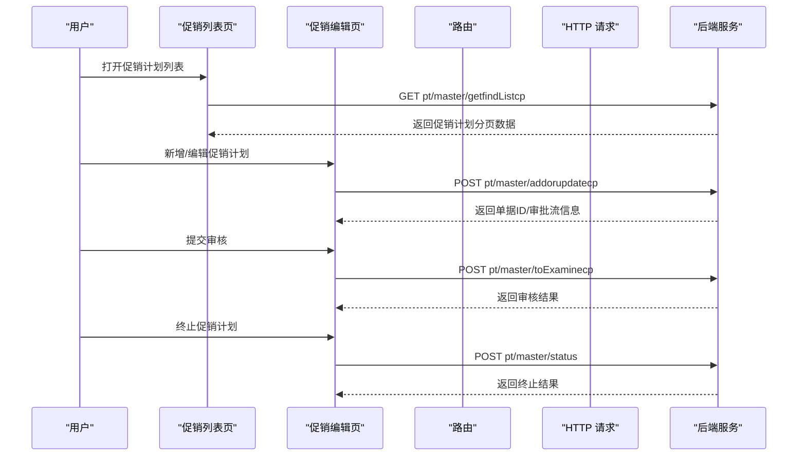
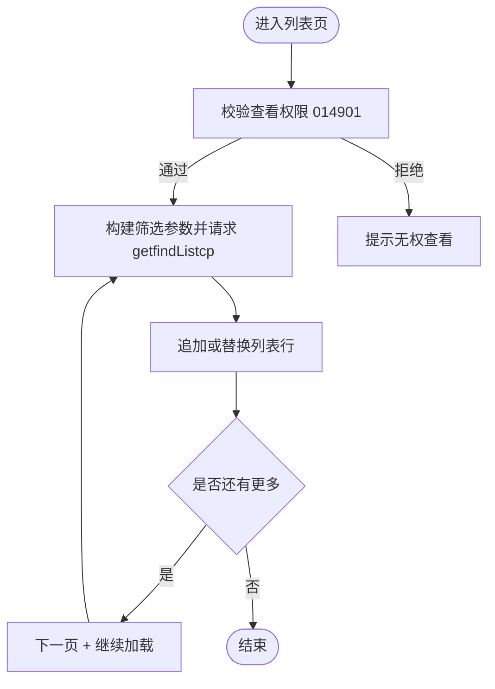
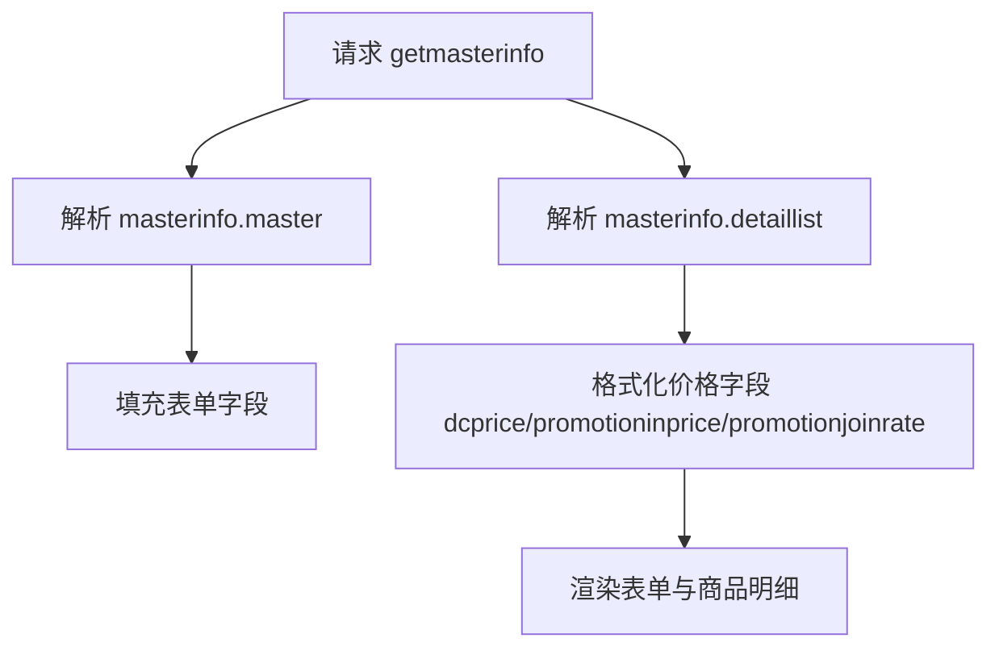
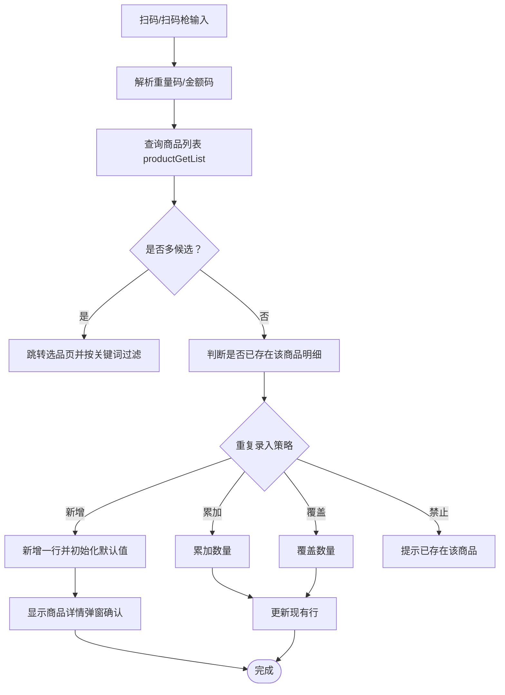
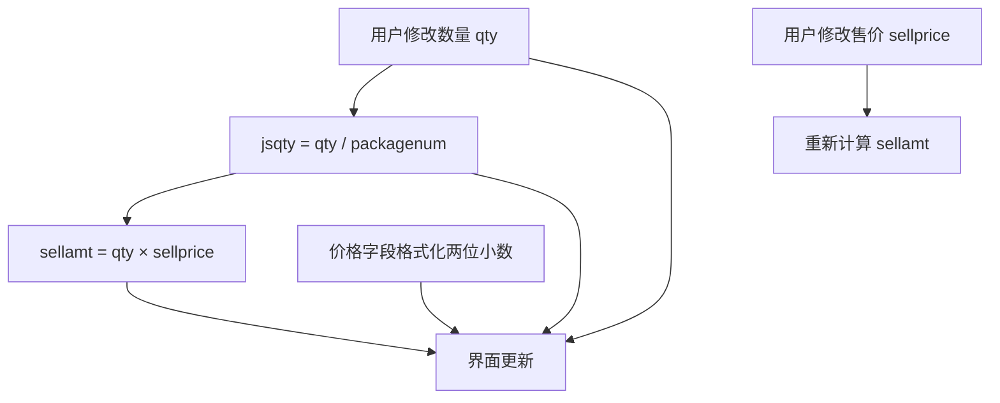
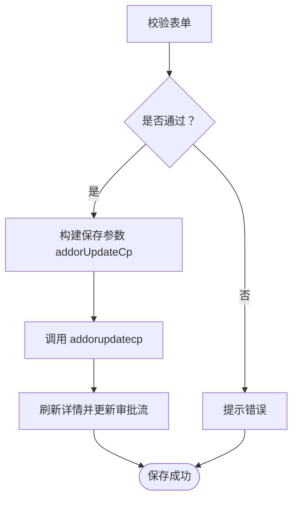
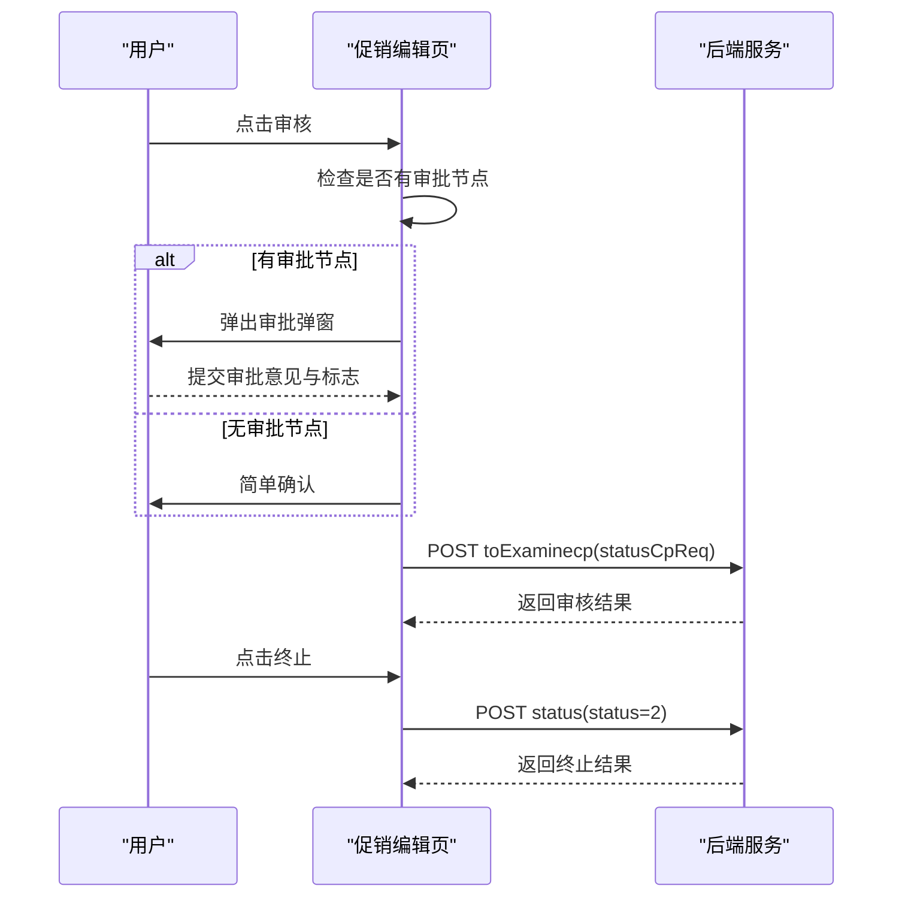
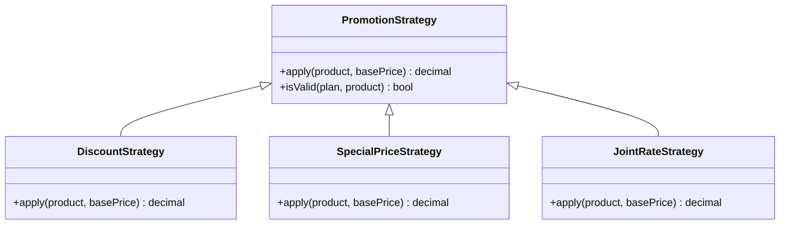
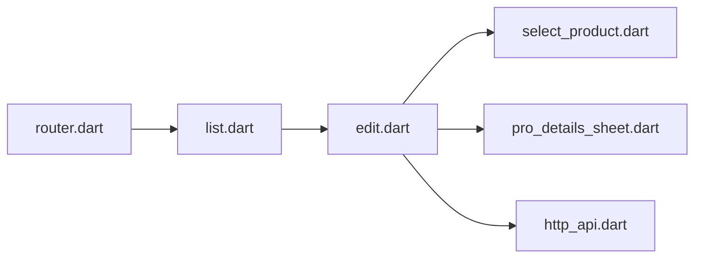

# 促销计划

<cite>
**本文引用的文件**   
- [lib/pages/business/basis/promotionPlan/router.dart](file://lib/pages/business/basis/promotionPlan/router.dart)
- [lib/pages/business/basis/promotionPlan/list.dart](file://lib/pages/business/basis/promotionPlan/list.dart)
- [lib/pages/business/basis/promotionPlan/edit.dart](file://lib/pages/business/basis/promotionPlan/edit.dart)
- [lib/net/http_api.dart](file://lib/net/http_api.dart)
- [lib/routers/routers.dart](file://lib/routers/routers.dart)
- [lib/components/select/select_product.dart](file://lib/components/select/select_product.dart)
- [lib/components/pro_details_sheet.dart](file://lib/components/pro_details_sheet.dart)
</cite>

## 目录
1. [简介](#简介)
2. [项目结构](#项目结构)
3. [核心组件](#核心组件)
4. [架构总览](#架构总览)
5. [详细组件分析](#详细组件分析)
6. [依赖关系分析](#依赖关系分析)
7. [性能与可用性](#性能与可用性)
8. [故障排查指南](#故障排查指南)
9. [结论](#结论)
10. [附录：促销参数与数据模型](#附录促销参数与数据模型)

## 简介
本文件面向灵犀管店 Flutter 项目的“促销计划”功能，围绕促销活动在移动端侧的创建、配置、审核、执行状态管理与效果观察进行系统化说明。文档重点包括：
- 促销计划的列表查询、筛选与分页加载
- 新增/编辑促销计划的表单字段、参与商品选择、价格与折扣规则设置
- 扫码录入商品、批量删除、复制并新增等交互
- 多级审批流程、审核/反审核/撤回/终止操作
- 与商品定价、销售统计等模块的数据关联点与设计建议
- 代码级流程图与架构图，帮助读者快速理解调用链和数据结构

## 项目结构
促销计划功能主要位于业务基础模块中，采用页面路由 + 列表页 + 编辑页的典型组织方式：
- 路由注册：`PromotionPlanRouter` 定义 `/basis/promotionPlan/list` 路由，统一由主路由表装配。
- 列表页：`PromotionPlanListPage` 负责按状态、门店、时间等维度检索促销计划，支持下拉刷新与滚动加载更多。
- 编辑页：`PromotionPlanEditPage` 负责促销计划的新增、修改、审核、反审核、删除、终止等操作，包含活动基本信息与商品明细。

**图表来源**
- [lib/routers/routers.dart:8-133](file://lib/routers/routers.dart#L8-L133)
- [lib/pages/business/basis/promotionPlan/router.dart:1-17](file://lib/pages/business/basis/promotionPlan/router.dart#L1-L17)
- [lib/pages/business/basis/promotionPlan/list.dart:1-200](file://lib/pages/business/basis/promotionPlan/list.dart#L1-L200)
- [lib/pages/business/basis/promotionPlan/edit.dart:1-200](file://lib/pages/business/basis/promotionPlan/edit.dart#L1-L200)
- [lib/net/http_api.dart:537-542](file://lib/net/http_api.dart#L537-L542)

**章节来源**
- [lib/pages/business/basis/promotionPlan/router.dart:1-17](file://lib/pages/business/basis/promotionPlan/router.dart#L1-L17)
- [lib/pages/business/basis/promotionPlan/list.dart:1-200](file://lib/pages/business/basis/promotionPlan/list.dart#L1-L200)
- [lib/pages/business/basis/promotionPlan/edit.dart:1-200](file://lib/pages/business/basis/promotionPlan/edit.dart#L1-L200)
- [lib/net/http_api.dart:537-542](file://lib/net/http_api.dart#L537-L542)

## 核心组件
本节对促销计划的关键组件进行职责划分与要点总结：

| 组件 | 职责 | 关键能力 |
|---|---|---|
| `PromotionPlanRouter` | 声明路由并返回列表页 | 定义 `/basis/promotionPlan/list` |
| `PromotionPlanListPage` | 展示促销计划列表、筛选、分页 | 待审核/已审核/已驳回、门店、日期范围、关键词搜索、权限控制 |
| `PromotionPlanEditPage` | 新增/编辑/审核/删除/终止促销计划 | 活动名称、起止日期/时间、机构、商品明细、特价/促销进货价/联营扣率、审批流 |
| `HttpApi.promotionPlan*` | 后端接口常量 | 列表、详情、保存、审核、删除、启用/终止 |
| `SelectProductPage` | 多选商品 | 按条码/自编码过滤、单位规格联动、覆盖或累加策略 |
| `ProDetailsSheet` | 商品详情弹窗 | 单位/规格、价格同步、库存/成本/售价等字段展示与更新 |

**章节来源**
- [lib/pages/business/basis/promotionPlan/router.dart:1-17](file://lib/pages/business/basis/promotionPlan/router.dart#L1-L17)
- [lib/pages/business/basis/promotionPlan/list.dart:1-200](file://lib/pages/business/basis/promotionPlan/list.dart#L1-L200)
- [lib/pages/business/basis/promotionPlan/edit.dart:1-200](file://lib/pages/business/basis/promotionPlan/edit.dart#L1-L200)
- [lib/net/http_api.dart:537-542](file://lib/net/http_api.dart#L537-L542)

## 架构总览
促销计划从前端到后端的整体调用链如下：

**图表来源**
- [lib/pages/business/basis/promotionPlan/list.dart:120-160](file://lib/pages/business/basis/promotionPlan/list.dart#L120-L160)
- [lib/pages/business/basis/promotionPlan/edit.dart:861-904](file://lib/pages/business/basis/promotionPlan/edit.dart#L861-L904)
- [lib/pages/business/basis/promotionPlan/edit.dart:1008-1060](file://lib/pages/business/basis/promotionPlan/edit.dart#L1008-L1060)
- [lib/pages/business/basis/promotionPlan/edit.dart:1090-1105](file://lib/pages/business/basis/promotionPlan/edit.dart#L1090-L1105)
- [lib/net/http_api.dart:537-542](file://lib/net/http_api.dart#L537-L542)

## 详细组件分析

### 促销列表页：`PromotionPlanListPage`
- 列表数据来源：调用 `pt/master/getfindListcp`，返回 `data.list`。
- 筛选条件：审核状态 `signflag`、生效状态 `startflag`、门店 `sids`、创建人 `createid/createname`、起止日期 `startdate/enddate`、关键词 `cond`。
- 分页加载：每页 20 条；滚动到底部自动加载更多；下拉刷新重置为第 1 页。
- 权限控制：查看权限码 `014901`；新增权限码 `014902`。

**图表来源**
- [lib/pages/business/basis/promotionPlan/list.dart:22-115](file://lib/pages/business/basis/promotionPlan/list.dart#L22-L115)
- [lib/pages/business/basis/promotionPlan/list.dart:116-160](file://lib/pages/business/basis/promotionPlan/list.dart#L116-L160)

**章节来源**
- [lib/pages/business/basis/promotionPlan/list.dart:22-160](file://lib/pages/business/basis/promotionPlan/list.dart#L22-L160)

### 促销编辑页：`PromotionPlanEditPage`
编辑页承担促销计划的核心配置逻辑，包括：
- 活动基本信息：促销名称、活动日期、活动时间、促销机构（门店）。
- 商品明细：支持手动新增、扫码录入、批量删除、复制并新增。
- 促销规则：
  - 特价 `dcprice`
  - 促销进货价 `promotioninprice`
  - 促销联营扣率 `promotionjoinrate`
  - 是否参与特价折扣促销 `itempromotionflag`
- 金额汇总：单据金额 `billamt`、数量 `billqty`、销售金额 `billsellamt`。
- 审批与状态：保存、审核、反审核、撤回、删除、终止。

#### 数据加载与解析
- 详情接口：`pt/master/getmasterinfo`，返回 `masterinfo.master` 与 `masterinfo.detaillist`。
- 解析后的主表字段包括：`billid`、`billno`、`startdate`、`enddate`、`starttime`、`endtime`、`sids`、`mdstore`、`createtime`、`createname`、`signflag`、`reviewsignflag`、`reviewremark`、`billname`。
- 明细字段包含商品信息与价格相关字段，并对价格类字段做两位小数格式化。

**图表来源**
- [lib/pages/business/basis/promotionPlan/edit.dart:201-260](file://lib/pages/business/basis/promotionPlan/edit.dart#L201-L260)

**章节来源**
- [lib/pages/business/basis/promotionPlan/edit.dart:201-260](file://lib/pages/business/basis/promotionPlan/edit.dart#L201-L260)

#### 商品选择与扫码录入
- 手动选品：使用 `SelectProductPage`，支持多选、单位规格、条码/自编码过滤，并将选中商品映射为明细行。
- 扫码录入：
  - 支持摄像头扫码与 PDA/扫码枪输入。
  - 解析重量码/金额码，按单价反算数量。
  - 同码多条时跳转选品页让用户挑选。
  - 重复录入策略来自登录参数 `addRepeatProductFlag`：
    - 0：禁止重复并提示
    - 1：不提示，累加数量
    - 2：不提示，覆盖数量
    - 3：允许重复新增行
  - 判重规则：以 `productid` 与 `barcode/productbarcode` 组合判断是否为同一商品明细。

**图表来源**
- [lib/pages/business/basis/promotionPlan/edit.dart:430-590](file://lib/pages/business/basis/promotionPlan/edit.dart#L430-L590)
- [lib/pages/business/basis/promotionPlan/edit.dart:590-700](file://lib/pages/business/basis/promotionPlan/edit.dart#L590-L700)

**章节来源**
- [lib/pages/business/basis/promotionPlan/edit.dart:430-700](file://lib/pages/business/basis/promotionPlan/edit.dart#L430-L700)

#### 价格与数量联动计算
- 数量联动：根据包装换算系数 `packagenum` 计算标准数量 `jsqty`，同时计算销售金额 `sellamt = qty × sellprice`。
- 价格字段格式化：所有价格类字段保留两位小数，数量字段保留一位小数，销售金额保留三位小数。
- 商品详情弹窗回写：单位/规格、条码、单位名称、规格名称、以及一系列价格字段会回写到对应明细行。

**图表来源**
- [lib/pages/business/basis/promotionPlan/edit.dart:600-650](file://lib/pages/business/basis/promotionPlan/edit.dart#L600-L650)
- [lib/pages/business/basis/promotionPlan/edit.dart:700-760](file://lib/pages/business/basis/promotionPlan/edit.dart#L700-L760)

**章节来源**
- [lib/pages/business/basis/promotionPlan/edit.dart:600-760](file://lib/pages/business/basis/promotionPlan/edit.dart#L600-L760)

#### 表单验证与保存
- 必填校验：促销名称、活动日期、至少一个有效商品、每个商品填写特价或特价为 0。
- 保存参数：包含活动起止日期/时间、机构、商品明细列表、汇总金额/数量/销售金额，固定单类型 `billtype=8`、`itemtype=0`、`salebound=1`。
- 保存成功后刷新详情并处理审批流信息。

**图表来源**
- [lib/pages/business/basis/promotionPlan/edit.dart:760-820](file://lib/pages/business/basis/promotionPlan/edit.dart#L760-L820)
- [lib/pages/business/basis/promotionPlan/edit.dart:820-904](file://lib/pages/business/basis/promotionPlan/edit.dart#L820-L904)

**章节来源**
- [lib/pages/business/basis/promotionPlan/edit.dart:760-904](file://lib/pages/business/basis/promotionPlan/edit.dart#L760-L904)

#### 审核、反审核、撤回与终止
- 审核：
  - 若存在多级审批节点，则弹出审批弹窗，收集审批意见与审批标志 `reviewsignflag`。
  - 无审批配置时直接确认审核。
  - 调用 `pt/master/toExaminecp` 提交审核。
- 反审核：
  - 权限码 `014906`，确认后设置 `reviewsignflag=2` 并提交审核接口。
- 撤回：
  - 仅在非最终审核节点且非已审核状态下可撤回。
- 终止：
  - 调用 `pt/master/status`，状态码 `status=2`。

**图表来源**
- [lib/pages/business/basis/promotionPlan/edit.dart:904-1060](file://lib/pages/business/basis/promotionPlan/edit.dart#L904-L1060)
- [lib/pages/business/basis/promotionPlan/edit.dart:1060-1105](file://lib/pages/business/basis/promotionPlan/edit.dart#L1060-L1105)

**章节来源**
- [lib/pages/business/basis/promotionPlan/edit.dart:904-1105](file://lib/pages/business/basis/promotionPlan/edit.dart#L904-L1105)

### 概念性概览：促销策略设计模式
虽然当前前端未实现复杂的促销引擎，但可通过以下设计模式扩展促销策略：
- 策略模式：将不同促销规则封装为独立策略对象（如满减、折扣、特价、联营扣率），在订单结算阶段按规则优先级应用。
- 模板方法：统一促销计算流程（匹配商品、计算优惠、生成促销明细），子类实现具体算法。
- 观察者模式：监听促销计划状态变更（审核通过、终止），通知销售统计与定价模块刷新缓存。

[本图为概念设计图，不对应具体源码文件]

## 依赖关系分析
促销计划功能的前端依赖关系如下：

**图表来源**
- [lib/pages/business/basis/promotionPlan/router.dart:1-17](file://lib/pages/business/basis/promotionPlan/router.dart#L1-L17)
- [lib/pages/business/basis/promotionPlan/list.dart:1-200](file://lib/pages/business/basis/promotionPlan/list.dart#L1-L200)
- [lib/pages/business/basis/promotionPlan/edit.dart:1-200](file://lib/pages/business/basis/promotionPlan/edit.dart#L1-L200)
- [lib/components/select/select_product.dart](file://lib/components/select/select_product.dart)
- [lib/components/pro_details_sheet.dart](file://lib/components/pro_details_sheet.dart)
- [lib/net/http_api.dart:537-542](file://lib/net/http_api.dart#L537-L542)

**章节来源**
- [lib/pages/business/basis/promotionPlan/router.dart:1-17](file://lib/pages/business/basis/promotionPlan/router.dart#L1-L17)
- [lib/pages/business/basis/promotionPlan/list.dart:1-200](file://lib/pages/business/basis/promotionPlan/list.dart#L1-L200)
- [lib/pages/business/basis/promotionPlan/edit.dart:1-200](file://lib/pages/business/basis/promotionPlan/edit.dart#L1-L200)

## 性能与可用性
- 列表分页：默认每页 20 条，避免一次性加载过多数据导致卡顿。
- 滚动加载：在滚动到距底部 60px 时触发下一页加载，提升长列表体验。
- 防抖搜索：搜索输入 350ms 防抖，减少频繁请求。
- 详情页优化：使用 `CustomScrollView` 与粘性头部，保证扫码框与标题栏在滚动时始终可见。
- 键盘交互：输入框弹起时延迟滚动定位，避免被键盘遮挡。
- 并发保护：扫码输入在查询/弹窗期间锁定，防止并发插入明细造成数据竞争。

[本节为通用性能建议，不涉及具体源码片段]

## 故障排查指南
- 无法查看促销计划：
  - 检查权限码 `014901` 是否授予。
  - 列表页在权限不足时会提示无权查看。
- 无法新增/编辑促销计划：
  - 新增权限码 `014902`，编辑权限码 `014903`。
  - 编辑页在保存前会校验必填字段与特价必填。
- 审核失败：
  - 检查是否属于当前审批节点，若非第一节点需具备相应权限。
  - 审核接口返回 `retmsg`，可根据提示定位问题。
- 终止失败：
  - 确认单据处于可终止状态，终止调用状态码 `status=2`。
- 扫码无结果：
  - 检查商品查询接口是否返回有效商品；重量码/金额码解析是否正确。
  - 多候选商品会跳转选品页，需手动选择。

**章节来源**
- [lib/pages/business/basis/promotionPlan/list.dart:40-80](file://lib/pages/business/basis/promotionPlan/list.dart#L40-L80)
- [lib/pages/business/basis/promotionPlan/edit.dart:820-904](file://lib/pages/business/basis/promotionPlan/edit.dart#L820-L904)
- [lib/pages/business/basis/promotionPlan/edit.dart:1008-1060](file://lib/pages/business/basis/promotionPlan/edit.dart#L1008-L1060)
- [lib/pages/business/basis/promotionPlan/edit.dart:1090-1105](file://lib/pages/business/basis/promotionPlan/edit.dart#L1090-L1105)

## 结论
促销计划在当前实现中提供了完整的移动端管理能力：列表查询、筛选、分页；新增/编辑表单；商品选择与扫码录入；价格与数量联动；审批流与状态管理。虽然促销效果的计算逻辑主要由后端承担，前端负责数据采集与展示，但通过清晰的数据结构与调用链，可以方便地在后端扩展促销策略并在前端对接新的计算结果。

[本节为总结性内容，不涉及具体源码片段]

## 附录：促销参数与数据模型
- 促销计划主表关键字段：
  - `billid`：单据 ID
  - `billno`：单据编号
  - `billname`：促销名称
  - `startdate`/`enddate`：活动日期
  - `starttime`/`endtime`：活动时间
  - `sids`/`mdstore`：促销机构/门店
  - `createtime`/`createname`：创建时间与创建人
  - `signflag`：审核状态
  - `reviewsignflag`：审批标志
  - `reviewremark`：审批备注
- 促销计划明细关键字段：
  - `productid`/`productcode`/`productbarcode`：商品标识
  - `productname`/`typename`/`unit`/`unitname`/`size`/`sizename`：商品信息
  - `dcprice`：特价
  - `promotioninprice`：促销进货价
  - `promotionjoinrate`：促销联营扣率
  - `itempromotionflag`：是否参与特价折扣促销
  - `qty`/`jsqty`：数量与标准数量
  - `sellprice`/`sellamt`：售价与销售金额
  - `costprice`/`stockqty`：成本与库存
- 后端 API：
  - `pt/master/getfindListcp`：促销计划列表
  - `pt/master/getmasterinfo`：促销计划详情
  - `pt/master/addorupdatecp`：保存/更新促销计划
  - `pt/master/toExaminecp`：审核/撤回/反审核
  - `pt/master/delete`：删除促销计划
  - `pt/master/status`：启用/终止促销调价单

**章节来源**
- [lib/pages/business/basis/promotionPlan/edit.dart:201-260](file://lib/pages/business/basis/promotionPlan/edit.dart#L201-L260)
- [lib/pages/business/basis/promotionPlan/edit.dart:820-904](file://lib/pages/business/basis/promotionPlan/edit.dart#L820-L904)
- [lib/net/http_api.dart:537-542](file://lib/net/http_api.dart#L537-L542)