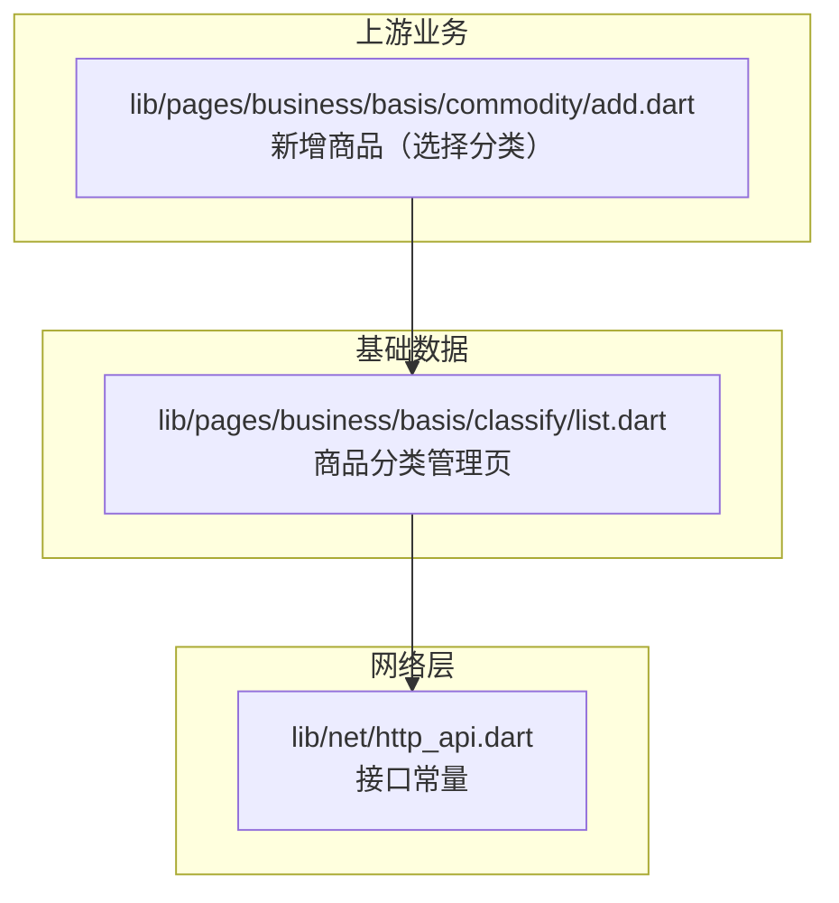
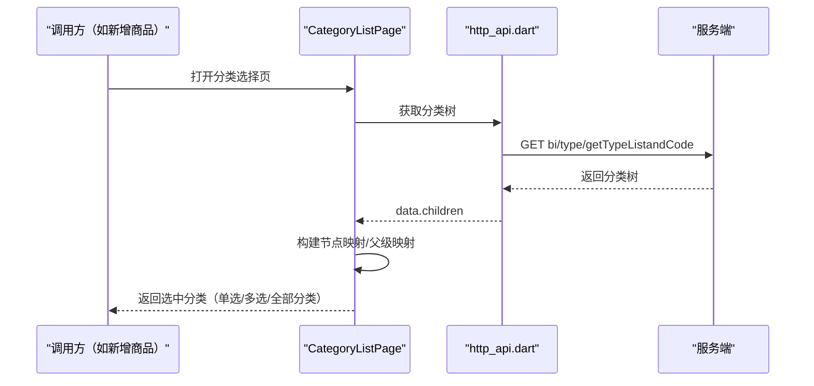
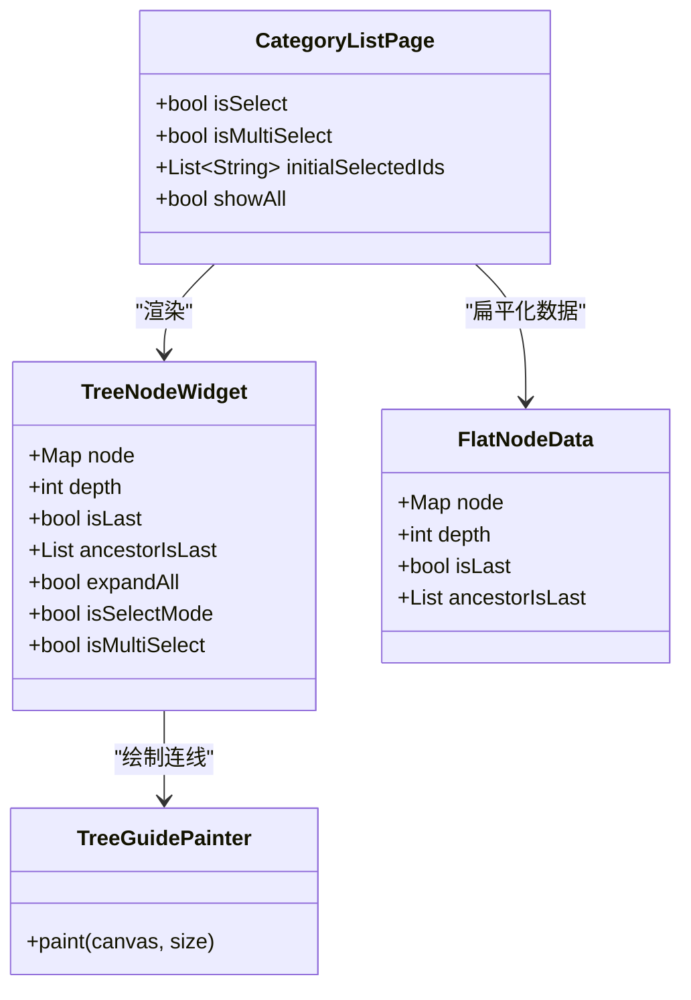
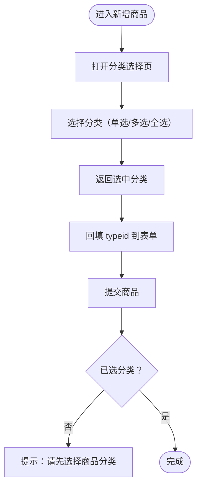

# 分类管理

<cite>
**本文引用的文件**   
- [lib/pages/business/basis/classify/list.dart](file://lib/pages/business/basis/classify/list.dart)
- [lib/net/http_api.dart](file://lib/net/http_api.dart)
- [lib/pages/business/basis/commodity/add.dart](file://lib/pages/business/basis/commodity/add.dart)
</cite>

## 目录
1. [简介](#简介)
2. [项目结构中的定位](#项目结构中的定位)
3. [核心组件](#核心组件)
4. [架构总览](#架构总览)
5. [详细组件分析](#详细组件分析)
6. [依赖关系分析](#依赖关系分析)
7. [性能与可扩展性](#性能与可扩展性)
8. [故障排查](#故障排查)
9. [结论](#结论)
10. [附录：字段、规则与示例](#附录字段规则与示例)

## 简介
本文件为灵犀管店 Flutter 项目中“商品分类”功能的完整技术文档。内容覆盖分类的层级结构、增删改查、树形展示、选择模式、权限校验、与商品业务的关系，以及最佳实践和性能优化建议。读者包括后端对接人员、Flutter 前端开发者、测试与运维同学。

## 项目结构中的定位
分类管理功能位于基础数据模块中，由一个统一的分类列表页面承载，既可用作“管理模式”，也可作为其他页面的“分类选择器”。

**图表来源**
- [lib/pages/business/basis/classify/list.dart:1-50](file://lib/pages/business/basis/classify/list.dart#L1-L50)
- [lib/net/http_api.dart:68-72](file://lib/net/http_api.dart#L68-L72)
- [lib/pages/business/basis/commodity/add.dart:1642-1656](file://lib/pages/business/basis/commodity/add.dart#L1642-L1656)

**章节来源**
- [lib/pages/business/basis/classify/list.dart:1-50](file://lib/pages/business/basis/classify/list.dart#L1-L50)
- [lib/net/http_api.dart:68-72](file://lib/net/http_api.dart#L68-L72)
- [lib/pages/business/basis/commodity/add.dart:1642-1656](file://lib/pages/business/basis/commodity/add.dart#L1642-L1656)

## 核心组件
- CategoryListPage：商品分类主页面，同时支持“管理模式”和“选择模式”。
- _TreeNodeWidget：树节点 Widget，负责渲染缩进线、展开/折叠、单选/多选、编辑/新增子分类。
- _FlatNodeData：扁平化节点数据，用于高效渲染长树。
- _TreeGuidePainter：绘制树形引导线的自定义 Painter。
- 分类表单弹窗：新增/编辑分类的底部弹窗，含上级分类、编码、名称、状态等字段。

关键职责：
- 加载分类树并维护父子映射。
- 支持搜索过滤、全选、级联选中、半选状态。
- 提供权限校验下的新增、编辑、删除。
- 在“选择模式”下返回选中分类给调用方。

**章节来源**
- [lib/pages/business/basis/classify/list.dart:1-50](file://lib/pages/business/basis/classify/list.dart#L1-L50)
- [lib/pages/business/basis/classify/list.dart:1053-1307](file://lib/pages/business/basis/classify/list.dart#L1053-L1307)

## 架构总览
分类管理采用单页多态设计：同一个页面通过参数切换“管理模式”与“选择模式”。网络访问集中在 http_api.dart 的接口常量，业务逻辑与 UI 耦合在一个文件中，便于快速迭代但需要注意后续拆分。

**图表来源**
- [lib/pages/business/basis/classify/list.dart:1-50](file://lib/pages/business/basis/classify/list.dart#L1-L50)
- [lib/net/http_api.dart:68-72](file://lib/net/http_api.dart#L68-L72)
- [lib/pages/business/basis/commodity/add.dart:1642-1656](file://lib/pages/business/basis/commodity/add.dart#L1642-L1656)

## 详细组件分析

### CategoryListPage：分类树管理与选择器
- 支持两种模式：
  - isSelect = false：管理模式，显示编辑/新增子分类按钮。
  - isSelect = true：选择模式，底部显示确认/取消；isMultiSelect=true 时支持多选。
- 内置权限校验：
  - 查看：010101
  - 新增：010102
  - 编辑：010103
  - 删除：010104
- 数据模型：
  - 使用 Map<String, dynamic> 表示分类节点。
  - 维护 _nodeMap、_parentMap、_selectedIds、_indeterminateIds 等缓存与状态。
- 核心流程：
  - 初始化时校验权限并加载分类树。
  - 根据 selectedIds 计算半选节点集合，向上同步祖先选中状态。
  - 搜索时按名称/编码过滤树，并按需自动展开。
  - 提交前对选择结果进行格式化（例如多选时 name 拼接为 “[编码]名称”）。

典型方法：
- _loadCategories：拉取分类树并构建父子映射。
- _buildNodeMaps：递归建立 ID 到节点、ID 到父 ID 的映射。
- _getDescendantIds：获取节点及其所有子孙 ID。
- _syncUp：选中/取消时向上同步祖先节点。
- _openEditSheet：打开新增/编辑弹窗。
- _saveCategory：保存新增或修改的分类。
- _confirmDelete：删除分类前的权限校验与二次确认。

**章节来源**
- [lib/pages/business/basis/classify/list.dart:1-200](file://lib/pages/business/basis/classify/list.dart#L1-L200)
- [lib/pages/business/basis/classify/list.dart:201-600](file://lib/pages/business/basis/classify/list.dart#L201-L600)
- [lib/pages/business/basis/classify/list.dart:601-1052](file://lib/pages/business/basis/classify/list.dart#L601-L1052)

### _TreeNodeWidget：树节点渲染
- 负责单个分类节点的渲染：
  - 树形缩进与连接线（使用 CustomPaint）。
  - 展开/折叠图标或叶子指示点。
  - 单选框、复选框、半选状态。
  - 管理模式下的编辑与新增子分类按钮。
- 性能要点：
  - 复用 widget，避免每次重建整棵树。
  - 使用 RepaintBoundary 降低重绘范围。
- 业务约束：
  - 最多支持 4 级分类（depth < 3 才允许新增子级）。

**章节来源**
- [lib/pages/business/basis/classify/list.dart:1053-1307](file://lib/pages/business/basis/classify/list.dart#L1053-L1307)

### 分类表单弹窗：新增/编辑分类
- 字段：
  - 上级分类：只读显示，新增子分类时来自被点击的父节点。
  - 分类编码：新增时可输入，支持从接口自动获取；编辑时为只读文本。
  - 分类名称：必填。
  - 状态：启用/停用开关。
- 交互：
  - 新增时“保存并继续”可清空输入并预填下一个编码。
  - 编辑时“删除”按钮触发删除流程。
  - 提交后刷新分类树。

**章节来源**
- [lib/pages/business/basis/classify/list.dart:201-600](file://lib/pages/business/basis/classify/list.dart#L201-L600)
- [lib/pages/business/basis/classify/list.dart:601-1052](file://lib/pages/business/basis/classify/list.dart#L601-L1052)

## 依赖关系分析
分类管理对外暴露的主要依赖：
- 网络接口常量：bi/type/*
- 权限工具：PermissionUtils
- Toast 工具：Toast
- 调用方：商品新增、库存查询、报表筛选等页面。

**图表来源**
- [lib/pages/business/basis/classify/list.dart:1-50](file://lib/pages/business/basis/classify/list.dart#L1-L50)
- [lib/pages/business/basis/classify/list.dart:1053-1307](file://lib/pages/business/basis/classify/list.dart#L1053-L1307)

**章节来源**
- [lib/pages/business/basis/classify/list.dart:1-50](file://lib/pages/business/basis/classify/list.dart#L1-L50)
- [lib/pages/business/basis/classify/list.dart:1053-1307](file://lib/pages/business/basis/classify/list.dart#L1053-L1307)

## 性能与可扩展性

### 数据结构与复杂度
- 节点映射：
  - _nodeMap：O(N) 空间，O(1) 查找。
  - _parentMap：O(N) 空间，O(1) 查找。
- 树展平：
  - _flattenTree：一次 DFS，时间 O(N)。
- 选择联动：
  - _getDescendantIds：最坏 O(N)。
  - _hasSelectedDescendant/_recomputeIndeterminate：遍历节点集合，整体接近 O(N^2) 的极端情况，但在分类规模不大时影响有限。
- 列表渲染：
  - ListView.builder + cacheExtent 提升滚动性能。
  - RepaintBoundary 减少不必要重绘。

### 优化建议
- 将复杂联动逻辑下沉至独立的 Service/Provider，解耦 UI。
- 对大规模分类数据，考虑后端分页或懒加载子节点。
- 对搜索过滤结果做防抖处理，减少频繁 setState。
- 将权限校验封装为统一中间件或守卫函数。
- 将分类数据缓存到本地存储，结合版本号控制更新策略。

[本节为通用性能讨论，不直接分析具体代码行]

## 故障排查
常见问题与处理方式：
- 无权限提示：
  - 查看/新增/编辑/删除分别对应权限码 010101/010102/010103/010104，请检查后台配置。
- 无法新增子分类：
  - 当 depth >= 3 时不再显示“+”按钮，这是 API 限制最多 4 级的体现。
- 新增分类编码为空：
  - 新增时会自动调用 getCode 接口填充编码；若为空，请检查网络或接口返回值。
- 删除失败：
  - 删除前会弹出二次确认，且需要 010104 权限；请确认权限与后端接口正常。
- 搜索结果异常：
  - 搜索同时匹配 name/typename 与 typecode/code，确保字段名与数据一致。

**章节来源**
- [lib/pages/business/basis/classify/list.dart:201-600](file://lib/pages/business/basis/classify/list.dart#L201-L600)
- [lib/pages/business/basis/classify/list.dart:601-1052](file://lib/pages/business/basis/classify/list.dart#L601-L1052)

## 结论
分类管理以单一页面实现了“管理+选择”双场景，具备完整的层级结构、树形展示、选择联动与权限控制，并与商品等业务紧密衔接。建议在后续版本中逐步解耦数据层与服务层，增强搜索与批量操作能力，同时引入更完善的错误处理与日志上报。

[本节为总结性内容，不直接分析具体代码行]

## 附录：字段、规则与示例

### 分类字段定义
- typeid：分类唯一标识（字符串）。
- name/typename：分类名称。
- typecode/code：分类编码。
- parenttypeid：上级分类 ID。
- children：子分类数组。
- stopflag：状态，“1”表示停用。

上述字段在页面中被兼容读取，优先使用 name/typecode，其次 fallback 到 typename/code。

**章节来源**
- [lib/pages/business/basis/classify/list.dart:201-600](file://lib/pages/business/basis/classify/list.dart#L201-L600)
- [lib/pages/business/basis/classify/list.dart:601-1052](file://lib/pages/business/basis/classify/list.dart#L601-L1052)

### 业务规则
- 层级限制：最多 4 级分类。
- 权限控制：
  - 查看：010101
  - 新增：010102
  - 编辑：010103
  - 删除：010104
- 编码生成：新增分类时调用 getCode 接口，传入父级原始编码字符串。
- 选择模式：
  - 单选：返回包含 typeid/typename/typecode/code 的对象。
  - 多选：返回节点数组，name/typename 会被格式化为 “[编码]名称”。
  - 全选：showAll=true 且勾选“全部分类”时返回空数组，表示全部分类。

**章节来源**
- [lib/pages/business/basis/classify/list.dart:201-600](file://lib/pages/business/basis/classify/list.dart#L201-L600)

### 分类与商品的关系
- 商品新增页面通过 CategoryListPage 选择所属分类，并将 typeid 回写至表单。
- 提交商品时校验是否选择了分类，未选择则提示“请先选择商品分类”。

**图表来源**
- [lib/pages/business/basis/commodity/add.dart:1642-1656](file://lib/pages/business/basis/commodity/add.dart#L1642-L1656)
- [lib/pages/business/basis/commodity/add.dart:977-978](file://lib/pages/business/basis/commodity/add.dart#L977-L978)

**章节来源**
- [lib/pages/business/basis/commodity/add.dart:977-978](file://lib/pages/business/basis/commodity/add.dart#L977-L978)
- [lib/pages/business/basis/commodity/add.dart:1642-1656](file://lib/pages/business/basis/commodity/add.dart#L1642-L1656)

### 操作示例（路径说明）
- 创建多级分类：
  - 在分类树中点击某节点的“+”按钮，填写上级分类、编码、名称与状态后保存。
  - 参考路径：[lib/pages/business/basis/classify/list.dart:201-600](file://lib/pages/business/basis/classify/list.dart#L201-L600)
- 拖拽排序：
  - 当前分类管理页面未实现拖拽排序功能；如需支持，可在 _TreeNodeWidget 中引入拖拽库并维护排序字段。
- 批量操作分类：
  - 当前仅支持多选选择分类；如需批量编辑/删除，可增加批量操作入口并在后端扩展相应接口。

[本节为概念性示例，不直接引用具体代码行]

### 接口清单
- 分类树（含编码）：bi/type/getTypeListandCode
- 新增分类：bi/type/addTypeInfo
- 修改分类：bi/type/updateTypeInfo
- 删除分类：bi/type/delTypeInfo
- 获取分类编码：bi/type/getCode

**章节来源**
- [lib/net/http_api.dart:68-72](file://lib/net/http_api.dart#L68-L72)