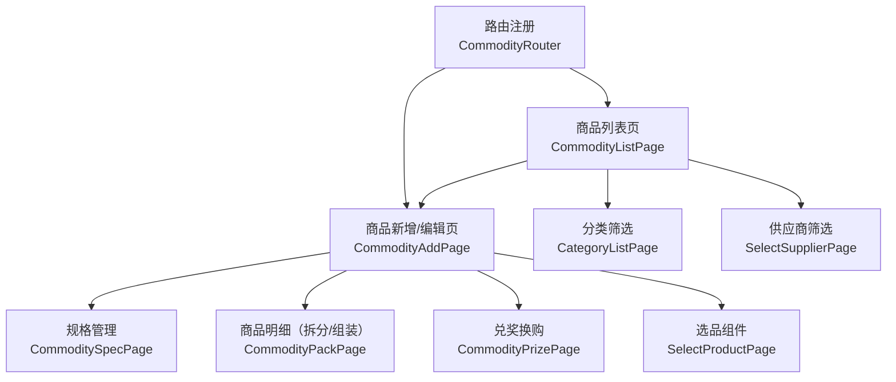
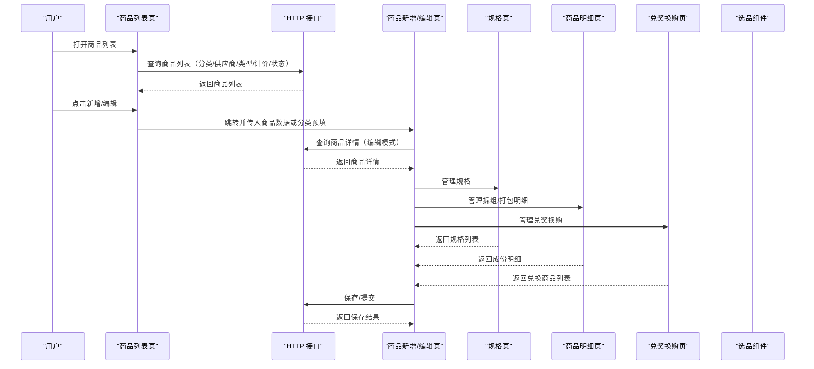
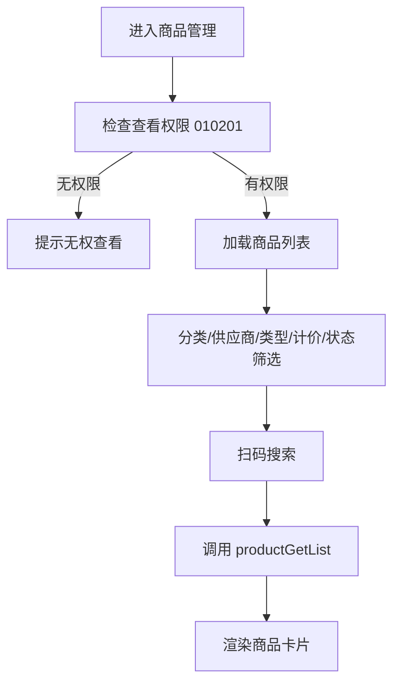
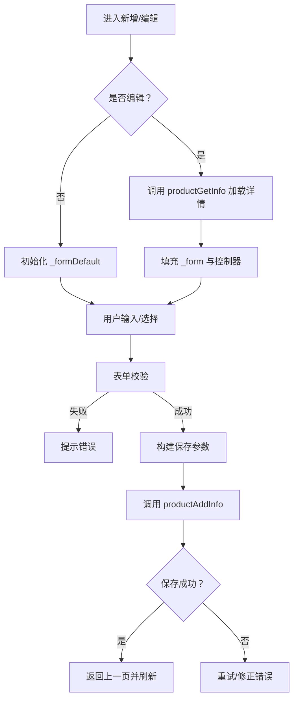
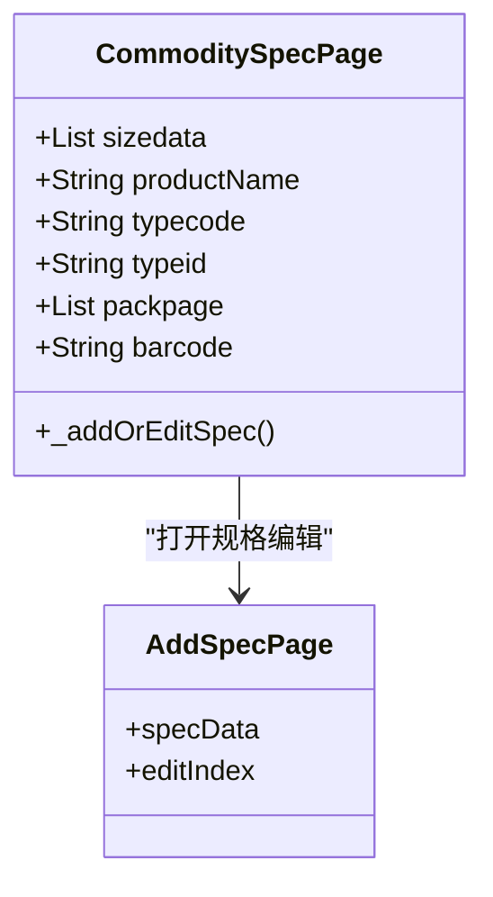
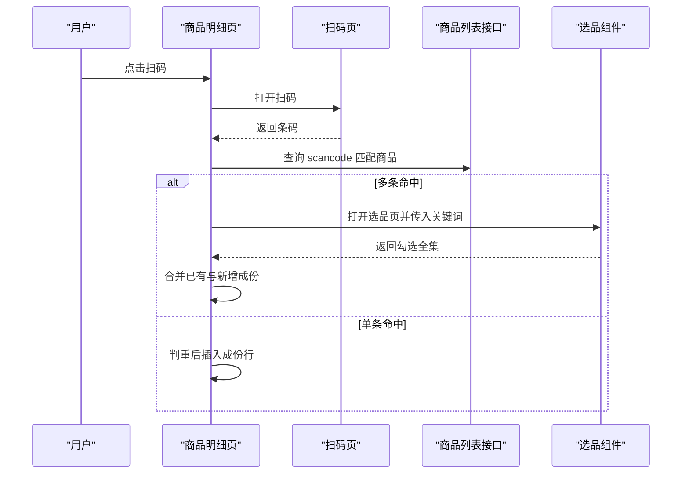

# 商品管理

<cite>
**本文引用的文件**   
- [lib/pages/business/basis/commodity/router.dart](file://lib/pages/business/basis/commodity/router.dart)
- [lib/pages/business/basis/commodity/list.dart](file://lib/pages/business/basis/commodity/list.dart)
- [lib/pages/business/basis/commodity/add.dart](file://lib/pages/business/basis/commodity/add.dart)
- [lib/pages/business/basis/commodity/product.dart](file://lib/pages/business/basis/commodity/product.dart)
- [lib/pages/business/basis/commodity/spec.dart](file://lib/pages/business/basis/commodity/spec.dart)
- [lib/pages/business/basis/commodity/prize.dart](file://lib/pages/business/basis/commodity/prize.dart)
- [lib/components/select/select_product.dart](file://lib/components/select/select_product.dart)
- [lib/net/http_api.dart](file://lib/net/http_api.dart)
</cite>

## 目录
1. [简介](#简介)
2. [项目结构与入口](#项目结构与入口)
3. [核心功能总览](#核心功能总览)
4. [架构与数据流](#架构与数据流)
5. [商品字段定义](#商品字段定义)
6. [筛选条件与权限控制](#筛选条件与权限控制)
7. [商品列表展示](#商品列表展示)
8. [商品新增与编辑](#商品新增与编辑)
9. [规格管理与多类型商品](#规格管理与多类型商品)
10. [扫码添加商品与批量选择](#扫码添加商品与批量选择)
11. [最佳实践](#最佳实践)
12. [常见问题与排错](#常见问题与排错)
13. [总结](#总结)

## 简介
本文围绕灵犀管店 Flutter 项目的“商品管理”能力，系统性说明商品列表、新增编辑、规格、包装、兑奖换购、条码查重、扫码选品、权限控制等实现方式。文档既面向业务人员理解商品主数据含义，也面向开发者理解页面职责、接口契约和交互流程。

## 项目结构与入口
商品管理相关代码集中在基础资料模块下的商品目录中，并通过路由注册暴露两个主要入口：商品列表和商品新增/编辑。

**图表来源**
- [lib/pages/business/basis/commodity/router.dart:1-25](file://lib/pages/business/basis/commodity/router.dart#L1-L25)
- [lib/pages/business/basis/commodity/list.dart:1-200](file://lib/pages/business/basis/commodity/list.dart#L1-L200)
- [lib/pages/business/basis/commodity/add.dart:1-200](file://lib/pages/business/basis/commodity/add.dart#L1-L200)
- [lib/pages/business/basis/commodity/product.dart:1-60](file://lib/pages/business/basis/commodity/product.dart#L1-L60)
- [lib/pages/business/basis/commodity/spec.dart:1-60](file://lib/pages/business/basis/commodity/spec.dart#L1-L60)
- [lib/pages/business/basis/commodity/prize.dart:1-60](file://lib/pages/business/basis/commodity/prize.dart#L1-L60)
- [lib/components/select/select_product.dart:18-84](file://lib/components/select/select_product.dart#L18-L84)

**章节来源**
- [lib/pages/business/basis/commodity/router.dart:1-25](file://lib/pages/business/basis/commodity/router.dart#L1-L25)

## 核心功能总览
- 商品列表：支持关键词搜索、扫码搜索、分类筛选、供应商筛选、更多筛选（商品类型、计价方式、商品状态）、分页加载。
- 商品新增/编辑：基础信息、价格体系、单位与业务单位、规格、包装、包装配置、拆组明细、兑奖换购、更多参数、权限控制、条码查重与云商品库回填。
- 规格管理：增删改规格，设置默认规格，校验条码冲突。
- 商品明细：拆分/组装/自动拆组/打包商品的成份行管理，支持扫码、多选选品、判重合并。
- 兑奖换购：为 itemtype=10 的兑换商品维护兑换商品集合，支持扫码、多选、数量校验、单位切换。
- 批量操作：通过通用选品组件进行多选、勾选全集回写，用于拆组商品和兑奖换购等场景。

**章节来源**
- [lib/pages/business/basis/commodity/list.dart:1-200](file://lib/pages/business/basis/commodity/list.dart#L1-L200)
- [lib/pages/business/basis/commodity/add.dart:1-200](file://lib/pages/business/basis/commodity/add.dart#L1-L200)
- [lib/pages/business/basis/commodity/product.dart:1-60](file://lib/pages/business/basis/commodity/product.dart#L1-L60)
- [lib/pages/business/basis/commodity/spec.dart:1-60](file://lib/pages/business/basis/commodity/spec.dart#L1-L60)
- [lib/pages/business/basis/commodity/prize.dart:1-60](file://lib/pages/business/basis/commodity/prize.dart#L1-L60)

## 架构与数据流
商品管理整体采用“页面 + 组件 + 网络层”的结构：页面负责 UI 与用户交互；通用选品组件复用多选逻辑；网络层统一声明接口地址。

**图表来源**
- [lib/pages/business/basis/commodity/list.dart:1-200](file://lib/pages/business/basis/commodity/list.dart#L1-L200)
- [lib/pages/business/basis/commodity/add.dart:1-200](file://lib/pages/business/basis/commodity/add.dart#L1-L200)
- [lib/pages/business/basis/commodity/product.dart:1-60](file://lib/pages/business/basis/commodity/product.dart#L1-L60)
- [lib/pages/business/basis/commodity/spec.dart:1-60](file://lib/pages/business/basis/commodity/spec.dart#L1-L60)
- [lib/pages/business/basis/commodity/prize.dart:1-60](file://lib/pages/business/basis/commodity/prize.dart#L1-L60)
- [lib/net/http_api.dart:54-55](file://lib/net/http_api.dart#L54-L55)
- [lib/net/http_api.dart:347-349](file://lib/net/http_api.dart#L347-L349)

## 商品字段定义
商品新增/编辑表单以统一的 `_form` 对象为中心，所有输入框通过控制器监听自动同步到该对象，保存时直接序列化构建参数。以下为关键分组与字段说明。

### 基础标识与分类
- 条码：`barcode`，必填，支持国标 EAN-13 校验与重复判断。
- 自编码：`code`，可选，可仅条码建档。
- 名称：`name` / `productname`，必填。
- 简称：`shortname`。
- 助记码：`helpcode`。
- 图片：`imageurl`。
- 分类：`typeid` / `typecode` / `typename`，必填。
- 品牌：`brandname`。
- 备注：`remark`。
- 产地：`home`。

### 单位与业务单位
- 基本单位：`unit`，必填。
- 采购单位：`defcgunit`。
- 批发单位：`defpfunit`。
- 配送单位：`defpsunit`。
- 包装单位与包装配置：`packpage`、`packlinkpro`、`packagenum`。

### 价格与毛利
- 进价：`inprice`，受权限控制显示。
- 零售价：`sellprice`。
- 毛利率：`grossrate`，按进价/零售价联动计算。
- 会员价：`mprice1` / `mprice2` / `mprice3`。
- 批发价：`pfprice1` / `pfprice2` / `pfprice3`。
- 配送价：`psprice`，受权限控制显示。
- 最低售价：`minsellprice`。
- 促销价与时间：`promotionprice` / `promotionbegintime` / `promotionendtime`。

### 库存与积分
- 最高库存：`maxstock`。
- 最低库存：`minstock`。
- 期初库存：`initstorage`。
- 积分基数：`pointbase`。
- 积分：`point`。
- 积分方式：`pointtype`。
- 是否参与积分：`pointflag`。

### 商品属性与状态
- 商品类型：`itemtype`（普通、拆分、组装、自动拆分、自动组装、特价打包、包装商品、兑奖换购等）。
- 计价方式：`pricetype`（普通商品、计重商品、计份商品）。
- 经销方式：`selltype`（购销、联营、成本代销、扣率代销、租赁）。
- 物流方式：`pstype`。
- 存储方式：`memorytype`。
- 商品状态：`itemstatus`（正常、新品、冻结、停购、停用）。
- 销售开关：`sellflag`。
- 变更价格标志：`changepriceflag`。
- 生鲜标志：`freshflag`。
- 称重销售标志：`saleweighflag`。
- 促销标志：`promotionflag`。
- 折扣标志：`dscflag`。
- 赠品标志：`presentflag`。
- 有效期天数：`validday`。
- 有效标志：`validflag`。
- 位置：`locationcode` / `locationid`。
- 其他：`nousecouponsflag`、`freepriceflag`、`snflag`、`deducttype`、`deductvalue`、`joinrate`、`intaxrate`、`outtaxrate`、`custorderqtymin`。

### 明细与扩展数据
- 一品多码：`codes`。
- 规格：`sizedata`，过滤空条码后提交。
- 包装单位：`packpage`。
- 包装配置：`packlinkpro`，仅提交已关联商品的行。
- 拆组/打包明细：`extendlist`，根据 `itemtype` 动态使用对应 key。
- 兑奖换购：`prizelist`，仅 `itemtype=10` 时提交。

**章节来源**
- [lib/pages/business/basis/commodity/add.dart:1-200](file://lib/pages/business/basis/commodity/add.dart#L1-L200)
- [lib/pages/business/basis/commodity/add.dart:987-1368](file://lib/pages/business/basis/commodity/add.dart#L987-L1368)
- [lib/pages/business/basis/commodity/add.dart:1600-2000](file://lib/pages/business/basis/commodity/add.dart#L1600-L2000)

## 筛选条件与权限控制

### 筛选条件
- 分类：`typeid` / `typename` / `typecode`，通过分类选择器设置。
- 供应商：`supid` / `supname`，通过供应商选择器设置。
- 商品类型：`itemtype`，支持普通、拆分、组装、自动拆分、自动组装、特价打包等。
- 计价方式：`pricetype`，支持普通商品、计重商品、计份商品。
- 商品状态：`itemstatus`，多选并以逗号分隔传参，如 `1,2`。
- 关键词：`cond`，支持名称/编码模糊搜索。

### 权限控制
- 商品档案查看：进入列表前检查权限 `010201`，无权限提示。
- 商品档案新增：点击新增按钮检查权限 `010202`，无权限提示。
- 商品档案编辑：编辑保存前检查权限 `010203`，无权限提示。
- 商品档案删除：删除前检查权限 `010204`，无权限提示。
- 新品申请新增/编辑/删除/提交：分别使用权限 `010301` / `010305` / `010307` / `010306`。
- 进价查看：`user.inpriceflag==1` 或管理员 `code==1001` 时显示进价与毛利率。
- 配送价查看：`user.pspriceflag==1` 或管理员 `code==1001` 时显示配送价。
- 库存查看：列表卡片根据 `checkstockflag` 控制库存显示。

**图表来源**
- [lib/pages/business/basis/commodity/list.dart:1-200](file://lib/pages/business/basis/commodity/list.dart#L1-L200)
- [lib/pages/business/basis/commodity/list.dart:201-546](file://lib/pages/business/basis/commodity/list.dart#L201-L546)

**章节来源**
- [lib/pages/business/basis/commodity/list.dart:1-200](file://lib/pages/business/basis/commodity/list.dart#L1-L200)
- [lib/pages/business/basis/commodity/list.dart:201-546](file://lib/pages/business/basis/commodity/list.dart#L201-L546)
- [lib/pages/business/basis/commodity/add.dart:201-575](file://lib/pages/business/basis/commodity/add.dart#L201-L575)

## 商品列表展示
商品列表页承担以下职责：
- 顶部工具栏：关键词输入框、清空按钮、扫码图标、新增按钮。
- 快捷筛选条：分类、供应商、筛选按钮（更多筛选抽屉）。
- 下拉刷新与上拉加载更多。
- 商品卡片：展示名称、规格、单位、条码、零售价、库存、进价、批发价、会员价、货架号、图片等。
- 权限控制：根据进价查看与库存查看权限控制敏感字段展示。

交互要点：
- 搜索防抖：500ms 触发一次请求。
- 扫码搜索：非移动端提示不支持；移动端跳转扫码页，扫码后回填搜索框并执行搜索。
- 分类筛选：选择分类后重置分页并重新加载。
- 供应商筛选：选择供应商后重置分页并重新加载。
- 更多筛选：商品类型单选、计价方式单选、商品状态多选；确定后将 `itemstatus` 拼接为逗号分隔字符串传参。

**章节来源**
- [lib/pages/business/basis/commodity/list.dart:1-200](file://lib/pages/business/basis/commodity/list.dart#L1-L200)
- [lib/pages/business/basis/commodity/list.dart:201-546](file://lib/pages/business/basis/commodity/list.dart#L201-L546)
- [lib/pages/business/basis/commodity/list.dart:547-883](file://lib/pages/business/basis/commodity/list.dart#L547-L883)

## 商品新增与编辑
新增/编辑页是商品管理的核心。它统一管理表单数据、校验规则、权限、条码处理、价格联动、单位联动、多类型商品明细、以及保存与提交。

### 表单数据模型
- 中心数据对象 `_form`：所有字段集中管理，避免逐字段收集。
- 控制器映射 `_ctrlKeyMap`：将输入控件文本变更自动写入 `_form`。
- 默认值 `_formDefault`：保证新增时字段有初始值。
- 编辑模式：先调用 `productGetInfo` 获取详情，再填充 `_form` 与控制器。

### 校验规则
- 必填项：商品名称、分类、条码、单位、供应商、经销方式。
- 业务单位：采购单位、批发单位、配送单位在需要时必填。
- 特殊类型：拆分/组装/自动拆组/自动组装/特价打包必须维护对应明细。
- 兑奖换购：至少选择一个兑换商品，且兑换数量大于 0。
- 包装配置：已关联商品的包装数量必须大于等于 1。
- 价格约束：零售价小于进价或小于会员价时按系统参数限制。
- 条码冲突：商品条码不得与包装条码、规格条码相同。
- EAN-13：当后台开启且计价方式为普通商品时，校验条码格式。

### 条码处理
- 自动生成：选择分类或供应商后生成条码与自编码。
- 扫码录入：只接受 13 位条码，回车后查重并尝试云商品库回填。
- 重复判断：失焦或回车时调用后端查重接口；重复时弹出选择弹窗：建立同码新商品、修改原商品或取消。
- 云商品库：根据登录参数决定是否启用，成功后回填进价、零售价、名称、单位、规格等。

### 价格联动
- 毛利率：由进价与零售价联动计算，也可反向推算零售价。
- 自动加价：根据登录参数中的加价开关与基准，联动零售价/进价、批发价1、会员价1、配送价及等级价格。

### 单位联动
- 基本单位变化时，采购单位、批发单位、配送单位跟随业务单位规则自动回落或跟随包装单位。
- 包装设置模式下隐藏部分单位字段，并根据 itemtype 显示不同 Tab。

### 保存与提交
- 保存：校验通过后构建参数并提交 `productAddInfo`。
- 保存并继续：新增成功重置表单，保留分类/供应商/单位，再生成条码与自编码。
- 删除：二次确认后调用 `productDelInfo`。
- 新品申请：保存成功后二次调用 `applyNewProUpdate` 提交申请。

**图表来源**
- [lib/pages/business/basis/commodity/add.dart:600-986](file://lib/pages/business/basis/commodity/add.dart#L600-L986)
- [lib/pages/business/basis/commodity/add.dart:987-1368](file://lib/pages/business/basis/commodity/add.dart#L987-L1368)
- [lib/pages/business/basis/commodity/add.dart:3480-3720](file://lib/pages/business/basis/commodity/add.dart#L3480-L3720)

**章节来源**
- [lib/pages/business/basis/commodity/add.dart:1-200](file://lib/pages/business/basis/commodity/add.dart#L1-L200)
- [lib/pages/business/basis/commodity/add.dart:201-575](file://lib/pages/business/basis/commodity/add.dart#L201-L575)
- [lib/pages/business/basis/commodity/add.dart:600-986](file://lib/pages/business/basis/commodity/add.dart#L600-L986)
- [lib/pages/business/basis/commodity/add.dart:987-1368](file://lib/pages/business/basis/commodity/add.dart#L987-L1368)
- [lib/pages/business/basis/commodity/add.dart:1600-2000](file://lib/pages/business/basis/commodity/add.dart#L1600-L2000)
- [lib/pages/business/basis/commodity/add.dart:3480-3720](file://lib/pages/business/basis/commodity/add.dart#L3480-L3720)

## 规格管理与多类型商品

### 规格管理
规格页用于维护 `sizedata`，支持新增、编辑、删除、设置默认规格，并在提交时过滤空条码规格。

关键点：
- 新增/编辑规格：通过 `AddSpecPage` 返回数据，若设置为默认规格则取消其他默认。
- 展示：只显示有条码的有效规格。
- 校验：与主条码、包装条码去重。

**图表来源**
- [lib/pages/business/basis/commodity/spec.dart:1-60](file://lib/pages/business/basis/commodity/spec.dart#L1-L60)
- [lib/pages/business/basis/commodity/spec.dart:201-246](file://lib/pages/business/basis/commodity/spec.dart#L201-L246)

### 多类型商品明细
对于拆分、组装、自动拆分、自动组装、特价打包等商品类型，商品明细页管理成份行。

关键点：
- 标题随 `itemtype` 动态变化。
- 扫码添加：单条命中直接追加，多条命中跳转选品页。
- 选品页返回：以勾选全集为准，已有保留、新勾选追加。
- 判重：按 `packageid` 去重。

**章节来源**
- [lib/pages/business/basis/commodity/spec.dart:1-60](file://lib/pages/business/basis/commodity/spec.dart#L1-L60)
- [lib/pages/business/basis/commodity/spec.dart:201-246](file://lib/pages/business/basis/commodity/spec.dart#L201-L246)
- [lib/pages/business/basis/commodity/product.dart:1-60](file://lib/pages/business/basis/commodity/product.dart#L1-L60)

## 扫码添加商品与批量选择

### 扫码添加商品
- 列表页扫码：扫码后回填搜索框并搜索。
- 商品明细扫码：扫码查询商品，单条命中直接追加成份行，多条命中跳转选品页。
- 兑奖换购扫码：扫码查询商品，单条命中判重后追加，多条命中跳转选品页。

### 批量选择商品
选品组件支持单选、多选、复选框模式，并可传入 `mergData`、`selectList`、`initialKeyword`、`multiple`、`checkboxMode` 等参数。商品明细与兑奖换购均复用该组件完成批量选择。

**图表来源**
- [lib/pages/business/basis/commodity/product.dart:60-200](file://lib/pages/business/basis/commodity/product.dart#L60-L200)
- [lib/components/select/select_product.dart:18-84](file://lib/components/select/select_product.dart#L18-L84)
- [lib/net/http_api.dart:54-55](file://lib/net/http_api.dart#L54-L55)

**章节来源**
- [lib/pages/business/basis/commodity/product.dart:1-200](file://lib/pages/business/basis/commodity/product.dart#L1-L200)
- [lib/pages/business/basis/commodity/prize.dart:201-500](file://lib/pages/business/basis/commodity/prize.dart#L201-L500)
- [lib/components/select/select_product.dart:18-84](file://lib/components/select/select_product.dart#L18-L84)

## 最佳实践
- 优先使用中心 `_form` 管理表单数据，避免分散的状态变量导致提交遗漏。
- 所有数字字段统一使用格式化方法，保证小数位数一致。
- 条码处理遵循“自动生成 → 扫码录入 → 查重 → 云商品库回填”的顺序。
- 特殊商品类型必须先维护对应明细再提交，避免后端校验失败。
- 权限控制应贯穿列表、新增、编辑、删除、新品申请各入口，保持一致性。
- 批量选择时使用选品组件的勾选全集语义，确保已有数据不被误清空。
- 对敏感字段（进价、毛利率、配送价、库存）根据用户权限动态显示。

[本节为通用建议，不直接分析具体文件]

## 常见问题与排错
- 无法查看商品档案：检查用户是否拥有 `010201` 权限。
- 无法新增商品：检查用户是否拥有 `010202` 权限。
- 进价/毛利率不显示：检查 `inpriceflag` 是否为 1 或当前用户是否为管理员。
- 零售价小于进价报错：检查系统参数是否允许零售价小于进价。
- 条码重复：使用条码查重弹窗选择建立同码新商品或修改原商品。
- 云商品库未回填：检查登录参数中是否启用云商品库。
- 规格为空被过滤：规格必须有条码才会提交。
- 包装配置数量无效：包装数量必须大于等于 1。
- 兑换数量无效：兑换数量必须大于 0。
- 扫码不可用：非移动端平台会提示暂不支持扫码。

**章节来源**
- [lib/pages/business/basis/commodity/list.dart:1-200](file://lib/pages/business/basis/commodity/list.dart#L1-L200)
- [lib/pages/business/basis/commodity/add.dart:987-1368](file://lib/pages/business/basis/commodity/add.dart#L987-L1368)
- [lib/pages/business/basis/commodity/add.dart:3480-3720](file://lib/pages/business/basis/commodity/add.dart#L3480-L3720)

## 总结
灵犀管店的商品管理功能以商品列表与新增/编辑为核心，辅以规格、包装、拆组明细、兑奖换购等扩展能力。其设计强调：
- 数据结构集中：通过 `_form` 统一管理字段。
- 交互体验完善：扫码、多选、权限、校验、联动齐全。
- 扩展性强：通过 `itemtype` 区分不同商品类型，复用选品组件。
- 可维护性好：路由清晰、页面职责明确、接口集中声明。

在实际使用中，建议优先规范条码与分类，合理配置单位与业务单位，充分利用权限控制保护敏感数据，并按商品类型完善对应明细，从而保障后续采购、销售、库存等业务环节的顺畅运行。