# 基础资料模块

<cite>
**本文引用的文件**   
- [商品路由](file://lib/pages/business/basis/commodity/router.dart)
- [商品列表页](file://lib/pages/business/basis/commodity/list.dart)
- [商品新增/编辑页](file://lib/pages/business/basis/commodity/add.dart)
- [商品规格页](file://lib/pages/business/basis/commodity/spec.dart)
- [特价打包商品页](file://lib/pages/business/basis/commodity/bundle.dart)
- [商品明细（成份/拆分）页](file://lib/pages/business/basis/commodity/product.dart)
- [兑奖换购页](file://lib/pages/business/basis/commodity/prize.dart)
- [分类管理页](file://lib/pages/business/basis/classify/list.dart)
- [预包装改价路由](file://lib/pages/business/basis/prepackPrice/router.dart)
- [预包装改价主页](file://lib/pages/business/basis/prepackPrice/prepack_price_home.dart)
- [预包装详情抽屉](file://lib/pages/business/basis/prepackPrice/prepack_detail_sheet.dart)
- [打印路由](file://lib/pages/business/basis/printing/router.dart)
- [标签打印主页](file://lib/pages/business/basis/printing/label_print_home.dart)
- [单据列表页](file://lib/pages/business/basis/printing/receipts_list.dart)
- [快速调价列表页](file://lib/pages/business/basis/productChangePrice/list.dart)
- [门店调价单列表页](file://lib/pages/business/basis/storeChangePrice/list.dart)
- [促销计划列表页](file://lib/pages/business/basis/promotionPlan/list.dart)
- [新品申请列表页](file://lib/pages/business/basis/newApplication/list.dart)
</cite>

## 目录
1. [引言](#引言)
2. [项目结构与入口](#项目结构与入口)
3. [核心子功能总览](#核心子功能总览)
4. [架构与交互总览](#架构与交互总览)
5. [详细组件分析](#详细组件分析)
6. [数据依赖与业务关联](#数据依赖与业务关联)
7. [性能与状态设计](#性能与状态设计)
8. [扩展开发指南](#扩展开发指南)
9. [常见问题与排错](#常见问题与排错)
10. [结语](#结语)

## 引言
本模块聚焦灵犀管店 Flutter 应用中的“基础资料”领域，涵盖商品档案、商品分类、预包装改价、打印模板与单据、商品价格调整、门店价格调整、促销计划以及新品申请。这些功能共同构成门店日常运营的数据基座：商品与分类是主数据，调价与促销基于商品和门店定价策略，打印模板与预包装改价面向终端操作与出票场景，新品申请则提供商品上线前的审批流程。

文档从页面结构、业务流程、数据模型、界面交互、状态管理和扩展点五个维度展开，帮助开发者快速理解各子功能如何协作，并给出可落地的二次开发建议。

## 项目结构与入口
基础资料模块位于业务域 `lib/pages/business/basis` 下，采用“按子功能分目录 + 每个子功能自带路由文件”的组织方式。每个子功能通常包含：
- 路由定义文件：注册 Fluro 路由常量与页面构造器。
- 列表页：分页加载、筛选、扫码、权限校验。
- 编辑/详情页：表单或明细维护，部分通过底部抽屉展示。
- 辅助页：如分类选择、选品、打印设置等。

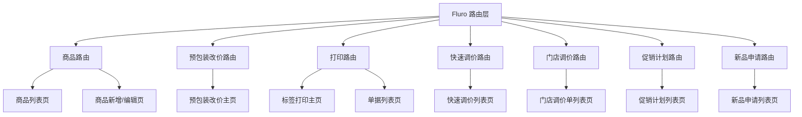

**图表来源**
- [商品路由:1-25](file://lib/pages/business/basis/commodity/router.dart#L1-L25)
- [预包装改价路由:1-17](file://lib/pages/business/basis/prepackPrice/router.dart#L1-L17)
- [打印路由:1-49](file://lib/pages/business/basis/printing/router.dart#L1-L49)
- [快速调价路由:1-17](file://lib/pages/business/basis/productChangePrice/router.dart#L1-L17)
- [门店调价路由:1-17](file://lib/pages/business/basis/storeChangePrice/router.dart#L1-L17)
- [促销计划路由:1-17](file://lib/pages/business/basis/promotionPlan/router.dart#L1-L17)
- [新品申请路由:1-17](file://lib/pages/business/basis/newApplication/router.dart#L1-L17)

**章节来源**
- [商品路由:1-25](file://lib/pages/business/basis/commodity/router.dart#L1-L25)
- [打印路由:1-49](file://lib/pages/business/basis/printing/router.dart#L1-L49)

## 核心子功能总览
| 子功能 | 主要职责 | 关键页面 | 典型接口 | 权限标识 |
|---|---|---|---|---|
| 商品管理 | 商品增删改查、多规格/打包/成份/兑奖维护 | 商品列表、商品新增/编辑、规格、打包、成份、兑奖 | 商品列表接口 | 查看、新增、编辑、删除、提交 |
| 分类管理 | 树形分类选择与管理，支持多选与全选 | 分类列表 | 分类列表接口 | 查看 |
| 预包装改价 | 计重/计份商品包装条码、金额、折扣联动计算与打印 | 改价主页、详情抽屉 | 商品列表、打印设置 | 查看、打印 |
| 打印模板与单据 | 标签打印、单据查询、未打印列表、商品分组 | 标签打印主页、单据列表、未打印列表 | 打印设置、标签打印参数、单据列表 | 查看 |
| 商品价格调整 | 针对商品进行快速批量调价 | 调价列表、调价编辑 | 商品列表接口 | 查看、编辑 |
| 门店价格调整 | 门店维度的调价单管理与审核流 | 门店调价单列表、编辑 | 门店调价单列表接口 | 查看、新增、查看明细 |
| 促销计划 | 促销调价单的创建、筛选与审核状态管理 | 促销计划列表、编辑 | 促销计划列表接口 | 查看、新增 |
| 新品申请 | 新品资料申请、提交与审核流转 | 新品申请列表、复用商品新增/编辑 | 新品申请列表接口 | 查看、新增、编辑、提交 |

**章节来源**
- [商品列表页:1-200](file://lib/pages/business/basis/commodity/list.dart#L1-L200)
- [商品新增/编辑页:1-200](file://lib/pages/business/basis/commodity/add.dart#L1-L200)
- [分类管理页:1-200](file://lib/pages/business/basis/classify/list.dart#L1-L200)
- [预包装改价主页:1-200](file://lib/pages/business/basis/prepackPrice/prepack_price_home.dart#L1-L200)
- [标签打印主页:1-200](file://lib/pages/business/basis/printing/label_print_home.dart#L1-L200)
- [快速调价列表页:1-200](file://lib/pages/business/basis/productChangePrice/list.dart#L1-L200)
- [门店调价单列表页:1-200](file://lib/pages/business/basis/storeChangePrice/list.dart#L1-L200)
- [促销计划列表页:1-200](file://lib/pages/business/basis/promotionPlan/list.dart#L1-L200)
- [新品申请列表页:1-200](file://lib/pages/business/basis/newApplication/list.dart#L1-L200)

## 架构与交互总览
基础资料模块整体遵循“路由 → 列表/编辑页面 → 选择器/工具 → 网络请求 → UI 更新”的单向数据流。跨页面数据传递主要通过 Navigator 返回结果；共享上下文（如当前门店、用户信息）通过本地存储读取。

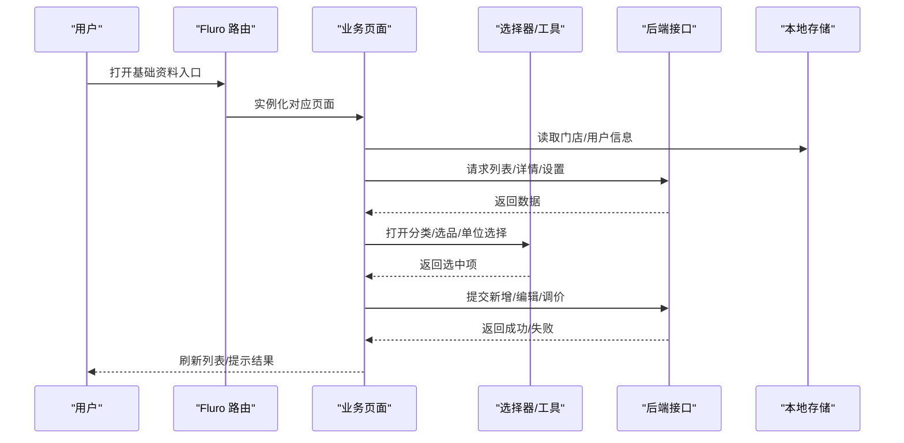

该流程在商品管理、调价、促销、新品申请中高度一致，差异主要体现在字段集合、筛选条件和业务规则。

**图表来源**
- [商品列表页:1-200](file://lib/pages/business/basis/commodity/list.dart#L1-L200)
- [分类管理页:1-200](file://lib/pages/business/basis/classify/list.dart#L1-L200)
- [预包装改价主页:1-200](file://lib/pages/business/basis/prepackPrice/prepack_price_home.dart#L1-L200)
- [快速调价列表页:1-200](file://lib/pages/business/basis/productChangePrice/list.dart#L1-L200)

## 详细组件分析

### 商品管理
商品管理是基础资料的核心，包含商品主档、分类、规格、打包、成份、兑奖等多个维度。商品列表支持分页、模糊搜索、扫码、分类筛选、供应商筛选、商品类型与计价方式筛选；商品新增/编辑页承载完整表单，包括基本信息、价格、库存、积分、促销、位置、包装、赠品等。

#### 业务流程
1. 进入商品列表，检查权限后拉取商品分页数据。
2. 可通过输入框或扫码进行搜索；扫码命中多条时跳转选品页。
3. 新增商品时预填分类、单位、品牌等信息；编辑商品时回填完整商品数据。
4. 维护规格、打包、成份、兑奖等子表，最终统一提交到后端。

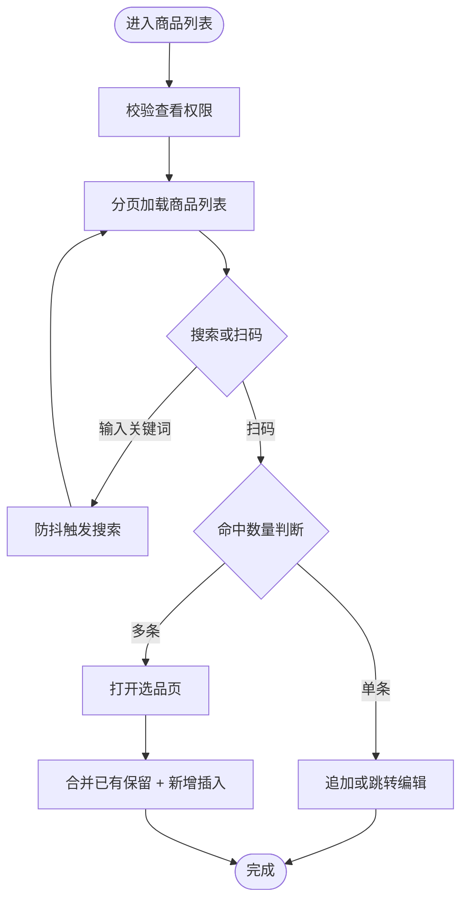

**图表来源**
- [商品列表页:1-200](file://lib/pages/business/basis/commodity/list.dart#L1-L200)
- [特价打包商品页:1-200](file://lib/pages/business/basis/commodity/bundle.dart#L1-L200)
- [商品明细（成份/拆分）页:1-200](file://lib/pages/business/basis/commodity/product.dart#L1-L200)

#### 数据模型要点
- 商品主字段：条码、名称、编码、分类、单位、品牌、进价、售价、多档位价格、最低最高售价、库存上限下限、初始库存、积分基数、促销价与时间、税率、销售标志、变价标志、SN 码、新鲜度标志、免费价标志、称重标志、优惠券使用标志、促销标志、首页推荐、商品状态、扣减类型、促销折扣标志、赠品标志、有效期、位置编码与 ID、包装数量、扩展明细、兑奖明细等。
- 规格数据：规格名称、规格条码、是否默认规格、售价等。
- 打包明细：子商品条码、名称、数量、包装数量、规格等。
- 成份明细：子商品条码、名称、数量、主商品 ID、规格等。
- 兑奖明细：兑换商品条码、名称、加价兑换、兑换成本、兑换数量、单位等。

**章节来源**
- [商品新增/编辑页:1-200](file://lib/pages/business/basis/commodity/add.dart#L1-L200)
- [商品规格页:1-200](file://lib/pages/business/basis/commodity/spec.dart#L1-L200)
- [特价打包商品页:1-200](file://lib/pages/business/basis/commodity/bundle.dart#L1-L200)
- [商品明细（成份/拆分）页:1-200](file://lib/pages/business/basis/commodity/product.dart#L1-L200)
- [兑奖换购页:1-200](file://lib/pages/business/basis/commodity/prize.dart#L1-L200)

#### 界面交互与状态管理
- 列表页维护 `_list`、分页号 `_page`、加载状态 `_loading`、是否有更多 `_hasMore`、搜索控制器 `_searchController` 与防抖定时器 `_debounce`。
- 新增/编辑页以中心 Map `_form` 作为表单数据源，所有输入控件同步该 Map，避免逐字段收集；提交时直接序列化该 Map。
- 规格、打包、成份、兑奖等子页面通过 Navigator.pop 返回修改后的列表，父页面 setState 合并更新。

**章节来源**
- [商品列表页:1-200](file://lib/pages/business/basis/commodity/list.dart#L1-L200)
- [商品新增/编辑页:1-200](file://lib/pages/business/basis/commodity/add.dart#L1-L200)
- [商品规格页:1-200](file://lib/pages/business/basis/commodity/spec.dart#L1-L200)

### 分类管理
分类管理以树形结构呈现，支持单选模式（从新增商品或商品列表进入）、多选模式（支持全选与半选），并提供搜索过滤、父子级联勾选与去重计算。

#### 关键行为
- 初始化时根据权限决定是否加载分类数据。
- 构建节点映射 `_nodeMap` 与父级映射 `_parentMap`，用于父子关系与半选计算。
- 多选模式下，父节点选中自动级联选中子孙；子节点变更向上同步祖先节点的选中/半选状态。
- 搜索时递归过滤树节点，匹配名称或编码。

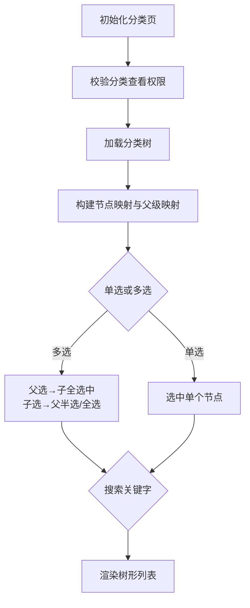

**图表来源**
- [分类管理页:1-200](file://lib/pages/business/basis/classify/list.dart#L1-L200)

**章节来源**
- [分类管理页:1-200](file://lib/pages/business/basis/classify/list.dart#L1-L200)

### 预包装改价
预包装改价面向计重/计份商品，核心能力包括：
- 搜索或扫码获取商品，解析条码秤重量码/金额码，自动赋值数量。
- 同码多条时批量加入列表，单条命中时根据重复录入策略处理（提示、累加、覆盖、允许重复）。
- 打开详情抽屉编辑包装条码、包装数量、包装金额、包装折扣，三者联动计算。
- 结合蓝牙打印设置执行打印。

#### 详情抽屉联动逻辑
- 包装数量变化：保持金额不变，反算折扣与包装条码。
- 包装金额变化：根据金额与售价、数量反算折扣与包装条码。
- 包装折扣变化：根据折扣与售价、数量反算金额与包装条码。
- 单位/规格选择：调用扩展选择弹窗，回写包装单位与规格信息。

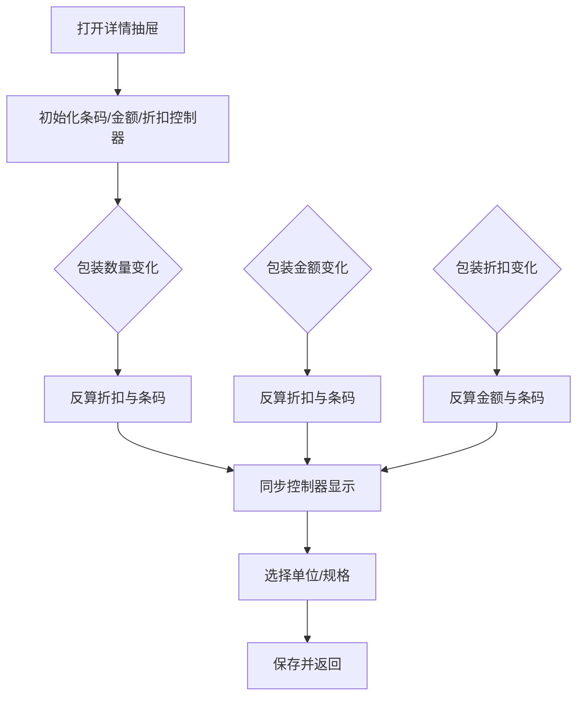

**图表来源**
- [预包装详情抽屉:1-200](file://lib/pages/business/basis/prepackPrice/prepack_detail_sheet.dart#L1-L200)

**章节来源**
- [预包装改价主页:1-200](file://lib/pages/business/basis/prepackPrice/prepack_price_home.dart#L1-L200)
- [预包装详情抽屉:1-200](file://lib/pages/business/basis/prepackPrice/prepack_detail_sheet.dart#L1-L200)
- [预包装改价路由:1-17](file://lib/pages/business/basis/prepackPrice/router.dart#L1-L17)

### 打印模板与单据
打印模块包含标签打印主页与单据列表两个主要入口：
- 标签打印主页：加载打印设置与旧接口前台打印参数；支持扫码与输入搜索；多规格/多单位商品打开详情弹窗选择单位/规格；普通商品按 productid 或 barcode 追加或累加数量。
- 单据列表页：支持采购入库单、调价单、配送收货单、调拨入库单、商品分组等类型；可按日期范围、供应商、制单人筛选；支持分页加载与搜索。

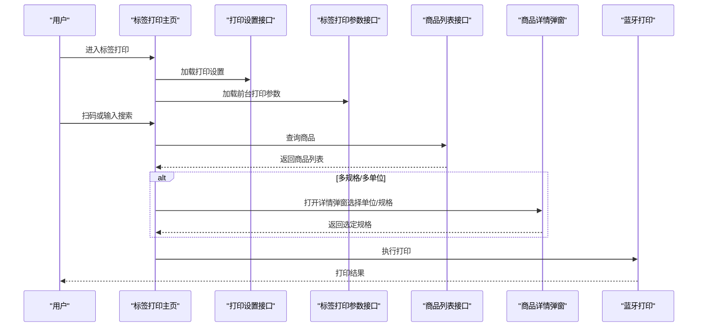

**图表来源**
- [标签打印主页:1-200](file://lib/pages/business/basis/printing/label_print_home.dart#L1-L200)
- [打印路由:1-49](file://lib/pages/business/basis/printing/router.dart#L1-L49)

**章节来源**
- [标签打印主页:1-200](file://lib/pages/business/basis/printing/label_print_home.dart#L1-L200)
- [单据列表页:1-200](file://lib/pages/business/basis/printing/receipts_list.dart#L1-L200)
- [打印路由:1-49](file://lib/pages/business/basis/printing/router.dart#L1-L49)

### 商品价格调整
快速调价列表页用于对商品进行快速调价，支持分类筛选、门店筛选、扫码搜索；进入编辑页进行调价维护，完成后返回列表刷新。

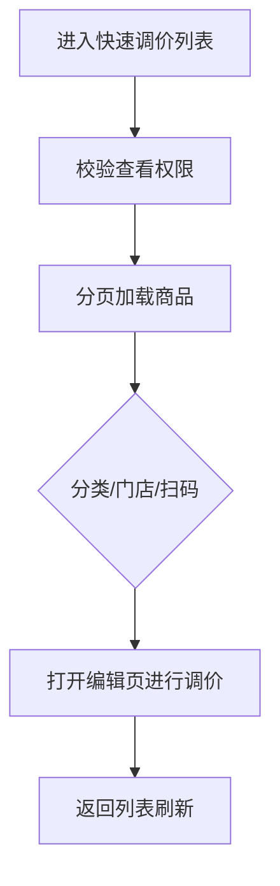

**图表来源**
- [快速调价列表页:1-200](file://lib/pages/business/basis/productChangePrice/list.dart#L1-L200)

**章节来源**
- [快速调价列表页:1-200](file://lib/pages/business/basis/productChangePrice/list.dart#L1-L200)
- [快速调价路由:1-17](file://lib/pages/business/basis/productChangePrice/router.dart#L1-L17)

### 门店价格调整
门店调价单列表页提供门店维度的调价单管理，支持按审核状态 Tab、门店、日期范围、执行类型筛选；新增与编辑均受权限控制，查看明细需具备相应权限。

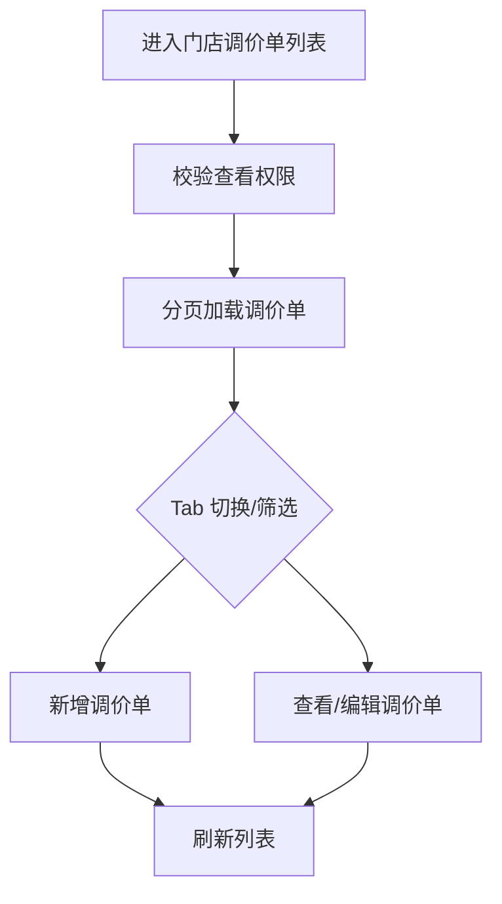

**图表来源**
- [门店调价单列表页:1-200](file://lib/pages/business/basis/storeChangePrice/list.dart#L1-L200)

**章节来源**
- [门店调价单列表页:1-200](file://lib/pages/business/basis/storeChangePrice/list.dart#L1-L200)
- [门店调价路由:1-17](file://lib/pages/business/basis/storeChangePrice/router.dart#L1-L17)

### 促销计划
促销计划列表页支持按审核状态与生效状态筛选，并可按门店、创建人、日期范围检索；新增促销计划需具备权限，编辑后刷新列表。

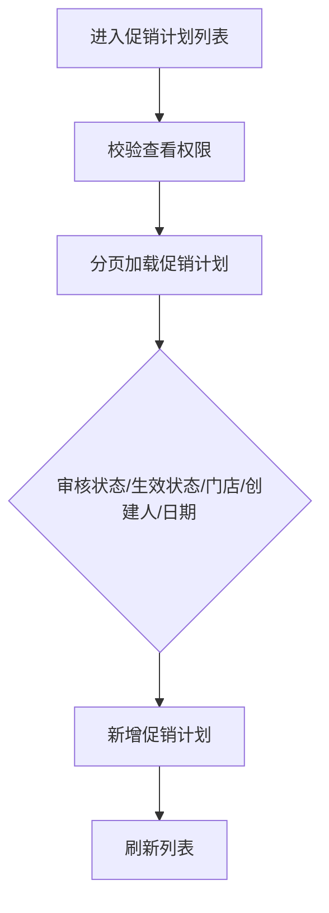

**图表来源**
- [促销计划列表页:1-200](file://lib/pages/business/basis/promotionPlan/list.dart#L1-L200)

**章节来源**
- [促销计划列表页:1-200](file://lib/pages/business/basis/promotionPlan/list.dart#L1-L200)
- [促销计划路由:1-17](file://lib/pages/business/basis/promotionPlan/router.dart#L1-L17)

### 新品申请
新品申请列表页提供待提交、待审核、已审核、已驳回等多状态管理；新增与编辑复用商品新增/编辑页，但通过 `applynewflag` 与 `status` 控制只读与权限。

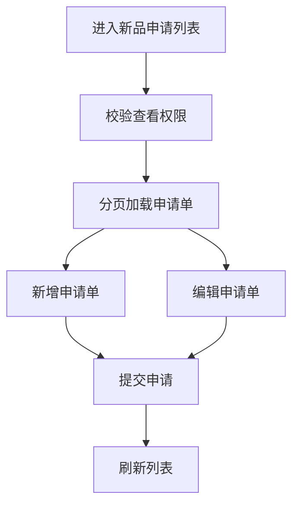

**图表来源**
- [新品申请列表页:1-200](file://lib/pages/business/basis/newApplication/list.dart#L1-L200)

**章节来源**
- [新品申请列表页:1-200](file://lib/pages/business/basis/newApplication/list.dart#L1-L200)
- [新品申请路由:1-17](file://lib/pages/business/basis/newApplication/router.dart#L1-L17)

## 数据依赖与业务关联
各子功能之间存在明确的数据依赖关系：
- 商品管理依赖分类管理提供的分类树；商品新增/编辑页将分类 ID、编码、名称写入商品主档。
- 预包装改价与标签打印依赖商品信息与打印设置；预包装改价生成包装条码，标签打印消费条码并输出标签。
- 快速调价与门店调价单依赖商品与门店数据；促销计划同样依赖商品与门店，并引入审核状态。
- 新品申请复用商品新增/编辑页，但通过状态控制只读与权限，并最终形成独立的新品申请记录。

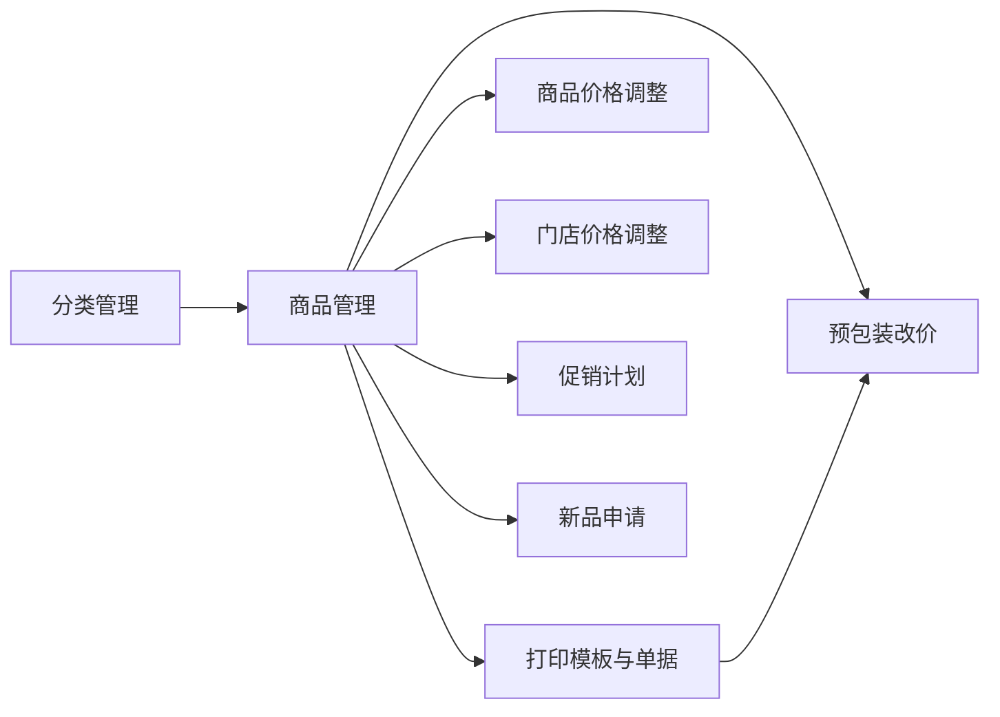

**图表来源**
- [分类管理页:1-200](file://lib/pages/business/basis/classify/list.dart#L1-L200)
- [商品新增/编辑页:1-200](file://lib/pages/business/basis/commodity/add.dart#L1-L200)
- [预包装改价主页:1-200](file://lib/pages/business/basis/prepackPrice/prepack_price_home.dart#L1-L200)
- [标签打印主页:1-200](file://lib/pages/business/basis/printing/label_print_home.dart#L1-L200)
- [快速调价列表页:1-200](file://lib/pages/business/basis/productChangePrice/list.dart#L1-L200)
- [门店调价单列表页:1-200](file://lib/pages/business/basis/storeChangePrice/list.dart#L1-L200)
- [促销计划列表页:1-200](file://lib/pages/business/basis/promotionPlan/list.dart#L1-L200)
- [新品申请列表页:1-200](file://lib/pages/business/basis/newApplication/list.dart#L1-L200)

## 性能与状态设计
- 分页与懒加载：列表页普遍采用滚动到底触发下一页加载，配合 `_hasMore` 控制是否继续请求。
- 防抖搜索：搜索输入使用定时器防抖，减少频繁请求。
- 权限前置校验：在进入页面时即校验权限，若无权限则提示并阻止后续数据加载。
- 中心表单数据：商品新增/编辑页使用单一 Map 作为表单数据源，降低字段遗漏风险。
- 选择器返回全集：选品页返回勾选全集，父页面据此区分“已有保留/新增插入”，避免误清空明细。
- 本地缓存：门店信息与用户权限标志通过本地存储读取，减少重复请求。

[本节为通用指导，不直接分析具体文件]

## 扩展开发指南
- 新增基础资料子功能时，建议在 `lib/pages/business/basis` 下新建目录，并实现：
  - 路由文件：注册 Fluro 路由常量与页面构造器。
  - 列表页：实现分页、筛选、权限校验与扫码搜索。
  - 编辑/详情页：实现表单或明细维护，必要时使用底部抽屉。
  - 选择器集成：复用分类、选品、单位等选择器组件。
- 若需与商品主档关联，请在新增/编辑页中维护相关子表字段，并在提交时一并上传。
- 若涉及打印，请复用打印设置与蓝牙打印能力，并确保条码格式与商品类型兼容。
- 权限标识应与后台菜单配置保持一致，并在页面初始化阶段进行校验。

[本节为通用指导，不直接分析具体文件]

## 常见问题与排错
- 无权限访问：页面初始化时会校验权限，若无权限会弹出提示。检查后台菜单权限分配与当前用户角色。
- 扫码无效或提示不支持：非移动平台或设备不支持扫码时会提示；确保在移动端使用。
- 同码多条处理异常：扫码命中多条时会自动跳转选品页或批量加入列表，检查重复录入策略与选品页返回的全集是否正确。
- 预包装改价打印失败：确认蓝牙打印设置已加载，且当前门店条码称使用 13 位条码格式；否则会有不支持提示。
- 调价单/促销计划筛选无效：检查筛选条件参数是否与接口定义一致，尤其是日期范围、门店 ID、执行类型等字段。
- 新品申请只读：当新品申请处于已审核或已驳回状态时，商品新增/编辑页会进入只读模式，无法编辑。

**章节来源**
- [商品列表页:1-200](file://lib/pages/business/basis/commodity/list.dart#L1-L200)
- [分类管理页:1-200](file://lib/pages/business/basis/classify/list.dart#L1-L200)
- [预包装改价主页:1-200](file://lib/pages/business/basis/prepackPrice/prepack_price_home.dart#L1-L200)
- [快速调价列表页:1-200](file://lib/pages/business/basis/productChangePrice/list.dart#L1-L200)
- [门店调价单列表页:1-200](file://lib/pages/business/basis/storeChangePrice/list.dart#L1-L200)
- [促销计划列表页:1-200](file://lib/pages/business/basis/promotionPlan/list.dart#L1-L200)
- [新品申请列表页:1-200](file://lib/pages/business/basis/newApplication/list.dart#L1-L200)

## 结语
基础资料模块围绕商品主数据构建了完整的门店运营支撑体系。通过清晰的路由组织、一致的列表/编辑交互模式、严谨的权限与数据校验机制，以及与打印、调价、促销、新品申请的深度耦合，该模块为灵犀管店提供了稳定可扩展的基础能力。开发者在扩展新功能时，应遵循现有架构与数据流约定，确保可维护性与一致性。

[本节为总结性内容，不直接分析具体文件]