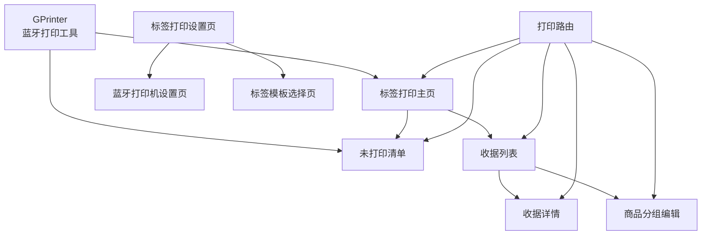
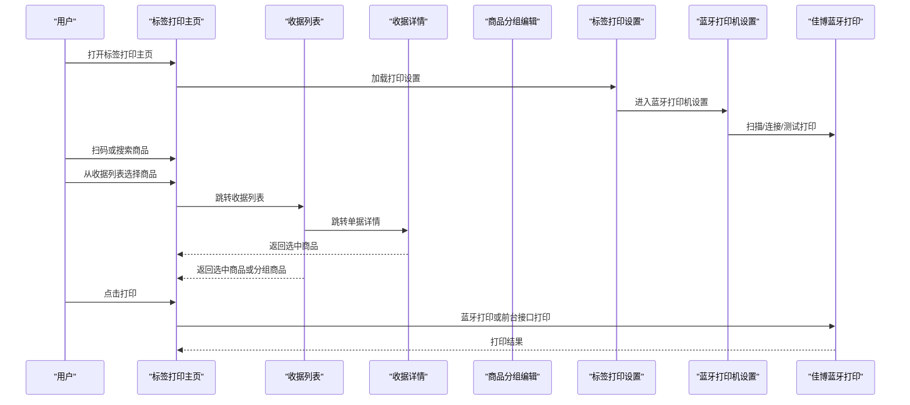
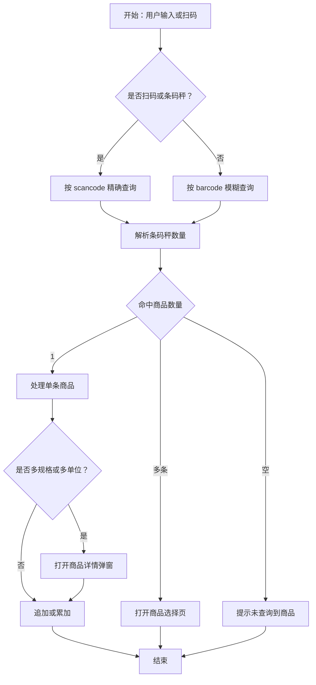
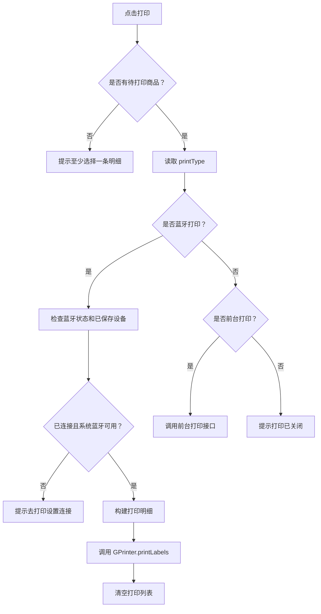
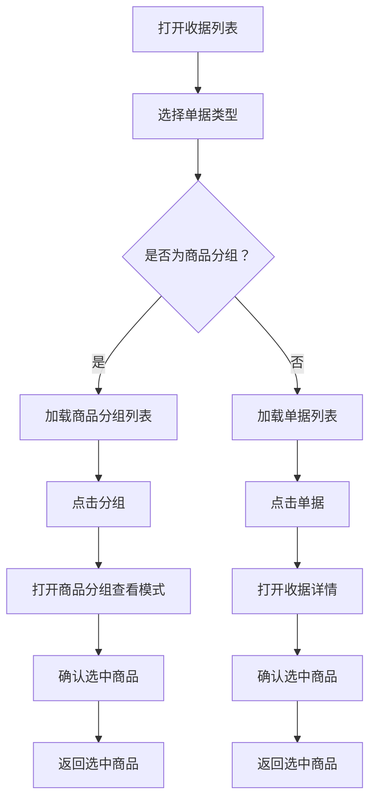
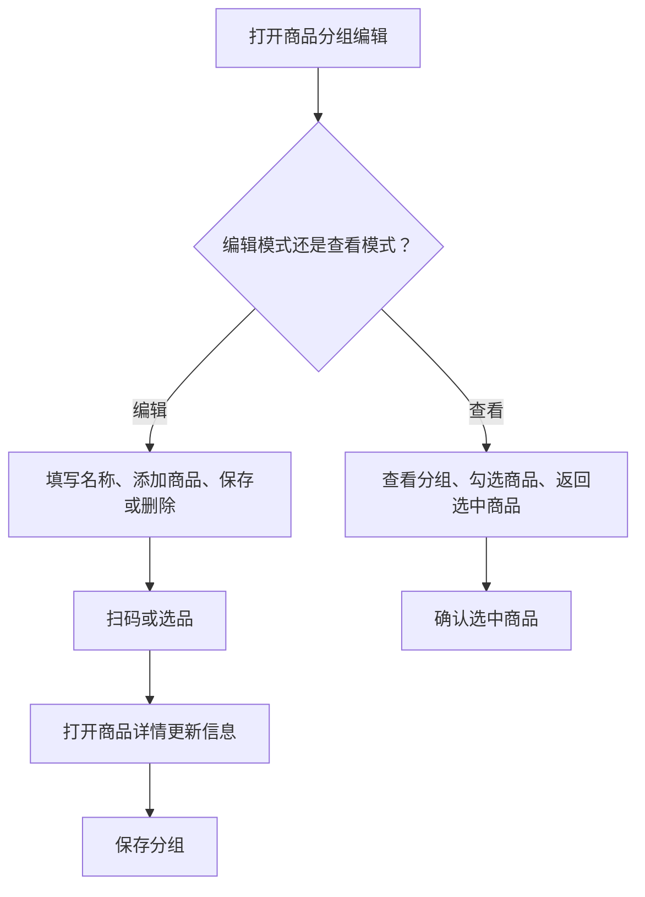
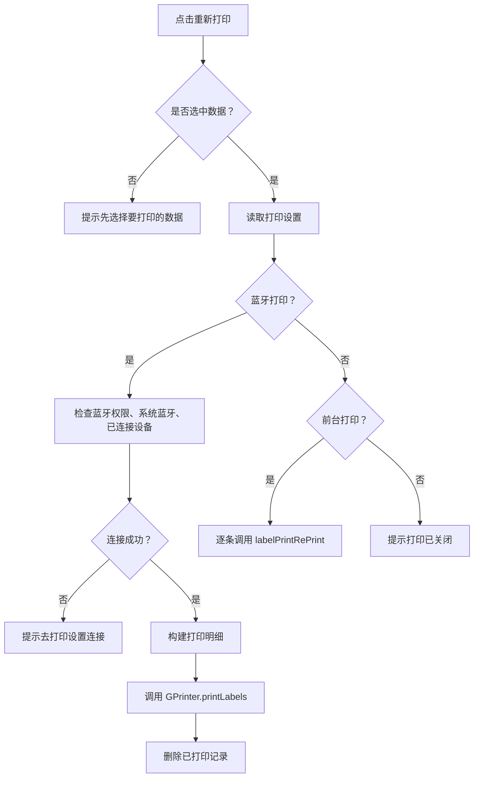
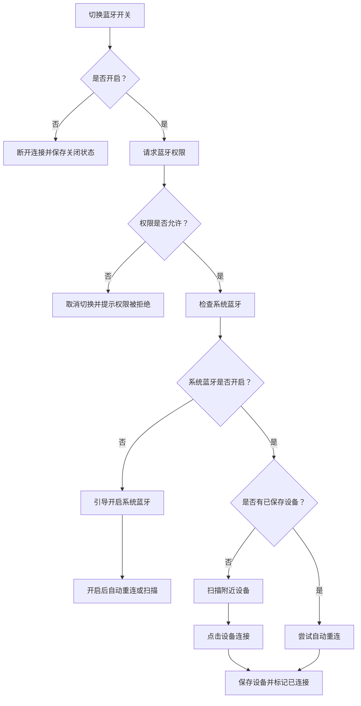
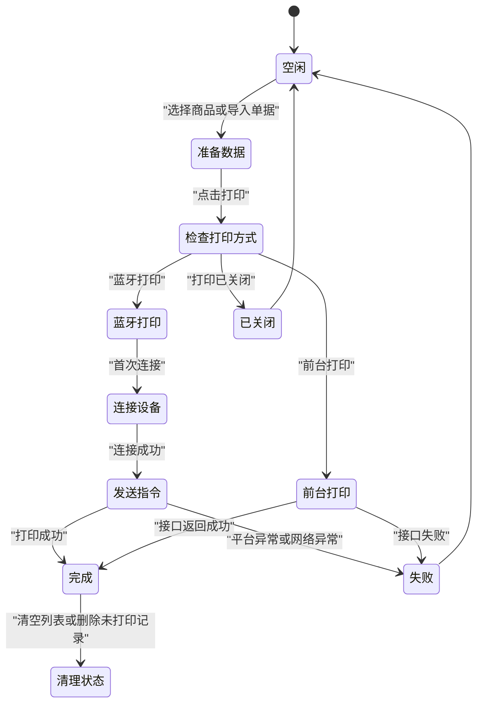

# 打印模板

<cite>
**本文引用的文件**   
- [gprinter.dart](file://lib/util/gprinter.dart)
- [bluetooth_printer_page.dart](file://lib/pages/user/bluetooth_printer_page.dart)
- [label_print_page.dart](file://lib/pages/user/label_print_page.dart)
- [label_template_page.dart](file://lib/pages/user/label_template_page.dart)
- [router.dart](file://lib/pages/business/basis/printing/router.dart)
- [label_print_home.dart](file://lib/pages/business/basis/printing/label_print_home.dart)
- [receipts_list.dart](file://lib/pages/business/basis/printing/receipts_list.dart)
- [receipt_detail.dart](file://lib/pages/business/basis/printing/receipt_detail.dart)
- [edit_product_group.dart](file://lib/pages/business/basis/printing/edit_product_group.dart)
- [unprinted_list.dart](file://lib/pages/business/basis/printing/unprinted_list.dart)
</cite>

## 目录

1. [引言](#引言)
2. [项目结构与职责划分](#项目结构与职责划分)
3. [核心组件总览](#核心组件总览)
4. [架构与数据流](#架构与数据流)
5. [标签打印主页](#标签打印主页)
6. [收据列表、收据详情与商品分组编辑](#收据列表收据详情与商品分组编辑)
7. [未打印清单](#未打印清单)
8. [蓝牙打印机配置](#蓝牙打印机配置)
9. [打印模板与商品信息关联](#打印模板与商品信息关联)
10. [打印任务处理机制](#打印任务处理机制)
11. [调试与常见问题](#调试与常见问题)
12. [结论](#结论)

## 引言

灵犀管店 Flutter 项目的打印模板功能围绕“标签打印”展开，既支持前台接口打印，也支持 Android 端佳博蓝牙标签打印。它覆盖以下关键场景：

- **标签打印主页**：搜索或扫码商品、批量选择商品、从单据或商品分组中选择商品，最终生成待打印标签明细。
- **收据列表**：按单据类型筛选采购入库单、调价单、配送收货单、调拨入库单和商品分组。
- **收据详情**：查看单据明细并勾选需要打印的商品行。
- **商品组编辑**：新增、编辑、查看商品分组，管理分组中的商品明细。
- **未打印清单**：查询历史未打印标签，支持修改份数、删除、重新打印。
- **蓝牙打印机设置**：启用蓝牙、扫描设备、连接或断开打印机、测试打印，并保存服务端打印配置。
- **标签模板选择**：在四种系统标签尺寸之间切换默认模板。

该文档以代码为依据，说明各页面如何协作、如何读取打印设置、如何构造打印数据，以及如何通过原生 MethodChannel 调用蓝牙打印机。

## 项目结构与职责划分

打印相关代码主要分布在两个区域：

| 路径 | 职责 |
|---|---|
| `lib/util/gprinter.dart` | 封装佳博蓝牙打印原生通道，提供权限、开关、扫描、连接、断连、标签打印和测试打印能力。 |
| `lib/pages/user/*` | 用户侧打印设置入口，包括标签打印设置页、蓝牙打印机设置页、标签模板选择页。 |
| `lib/pages/business/basis/printing/*` | 业务打印流程入口，包括路由、标签打印主页、收据列表、收据详情、商品分组编辑、未打印清单。 |
| `lib/pages/business/basis/printing/router.dart` | 注册打印子模块路由，统一暴露标签打印主页、收据列表、收据详情、商品分组编辑、未打印清单的跳转地址。 |

**图表来源**
- [gprinter.dart:1-130](file://lib/util/gprinter.dart#L1-L130)
- [label_print_page.dart:1-200](file://lib/pages/user/label_print_page.dart#L1-L200)
- [bluetooth_printer_page.dart:1-200](file://lib/pages/user/bluetooth_printer_page.dart#L1-L200)
- [label_template_page.dart:1-200](file://lib/pages/user/label_template_page.dart#L1-L200)
- [router.dart:1-49](file://lib/pages/business/basis/printing/router.dart#L1-L49)
- [label_print_home.dart:1-200](file://lib/pages/business/basis/printing/label_print_home.dart#L1-L200)
- [receipts_list.dart:1-200](file://lib/pages/business/basis/printing/receipts_list.dart#L1-L200)
- [receipt_detail.dart:1-200](file://lib/pages/business/basis/printing/receipt_detail.dart#L1-L200)
- [edit_product_group.dart:1-200](file://lib/pages/business/basis/printing/edit_product_group.dart#L1-L200)
- [unprinted_list.dart:1-200](file://lib/pages/business/basis/printing/unprinted_list.dart#L1-L200)

**章节来源**
- [router.dart:1-49](file://lib/pages/business/basis/printing/router.dart#L1-L49)
- [label_print_home.dart:1-200](file://lib/pages/business/basis/printing/label_print_home.dart#L1-L200)

## 核心组件总览

| 组件 | 文件 | 主要职责 |
|---|---|---|
| `GPrinter` | `lib/util/gprinter.dart` | 封装蓝牙打印原生通道，负责权限、蓝牙状态、设备扫描、连接、断开、标签打印、预包装标签打印和测试打印。 |
| `LabelPrintHomePage` | `lib/pages/business/basis/printing/label_print_home.dart` | 标签打印主页：搜索、扫码、选品、构建打印明细、判断打印方式并执行打印。 |
| `ReceiptsListPage` | `lib/pages/business/basis/printing/receipts_list.dart` | 单据列表：按单据类型、时间、供应商、制单人筛选，并跳转到详情或商品分组。 |
| `ReceiptDetailPage` | `lib/pages/business/basis/printing/receipt_detail.dart` | 单据详情：加载明细、全选/单选、返回选中商品。 |
| `EditProductGroupPage` | `lib/pages/business/basis/printing/edit_product_group.dart` | 商品分组管理：名称校验、扫码选品、多选、批量删除、保存和删除分组。 |
| `UnprintedListPage` | `lib/pages/business/basis/printing/unprinted_list.dart` | 未打印清单：勾选、改份数、删除、重新打印。 |
| `LabelPrintPage` | `lib/pages/user/label_print_page.dart` | 标签打印设置：打印方式、打印份数、模板、蓝牙开关及新旧接口联动。 |
| `BluetoothPrinterPage` | `lib/pages/user/bluetooth_printer_page.dart` | 蓝牙打印机设置：权限、系统蓝牙引导、自动重连、扫描、连接、断开、测试打印。 |
| `LabelTemplatePage` | `lib/pages/user/label_template_page.dart` | 标签模板选择：展示四种系统模板预览，返回所选模板 ID。 |
| `PrintingRouter` | `lib/pages/business/basis/printing/router.dart` | 打印模块路由定义。 |

**章节来源**
- [gprinter.dart:1-130](file://lib/util/gprinter.dart#L1-L130)
- [label_print_home.dart:1-200](file://lib/pages/business/basis/printing/label_print_home.dart#L1-L200)
- [receipts_list.dart:1-200](file://lib/pages/business/basis/printing/receipts_list.dart#L1-L200)
- [receipt_detail.dart:1-200](file://lib/pages/business/basis/printing/receipt_detail.dart#L1-L200)
- [edit_product_group.dart:1-200](file://lib/pages/business/basis/printing/edit_product_group.dart#L1-L200)
- [unprinted_list.dart:1-200](file://lib/pages/business/basis/printing/unprinted_list.dart#L1-L200)
- [label_print_page.dart:1-200](file://lib/pages/user/label_print_page.dart#L1-L200)
- [bluetooth_printer_page.dart:1-200](file://lib/pages/user/bluetooth_printer_page.dart#L1-L200)
- [label_template_page.dart:1-200](file://lib/pages/user/label_template_page.dart#L1-L200)
- [router.dart:1-49](file://lib/pages/business/basis/printing/router.dart#L1-L49)

## 架构与数据流

### 整体交互关系

**图表来源**
- [label_print_home.dart:200-678](file://lib/pages/business/basis/printing/label_print_home.dart#L200-L678)
- [receipts_list.dart:635-907](file://lib/pages/business/basis/printing/receipts_list.dart#L635-L907)
- [receipt_detail.dart:1-345](file://lib/pages/business/basis/printing/receipt_detail.dart#L1-L345)
- [edit_product_group.dart:200-657](file://lib/pages/business/basis/printing/edit_product_group.dart#L200-L657)
- [label_print_page.dart:1-200](file://lib/pages/user/label_print_page.dart#L1-L200)
- [bluetooth_printer_page.dart:200-720](file://lib/pages/user/bluetooth_printer_page.dart#L200-L720)
- [gprinter.dart:1-130](file://lib/util/gprinter.dart#L1-L130)

### 打印方式决策

打印行为由“新接口打印设置”决定：

| 打印方式 | 字段含义 | 行为 |
|---|---|---|
| 关闭打印 | `printType == 0` | 提示用户前往打印设置开启。 |
| 前台打印 | `printType == 1` | 调用旧接口 `setLabelPrintFlow` 或 `labelPrintRePrint`。 |
| 蓝牙打印 | `printType == 2` | 检查蓝牙权限、系统蓝牙状态和已保存设备，调用 `GPrinter.printLabels`。 |

**章节来源**
- [label_print_home.dart:200-678](file://lib/pages/business/basis/printing/label_print_home.dart#L200-L678)
- [unprinted_list.dart:200-678](file://lib/pages/business/basis/printing/unprinted_list.dart#L200-L678)

## 标签打印主页

### 功能要点

标签打印主页是打印模板功能的核心入口，承担以下职责：

1. 权限校验：仅允许具备权限的用户查看标签打印。
2. 加载打印设置：并行拉取新接口打印设置和旧接口前台打印参数。
3. 商品检索：
   - 输入框回车：按条码模糊匹配。
   - 扫码枪或摄像头扫码：按 `scancode` 精确匹配；支持解析条码秤重量码和金额码。
4. 多规格/多单位商品：打开公共商品详情弹窗，确认后追加或累加。
5. 批量选品：跳转到通用商品选择页，多选后替换当前打印列表。
6. 从单据或商品分组导入：支持收据列表和商品分组两种数据来源。
7. 打印执行：根据打印方式走蓝牙打印或前台接口打印。

### 商品查找与追加逻辑

**图表来源**
- [label_print_home.dart:1-200](file://lib/pages/business/basis/printing/label_print_home.dart#L1-L200)
- [label_print_home.dart:200-678](file://lib/pages/business/basis/printing/label_print_home.dart#L200-L678)

### 打印执行流程

**图表来源**
- [label_print_home.dart:200-678](file://lib/pages/business/basis/printing/label_print_home.dart#L200-L678)

**章节来源**
- [label_print_home.dart:1-200](file://lib/pages/business/basis/printing/label_print_home.dart#L1-L200)
- [label_print_home.dart:200-678](file://lib/pages/business/basis/printing/label_print_home.dart#L200-L678)

## 收据列表、收据详情与商品分组编辑

### 收据列表

收据列表页支持以下能力：

- 单据类型切换：采购入库单、调价单、配送收货单、调拨入库单、商品分组。
- 时间范围筛选：昨天、本周、本月、自定义日期。
- 供应商筛选和制单人筛选。
- 分页加载。
- 当单据类型为“商品分组”时，跳转到商品分组查看模式，返回选中商品。
- 其他单据类型跳转到收据详情页，返回选中商品。

**图表来源**
- [receipts_list.dart:1-200](file://lib/pages/business/basis/printing/receipts_list.dart#L1-L200)
- [receipts_list.dart:635-907](file://lib/pages/business/basis/printing/receipts_list.dart#L635-L907)

### 收据详情

收据详情页用于展示单据明细并让用户勾选需要打印的行。关键逻辑：

- 按 `billid` 和 `notype` 拉取明细。
- 为每条明细增加 `checked` 字段。
- 支持全选和单选。
- 底部显示已选数量，确认后返回选中商品列表。

**章节来源**
- [receipt_detail.dart:1-200](file://lib/pages/business/basis/printing/receipt_detail.dart#L1-L200)
- [receipt_detail.dart:200-345](file://lib/pages/business/basis/printing/receipt_detail.dart#L200-L345)

### 商品分组编辑

商品分组编辑页支持三种用途：

| isEdit | 用途 |
|---|---|
| `1` | 新增或编辑商品分组。 |
| `2` | 查看商品分组并选择商品返回给上级页面。 |

核心能力：

- 分组名称必填校验。
- 扫码添加商品：支持解析条码秤，支持同码多条时跳转到选品页。
- 商品判重：按 `productid` 与条码组合判断。
- 打开商品详情弹窗更新单位、规格、条码、自编码和价格字段。
- 多选、批量删除、保存分组、删除分组。
- 查看模式下确认选中商品，并将每个选中商品的份数设为 `1`。

**图表来源**
- [edit_product_group.dart:1-200](file://lib/pages/business/basis/printing/edit_product_group.dart#L1-L200)
- [edit_product_group.dart:200-657](file://lib/pages/business/basis/printing/edit_product_group.dart#L200-L657)

**章节来源**
- [receipts_list.dart:1-200](file://lib/pages/business/basis/printing/receipts_list.dart#L1-L200)
- [receipts_list.dart:635-907](file://lib/pages/business/basis/printing/receipts_list.dart#L635-L907)
- [receipt_detail.dart:1-345](file://lib/pages/business/basis/printing/receipt_detail.dart#L1-L345)
- [edit_product_group.dart:1-200](file://lib/pages/business/basis/printing/edit_product_group.dart#L1-L200)
- [edit_product_group.dart:200-657](file://lib/pages/business/basis/printing/edit_product_group.dart#L200-L657)

## 未打印清单

未打印清单页用于处理历史未打印标签。其核心能力包括：

- 查询未打印列表。
- 全选或部分勾选。
- 修改单条打印份数。
- 单条删除和批量删除。
- 重新打印：蓝牙打印、前台接口打印或关闭打印三种分支。
- 蓝牙打印成功后删除对应未打印记录。

### 重新打印流程

**图表来源**
- [unprinted_list.dart:200-678](file://lib/pages/business/basis/printing/unprinted_list.dart#L200-L678)

**章节来源**
- [unprinted_list.dart:1-200](file://lib/pages/business/basis/printing/unprinted_list.dart#L1-L200)
- [unprinted_list.dart:200-678](file://lib/pages/business/basis/printing/unprinted_list.dart#L200-L678)

## 蓝牙打印机配置

### 蓝牙打印工具

`GPrinter` 是打印能力的底层封装，对外暴露以下能力：

| 方法 | 作用 |
|---|---|
| `requestPermissions()` | 请求蓝牙相关运行时权限。 |
| `isBluetoothEnabled` | 判断系统蓝牙是否已开启。 |
| `enableBluetooth()` | 开启系统蓝牙：Android 13 以下弹出开启弹窗，13+ 跳转系统设置。 |
| `scanPrinters(timeout)` | 扫描附近蓝牙打印机。 |
| `connect(mac, name)` | 连接指定 MAC 的蓝牙打印机。 |
| `disconnect()` | 断开当前打印机连接。 |
| `isConnected` | 判断是否已连接打印机。 |
| `printLabels(items, template)` | 打印标签。 |
| `printPrepackLabels(items, template)` | 打印预包装改价标签。 |
| `printTestLabel()` | 打印测试标签。 |

#### 标签数据结构

`printLabels` 要求每条明细包含以下字段：

| 字段 | 含义 |
|---|---|
| `name` | 商品名称。 |
| `size` | 规格。 |
| `mprice1` | 会员价或折后单价。 |
| `sellprice` | 零售价。 |
| `qty` | 打印份数。 |
| `barcode` | 条码。 |
| `copies` | 每份副本数量。 |

模板编号规则：

| 模板 | 尺寸 |
|---|---|
| `1` | `60×40mm` |
| `2` | `50×30mm` |
| `3` | `40×30mm` |
| `4` | `45×20mm` |

### 蓝牙打印机设置页

蓝牙打印机设置页维护两类状态：

- **服务端打印设置**：保存在服务端的蓝牙开关、设备名称、设备 MAC、服务 ID、特征值等。
- **SDK 实际连接状态**：通过 `GPrinter.isConnected` 获取，不一定等于已保存设备。

典型流程：

1. 初始化时请求权限并加载服务端设置。
2. 如果蓝牙开关开启且未连接：
   - 若系统蓝牙未开启，引导用户开启。
   - 若有已保存 MAC，尝试自动重连。
   - 否则扫描附近设备。
3. 扫描失败时区分平台异常和业务错误。
4. 连接成功后保存设备信息并更新连接状态。
5. 断开连接时保留已保存设备，便于下次自动重连。
6. 测试打印前必须处于已连接状态。

**图表来源**
- [bluetooth_printer_page.dart:1-200](file://lib/pages/user/bluetooth_printer_page.dart#L1-L200)
- [bluetooth_printer_page.dart:200-720](file://lib/pages/user/bluetooth_printer_page.dart#L200-L720)

**章节来源**
- [gprinter.dart:1-130](file://lib/util/gprinter.dart#L1-L130)
- [bluetooth_printer_page.dart:1-200](file://lib/pages/user/bluetooth_printer_page.dart#L1-L200)
- [bluetooth_printer_page.dart:200-720](file://lib/pages/user/bluetooth_printer_page.dart#L200-L720)

## 打印模板与商品信息关联

### 模板选择

标签模板选择页提供四个系统模板，分别对应不同物理标签尺寸。用户选择一个模板后，页面会立即将该模板 ID 返回给上一页，并由标签打印设置页保存到服务端。

| 模板 ID | 预览尺寸 | 使用场景 |
|---|---|---|
| `1` | `60×40` | 常规商品标签。 |
| `2` | `50×30` | 中等尺寸标签。 |
| `3` | `40×30` | 较小标签。 |
| `4` | `45×20` | 紧凑型标签，包含折扣价和时间信息布局。 |

模板选择页只负责选择和预览，不直接调用打印机。真正决定打印尺寸的是标签打印设置中保存的 `print_template`，以及蓝牙打印时传入的 `template`。

### 模板与打印数据的映射

标签打印主页和未打印清单页都会将商品数据转换为 `GPrinter.printLabels` 需要的结构：

| 前端商品字段 | 打印字段 | 说明 |
|---|---|---|
| `name` 或 `productname` | `name` | 商品名称。 |
| `size` | `size` | 规格。 |
| `mprice1` | `mprice1` | 折后单价或会员价。 |
| `sellprice` | `sellprice` | 零售价。 |
| `barcode` | `barcode` | 条码。 |
| `qty` | `qty` | 打印份数。 |
| `qty` | `copies` | 副本数量。 |

打印份数会被限制在 `1` 到 `20` 之间。

**章节来源**
- [label_template_page.dart:1-200](file://lib/pages/user/label_template_page.dart#L1-L200)
- [label_template_page.dart:200-391](file://lib/pages/user/label_template_page.dart#L200-L391)
- [label_print_home.dart:200-678](file://lib/pages/business/basis/printing/label_print_home.dart#L200-L678)
- [unprinted_list.dart:200-678](file://lib/pages/business/basis/printing/unprinted_list.dart#L200-L678)
- [gprinter.dart:1-130](file://lib/util/gprinter.dart#L1-L130)

## 打印任务处理机制

### 打印任务生命周期

打印任务的生命周期可以抽象为以下阶段：

**图表来源**
- [label_print_home.dart:200-678](file://lib/pages/business/basis/printing/label_print_home.dart#L200-L678)
- [unprinted_list.dart:200-678](file://lib/pages/business/basis/printing/unprinted_list.dart#L200-L678)

### 蓝牙打印与前台打印差异

| 维度 | 蓝牙打印 | 前台打印 |
|---|---|---|
| 入口 | 直接调用原生 `GPrinter.printLabels` | 调用服务端接口 `setLabelPrintFlow` 或 `labelPrintRePrint` |
| 依赖 | Android 蓝牙权限、系统蓝牙、佳博 SDK | 前台打印开关 |
| 连接管理 | 应用内连接、自动重连、测试打印 | 无本地连接概念 |
| 失败反馈 | `PlatformException` 或通用异常 | 接口返回码 |
| 成功后操作 | 清空打印列表或删除未打印记录 | 清空列表或刷新列表 |

### 打印任务并发控制

- 标签打印主页在未连接蓝牙时使用全屏 loading 弹窗。
- 蓝牙打印过程中通过 `_blePrinting` 标志防止重复触发。
- 蓝牙打印机设置页通过 `_connectingMac` 防止重复点击连接。
- 测试打印通过 `_printing` 防止重复点击。

**章节来源**
- [label_print_home.dart:200-678](file://lib/pages/business/basis/printing/label_print_home.dart#L200-L678)
- [unprinted_list.dart:200-678](file://lib/pages/business/basis/printing/unprinted_list.dart#L200-L678)
- [bluetooth_printer_page.dart:200-720](file://lib/pages/user/bluetooth_printer_page.dart#L200-L720)
- [gprinter.dart:1-130](file://lib/util/gprinter.dart#L1-L130)

## 调试与常见问题

### 常见问题排查表

| 现象 | 可能原因 | 处理方法 |
|---|---|---|
| 提示蓝牙权限被拒绝 | 未授予蓝牙相关运行时权限 | 在蓝牙打印机设置页重新授权，或在系统设置中开启。 |
| 系统蓝牙未开启 | Android 系统蓝牙关闭 | 使用引导开启系统蓝牙，或手动开启后重试。 |
| 蓝牙打印机连接失败 | 设备未开启、距离过远、MAC 无效 | 重新扫描设备，确认设备名称和 MAC，再次连接。 |
| 打印失败但无明确错误 | 原生通道异常或平台异常未捕获详细消息 | 检查 `PlatformException.message`，并在日志中记录。 |
| 打印内容空白或格式异常 | 模板尺寸与实际标签不符 | 调整标签模板设置，确保与物理标签一致。 |
| 前台打印无效 | 前台打印未启用 | 在标签打印设置中将打印方式改为前台打印并开启。 |
| 扫码无结果 | 条码秤生成的重量码或金额码未正确解析 | 检查扫码输入是否来自条码秤，确认解析后的产品码。 |
| 多规格商品误合并 | 多规格商品按 productid 匹配导致数量累加 | 多规格商品应按条码独立处理，避免跨规格累加。 |
| 未打印记录打印后仍存在 | 删除未打印记录接口失败 | 检查 `delNoPrintList` 接口返回，必要时手动刷新列表。 |

### 调试建议

1. **优先使用测试打印验证硬件链路**  
   在蓝牙打印机设置页连接成功后，点击测试打印。若测试失败，优先排查蓝牙权限、系统蓝牙和设备连接。

2. **核对打印模板尺寸**  
   如果打印内容错位或截断，检查 `print_template` 是否与物理标签尺寸匹配。

3. **区分前台打印和蓝牙打印**  
   若业务希望直接调用后端打印能力，应使用前台打印；若希望本地直连打印机，应使用蓝牙打印。

4. **关注打印份数边界**  
   所有打印份数会被限制在 `1` 到 `20` 之间。批量修改或扫码数量计算后都应经过该约束。

5. **检查商品数据来源**  
   收据详情和商品分组编辑返回的商品会直接进入打印列表，需确认其包含必要字段：名称、条码、价格、规格、单位、份数。

6. **记录平台异常**  
   蓝牙打印抛出 `PlatformException` 时，应记录异常码和消息，便于定位原生层问题。

**章节来源**
- [bluetooth_printer_page.dart:200-720](file://lib/pages/user/bluetooth_printer_page.dart#L200-L720)
- [label_print_home.dart:200-678](file://lib/pages/business/basis/printing/label_print_home.dart#L200-L678)
- [unprinted_list.dart:200-678](file://lib/pages/business/basis/printing/unprinted_list.dart#L200-L678)
- [gprinter.dart:1-130](file://lib/util/gprinter.dart#L1-L130)

## 结论

灵犀管店的打印模板功能以“标签打印主页”为中心，向上承接商品搜索、扫码、单据选择和分组管理，向下对接打印设置、蓝牙设备和原生打印通道。其设计特点如下：

- **双通道打印**：同时支持前台接口打印和本地蓝牙打印，适应不同门店硬件环境。
- **配置集中化**：打印方式、打印份数、模板、蓝牙开关均通过打印设置统一管理。
- **数据可复用**：收据详情和商品分组编辑返回的商品可直接进入打印队列。
- **状态可恢复**：蓝牙设备支持自动重连，未打印记录支持重新打印。
- **边界清晰**：打印份数上限、权限校验、平台差异和异常处理均有明确实现。

在实际使用中，应优先确保蓝牙权限、系统蓝牙和模板尺寸正确，再根据业务需求选择前台打印或蓝牙打印。对于复杂商品场景，应重点关注多规格、多单位和条码秤扫码的数据一致性。