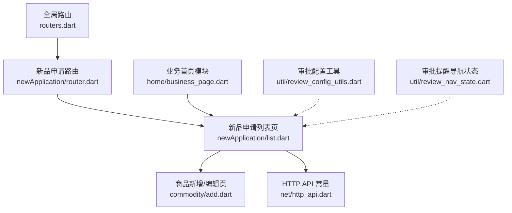
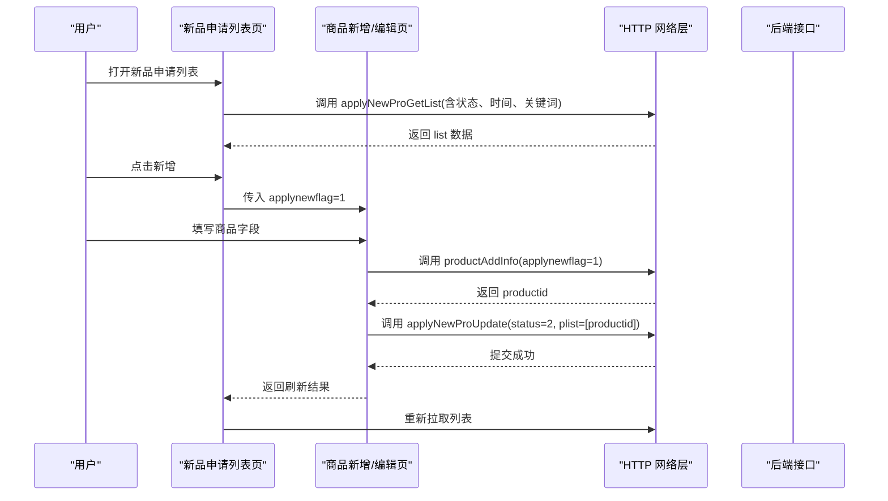
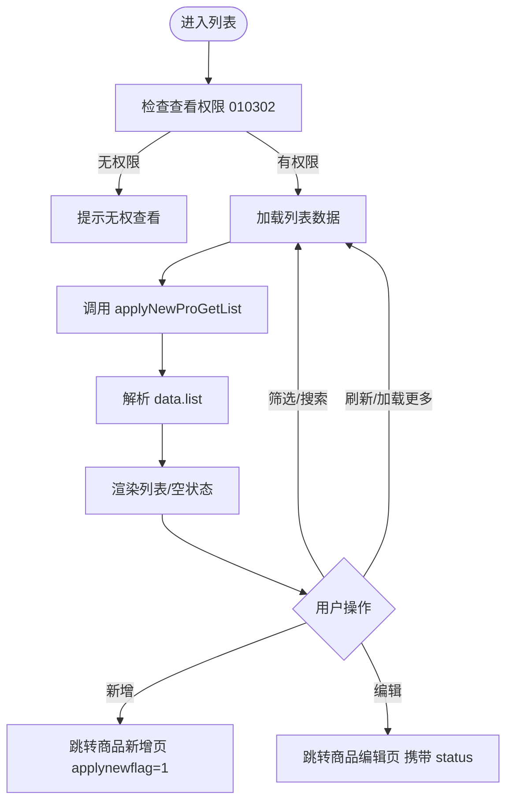
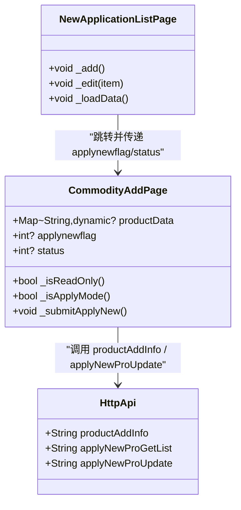
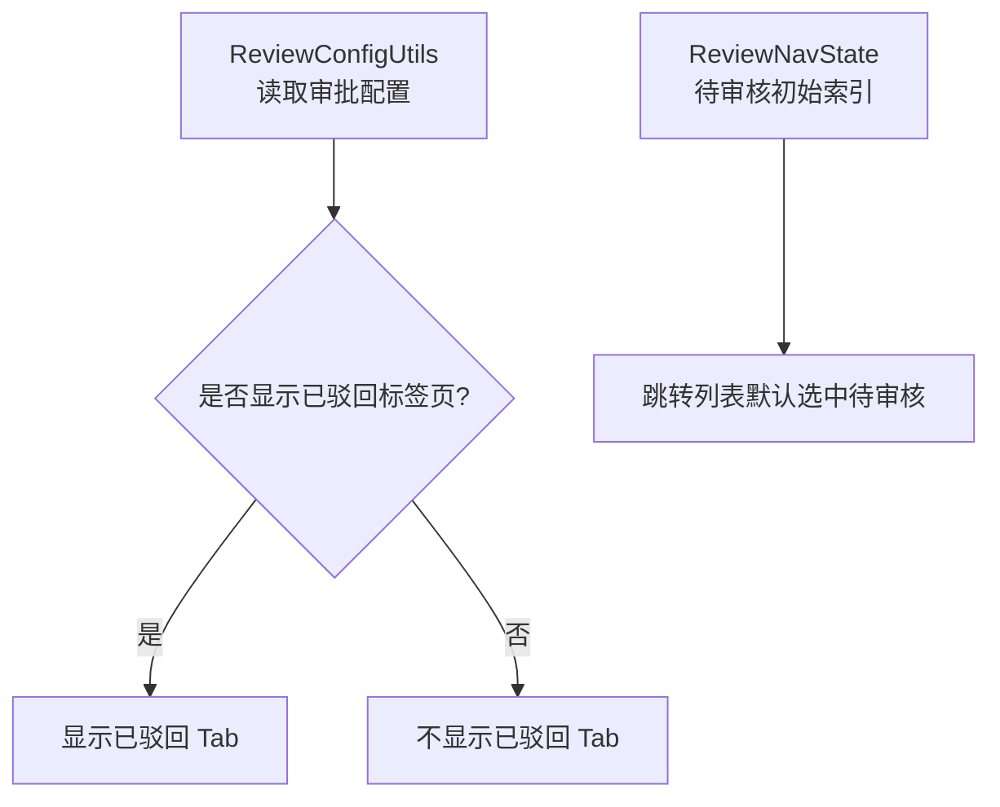
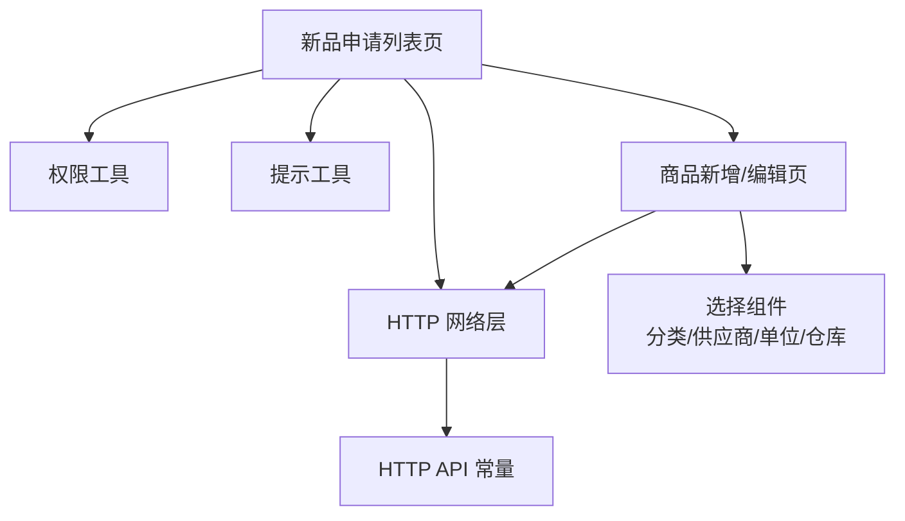

# 新申请

<cite>
**本文引用的文件**   
- [lib/pages/business/basis/newApplication/router.dart](file://lib/pages/business/basis/newApplication/router.dart)
- [lib/pages/business/basis/newApplication/list.dart](file://lib/pages/business/basis/newApplication/list.dart)
- [lib/pages/business/basis/commodity/add.dart](file://lib/pages/business/basis/commodity/add.dart)
- [lib/net/http_api.dart](file://lib/net/http_api.dart)
- [lib/routers/routers.dart](file://lib/routers/routers.dart)
- [lib/pages/home/business_page.dart](file://lib/pages/home/business_page.dart)
- [lib/util/review_config_utils.dart](file://lib/util/review_config_utils.dart)
- [lib/util/review_nav_state.dart](file://lib/util/review_nav_state.dart)
</cite>

## 目录
1. [引言](#引言)
2. [项目结构定位](#项目结构定位)
3. [核心组件](#核心组件)
4. [架构总览](#架构总览)
5. [详细组件分析](#详细组件分析)
6. [依赖关系分析](#依赖关系分析)
7. [性能与可靠性](#性能与可靠性)
8. [故障排查](#故障排查)
9. [扩展指南：新增业务申请类型](#扩展指南新增业务申请类型)
10. [结论](#结论)

## 引言
“新申请”在灵犀管店中对应“新品申请”业务。它用于门店提交新品档案，走“待提交 → 待审核 → 已审核 / 已驳回”的审批流程。前端通过独立的“新品申请列表页”展示、筛选、跳转编辑；实际表单复用“商品新增/编辑页”，并通过“新品申请模式”控制权限、按钮和提交流程。后端接口集中在统一 HTTP API 常量中，由通用网络层发起请求。

## 项目结构定位
- 路由入口：`lib/pages/business/basis/newApplication/router.dart` 定义 `/basis/newApplication/list` 路由。
- 列表页面：`lib/pages/business/basis/newApplication/list.dart` 实现新品申请列表、搜索、筛选、分页、新增与编辑跳转。
- 表单复用：`lib/pages/business/basis/commodity/add.dart` 提供商品新增/编辑能力，支持 `applynewflag` 进入新品申请模式。
- 路由注册：`lib/routers/routers.dart` 将 `NewApplicationRouter` 注册到全局路由器。
- 菜单入口：`lib/pages/home/business_page.dart` 在业务首页模块中提供“新品申请”入口。
- 审批配置：`lib/util/review_config_utils.dart` 提供多级审批配置工具（多数单据使用），新品申请当前以固定状态 Tab 为主。
- 审批提醒导航：`lib/util/review_nav_state.dart` 提供从审批提醒跳转到列表并默认停留在“待审核”的状态管理。

**图表来源**
- [lib/routers/routers.dart:132-132](file://lib/routers/routers.dart#L132-L132)
- [lib/pages/business/basis/newApplication/router.dart:5-17](file://lib/pages/business/basis/newApplication/router.dart#L5-L17)
- [lib/pages/business/basis/newApplication/list.dart:11-200](file://lib/pages/business/basis/newApplication/list.dart#L11-L200)
- [lib/pages/business/basis/commodity/add.dart:108-170](file://lib/pages/business/basis/commodity/add.dart#L108-L170)
- [lib/net/http_api.dart:480-490](file://lib/net/http_api.dart#L480-L490)
- [lib/pages/home/business_page.dart:519-519](file://lib/pages/home/business_page.dart#L519-L519)
- [lib/util/review_config_utils.dart:22-141](file://lib/util/review_config_utils.dart#L22-L141)
- [lib/util/review_nav_state.dart:1-29](file://lib/util/review_nav_state.dart#L1-L29)

**章节来源**
- [lib/pages/business/basis/newApplication/router.dart:1-17](file://lib/pages/business/basis/newApplication/router.dart#L1-L17)
- [lib/pages/business/basis/newApplication/list.dart:11-200](file://lib/pages/business/basis/newApplication/list.dart#L11-L200)
- [lib/pages/business/basis/commodity/add.dart:108-170](file://lib/pages/business/basis/commodity/add.dart#L108-L170)
- [lib/net/http_api.dart:480-490](file://lib/net/http_api.dart#L480-L490)
- [lib/routers/routers.dart:132-132](file://lib/routers/routers.dart#L132-L132)
- [lib/pages/home/business_page.dart:519-519](file://lib/pages/home/business_page.dart#L519-L519)
- [lib/util/review_config_utils.dart:22-141](file://lib/util/review_config_utils.dart#L22-L141)
- [lib/util/review_nav_state.dart:1-29](file://lib/util/review_nav_state.dart#L1-L29)

## 核心组件
- 新品申请列表页：负责按状态筛选、关键词搜索、时间范围筛选、分页加载、新增与编辑跳转。
- 商品新增/编辑页（新品申请模式）：复用商品表单，根据 `applynewflag` 切换为新品申请模式，控制只读态、权限映射、“保存并提交”动作。
- HTTP API 常量：集中声明新品申请相关接口地址，如列表查询、操作更新。
- 审批配置工具：为多单据提供“是否显示已驳回标签页”的配置解析与缓存策略。
- 审批提醒导航状态：允许从审批提醒入口直接跳到目标列表并默认选中“待审核”。

**章节来源**
- [lib/pages/business/basis/newApplication/list.dart:11-200](file://lib/pages/business/basis/newApplication/list.dart#L11-L200)
- [lib/pages/business/basis/commodity/add.dart:108-170](file://lib/pages/business/basis/commodity/add.dart#L108-L170)
- [lib/net/http_api.dart:480-490](file://lib/net/http_api.dart#L480-L490)
- [lib/util/review_config_utils.dart:22-141](file://lib/util/review_config_utils.dart#L22-L141)
- [lib/util/review_nav_state.dart:1-29](file://lib/util/review_nav_state.dart#L1-L29)

## 架构总览
新品申请的前端交互由“列表页 + 商品表单页”构成，数据通过统一 HTTP API 与后端交互。列表页承担“查询、筛选、分页、跳转”职责；表单页承担“字段采集、校验、保存、提交申请”职责。

**图表来源**
- [lib/pages/business/basis/newApplication/list.dart:11-200](file://lib/pages/business/basis/newApplication/list.dart#L11-L200)
- [lib/pages/business/basis/commodity/add.dart:1570-1680](file://lib/pages/business/basis/commodity/add.dart#L1570-L1680)
- [lib/net/http_api.dart:348-348](file://lib/net/http_api.dart#L348-L348)
- [lib/net/http_api.dart:486-487](file://lib/net/http_api.dart#L486-L487)

## 详细组件分析

### 新品申请列表页
- 功能要点
  - 顶部搜索栏支持条码、品名、自编码关键词检索。
  - 筛选抽屉支持快速时间（昨天、今天、本周、本月、自定义）与起止日期选择。
  - Tab 状态包括“全部、待审核、待提交、已审核、已驳回”，与后端 status 值对齐。
  - 下拉刷新、上拉加载更多，分页参数包含 page、pagesize、cond、status、starttime、endtime。
  - 新增需要“010301”权限；编辑需要“010305”权限；查看需要“010302”权限。
  - 点击卡片进入编辑；编辑时根据 item.status 决定 applynewflag 与 status。

- 关键数据流
  - `_loadData` 构造请求参数后调用 `request(HttpApi.applyNewProGetList, params)`。
  - 返回结构期望 `data.list` 为数组，否则降级为空列表。
  - 列表项卡片渲染名称、规格、申请机构、申请时间、状态标签；已驳回且存在驳回原因时显示原因。

**图表来源**
- [lib/pages/business/basis/newApplication/list.dart:11-200](file://lib/pages/business/basis/newApplication/list.dart#L11-L200)
- [lib/pages/business/basis/newApplication/list.dart:201-450](file://lib/pages/business/basis/newApplication/list.dart#L201-L450)
- [lib/pages/business/basis/newApplication/list.dart:451-760](file://lib/pages/business/basis/newApplication/list.dart#L451-L760)

**章节来源**
- [lib/pages/business/basis/newApplication/list.dart:11-200](file://lib/pages/business/basis/newApplication/list.dart#L11-L200)
- [lib/pages/business/basis/newApplication/list.dart:201-450](file://lib/pages/business/basis/newApplication/list.dart#L201-L450)
- [lib/pages/business/basis/newApplication/list.dart:451-760](file://lib/pages/business/basis/newApplication/list.dart#L451-L760)

### 商品新增/编辑页（新品申请模式）
- 模式区分
  - `applynewflag` 非空表示新品申请模式；此时权限映射使用“新品申请”对应的 menuId。
  - 当 `status` 为“已审核(3)”或“已驳回(4)”时，表单处于只读模式，禁止编辑。
  - 普通商品模式下使用商品档案权限；新品申请模式下使用新品申请权限。

- 提交流程
  - “保存并提交”会先调用 `productAddInfo` 保存商品，并传入 `applynewflag=1`。
  - 成功后取得 `productid`，再调用 `applyNewProUpdate`，设置 `status=2`（待审核）。
  - 若仅编辑已有申请单，则通过 `applyNewProUpdate` 执行删除/撤回/审核/驳回等动作。

- 字段配置
  - 表单默认值与小程序/Vue 项目保持一致，涵盖条码、名称、分类、单位、价格、库存、积分、促销、税务、包装、SN、新鲜度等多个维度。
  - 所属分类变更后会自动触发条码生成逻辑，并可能根据登录配置补全编码。

**图表来源**
- [lib/pages/business/basis/commodity/add.dart:108-170](file://lib/pages/business/basis/commodity/add.dart#L108-L170)
- [lib/pages/business/basis/commodity/add.dart:1570-1680](file://lib/pages/business/basis/commodity/add.dart#L1570-L1680)
- [lib/net/http_api.dart:348-348](file://lib/net/http_api.dart#L348-L348)
- [lib/net/http_api.dart:486-487](file://lib/net/http_api.dart#L486-L487)

**章节来源**
- [lib/pages/business/basis/commodity/add.dart:108-170](file://lib/pages/business/basis/commodity/add.dart#L108-L170)
- [lib/pages/business/basis/commodity/add.dart:1570-1680](file://lib/pages/business/basis/commodity/add.dart#L1570-L1680)

### 路由与菜单集成
- 路由注册
  - `NewApplicationRouter` 定义 `/basis/newApplication/list` 路由，处理器返回 `NewApplicationListPage`。
  - 全局路由表在初始化时将该路由加入 `_listRouter`。

- 菜单入口
  - 业务首页模块提供“新品申请”菜单项，点击后进入列表页。

**图表来源**
- [lib/pages/home/business_page.dart:519-519](file://lib/pages/home/business_page.dart#L519-L519)
- [lib/routers/routers.dart:132-132](file://lib/routers/routers.dart#L132-L132)
- [lib/pages/business/basis/newApplication/router.dart:5-17](file://lib/pages/business/basis/newApplication/router.dart#L5-L17)

**章节来源**
- [lib/pages/business/basis/newApplication/router.dart:1-17](file://lib/pages/business/basis/newApplication/router.dart#L1-L17)
- [lib/routers/routers.dart:132-132](file://lib/routers/routers.dart#L132-L132)
- [lib/pages/home/business_page.dart:519-519](file://lib/pages/home/business_page.dart#L519-L519)

### 审批与跟踪机制
- 列表状态 Tab
  - 新品申请列表使用固定状态集合：“全部、待审核、待提交、已审核、已驳回”，分别对应字符串 key 与后端 status。
  - 列表项卡片对状态进行文本与颜色映射，便于直观识别。

- 审批配置与“已驳回”标签页
  - 其他单据普遍通过 `ReviewConfigUtils.shouldShowRejectedTab` 动态决定是否显示“已驳回”标签页。
  - 新品申请当前未使用该动态开关，而是固定列出所有状态；但系统提供了统一的审批配置工具，可被后续扩展复用。

- 审批提醒跳转
  - `ReviewNavState` 提供从审批提醒入口跳转到列表并默认停留在“待审核”的能力，适用于其他单据列表；新品申请列表可按需接入该机制。

**图表来源**
- [lib/util/review_config_utils.dart:22-141](file://lib/util/review_config_utils.dart#L22-L141)
- [lib/util/review_nav_state.dart:1-29](file://lib/util/review_nav_state.dart#L1-L29)

**章节来源**
- [lib/pages/business/basis/newApplication/list.dart:11-200](file://lib/pages/business/basis/newApplication/list.dart#L11-L200)
- [lib/util/review_config_utils.dart:22-141](file://lib/util/review_config_utils.dart#L22-L141)
- [lib/util/review_nav_state.dart:1-29](file://lib/util/review_nav_state.dart#L1-L29)

## 依赖关系分析
- 列表页依赖
  - 网络层与 API 常量：`HttpApi.applyNewProGetList`。
  - 权限工具：`PermissionUtils`，用于控制查看、新增、编辑权限。
  - Toast 工具：用于权限不足或操作失败时的提示。
  - 商品新增/编辑页：作为路由目标，承载表单逻辑。

- 表单页依赖
  - 网络层与 API 常量：`HttpApi.productAddInfo`、`HttpApi.applyNewProUpdate`。
  - 分类选择、供应商、品牌、单位、仓库等选择组件。
  - 本地存储与配置：如登录参数、权限配置等。

**图表来源**
- [lib/pages/business/basis/newApplication/list.dart:11-200](file://lib/pages/business/basis/newApplication/list.dart#L11-L200)
- [lib/pages/business/basis/commodity/add.dart:108-170](file://lib/pages/business/basis/commodity/add.dart#L108-L170)
- [lib/net/http_api.dart:348-348](file://lib/net/http_api.dart#L348-L348)
- [lib/net/http_api.dart:486-487](file://lib/net/http_api.dart#L486-L487)

**章节来源**
- [lib/pages/business/basis/newApplication/list.dart:11-200](file://lib/pages/business/basis/newApplication/list.dart#L11-L200)
- [lib/pages/business/basis/commodity/add.dart:108-170](file://lib/pages/business/basis/commodity/add.dart#L108-L170)
- [lib/net/http_api.dart:348-348](file://lib/net/http_api.dart#L348-L348)
- [lib/net/http_api.dart:486-487](file://lib/net/http_api.dart#L486-L487)

## 性能与可靠性
- 列表分页与滚动
  - 使用 `RefreshIndicator` 与 `ListView.builder` 实现下拉刷新与上拉加载，避免一次性加载大量数据。
  - 滚动监听阈值控制下一页加载时机，减少重复请求。

- 权限校验前置
  - 在进入列表、新增、编辑前进行权限校验，失败即提示，避免无效请求。

- 网络错误处理
  - 列表加载捕获异常后将 `_hasMore` 置为 false，防止无限重试。
  - 表单提交失败由拦截器统一提示，避免重复弹窗。

[本节为通用建议，不直接分析具体代码行]

## 故障排查
- 无法查看新品申请
  - 检查“010302”查看权限是否配置；若权限不足，列表初始化时会提示无权查看。

- 无法新增或编辑
  - 检查“010301”新增权限或“010305”编辑权限。
  - 若商品已“已审核”或“已驳回”，表单为只读模式，无法编辑。

- 列表数据为空
  - 检查关键词、时间范围筛选条件是否正确。
  - 检查后端 `bi/applynewpro/getApplyList` 接口是否正常返回 `data.list`。

- 提交申请失败
  - 确认 `productAddInfo` 返回了 `productid`。
  - 确认 `applyNewProUpdate` 调用参数 `status=2`、`plist=[productid]` 正确。

**章节来源**
- [lib/pages/business/basis/newApplication/list.dart:11-200](file://lib/pages/business/basis/newApplication/list.dart#L11-L200)
- [lib/pages/business/basis/commodity/add.dart:1570-1680](file://lib/pages/business/basis/commodity/add.dart#L1570-L1680)
- [lib/net/http_api.dart:486-487](file://lib/net/http_api.dart#L486-L487)

## 扩展指南：新增业务申请类型
如果你需要在系统中新增一种“业务申请”（例如“活动申请”“调价申请”），可以参照“新品申请”的实现方式，采用“列表页 + 复用表单或独立表单 + 统一审批状态”的模式。

### 步骤一：定义路由与菜单
- 在业务目录下新建子模块，例如 `lib/pages/business/basis/activityApply/`。
- 创建路由文件，定义路由路径与页面处理器。
- 在全局路由表中注册该路由。
- 在业务首页模块中添加菜单项，指向新列表页。

参考路径：
- [lib/pages/business/basis/newApplication/router.dart:5-17](file://lib/pages/business/basis/newApplication/router.dart#L5-L17)
- [lib/routers/routers.dart:132-132](file://lib/routers/routers.dart#L132-L132)
- [lib/pages/home/business_page.dart:519-519](file://lib/pages/home/business_page.dart#L519-L519)

### 步骤二：实现列表页
- 实现列表页，包含：
  - 状态 Tab（全部、待提交、待审核、已审核、已驳回）。
  - 关键词搜索。
  - 时间范围筛选。
  - 分页加载。
  - 新增与编辑跳转。
  - 权限校验（查看、新增、编辑）。

参考路径：
- [lib/pages/business/basis/newApplication/list.dart:11-200](file://lib/pages/business/basis/newApplication/list.dart#L11-L200)
- [lib/pages/business/basis/newApplication/list.dart:201-450](file://lib/pages/business/basis/newApplication/list.dart#L201-L450)
- [lib/pages/business/basis/newApplication/list.dart:451-760](file://lib/pages/business/basis/newApplication/list.dart#L451-L760)

### 步骤三：实现表单页
- 如果现有表单可满足需求，可复用现有表单页，并通过模式参数（如 `applynewflag`）切换行为。
- 如果需要独立表单，新建表单页，并在新增/编辑时传入必要上下文。
- 在表单页实现：
  - 字段采集与校验。
  - 保存逻辑。
  - 提交申请逻辑（如需分步调用多个接口）。
  - 权限控制与只读模式。

参考路径：
- [lib/pages/business/basis/commodity/add.dart:108-170](file://lib/pages/business/basis/commodity/add.dart#L108-L170)
- [lib/pages/business/basis/commodity/add.dart:1570-1680](file://lib/pages/business/basis/commodity/add.dart#L1570-L1680)

### 步骤四：注册接口
- 在 `HttpApi` 中声明新申请相关的接口地址，如列表查询、保存、操作更新。
- 在列表页和表单页中使用这些常量发起请求。

参考路径：
- [lib/net/http_api.dart:486-487](file://lib/net/http_api.dart#L486-L487)

### 步骤五：集成审批与跟踪
- 如需与其他单据一致显示“已驳回”标签页，可使用 `ReviewConfigUtils.shouldShowRejectedTab`。
- 如需从审批提醒入口跳转到列表并默认停留在“待审核”，可使用 `ReviewNavState`。

参考路径：
- [lib/util/review_config_utils.dart:22-141](file://lib/util/review_config_utils.dart#L22-L141)
- [lib/util/review_nav_state.dart:1-29](file://lib/util/review_nav_state.dart#L1-L29)

### 开发示例说明（以路径引用代替代码）
- 创建新申请类型
  - 新建路由与菜单：参考 [lib/pages/business/basis/newApplication/router.dart:5-17](file://lib/pages/business/basis/newApplication/router.dart#L5-L17)、[lib/routers/routers.dart:132-132](file://lib/routers/routers.dart#L132-L132)、[lib/pages/home/business_page.dart:519-519](file://lib/pages/home/business_page.dart#L519-L519)。
- 填写申请表单
  - 复用商品表单并启用新模式：参考 [lib/pages/business/basis/commodity/add.dart:108-170](file://lib/pages/business/basis/commodity/add.dart#L108-L170)。
- 跟踪审批状态
  - 列表状态与卡片渲染：参考 [lib/pages/business/basis/newApplication/list.dart:11-200](file://lib/pages/business/basis/newApplication/list.dart#L11-L200)、[lib/pages/business/basis/newApplication/list.dart:451-760](file://lib/pages/business/basis/newApplication/list.dart#L451-L760)。
- 提交申请
  - 保存并提交流程：参考 [lib/pages/business/basis/commodity/add.dart:1570-1680](file://lib/pages/business/basis/commodity/add.dart#L1570-L1680)、[lib/net/http_api.dart:348-348](file://lib/net/http_api.dart#L348-L348)、[lib/net/http_api.dart:486-487](file://lib/net/http_api.dart#L486-L487)。

**章节来源**
- [lib/pages/business/basis/newApplication/router.dart:5-17](file://lib/pages/business/basis/newApplication/router.dart#L5-L17)
- [lib/routers/routers.dart:132-132](file://lib/routers/routers.dart#L132-L132)
- [lib/pages/home/business_page.dart:519-519](file://lib/pages/home/business_page.dart#L519-L519)
- [lib/pages/business/basis/newApplication/list.dart:11-200](file://lib/pages/business/basis/newApplication/list.dart#L11-L200)
- [lib/pages/business/basis/newApplication/list.dart:451-760](file://lib/pages/business/basis/newApplication/list.dart#L451-L760)
- [lib/pages/business/basis/commodity/add.dart:108-170](file://lib/pages/business/basis/commodity/add.dart#L108-L170)
- [lib/pages/business/basis/commodity/add.dart:1570-1680](file://lib/pages/business/basis/commodity/add.dart#L1570-L1680)
- [lib/net/http_api.dart:348-348](file://lib/net/http_api.dart#L348-L348)
- [lib/net/http_api.dart:486-487](file://lib/net/http_api.dart#L486-L487)
- [lib/util/review_config_utils.dart:22-141](file://lib/util/review_config_utils.dart#L22-L141)
- [lib/util/review_nav_state.dart:1-29](file://lib/util/review_nav_state.dart#L1-L29)

## 结论
灵犀管店的“新申请”以“新品申请”为典型实现：列表页负责查询与筛选，表单页复用商品新增/编辑能力并通过模式参数控制行为，提交流程分为“保存商品”和“提交申请”两步。权限校验、分页加载、状态映射与接口常量组织清晰，便于扩展新的业务申请类型。若需统一审批配置与提醒导航，可复用 `ReviewConfigUtils` 与 `ReviewNavState`。