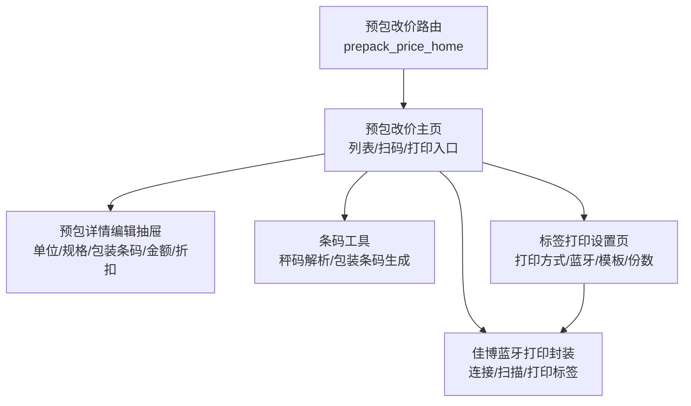
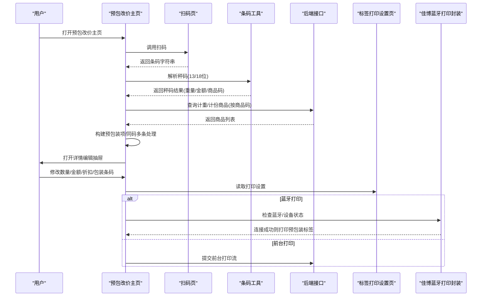
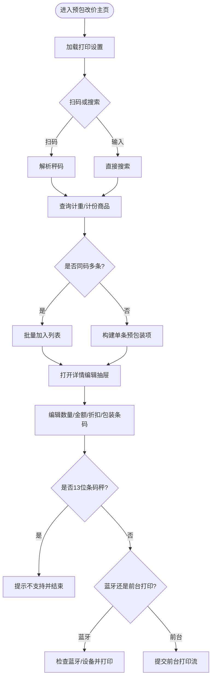
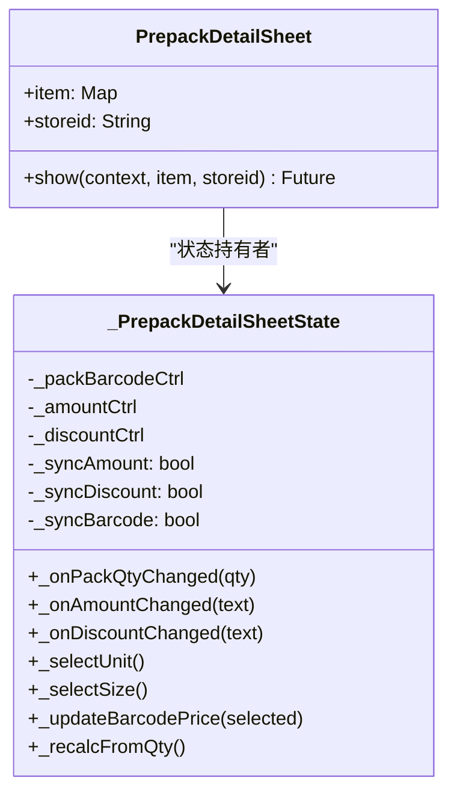
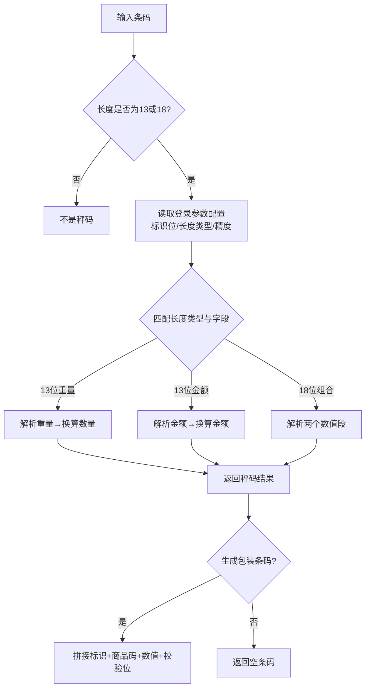
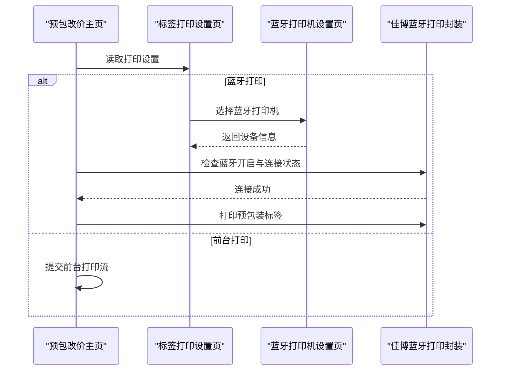
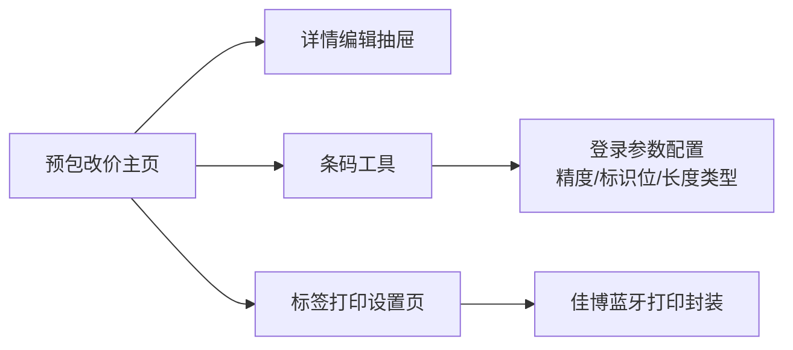

# 预包装价格

<cite>
**本文引用的文件**
- [prepack_price_home.dart](file://lib/pages/business/basis/prepackPrice/prepack_price_home.dart)
- [prepack_detail_sheet.dart](file://lib/pages/business/basis/prepackPrice/prepack_detail_sheet.dart)
- [router.dart](file://lib/pages/business/basis/prepackPrice/router.dart)
- [barcode_utils.dart](file://lib/util/barcode_utils.dart)
- [label_print_page.dart](file://lib/pages/user/label_print_page.dart)
- [gprinter.dart](file://lib/util/gprinter.dart)
</cite>

## 目录
1. [简介](#简介)
2. [项目结构](#项目结构)
3. [核心组件](#核心组件)
4. [架构总览](#架构总览)
5. [详细组件分析](#详细组件分析)
6. [依赖关系分析](#依赖关系分析)
7. [性能与可靠性](#性能与可靠性)
8. [故障排除指南](#故障排除指南)
9. [结论](#结论)

## 简介
本文面向灵犀管店 Flutter 应用中的“预包装价格”功能，聚焦以下目标：
- 预包装商品的改价流程、扫码识别与数量金额联动。
- 13位条码格式要求及与蓝牙标签打印的兼容性限制。
- 预包装商品特殊属性、包装条码生成规则与价格计算逻辑。
- 打印设置配置项、前台打印与蓝牙打印集成方案。
- 预包装业务与普通商品的区别、与标签打印系统的关系。
- 可操作的流程图和代码级参考路径，帮助快速定位实现位置。

## 项目结构
预包装价格功能集中在“基础数据”模块下，围绕页面路由、主页改价、详情编辑抽屉、条码工具与打印设置展开：
- 页面入口与路由：`lib/pages/business/basis/prepackPrice/router.dart`
- 改价主页与列表处理：`lib/pages/business/basis/prepackPrice/prepack_price_home.dart`
- 单价/折扣/包装条码联动编辑抽屉：`lib/pages/business/basis/prepackPrice/prepack_detail_sheet.dart`
- 秤码解析与包装条码生成：`lib/util/barcode_utils.dart`
- 标签打印设置页（蓝牙设备、模板、份数）：`lib/pages/user/label_print_page.dart`
- 佳博蓝牙标签打印封装：`lib/util/gprinter.dart`

**图示来源**
- [router.dart:1-17](file://lib/pages/business/basis/prepackPrice/router.dart#L1-L17)
- [prepack_price_home.dart:1-200](file://lib/pages/business/basis/prepackPrice/prepack_price_home.dart#L1-L200)
- [prepack_detail_sheet.dart:1-120](file://lib/pages/business/basis/prepackPrice/prepack_detail_sheet.dart#L1-L120)
- [barcode_utils.dart:1-200](file://lib/util/barcode_utils.dart#L1-L200)
- [label_print_page.dart:1-120](file://lib/pages/user/label_print_page.dart#L1-L120)
- [gprinter.dart:1-130](file://lib/util/gprinter.dart#L1-L130)

**章节来源**
- [router.dart:1-17](file://lib/pages/business/basis/prepackPrice/router.dart#L1-L17)

## 核心组件
- 预包改价主页
  - 负责搜索/扫码、构建预包装商品项、重复录入策略、打印前校验与蓝牙/前台打印分支。
- 预包详情编辑抽屉
  - 负责单位/规格选择、包装数量、包装金额、包装折扣三者联动计算与包装条码同步更新。
- 条码工具
  - 解析秤码（13位/18位），生成预包装包装条码，并处理精度缩放与数值补位。
- 标签打印设置页
  - 管理打印方式（关闭/前台/蓝牙）、蓝牙设备、打印份数与模板。
- 佳博蓝牙打印封装
  - 提供系统蓝牙能力、设备扫描连接、标签与预包装标签打印方法。

**章节来源**
- [prepack_price_home.dart:1-200](file://lib/pages/business/basis/prepackPrice/prepack_price_home.dart#L1-L200)
- [prepack_detail_sheet.dart:1-200](file://lib/pages/business/basis/prepackPrice/prepack_detail_sheet.dart#L1-L200)
- [barcode_utils.dart:1-200](file://lib/util/barcode_utils.dart#L1-L200)
- [label_print_page.dart:1-200](file://lib/pages/user/label_print_page.dart#L1-L200)
- [gprinter.dart:1-130](file://lib/util/gprinter.dart#L1-L130)

## 架构总览
预包装改价的主流程是：扫码或输入 → 解析秤码 → 查询计重/计份商品 → 构建预包装项 → 可选批量同码多条 → 打开详情抽屉编辑 → 根据打印设置走蓝牙或前台打印。

**图示来源**
- [prepack_price_home.dart:201-500](file://lib/pages/business/basis/prepackPrice/prepack_price_home.dart#L201-L500)
- [barcode_utils.dart:1-200](file://lib/util/barcode_utils.dart#L1-L200)
- [label_print_page.dart:1-200](file://lib/pages/user/label_print_page.dart#L1-L200)
- [gprinter.dart:1-130](file://lib/util/gprinter.dart#L1-L130)

## 详细组件分析

### 预包改价主页
职责与关键点：
- 加载打印设置：通过客户端标识拉取新接口打印设置，包含蓝牙状态、设备ID、打印类型、份数与模板。
- 扫码与搜索：支持扫码与手动输入；若为秤码则先解析出商品码再查询；对同码多条进行批量处理。
- 重复录入策略：支持提示、累加、覆盖、允许重复四种策略，影响已存在商品的处理方式。
- 预包装项构建：从商品零售价与包装数量推导包装金额，自动生成包装条码与包装折扣。
- 打印分支：13位条码秤时提示不支持；否则根据打印类型执行蓝牙或前台打印。

关键流程片段参考：
- 打印前校验与蓝牙判断：[prepack_price_home.dart:201-500](file://lib/pages/business/basis/prepackPrice/prepack_price_home.dart#L201-L500)
- 重复录入策略与同码多条处理：[prepack_price_home.dart:201-500](file://lib/pages/business/basis/prepackPrice/prepack_price_home.dart#L201-L500)
- 预包装项构建与包装条码生成：[prepack_price_home.dart:201-500](file://lib/pages/business/basis/prepackPrice/prepack_price_home.dart#L201-L500)

**图示来源**
- [prepack_price_home.dart:201-500](file://lib/pages/business/basis/prepackPrice/prepack_price_home.dart#L201-L500)

**章节来源**
- [prepack_price_home.dart:1-200](file://lib/pages/business/basis/prepackPrice/prepack_price_home.dart#L1-L200)
- [prepack_price_home.dart:201-500](file://lib/pages/business/basis/prepackPrice/prepack_price_home.dart#L201-L500)

### 预包详情编辑抽屉
职责与关键点：
- 单位/规格选择：调用扩展选择弹窗，获取单位或规格信息后更新条码与零售价。
- 字段联动：
  - 修改包装数量：保持金额不变，反算折扣与包装条码。
  - 修改包装金额：根据金额反算折扣，并重算包装条码。
  - 修改包装折扣：根据折扣反算金额，并重算包装条码。
- 扫码来源保护：当数量来自扫码时，包装数量显示为只读，避免误改。

关键流程片段参考：
- 单位/规格选择与条码价格更新：[prepack_detail_sheet.dart:201-360](file://lib/pages/business/basis/prepackPrice/prepack_detail_sheet.dart#L201-L360)
- 三个输入框联动计算与控制器同步标记：[prepack_detail_sheet.dart:120-200](file://lib/pages/business/basis/prepackPrice/prepack_detail_sheet.dart#L120-L200)

**图示来源**
- [prepack_detail_sheet.dart:1-200](file://lib/pages/business/basis/prepackPrice/prepack_detail_sheet.dart#L1-L200)
- [prepack_detail_sheet.dart:201-360](file://lib/pages/business/basis/prepackPrice/prepack_detail_sheet.dart#L201-L360)

**章节来源**
- [prepack_detail_sheet.dart:1-200](file://lib/pages/business/basis/prepackPrice/prepack_detail_sheet.dart#L1-L200)
- [prepack_detail_sheet.dart:201-678](file://lib/pages/business/basis/prepackPrice/prepack_detail_sheet.dart#L201-L678)

### 条码工具：秤码解析与包装条码生成
职责与关键点：
- 秤码解析：支持13位重量码、13位金额码，以及多种18位组合（重+金额、重+单价、金额+重量、单价+重量）。
- 精度缩放：根据登录参数中的 `webWeightInt`、`webAmtInt`、`webPriceInt` 等配置换算重量/金额/单价。
- 包装条码生成：根据当前 lengthType（13位或18位）与精度配置，生成符合秤码规则的包装条码，并对数值进行四舍五入与前置补零。
- 异常与边界：数值超范围会提示“非正常称重条码”，并返回空条码阻止后续错误打印。

关键流程片段参考：
- 秤码解析主逻辑与长度类型判断：[barcode_utils.dart:1-200](file://lib/util/barcode_utils.dart#L1-L200)
- 包装条码生成与精度缩放映射：[barcode_utils.dart:201-311](file://lib/util/barcode_utils.dart#L201-L311)

**图示来源**
- [barcode_utils.dart:1-200](file://lib/util/barcode_utils.dart#L1-L200)
- [barcode_utils.dart:201-311](file://lib/util/barcode_utils.dart#L201-L311)

**章节来源**
- [barcode_utils.dart:1-200](file://lib/util/barcode_utils.dart#L1-L200)
- [barcode_utils.dart:201-311](file://lib/util/barcode_utils.dart#L201-L311)

### 标签打印设置与蓝牙打印集成
职责与关键点：
- 打印设置：支持关闭打印、前台打印、蓝牙打印三种模式；保存新接口设置，并与旧接口前台打印开关互斥。
- 蓝牙打印：跳转蓝牙打印机设置页，回显已连接的打印机名称或设备ID；支持打印份数与模板选择。
- 打印触发：预包改价主页在蓝牙模式下检查蓝牙开启状态与设备连接状态，未连接则引导去设置页；连接成功后调用佳博封装打印预包装标签。

关键流程片段参考：
- 打印设置加载与新旧接口互斥规则：[label_print_page.dart:1-200](file://lib/pages/user/label_print_page.dart#L1-L200)
- 蓝牙打印设置UI与保存逻辑：[label_print_page.dart:201-448](file://lib/pages/user/label_print_page.dart#L201-L448)
- 佳博蓝牙打印封装方法：[gprinter.dart:1-130](file://lib/util/gprinter.dart#L1-L130)

**图示来源**
- [label_print_page.dart:1-200](file://lib/pages/user/label_print_page.dart#L1-L200)
- [label_print_page.dart:201-448](file://lib/pages/user/label_print_page.dart#L201-L448)
- [gprinter.dart:1-130](file://lib/util/gprinter.dart#L1-L130)
- [prepack_price_home.dart:201-500](file://lib/pages/business/basis/prepackPrice/prepack_price_home.dart#L201-L500)

**章节来源**
- [label_print_page.dart:1-200](file://lib/pages/user/label_print_page.dart#L1-L200)
- [label_print_page.dart:201-448](file://lib/pages/user/label_print_page.dart#L201-L448)
- [gprinter.dart:1-130](file://lib/util/gprinter.dart#L1-L130)
- [prepack_price_home.dart:201-500](file://lib/pages/business/basis/prepackPrice/prepack_price_home.dart#L201-L500)

## 依赖关系分析
- 页面层
  - 预包改价主页依赖条码工具解析秤码、调用网络接口查询商品、驱动详情编辑抽屉与打印设置。
  - 详情编辑抽屉依赖条码工具生成包装条码，并通过扩展选择弹窗获取单位/规格。
- 工具层
  - 条码工具依赖本地登录参数配置（精度、标识位、长度类型）。
  - 蓝牙打印封装依赖原生 MethodChannel 与 Android 插件实现蓝牙能力。
- 配置层
  - 打印设置依赖新接口与旧接口协同，确保前台打印与蓝牙打印互斥。

**图示来源**
- [prepack_price_home.dart:1-200](file://lib/pages/business/basis/prepackPrice/prepack_price_home.dart#L1-L200)
- [prepack_detail_sheet.dart:1-200](file://lib/pages/business/basis/prepackPrice/prepack_detail_sheet.dart#L1-L200)
- [barcode_utils.dart:1-200](file://lib/util/barcode_utils.dart#L1-L200)
- [label_print_page.dart:1-200](file://lib/pages/user/label_print_page.dart#L1-L200)
- [gprinter.dart:1-130](file://lib/util/gprinter.dart#L1-L130)

**章节来源**
- [prepack_price_home.dart:1-200](file://lib/pages/business/basis/prepackPrice/prepack_price_home.dart#L1-L200)
- [prepack_detail_sheet.dart:1-200](file://lib/pages/business/basis/prepackPrice/prepack_detail_sheet.dart#L1-L200)
- [barcode_utils.dart:1-200](file://lib/util/barcode_utils.dart#L1-L200)
- [label_print_page.dart:1-200](file://lib/pages/user/label_print_page.dart#L1-L200)
- [gprinter.dart:1-130](file://lib/util/gprinter.dart#L1-L130)

## 性能与可靠性
- 扫码与解析：秤码解析仅做字符串切片与数值转换，时间复杂度 O(1)，适合高频扫码场景。
- 包装条码生成：根据配置与数值进行缩放与补位，注意数值上限校验，避免生成非法条码。
- 打印设置加载：并行拉取新接口设置与旧接口互斥状态，减少等待时间。
- 蓝牙连接：Android 13 以上需要用户手动开启蓝牙；连接失败时引导至设置页，提升用户体验。

[本节为通用指导，不直接分析具体文件]

## 故障排除指南
常见问题与排查建议：
- 扫码无法识别秤码
  - 检查登录参数中的标识位、长度类型与精度配置是否与秤端一致。
  - 确认条码长度为13或18位，且以正确标识位开头。
  - 参考解析逻辑与调试日志输出位置：[prepack_price_home.dart:201-500](file://lib/pages/business/basis/prepackPrice/prepack_price_home.dart#L201-L500)、[barcode_utils.dart:1-200](file://lib/util/barcode_utils.dart#L1-L200)。
- 包装条码生成失败
  - 数值超出范围会提示“非正常称重条码”，检查重量/金额/单价配置与当前数量金额是否合理。
  - 参考生成逻辑与边界校验：[barcode_utils.dart:201-311](file://lib/util/barcode_utils.dart#L201-L311)。
- 13位条码秤不支持预包装改价打印
  - 当门店条码称使用13位条码格式时，应用会提示不支持并拦截打印流程。
  - 参考限制判断与提示文案：[prepack_price_home.dart:1-200](file://lib/pages/business/basis/prepackPrice/prepack_price_home.dart#L1-L200)。
- 蓝牙打印无响应
  - 检查蓝牙是否开启、是否已在应用内连接打印机、设备ID是否存在。
  - 前往标签打印设置页重新选择蓝牙打印机，确认打印份数与模板。
  - 参考蓝牙相关方法与设置页交互：[gprinter.dart:1-130](file://lib/util/gprinter.dart#L1-L130)、[label_print_page.dart:201-448](file://lib/pages/user/label_print_page.dart#L201-L448)。
- 前台打印不生效
  - 确认新接口打印类型未设置为蓝牙，同时旧接口前台打印开关未被强制关闭。
  - 参考新旧接口互斥规则与保存逻辑：[label_print_page.dart:1-200](file://lib/pages/user/label_print_page.dart#L1-L200)。

**章节来源**
- [prepack_price_home.dart:1-200](file://lib/pages/business/basis/prepackPrice/prepack_price_home.dart#L1-L200)
- [prepack_price_home.dart:201-500](file://lib/pages/business/basis/prepackPrice/prepack_price_home.dart#L201-L500)
- [barcode_utils.dart:1-200](file://lib/util/barcode_utils.dart#L1-L200)
- [barcode_utils.dart:201-311](file://lib/util/barcode_utils.dart#L201-L311)
- [label_print_page.dart:1-200](file://lib/pages/user/label_print_page.dart#L1-L200)
- [label_print_page.dart:201-448](file://lib/pages/user/label_print_page.dart#L201-L448)
- [gprinter.dart:1-130](file://lib/util/gprinter.dart#L1-L130)

## 结论
预包装价格功能将扫码识别、商品查询、详情编辑与打印设置整合成一条完整的业务流程。其核心在于：
- 准确的秤码解析与包装条码生成，保证标签内容符合秤端规则。
- 灵活的价格联动与重复录入策略，适应不同门店操作习惯。
- 明确的打印模式与蓝牙连接校验，确保标签打印可靠稳定。
- 对13位条码秤的限制提示，避免误用导致打印失败。

在实际使用中，建议优先校验秤端配置与应用配置一致性，并在首次使用前完成蓝牙打印设备的连接与模板选择。遇到问题时，可依据本指南逐步排查扫码解析、包装条码生成与打印设置等环节。