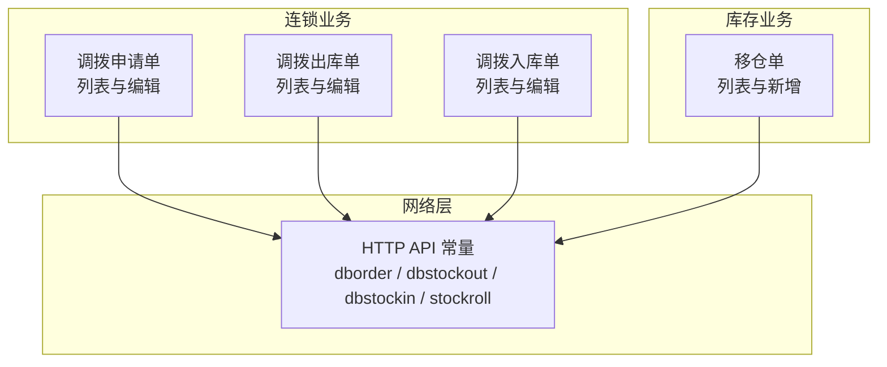
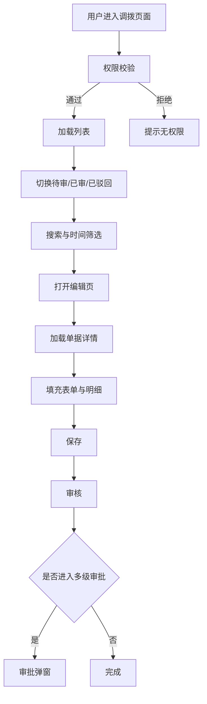
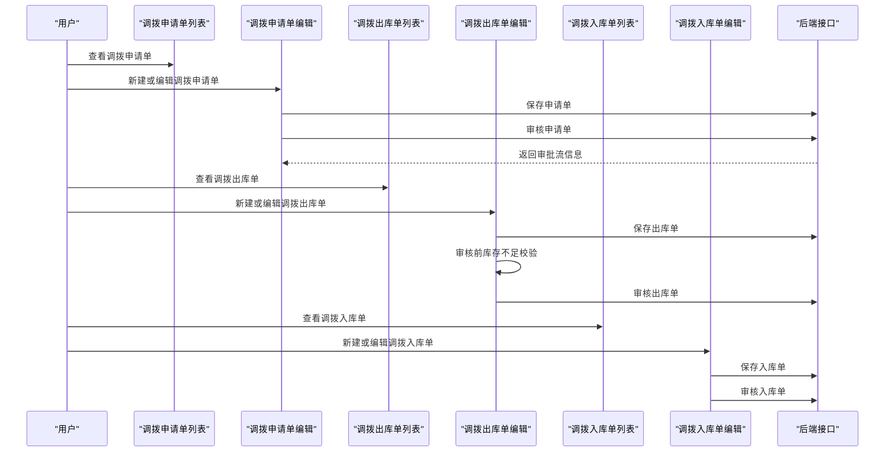
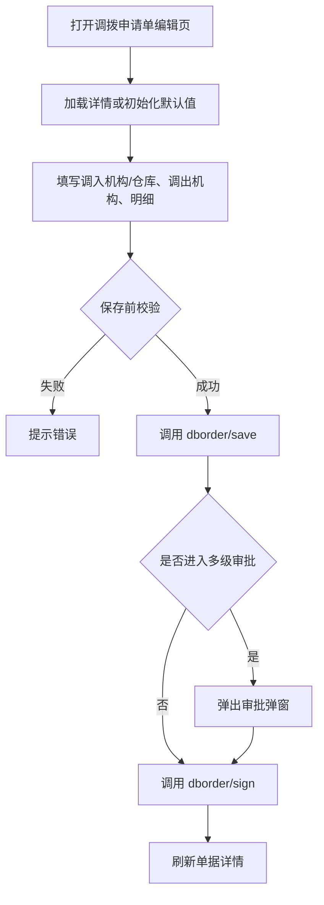
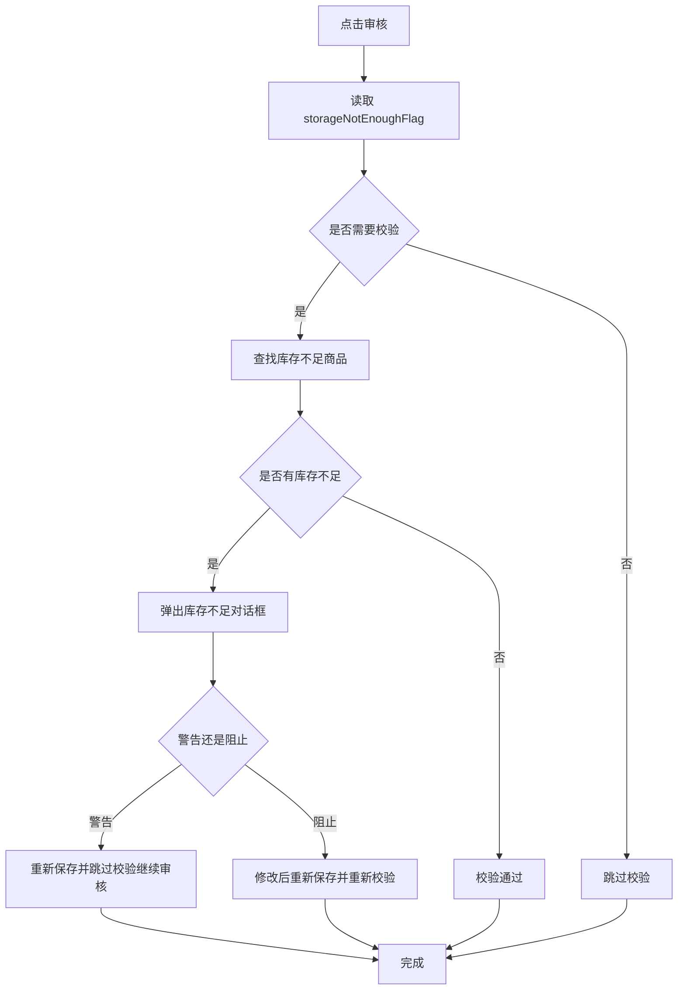
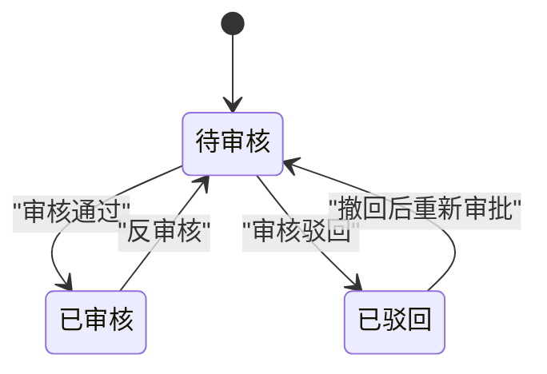
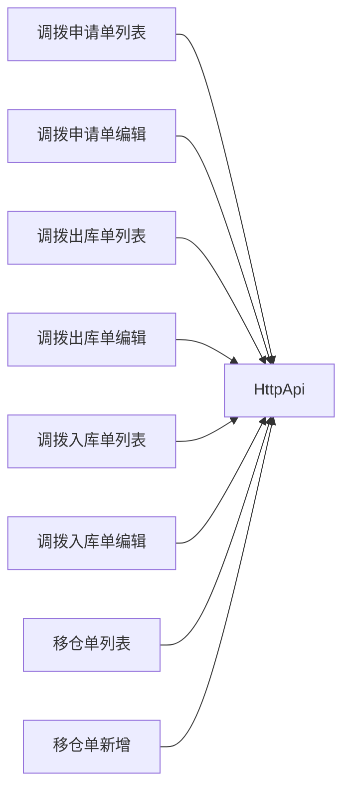

# 仓库调拨

<cite>
**本文引用的文件**   
- [http_api.dart](file://lib/net/http_api.dart)
- [allot_apply_list.dart](file://lib/pages/business/chain/allot_apply/list.dart)
- [allot_apply_edit.dart](file://lib/pages/business/chain/allot_apply/edit.dart)
- [allot_delivery_list.dart](file://lib/pages/business/chain/allot_delivery/list.dart)
- [allot_delivery_edit.dart](file://lib/pages/business/chain/allot_delivery/edit.dart)
- [allot_entry_list.dart](file://lib/pages/business/chain/allot_entry/list.dart)
- [allot_entry_edit.dart](file://lib/pages/business/chain/allot_entry/edit.dart)
- [movewarehouse_list.dart](file://lib/pages/business/inventory/movewarehouse/list.dart)
- [movewarehouse_add.dart](file://lib/pages/business/inventory/movewarehouse/add.dart)
</cite>

## 目录
1. [引言](#引言)
2. [项目结构与调拨业务定位](#项目结构与调拨业务定位)
3. [核心组件与单据类型](#核心组件与单据类型)
4. [系统架构总览](#系统架构总览)
5. [跨仓库调拨完整流程](#跨仓库调拨完整流程)
6. [调拨申请单分析](#调拨申请单分析)
7. [调拨出库单分析](#调拨出库单分析)
8. [调拨入库单分析](#调拨入库单分析)
9. [移仓单与库存转移](#移仓单与库存转移)
10. [状态管理与审批规则](#状态管理与审批规则)
11. [库存计算、成本与多仓库平衡](#库存计算成本与多仓库平衡)
12. [与其他业务单据的关联关系](#与其他业务单据的关联关系)
13. [依赖关系分析](#依赖关系分析)
14. [性能与交互优化](#性能与交互优化)
15. [异常处理与排障指南](#异常处理与排障指南)
16. [调拨效率分析与优化策略](#调拨效率分析与优化策略)
17. [结论](#结论)

## 引言
本文件围绕灵犀管店 Flutter 项目中的“仓库调拨”能力进行系统化文档化。仓库调拨用于在机构或仓库之间转移商品库存，典型场景包括：门店间调货、配送中心与门店之间的补货与退货、内部仓库间的库存再分配等。

从代码视角看，调拨功能由三类链式单据构成：
- 调拨申请单：发起调拨需求，定义调入方、调出方及明细。
- 调拨出库单：按申请单执行调出方的库存减少。
- 调拨入库单：按申请单执行调入方的库存增加。

此外，仓库模块还提供“移仓单”，用于同一机构内部仓库间的库存移动。它与调拨不同：调拨强调机构或仓库之间的双向库存转移，而移仓更偏向同机构内仓库间调整。

## 项目结构与调拨业务定位
调拨相关页面集中在 `lib/pages/business/chain` 下的 chain（连锁）业务目录中；库存类辅助能力位于 `lib/pages/business/inventory` 下。HTTP API 常量统一维护在 `lib/net/http_api.dart`，列表页与编辑页采用一致的权限校验、分页加载、时间筛选、Tab 状态切换和多级审批交互模式。

**图表来源**
- [http_api.dart:123-148](file://lib/net/http_api.dart#L123-L148)
- [http_api.dart:418-423](file://lib/net/http_api.dart#L418-L423)
- [allot_apply_list.dart:1-200](file://lib/pages/business/chain/allot_apply/list.dart#L1-L200)
- [allot_delivery_list.dart:1-200](file://lib/pages/business/chain/allot_delivery/list.dart#L1-L200)
- [allot_entry_list.dart:1-200](file://lib/pages/business/chain/allot_entry/list.dart#L1-L200)
- [movewarehouse_list.dart:1-200](file://lib/pages/business/inventory/movewarehouse/list.dart#L1-L200)

**章节来源**
- [http_api.dart:123-148](file://lib/net/http_api.dart#L123-L148)
- [http_api.dart:418-423](file://lib/net/http_api.dart#L418-L423)
- [allot_apply_list.dart:1-200](file://lib/pages/business/chain/allot_apply/list.dart#L1-L200)
- [allot_delivery_list.dart:1-200](file://lib/pages/business/chain/allot_delivery/list.dart#L1-L200)
- [allot_entry_list.dart:1-200](file://lib/pages/business/chain/allot_entry/list.dart#L1-L200)
- [movewarehouse_list.dart:1-200](file://lib/pages/business/inventory/movewarehouse/list.dart#L1-L200)

## 核心组件与单据类型
| 组件 | 主要职责 | 关键接口 | 前端入口 |
|---|---|---|---|
| 调拨申请单 | 创建调拨需求，选择调入机构、调入仓库、调出机构，填写商品明细 | `dborder/findList`、`dborder/getInfo`、`dborder/save`、`dborder/sign`、`dborder/retsign` | `AllotApplyListPage`、`AllotApplyEditPage` |
| 调拨出库单 | 根据调拨申请单生成调出方出库数据，支持库存不足校验 | `dbstockout/findList`、`dbstockout/getInfo`、`dbstockout/save`、`dbstockout/sign`、`dbstockout/retsign` | `AllotDeliveryListPage`、`AllotDeliveryEditPage` |
| 调拨入库单 | 根据调拨申请单生成调入方入库数据，校验仓库类型与商品存储方式 | `dbstockout/findList`、`dbstockout/getInfo`、`dbstockout/inSave`、`dbstockout/inSign`、`dbstockout/retInSign` | `AllotEntryListPage`、`AllotEntryEditPage` |
| 移仓单 | 同机构内仓库间库存移动，常用于库存盘点差异、库位调整 | `stockroll/findList`、`stockroll/getInfo`、`stockroll/save`、`stockroll/sign` | `InventoryMovewarehouseListPage`、`InventoryMovewarehouseAddPage` |

调拨申请单使用 `signflag` 表示审核状态；调拨出库单同样使用 `signflag`；调拨入库单使用 `insignflag` 表示入库审核状态。移仓单使用 `signflag`。

**章节来源**
- [http_api.dart:123-148](file://lib/net/http_api.dart#L123-L148)
- [http_api.dart:418-423](file://lib/net/http_api.dart#L418-L423)
- [allot_apply_edit.dart:200-612](file://lib/pages/business/chain/allot_apply/edit.dart#L200-L612)
- [allot_delivery_edit.dart:200-820](file://lib/pages/business/chain/allot_delivery/edit.dart#L200-L820)
- [allot_entry_edit.dart:200-606](file://lib/pages/business/chain/allot_entry/edit.dart#L200-L606)
- [movewarehouse_add.dart:1-200](file://lib/pages/business/inventory/movewarehouse/add.dart#L1-L200)

## 系统架构总览
调拨功能的前端遵循“列表页 + 编辑页 + HTTP API 常量”的分层结构：
- 列表页负责权限校验、分页、搜索、快速时间范围、Tab 状态和动态“已驳回”标签。
- 编辑页负责表单字段、多级审批、保存、审核、反审核、撤回、删除、打印和未保存修改提示。
- HTTP API 常量集中管理后端接口路径，避免业务页面直接硬编码字符串。

**图表来源**
- [allot_apply_list.dart:1-200](file://lib/pages/business/chain/allot_apply/list.dart#L1-L200)
- [allot_delivery_list.dart:1-200](file://lib/pages/business/chain/allot_delivery/list.dart#L1-L200)
- [allot_entry_list.dart:1-200](file://lib/pages/business/chain/allot_entry/list.dart#L1-L200)
- [allot_apply_edit.dart:200-612](file://lib/pages/business/chain/allot_apply/edit.dart#L200-L612)
- [allot_delivery_edit.dart:200-820](file://lib/pages/business/chain/allot_delivery/edit.dart#L200-L820)
- [allot_entry_edit.dart:200-606](file://lib/pages/business/chain/allot_entry/edit.dart#L200-L606)

## 跨仓库调拨完整流程
调拨不是单一动作，而是“申请 → 出库 → 入库”的三段式业务流。调拨申请单作为主单据，出库单和入库单都与之关联。

**图表来源**
- [allot_apply_edit.dart:200-612](file://lib/pages/business/chain/allot_apply/edit.dart#L200-L612)
- [allot_delivery_edit.dart:200-820](file://lib/pages/business/chain/allot_delivery/edit.dart#L200-L820)
- [allot_entry_edit.dart:200-606](file://lib/pages/business/chain/allot_entry/edit.dart#L200-L606)
- [http_api.dart:123-148](file://lib/net/http_api.dart#L123-L148)

### 业务流程要点
1. **调拨申请单**：必须选择调入机构、调入仓库、调出机构，并填写至少一条商品明细；数量不能为 0。
2. **调拨出库单**：可引用调拨申请单；需要校验仓库类型匹配、批次必填、库存不足；审核前根据配置决定是否允许继续审核。
3. **调拨入库单**：可引用调拨申请单；需要校验仓库类型与商品存储方式一致性；汇总时以 `inqty` 作为入库数量。
4. **状态流转**：申请单、出库单、入库单各自维护审核状态；入库单使用 `insignflag`，出库单使用 `signflag`。
5. **审批流**：三个单据均支持多级审批，审核失败可反审核，必要时可撤回重新走审批。

**章节来源**
- [allot_apply_edit.dart:200-612](file://lib/pages/business/chain/allot_apply/edit.dart#L200-L612)
- [allot_delivery_edit.dart:200-820](file://lib/pages/business/chain/allot_delivery/edit.dart#L200-L820)
- [allot_entry_edit.dart:200-606](file://lib/pages/business/chain/allot_entry/edit.dart#L200-L606)

## 调拨申请单分析
调拨申请单是调拨业务的起点。其列表页支持权限控制、Tab 状态切换、快速时间范围、单据号搜索、创建人筛选、调入调出机构筛选。编辑页承担核心的业务参数收集与提交逻辑。

### 列表页行为
- 默认按当前登录机构过滤。
- 待审对应 `signflag=0`，已审对应 `signflag=1`，已驳对应 `signflag=2`。
- “已驳回”标签根据审批配置动态显示。
- 列表请求使用 `dborder/findList`。

### 编辑页核心逻辑
- 新增时默认有效日期为 30 天后。
- 编辑模式加载详情后，回填调入/调出机构、仓库、经手人、明细、附件、审批流。
- 保存前校验：明细非空、调入机构非空、调入仓库非空、调出机构非空、每行数量大于 0。
- 保存参数包含 `insid`、`counterid`、`outsid`、`validtime`、`detaillist`、`billqty`、`billamt`。
- 保存后可直接进入多级审批流程；若无审批流则直接调用审核接口。
- 支持反审核、撤回、删除、打印。

**图表来源**
- [allot_apply_edit.dart:200-612](file://lib/pages/business/chain/allot_apply/edit.dart#L200-L612)

**章节来源**
- [allot_apply_list.dart:1-200](file://lib/pages/business/chain/allot_apply/list.dart#L1-L200)
- [allot_apply_edit.dart:200-612](file://lib/pages/business/chain/allot_apply/edit.dart#L200-L612)
- [http_api.dart:123-130](file://lib/net/http_api.dart#L123-L130)

## 调拨出库单分析
调拨出库单代表调出方的库存减少。它既可以独立创建，也可以从调拨申请单衍生；代码中明确存在 `_dbbillid` 与 `_dbbillno` 字段，表明出库单与调拨申请单存在关联。

### 关键校验
- 必填项：调入机构、调入仓库、调出机构、调出仓库、明细。
- 仓库类型匹配：双配送中心间调拨需保证仓库类型一致。
- 批次校验：当登录参数开启批次验证且商品有有效期时，必须输入批次。
- 数量为 0：弹出对话框让用户修改或删除该行，再重新保存。
- 库存不足：根据 `storageNotEnoughFlag` 与 `outstocksaleflag` 决定警告或阻止。

### 库存不足校验流程

**图表来源**
- [allot_delivery_edit.dart:614-820](file://lib/pages/business/chain/allot_delivery/edit.dart#L614-L820)

### 状态与操作
- 审核状态使用 `signflag`。
- 支持保存、审核、反审核、撤回、删除、打印。
- 审核前若检测到库存不足，会根据配置采取不同策略。

**章节来源**
- [allot_delivery_list.dart:1-200](file://lib/pages/business/chain/allot_delivery/list.dart#L1-L200)
- [allot_delivery_edit.dart:200-820](file://lib/pages/business/chain/allot_delivery/edit.dart#L200-L820)
- [http_api.dart:133-139](file://lib/net/http_api.dart#L133-L139)

## 调拨入库单分析
调拨入库单代表调入方的库存增加。与出库单类似，它也携带调拨申请单关联字段，并在保存前进行仓库类型与商品存储方式的一致性校验。

### 关键校验
- 必填项：调入机构、调入仓库、调出机构、调出仓库、明细。
- 仓库类型匹配：双配送中心间调拨需保证仓库类型一致。
- 仓库类型与商品存储方式不一致：弹出提示并要求重新选择仓库。
- 数量为 0：弹出对话框让用户修改或删除该行。
- 入库数量：汇总时使用 `inqty`，若为空则回退到 `qty`。

### 状态与操作
- 审核状态使用 `insignflag`。
- 支持保存、审核、反审核、撤回、删除、打印。
- 入库单编辑页会从详情中读取 `dbbillno`，并在只读区域展示调拨申请单号。

**章节来源**
- [allot_entry_list.dart:1-200](file://lib/pages/business/chain/allot_entry/list.dart#L1-L200)
- [allot_entry_edit.dart:200-606](file://lib/pages/business/chain/allot_entry/edit.dart#L200-L606)
- [http_api.dart:142-148](file://lib/net/http_api.dart#L142-L148)

## 移仓单与库存转移
移仓单属于库存业务，而非连锁调拨链。它用于同一机构内的仓库间库存移动，常见用途包括仓库调整、盘点差异处理、库存位置优化等。

### 列表与新增
- 列表页支持权限校验、Tab 状态切换、快速时间范围、单据号搜索、按当前登录机构过滤。
- 新增页支持扫码、选择调出仓库、调入仓库、经手人、明细、附件、多级审批。
- 列表接口使用 `stockroll/findList`，详情接口使用 `stockroll/getInfo`。

### 与调拨的区别
- 调拨强调跨机构或跨仓库的双向库存转移，通常有明确的调出方和调入方，并与调拨申请单形成业务闭环。
- 移仓单更偏向内部库存调整，不必然体现“申请 → 出库 → 入库”的连锁链路。

**章节来源**
- [movewarehouse_list.dart:1-200](file://lib/pages/business/inventory/movewarehouse/list.dart#L1-L200)
- [movewarehouse_add.dart:1-200](file://lib/pages/business/inventory/movewarehouse/add.dart#L1-L200)
- [http_api.dart:418-423](file://lib/net/http_api.dart#L418-L423)

## 状态管理与审批规则
### 单据状态
| 单据类型 | 审核状态字段 | 含义 |
|---|---|---|
| 调拨申请单 | `signflag` | 0=待审，1=已审，2=已驳 |
| 调拨出库单 | `signflag` | 0=待审，1=已审，2=已驳 |
| 调拨入库单 | `insignflag` | 0=待审，1=已审，2=已驳 |
| 移仓单 | `signflag` | 0=待审，1=已审，2=已驳 |

### 审批规则
- 三个调拨单据和一个移仓单都支持多级审批。
- 审核前会检查当前用户是否属于审批节点。
- 若返回审批流用户列表，则弹出审批弹窗；否则直接调用审核接口。
- 反审核后若存在历史审批记录，会提示所有审批步骤需重新处理。
- 撤回操作会将 `reviewsignflag` 设置为 2，并重新触发审核流程。

**图表来源**
- [allot_apply_edit.dart:200-612](file://lib/pages/business/chain/allot_apply/edit.dart#L200-L612)
- [allot_delivery_edit.dart:614-820](file://lib/pages/business/chain/allot_delivery/edit.dart#L614-L820)
- [allot_entry_edit.dart:200-606](file://lib/pages/business/chain/allot_entry/edit.dart#L200-L606)

**章节来源**
- [allot_apply_edit.dart:200-612](file://lib/pages/business/chain/allot_apply/edit.dart#L200-L612)
- [allot_delivery_edit.dart:614-820](file://lib/pages/business/chain/allot_delivery/edit.dart#L614-L820)
- [allot_entry_edit.dart:200-606](file://lib/pages/business/chain/allot_entry/edit.dart#L200-L606)

## 库存计算、成本与多仓库平衡
### 调拨出库数量
调拨出库单的明细汇总以 `qty` 为基础计算 `billqty`，并以每行 `amt` 计算 `billamt`。审核前会读取后端返回的库存字段 `stockoutqty` 或 `outstockqty`，判断是否小于提交数量。

### 调拨入库数量
调拨入库单的明细汇总以 `inqty` 为主，若为空则回退到 `qty`；金额仍按每行 `amt` 汇总。

### 成本处理方式
- 调拨申请单明细包含 `lspsprice` 或 `price`，以及 `amt`。
- 调拨出库单明细在详情返回时优先使用 `price`，其次回退到 `inprice`。
- 调拨入库单明细优先使用 `price`，其次回退到 `inprice`。
- 前端对金额求和时使用 `MathUtils.roundTo`，保留三位小数。

需要注意的是，具体库存扣减、入库、成本结转逻辑主要由后端实现；前端主要负责参数组装、校验、状态展示和用户交互。

### 多仓库库存平衡
调拨本质上是“调出仓库减少、调入仓库增加”的库存再平衡过程。代码层面的约束包括：
- 调出仓库与调入仓库不能为空。
- 双配送中心间调拨要求仓库类型一致。
- 入库时仓库类型需与商品存储方式一致。
- 移仓单用于同机构内仓库间调整，可作为调拨之外的补充手段。

**章节来源**
- [allot_delivery_edit.dart:200-820](file://lib/pages/business/chain/allot_delivery/edit.dart#L200-L820)
- [allot_entry_edit.dart:200-606](file://lib/pages/business/chain/allot_entry/edit.dart#L200-L606)
- [allot_apply_edit.dart:200-612](file://lib/pages/business/chain/allot_apply/edit.dart#L200-L612)

## 与其他业务单据的关联关系
调拨与采购、销售等业务单据的关联主要体现在“查询、生成、参考”层面：
- 调拨申请单、出库单、入库单都有独立的列表、详情、保存、审核、反审核、删除、打印接口。
- 调拨出库单和入库单通过 `dbbillid`、`dbbillno` 与调拨申请单建立关联。
- 其他业务如采购订单、采购入库、销售发货等，在仓库调拨文档中并未直接参与调拨状态机，但可在系统整体供应链视角下理解为：调拨影响的是库存可用性，进而间接影响采购补货与销售缺货判断。

从当前代码证据看，调拨的核心关联对象是“调拨申请单”，而不是采购单或销售单。若未来需要扩展调拨与采购计划、销售预测的联动，应优先考虑在后端增加来源单据标识，并在前端提供“从计划/订单生成调拨”的能力。

**章节来源**
- [allot_delivery_edit.dart:200-606](file://lib/pages/business/chain/allot_delivery/edit.dart#L200-L606)
- [allot_entry_edit.dart:200-606](file://lib/pages/business/chain/allot_entry/edit.dart#L200-L606)
- [http_api.dart:123-148](file://lib/net/http_api.dart#L123-L148)

## 依赖关系分析
调拨相关页面的依赖关系可以概括为：
- 列表页依赖 `HttpApi` 常量与通用请求方法。
- 编辑页依赖 `HttpApi`、权限工具、本地存储、扫码设置、数学工具、Toast、审批配置等。
- 三个调拨单据共享相似的 UI 和交互模型：权限校验、分页、Tab、未保存提示、批量操作、附件、审批流。

**图表来源**
- [allot_apply_list.dart:1-200](file://lib/pages/business/chain/allot_apply/list.dart#L1-L200)
- [allot_delivery_list.dart:1-200](file://lib/pages/business/chain/allot_delivery/list.dart#L1-L200)
- [allot_entry_list.dart:1-200](file://lib/pages/business/chain/allot_entry/list.dart#L1-L200)
- [movewarehouse_list.dart:1-200](file://lib/pages/business/inventory/movewarehouse/list.dart#L1-L200)
- [http_api.dart:123-148](file://lib/net/http_api.dart#L123-L148)
- [http_api.dart:418-423](file://lib/net/http_api.dart#L418-L423)

**章节来源**
- [allot_apply_list.dart:1-200](file://lib/pages/business/chain/allot_apply/list.dart#L1-L200)
- [allot_delivery_list.dart:1-200](file://lib/pages/business/chain/allot_delivery/list.dart#L1-L200)
- [allot_entry_list.dart:1-200](file://lib/pages/business/chain/allot_entry/list.dart#L1-L200)
- [movewarehouse_list.dart:1-200](file://lib/pages/business/inventory/movewarehouse/list.dart#L1-L200)
- [http_api.dart:123-148](file://lib/net/http_api.dart#L123-L148)
- [http_api.dart:418-423](file://lib/net/http_api.dart#L418-L423)

## 性能与交互优化
调拨相关页面已经实现了多项提升体验的性能和交互优化：
- 分页加载：列表使用 `page`、`pagesize`，滚动到底部自动加载更多。
- 防抖搜索：搜索输入使用定时器防抖，避免频繁请求。
- 权限前置校验：无权限时直接提示，避免无效请求。
- 动态 Tab：根据审批配置动态显示“已驳回”标签，防止 Tab 数量不一致。
- 未保存修改检测：编辑页返回前比对表单快照，提示用户保存。
- 扫码输入：PDA 扫码枪支持回车和焦点监听，减少手动输入。
- 批量操作：支持多选行、批量删除、批量重算金额。

这些优化降低了用户误操作风险，也减少了不必要的数据请求。

**章节来源**
- [allot_apply_list.dart:1-200](file://lib/pages/business/chain/allot_apply/list.dart#L1-L200)
- [allot_delivery_list.dart:1-200](file://lib/pages/business/chain/allot_delivery/list.dart#L1-L200)
- [allot_entry_list.dart:1-200](file://lib/pages/business/chain/allot_entry/list.dart#L1-L200)
- [allot_apply_edit.dart:200-612](file://lib/pages/business/chain/allot_apply/edit.dart#L200-L612)
- [allot_delivery_edit.dart:200-820](file://lib/pages/business/chain/allot_delivery/edit.dart#L200-L820)
- [allot_entry_edit.dart:200-606](file://lib/pages/business/chain/allot_entry/edit.dart#L200-L606)

## 异常处理与排障指南
### 常见问题与处理
| 问题 | 现象 | 处理建议 |
|---|---|---|
| 无权限查看调拨申请单 | 列表页提示无权查看 | 联系管理员分配权限码 `012708` |
| 无权限保存调拨申请单 | 编辑页提示无权保存 | 分配权限码 `012703` |
| 无权限审核调拨申请单 | 无法进入审核或撤回 | 分配权限码 `012705` |
| 无权限反审核调拨申请单 | 反审核被拦截 | 分配权限码 `012706` |
| 出库单库存不足 | 审核时被阻止或警告 | 根据配置修改数量或确认继续审核 |
| 入库仓库类型不匹配 | 提示仓库类型与商品存储方式不一致 | 重新选择仓库 |
| 批次必填但未填 | 提示某些商品必须输入批次 | 启用批次验证后补全批次号 |
| 返回列表报错 | Tab 控制器长度与实际不一致 | 检查审批配置是否正确，确保“已驳回”标签动态更新 |

### 调试建议
- 先确认权限码是否正确。
- 再确认必填字段是否完整。
- 若涉及库存，检查商品可售库存、仓库类型、批次配置。
- 若涉及审批，检查当前用户是否在审批节点列表中。
- 若接口返回异常，优先查看后端日志；前端主要做友好提示与重试保护。

**章节来源**
- [allot_apply_list.dart:1-200](file://lib/pages/business/chain/allot_apply/list.dart#L1-L200)
- [allot_apply_edit.dart:200-612](file://lib/pages/business/chain/allot_apply/edit.dart#L200-L612)
- [allot_delivery_edit.dart:200-820](file://lib/pages/business/chain/allot_delivery/edit.dart#L200-L820)
- [allot_entry_edit.dart:200-606](file://lib/pages/business/chain/allot_entry/edit.dart#L200-L606)

## 调拨效率分析与优化策略
### 效率观察点
从现有代码可以看到，调拨效率受以下因素影响：
- 审批流程复杂度：多级审批会增加单据流转时间。
- 库存不足校验：阻塞式校验会降低审核通过率。
- 仓库类型限制：双配送中心间调拨要求仓库类型一致，否则无法审核。
- 批次与有效期：强校验会增加录入负担。
- 扫描与批量操作：扫码和批量操作能显著提升一线作业效率。

### 优化策略
1. **合理配置库存不足策略**：对高周转商品可适当放宽警告模式，对低周转或易损商品保持阻止模式。
2. **简化高频调拨的审批流**：对常规补货调拨可配置更短审批链。
3. **强化仓库类型治理**：确保仓库类型与商品存储方式正确配置，减少入库校验失败。
4. **推广扫码与批量操作**：利用 PDA 扫码和批量删除、批量重算功能降低人工错误。
5. **结合移仓单优化内部库存**：对于同机构仓库间的小幅不平衡，优先使用移仓单调整，减少长链路调拨。

### 调拨效率分析能力
当前仓库中没有专门的“调拨效率分析报表”页面。若需要实现该能力，可基于现有调拨列表和详情数据扩展：
- 统计调拨申请单的平均审核时长。
- 统计调拨出库单到入库单的平均流转时长。
- 统计库存不足导致的审核失败率。
- 统计仓库类型不匹配导致的退回率。
- 按商品、机构、仓库维度分析调拨频次与周转效率。

这部分属于后续增强方向，当前代码未直接提供分析算法，但提供了足够的数据入口。

**章节来源**
- [allot_apply_edit.dart:200-612](file://lib/pages/business/chain/allot_apply/edit.dart#L200-L612)
- [allot_delivery_edit.dart:614-820](file://lib/pages/business/chain/allot_delivery/edit.dart#L614-L820)
- [allot_entry_edit.dart:200-606](file://lib/pages/business/chain/allot_entry/edit.dart#L200-L606)
- [movewarehouse_list.dart:1-200](file://lib/pages/business/inventory/movewarehouse/list.dart#L1-L200)

## 结论
灵犀管店 Flutter 项目的仓库调拨功能以“调拨申请单、调拨出库单、调拨入库单”为核心，配合移仓单形成完整的库存转移体系。前端通过统一的列表与编辑模型，实现了权限控制、分页、搜索、Tab 状态、多级审批、未保存提示、扫码和批量操作等能力。

调拨的业务关键点在于：
- 申请单确定调拨意图；
- 出库单完成调出方库存减少；
- 入库单完成调入方库存增加；
- 移仓单补充同机构仓库间调整；
- 库存不足、仓库类型、批次、审批流共同构成调拨质量与效率的控制面。

在实际使用中，建议优先保证基础数据正确性，再结合业务节奏配置库存校验策略和审批流程，从而在保证库存准确性的同时提升调拨效率。