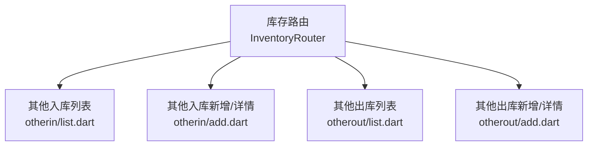
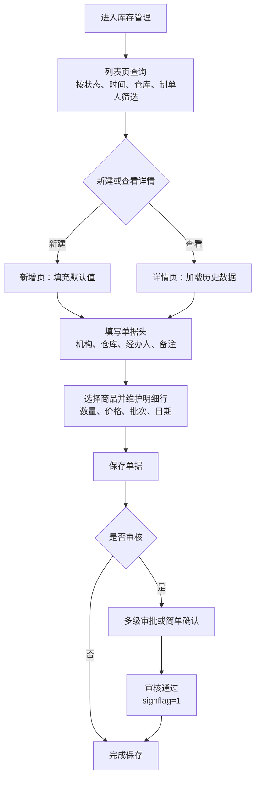
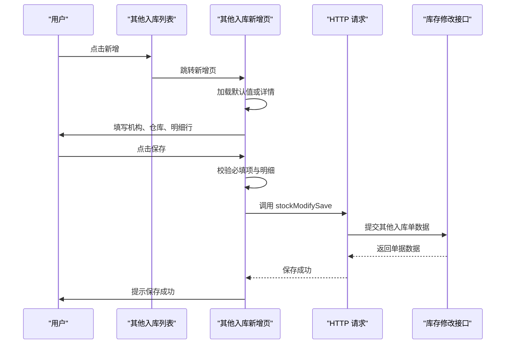
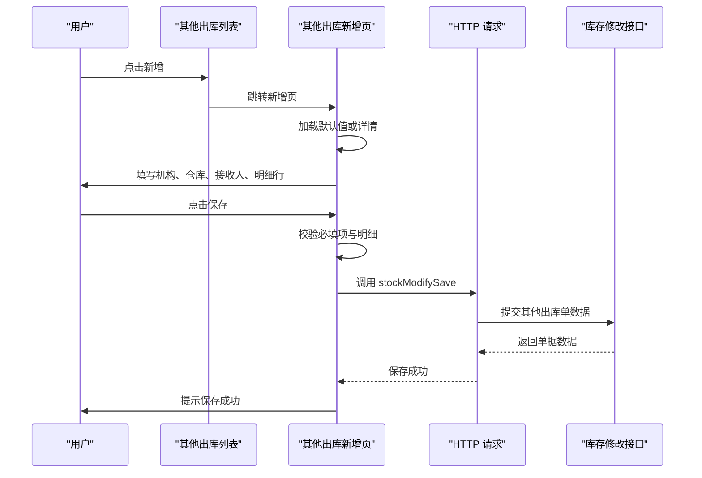
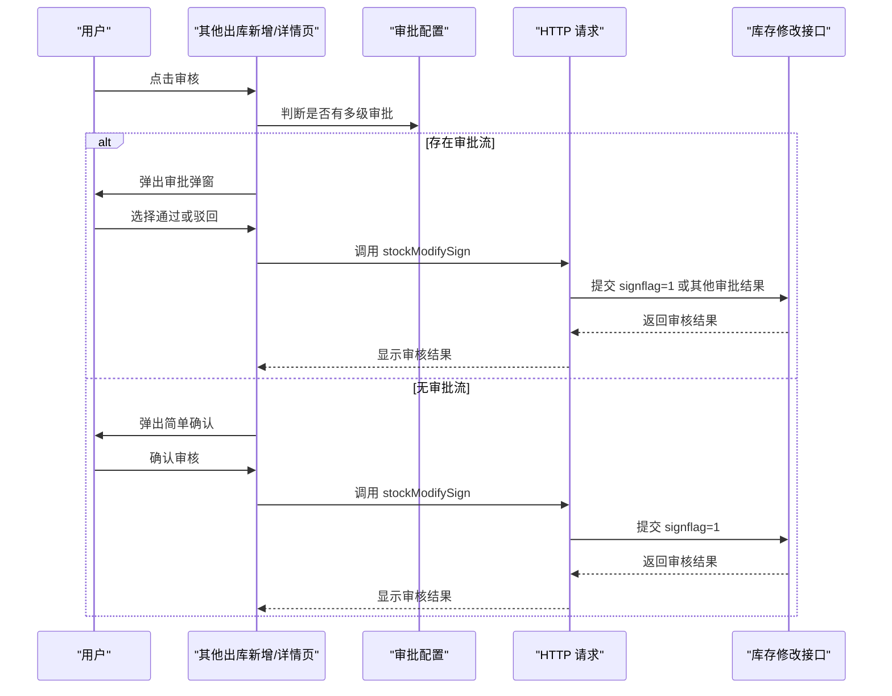
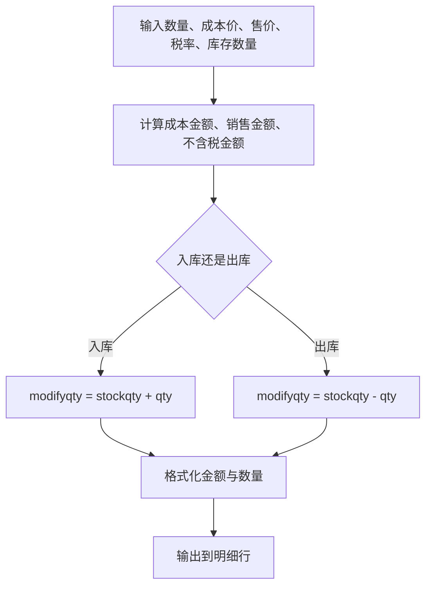
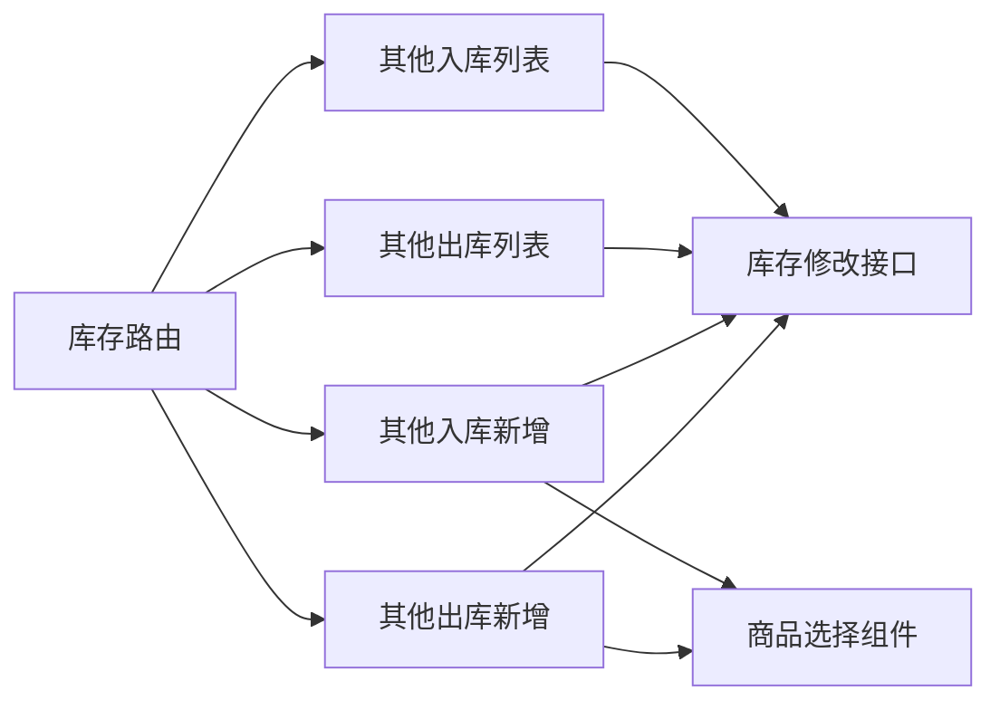

# 其他出入库

<cite>
**本文引用的文件**   
- [lib/pages/business/inventory/router.dart](file://lib/pages/business/inventory/router.dart)
- [lib/pages/business/inventory/otherin/list.dart](file://lib/pages/business/inventory/otherin/list.dart)
- [lib/pages/business/inventory/otherin/add.dart](file://lib/pages/business/inventory/otherin/add.dart)
- [lib/pages/business/inventory/otherout/list.dart](file://lib/pages/business/inventory/otherout/list.dart)
- [lib/pages/business/inventory/otherout/add.dart](file://lib/pages/business/inventory/otherout/add.dart)
- [lib/net/http_api.dart](file://lib/net/http_api.dart)
- [lib/components/select/select_product.dart](file://lib/components/select/select_product.dart)
</cite>

## 目录
1. [简介](#简介)
2. [项目结构定位](#项目结构定位)
3. [核心业务流程总览](#核心业务流程总览)
4. [其他入库单详解](#其他入库单详解)
5. [其他出库单详解](#其他出库单详解)
6. [库存变动与成本计算逻辑](#库存变动与成本计算逻辑)
7. [与其他模块的集成关系](#与其他模块的集成关系)
8. [数据校验与异常处理规则](#数据校验与异常处理规则)
9. [依赖关系分析](#依赖关系分析)
10. [性能与使用建议](#性能与使用建议)
11. [常见问题排查](#常见问题排查)
12. [结论](#结论)

## 简介
本文件面向灵犀管店 Flutter 项目的“其他出入库”功能，重点说明：
- 其他入库单、其他出库单的页面入口、列表查询、单据新增、编辑、审核、打印、撤回等完整业务流程。
- 不同业务场景下的出入库类型，例如盘盈盘亏、损耗报废、样品领用等。
- 明细行数量录入、金额计算、批次信息、扫码输入、附件上传等行为。
- 库存变动方向、`outflag`、`outtype`、`billtype` 等关键字段对后端库存和成本的影响。
- 与仓库管理、供应商、客户、商品选择、审批流等模块的集成点。
- 权限控制、数据校验规则、异常处理和常见故障排查方式。

该功能位于“库存管理”子模块中，属于非采购入库、非销售出库的补充性库存调整类单据，适合处理盘点差异、内部领用、报损报废、样品发放等真实业务。

## 项目结构定位
其他出入库在路由系统中注册为库存管理的两个独立子功能：
- 其他入库：`/inventory/otherin/list`、`/inventory/otherin/add`
- 其他出库：`/inventory/otherout/list`、`/inventory/otherout/add`

**图示来源**
- [lib/pages/business/inventory/router.dart:1-57](file://lib/pages/business/inventory/router.dart#L1-L57)

**章节来源**
- [lib/pages/business/inventory/router.dart:1-57](file://lib/pages/business/inventory/router.dart#L1-L57)

## 核心业务流程总览
其他出入库的整体流程可以抽象为以下阶段：
1. **进入列表页**：按门店、时间范围、制单人、仓库、单据状态等条件查询库存修改记录。
2. **新建或查看单据**：从列表进入新增页或详情页，加载默认值或历史数据。
3. **填写单据头信息**：包括机构、仓库、经办人、备注、附件等。
4. **选择并维护明细行**：选择商品、单位、规格、数量、成本价、售价、税率、批次号、生产日期、有效期等。
5. **保存单据**：前端校验必填项后调用保存接口；新增成功后生成正式单号。
6. **审核过账**：支持简单确认或多级审批，通过后更新 `signflag` 并触发后端库存与财务处理。
7. **后续操作**：根据权限执行打印、撤回、反审核、删除等操作。

[本图为概念流程图，不直接映射具体代码文件]

## 其他入库单详解

### 列表页行为
其他入库单列表负责展示所有类型为“其他入库”的库存修改单据，主要职责包括：
- 使用状态标签切换待审核、已审核、已驳回等单据状态。
- 按门店、时间范围、制单人、仓库进行筛选。
- 使用分页滚动加载数据。
- 调用统一的库存修改列表接口，并通过 `outtype=2`、`billtypes=[4]` 过滤出其他入库单。
- 打开权限校验码 `014001`，无权限时提示用户无法查看。

关键参数说明：
- `outtype=2`：表示其他入库方向。
- `billtypes=[4]`：表示单据类型为“其他入库”。
- `signflag`：空字符串表示全部状态，`0` 表示待审核，`1` 表示已审核，`2` 表示已驳回。

**章节来源**
- [lib/pages/business/inventory/otherin/list.dart:1-120](file://lib/pages/business/inventory/otherin/list.dart#L1-L120)
- [lib/pages/business/inventory/otherin/list.dart:120-200](file://lib/pages/business/inventory/otherin/list.dart#L120-L200)

### 新增与编辑页行为
其他入库单新增页承担以下职责：
- 新增模式：从本地存储读取当前门店信息作为默认机构，初始化审批签字按钮可见性。
- 编辑模式：通过传入的单据数据加载完整详情，包括单据头、明细行、审批流、附件等。
- 提供扫码输入框，兼容 PDA 扫码枪输入，带防抖处理。
- 维护明细行的数量、成本价、售价、税率、库存数量、修改后数量、批次号、生产日期、有效期等。
- 计算汇总金额、汇总数量、汇总销售金额。
- 保存前校验机构、仓库、商品明细是否为空。
- 保存成功后可继续执行审核、打印、撤回、删除等操作。

#### 其他入库单新增与保存序列图

**图示来源**
- [lib/pages/business/inventory/otherin/add.dart:201-420](file://lib/pages/business/inventory/otherin/add.dart#L201-L420)

#### 其他入库单审核序列图

**图示来源**
- [lib/pages/business/inventory/otherin/add.dart:420-600](file://lib/pages/business/inventory/otherin/add.dart#L420-L600)

### 其他入库的业务含义
- `billtype=4`：固定为“其他入库”。
- `outflag=-1`：表示入库方向。
- `outtype=2`：表示其他入库业务类型。
- 适用于盘盈、供应商补货未走采购流程、退回入库、样品回仓、内部调拨后的补充入库等非标准采购入库场景。

**章节来源**
- [lib/pages/business/inventory/otherin/add.dart:201-420](file://lib/pages/business/inventory/otherin/add.dart#L201-L420)
- [lib/pages/business/inventory/otherin/add.dart:420-600](file://lib/pages/business/inventory/otherin/add.dart#L420-L600)

## 其他出库单详解

### 列表页行为
其他出库单列表与其他入库类似，但增加“单据类型”筛选：
- 可选“全部”“报损”“领用”“其他出库”。
- “全部”对应 `billtypes=[1,2,4]`。
- 选择“其他出库”时额外传递 `outtype=1`。
- 同样按门店、时间范围、制单人、仓库、状态筛选。
- 权限校验码为 `013901`。

关键参数说明：
- `billtype` 取值含义：
  - `1`：报损
  - `2`：领用
  - `4`：其他出库
- `outtype`：
  - `0`：一般出库
  - `1`：其他出库
- `signflag`：同其他入库。

**章节来源**
- [lib/pages/business/inventory/otherout/list.dart:1-120](file://lib/pages/business/inventory/otherout/list.dart#L1-L120)
- [lib/pages/business/inventory/otherout/list.dart:120-220](file://lib/pages/business/inventory/otherout/list.dart#L120-L220)

### 新增与编辑页行为
其他出库单新增页与其他入库单新增页结构相似，但存在以下差异：
- 默认 `billtype=4`，即“其他出库”。
- 支持选择“报损”“领用”“其他出库”三种业务类型。
- 支持选择接收人（如领用人、客户或外部对象）。
- 明细行中的 `modifyqty` 使用库存数量减去数量，体现出库扣减。
- 保存时 `outflag=1`，表示出库方向。
- `outtype` 根据 `billtype` 决定：当 `billtype=4` 时为 `1`，否则为 `0`。

#### 其他出库单新增与保存序列图

**图示来源**
- [lib/pages/business/inventory/otherout/add.dart:201-420](file://lib/pages/business/inventory/otherout/add.dart#L201-L420)

#### 其他出库单审核序列图

**图示来源**
- [lib/pages/business/inventory/otherout/add.dart:420-600](file://lib/pages/business/inventory/otherout/add.dart#L420-L600)

### 其他出库的业务含义
- `billtype`：
  - `1`：报损，通常对应损耗报废。
  - `2`：领用，通常对应内部领用、样品领用。
  - `4`：其他出库。
- `outflag=1`：表示出库方向。
- `outtype`：
  - `0`：普通出库。
  - `1`：其他出库。
- 适用于损耗报废、内部领用、样品发放、非销售性质的出库场景。

**章节来源**
- [lib/pages/business/inventory/otherout/add.dart:201-420](file://lib/pages/business/inventory/otherout/add.dart#L201-L420)
- [lib/pages/business/inventory/otherout/add.dart:420-600](file://lib/pages/business/inventory/otherout/add.dart#L420-L600)

## 库存变动与成本计算逻辑

### 数量与金额计算
两个新增页都实现了相似的明细行金额计算逻辑：
- 成本金额：`amt = qty × costprice`
- 销售金额：`sellamt = qty × saleprice`
- 不含税金额：`notaxamt = amt / (1 + intaxrate)`
- 修改后库存数量：
  - 其他入库：`modifyqty = stockqty + qty`
  - 其他出库：`modifyqty = stockqty - qty`
- 数值精度：
  - 金额字段保留三位小数。
  - 数量字段保留一位小数。
  - 价格字段保留两位小数。

这些计算由 `_computeAmts`、`_defValSet`、`_writeData` 等方法完成，并在数量、成本价、售价变化时重新计算。

**图示来源**
- [lib/pages/business/inventory/otherin/add.dart:201-300](file://lib/pages/business/inventory/otherin/add.dart#L201-L300)
- [lib/pages/business/inventory/otherout/add.dart:201-300](file://lib/pages/business/inventory/otherout/add.dart#L201-L300)

### 单据头汇总
保存时会汇总：
- `billamt`：所有明细行的成本金额之和。
- `billqty`：所有明细行的数量之和。
- `billsellamt`：所有明细行的销售金额之和。

这些汇总值会随单据一起提交给后端，用于财务统计、成本核算和报表展示。

**章节来源**
- [lib/pages/business/inventory/otherin/add.dart:300-420](file://lib/pages/business/inventory/otherin/add.dart#L300-L420)
- [lib/pages/business/inventory/otherout/add.dart:300-420](file://lib/pages/business/inventory/otherout/add.dart#L300-L420)

## 与其他模块的集成关系

### 仓库管理与门店
- 列表页和新增页都会从本地存储读取当前门店信息，用于默认机构过滤。
- 列表筛选支持选择仓库。
- 新增页要求必须选择仓库，否则保存失败。

**章节来源**
- [lib/pages/business/inventory/otherin/list.dart:80-160](file://lib/pages/business/inventory/otherin/list.dart#L80-L160)
- [lib/pages/business/inventory/otherout/list.dart:80-160](file://lib/pages/business/inventory/otherout/list.dart#L80-L160)
- [lib/pages/business/inventory/otherin/add.dart:120-200](file://lib/pages/business/inventory/otherin/add.dart#L120-L200)
- [lib/pages/business/inventory/otherout/add.dart:120-200](file://lib/pages/business/inventory/otherout/add.dart#L120-L200)

### 商品选择
- 其他出入库新增页依赖商品选择组件，用于添加商品明细行。
- 商品选择组件同时被采购、销售等其他模块复用，体现统一的商品基础数据能力。

**章节来源**
- [lib/components/select/select_product.dart](file://lib/components/select/select_product.dart)

### 供应商与客户
- 其他入库单在保存时使用 `counterid`、`countername`，偏向仓库或供应商侧的入库场景。
- 其他出库单在保存时可携带 `recipientid`、`recipientname`，用于记录领用人、客户或外部接收方。
- 虽然其他出入库不是标准采购订单或销售订单，但仍可与供应商、客户信息联动，便于追溯责任主体。

**章节来源**
- [lib/pages/business/inventory/otherin/add.dart:300-420](file://lib/pages/business/inventory/otherin/add.dart#L300-L420)
- [lib/pages/business/inventory/otherout/add.dart:300-420](file://lib/pages/business/inventory/otherout/add.dart#L300-L420)

### 审批流
- 新增页会根据当前登录用户、机构、单据类型查询是否需要审批签字。
- 若存在多级审批配置，则弹出审批弹窗，支持通过、驳回、备注。
- 管理员账户拥有特殊权限，可直接参与或跳过部分审批节点。
- 审核通过后调用审核接口，将 `signflag` 设为 `1`。

**章节来源**
- [lib/pages/business/inventory/otherin/add.dart:420-600](file://lib/pages/business/inventory/otherin/add.dart#L420-L600)
- [lib/pages/business/inventory/otherout/add.dart:420-600](file://lib/pages/business/inventory/otherout/add.dart#L420-L600)

## 数据校验与异常处理规则

### 必填校验
- 机构不能为空。
- 仓库不能为空。
- 商品明细不能为空。
- 数量、价格、税率等数值字段会在写入时格式化并重新计算金额。

### 权限校验
- 其他入库列表：权限码 `014001`
- 其他入库新增：权限码 `014002`
- 其他入库编辑：权限码 `014003`
- 其他入库审核：权限码 `014005`
- 其他出库列表：权限码 `013901`
- 其他出库新增：权限码 `013902`
- 其他出库编辑：权限码 `013903`
- 其他出库审核：权限码 `013905`

### 返回拦截保护
- 新增或编辑过程中，如果存在未保存修改且单据处于待审核状态，返回时会提示是否保存。
- 已审核或已驳回单据通常为只读或撤回态，不触发保存拦截。

### 网络与异常处理
- 列表加载失败时，会将“是否有更多”置为假，避免无限重试。
- 保存和审核操作完成后会清空提交状态，防止重复提交。
- 审批弹窗失败时会恢复提交状态并提示错误。

**章节来源**
- [lib/pages/business/inventory/otherin/add.dart:201-420](file://lib/pages/business/inventory/otherin/add.dart#L201-L420)
- [lib/pages/business/inventory/otherout/add.dart:201-420](file://lib/pages/business/inventory/otherout/add.dart#L201-L420)
- [lib/pages/business/inventory/otherin/list.dart:120-200](file://lib/pages/business/inventory/otherin/list.dart#L120-L200)
- [lib/pages/business/inventory/otherout/list.dart:120-220](file://lib/pages/business/inventory/otherout/list.dart#L120-L220)

## 依赖关系分析

**图示来源**
- [lib/pages/business/inventory/router.dart:1-57](file://lib/pages/business/inventory/router.dart#L1-L57)
- [lib/pages/business/inventory/otherin/list.dart:1-120](file://lib/pages/business/inventory/otherin/list.dart#L1-L120)
- [lib/pages/business/inventory/otherout/list.dart:1-120](file://lib/pages/business/inventory/otherout/list.dart#L1-L120)
- [lib/pages/business/inventory/otherin/add.dart:1-120](file://lib/pages/business/inventory/otherin/add.dart#L1-L120)
- [lib/pages/business/inventory/otherout/add.dart:1-120](file://lib/pages/business/inventory/otherout/add.dart#L1-L120)
- [lib/components/select/select_product.dart](file://lib/components/select/select_product.dart)

**章节来源**
- [lib/pages/business/inventory/router.dart:1-57](file://lib/pages/business/inventory/router.dart#L1-L57)
- [lib/pages/business/inventory/otherin/list.dart:1-120](file://lib/pages/business/inventory/otherin/list.dart#L1-L120)
- [lib/pages/business/inventory/otherout/list.dart:1-120](file://lib/pages/business/inventory/otherout/list.dart#L1-L120)
- [lib/pages/business/inventory/otherin/add.dart:1-120](file://lib/pages/business/inventory/otherin/add.dart#L1-L120)
- [lib/pages/business/inventory/otherout/add.dart:1-120](file://lib/pages/business/inventory/otherout/add.dart#L1-L120)
- [lib/components/select/select_product.dart](file://lib/components/select/select_product.dart)

## 性能与使用建议
- 列表页使用分页加载和滚动加载更多，避免一次性拉取大量数据。
- 搜索输入使用防抖，减少频繁刷新。
- 明细行金额计算采用增量重算，仅在数量、价格变化时触发。
- 扫码输入使用定时器防抖，提高扫码枪连续输入稳定性。
- 建议批量导入或扫描时合并多次变更，减少界面重渲染。
- 对于高频使用的库存调整场景，可在后台配置合理的审批流，避免每次审核阻塞业务。

[本节为通用性能建议，不直接分析具体代码文件]

## 常见问题排查

### 列表查不到其他入库或出库单
- 检查 `outtype` 和 `billtypes` 参数是否正确。
- 检查门店、时间范围、仓库、制单人筛选条件是否过于严格。
- 检查权限码是否赋予当前用户。

**章节来源**
- [lib/pages/business/inventory/otherin/list.dart:120-200](file://lib/pages/business/inventory/otherin/list.dart#L120-L200)
- [lib/pages/business/inventory/otherout/list.dart:120-220](file://lib/pages/business/inventory/otherout/list.dart#L120-L220)

### 保存时报错或未生效
- 确认已选择机构、仓库、商品明细。
- 确认数量、价格、税率格式正确。
- 确认保存权限码有效。
- 检查网络请求是否成功返回单据数据。

**章节来源**
- [lib/pages/business/inventory/otherin/add.dart:300-420](file://lib/pages/business/inventory/otherin/add.dart#L300-L420)
- [lib/pages/business/inventory/otherout/add.dart:300-420](file://lib/pages/business/inventory/otherout/add.dart#L300-L420)

### 审核后库存没有变化
- 确认审核是否真正调用审核接口。
- 确认 `signflag` 是否设置为 `1`。
- 确认 `outflag` 和 `outtype` 是否符合预期。
- 检查多级审批是否通过，是否存在驳回或撤回状态。

**章节来源**
- [lib/pages/business/inventory/otherin/add.dart:420-600](file://lib/pages/business/inventory/otherin/add.dart#L420-L600)
- [lib/pages/business/inventory/otherout/add.dart:420-600](file://lib/pages/business/inventory/otherout/add.dart#L420-L600)

### 返回时反复提示未保存修改
- 检查是否修改了表单快照包含的字段。
- 确认是否已完成保存并重建快照。
- 检查单据状态是否为待审核。

**章节来源**
- [lib/pages/business/inventory/otherin/add.dart:201-300](file://lib/pages/business/inventory/otherin/add.dart#L201-L300)
- [lib/pages/business/inventory/otherout/add.dart:201-300](file://lib/pages/business/inventory/otherout/add.dart#L201-L300)

## 结论
灵犀管店 Flutter 项目的其他出入库功能以库存修改为核心，围绕“其他入库”和“其他出库”两类非标准出入库场景构建。其实现特点包括：
- 清晰的页面分层：路由、列表、新增/详情。
- 统一的库存修改接口调用。
- 完善的权限控制和审批流程。
- 明确的库存变动方向和业务类型区分。
- 稳定的金额与数量计算逻辑。
- 良好的用户体验，包括扫码、附件、筛选、分页、返回保护等。

在实际使用中，应特别注意：
- 正确使用 `billtype`、`outflag`、`outtype`。
- 合理配置审批流。
- 严格遵循必填校验和权限控制。
- 结合仓库管理、商品基础数据、供应商和客户信息进行完整追溯。