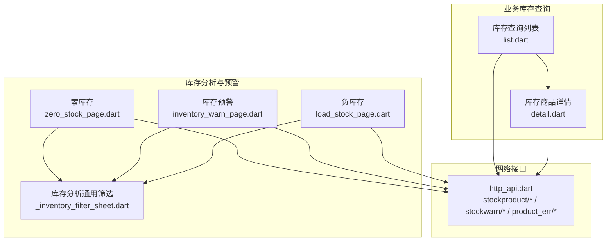
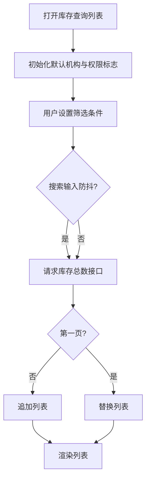
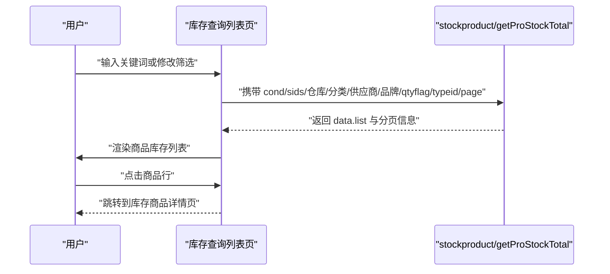
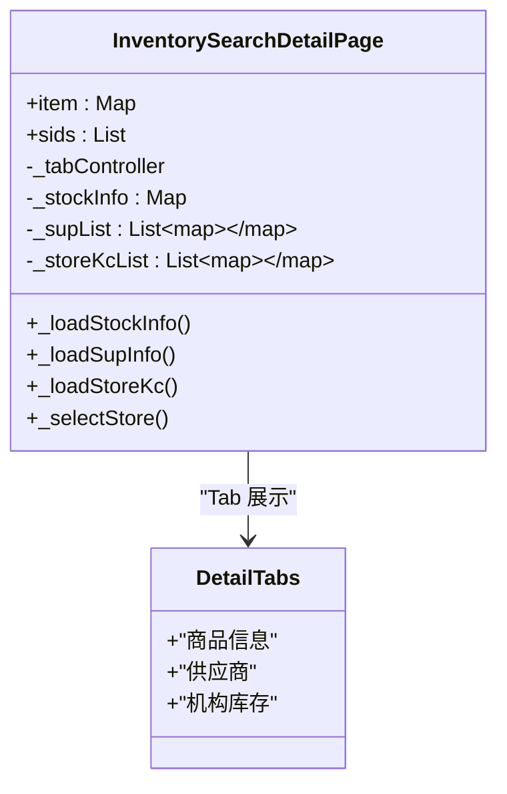
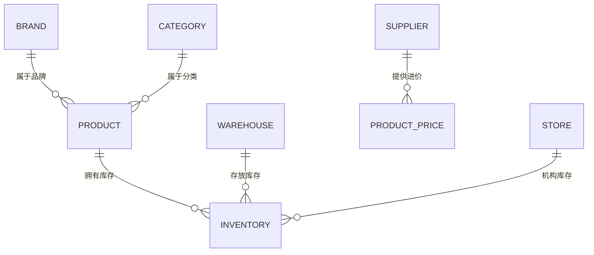

# 库存查询

<cite>
**本文引用的文件**
- [lib/pages/business/inventory/search/list.dart](file://lib/pages/business/inventory/search/list.dart)
- [lib/pages/business/inventory/search/detail.dart](file://lib/pages/business/inventory/search/detail.dart)
- [lib/pages/data/inventory/_inventory_filter_sheet.dart](file://lib/pages/data/inventory/_inventory_filter_sheet.dart)
- [lib/pages/data/inventory/zeroStock/zero_stock_page.dart](file://lib/pages/data/inventory/zeroStock/zero_stock_page.dart)
- [lib/pages/data/inventory/inventoryWarn/inventory_warn_page.dart](file://lib/pages/data/inventory/inventoryWarn/inventory_warn_page.dart)
- [lib/pages/data/inventory/loadStock/load_stock_page.dart](file://lib/pages/data/inventory/loadStock/load_stock_page.dart)
- [lib/net/http_api.dart](file://lib/net/http_api.dart)
</cite>

## 目录
1. [引言](#引言)
2. [项目结构与定位](#项目结构与定位)
3. [核心功能总览](#核心功能总览)
4. [多维度筛选条件说明](#多维度筛选条件说明)
5. [查询结果展示与明细查看](#查询结果展示与明细查看)
6. [库存预警与异常分析](#库存预警与异常分析)
7. [数据关联关系](#数据关联关系)
8. [实时性与缓存策略](#实时性与缓存策略)
9. [性能优化与大数据量处理](#性能优化与大数据量处理)
10. [常见问题排查](#常见问题排查)
11. [结论与建议](#结论与建议)

## 引言
本文件面向灵犀管店 Flutter 项目的“库存查询”能力，聚焦以下目标：
- 说明库存查询的多维度筛选条件，包括商品、仓库、时间、状态、机构等。
- 描述库存列表与库存明细的展示方式。
- 解释库存预警、零库存、负库存、进货未销等库存分析能力。
- 梳理与商品管理、仓库管理、供应商、品牌、分类等模块的数据关联。
- 总结当前实现中的实时性、缓存和性能特征，并给出可操作的优化建议。

需要特别说明的是：当前代码库中未发现独立的“历史变动流水”页面；库存变更历史通常由业务单据（如盘点、调拨、出入库）承载，不在库存查询页直接提供完整流水视图。

## 项目结构与定位
库存查询相关代码主要分布在两个位置：
- 业务库存查询入口：`lib/pages/business/inventory/search/list.dart` 与 `lib/pages/business/inventory/search/detail.dart`。
- 库存分析与预警：`lib/pages/data/inventory/...` 下的零库存、库存预警、负库存、进货未销等页面，以及共用筛选组件 `_inventory_filter_sheet.dart`。
- 接口地址集中定义在 `lib/net/http_api.dart`。

**图表来源**
- [lib/pages/business/inventory/search/list.dart:1-200](file://lib/pages/business/inventory/search/list.dart#L1-L200)
- [lib/pages/business/inventory/search/detail.dart:1-200](file://lib/pages/business/inventory/search/detail.dart#L1-L200)
- [lib/pages/data/inventory/_inventory_filter_sheet.dart:1-200](file://lib/pages/data/inventory/_inventory_filter_sheet.dart#L1-L200)
- [lib/pages/data/inventory/zeroStock/zero_stock_page.dart:1-200](file://lib/pages/data/inventory/zeroStock/zero_stock_page.dart#L1-L200)
- [lib/pages/data/inventory/inventoryWarn/inventory_warn_page.dart:1-200](file://lib/pages/data/inventory/inventoryWarn/inventory_warn_page.dart#L1-L200)
- [lib/pages/data/inventory/loadStock/load_stock_page.dart:1-200](file://lib/pages/data/inventory/loadStock/load_stock_page.dart#L1-L200)
- [lib/net/http_api.dart:333-438](file://lib/net/http_api.dart#L333-L438)

**章节来源**
- [lib/pages/business/inventory/search/list.dart:1-200](file://lib/pages/business/inventory/search/list.dart#L1-L200)
- [lib/pages/business/inventory/search/detail.dart:1-200](file://lib/pages/business/inventory/search/detail.dart#L1-L200)
- [lib/pages/data/inventory/_inventory_filter_sheet.dart:1-200](file://lib/pages/data/inventory/_inventory_filter_sheet.dart#L1-L200)
- [lib/net/http_api.dart:333-438](file://lib/net/http_api.dart#L333-L438)

## 核心功能总览
- 库存查询列表页：支持按商品关键词、机构、仓库、分类、供应商、品牌、是否显示零库存等多维筛选，分页加载并支持下拉加载更多。
- 库存商品详情页：分三个标签页，分别展示商品信息、供应商价格、机构库存，并支持按机构切换查看各仓库库存明细。
- 库存分析与预警：零库存、库存不足、库存积压、负库存、进货未销等报表，均复用通用筛选弹窗。
- 网络层：统一通过 `HttpApi` 常量调用后端接口，返回结构以 `data.list` 为主的分页数据。

**章节来源**
- [lib/pages/business/inventory/search/list.dart:1-200](file://lib/pages/business/inventory/search/list.dart#L1-L200)
- [lib/pages/business/inventory/search/detail.dart:1-200](file://lib/pages/business/inventory/search/detail.dart#L1-L200)
- [lib/pages/data/inventory/zeroStock/zero_stock_page.dart:1-200](file://lib/pages/data/inventory/zeroStock/zero_stock_page.dart#L1-L200)
- [lib/pages/data/inventory/inventoryWarn/inventory_warn_page.dart:1-200](file://lib/pages/data/inventory/inventoryWarn/inventory_warn_page.dart#L1-L200)
- [lib/pages/data/inventory/loadStock/load_stock_page.dart:1-200](file://lib/pages/data/inventory/loadStock/load_stock_page.dart#L1-L200)

## 多维度筛选条件说明
库存查询与库存分析页面的筛选条件既有共性，也有各自侧重点。

### 库存查询列表筛选
库存查询列表支持以下筛选维度：
- 机构：从本地存储读取默认机构，并可切换为其他机构。
- 仓库：通过仓库选择器选择单一仓库。
- 商品分类：多选分类，最终拼接为逗号分隔的分类标识。
- 供应商：单选供应商。
- 品牌：单选品牌名称。
- 显示零库存：控制是否包含零库存商品。
- 搜索关键词：条码、品名、自编码等模糊匹配。

这些参数最终通过 `stockproduct/getProStockTotal` 接口提交。

**图表来源**
- [lib/pages/business/inventory/search/list.dart:1-200](file://lib/pages/business/inventory/search/list.dart#L1-L200)
- [lib/pages/business/inventory/search/list.dart:201-580](file://lib/pages/business/inventory/search/list.dart#L201-L580)

**章节来源**
- [lib/pages/business/inventory/search/list.dart:1-200](file://lib/pages/business/inventory/search/list.dart#L1-L200)
- [lib/pages/business/inventory/search/list.dart:201-580](file://lib/pages/business/inventory/search/list.dart#L201-L580)
- [lib/net/http_api.dart:434-438](file://lib/net/http_api.dart#L434-L438)

### 库存分析与预警筛选
零库存、库存预警、负库存等页面使用通用筛选组件 `InventoryFilterSheet`，支持：
- 商品关键词：条码、品名、自编码。
- 持续天数或临期天数：根据业务场景配置默认天数。
- 品牌：通过通用选择器选择品牌。
- 商品状态：正常、新品、冻结、停购、停用等。
- 是否仅查询有业务记录商品：用于畅缺等场景。
- 第二开关：例如进货未销等场景的业务开关。

该组件封装了表单数据模型 `InventoryFilterData`，并在确认时回调给具体页面组装参数。

**章节来源**
- [lib/pages/data/inventory/_inventory_filter_sheet.dart:1-200](file://lib/pages/data/inventory/_inventory_filter_sheet.dart#L1-L200)
- [lib/pages/data/inventory/_inventory_filter_sheet.dart:201-636](file://lib/pages/data/inventory/_inventory_filter_sheet.dart#L201-L636)
- [lib/pages/data/inventory/_inventory_filter_sheet.dart:637-723](file://lib/pages/data/inventory/_inventory_filter_sheet.dart#L637-L723)
- [lib/pages/data/inventory/zeroStock/zero_stock_page.dart:1-200](file://lib/pages/data/inventory/zeroStock/zero_stock_page.dart#L1-L200)
- [lib/pages/data/inventory/loadStock/load_stock_page.dart:1-200](file://lib/pages/data/inventory/loadStock/load_stock_page.dart#L1-L200)

## 查询结果展示与明细查看

### 库存查询列表
- 列表项来自 `stockproduct/getProStockTotal` 返回的 `data.list`。
- 支持下拉滚动触发下一页加载。
- 点击商品行进入库存商品详情页。

**图表来源**
- [lib/pages/business/inventory/search/list.dart:1-200](file://lib/pages/business/inventory/search/list.dart#L1-L200)
- [lib/net/http_api.dart:434-438](file://lib/net/http_api.dart#L434-L438)

### 库存商品详情页
库存商品详情页分为三个标签页：
1. 商品信息：展示零售价、商品库存、库存单价、库存金额、未税单价、未税库存金额、未税零售价等；其中成本相关字段受用户权限控制，无权限时显示掩码。
2. 供应商：展示供应商经销方式与进价。
3. 机构库存：按当前选择的机构加载商品在各仓库的库存；点击某行可展开仓库库存明细弹窗。

**图表来源**
- [lib/pages/business/inventory/search/detail.dart:1-200](file://lib/pages/business/inventory/search/detail.dart#L1-L200)
- [lib/pages/business/inventory/search/detail.dart:201-613](file://lib/pages/business/inventory/search/detail.dart#L201-L613)

**章节来源**
- [lib/pages/business/inventory/search/detail.dart:1-200](file://lib/pages/business/inventory/search/detail.dart#L1-L200)
- [lib/pages/business/inventory/search/detail.dart:201-613](file://lib/pages/business/inventory/search/detail.dart#L201-L613)
- [lib/net/http_api.dart:434-438](file://lib/net/http_api.dart#L434-L438)

## 库存预警与异常分析

### 库存预警
库存预警页面提供两个子视角：
- 库存不足：比较实际库存与最低库存阈值。
- 库存积压：比较实际库存与最高库存阈值。

数据来源接口为：
- `stockwarn/getStockLow`
- `stockwarn/getStockOver`

页面同时支持机构、分类、供应商、关键词筛选，并使用分页加载。

**章节来源**
- [lib/pages/data/inventory/inventoryWarn/inventory_warn_page.dart:1-200](file://lib/pages/data/inventory/inventoryWarn/inventory_warn_page.dart#L1-L200)
- [lib/net/http_api.dart:333-335](file://lib/net/http_api.dart#L333-L335)

### 零库存与负库存
- 零库存页面默认当月统计，支持按分类、供应商、品牌、商品状态、是否有业务记录、持续天数等筛选。
- 负库存页面同样支持类似筛选，侧重负库存持续天数。

两者均调用 `product_err/getProductErrList`，并通过 `selecttype` 区分不同分析类型。

**章节来源**
- [lib/pages/data/inventory/zeroStock/zero_stock_page.dart:1-200](file://lib/pages/data/inventory/zeroStock/zero_stock_page.dart#L1-L200)
- [lib/pages/data/inventory/loadStock/load_stock_page.dart:1-200](file://lib/pages/data/inventory/loadStock/load_stock_page.dart#L1-L200)
- [lib/net/http_api.dart:333-333](file://lib/net/http_api.dart#L333-L333)

### 进货未销与其他分析
其他库存分析页面（如滞销、进货未销等）也复用 `InventoryFilterSheet`，通过不同的筛选项组合调用同一错误商品列表接口，从而形成统一的库存异常分析体系。

**章节来源**
- [lib/pages/data/inventory/_inventory_filter_sheet.dart:1-200](file://lib/pages/data/inventory/_inventory_filter_sheet.dart#L1-L200)
- [lib/net/http_api.dart:333-333](file://lib/net/http_api.dart#L333-L333)

## 数据关联关系
库存查询不是孤立功能，它与多个基础模块存在强关联：

| 关联模块 | 关联字段或交互 | 作用 |
|---|---|---|
| 商品管理 | `productid`、`name`、`barcode`、`unit`、`brandname`、`typename`、`imageurl` | 商品主数据，决定库存归属与展示 |
| 仓库管理 | `counterid`、`countername`、`shelves` | 库存所属仓库及货位 |
| 供应商 | `supid`、`supname`、`supselltypename`、`price` | 供应商进价与经销方式 |
| 品牌 | `brandname`、`brandid` | 品牌筛选与聚合 |
| 商品分类 | `typeid`、`name` | 分类筛选与多维分析 |
| 机构 | `sids`、`bsid`、`storename` | 多门店库存隔离与汇总 |
| 权限 | `costpriceflag`、`checkstockflag`、`productCodeDisabledFlag` | 控制成本价显示、盘点相关行为 |

[此图为概念关系图，不直接映射到具体源码文件]

**章节来源**
- [lib/pages/business/inventory/search/detail.dart:201-613](file://lib/pages/business/inventory/search/detail.dart#L201-L613)
- [lib/pages/business/inventory/search/list.dart:1-200](file://lib/pages/business/inventory/search/list.dart#L1-L200)

## 实时性与缓存策略

### 实时性
当前库存查询与库存分析页面多为“主动刷新型”：
- 首次进入页面时加载数据。
- 切换机构、修改筛选条件后重置分页并重新请求。
- 下拉加载更多时继续向后端请求下一页。
- 详情页在切换 Tab 时按需加载对应数据。

未发现基于 WebSocket、推送或定时轮询的自动实时更新机制。若需实时库存变化提醒，应结合系统已有的推送能力扩展。

### 本地缓存
当前实现没有对库存查询结果做显式本地缓存：
- 列表数据保存在页面内存变量中。
- 图片资源在网络请求时由 Flutter 网络图片组件进行常规缓存。
- 用户信息、当前机构、登录参数等配置存储在本地持久化存储中，用于初始化筛选条件与权限。

因此，“缓存策略”在当前库存查询场景中更接近“无服务端响应缓存 + 前端内存数据 + 图片缓存”。

**章节来源**
- [lib/pages/business/inventory/search/list.dart:1-200](file://lib/pages/business/inventory/search/list.dart#L1-L200)
- [lib/pages/business/inventory/search/detail.dart:1-200](file://lib/pages/business/inventory/search/detail.dart#L1-L200)
- [lib/pages/data/inventory/inventoryWarn/inventory_warn_page.dart:1-200](file://lib/pages/data/inventory/inventoryWarn/inventory_warn_page.dart#L1-L200)

## 性能优化与大数据量处理

### 当前已实现的优化
- 搜索输入防抖：避免频繁请求。
- 分页加载：默认每页 20 条，支持下拉加载更多。
- 延迟加载：详情页各 Tab 在切换到对应标签时才发起请求。
- 重复请求保护：加载中时忽略重复加载。
- 图片尺寸缓存：详情页图片指定缓存宽高，减少解码压力。
- 列表渲染边界：通用选择器中使用 `cacheExtent` 与 `RepaintBoundary` 提升长列表性能。

### 可进一步优化的方向
- 增加响应级缓存：对相同参数的库存查询结果进行短时间缓存，减少重复请求。
- 增量更新：当发生入库、出库、调拨等业务变更后，优先局部刷新受影响商品。
- 虚拟列表优化：对超大数据集考虑使用更细粒度的虚拟滚动策略。
- 合并请求：将商品基本信息、库存信息、供应商信息的多次请求合并或预取。
- 去重与节流：确保快速切换筛选时只保留最后一次有效请求。
- 后端索引建议：建议在商品条码、品类、仓库、品牌、供应商等高频筛选字段建立联合索引。

[本节为通用优化建议，不直接分析具体源码片段]

## 常见问题排查

| 问题现象 | 可能原因 | 排查建议 |
|---|---|---|
| 库存列表为空 | 筛选条件过严、机构选择错误、接口返回空数据 | 检查机构、仓库、分类、供应商、品牌、是否显示零库存；确认接口返回结构 |
| 成本价显示掩码 | 当前用户无成本价查看权限 | 检查本地用户信息中的成本价权限标志 |
| 详情页无仓库库存 | 所选机构下该商品无仓库库存数据 | 检查 `counterstocklist` 是否为空 |
| 下拉加载更多无效 | 接口返回数据少于页大小或已无更多数据 | 检查 `_hasMore` 判断逻辑与接口返回长度 |
| 库存预警页面闪烁 | 首次加载后刷新导致空数据闪屏 | 使用已有 `_hasLoadedOnce` 标记区分首次加载 |
| 筛选弹窗数据加载慢 | 品牌或供应商列表较大 | 利用现有关键词搜索与分页加载优化体验 |

**章节来源**
- [lib/pages/business/inventory/search/detail.dart:201-613](file://lib/pages/business/inventory/search/detail.dart#L201-L613)
- [lib/pages/data/inventory/inventoryWarn/inventory_warn_page.dart:1-200](file://lib/pages/data/inventory/inventoryWarn/inventory_warn_page.dart#L1-L200)
- [lib/pages/data/inventory/_inventory_filter_sheet.dart:637-723](file://lib/pages/data/inventory/_inventory_filter_sheet.dart#L637-L723)

## 结论与建议
灵犀管店的库存查询功能以“库存查询列表 + 库存商品详情 + 库存分析与预警”为主线，形成了从全局库存概览到单品库存细节的完整闭环。其优势在于：
- 筛选维度丰富，覆盖商品、仓库、分类、供应商、品牌、机构等关键维度。
- 详情页清晰拆分商品信息、供应商、机构库存，便于快速定位问题。
- 库存分析模块复用通用筛选组件，降低重复开发成本。
- 已通过防抖、分页、延迟加载等方式保障基本性能。

改进建议：
- 补充库存变更历史查看能力，至少提供按商品维度的近期变动摘要。
- 引入轻量级响应缓存，减少重复查询。
- 在库存发生变化时提供推送或局部刷新机制，提升实时性。
- 对超大商品库进行前后端协同优化，包括分页、虚拟滚动、后端索引与聚合计算。