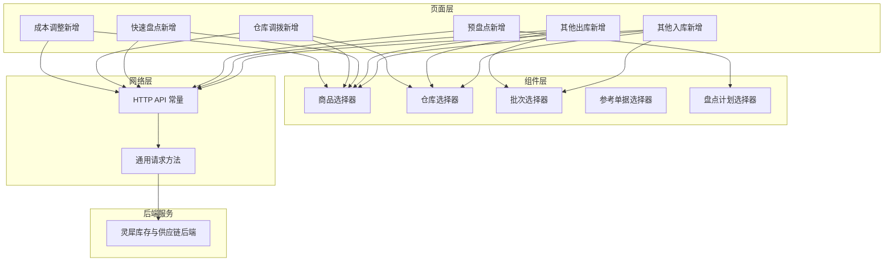
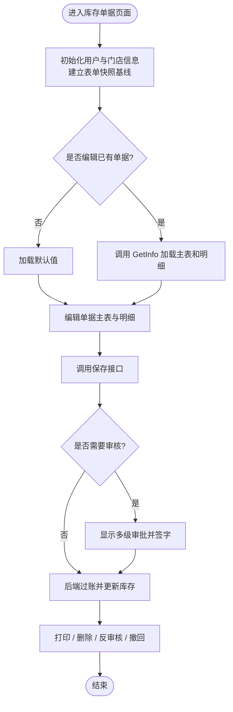
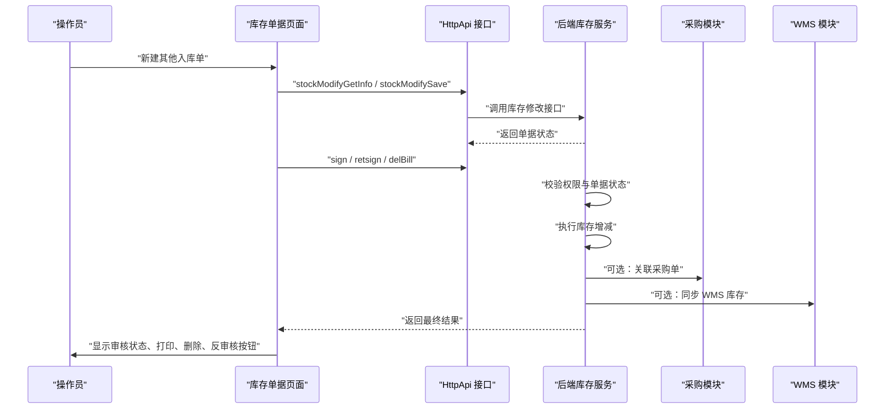
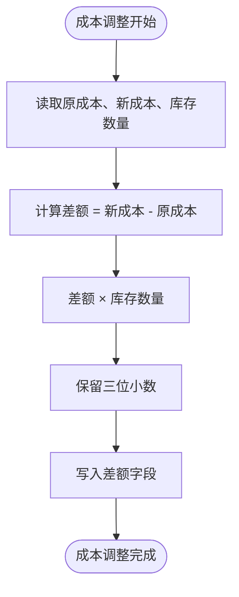
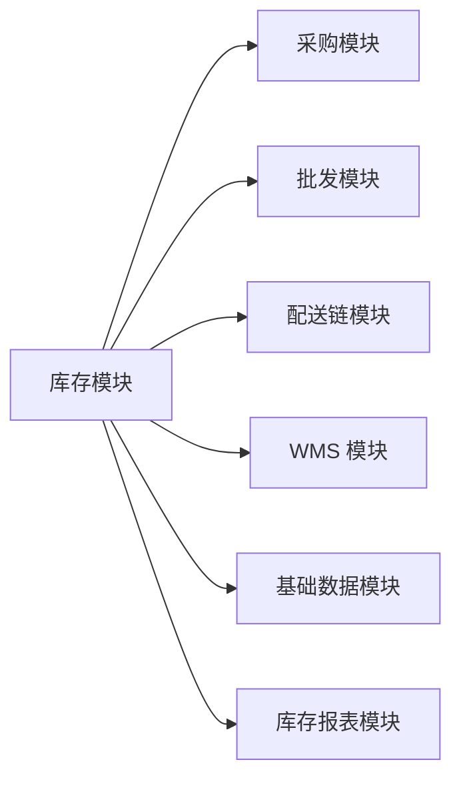
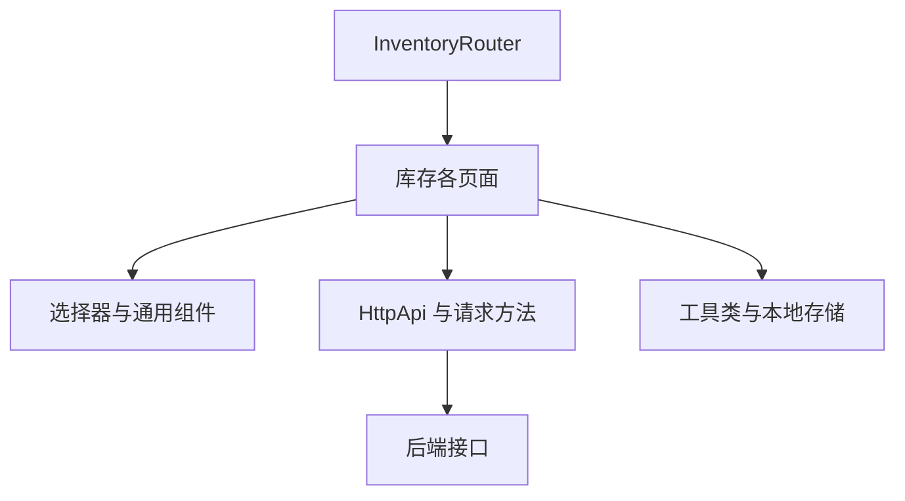

# 库存管理模块

<cite>
**本文引用的文件 **   
- [router.dart](file://lib/pages/business/inventory/router.dart)
- [otherin/add.dart](file://lib/pages/business/inventory/otherin/add.dart)
- [otherout/add.dart](file://lib/pages/business/inventory/otherout/add.dart)
- [precheck/add.dart](file://lib/pages/business/inventory/precheck/add.dart)
- [quickcheck/add.dart](file://lib/pages/business/inventory/quickcheck/add.dart)
- [movewarehouse/add.dart](file://lib/pages/business/inventory/movewarehouse/add.dart)
- [costchange/add.dart](file://lib/pages/business/inventory/costchange/add.dart)
- [select_inventory_plan.dart](file://lib/components/select/select_inventory_plan.dart)
- [select_refbill.dart](file://lib/components/select/select_refbill.dart)
- [http_api.dart](file://lib/net/http_api.dart)
</cite>

## 目录
1. [简介](#简介)
2. [项目结构](#项目结构)
3. [核心功能与职责](#核心功能与职责)
4. [架构总览](#架构总览)
5. [单据创建、审核与过账流程](#单据创建审核与过账流程)
6. [库存变动数据流转](#库存变动数据流转)
7. [库存计算规则与成本核算逻辑](#库存计算规则与成本核算逻辑)
8. [与其他模块集成关系](#与其他模块集成关系)
9. [依赖分析](#依赖分析)
10. [性能与可用性特性](#性能与可用性特性)
11. [异常处理与排错指南](#异常处理与排错指南)
12. [库存优化策略](#库存优化策略)
13. [结论](#结论)

## 简介
本模块是灵犀管店 Flutter 应用的库存业务入口，覆盖其他出入库、库存计划、预盘点、快速盘点、库存查询、仓库调拨和成本调整等核心能力。前端通过统一的页面路由组织功能，使用共享的扫码输入、商品/仓库/批次选择组件与 HTTP API 常量，完成单据编辑、多级审批、打印、删除、反审核等操作；实际库存增减、成本计算和跨模块联动由后端接口负责，前端承担表单建模、校验、交互与状态展示。

## 项目结构
库存模块位于 `lib/pages/business/inventory`，采用“按业务子域+页面”的组织方式：每个业务（如其他入库、其他出库、预盘点、快速盘点、移仓、成本变更）提供列表页与新增/详情页；所有子功能通过一个统一路由器注册到全局路由系统。

```mermaid
graph TB
    InventoryRouter["库存路由<br/>InventoryRouter"] --> PlanList["库存计划 列表"]
    InventoryRouter --> PlanAdd["库存计划 新增"]
    InventoryRouter --> PrecheckList["预盘点 列表"]
    InventoryRouter --> PrecheckAdd["预盘点 新增"]
    InventoryRouter --> QuickcheckList["快速盘点 列表"]
    InventoryRouter --> QuickcheckAdd["快速盘点 新增"]
    InventoryRouter --> OtheroutList["其他出库 列表"]
    InventoryRouter --> OtheroutAdd["其他出库 新增"]
    InventoryRouter --> OtherinList["其他入库 列表"]
    InventoryRouter --> OtherinAdd["其他入库 新增"]
    InventoryRouter --> MovewarehouseList["仓库调拨 列表"]
    InventoryRouter --> MovewarehouseAdd["仓库调拨 新增"]
    InventoryRouter --> CostchangeList["成本调整 列表"]
    InventoryRouter --> CostchangeAdd["成本调整 新增"]
    InventoryRouter --> SearchList["库存查询 列表"]
    InventoryRouter --> SearchDetail["库存查询 详情"]
```

**图示来源**
- [router.dart:1-57](file://lib/pages/business/inventory/router.dart#L1-L57)

**章节来源**
- [router.dart:1-57](file://lib/pages/business/inventory/router.dart#L1-L57)

## 核心功能与职责
| 功能 | 主要职责 | 典型操作 | 关键字段或行为 |
|---|---|---|---|
| 其他出入库 | 记录非采购/销售类的库存增加或减少 | 新增、保存、审核、打印、删除、反审核、扫码入库/出库 | 机构、仓库、业务员、往来单位、明细行、批次、有效期 |
| 库存计划 | 维护盘点计划，作为预盘单的来源 | 查看计划列表、筛选日期范围、选择计划 | 单号、时间区间、计划明细 |
| 预盘点 | 基于库存计划生成预盘单并录入预期数量 | 选择计划、加载计划明细、批量录入 | 计划编号、检查类型、预期数量、差异 |
| 快速盘点 | 直接按实物扫码盘点并写入实盘数量 | 扫码识别商品、自动填充实盘数、提交盘点 | 实盘数量、预盘数量、差异 |
| 库存查询 | 查询当前库存及库存流水 | 条件筛选、分页浏览、查看明细 | 商品、仓库、批次、库存量、在途、已占用 |
| 仓库调拨 | 同一机构内不同仓库间转移库存 | 设置出库仓库、入库仓库、明细 | 出仓、入仓、数量、批次 |
| 成本调整 | 调整库存商品的成本价并计算差额 | 填写新成本价、自动计算金额 | 原成本、新成本、库存数量、差额 |

**章节来源**
- [otherin/add.dart:1-200](file://lib/pages/business/inventory/otherin/add.dart#L1-L200)
- [otherout/add.dart:1-200](file://lib/pages/business/inventory/otherout/add.dart#L1-L200)
- [precheck/add.dart:1-200](file://lib/pages/business/inventory/precheck/add.dart#L1-L200)
- [quickcheck/add.dart:1-200](file://lib/pages/business/inventory/quickcheck/add.dart#L1-L200)
- [movewarehouse/add.dart:1-200](file://lib/pages/business/inventory/movewarehouse/add.dart#L1-L200)
- [costchange/add.dart:1-200](file://lib/pages/business/inventory/costchange/add.dart#L1-L200)

## 架构总览
库存模块的前端层遵循“页面 + 组件 + 网络常量”的分层：

- 页面层：各业务新增/列表页面负责表单、扫码、审批、附件、日志、未保存提示等交互。
- 组件层：复用商品、仓库、批次、进货员、门店、参考单据、盘点计划等选择器。
- 网络层：通过 `HttpApi` 集中声明后端接口路径，页面通过通用请求方法调用。
- 路由层：`InventoryRouter` 将库存相关页面暴露给全局导航。

**图示来源**
- [otherin/add.dart:1-120](file://lib/pages/business/inventory/otherin/add.dart#L1-L120)
- [otherout/add.dart:1-120](file://lib/pages/business/inventory/otherout/add.dart#L1-L120)
- [precheck/add.dart:1-120](file://lib/pages/business/inventory/precheck/add.dart#L1-L120)
- [quickcheck/add.dart:1-120](file://lib/pages/business/inventory/quickcheck/add.dart#L1-L120)
- [movewarehouse/add.dart:1-120](file://lib/pages/business/inventory/movewarehouse/add.dart#L1-L120)
- [costchange/add.dart:1-120](file://lib/pages/business/inventory/costchange/add.dart#L1-L120)
- [select_inventory_plan.dart:1-40](file://lib/components/select/select_inventory_plan.dart#L1-L40)
- [select_refbill.dart:1-40](file://lib/components/select/select_refbill.dart#L1-L40)
- [http_api.dart:1-120](file://lib/net/http_api.dart#L1-L120)

## 单据创建、审核与过账流程
库存相关单据在前端通常经历以下阶段：

1. **打开页面并初始化**：根据是否传入单据数据判断新增或编辑；从本地存储读取当前登录用户、门店信息，建立表单快照基线。
2. **加载默认值或详情**：新增时填充门店等基础信息；编辑时调用对应 `GetInfo` 接口加载主表、明细、审批流、附件等数据。
3. **录入明细**：支持手动输入、扫码枪输入、批量选择批次；部分单据支持选择参考单据或库存计划。
4. **保存草稿**：调用保存接口，返回单据编号和状态。
5. **审核**：调用签名/审核接口；若配置多级审批，则显示审批人列表并允许签字。
6. **过账/生效**：审核通过后由后端执行库存扣减或增加、成本结转、流水登记等逻辑；前端仅负责状态展示和后续操作控制。
7. **辅助操作**：打印、删除、反审核、撤回等受单据状态限制。

**图示来源**
- [otherin/add.dart:120-200](file://lib/pages/business/inventory/otherin/add.dart#L120-L200)
- [otherout/add.dart:120-200](file://lib/pages/business/inventory/otherout/add.dart#L120-L200)
- [precheck/add.dart:120-200](file://lib/pages/business/inventory/precheck/add.dart#L120-L200)
- [quickcheck/add.dart:120-200](file://lib/pages/business/inventory/quickcheck/add.dart#L120-L200)
- [movewarehouse/add.dart:120-200](file://lib/pages/business/inventory/movewarehouse/add.dart#L120-L200)
- [costchange/add.dart:120-200](file://lib/pages/business/inventory/costchange/add.dart#L120-L200)

**章节来源**
- [otherin/add.dart:120-200](file://lib/pages/business/inventory/otherin/add.dart#L120-L200)
- [otherout/add.dart:120-200](file://lib/pages/business/inventory/otherout/add.dart#L120-L200)
- [precheck/add.dart:120-200](file://lib/pages/business/inventory/precheck/add.dart#L120-L200)
- [quickcheck/add.dart:120-200](file://lib/pages/business/inventory/quickcheck/add.dart#L120-L200)
- [movewarehouse/add.dart:120-200](file://lib/pages/business/inventory/movewarehouse/add.dart#L120-L200)
- [costchange/add.dart:120-200](file://lib/pages/business/inventory/costchange/add.dart#L120-L200)

## 库存变动数据流转
库存变动的数据流分为前端建模、后端持久化与跨模块联动三部分：

- 前端负责收集机构、仓库、商品、批次、数量、单价、成本、备注、附件、审批信息等。
- 保存或审核后，后端根据单据类型决定库存方向：其他入库增加库存，其他出库减少库存，预盘点/快速盘点产生盘点差异并影响库存，仓库调拨在同一机构内移动库存，成本调整不影响数量但影响库存成本。
- 参考单据用于溯源：例如从采购订货单、采购计划单、自采申请单等生成库存相关单据；盘点计划为预盘点提供目标范围。

**图示来源**
- [otherin/add.dart:120-200](file://lib/pages/business/inventory/otherin/add.dart#L120-L200)
- [http_api.dart:1-200](file://lib/net/http_api.dart#L1-L200)

**章节来源**
- [otherin/add.dart:120-200](file://lib/pages/business/inventory/otherin/add.dart#L120-L200)
- [otherout/add.dart:120-200](file://lib/pages/business/inventory/otherout/add.dart#L120-L200)
- [precheck/add.dart:120-200](file://lib/pages/business/inventory/precheck/add.dart#L120-L200)
- [quickcheck/add.dart:120-200](file://lib/pages/business/inventory/quickcheck/add.dart#L120-L200)
- [movewarehouse/add.dart:120-200](file://lib/pages/business/inventory/movewarehouse/add.dart#L120-L200)
- [costchange/add.dart:120-200](file://lib/pages/business/inventory/costchange/add.dart#L120-L200)
- [http_api.dart:1-200](file://lib/net/http_api.dart#L1-L200)

## 库存计算规则与成本核算逻辑
### 其他出入库
- 其他入库：按明细行的数量增加指定仓库的商品库存，可携带批次、有效期、成本等信息。
- 其他出库：按明细行的数量减少指定仓库的商品库存，常用于损耗、赠送、样品发出等场景。
- 数量校验：前端对明细行数量进行基本校验，避免负数或空值；具体库存不足校验由后端保证。

### 预盘点与快速盘点
- 预盘点：先根据库存计划生成预期数量，再结合实盘数量计算差异；差异会触发库存调整逻辑。
- 快速盘点：以实盘数量为主，通常用实盘数量覆盖系统数量或直接生成差异单；快速盘点更强调现场效率。
- 差异计算：前端会在加载详情时对缺失字段做兜底赋值，例如快速盘点中若无实盘数量则回退到预盘数量。

### 仓库调拨
- 调拨不改变机构总库存，只改变仓库维度分布：出库仓库减少，入库仓库增加。
- 调拨单需同时维护出仓仓库和入仓仓库，确保同一商品、批次、单位的一致性。

### 成本调整
- 成本调整不改变库存数量，但会更新库存成本并计算差额。
- 差额计算公式为：差额 = (新成本 - 原成本) × 库存数量，前端使用工具类进行三位小数格式化。

**图示来源**
- [costchange/add.dart:180-220](file://lib/pages/business/inventory/costchange/add.dart#L180-L220)

**章节来源**
- [otherin/add.dart:120-200](file://lib/pages/business/inventory/otherin/add.dart#L120-L200)
- [otherout/add.dart:120-200](file://lib/pages/business/inventory/otherout/add.dart#L120-L200)
- [precheck/add.dart:120-200](file://lib/pages/business/inventory/precheck/add.dart#L120-L200)
- [quickcheck/add.dart:120-200](file://lib/pages/business/inventory/quickcheck/add.dart#L120-L200)
- [movewarehouse/add.dart:120-200](file://lib/pages/business/inventory/movewarehouse/add.dart#L120-L200)
- [costchange/add.dart:180-220](file://lib/pages/business/inventory/costchange/add.dart#L180-L220)

## 与其他模块集成关系
库存模块与采购、配送、批发、WMS、基础数据、报表等模块存在紧密集成：

- 与采购模块：库存计划、采购订货单、采购计划单、自采申请单可作为参考单据来源；采购入库完成后会影响库存。
- 与配送模块：调拨申请、调拨出库、调拨入库、配送发货、配送收货等链路中的库存变化由对应单据驱动。
- 与批发模块：批发销售、退货等会消耗库存，库存查询应反映最新库存。
- 与 WMS 模块：WMS 收货任务、补货、库存查询、移动商品等与库存数据保持一致。
- 与基础数据：商品、仓库、分类、品牌、供应商、门店等基础数据是所有库存单据的前提。
- 与报表模块：库存预警、滞销、零库存、过期预警等报表依赖库存流水和实时库存。

**图示来源**
- [http_api.dart:1-200](file://lib/net/http_api.dart#L1-L200)
- [select_refbill.dart:1-80](file://lib/components/select/select_refbill.dart#L1-L80)

**章节来源**
- [http_api.dart:1-200](file://lib/net/http_api.dart#L1-L200)
- [select_refbill.dart:1-80](file://lib/components/select/select_refbill.dart#L1-L80)

## 依赖分析
库存模块的主要依赖包括：

- 路由依赖：`InventoryRouter` 依赖 fluro 路由框架，并将库存子功能映射到对应页面。
- UI 组件依赖：各新增页面依赖商品选择器、仓库选择器、批次选择器、附件选择器、扫码扫描器等。
- 网络依赖：所有接口路径集中在 `HttpApi`，页面通过通用请求方法发起网络调用。
- 工具依赖：数学工具、扫码匹配工具、权限工具、Toast 提示、本地存储等。

**图示来源**
- [router.dart:1-57](file://lib/pages/business/inventory/router.dart#L1-L57)
- [http_api.dart:1-120](file://lib/net/http_api.dart#L1-L120)

**章节来源**
- [router.dart:1-57](file://lib/pages/business/inventory/router.dart#L1-L57)
- [http_api.dart:1-120](file://lib/net/http_api.dart#L1-L120)

## 性能与可用性特性
- 扫码防抖：多个库存单据页面均实现扫码输入框的防抖逻辑，避免 PDA 扫码枪字符注入过快导致重复查询。
- 键盘隐藏：聚焦扫码输入框时主动隐藏软键盘，提升扫码体验。
- 分页加载：参考单据选择器和盘点计划选择器支持滚动加载更多，减少首屏数据压力。
- 表单快照：新增模式下记录表单快照，未修改直接返回时不弹出未保存提示，提升操作流畅度。
- 状态文案：统一使用待审核、已审核、已驳回状态文案与颜色，便于用户理解单据生命周期。

**章节来源**
- [otherin/add.dart:120-200](file://lib/pages/business/inventory/otherin/add.dart#L120-L200)
- [otherout/add.dart:120-200](file://lib/pages/business/inventory/otherout/add.dart#L120-L200)
- [precheck/add.dart:120-200](file://lib/pages/business/inventory/precheck/add.dart#L120-L200)
- [quickcheck/add.dart:120-200](file://lib/pages/business/inventory/quickcheck/add.dart#L120-L200)
- [movewarehouse/add.dart:120-200](file://lib/pages/business/inventory/movewarehouse/add.dart#L120-L200)
- [select_refbill.dart:80-160](file://lib/components/select/select_refbill.dart#L80-L160)
- [select_inventory_plan.dart:1-120](file://lib/components/select/select_inventory_plan.dart#L1-L120)

## 异常处理与排错指南
常见异常和处理建议如下：

| 问题现象 | 可能原因 | 处理建议 |
|---|---|---|
| 扫码后提示未找到商品 | 条码与商品不匹配、商品未上架、扫码枪注入字符不完整 | 检查商品条码配置；确认扫码枪模式；利用页面防抖逻辑等待完整字符 |
| 审核失败 | 权限不足、单据已审核、审批流配置错误 | 检查当前用户角色；确认单据状态；查看多级审批配置 |
| 库存不足 | 出库数量大于可用库存 | 先补充库存或减少出库数量；检查是否有在途或已占用库存 |
| 成本差额异常 | 原成本、新成本或库存数量为空 | 重新加载详情；检查成本变更明细；确认后端返回字段 |
| 参考单据为空 | 日期范围过窄、机构过滤过严、单据类型不匹配 | 扩大日期范围；取消机构过滤；切换合适的单据类型 |
| 盘点计划为空 | 时间筛选不正确、计划未创建 | 使用昨天/今日/本周/本月/自定义筛选；检查计划是否已创建 |

**章节来源**
- [select_refbill.dart:160-240](file://lib/components/select/select_refbill.dart#L160-L240)
- [select_inventory_plan.dart:120-200](file://lib/components/select/select_inventory_plan.dart#L120-L200)
- [costchange/add.dart:180-220](file://lib/pages/business/inventory/costchange/add.dart#L180-L220)

## 库存优化策略
- 定期盘点：通过库存计划和预盘点机制发现差异，快速修正库存。
- 快速盘点优先高频商品：对周转快的商品采用快速盘点，提高准确率。
- 仓库调拨均衡库存：根据销售趋势在不同仓库间调拨，降低缺货风险。
- 成本监控：关注成本调整带来的差额，避免异常成本波动影响利润。
- 库存查询多维分析：结合仓库、商品、批次、有效期等维度分析库存结构，识别滞销和临期商品。
- 与采购联动：根据库存预警和报表反馈调整采购计划，减少积压。

[本节为概念性指导，不直接分析具体代码文件]

## 结论
灵犀管店库存管理模块以清晰的路由组织和统一的页面模板为基础，围绕其他出入库、库存计划、预盘点、快速盘点、库存查询、仓库调拨和成本调整七大功能构建完整的库存业务闭环。前端侧重用户体验、扫码效率和表单一致性，后端负责库存增减、成本计算和跨模块联动。通过参考单据、多级审批、打印与日志等能力，该模块能够支撑门店和连锁企业的日常库存运营。

[本节为总结性内容，不直接分析具体代码文件]