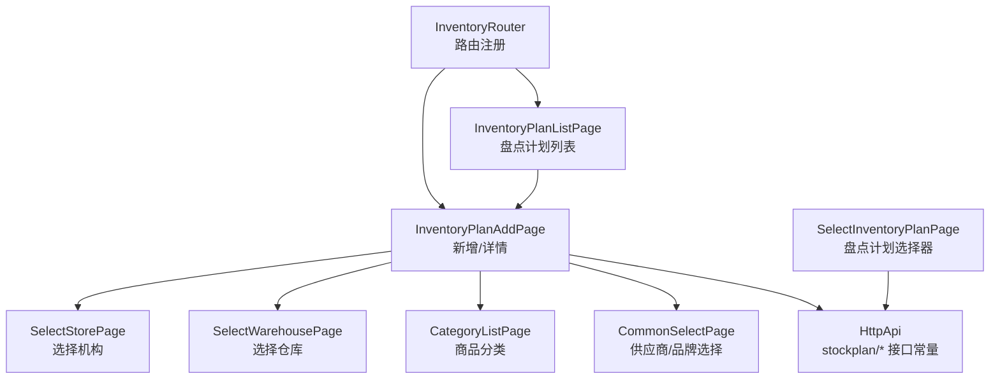
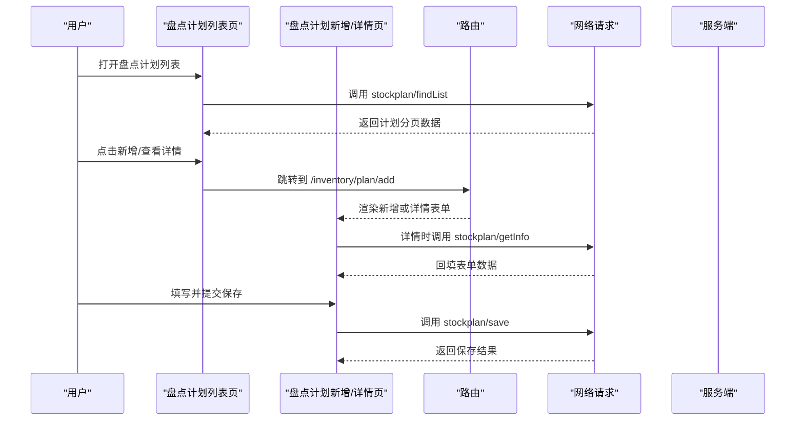
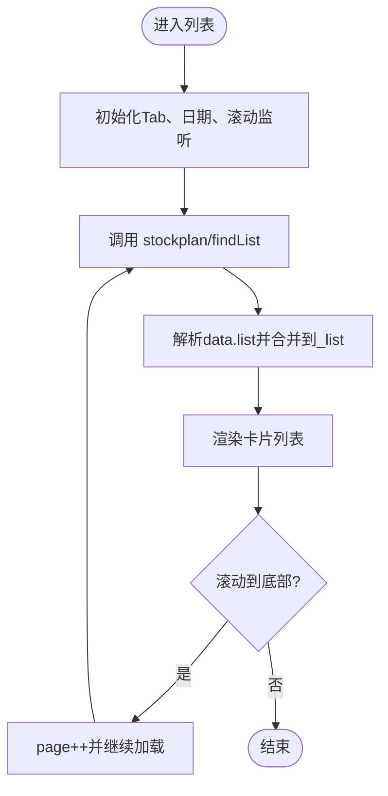
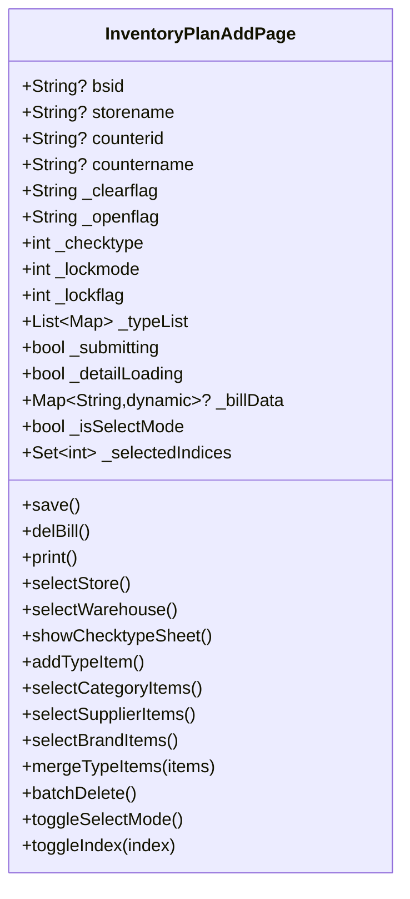
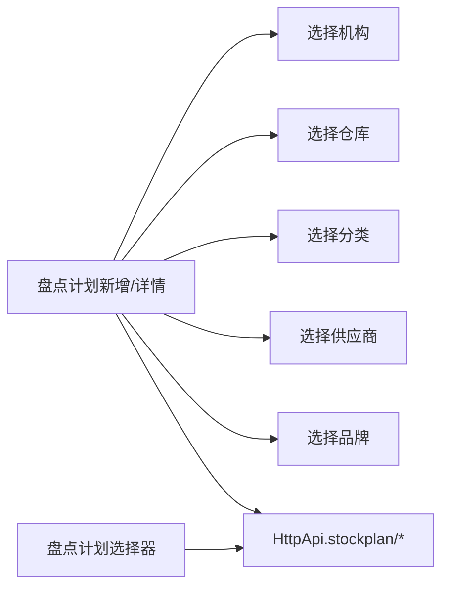

# 库存计划

<cite>
**本文引用的文件**
- [lib/pages/business/inventory/plan/add.dart](file://lib/pages/business/inventory/plan/add.dart)
- [lib/pages/business/inventory/plan/list.dart](file://lib/pages/business/inventory/plan/list.dart)
- [lib/components/select/select_inventory_plan.dart](file://lib/components/select/select_inventory_plan.dart)
- [lib/pages/business/inventory/router.dart](file://lib/pages/business/inventory/router.dart)
- [lib/net/http_api.dart](file://lib/net/http_api.dart)
- [lib/components/select/select_store.dart](file://lib/components/select/select_store.dart)
- [lib/components/select/select_warehouse.dart](file://lib/components/select/select_warehouse.dart)
- [lib/pages/business/basis/classify/list.dart](file://lib/pages/business/basis/classify/list.dart)
- [lib/widgets/common_select_page.dart](file://lib/widgets/common_select_page.dart)
</cite>

## 目录
1. [引言](#引言)
2. [项目结构](#项目结构)
3. [核心组件](#核心组件)
4. [架构总览](#架构总览)
5. [详细组件分析](#详细组件分析)
6. [依赖关系分析](#依赖关系分析)
7. [性能与优化建议](#性能与优化建议)
8. [故障排查指南](#故障排查指南)
9. [结论](#结论)

## 引言
本文件面向灵犀管店 Flutter 项目中的“库存盘点计划”功能，围绕以下目标展开：
- 说明盘点计划的创建、编辑、删除和查看流程；
- 解释盘点范围（全场、分类、供应商、品牌）与计划模板配置；
- 描述盘点状态管理（待盘点、盘点中、已盘点）及业务含义；
- 梳理与基础资料（机构、仓库、商品分类、供应商、品牌）、库存查询等模块的数据交互；
- 提供可落地的盘点优化策略与性能注意事项。

需要特别说明的是：当前仓库中“库存计划”主要实现的是盘点计划的定义、筛选与详情展示；实际的“盘点执行与完成”能力由独立模块承担，例如预盘点与快速盘点。因此，本文对“盘点执行”的说明以现有代码为依据，不虚构后端行为或差异调整逻辑。

## 项目结构
库存计划功能集中在 inventory 业务目录下，采用页面路由 + 列表页 + 新增/详情页的组织方式：
- 路由注册：inventory/router.dart
- 列表页：inventory/plan/list.dart
- 新增/详情页：inventory/plan/add.dart
- 盘点计划选择器：components/select/select_inventory_plan.dart
- 网络接口常量：net/http_api.dart

**图表来源**
- [lib/pages/business/inventory/router.dart:1-57](file://lib/pages/business/inventory/router.dart#L1-L57)
- [lib/pages/business/inventory/plan/list.dart:1-200](file://lib/pages/business/inventory/plan/list.dart#L1-L200)
- [lib/pages/business/inventory/plan/add.dart:1-200](file://lib/pages/business/inventory/plan/add.dart#L1-L200)
- [lib/components/select/select_inventory_plan.dart:1-60](file://lib/components/select/select_inventory_plan.dart#L1-L60)
- [lib/net/http_api.dart:388-392](file://lib/net/http_api.dart#L388-L392)

**章节来源**
- [lib/pages/business/inventory/router.dart:1-57](file://lib/pages/business/inventory/router.dart#L1-L57)

## 核心组件
- 盘点计划列表页
  - 负责盘点计划分页查询、状态筛选、时间范围筛选、机构筛选、单号搜索、筛选抽屉、列表渲染。
  - 通过 Tab 切换“全部/待盘点/盘点中/已盘点”，将 Tab 索引映射为 signflag 参数。
- 盘点计划新增/详情页
  - 负责计划名称、机构、仓库、未盘商品处理、盘点类型、锁定方式/状态、备注等字段维护。
  - 支持分类/供应商/品牌明细的多选添加、批量删除、去重合并。
  - 负责保存、删除、打印、返回拦截与未保存修改提示。
- 盘点计划选择器
  - 提供按单号、时间维度（昨天/今日/本周/本月/自定义）检索盘点计划的能力，用于其他模块引用。
- 路由与网络层
  - 路由统一注册 inventory/plan/list 与 inventory/plan/add。
  - 盘点计划相关接口常量集中在 http_api.dart 的 stockplan 命名空间下。

**章节来源**
- [lib/pages/business/inventory/plan/list.dart:1-200](file://lib/pages/business/inventory/plan/list.dart#L1-L200)
- [lib/pages/business/inventory/plan/add.dart:1-200](file://lib/pages/business/inventory/plan/add.dart#L1-L200)
- [lib/components/select/select_inventory_plan.dart:1-60](file://lib/components/select/select_inventory_plan.dart#L1-L60)
- [lib/pages/business/inventory/router.dart:1-57](file://lib/pages/business/inventory/router.dart#L1-L57)
- [lib/net/http_api.dart:388-392](file://lib/net/http_api.dart#L388-L392)

## 架构总览
库存计划的前端架构遵循“页面视图 + 路由 + 网络常量”的轻量组合：
- 视图层：Flutter StatefulWidget 页面；
- 路由层：Fluro 路由集中管理；
- 数据层：通过 request 调用后端 API，数据解析后驱动 UI。

**图表来源**
- [lib/pages/business/inventory/plan/list.dart:201-450](file://lib/pages/business/inventory/plan/list.dart#L201-L450)
- [lib/pages/business/inventory/plan/add.dart:201-350](file://lib/pages/business/inventory/plan/add.dart#L201-L350)
- [lib/pages/business/inventory/router.dart:30-57](file://lib/pages/business/inventory/router.dart#L30-L57)
- [lib/net/http_api.dart:388-392](file://lib/net/http_api.dart#L388-L392)

## 详细组件分析

### 盘点计划列表页
列表页承担盘点计划的查询与展示职责，关键能力包括：
- 状态筛选：Tab 控制“全部/待盘点/盘点中/已盘点”，内部映射 signflag 为字符串值，其中“待盘点”映射为 '0'，“盘点中”映射为 '2'，“已盘点”映射为 '1'。
- 时间筛选：默认最近 30 天，支持快速标签（昨天/今天/本周/本月/自定义）与手动日期选择。
- 机构筛选：可选单一机构进行过滤。
- 单号搜索：支持输入单号并触发查询。
- 分页加载：滚动到底部自动加载更多，使用 hasMore 与 page 控制。
- 权限控制：进入时检查权限标识，无权限时提示。

列表项卡片根据 signflag 显示不同状态文案与颜色：
- signflag='1' → 已盘点；
- signflag='2' → 盘点中；
- 其他 → 待盘点。

**图表来源**
- [lib/pages/business/inventory/plan/list.dart:201-450](file://lib/pages/business/inventory/plan/list.dart#L201-L450)
- [lib/pages/business/inventory/plan/list.dart:751-917](file://lib/pages/business/inventory/plan/list.dart#L751-L917)

**章节来源**
- [lib/pages/business/inventory/plan/list.dart:1-200](file://lib/pages/business/inventory/plan/list.dart#L1-L200)
- [lib/pages/business/inventory/plan/list.dart:201-450](file://lib/pages/business/inventory/plan/list.dart#L201-L450)
- [lib/pages/business/inventory/plan/list.dart:751-917](file://lib/pages/business/inventory/plan/list.dart#L751-L917)

### 盘点计划新增/详情页
新增/详情页负责盘点计划的模板配置与生命周期操作，核心点如下：

- 基本信息
  - 计划名称、机构、仓库、备注；
  - 编辑模式下展示单号、制单人、制单时间、状态。
- 未盘商品处理
  - 当盘点类型为全场盘点时隐藏该选项；
  - 非全场盘点时可选择“库存不变”或“库存清零”。
- 盘点类型
  - 支持“分类盘点”“供应商盘点”“品牌盘点”“全场盘点”；
  - 切换类型时会清空已有明细并给出确认提示。
- 全场盘点锁定配置
  - 锁定方式：“系统立即锁定”“人工手动锁定”；
  - 锁定状态：“暂不锁定”“立即锁定”；
  - 系统立即锁定会强制锁定状态为立即锁定；
  - 锁定字段仅在全场盘点时显示，且编辑模式下受限制。
- 分类/供应商/品牌明细
  - 分类：跳转分类列表多选；
  - 供应商：调用供应商列表接口，支持编码+名称展示；
  - 品牌：调用品牌列表接口，支持编码+名称展示；
  - 所有明细均进行 ID 去重合并。
- 保存与校验
  - 必填校验：计划名称、机构、仓库；
  - 非全场盘点时，必须至少选择一个分类/供应商/品牌；
  - 新增/编辑分别校验权限标识；
  - 提交参数包含 planname、bsid、storename、counterid、countername、clearflag、openflag、checktype、lockmode、lockflag、remark、stockPlanItemtypeResp。
- 删除与打印
  - 删除需二次确认；
  - 打印调用通用打印接口，传入 menuid 与单据数据。
- 返回拦截与未保存提示
  - 仅在可保存态（signflag='0'）启用；
  - 生成表单快照，离开时比对是否变更，提示保存或放弃。

**图表来源**
- [lib/pages/business/inventory/plan/add.dart:1-200](file://lib/pages/business/inventory/plan/add.dart#L1-L200)
- [lib/pages/business/inventory/plan/add.dart:201-500](file://lib/pages/business/inventory/plan/add.dart#L201-L500)
- [lib/pages/business/inventory/plan/add.dart:501-841](file://lib/pages/business/inventory/plan/add.dart#L501-L841)
- [lib/pages/business/inventory/plan/add.dart:842-1289](file://lib/pages/business/inventory/plan/add.dart#L842-L1289)

**章节来源**
- [lib/pages/business/inventory/plan/add.dart:1-200](file://lib/pages/business/inventory/plan/add.dart#L1-L200)
- [lib/pages/business/inventory/plan/add.dart:201-500](file://lib/pages/business/inventory/plan/add.dart#L201-L500)
- [lib/pages/business/inventory/plan/add.dart:501-841](file://lib/pages/business/inventory/plan/add.dart#L501-L841)
- [lib/pages/business/inventory/plan/add.dart:842-1289](file://lib/pages/business/inventory/plan/add.dart#L842-L1289)

### 盘点计划选择器
盘点计划选择器用于在其他业务流程中选择已有的盘点计划，并与 boss 端对齐：
- 支持按单号搜索；
- 支持昨天/今日/本周/本月/自定义时间筛选；
- 分页加载，滚动到底部继续拉取；
- 选中后返回 getInfo 完整数据，供调用方直接使用。

该选择器强调与后端“inventoryPlan/search”的对齐，体现跨端一致性。

**章节来源**
- [lib/components/select/select_inventory_plan.dart:1-60](file://lib/components/select/select_inventory_plan.dart#L1-L60)

### 路由与入口
路由文件中定义了盘点计划的两条路由：
- inventory/plan/list：盘点计划列表；
- inventory/plan/add：盘点计划新增/详情。

**章节来源**
- [lib/pages/business/inventory/router.dart:1-57](file://lib/pages/business/inventory/router.dart#L1-L57)

## 依赖关系分析
库存计划功能对外部模块的依赖主要体现在基础资料选择与网络层：
- 选择机构：SelectStorePage；
- 选择仓库：SelectWarehousePage；
- 选择分类：CategoryListPage；
- 选择供应商/品牌：CommonSelectPage + HttpApi.supplierList/brandList；
- 网络接口：HttpApi.stockplanFindList/GetInfo/Save/DelBill。

**图表来源**
- [lib/pages/business/inventory/plan/add.dart:201-500](file://lib/pages/business/inventory/plan/add.dart#L201-L500)
- [lib/components/select/select_store.dart](file://lib/components/select/select_store.dart)
- [lib/components/select/select_warehouse.dart](file://lib/components/select/select_warehouse.dart)
- [lib/pages/business/basis/classify/list.dart](file://lib/pages/business/basis/classify/list.dart)
- [lib/widgets/common_select_page.dart](file://lib/widgets/common_select_page.dart)
- [lib/net/http_api.dart:388-392](file://lib/net/http_api.dart#L388-L392)

**章节来源**
- [lib/pages/business/inventory/plan/add.dart:201-500](file://lib/pages/business/inventory/plan/add.dart#L201-L500)
- [lib/components/select/select_store.dart](file://lib/components/select/select_store.dart)
- [lib/components/select/select_warehouse.dart](file://lib/components/select/select_warehouse.dart)
- [lib/pages/business/basis/classify/list.dart](file://lib/pages/business/basis/classify/list.dart)
- [lib/widgets/common_select_page.dart](file://lib/widgets/common_select_page.dart)
- [lib/net/http_api.dart:388-392](file://lib/net/http_api.dart#L388-L392)

## 性能与优化建议
基于现有实现，可从以下方面优化盘点计划相关体验：

- 列表性能
  - 列表已使用 ListView.builder 与 cacheExtent 提升滚动性能；
  - 建议在大数据量场景增加防抖与节流，避免频繁刷新；
  - 可将筛选条件封装为不可变对象，减少重建开销。
- 表单交互
  - 表单快照用于未保存拦截，建议进一步区分“脏字段”而非整串比较，降低计算成本；
  - 分类/供应商/品牌明细合并去重已实现，可在大数据集场景考虑使用 Map 加速查找。
- 网络请求
  - 列表分页合理，建议在后端侧增加必要索引；
  - 选择器与列表共用同一类查询模式，建议复用统一的查询构建器。
- 状态映射
  - signflag 在不同页面存在多处硬编码，建议抽取枚举或常量表，便于维护与扩展。

[本节为通用性能建议，不直接分析具体文件]

## 故障排查指南
常见问题与定位思路：

- 无权限查看或编辑盘点计划
  - 现象：提示无权查看/新增/编辑/删除；
  - 排查：检查权限标识（如 013601、013602、013603、013604）是否在后台正确配置。
- 表单保存失败或未生效
  - 现象：保存后仍无法进入下一步；
  - 排查：确认必填字段（计划名称、机构、仓库）与非全场盘点的明细是否已选择；检查后端返回 data 是否为空。
- 返回时重复提示未保存
  - 现象：返回列表再次弹窗；
  - 排查：确认保存成功后是否调用了刷新快照方法；确保表单字段与快照一致。
- 锁定方式/状态异常
  - 现象：锁定状态未按预期设置；
  - 排查：确认是否为全场盘点，以及锁定方式为“系统立即锁定”还是“人工手动锁定”。

**章节来源**
- [lib/pages/business/inventory/plan/list.dart:1-200](file://lib/pages/business/inventory/plan/list.dart#L1-L200)
- [lib/pages/business/inventory/plan/add.dart:201-350](file://lib/pages/business/inventory/plan/add.dart#L201-L350)
- [lib/pages/business/inventory/plan/add.dart:501-841](file://lib/pages/business/inventory/plan/add.dart#L501-L841)

## 结论
灵犀管店的“库存计划”模块在前端实现了盘点计划的完整生命周期管理，包括计划创建、编辑、删除、查看与筛选，同时提供了丰富的盘点范围与锁定配置。对于盘点执行与完成，仓库中存在独立的预盘点与快速盘点模块，它们与库存计划共同构成完整的库存盘点体系。

当前前端未直接实现盘点数据的采集、差异分析与调整建议生成逻辑；这些能力通常由后端在盘点完成后处理，或由其他盘点执行页面协同完成。若需要在前端展示差异与建议，建议在后端返回差异数据的基础上，在前端增加差异列表与建议面板，并结合库存查询模块进行对比展示。