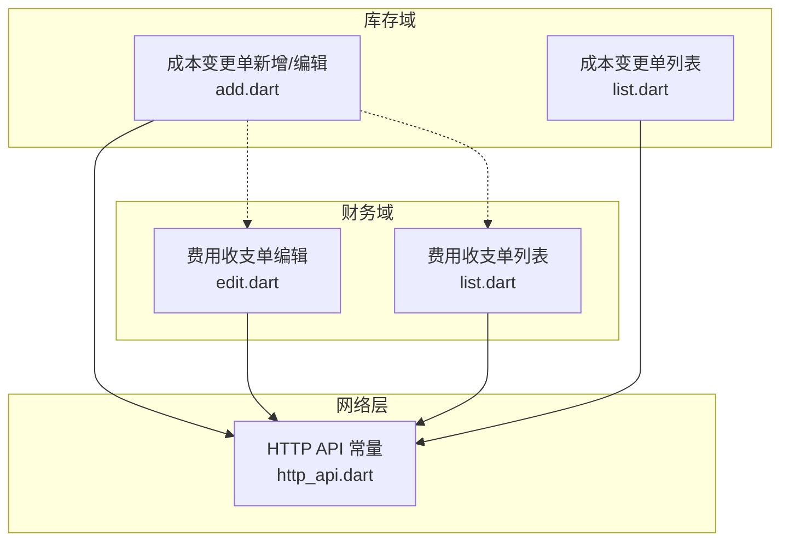
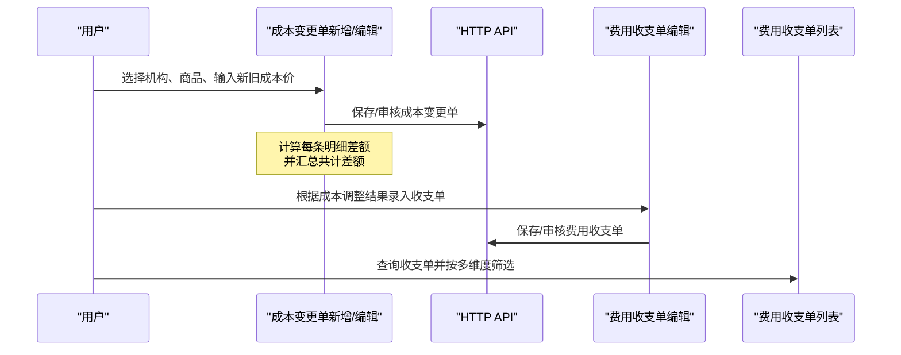
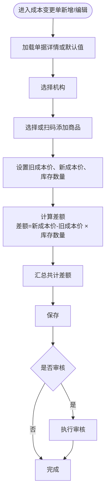
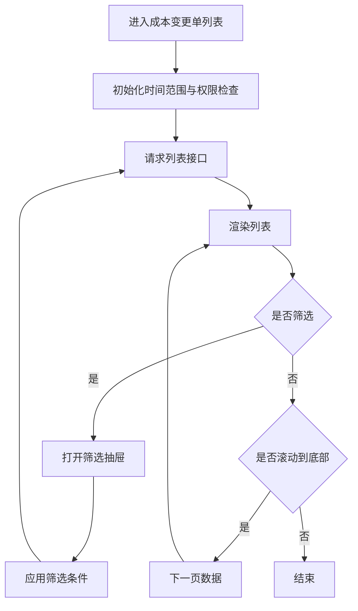
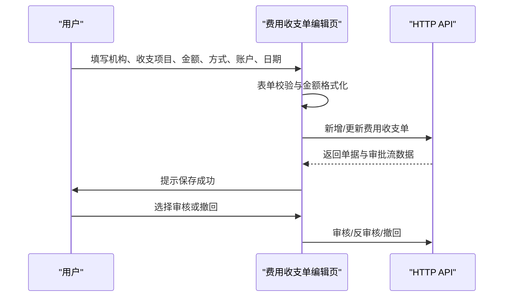
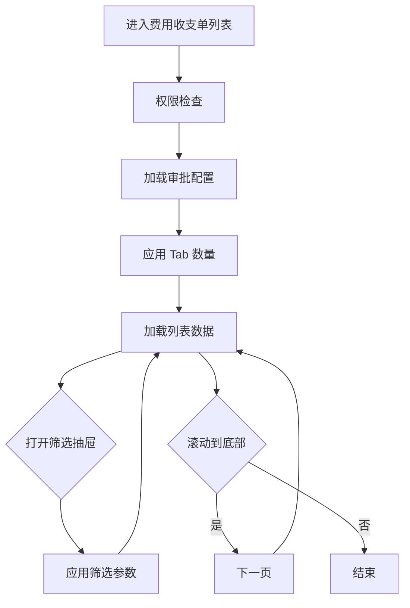
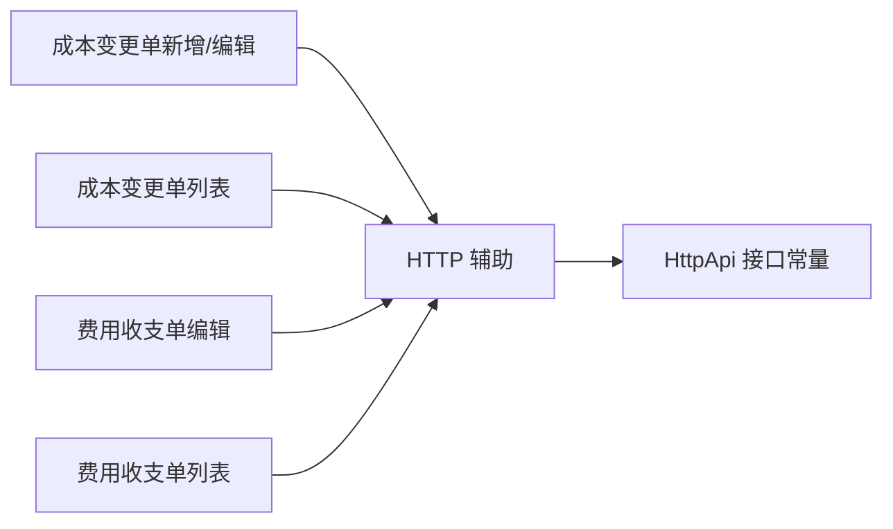
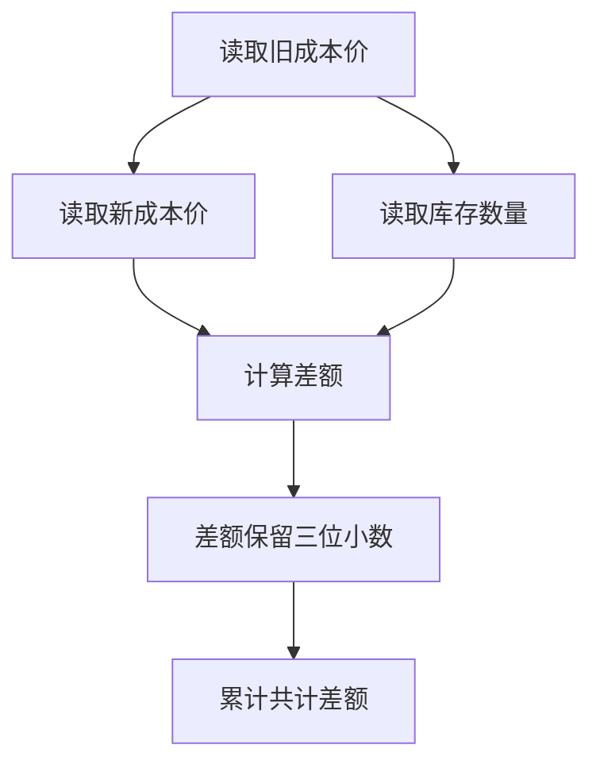
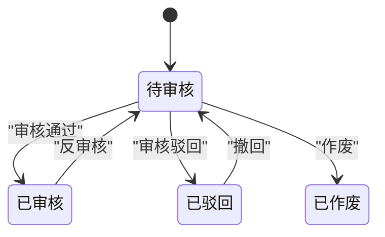
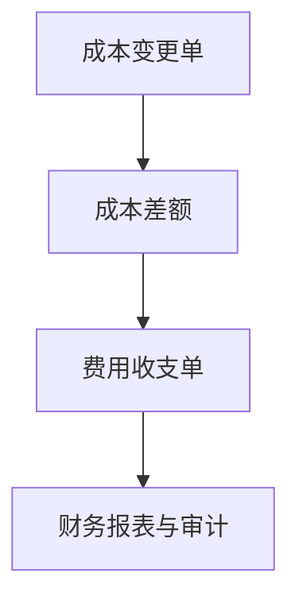

# 成本调整

<cite>
**本文引用的文件**   
- [lib/pages/business/inventory/costchange/add.dart](file://lib/pages/business/inventory/costchange/add.dart)
- [lib/pages/business/inventory/costchange/list.dart](file://lib/pages/business/inventory/costchange/list.dart)
- [lib/pages/business/finance/cost_revenue/edit.dart](file://lib/pages/business/finance/cost_revenue/edit.dart)
- [lib/pages/business/finance/cost_revenue/list.dart](file://lib/pages/business/finance/cost_revenue/list.dart)
- [lib/net/http_api.dart](file://lib/net/http_api.dart)
</cite>

## 目录
1. [引言](#引言)
2. [项目结构](#项目结构)
3. [核心组件](#核心组件)
4. [架构总览](#架构总览)
5. [详细组件分析](#详细组件分析)
6. [依赖关系分析](#依赖关系分析)
7. [性能与实现特征](#性能与实现特征)
8. [成本计算与财务影响](#成本计算与财务影响)
9. [审计追踪与版本管理](#审计追踪与版本管理)
10. [集成关系与报表溯源](#集成关系与报表溯源)
11. [优化策略与风险控制](#优化策略与风险控制)
12. [故障排查指南](#故障排查指南)
13. [结论](#结论)

## 引言
本文件面向灵犀管店 Flutter 项目中“库存成本调整”能力，聚焦以下目标：
- 明确成本变更单的使用场景、规则与数据字段。
- 解释前端成本差额计算逻辑及其对财务报表的间接影响。
- 说明成本变更单与费用收支单的协作关系及审批流控制。
- 提供历史追溯、审计日志、打印归档等可审计性设计要点。
- 给出成本优化建议与风险控制方案。

需要特别说明的是：当前仓库主要暴露的是移动端业务页面和前端计算逻辑；服务器端成本核算引擎、会计分录生成、成本计价算法等后端实现未在该代码结构中直接出现，因此本文关于“底层成本计算引擎”“会计分录明细”等内容仅以现有前端接口调用和字段表现为依据进行说明，不虚构服务端行为。

## 项目结构
围绕成本调整功能，相关代码集中在两个业务域：
- 库存域的成本变更单：新增、编辑、列表、审核、撤回、删除、打印。
- 财务域的费用收支单：新增、编辑、列表、审核、反审核、删除，用于记录因成本调整产生的财务收支或转账。

**图表来源**
- [lib/pages/business/inventory/costchange/add.dart:1-200](file://lib/pages/business/inventory/costchange/add.dart#L1-L200)
- [lib/pages/business/inventory/costchange/list.dart:1-200](file://lib/pages/business/inventory/costchange/list.dart#L1-L200)
- [lib/pages/business/finance/cost_revenue/edit.dart:1-200](file://lib/pages/business/finance/cost_revenue/edit.dart#L1-L200)
- [lib/pages/business/finance/cost_revenue/list.dart:1-200](file://lib/pages/business/finance/cost_revenue/list.dart#L1-L200)
- [lib/net/http_api.dart](file://lib/net/http_api.dart)

**章节来源**
- [lib/pages/business/inventory/costchange/add.dart:1-200](file://lib/pages/business/inventory/costchange/add.dart#L1-L200)
- [lib/pages/business/inventory/costchange/list.dart:1-200](file://lib/pages/business/inventory/costchange/list.dart#L1-L200)
- [lib/pages/business/finance/cost_revenue/edit.dart:1-200](file://lib/pages/business/finance/cost_revenue/edit.dart#L1-L200)
- [lib/pages/business/finance/cost_revenue/list.dart:1-200](file://lib/pages/business/finance/cost_revenue/list.dart#L1-L200)

## 核心组件
| 组件 | 职责 | 关键能力 | 主要入口 |
|---|---|---|---|
| 成本变更单新增/编辑页 | 录入机构、商品、旧成本价、新成本价、库存数量、备注，并计算差额 | 扫码添加、批量选择、保存、审核、撤回、删除、打印、多级审批 | `InventoryCostchangeAddPage` |
| 成本变更单列表页 | 查询待审、已审、已驳回单据，支持时间、制单人筛选 | 分页加载、Tab 状态切换、快捷时间、机构筛选 | `InventoryCostchangeListPage` |
| 费用收支单编辑页 | 录入机构、收支项目、金额、方式、账户、日期、经手人、备注 | 收入/支出/转账类型、保存、审核、反审核、删除、撤回、多级审批 | `CostRevenueEditPage` |
| 费用收支单列表页 | 查询收支单，支持多维度筛选 | 动态“已驳回”Tab、快捷时间、多维筛选、分页 | `CostRevenueListPage` |

**章节来源**
- [lib/pages/business/inventory/costchange/add.dart:1-200](file://lib/pages/business/inventory/costchange/add.dart#L1-L200)
- [lib/pages/business/inventory/costchange/list.dart:1-200](file://lib/pages/business/inventory/costchange/list.dart#L1-L200)
- [lib/pages/business/finance/cost_revenue/edit.dart:1-200](file://lib/pages/business/finance/cost_revenue/edit.dart#L1-L200)
- [lib/pages/business/finance/cost_revenue/list.dart:1-200](file://lib/pages/business/finance/cost_revenue/list.dart#L1-L200)

## 架构总览
成本调整在应用内采用“库存单据 + 财务单据”的双轨模式：
- 库存侧通过成本变更单记录商品成本变动明细，并计算差额。
- 财务侧通过费用收支单记录由此产生的资金流入、流出或内部转账。
- 两端都支持权限校验、多级审批、撤销/反审、打印与审计日志查看。
- 所有请求统一通过 HTTP 辅助类调用 `HttpApi` 中定义的接口常量。

**图表来源**
- [lib/pages/business/inventory/costchange/add.dart:201-647](file://lib/pages/business/inventory/costchange/add.dart#L201-L647)
- [lib/pages/business/finance/cost_revenue/edit.dart:201-650](file://lib/pages/business/finance/cost_revenue/edit.dart#L201-L650)
- [lib/pages/business/finance/cost_revenue/list.dart:201-580](file://lib/pages/business/finance/cost_revenue/list.dart#L201-L580)
- [lib/net/http_api.dart](file://lib/net/http_api.dart)

## 详细组件分析

### 成本变更单新增/编辑页
该页面承担成本调整的核心录入与计算职责。

#### 关键流程
- 初始化时读取登录用户信息、当前门店信息，并在编辑模式下加载单据详情。
- 商品选择支持扫码、键盘扫描、手动选择；扫码支持秤码解析、累加模式或弹窗确认模式。
- 每行明细包含商品编码、条码、名称、单位、规格、批次、进销价格、税率、供应商等信息。
- 默认旧成本价为商品当前成本价，新成本价初始为 0，库存数量为商品库存数量。
- 差额按“（新成本价 - 旧成本价）× 库存数量”计算，保留三位小数。
- 底部统计展示“共计差额”和明细项数。
- 支持保存、保存并审核、撤回、删除、打印。

**图表来源**
- [lib/pages/business/inventory/costchange/add.dart:201-647](file://lib/pages/business/inventory/costchange/add.dart#L201-L647)
- [lib/pages/business/inventory/costchange/add.dart:648-1264](file://lib/pages/business/inventory/costchange/add.dart#L648-L1264)

#### 核心数据结构与复杂度
- 明细列表 `_detailList` 使用 `List<Map<String, dynamic>>`，时间复杂度取决于商品匹配和去重逻辑，通常为线性扫描。
- 扫码匹配时会对已有明细进行多次字段比较，包括商品 ID、条码、规格、单位、批次，属于 O(n) 查找。
- 差额计算为 O(1) 每行，合计差额为 O(n)。

#### 权限与控制
- 新增需权限标识，编辑需另一权限标识，审核需审核权限，删除需删除权限。
- 当存在多级审批配置时，会拉取审批人员列表，并根据管理员身份、第一审批人、审批流节点判断操作可见性。

**章节来源**
- [lib/pages/business/inventory/costchange/add.dart:1-200](file://lib/pages/business/inventory/costchange/add.dart#L1-L200)
- [lib/pages/business/inventory/costchange/add.dart:201-647](file://lib/pages/business/inventory/costchange/add.dart#L201-L647)
- [lib/pages/business/inventory/costchange/add.dart:648-1264](file://lib/pages/business/inventory/costchange/add.dart#L648-L1264)

### 成本变更单列表页
该页面负责成本变更单的查询、筛选与分页。

#### 关键流程
- 默认近 30 天时间范围，支持昨天、今天、本周、本月、自定义时间。
- 支持按单据号搜索、按机构筛选、按制单人筛选。
- Tab 区分全部、待审核、已审核、已驳回。
- 下拉加载更多，错误时置为无更多数据。

**图表来源**
- [lib/pages/business/inventory/costchange/list.dart:1-200](file://lib/pages/business/inventory/costchange/list.dart#L1-L200)
- [lib/pages/business/inventory/costchange/list.dart:201-525](file://lib/pages/business/inventory/costchange/list.dart#L201-L525)

**章节来源**
- [lib/pages/business/inventory/costchange/list.dart:1-200](file://lib/pages/business/inventory/costchange/list.dart#L1-L200)
- [lib/pages/business/inventory/costchange/list.dart:201-525](file://lib/pages/business/inventory/costchange/list.dart#L201-L525)

### 费用收支单编辑页
该页面记录与成本调整相关的财务收支行为，作为成本调整的财务落地载体。

#### 关键流程
- 支持收入单、支出单、转账单三种业务类型。
- 必填校验包括机构、收支项目、金额、收支方式，以及转入转出账户的条件必填。
- 金额失焦后按三位小数格式化。
- 保存成功后刷新审批流数据，可选择继续审核或返回。
- 支持审核、反审核、删除、撤回，并具备多级审批弹窗与日志查看。

**图表来源**
- [lib/pages/business/finance/cost_revenue/edit.dart:201-650](file://lib/pages/business/finance/cost_revenue/edit.dart#L201-L650)
- [lib/pages/business/finance/cost_revenue/edit.dart:651-1054](file://lib/pages/business/finance/cost_revenue/edit.dart#L651-L1054)

**章节来源**
- [lib/pages/business/finance/cost_revenue/edit.dart:1-200](file://lib/pages/business/finance/cost_revenue/edit.dart#L1-L200)
- [lib/pages/business/finance/cost_revenue/edit.dart:201-650](file://lib/pages/business/finance/cost_revenue/edit.dart#L201-L650)
- [lib/pages/business/finance/cost_revenue/edit.dart:651-1054](file://lib/pages/business/finance/cost_revenue/edit.dart#L651-L1054)

### 费用收支单列表页
该页面支持多维度筛选和动态 Tab 控制。

#### 关键能力
- 动态显示“已驳回”Tab，由审批配置决定。
- 快捷时间选择器与日期导航。
- 多维度筛选：业务类型、收支项目、制单人、经手人、收支方式。
- 分页加载与防抖搜索。

**图表来源**
- [lib/pages/business/finance/cost_revenue/list.dart:1-200](file://lib/pages/business/finance/cost_revenue/list.dart#L1-L200)
- [lib/pages/business/finance/cost_revenue/list.dart:201-580](file://lib/pages/business/finance/cost_revenue/list.dart#L201-L580)

**章节来源**
- [lib/pages/business/finance/cost_revenue/list.dart:1-200](file://lib/pages/business/finance/cost_revenue/list.dart#L1-L200)
- [lib/pages/business/finance/cost_revenue/list.dart:201-580](file://lib/pages/business/finance/cost_revenue/list.dart#L201-L580)

## 依赖关系分析
- 成本变更单与费用收支单均依赖网络层 `request` 与 `HttpApi` 中的接口常量。
- 成本变更单在选择商品时可能复用商品选择组件，但具体组件不在本次分析范围内。
- 两类单据均依赖本地存储 `sp_util` 获取用户信息与门店信息。
- 审批相关逻辑依赖通用审批配置与导航状态工具。

**图表来源**
- [lib/pages/business/inventory/costchange/add.dart:1-200](file://lib/pages/business/inventory/costchange/add.dart#L1-L200)
- [lib/pages/business/inventory/costchange/list.dart:1-200](file://lib/pages/business/inventory/costchange/list.dart#L1-L200)
- [lib/pages/business/finance/cost_revenue/edit.dart:1-200](file://lib/pages/business/finance/cost_revenue/edit.dart#L1-L200)
- [lib/pages/business/finance/cost_revenue/list.dart:1-200](file://lib/pages/business/finance/cost_revenue/list.dart#L1-L200)
- [lib/net/http_api.dart](file://lib/net/http_api.dart)

**章节来源**
- [lib/pages/business/inventory/costchange/add.dart:1-200](file://lib/pages/business/inventory/costchange/add.dart#L1-L200)
- [lib/pages/business/inventory/costchange/list.dart:1-200](file://lib/pages/business/inventory/costchange/list.dart#L1-L200)
- [lib/pages/business/finance/cost_revenue/edit.dart:1-200](file://lib/pages/business/finance/cost_revenue/edit.dart#L1-L200)
- [lib/pages/business/finance/cost_revenue/list.dart:1-200](file://lib/pages/business/finance/cost_revenue/list.dart#L1-L200)
- [lib/net/http_api.dart](file://lib/net/http_api.dart)

## 性能与实现特征
- 成本变更单新增页使用长列表滚动容器，并对商品明细项使用 `RepaintBoundary` 减少重绘开销。
- 扫码输入使用防抖定时器，避免频繁触发商品查询。
- 列表页分页加载，结合滚动监听自动加载更多，错误时降级为无更多数据。
- 费用收支单列表使用动态 TabController，仅在 Tab 数量变化时重建控制器，降低不必要的重建。
- 表单返回拦截使用快照比对，避免误提示未保存修改。

[本节为通用实现特征总结，无需特定文件引用]

## 成本计算与财务影响

### 成本变更单差额计算
成本变更单每条明细的差额计算公式为：
- 差额 = （新成本价 - 旧成本价）× 库存数量
- 差额保留三位小数。
- 旧成本价默认取商品当前成本价，新成本价默认初始为 0。
- 库存数量默认取商品库存数量。
- 合计差额为所有明细差额之和。

**图表来源**
- [lib/pages/business/inventory/costchange/add.dart:201-350](file://lib/pages/business/inventory/costchange/add.dart#L201-L350)

### 财务影响说明
- 成本变更单本身记录的是库存成本调整明细与差额，不直接等同于会计分录。
- 费用收支单用于记录与该成本调整相关的资金流动，例如：
  - 若成本调增导致资产增加且伴随外部结算，可记录为收入或转账。
  - 若成本调减产生费用冲回或退款，可记录为支出。
  - 内部账户间转移可记录为转账单。
- 由于仓库未暴露服务端成本核算与凭证生成逻辑，具体账务科目、借贷方向、凭证编号等应由后端系统定义；前端仅提供录入与查询能力。

**章节来源**
- [lib/pages/business/inventory/costchange/add.dart:201-350](file://lib/pages/business/inventory/costchange/add.dart#L201-L350)
- [lib/pages/business/finance/cost_revenue/edit.dart:201-650](file://lib/pages/business/finance/cost_revenue/edit.dart#L201-L650)

## 审计追踪与版本管理

### 单据状态与审批流
- 成本变更单状态文案与颜色：
  - 空或 0：待审核
  - 1：已审核
  - 2：已驳回
- 费用收支单状态文案与颜色：
  - 待审核或新增：待处理
  - 1：已审核
  - 2：已驳回
  - -1：已作废
- 两级审批控制：
  - 普通确认弹窗用于无多级审批配置的场景。
  - 多级审批弹窗支持通过、驳回并填写备注。
  - 支持查看审批日志。
  - 支持撤回，使所有审批步骤重新处理。

**图表来源**
- [lib/pages/business/inventory/costchange/add.dart:1-200](file://lib/pages/business/inventory/costchange/add.dart#L1-L200)
- [lib/pages/business/finance/cost_revenue/edit.dart:201-650](file://lib/pages/business/finance/cost_revenue/edit.dart#L201-L650)

### 历史追溯与归档
- 成本变更单支持打印，便于线下归档。
- 费用收支单支持删除、反审核、撤回等操作，形成完整生命周期。
- 列表页支持按时间、制单人、机构等维度回溯历史单据。
- 审批日志可查看审批节点与处理人，提升审计可追溯性。

**章节来源**
- [lib/pages/business/inventory/costchange/add.dart:648-1264](file://lib/pages/business/inventory/costchange/add.dart#L648-L1264)
- [lib/pages/business/finance/cost_revenue/edit.dart:651-1054](file://lib/pages/business/finance/cost_revenue/edit.dart#L651-L1054)

## 集成关系与报表溯源

### 与财务管理模块的集成
- 成本变更单侧重库存成本维度，记录商品级成本差异。
- 费用收支单侧重财务资金维度，记录因成本调整引发的收支或转账。
- 两者共同构成“库存成本调整 → 财务收支落账”的业务闭环。
- 前端通过统一的 `HttpApi` 常量调用后端接口，确保接口命名一致性与可维护性。

**图表来源**
- [lib/pages/business/inventory/costchange/add.dart:201-350](file://lib/pages/business/inventory/costchange/add.dart#L201-L350)
- [lib/pages/business/finance/cost_revenue/edit.dart:201-650](file://lib/pages/business/finance/cost_revenue/edit.dart#L201-L650)
- [lib/net/http_api.dart](file://lib/net/http_api.dart)

**章节来源**
- [lib/pages/business/inventory/costchange/add.dart:201-350](file://lib/pages/business/inventory/costchange/add.dart#L201-L350)
- [lib/pages/business/finance/cost_revenue/edit.dart:201-650](file://lib/pages/business/finance/cost_revenue/edit.dart#L201-L650)
- [lib/net/http_api.dart](file://lib/net/http_api.dart)

### 报表与数据导出
- 当前代码未发现专门的成本调整报表导出逻辑。
- 可通过费用收支单列表的多维筛选，配合后端报表接口或导出功能进行统计分析。
- 成本变更单的打印能力可作为纸质归档补充。

[本节为现状说明，无需特定文件引用]

## 优化策略与风险控制

### 成本优化策略
- 分仓分时段调整：将大范围成本调整拆分为较小范围，便于定位差异。
- 先试算后提交：利用差额汇总预览，确认整体影响后再提交。
- 关联费用收支：在成本调整后及时录入对应收支单，保持库存与财务一致性。
- 定期盘点核对：通过盘点差异发现异常成本波动，再发起成本调整。

### 风险控制方案
- 权限控制：严格区分新增、编辑、审核、删除权限。
- 审批控制：启用多级审批，限制非审批人对敏感单据的操作。
- 撤回与反审：对错误单据提供撤回与反审能力，但需二次确认。
- 不可篡改原则：已审核单据应限制直接修改，优先使用红冲或反向调整。
- 审计留痕：所有关键操作需记录审批日志与操作痕迹。

[本节为通用建议，无需特定文件引用]

## 故障排查指南

### 常见问题
- 无法保存：检查是否选择了机构、是否添加了商品、金额是否为空、是否缺少必填收支项目或收支方式。
- 无法审核：检查是否拥有审核权限、是否属于当前审批节点。
- 扫码失败：检查是否开启扫码权限、设备平台是否支持扫码、条码是否能匹配到商品。
- 列表为空：检查时间范围、机构筛选、制单人筛选是否正确。
- 费用收支单校验失败：检查业务类型对应的转入转出账户是否按要求填写。

### 定位建议
- 检查 `PermissionUtils` 权限标识是否符合预期。
- 检查 `HttpApi` 接口常量是否与后端保持一致。
- 检查 `MathUtils.formatDecimal` 的数值格式是否符合业务要求。
- 检查审批流配置是否生效，必要时查看审批日志弹窗内容。

**章节来源**
- [lib/pages/business/inventory/costchange/add.dart:201-647](file://lib/pages/business/inventory/costchange/add.dart#L201-L647)
- [lib/pages/business/finance/cost_revenue/edit.dart:201-650](file://lib/pages/business/finance/cost_revenue/edit.dart#L201-L650)

## 结论
灵犀管店 Flutter 项目的成本调整能力由“成本变更单”和“费用收支单”共同构成：
- 成本变更单负责商品成本差异的录入、计算与审批归档。
- 费用收支单负责成本调整带来的财务资金变动记录与审批归档。
- 两者通过统一的网络层接口与审批流机制协同工作，形成可审计、可追溯、可打印的业务闭环。
- 实际后端成本核算引擎与会计分录生成逻辑未在仓库中直接体现，建议在后续迭代中明确前后端契约，完善成本计价算法、凭证生成与报表输出能力。

[本节为总结，无需特定文件引用]