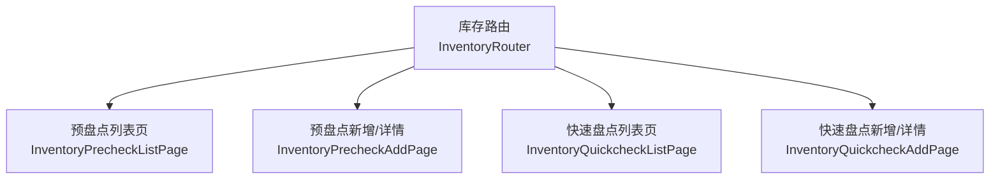
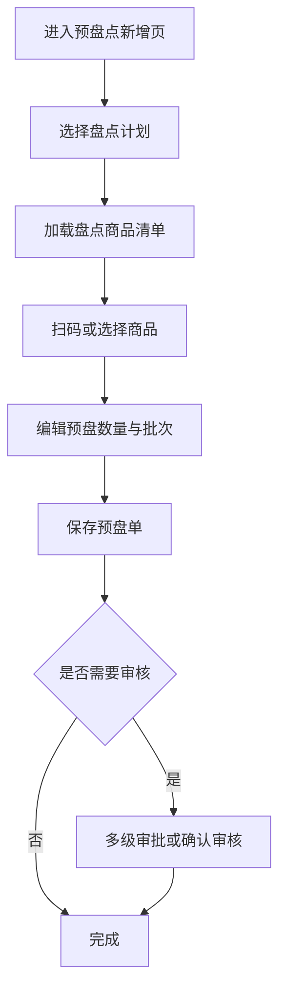
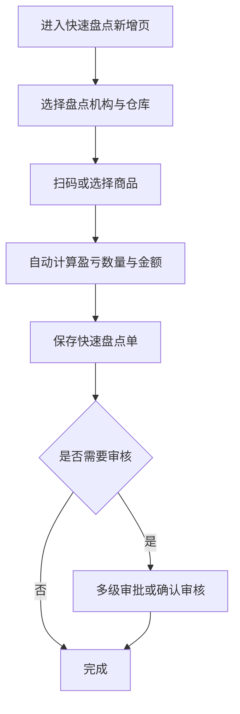
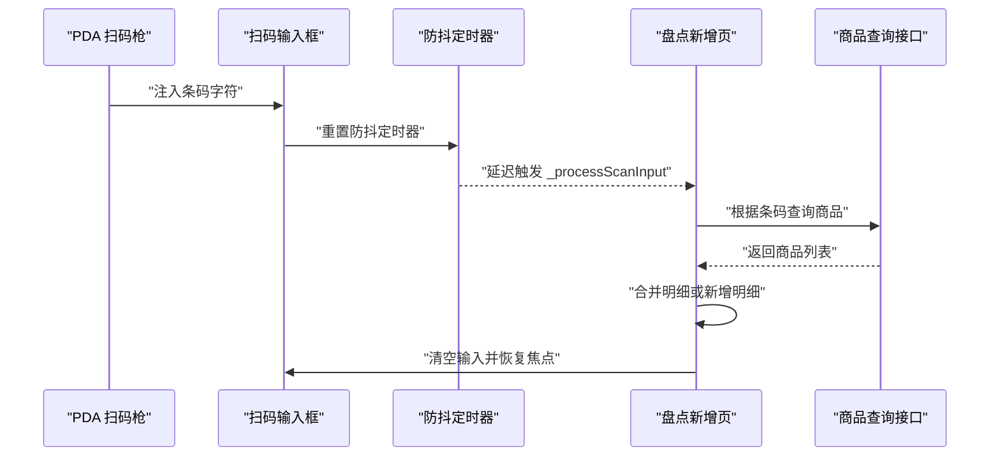
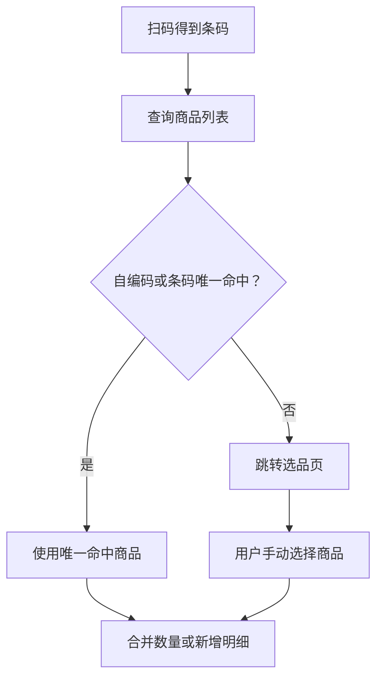
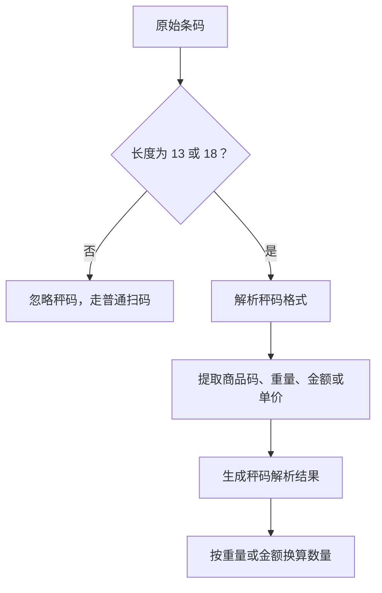
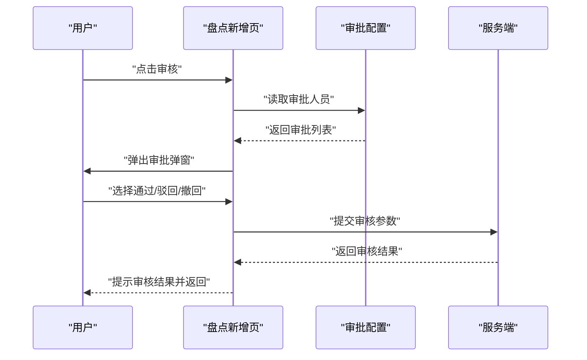
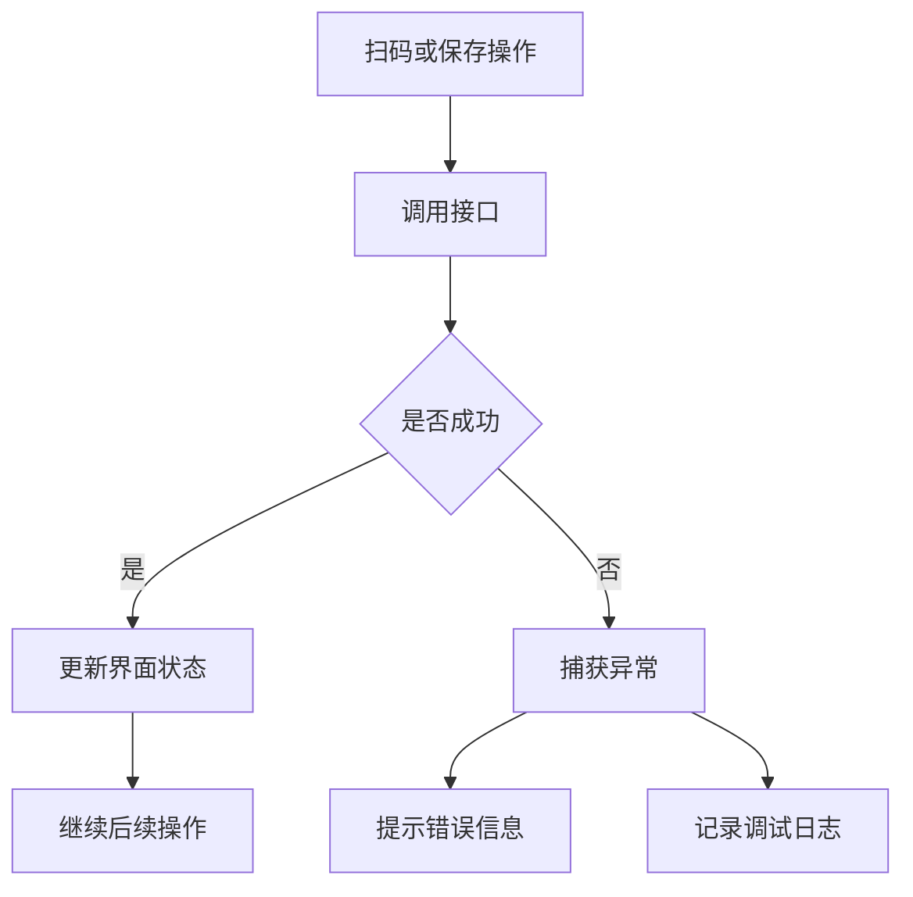

# 预盘点与快速盘点

<cite>
**本文引用的文件**   
- [lib/pages/business/inventory/router.dart](file://lib/pages/business/inventory/router.dart)
- [lib/pages/business/inventory/precheck/list.dart](file://lib/pages/business/inventory/precheck/list.dart)
- [lib/pages/business/inventory/precheck/add.dart](file://lib/pages/business/inventory/precheck/add.dart)
- [lib/pages/business/inventory/quickcheck/list.dart](file://lib/pages/business/inventory/quickcheck/list.dart)
- [lib/pages/business/inventory/quickcheck/add.dart](file://lib/pages/business/inventory/quickcheck/add.dart)
- [lib/util/barcode_utils.dart](file://lib/util/barcode_utils.dart)
- [lib/util/pda_scanner_util.dart](file://lib/util/pda_scanner_util.dart)
- [lib/util/scan_match_utils.dart](file://lib/util/scan_match_utils.dart)
</cite>

## 目录
1. [文档目标与适用范围](#文档目标与适用范围)
2. [功能总览](#功能总览)
3. [项目结构与入口](#项目结构与入口)
4. [两种盘点模式对比](#两种盘点模式对比)
5. [核心业务流程](#核心业务流程)
6. [扫码盘点与硬件集成](#扫码盘点与硬件集成)
7. [数据录入、差异计算与金额计算](#数据录入差异计算与金额计算)
8. [单据生命周期：保存、审核、反审核、撤回、删除、打印](#单据生命周期保存审核反审核撤回删除打印)
9. [实时同步与离线容错建议](#实时同步与离线容错建议)
10. [权限控制与异常处理](#权限控制与异常处理)
11. [效率优化建议](#效率优化建议)
12. [盘点结果分析与报表建议](#盘点结果分析与报表建议)
13. [常见问题排查](#常见问题排查)
14. [结论](#结论)

## 文档目标与适用范围

本文件面向灵犀管店 Flutter 项目的库存模块，聚焦“预盘点”和“快速盘点”两个盘点能力。内容覆盖：

- 两种盘点模式的适用场景与操作差异；
- 盘点任务创建、扫码盘点、手工数据录入；
- 明细差异计算、金额计算、批号与批次管理；
- 与条码扫描硬件的集成方式；
- 保存、审核、反审核、撤回、删除、打印等单据状态流转；
- 实时同步机制说明及离线场景下的优化建议；
- 权限校验、错误提示与异常处理；
- 盘点结果分析统计与报表生成功能建议。

该文档不直接复制代码实现，而是通过源码路径进行定位和解释，便于读者结合仓库中的具体文件进一步阅读。

**章节来源**
- [lib/pages/business/inventory/precheck/add.dart:1-200](file://lib/pages/business/inventory/precheck/add.dart#L1-L200)
- [lib/pages/business/inventory/quickcheck/add.dart:1-200](file://lib/pages/business/inventory/quickcheck/add.dart#L1-L200)

## 功能总览

### 预盘点

预盘点用于在正式盘点前，基于“盘点计划”提前采集商品数量，形成预盘数据。其典型特征包括：

- 必须关联盘点计划；
- 支持按全场、分类、供应商、品牌等维度选择盘点范围；
- 支持从盘点计划加载商品清单；
- 支持扫码录入、手工修改预盘数量；
- 支持多级审批、反审核、撤回、删除、打印；
- 支持附件上传、备注、批次有效期等完整业务字段。

预盘点适合需要计划性、可追溯、可审计的大规模盘点场景。

**章节来源**
- [lib/pages/business/inventory/precheck/add.dart:201-260](file://lib/pages/business/inventory/precheck/add.dart#L201-L260)
- [lib/pages/business/inventory/precheck/list.dart:1-120](file://lib/pages/business/inventory/precheck/list.dart#L1-L120)

### 快速盘点

快速盘点用于现场即时盘点，不依赖盘点计划，通常由门店或仓管人员在盘点现场快速发起。其典型特征包括：

- 不需要盘点计划；
- 主要选择盘点机构与仓库；
- 以扫码为主，也可手动添加商品；
- 自动计算盈亏数量、成本金额、零售金额等；
- 支持多级审批、撤回、删除、打印；
- 更适合单点、临时、高频盘点场景。

**章节来源**
- [lib/pages/business/inventory/quickcheck/add.dart:1-120](file://lib/pages/business/inventory/quickcheck/add.dart#L1-L120)
- [lib/pages/business/inventory/quickcheck/list.dart:1-120](file://lib/pages/business/inventory/quickcheck/list.dart#L1-L120)

## 项目结构与入口

### 路由入口

库存模块的路由集中在 `InventoryRouter` 中，预盘点与快速盘点分别提供列表页和新增详情页：

| 功能 | 路由常量 | 页面类 |
|---|---|---|
| 预盘点列表 | `/inventory/precheck/list` | `InventoryPrecheckListPage` |
| 预盘点新增/详情 | `/inventory/precheck/add` | `InventoryPrecheckAddPage` |
| 快速盘点列表 | `/inventory/quickcheck/list` | `InventoryQuickcheckListPage` |
| 快速盘点新增/详情 | `/inventory/quickcheck/add` | `InventoryQuickcheckAddPage` |

这些路由定义在库存模块路由器中，统一注册到 Fluro 路由系统。

**图表来源**
- [lib/pages/business/inventory/router.dart:1-57](file://lib/pages/business/inventory/router.dart#L1-L57)

**章节来源**
- [lib/pages/business/inventory/router.dart:1-57](file://lib/pages/business/inventory/router.dart#L1-L57)

## 两种盘点模式对比

| 维度 | 预盘点 | 快速盘点 |
|---|---|---|
| 是否依赖盘点计划 | 是 | 否 |
| 典型使用场景 | 计划性盘点、分类/供应商/品牌范围盘点 | 现场临时盘点、单仓快速盘点 |
| 核心筛选条件 | 盘点计划、盘点类型（全场/分类/供应商/品牌） | 盘点机构、仓库 |
| 数据来源 | 可从盘点计划加载商品 | 以扫码或手动选品为主 |
| 预盘数量字段 | `precheckqty` | `checkqty` |
| 盈亏数量计算 | `qty = precheckqty - stockqty` | `qty = checkqty - stockqty` |
| 金额计算重点 | 预盘数量对应零售价、成本价 | 盘点数量对应成本金额、零售金额、未税金额 |
| 列表接口路径 | `/stockprecheck/findList` | `/stockcheckfast/findList` |
| 详情获取接口 | `stockprecheckGetInfo` | `stockcheckfastGetInfo` |
| 保存接口 | `stockprecheckSave` | `stockcheckfastSave` |
| 审核接口 | `stockprecheckSign` | `stockcheckfastSign` |
| 删除接口 | `stockprecheckDelBill` | `stockcheckfastDelBill` |

### 适用场景建议

- **大型连锁门店周期性盘点**：优先使用预盘点，先制定盘点计划，再分批执行。
- **门店日清或突击盘点**：优先使用快速盘点，快速扫码、快速提交。
- **需要按分类或品牌限定的盘点**：使用预盘点更合适。
- **只关心某仓库现盘数量差异**：快速盘点更高效。

**章节来源**
- [lib/pages/business/inventory/precheck/add.dart:201-260](file://lib/pages/business/inventory/precheck/add.dart#L201-L260)
- [lib/pages/business/inventory/quickcheck/add.dart:201-260](file://lib/pages/business/inventory/quickcheck/add.dart#L201-L260)
- [lib/pages/business/inventory/precheck/list.dart:120-220](file://lib/pages/business/inventory/precheck/list.dart#L120-L220)
- [lib/pages/business/inventory/quickcheck/list.dart:120-220](file://lib/pages/business/inventory/quickcheck/list.dart#L120-L220)

## 核心业务流程

### 预盘点流程

预盘点流程包含：

1. 进入预盘点列表，查看历史单据并按状态筛选。
2. 新建预盘点单时，选择盘点计划、机构、仓库、柜台、盘点类型。
3. 加载盘点计划对应的商品清单。
4. 扫码或手动选择商品，维护预盘数量、批次、有效期、备注。
5. 保存单据；如需审核，触发多级审批流程。
6. 已审核后可打印；必要时可反审核、撤回或删除。

**图表来源**
- [lib/pages/business/inventory/precheck/add.dart:201-260](file://lib/pages/business/inventory/precheck/add.dart#L201-L260)
- [lib/pages/business/inventory/precheck/add.dart:601-980](file://lib/pages/business/inventory/precheck/add.dart#L601-L980)

**章节来源**
- [lib/pages/business/inventory/precheck/add.dart:201-260](file://lib/pages/business/inventory/precheck/add.dart#L201-L260)
- [lib/pages/business/inventory/precheck/add.dart:601-980](file://lib/pages/business/inventory/precheck/add.dart#L601-L980)

### 快速盘点流程

快速盘点流程包含：

1. 进入快速盘点列表，查看历史单据并按状态筛选。
2. 新建快速盘点单时，选择盘点机构和仓库。
3. 通过扫码或手动选择商品，录入实盘数量。
4. 系统自动计算盈亏数量和金额。
5. 保存单据；如需审核，触发多级审批流程。
6. 已审核后可打印；必要时可撤回或删除。

**图表来源**
- [lib/pages/business/inventory/quickcheck/add.dart:201-260](file://lib/pages/business/inventory/quickcheck/add.dart#L201-L260)
- [lib/pages/business/inventory/quickcheck/add.dart:628-992](file://lib/pages/business/inventory/quickcheck/add.dart#L628-L992)

**章节来源**
- [lib/pages/business/inventory/quickcheck/add.dart:201-260](file://lib/pages/business/inventory/quickcheck/add.dart#L201-L260)
- [lib/pages/business/inventory/quickcheck/add.dart:628-992](file://lib/pages/business/inventory/quickcheck/add.dart#L628-L992)

## 扫码盘点与硬件集成

### 扫码输入通道

预盘点与快速盘点新增页都实现了红外扫描输入框，用于对接 PDA 扫码枪。核心机制包括：

- 使用独立 `TextEditingController` 接收扫码字符；
- 使用 `FocusNode` 监听焦点变化；
- 拦截 Enter 键事件，避免软键盘弹出；
- 对扫码输入做防抖处理，等待扫码头注入的字符稳定后再查询商品；
- 扫码完成后清空输入框并恢复焦点，支持连续扫码。

**图表来源**
- [lib/pages/business/inventory/precheck/add.dart:100-150](file://lib/pages/business/inventory/precheck/add.dart#L100-L150)
- [lib/pages/business/inventory/quickcheck/add.dart:80-130](file://lib/pages/business/inventory/quickcheck/add.dart#L80-L130)

### 扫码匹配逻辑

扫码后，系统会调用商品查询接口，并根据自编码和条码命中规则分流：

- 如果自编码唯一命中，直接使用该商品；
- 如果条码唯一命中，直接使用该商品；
- 如果自编码或多条条码命中多条商品，则跳转选品页让用户选择；
- 如果无匹配商品，提示重新扫码。

该逻辑由 `matchScanList` 实现，用于对齐现有扫码分流策略。

**图表来源**
- [lib/util/scan_match_utils.dart:1-38](file://lib/util/scan_match_utils.dart#L1-L38)
- [lib/pages/business/inventory/quickcheck/add.dart:752-992](file://lib/pages/business/inventory/quickcheck/add.dart#L752-L992)

**章节来源**
- [lib/pages/business/inventory/precheck/add.dart:100-150](file://lib/pages/business/inventory/precheck/add.dart#L100-L150)
- [lib/pages/business/inventory/quickcheck/add.dart:752-992](file://lib/pages/business/inventory/quickcheck/add.dart#L752-L992)
- [lib/util/scan_match_utils.dart:1-38](file://lib/util/scan_match_utils.dart#L1-L38)

### 秤码解析

对于条码秤输出的重量码或金额码，系统支持解析出真实商品码、数量或金额：

- 支持 13 位重量码、金额码；
- 支持 18 位重加金额、重加单价、金额加重、单价加重等格式；
- 解析结果可用于自动设置数量，或直接回退为普通扫码行为；
- 配置来自登录参数中的秤码标识位、长度类型和精度缩放。

**图表来源**
- [lib/util/barcode_utils.dart:1-200](file://lib/util/barcode_utils.dart#L1-L200)

**章节来源**
- [lib/util/barcode_utils.dart:1-200](file://lib/util/barcode_utils.dart#L1-L200)

### PDA 硬件扫描监听

项目还提供 `PdaScannerUtil`，用于通过 Android EventChannel 监听 PDA 设备的硬件扫描广播，并以 Stream 形式暴露条码数据。该工具当前主要用于 Android 平台，不支持 Web；同时盘点新增页本身更多采用 IME 注入 + 防抖的方式处理扫码枪，因此 `PdaScannerUtil` 可作为扩展集成点。

| 能力 | 说明 |
|---|---|
| 监听方式 | EventChannel 广播流 |
| 回调参数 | 条码字符串 |
| 错误回调 | 可选 onError |
| 平台支持 | Android，非 Web |
| 资源释放 | stopListening、dispose |

**章节来源**
- [lib/util/pda_scanner_util.dart:1-66](file://lib/util/pda_scanner_util.dart#L1-L66)

## 数据录入、差异计算与金额计算

### 预盘点数据模型

预盘点明细项的核心字段包括：

| 字段 | 含义 |
|---|---|
| `prodid` / `productid` | 商品编号 |
| `barcode` / `selfbarcode` | 条码或自编码 |
| `productname` / `name` | 商品名称 |
| `unit` | 单位 |
| `stockqty` | 现库存数量 |
| `precheckqty` | 预盘数量 |
| `qty` | 盈亏数量 |
| `saleprice` / `sellprice` | 售价 |
| `costprice` | 成本价 |
| `batchno` | 批号 |
| `birthdate` | 生产日期 |
| `validdate` | 有效期 |
| `size` | 规格 |
| `morebatchflag` | 多批次标记 |
| `validflag` | 强制多批次标记 |

预盘点明细规范化函数负责：

- 将价格、成本、库存、预盘数量转为数值；
- 计算盈亏数量 `qty = precheckqty - stockqty`；
- 计算零售金额 `sellamt = precheckqty × saleprice`；
- 保证多批次拆行后每条明细都有正确默认值。

**章节来源**
- [lib/pages/business/inventory/precheck/add.dart:201-260](file://lib/pages/business/inventory/precheck/add.dart#L201-L260)

### 快速盘点数据模型

快速盘点明细项与预盘点类似，但核心数量字段是 `checkqty`，并且金额计算更丰富：

| 字段 | 含义 |
|---|---|
| `checkqty` | 实盘数量 |
| `stockqty` | 现库存数量 |
| `qty` | 盈亏数量 |
| `singleamt` | 盘点金额 |
| `costamt` | 盈亏金额 |
| `retailamt` | 零售金额 |
| `sellamt` | 盈亏售额 |
| `notaxcostprice` | 未税成本价 |
| `notaxsingleamt` | 未税盘点金额 |
| `notaxcostamt` | 未税盈亏金额 |
| `intaxrate` | 税率 |

快速盘点金额计算函数负责：

- 确保 `saleprice` 始终有值；
- 计算盈亏数量；
- 计算盘点金额、盈亏金额、零售金额、盈亏售额；
- 按税率计算未税相关字段。

**章节来源**
- [lib/pages/business/inventory/quickcheck/add.dart:201-260](file://lib/pages/business/inventory/quickcheck/add.dart#L201-L260)

### 差异计算规则

| 场景 | 计算规则 |
|---|---|
| 预盘点盈亏数量 | `qty = precheckqty - stockqty` |
| 预盘点零售金额 | `sellamt = precheckqty × saleprice` |
| 快速盘点盈亏数量 | `qty = checkqty - stockqty` |
| 快速盘点盘点金额 | `singleamt = checkqty × costprice` |
| 快速盘点盈亏金额 | `costamt = qty × costprice` |
| 快速盘点零售金额 | `retailamt = checkqty × saleprice` |
| 快速盘点盈亏售额 | `sellamt = qty × saleprice` |
| 快速盘点未税金额 | 按税率因子除法折算 |

当扫码结果为秤码时：

- 重量码直接使用解析出的数量；
- 金额码使用金额除以单价换算数量；
- 若无法换算，则回退为原商品基础数量加一；
- 条码秤仍按真实商品码查询商品，而不是用包装码查询。

**章节来源**
- [lib/pages/business/inventory/precheck/add.dart:201-260](file://lib/pages/business/inventory/precheck/add.dart#L201-L260)
- [lib/pages/business/inventory/quickcheck/add.dart:201-260](file://lib/pages/business/inventory/quickcheck/add.dart#L201-L260)
- [lib/util/barcode_utils.dart:1-200](file://lib/util/barcode_utils.dart#L1-L200)

## 单据生命周期：保存、审核、反审核、撤回、删除、打印

### 预盘点单据状态

预盘点单据支持以下关键操作：

| 操作 | 权限标识 | 行为 |
|---|---|---|
| 新增 | `013702` | 创建预盘点单 |
| 编辑 | `013703` | 编辑已有预盘点单 |
| 删除 | `013704` | 删除整张单据 |
| 审核 | `013705` | 审核预盘点单 |
| 反审核 | `013706` | 反审核预盘点单 |
| 打印 | 复用打印接口 | 打印预盘点单 |

预盘点保存参数包含：

- 计划编号、计划名称；
- 机构、仓库、柜台信息；
- 盘点类型；
- 备注；
- 附件列表；
- 分类名称；
- 明细列表。

审核参数会携带完整表单数据，并在多级审批场景下携带审批标志和备注。

**章节来源**
- [lib/pages/business/inventory/precheck/add.dart:601-980](file://lib/pages/business/inventory/precheck/add.dart#L601-L980)

### 快速盘点单据状态

快速盘点单据支持以下关键操作：

| 操作 | 权限标识 | 行为 |
|---|---|---|
| 新增 | `013802` | 创建快速盘点单 |
| 编辑 | `013803` | 编辑已有快速盘点单 |
| 删除 | `013804` | 删除整张单据 |
| 审核 | `013805` | 审核快速盘点单 |
| 撤回 | 复用审核接口 | 将单据置为撤回待处理态 |
| 打印 | 复用打印接口 | 打印快速盘点单 |

快速盘点保存参数包含：

- 机构编号；
- 仓库、柜台信息；
- 备注；
- 附件列表；
- 明细列表。

审核参数同样携带完整表单数据，并支持多级审批。

**章节来源**
- [lib/pages/business/inventory/quickcheck/add.dart:628-992](file://lib/pages/business/inventory/quickcheck/add.dart#L628-L992)

### 多级审批流程

两种盘点模式都支持多级审批：

1. 新增或保存后，读取审批人员列表；
2. 判断当前用户是否属于当前审批节点；
3. 弹出审批弹窗，允许选择通过、驳回或撤回；
4. 将审批标志和备注写入单据；
5. 调用审核接口完成状态变更；
6. 成功后返回上一页或刷新单据。

**图表来源**
- [lib/pages/business/inventory/precheck/add.dart:601-980](file://lib/pages/business/inventory/precheck/add.dart#L601-L980)
- [lib/pages/business/inventory/quickcheck/add.dart:628-992](file://lib/pages/business/inventory/quickcheck/add.dart#L628-L992)

### 撤回与反审核

- 预盘点支持反审核，将已审核单据恢复到可编辑状态；
- 快速盘点支持撤回，将单据置为 `reviewsignflag=2`，表示所有审批步骤需重新处理；
- 撤回后会刷新单据详情，以便后续重新审批。

**章节来源**
- [lib/pages/business/inventory/precheck/add.dart:601-980](file://lib/pages/business/inventory/precheck/add.dart#L601-L980)
- [lib/pages/business/inventory/quickcheck/add.dart:628-992](file://lib/pages/business/inventory/quickcheck/add.dart#L628-L992)

## 实时同步与离线容错建议

### 当前同步机制

从源码可见，预盘点和快速盘点的主要数据交互方式是网络请求：

- 列表分页查询；
- 详情拉取；
- 保存；
- 审核、反审核、撤回；
- 删除；
- 打印。

目前未发现本地数据库持久化、增量同步队列、冲突解决策略或断网缓存机制。因此，从实现角度可以认为：**盘点数据以实时网络同步为主，未显式实现离线落库和自动重试队列**。

**章节来源**
- [lib/pages/business/inventory/precheck/add.dart:201-260](file://lib/pages/business/inventory/precheck/add.dart#L201-L260)
- [lib/pages/business/inventory/quickcheck/add.dart:201-260](file://lib/pages/business/inventory/quickcheck/add.dart#L201-L260)
- [lib/pages/business/inventory/precheck/list.dart:120-220](file://lib/pages/business/inventory/precheck/list.dart#L120-L220)
- [lib/pages/business/inventory/quickcheck/list.dart:120-220](file://lib/pages/business/inventory/quickcheck/list.dart#L120-L220)

### 离线容错建议

虽然仓库未实现离线同步，但在盘点场景中仍可考虑以下改进方向：

1. **本地草稿存储**：将未保存的明细写入本地存储，防止误退出丢失。
2. **失败重试队列**：保存、审核等操作失败时进入本地队列，网络恢复后重试。
3. **乐观更新**：界面先展示成功状态，后台异步提交，失败时回滚。
4. **冲突检测**：当服务器端单据状态发生变化时，提示用户刷新。
5. **批量提交**：将多个扫码明细合并为一次保存请求，减少网络开销。
6. **弱网降级**：弱网环境下优先保存本地，强网时再同步。

上述建议属于架构优化方向，当前仓库尚未体现相应实现。

[本节为通用优化建议，不直接分析具体源码文件]

## 权限控制与异常处理

### 权限控制

预盘点与快速盘点均使用权限标识控制操作：

| 功能 | 权限标识 |
|---|---|
| 预盘点查看 | `013701` |
| 预盘点新增 | `013702` |
| 预盘点编辑 | `013703` |
| 预盘点删除 | `013704` |
| 预盘点审核 | `013705` |
| 预盘点反审核 | `013706` |
| 快速盘点查看 | `013801` |
| 快速盘点新增 | `013802` |
| 快速盘点编辑 | `013803` |
| 快速盘点删除 | `013804` |
| 快速盘点审核 | `013805` |

权限校验失败时会提示用户在后台修改权限。

**章节来源**
- [lib/pages/business/inventory/precheck/list.dart:1-120](file://lib/pages/business/inventory/precheck/list.dart#L1-L120)
- [lib/pages/business/inventory/precheck/add.dart:601-980](file://lib/pages/business/inventory/precheck/add.dart#L601-L980)
- [lib/pages/business/inventory/quickcheck/list.dart:1-120](file://lib/pages/business/inventory/quickcheck/list.dart#L1-L120)
- [lib/pages/business/inventory/quickcheck/add.dart:628-992](file://lib/pages/business/inventory/quickcheck/add.dart#L628-L992)

### 异常处理

盘点页面的异常处理主要包括：

- 列表加载失败时停止分页；
- 扫码查询商品失败时提示错误；
- 扫码无匹配商品时提示重新扫码；
- 扫码接口异常时输出调试日志并提示查询失败；
- 保存、审核、删除等操作失败时保持按钮状态或提示用户；
- 未保存修改离开页面时，弹出确认对话框。

**图表来源**
- [lib/pages/business/inventory/quickcheck/add.dart:752-992](file://lib/pages/business/inventory/quickcheck/add.dart#L752-L992)
- [lib/pages/business/inventory/precheck/add.dart:601-980](file://lib/pages/business/inventory/precheck/add.dart#L601-L980)

**章节来源**
- [lib/pages/business/inventory/quickcheck/add.dart:752-992](file://lib/pages/business/inventory/quickcheck/add.dart#L752-L992)
- [lib/pages/business/inventory/precheck/add.dart:601-980](file://lib/pages/business/inventory/precheck/add.dart#L601-L980)

## 效率优化建议

### 扫码效率优化

1. **保持扫码输入框持续聚焦**：盘点新增页在扫码完成后主动恢复焦点，避免重复点击。
2. **隐藏软键盘**：通过输入法通道隐藏软键盘，减少 PDA 扫码干扰。
3. **防抖查询**：扫码字符注入极快，使用 150 毫秒防抖避免多次重复查询。
4. **Enter 键兜底**：拦截 Enter 键后延迟读取，修复扫码头字符与 Enter 异步到达导致的漏字问题。
5. **秤码优先解析**：对条码秤输出直接解析数量和金额，减少人工输入。

**章节来源**
- [lib/pages/business/inventory/precheck/add.dart:100-150](file://lib/pages/business/inventory/precheck/add.dart#L100-L150)
- [lib/pages/business/inventory/quickcheck/add.dart:80-130](file://lib/pages/business/inventory/quickcheck/add.dart#L80-L130)
- [lib/pages/business/inventory/quickcheck/add.dart:752-992](file://lib/pages/business/inventory/quickcheck/add.dart#L752-L992)
- [lib/util/barcode_utils.dart:1-200](file://lib/util/barcode_utils.dart#L1-L200)

### 数据录入效率优化

1. **扫码重复商品自动累加数量**，避免重复创建明细行。
2. **多批次商品替换而非累加**：重新选择批次时移除旧行，按批次生成新行。
3. **新增商品置顶显示**，方便连续扫码后快速核对最近商品。
4. **批量删除选中明细**，提高批量修正效率。
5. **未保存修改拦截**，防止误退出丢失盘点数据。

**章节来源**
- [lib/pages/business/inventory/quickcheck/add.dart:628-992](file://lib/pages/business/inventory/quickcheck/add.dart#L628-L992)
- [lib/pages/business/inventory/precheck/add.dart:601-980](file://lib/pages/business/inventory/precheck/add.dart#L601-L980)

### 列表与筛选效率优化

1. 列表页使用分页加载；
2. 搜索输入框带防抖；
3. 下拉加载更多；
4. 按时间、机构、状态筛选；
5. 权限不足时提前提示并限制访问。

**章节来源**
- [lib/pages/business/inventory/precheck/list.dart:120-220](file://lib/pages/business/inventory/precheck/list.dart#L120-L220)
- [lib/pages/business/inventory/quickcheck/list.dart:120-220](file://lib/pages/business/inventory/quickcheck/list.dart#L120-L220)

## 盘点结果分析与报表建议

### 当前实现情况

仓库中与盘点相关的核心实现主要集中在：

- 预盘点列表；
- 预盘点新增和详情；
- 快速盘点列表；
- 快速盘点新增和详情；
- 扫码、差异计算、金额计算；
- 保存、审核、撤回、删除、打印。

当前未见专门的“盘点结果统计分析页”或“盘点差异报表生成页”。盘点差异和金额主要由明细行的计算字段体现，最终结果通过服务端接口和打印功能对外暴露。

**章节来源**
- [lib/pages/business/inventory/precheck/list.dart:120-220](file://lib/pages/business/inventory/precheck/list.dart#L120-L220)
- [lib/pages/business/inventory/quickcheck/list.dart:120-220](file://lib/pages/business/inventory/quickcheck/list.dart#L120-L220)
- [lib/pages/business/inventory/precheck/add.dart:201-260](file://lib/pages/business/inventory/precheck/add.dart#L201-L260)
- [lib/pages/business/inventory/quickcheck/add.dart:201-260](file://lib/pages/business/inventory/quickcheck/add.dart#L201-L260)

### 建议的分析统计维度

未来可基于现有明细字段扩展盘点结果分析：

| 分析维度 | 建议指标 |
|---|---|
| 商品维度 | 盘点数量、现库存、盈亏数量、盈亏金额 |
| 分类维度 | 分类内盈亏总金额、盘点覆盖率 |
| 仓库维度 | 各仓库盈亏总额、高差异商品数 |
| 批次维度 | 过期批次差异、临期批次差异 |
| 时间维度 | 日盘点差异趋势、周/月差异汇总 |
| 人员维度 | 不同盘点人差异率、异常率 |
| 门店维度 | 各门店盘点准确率、差异排名 |

### 建议的报表输出

- 盘点差异明细表；
- 分类/仓库/门店汇总报表；
- 高差异商品预警表；
- 批次有效期异常表；
- 盘点完成率与时效报表；
- 打印版盘点单与汇总报告。

这些报表可复用现有打印能力，并结合后端接口提供聚合数据。

[本节为概念性建议，不直接分析具体源码文件]

## 常见问题排查

### 扫码枪扫完显示未找到商品

可能原因：

1. 扫码字符未完全注入就发起查询；
2. 扫码头字符与 Enter 事件异步到达；
3. 条码秤配置与实际输出不一致；
4. 条码不是有效商品条码；
5. 接口查询参数不完整。

排查建议：

- 检查防抖定时器是否被重置；
- 检查 Enter 键处理逻辑；
- 检查秤码解析配置；
- 检查扫码参数中的机构、仓库、商品类型；
- 查看调试日志中的扫码输入和接口返回。

**章节来源**
- [lib/pages/business/inventory/precheck/add.dart:100-150](file://lib/pages/business/inventory/precheck/add.dart#L100-L150)
- [lib/pages/business/inventory/quickcheck/add.dart:80-130](file://lib/pages/business/inventory/quickcheck/add.dart#L80-L130)
- [lib/pages/business/inventory/quickcheck/add.dart:752-992](file://lib/pages/business/inventory/quickcheck/add.dart#L752-L992)
- [lib/util/barcode_utils.dart:1-200](file://lib/util/barcode_utils.dart#L1-L200)

### 扫码后数量不正确

可能原因：

1. 条码秤输出的是金额码，但单价为空；
2. 重量码精度配置不正确；
3. 扫码结果被当作普通商品，数量加一；
4. 多批次商品拆分后数量未正确归集。

排查建议：

- 检查秤码解析结果；
- 检查登录参数中的秤码配置；
- 检查商品单价、成本价、售价；
- 检查多批次拆分逻辑。

**章节来源**
- [lib/util/barcode_utils.dart:1-200](file://lib/util/barcode_utils.dart#L1-L200)
- [lib/pages/business/inventory/quickcheck/add.dart:752-992](file://lib/pages/business/inventory/quickcheck/add.dart#L752-L992)

### 审核失败或提示不属于审批人

可能原因：

1. 当前用户不在审批人员列表中；
2. 多级审批配置未正确加载；
3. 单据处于撤回待处理态；
4. 审批标志传参不正确。

排查建议：

- 检查审批人员列表；
- 检查当前用户身份；
- 检查单据的 `reviewsignflag`；
- 检查审核参数是否携带完整表单数据。

**章节来源**
- [lib/pages/business/inventory/precheck/add.dart:601-980](file://lib/pages/business/inventory/precheck/add.dart#L601-L980)
- [lib/pages/business/inventory/quickcheck/add.dart:628-992](file://lib/pages/business/inventory/quickcheck/add.dart#L628-L992)

### 返回列表提示未保存修改

可能原因：

1. 明细数量、批次、备注、附件等字段发生过修改；
2. 基线快照与当前表单不一致；
3. 单据处于可保存状态。

处理建议：

- 选择保存并继续返回；
- 选择不保存直接返回；
- 检查未保存修改比对逻辑。

**章节来源**
- [lib/pages/business/inventory/precheck/add.dart:260-420](file://lib/pages/business/inventory/precheck/add.dart#L260-L420)
- [lib/pages/business/inventory/quickcheck/add.dart:260-420](file://lib/pages/business/inventory/quickcheck/add.dart#L260-L420)

## 结论

灵犀管店 Flutter 项目的预盘点与快速盘点功能围绕“计划性盘点”和“现场快速盘点”两类场景展开。预盘点强调计划、范围和审计完整性，快速盘点强调效率和现场操作性。两者共享扫码输入、防抖处理、商品匹配、金额计算、权限控制和审批流程等核心能力。

当前实现以实时网络同步为主，未显式实现离线缓存与自动重试队列。扫码体验方面已考虑 PDA 扫码枪的字符注入特性，并通过秤码解析、重复商品合并、多批次拆分、未保存修改拦截等手段提升盘点效率。

未来可在离线同步、弱网容错、盘点结果分析统计和报表生成方面进一步增强，使盘点数据不仅能准确录入，还能更好支撑门店运营分析和库存决策。