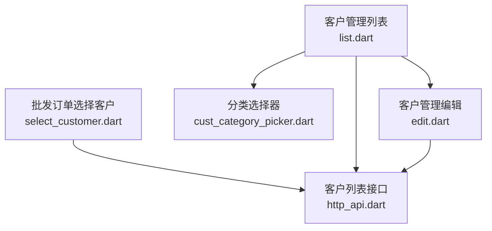
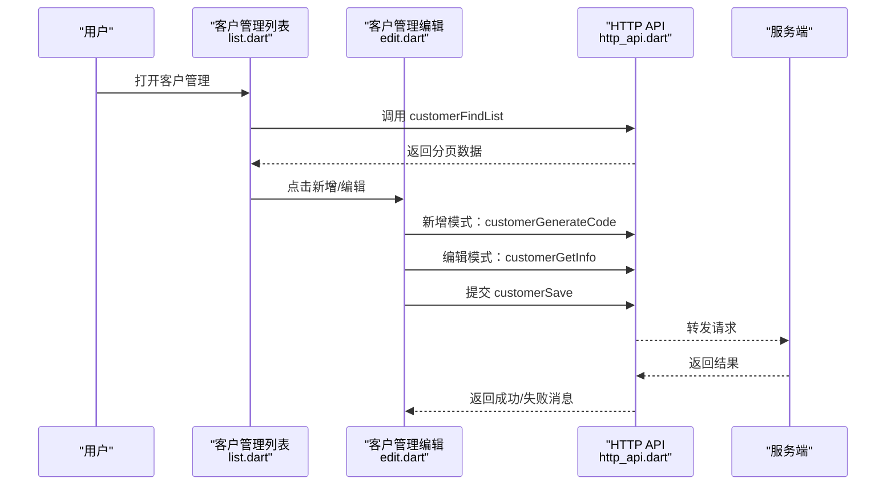
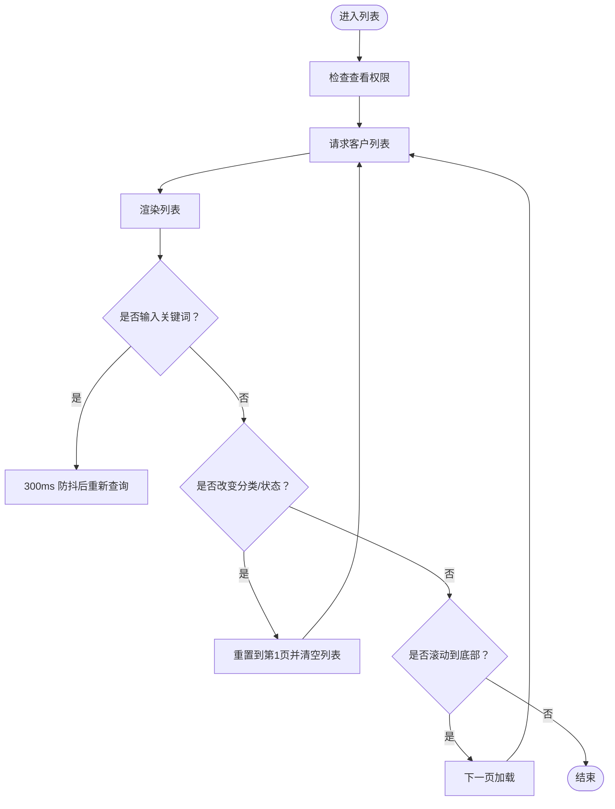
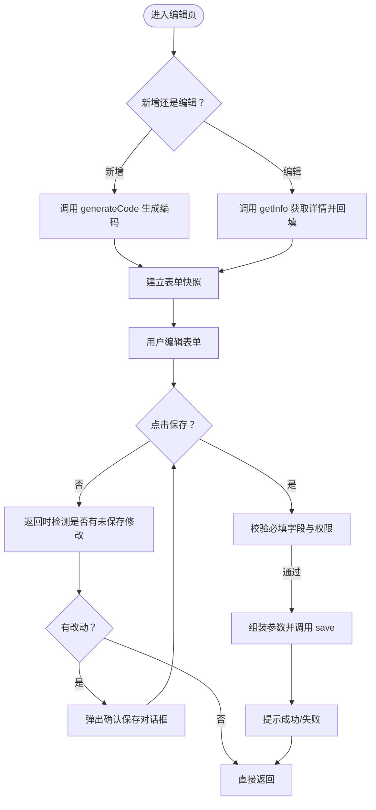
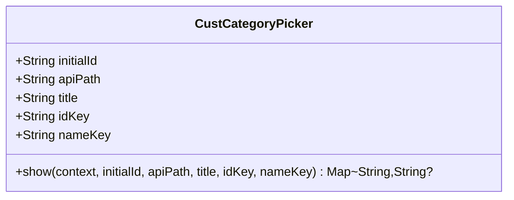
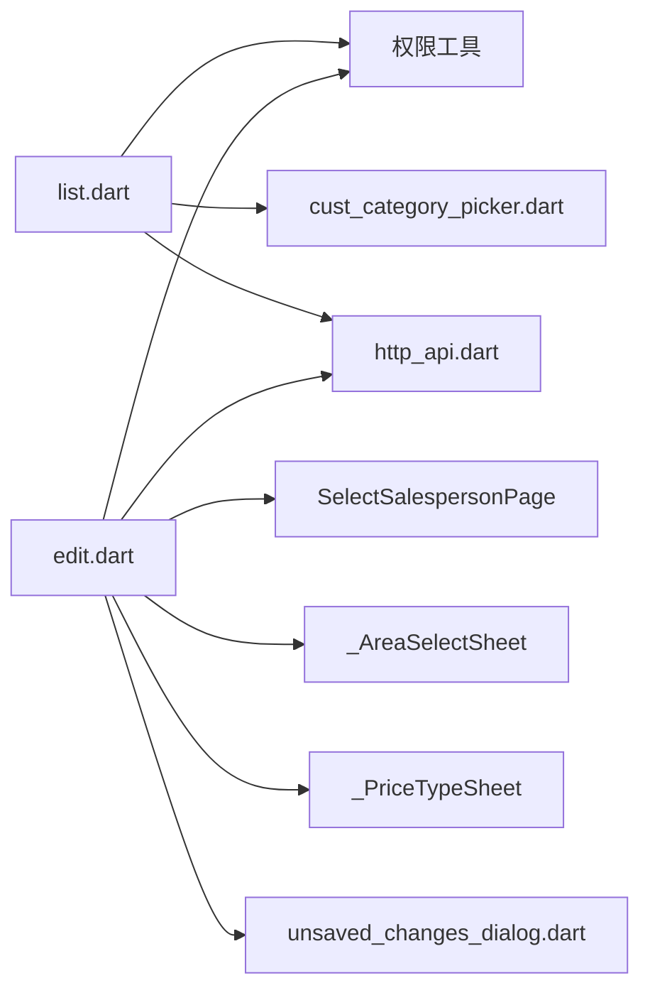
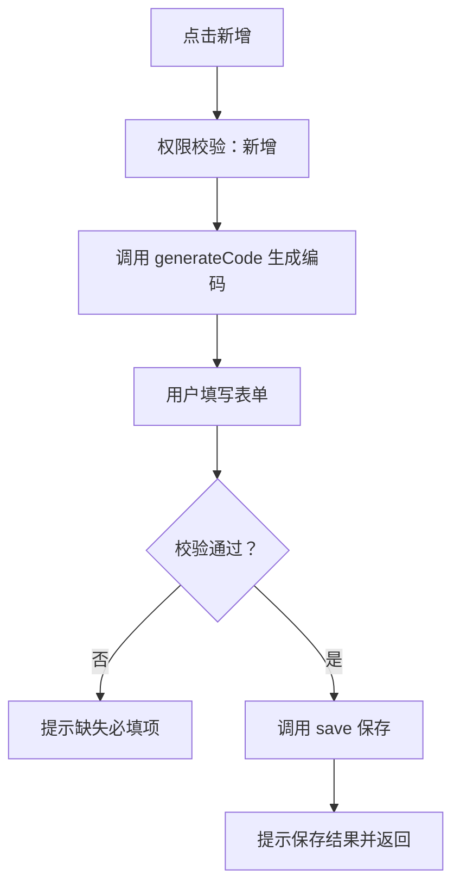
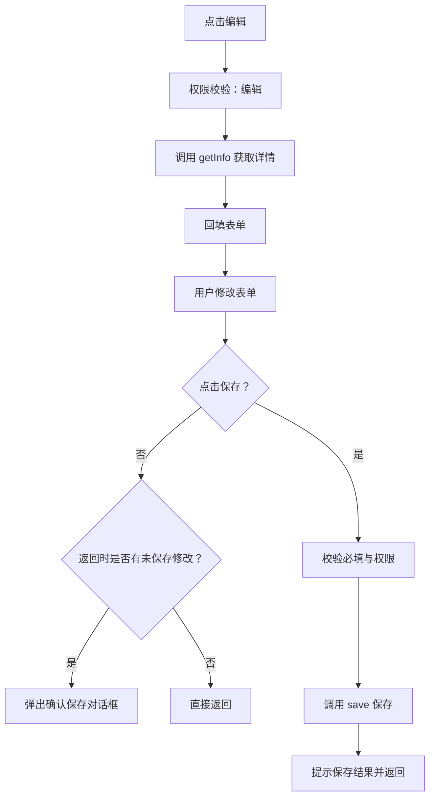

# 客户管理

<cite>
**本文引用的文件**   
- [lib/pages/business/wholesale/cust_manage/list.dart](file://lib/pages/business/wholesale/cust_manage/list.dart)
- [lib/pages/business/wholesale/cust_manage/edit.dart](file://lib/pages/business/wholesale/cust_manage/edit.dart)
- [lib/widgets/cust_category_picker.dart](file://lib/widgets/cust_category_picker.dart)
- [lib/pages/business/wholesale/select/select_customer.dart](file://lib/pages/business/wholesale/select/select_customer.dart)
- [lib/net/http_api.dart](file://lib/net/http_api.dart)
</cite>

## 目录
1. [简介](#简介)
2. [项目结构定位](#项目结构定位)
3. [核心组件](#核心组件)
4. [架构总览](#架构总览)
5. [详细组件分析](#详细组件分析)
6. [依赖关系分析](#依赖关系分析)
7. [性能与体验特性](#性能与体验特性)
8. [最佳实践](#最佳实践)
9. [常见问题与排查](#常见问题与排查)
10. [结论](#结论)

## 简介
本文件聚焦批发业务模块中的“客户管理”功能，围绕以下目标展开：
- 定义客户档案的完整数据结构，覆盖基本信息、联系方式、信用额度、结算与价格策略等字段。
- 说明客户列表的查询筛选、排序分页与编辑页数据录入验证规则。
- 解释客户分类、区域、业务员选择机制以及状态控制（启用/停用）。
- 梳理客户数据的增删改查业务流程，以及与批发订单的数据关联和一致性保障思路。
- 提供可操作的最佳实践与常见问题解决方案。

当前仓库中未实现后端删除接口；前端亦无批量删除入口。现有能力以新增、查看、编辑、列表查询为主。

## 项目结构定位
客户管理位于批发业务子模块下，包含列表页、编辑页、分类选择器及复用型客户选择器：
- 列表页：`lib/pages/business/wholesale/cust_manage/list.dart`
- 编辑页：`lib/pages/business/wholesale/cust_manage/edit.dart`
- 通用分类选择器：`lib/widgets/cust_category_picker.dart`
- 批发订单场景复用的客户选择器：`lib/pages/business/wholesale/select/select_customer.dart`
- 网络接口常量：`lib/net/http_api.dart`

图表来源
- [lib/pages/business/wholesale/cust_manage/list.dart:1-200](file://lib/pages/business/wholesale/cust_manage/list.dart#L1-L200)
- [lib/pages/business/wholesale/cust_manage/edit.dart:1-200](file://lib/pages/business/wholesale/cust_manage/edit.dart#L1-L200)
- [lib/widgets/cust_category_picker.dart:1-120](file://lib/widgets/cust_category_picker.dart#L1-L120)
- [lib/pages/business/wholesale/select/select_customer.dart:1-72](file://lib/pages/business/wholesale/select/select_customer.dart#L1-L72)
- [lib/net/http_api.dart:452-456](file://lib/net/http_api.dart#L452-L456)

章节来源
- [lib/pages/business/wholesale/cust_manage/list.dart:1-518](file://lib/pages/business/wholesale/cust_manage/list.dart#L1-L518)
- [lib/pages/business/wholesale/cust_manage/edit.dart:1-1339](file://lib/pages/business/wholesale/cust_manage/edit.dart#L1-L1339)
- [lib/widgets/cust_category_picker.dart:1-296](file://lib/widgets/cust_category_picker.dart#L1-L296)
- [lib/pages/business/wholesale/select/select_customer.dart:1-72](file://lib/pages/business/wholesale/select/select_customer.dart#L1-L72)
- [lib/net/http_api.dart:452-456](file://lib/net/http_api.dart#L452-L456)

## 核心组件
- 客户管理列表页：负责权限校验、关键词搜索、分类筛选、启用/停用状态筛选、下拉刷新与滚动分页，并跳转编辑页进行新增或编辑。
- 客户管理编辑页：采用三标签页组织信息（基本信息、资产信息、更多信息），支持自动生成编码、详情加载、表单快照比对、保存前必填校验与权限校验。
- 分类选择器：树形结构展示客户分类，支持按名称/编码搜索，返回选中分类 ID 与名称。
- 客户选择器：供批发单等业务复用，基于统一选择弹窗封装客户列表查询与结果映射。
- HTTP API：集中声明客户相关接口路径，包括列表、详情、保存、编码生成等。

章节来源
- [lib/pages/business/wholesale/cust_manage/list.dart:1-200](file://lib/pages/business/wholesale/cust_manage/list.dart#L1-L200)
- [lib/pages/business/wholesale/cust_manage/edit.dart:1-200](file://lib/pages/business/wholesale/cust_manage/edit.dart#L1-L200)
- [lib/widgets/cust_category_picker.dart:1-120](file://lib/widgets/cust_category_picker.dart#L1-L120)
- [lib/pages/business/wholesale/select/select_customer.dart:1-72](file://lib/pages/business/wholesale/select/select_customer.dart#L1-L72)
- [lib/net/http_api.dart:452-456](file://lib/net/http_api.dart#L452-L456)

## 架构总览
客户管理的请求链路如下：页面通过 `HttpApi` 常量调用 `request` 发起网络请求，后端返回统一结构后由页面解析并更新 UI。

图表来源
- [lib/pages/business/wholesale/cust_manage/list.dart:1-120](file://lib/pages/business/wholesale/cust_manage/list.dart#L1-L120)
- [lib/pages/business/wholesale/cust_manage/edit.dart:1-120](file://lib/pages/business/wholesale/cust_manage/edit.dart#L1-L120)
- [lib/net/http_api.dart:452-456](file://lib/net/http_api.dart#L452-L456)

## 详细组件分析

### 客户管理列表页
职责与行为：
- 权限校验：进入时检查“查看”权限，新增时检查“新增”权限，点击卡片编辑时检查“编辑”权限。
- 搜索：支持输入“客户编码/名称/手机号”，300ms 防抖触发查询。
- 筛选：支持按“客户分类”和“启用/停用”状态筛选。
- 分页：每页 20 条，支持下拉刷新与滚动加载更多。
- 排序：默认按创建时间降序。

关键字段与交互：
- 搜索参数：`cond`（模糊匹配）、`field='createtime'`、`type='desc'`。
- 分类筛选：通过 `CustCategoryPicker` 选择分类，回传 `custtypeid` 与 `custtypename`。
- 状态筛选：`stopflag=''|'0'|'1'`，分别表示全部、启用、停用。
- 列表项显示：名称+编码、联系人、手机号、分类、地址、停用标记。

图表来源
- [lib/pages/business/wholesale/cust_manage/list.dart:1-200](file://lib/pages/business/wholesale/cust_manage/list.dart#L1-L200)
- [lib/pages/business/wholesale/cust_manage/list.dart:201-518](file://lib/pages/business/wholesale/cust_manage/list.dart#L201-L518)

章节来源
- [lib/pages/business/wholesale/cust_manage/list.dart:1-518](file://lib/pages/business/wholesale/cust_manage/list.dart#L1-L518)

### 客户管理编辑页
职责与行为：
- 新增模式：自动调用编码生成接口填充客户编码；保存时需具备“新增”权限。
- 编辑模式：先拉取详情回填表单；保存时需具备“编辑”权限。
- 表单快照：维护表单快照，返回时若存在未保存修改则弹出确认对话框。
- 必填校验：客户编码、客户名称、客户分类为必填；其他字段可选。
- 数值字段：折扣、线上最低付款比例、期初金额、信誉额度使用数值解析，无效值回退默认值。
- 布尔与状态：状态开关控制停启用，订货助手开关控制是否允许自助下单。

关键字段分组：
- 基本信息：编码、名称、分类、区域、联系人、手机、传真、业务员、地址、价格类型、折扣、线上最低付款比例、状态、备注。
- 资产信息：发票抬头、税号、公司电话、公司地址、开户行、银行账户、期初金额、预付款金额、信誉额度、欠款金额。
- 更多信息：订货助手开关、绑定状态、创建人/日期、最后修改人/日期。

图表来源
- [lib/pages/business/wholesale/cust_manage/edit.dart:1-200](file://lib/pages/business/wholesale/cust_manage/edit.dart#L1-L200)
- [lib/pages/business/wholesale/cust_manage/edit.dart:201-600](file://lib/pages/business/wholesale/cust_manage/edit.dart#L201-L600)

章节来源
- [lib/pages/business/wholesale/cust_manage/edit.dart:1-600](file://lib/pages/business/wholesale/cust_manage/edit.dart#L1-L600)

### 客户分类选择器
- 支持树形结构展示分类，并可按名称/编码搜索。
- 返回列表来自 `customertype/getTypeListandCode`，数据结构包含 `children` 树节点。
- 返回值为 `{custtypeid, custtypename}`，用于列表筛选与编辑页分类字段。

图表来源
- [lib/widgets/cust_category_picker.dart:1-120](file://lib/widgets/cust_category_picker.dart#L1-L120)

章节来源
- [lib/widgets/cust_category_picker.dart:1-296](file://lib/widgets/cust_category_picker.dart#L1-L296)

### 批发订单复用客户选择器
- 复用 `customerinfo/getList` 接口，封装成通用选择弹窗。
- 返回映射包含 `custid`、`custname`、`code`，供订单等业务引用。

章节来源
- [lib/pages/business/wholesale/select/select_customer.dart:1-72](file://lib/pages/business/wholesale/select/select_customer.dart#L1-L72)

## 依赖关系分析
- 列表页依赖：
  - 权限工具：用于查看、新增、编辑权限校验。
  - 分类选择器：提供分类筛选。
  - HTTP API：获取客户列表。
- 编辑页依赖：
  - 权限工具：新增/编辑权限校验。
  - HTTP API：生成编码、获取详情、保存客户。
  - 业务员选择器：选择销售负责人。
  - 分类选择器与区域选择器：分类与区域选择。
  - 未保存修改对话框：返回时防止误关闭。
- 接口常量集中在 `http_api.dart`，便于统一管理与扩展。

图表来源
- [lib/pages/business/wholesale/cust_manage/list.dart:1-200](file://lib/pages/business/wholesale/cust_manage/list.dart#L1-L200)
- [lib/pages/business/wholesale/cust_manage/edit.dart:1-200](file://lib/pages/business/wholesale/cust_manage/edit.dart#L1-L200)
- [lib/net/http_api.dart:452-456](file://lib/net/http_api.dart#L452-L456)

章节来源
- [lib/pages/business/wholesale/cust_manage/list.dart:1-200](file://lib/pages/business/wholesale/cust_manage/list.dart#L1-L200)
- [lib/pages/business/wholesale/cust_manage/edit.dart:1-200](file://lib/pages/business/wholesale/cust_manage/edit.dart#L1-L200)
- [lib/net/http_api.dart:452-456](file://lib/net/http_api.dart#L452-L456)

## 性能与体验特性
- 列表分页：每页固定 20 条，避免一次性加载过多数据。
- 滚动加载：监听滚动位置，接近底部时自动加载下一页。
- 搜索防抖：300ms 防抖减少频繁请求。
- 下拉刷新：支持手动刷新并重置分页。
- 列表渲染优化：使用 `RepaintBoundary` 降低卡片重绘成本。
- 编辑页懒加载：新增模式不拉详情，编辑模式才拉详情并回填。
- 未保存变更保护：返回时检测表单快照差异，避免误丢数据。

[本节为通用指导，不涉及具体代码片段]

## 最佳实践
- 字段规范
  - 客户编码与名称必须填写，建议新增时优先使用系统生成的编码。
  - 客户分类必须选择，确保分类体系清晰、层级合理。
  - 价格类型建议使用标准“批发价1~批发价10”，避免随意编号。
  - 信用额度与期初金额使用数值格式，负数需结合财务规则评估。
- 权限控制
  - 列表查看、新增、编辑均做权限校验，建议后台同步配置菜单与按钮级权限。
- 数据一致性
  - 编辑模式先拉详情再覆盖表单值，保证非空字段不被意外清空。
  - 保存成功后立即返回上一页并刷新列表，保持视图与数据一致。
- 用户体验
  - 列表搜索支持快速过滤，分类筛选与状态筛选组合使用提升查找效率。
  - 编辑页使用三标签组织信息，避免单页过长。
  - 未保存修改拦截返回，减少误操作风险。

[本节为通用指导，不涉及具体代码片段]

## 常见问题与排查
- 问题：搜索无结果
  - 可能原因：关键词为空、分类筛选过窄、状态筛选限制。
  - 处理建议：清除分类与状态筛选，逐步缩小范围；检查网络请求参数。
- 问题：新增无法保存
  - 可能原因：缺少必填字段（编码、名称、分类）、无新增权限。
  - 处理建议：根据提示补齐必填项，检查后台权限配置。
- 问题：编辑时返回丢失数据
  - 可能原因：未保存修改被拦截。
  - 处理建议：在对话框中选择“保存”或“放弃”，确认后再返回。
- 问题：分类选择为空或异常
  - 可能原因：分类接口返回结构变化、网络错误。
  - 处理建议：检查分类接口返回值，确认 `children` 结构与字段名。
- 问题：数值字段保存异常
  - 可能原因：输入非数字字符导致解析失败。
  - 处理建议：仅输入数字，或使用键盘类型限制；系统会回退默认值。

章节来源
- [lib/pages/business/wholesale/cust_manage/edit.dart:201-600](file://lib/pages/business/wholesale/cust_manage/edit.dart#L201-L600)
- [lib/pages/business/wholesale/cust_manage/list.dart:1-200](file://lib/pages/business/wholesale/cust_manage/list.dart#L1-L200)

## 客户档案数据结构
以下字段来源于编辑页与列表页对后端字段的读写与展示：

- 基本信息
  - 编码：`code`，必填，新增时可自动生成。
  - 名称：`name`，必填。
  - 分类ID：`custtypeid`，必填，选择器返回。
  - 分类名称：`custtypename`，与分类ID联动。
  - 区域ID：`custareaid`，可选，区域选择器返回。
  - 区域名称：`custareaname`，与区域ID联动。
  - 联系人：`linkman`，可选。
  - 手机号码：`mobile`，可选。
  - 传真号码：`fax`，可选。
  - 业务员ID：`salesid`，可选。
  - 业务员名称：`salesname`，与业务员ID联动。
  - 地址：`address`，可选。
  - 价格类型：`pricetype`，默认“1”，对应批发价等级。
  - 批发折扣：`discount`，数值，默认 100。
  - 线上最低付款比例：`wxminpayrate`，数值，默认 0。
  - 状态：`stopflag`，字符串“0”表示启用、“1”表示停用。
  - 备注：`remark`，可选。

- 资产信息
  - 发票抬头名称：`invoicetitle`，可选。
  - 纳税人识别号：`taxid`，可选。
  - 公司电话：`phone`，可选。
  - 公司地址：`linkaddress`，可选。
  - 开户行：`bank`，可选。
  - 银行账户：`bankaccount`，可选。
  - 期初金额：`initamt`，数值，默认 0。
  - 预付款金额：`advance`，只读，财务计算。
  - 信誉额度：`amountowed`，数值，可编辑。
  - 欠款金额：`debtamt`，只读，财务计算。

- 更多信息
  - 订货助手开关：`wxcustorderflag`，“1”表示允许自助下单。
  - 绑定状态：`wxcustorderstatus`，显示“已绑定/未绑定”。
  - 创建信息：`createname`、`createtime`。
  - 修改信息：`opername`、`updatetime`。

- 标识与元数据
  - 客户ID：`id`，编辑模式下用于保存更新。
  - 客户ID（别名）：`custid`，部分接口返回时使用。

[本节为字段汇总，不涉及具体代码片段]

## 查询筛选、排序与分页
- 查询参数
  - 关键词：`cond`，模糊匹配编码/名称/手机号。
  - 分类：`custtypeid`、`custtypename`。
  - 状态：`stopflag`，空串表示全部，“0”启用，“1”停用。
  - 分页：`page`、`pagesize=20`。
  - 排序：`field='createtime'`、`type='desc'`。
  - 过滤微信客户：`notwx=1`。
- 分页逻辑
  - 首次加载 page=1，滚动到底部追加 page+1。
  - 当返回条目数小于 20 时判定没有更多数据。
- 排序
  - 默认按创建时间倒序。

章节来源
- [lib/pages/business/wholesale/cust_manage/list.dart:1-200](file://lib/pages/business/wholesale/cust_manage/list.dart#L1-L200)

## 编辑页数据录入验证规则
- 必填校验
  - 客户编码、客户名称、客户分类为必填。
- 数值校验
  - 折扣、线上最低付款比例、期初金额、信誉额度使用数值解析，无效值回退默认值。
- 权限校验
  - 新增需要“新增”权限，编辑需要“编辑”权限。
- 未保存变更保护
  - 返回时对比表单快照，如存在修改则弹出确认对话框。

章节来源
- [lib/pages/business/wholesale/cust_manage/edit.dart:201-600](file://lib/pages/business/wholesale/cust_manage/edit.dart#L201-L600)

## 客户等级分类与信用评级
- 客户分类
  - 通过分类选择器加载树形分类列表，支持搜索分类名称/编码。
  - 分类接口路径：`customertype/getTypeListandCode`。
- 信用评级
  - 当前实现未见独立的信用评级字段或评级算法；信用维度体现在“信誉额度”与“欠款金额”等财务字段。
  - 如需引入信用评级，建议在编辑页增加评级选择或自动计算逻辑，并在列表中展示。

章节来源
- [lib/widgets/cust_category_picker.dart:1-120](file://lib/widgets/cust_category_picker.dart#L1-L120)
- [lib/pages/business/wholesale/cust_manage/edit.dart:601-1091](file://lib/pages/business/wholesale/cust_manage/edit.dart#L601-L1091)

## 批量操作
- 当前版本未实现批量删除或批量启停功能。
- 列表仅提供单选编辑与新增入口。
- 如需批量操作，可在列表顶部增加批量选择与批量动作按钮，并在后端补充相应接口。

[本节为现状说明与扩展建议，不涉及具体代码片段]

## 与批发订单的关联关系与数据一致性
- 关联方式
  - 批发订单通过“选择客户”弹窗引用客户，使用 `custid`、`custname`、`code` 作为选择结果。
  - 客户档案中的分类、区域、业务员等信息可作为订单基础数据参考。
- 一致性保障
  - 编辑页保存成功后返回列表并刷新，确保订单侧选择到的客户信息与最新档案一致。
  - 若未来引入客户信息变更通知，应在订单侧缓存失效或重新拉取客户信息。

章节来源
- [lib/pages/business/wholesale/select/select_customer.dart:1-72](file://lib/pages/business/wholesale/select/select_customer.dart#L1-L72)
- [lib/pages/business/wholesale/cust_manage/list.dart:201-518](file://lib/pages/business/wholesale/cust_manage/list.dart#L201-L518)

## 业务流程图

### 新增客户流程

图表来源
- [lib/pages/business/wholesale/cust_manage/edit.dart:1-200](file://lib/pages/business/wholesale/cust_manage/edit.dart#L1-L200)
- [lib/pages/business/wholesale/cust_manage/edit.dart:201-600](file://lib/pages/business/wholesale/cust_manage/edit.dart#L201-L600)

### 编辑客户流程

图表来源
- [lib/pages/business/wholesale/cust_manage/edit.dart:1-200](file://lib/pages/business/wholesale/cust_manage/edit.dart#L1-L200)
- [lib/pages/business/wholesale/cust_manage/edit.dart:201-600](file://lib/pages/business/wholesale/cust_manage/edit.dart#L201-L600)

## 结论
客户管理模块在当前仓库中实现了完整的客户档案维护能力，涵盖列表查询、筛选、分页、新增与编辑，并通过分类选择器、区域选择器、业务员选择器增强可用性。数据层面以客户档案为核心字段集，财务维度通过期初金额、预付款金额、信誉额度与欠款金额体现。当前版本未实现批量操作与独立信用评级机制，后续可根据业务需求扩展。

[本节为总结性内容，不涉及具体代码片段]