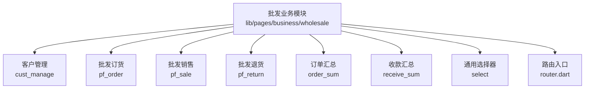
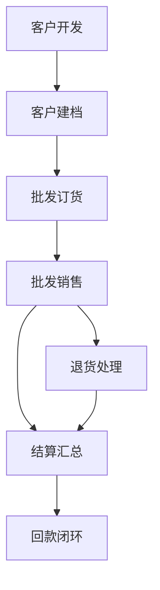
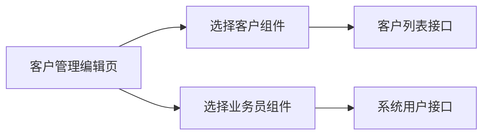
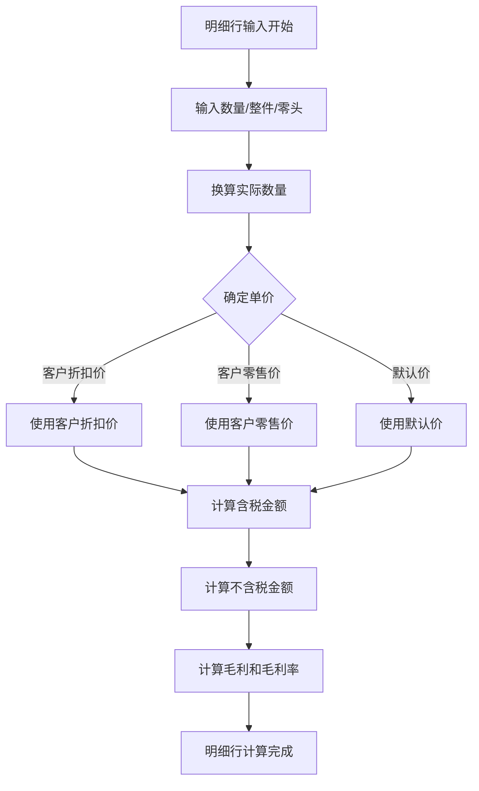
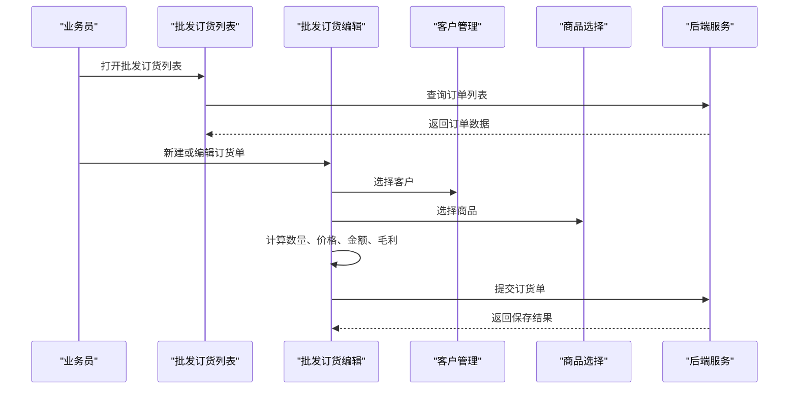
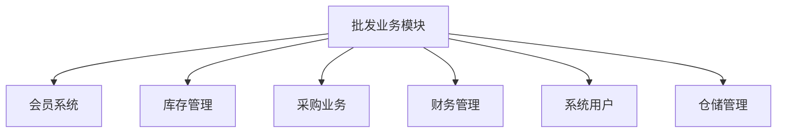
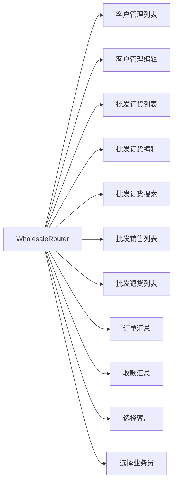

# 批发业务模块

<cite>
**本文引用的文件 **
- [router.dart](file://lib/pages/business/wholesale/router.dart)
- [客户管理列表页](file://lib/pages/business/wholesale/cust_manage/list.dart)
- [客户管理编辑页](file://lib/pages/business/wholesale/cust_manage/edit.dart)
- [选择客户组件](file://lib/pages/business/wholesale/select/select_customer.dart)
- [选择业务员组件](file://lib/pages/business/wholesale/select/select_salesperson.dart)
- [批发订货列表页](file://lib/pages/business/wholesale/pf_order/list.dart)
- [批发订货编辑页](file://lib/pages/business/wholesale/pf_order/edit.dart)
- [批发订货搜索页](file://lib/pages/business/wholesale/pf_order/search.dart)
- [批发销售列表页](file://lib/pages/business/wholesale/pf_sale/list.dart)
- [批发退货列表页](file://lib/pages/business/wholesale/pf_return/list.dart)
- [订单汇总列表页](file://lib/pages/business/wholesale/order_sum/list.dart)
- [收款汇总列表页](file://lib/pages/business/wholesale/receive_sum/list.dart)
</cite>

## 目录
1. [引言](#引言)
2. [项目结构与定位](#项目结构与定位)
3. [核心业务模块总览](#核心业务模块总览)
4. [批发业务全生命周期流程](#批发业务全生命周期流程)
5. [客户管理与信用基础](#客户管理与信用基础)
6. [批发定价与批量折扣机制](#批发定价与批量折扣机制)
7. [批发订单、销售、退货处理](#批发订单销售退货处理)
8. [结算汇总与财务集成](#结算汇总与财务集成)
9. [与其他业务模块的数据集成关系](#与其他业务模块的数据集成关系)
10. [架构与路由设计](#架构与路由设计)
11. [性能与交互优化](#性能与交互优化)
12. [最佳实践与排错指南](#最佳实践与排错指南)
13. [结论](#结论)

## 引言
本文件面向灵犀管店 Flutter 项目的批发业务模块，围绕“客户管理—批发订货—批发销售—退货处理—结算汇总”的完整闭环进行说明。文档以仓库中 `lib/pages/business/wholesale` 下的页面和路由为依据，解释批发业务的用户界面、数据查询、表单编辑、状态流转以及与会员、库存、财务等模块的集成点，并给出可落地的优化建议。

## 项目结构与定位
批发业务模块位于业务子模块 `business/wholesale` 下，采用按功能域组织的页面结构：

**图示来源**
- [router.dart:1-54](file://lib/pages/business/wholesale/router.dart#L1-L54)

批发模块通过统一的 `WholesaleRouter` 注册页面路由，对外暴露客户管理、批发订货、批发销售、批发退货、订单汇总、收款汇总以及选择器等能力。各子目录职责清晰：

| 目录 | 职责 | 典型页面 |
|---|---|---|
| `cust_manage` | 批发客户档案、分类、价格策略相关字段维护 | 列表、编辑 |
| `pf_order` | 批发订货单创建、审核、删除、打印、生成等 | 列表、编辑、搜索 |
| `pf_sale` | 批发销售单查看与管理 | 列表 |
| `pf_return` | 批发退货申请、审核、发货等 | 列表、编辑、搜索 |
| `order_sum` | 按条件汇总批发订单金额、数量等 | 列表 |
| `receive_sum` | 按条件汇总批发收款情况 | 列表 |
| `select` | 复用型选择器，如客户、业务员 | 选择客户、选择业务员 |

**章节来源**
- [router.dart:1-54](file://lib/pages/business/wholesale/router.dart#L1-L54)

## 核心业务模块总览
批发业务模块由以下核心页面组成：

| 模块 | 主要功能 | 关键交互 |
|---|---|---|
| 客户管理 | 新增、编辑、查询批发客户；维护折扣、价格类型、业务员、停售标志、财务信息 | 列表筛选、分页加载、详情编辑、未保存修改提示 |
| 批发订货 | 新建或编辑批发订货单；扫码选品、计算金额与毛利、提交审核、打印、作废、撤回 | 多状态标签、日期范围、门店/客户/业务员筛选、明细行自动计算 |
| 批发销售 | 查看批发销售单，支持按状态、时间、门店、客户、业务员、付款状态筛选 | 待审/已审/已驳回标签、分页、快速时间区间 |
| 批发退货 | 查看和管理批发退货单，支持筛选与编辑 | 列表、编辑、搜索 |
| 订单汇总 | 汇总批发订单相关统计 | 列表展示 |
| 收款汇总 | 汇总批发收款相关统计 | 列表展示 |

这些页面共同构成从“开发客户 → 建立客户档案 → 下单订货 → 销售出库 → 退货处理 → 回款结算”的完整批发业务闭环。

**章节来源**
- [router.dart:1-54](file://lib/pages/business/wholesale/router.dart#L1-L54)
- [客户管理列表页:1-200](file://lib/pages/business/wholesale/cust_manage/list.dart#L1-L200)
- [批发订货列表页:1-200](file://lib/pages/business/wholesale/pf_order/list.dart#L1-L200)
- [批发销售列表页:1-200](file://lib/pages/business/wholesale/pf_sale/list.dart#L1-L200)

## 批发业务全生命周期流程
批发业务的生命周期可以抽象为六个阶段：

1. **客户开发**：业务员开发新客户，进入客户管理模块。
2. **客户建档**：在客户管理中新建或编辑客户，设置折扣、价格类型、业务员、停售标志、财务信息等。
3. **批发订货**：创建批发订货单，选择门店、仓库、客户、业务员、商品，完成价格、数量、赠品、税额、毛利计算，并提交审核。
4. **批发销售**：订货确认后形成批发销售业务，销售列表用于跟踪销售单状态和收款情况。
5. **退货处理**：发生质量问题、错发、滞销等情况时，走批发退货流程。
6. **结算汇总**：基于订单和销售数据，汇总应收、实收、未收等财务指标，支撑对账和回款管理。

该流程强调：**客户是批发业务的起点，订单是业务数据的中心，销售体现交付结果，退货修正异常，结算是资金闭环。**

[无图示来源：该图为概念流程图，不对应具体代码结构]

## 客户管理与信用基础
### 客户管理列表
客户管理列表承担批发客户的查询、筛选、分页与权限控制。其关键特征包括：

- 使用权限码校验，无权访问时提示并在后台调整权限。
- 支持关键词模糊搜索，带防抖逻辑。
- 支持按客户分类、停售标志等维度筛选。
- 支持下拉刷新、滚动加载更多。
- 调用统一网络请求接口获取客户列表。

这使客户管理成为批发业务的“主数据入口”。

**章节来源**
- [客户管理列表页:1-200](file://lib/pages/business/wholesale/cust_manage/list.dart#L1-L200)

### 客户管理编辑
客户编辑页是批发定价策略和客户信用的重要承载页。它包含多个 Tab：

| Tab | 主要字段 | 业务含义 |
|---|---|---|
| 基本信息 | 编码、名称、联系人、手机、传真、地址、价格类型、折扣、备注 | 客户基础信息与批发价格策略 |
| 资产信息 | 发票抬头、税号、电话、开户行、银行账号、初始金额、预付款、欠款、债务金额 | 客户财务与信用基础 |
| 更多信息 | 微信订单标志、微信订单状态、创建人、修改人 | 系统扩展字段与审计信息 |

关键字段说明：

| 字段 | 含义 | 影响 |
|---|---|---|
| 折扣 | 客户折扣比例 | 影响订货单默认价格和折后价 |
| 价格类型 | 价格策略类型 | 决定使用哪类价格作为基准 |
| 停售标志 | 是否停用 | 控制客户是否还能参与业务 |
| 预付款 | 预付款余额 | 支持先款后货场景 |
| 欠款 | 应收未收余额 | 反映客户信用占用 |
| 债务金额 | 其他债务项 | 支持非销售类债权管理 |

编辑页还实现了：

- 自动生成客户编码。
- 加载客户详情并回填表单。
- 未保存修改检测，离开时提示。
- 与业务员选择器联动。

**章节来源**
- [客户管理编辑页:1-200](file://lib/pages/business/wholesale/cust_manage/edit.dart#L1-L200)

### 选择器与外部数据
选择客户组件封装了通用选择弹窗，调用客户列表接口，返回客户编号、名称等结构化数据，供订货、销售、退货等页面复用。选择业务员组件则调用系统用户接口，返回业务员编号和显示名称。

**图示来源**
- [客户管理编辑页:1-200](file://lib/pages/business/wholesale/cust_manage/edit.dart#L1-L200)
- [选择客户组件:1-72](file://lib/pages/business/wholesale/select/select_customer.dart#L1-L72)
- [选择业务员组件:1-69](file://lib/pages/business/wholesale/select/select_salesperson.dart#L1-L69)

## 批发定价与批量折扣机制
批发定价不是单一固定价格，而是由“客户折扣 + 价格类型 + 商品参考价 + 零售价 + 成本价 + 税率 + 包装换算”共同决定。

### 定价数据来源
- 客户折扣：来自客户编辑页的折扣字段。
- 价格类型：来自客户的价格类型字段。
- 商品参考价、零售价、成本价：来自商品选择和订货明细。
- 税率：销项税率、进项税率。
- 包装换算：整件数、零头数、包装数量。

### 金额计算逻辑
订货编辑页中，明细行的金额计算遵循以下原则：

1. 根据包装数量将整件数和零头数换算为实际数量。
2. 优先使用客户折扣价，其次使用客户零售价，最后使用商品默认价格。
3. 支持按折扣率、参考价、单价三种方式输入价格。
4. 根据数量和单价计算含税金额。
5. 根据销项税率计算不含税金额。
6. 根据零售金额、进价金额、成本价计算毛利和毛利率。
7. 赠品数量参与部分金额计算，但不一定改变单价。

**图示来源**
- [批发订货编辑页:1-200](file://lib/pages/business/wholesale/pf_order/edit.dart#L1-L200)

### 批量折扣规则建议
虽然具体折扣表可能由后端配置，但前端实现体现出以下模式：

| 规则类型 | 前端表现 | 适用场景 |
|---|---|---|
| 客户折扣 | 客户编辑页提供折扣字段 | 按客户等级或协议定价 |
| 价格类型 | 客户价格类型字段 | 区分标准价、促销价、渠道价 |
| 包装换算 | 整件数、零头数、包装数量 | 批发按箱、按包、按散件出货 |
| 赠品策略 | 赠品数量字段 | 买赠活动、搭赠促销 |
| 税率 | 销项税率、进项税率 | 开票和税务核算 |

**章节来源**
- [批发订货编辑页:1-200](file://lib/pages/business/wholesale/pf_order/edit.dart#L1-L200)

## 批发订单、销售、退货处理
### 批发订货
批发订货是批发业务的核心单据。列表页支持：

- 按“全部、待审核、已审核、已驳回”切换状态。
- 按日期范围、门店、客户、业务员、柜台、订货标志筛选。
- 分页加载与滚动加载更多。
- 跳转到新增或编辑订货单。

编辑页支持：

- 选择客户、门店、仓库、业务员。
- 扫码或手动添加商品。
- 自动计算数量、单价、金额、税额、毛利。
- 提交保存、签名审核、删除、打印、撤回、生成下游单据等操作。
- 多级审批流程相关数据结构。

**图示来源**
- [批发订货列表页:1-200](file://lib/pages/business/wholesale/pf_order/list.dart#L1-L200)
- [批发订货编辑页:1-200](file://lib/pages/business/wholesale/pf_order/edit.dart#L1-L200)
- [选择客户组件:1-72](file://lib/pages/business/wholesale/select/select_customer.dart#L1-L72)

### 批发销售
批发销售列表主要用于查看已发生的批发销售业务，支持：

- 待审核、已审核、已驳回状态切换。
- 按时间范围、门店、客户、业务员、柜台、付款状态筛选。
- 分页加载。
- 跳转到销售编辑页查看详情或后续操作。

它与批发订货的关系通常是：订货确认后，销售数据可用于跟踪交付、收款和开票。

**章节来源**
- [批发销售列表页:1-200](file://lib/pages/business/wholesale/pf_sale/list.dart#L1-L200)

### 批发退货
批发退货模块用于处理质量、错发、滞销等退货场景。其列表页支持筛选和跳转编辑，编辑页用于填写退货原因、数量、关联单据等信息。退货会反向影响库存、应收和财务数据。

**章节来源**
- [批发退货列表页](file://lib/pages/business/wholesale/pf_return/list.dart)

### 搜索与选择复用
批发订货搜索页提供可复用的订单查询能力，支持传入额外合并参数，便于在其他页面中作为“选择订单”的弹窗场景使用。

**章节来源**
- [批发订货搜索页:1-200](file://lib/pages/business/wholesale/pf_order/search.dart#L1-L200)

## 结算汇总与财务集成
### 订单汇总
订单汇总页面用于统计批发订单的规模、金额、数量等指标，帮助管理者掌握批发业务整体情况。它通常作为报表入口，不直接修改业务单据。

**章节来源**
- [订单汇总列表页](file://lib/pages/business/wholesale/order_sum/list.dart)

### 收款汇总
收款汇总页面用于统计批发业务的收款情况，包括实收、应收、未收等。它是批发回款管理的重要视图。

**章节来源**
- [收款汇总列表页](file://lib/pages/business/wholesale/receive_sum/list.dart)

### 与财务模块的关系
批发结算与财务模块的关系体现在：

| 业务单据 | 财务影响 | 对应模块 |
|---|---|---|
| 批发订货 | 产生预计收入、占用库存、可能触发信用检查 | 批发订货、库存 |
| 批发销售 | 确认销售收入、减少库存、增加应收 | 批发销售、库存、财务 |
| 批发退货 | 冲减收入、恢复或部分恢复库存、调整应收 | 批发退货、库存、财务 |
| 收款 | 减少应收、增加实收、生成财务凭证 | 收款汇总、财务管理 |

客户编辑页中的预付款、欠款、债务金额等字段，也为财务记账提供了基础数据。

[无章节来源：该节为集成关系说明，未直接分析具体文件内容]

## 与其他业务模块的数据集成关系
批发业务不是孤立模块，它与以下模块存在强耦合：

| 集成模块 | 集成点 | 数据流向 |
|---|---|---|
| 会员系统 | 客户选择、客户编码、客户状态 | 批发客户可与会员体系关联 |
| 库存管理 | 仓库选择、商品库存、出库 | 订货与销售影响库存 |
| 采购业务 | 供应商、采购入库、成本价 | 成本价用于毛利计算 |
| 财务管理 | 预付款、欠款、应收、实收 | 结算汇总对接财务 |
| 系统用户 | 业务员选择 | 业务员归属业绩和权限 |
| WMS | 仓库、拣货、发货 | 批发订单可驱动仓储作业 |

**图示来源**
- [选择业务员组件:1-69](file://lib/pages/business/wholesale/select/select_salesperson.dart#L1-L69)
- [批发订货编辑页:1-200](file://lib/pages/business/wholesale/pf_order/edit.dart#L1-L200)
- [客户管理编辑页:1-200](file://lib/pages/business/wholesale/cust_manage/edit.dart#L1-L200)

## 架构与路由设计
批发模块通过 `WholesaleRouter` 集中定义路由常量与页面映射，所有批发相关页面都通过 fluro 路由注册。

| 路由前缀 | 页面类别 | 示例路由 |
|---|---|---|
| `/wholesale/cust_manage` | 客户管理 | 列表、编辑 |
| `/wholesale/pf_order` | 批发订货 | 列表、编辑、搜索 |
| `/wholesale/pf_sale` | 批发销售 | 列表、编辑、搜索 |
| `/wholesale/pf_return` | 批发退货 | 列表、编辑、搜索 |
| `/wholesale/order_sum` | 订单汇总 | 列表 |
| `/wholesale/receive_sum` | 收款汇总 | 列表 |
| `/wholesale/select` | 选择器 | 选择客户、选择业务员 |

**图示来源**
- [router.dart:1-54](file://lib/pages/business/wholesale/router.dart#L1-L54)

这种设计的优点是：

- 路由集中管理，便于扩展和维护。
- 页面命名与业务语义一致。
- 选择器与业务页面解耦，可复用。
- 通过权限码控制页面可见性，降低越权风险。

**章节来源**
- [router.dart:1-54](file://lib/pages/business/wholesale/router.dart#L1-L54)

## 性能与交互优化
批发业务涉及大量列表查询、表单计算和移动端交互，当前实现已在多个层面做了优化：

| 优化点 | 实现方式 | 收益 |
|---|---|---|
| 列表分页 | 每次加载固定条数，滚动到底部继续加载 | 避免一次性加载过多数据 |
| 搜索防抖 | 输入框变更延迟触发查询 | 减少频繁网络请求 |
| 权限前置校验 | 进入页面即校验权限 | 提前拦截无权访问 |
| 未保存修改检测 | 编辑页记录表单快照 | 防止误退出丢失数据 |
| 扫码焦点管理 | 自动将焦点返回扫描输入框 | 提升连续扫码效率 |
| 状态标签页 | 使用 Tab 切换待审、已审、已驳回 | 提高业务查找效率 |
| 日期范围筛选 | 默认近 30 天 | 符合常见业务查询习惯 |

需要注意的性能风险包括：

- 列表数据量较大时，应避免在渲染层做复杂计算。
- 防抖时间不宜过短，否则仍可能造成抖动式请求。
- 扫码焦点重试帧数需要平衡响应速度与稳定性。
- 金额计算应尽量保持幂等，避免重复计算导致 UI 闪烁。

[无章节来源：该节为通用性能建议，未直接分析具体文件内容]

## 最佳实践与排错指南
### 最佳实践
1. **以客户为中心**：所有批发单据必须绑定明确客户，避免“匿名批发”导致对账困难。
2. **价格策略清晰**：客户折扣、价格类型、商品参考价三者关系要统一，避免手工改价造成毛利失真。
3. **包装换算准确**：批发常按箱出货，整件数、零头数、包装数量必须一致。
4. **状态闭环**：订货、销售、退货、收款都应有关联单据和状态，不能断链。
5. **权限最小化**：不同角色只能看到必要页面和数据。
6. **结算可追溯**：订单汇总和收款汇总应与明细单据可穿透查看。
7. **异常可回滚**：已审核单据如需撤销，应保留审计痕迹。

### 常见问题排查
| 问题 | 可能原因 | 处理方式 |
|---|---|---|
| 无法查看客户管理 | 权限码未开通 | 在后台为用户开通权限 |
| 客户列表为空 | 筛选条件过严或网络异常 | 清空筛选、检查网络和接口 |
| 订货金额不正确 | 折扣、包装换算、税率配置错误 | 核对客户折扣、商品价格和税率 |
| 扫码后焦点丢失 | 弹窗覆盖或焦点被其他控件接管 | 检查扫码输入框焦点管理逻辑 |
| 编辑页退出未提示 | 表单快照未更新或未检测差异 | 检查表单基线重建时机 |
| 销售列表查不到数据 | 时间范围、门店、客户筛选过滤 | 调整筛选条件或检查单据状态 |
| 收款汇总与订单不一致 | 存在退货、预付款、多笔收款 | 核对退货和收款明细 |

**章节来源**
- [客户管理列表页:1-200](file://lib/pages/business/wholesale/cust_manage/list.dart#L1-L200)
- [批发订货编辑页:1-200](file://lib/pages/business/wholesale/pf_order/edit.dart#L1-L200)
- [批发销售列表页:1-200](file://lib/pages/business/wholesale/pf_sale/list.dart#L1-L200)

## 结论
灵犀管店的批发业务模块以“客户管理”为基础，以“批发订货”为核心，以“批发销售”和“退货处理”为延伸，以“订单汇总”和“收款汇总”为财务出口，形成完整的批发业务闭环。其前端实现注重权限控制、列表分页、搜索防抖、金额计算和用户体验，同时与会员、库存、采购、财务、WMS、系统用户等模块形成紧密集成。

在实际使用中，建议重点把控客户主数据质量、价格策略一致性、单据状态闭环和结算可追溯性。对于新增需求，应优先考虑复用现有选择器、筛选模式和金额计算工具，避免在每个页面重复实现相同逻辑。