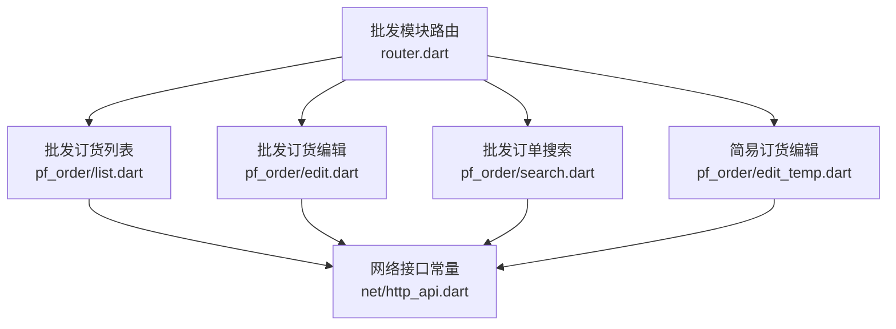
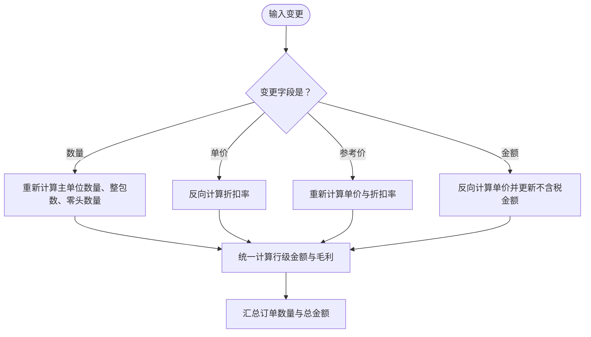
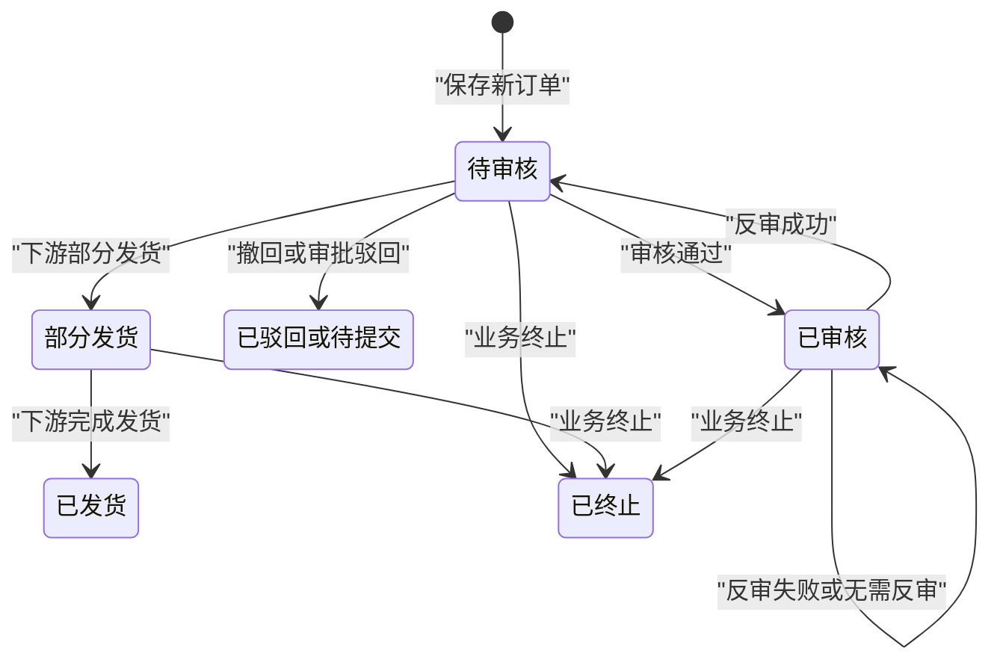
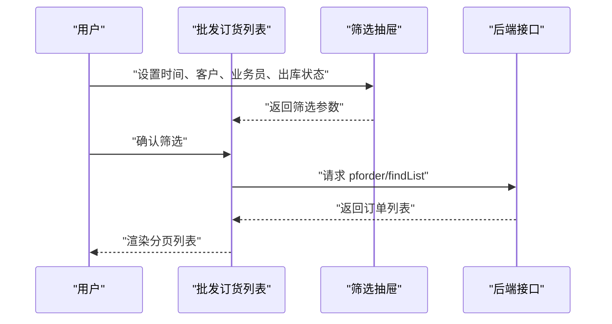
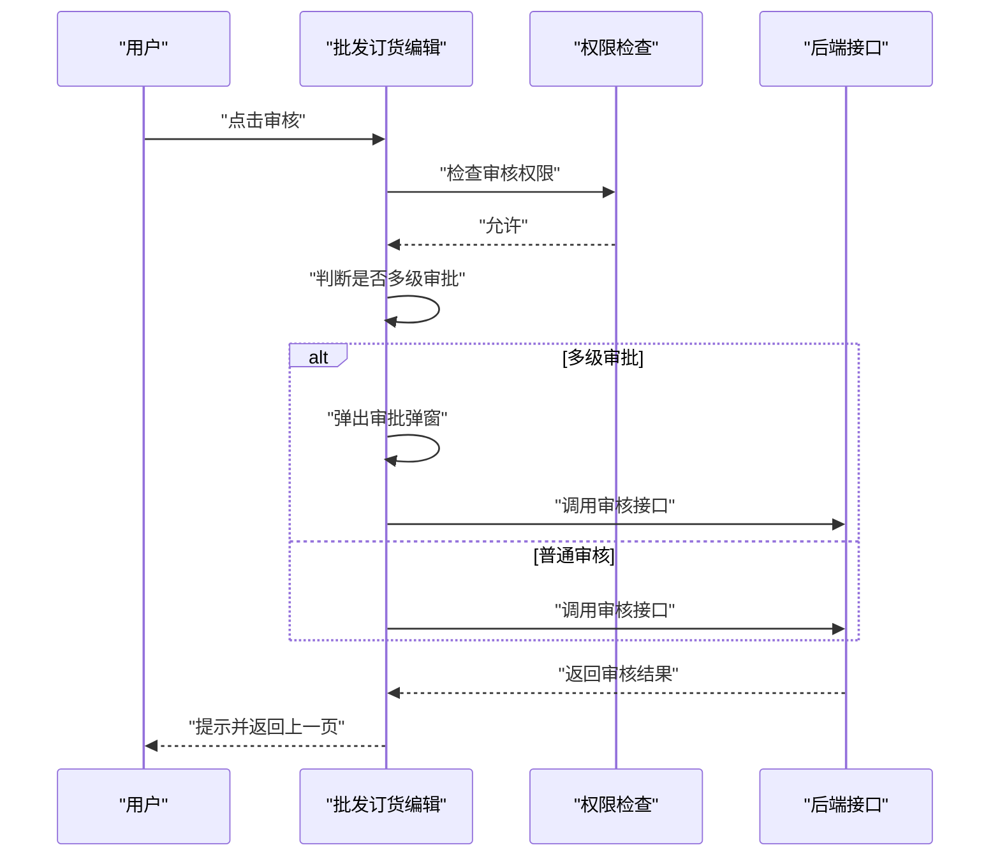
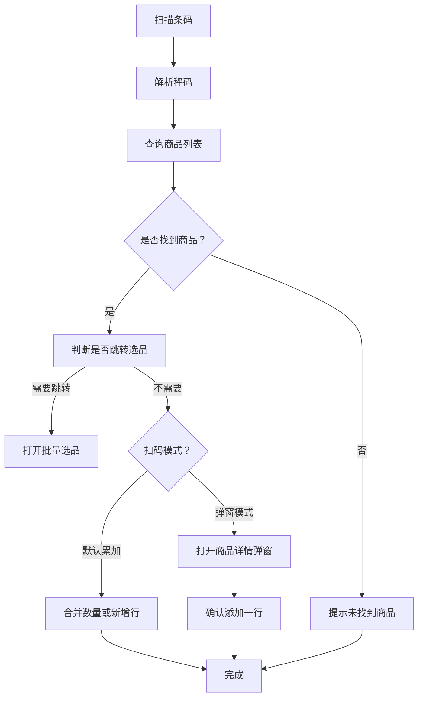

# 批发订单管理

<cite>
**本文引用的文件**   
- [router.dart](file://lib/pages/business/wholesale/router.dart)
- [list.dart](file://lib/pages/business/wholesale/pf_order/list.dart)
- [edit.dart](file://lib/pages/business/wholesale/pf_order/edit.dart)
- [search.dart](file://lib/pages/business/wholesale/pf_order/search.dart)
- [edit_temp.dart](file://lib/pages/business/wholesale/pf_order/edit_temp.dart)
- [http_api.dart](file://lib/net/http_api.dart)
</cite>

## 目录
1. [引言](#引言)
2. [项目结构定位](#项目结构定位)
3. [核心功能总览](#核心功能总览)
4. [订单数据模型](#订单数据模型)
5. [订单生命周期与状态机](#订单生命周期与状态机)
6. [订单列表与搜索](#订单列表与搜索)
7. [订单创建与编辑](#订单创建与编辑)
8. [暂存、审核、撤回与删除](#暂存审核撤回与删除)
9. [商品选择、扫码与价格计算](#商品选择扫码与价格计算)
10. [打印与生成销售单](#打印与生成销售单)
11. [依赖关系与接口契约](#依赖关系与接口契约)
12. [性能与可用性设计](#性能与可用性设计)
13. [常见问题排查](#常见问题排查)
14. [结论](#结论)

## 引言
本文件面向批发业务模块中的“批发订货”订单管理功能，围绕移动端 Flutter 实现，对订单的创建、编辑、暂存、审核、发货联动、搜索筛选等能力进行系统化说明。文档重点覆盖：

- 订单在应用内的完整生命周期：从新建、保存暂存、审核通过、反审撤回，到生成批发销售单和后续发货流程。
- 订单数据模型：包括客户、机构门店、仓库、业务员、商品明细、数量、单价、赠品、折扣、税额、总金额等字段及其联动关系。
- 状态机：待审核、已审核、已驳回、部分发货、已完成、已终止等状态的触发条件与限制。
- 搜索与筛选：按单号、时间范围、客户、业务员、出库状态等多维度查询。
- 技术细节：扫码加购、批量操作、多级审批、打印、权限控制、未保存修改拦截等。

## 项目结构定位
批发订单相关代码集中在 `lib/pages/business/wholesale` 下，主要包含：

| 目录或文件 | 职责 |
|---|---|
| `wholesale/router.dart` | 批发模块路由注册，定义批发订货、批发销售、批发退货、汇总统计等页面入口 |
| `pf_order/list.dart` | 批发订货列表页，支持分页、标签筛选、快速筛选抽屉、新增跳转 |
| `pf_order/edit.dart` | 批发订货新增与编辑页，核心业务逻辑集中地，包含暂存、审核、打印、生成销售单、扫码、批量操作等 |
| `pf_order/search.dart` | 通用订单搜索页，可作为选单来源嵌入其他业务流程 |
| `pf_order/edit_temp.dart` | 另一个订货编辑实现，侧重基础新增、扫码、保存与简单审核逻辑 |
| `http_api.dart` | 后端接口常量定义，如批发订货列表、详情、保存、审核、反审、删除、生成销售单等 |

**图示来源**  
- [router.dart:1-54](file://lib/pages/business/wholesale/router.dart#L1-L54)  
- [http_api.dart:459-465](file://lib/net/http_api.dart#L459-L465)

**章节来源**  
- [router.dart:1-54](file://lib/pages/business/wholesale/router.dart#L1-L54)

## 核心功能总览
批发订单管理在应用中承担以下核心职责：

1. **订单列表**：展示当前用户有权查看的批发订货单，支持分页加载、滚动加载更多、刷新、按标签切换审核状态、按单号模糊搜索、多维度筛选。
2. **订单新增与编辑**：选择客户、机构、仓库、业务员后录入商品明细，自动计算金额、税额、毛利、售价等；支持扫码加购、批量选择商品、批量选中删除。
3. **订单暂存与提交**：支持保存单据为草稿；保存时校验必填项并汇总数量与金额；支持保存后继续审核。
4. **订单审核与撤回**：支持普通确认审核、反审；支持多级审批流，包含审批人判断、审批备注、审批日志查看、撤回待处理态。
5. **订单删除与打印**：支持删除单据；调用打印接口输出订单信息。
6. **生成下游单据**：根据批发订货单生成批发销售单，并与出库状态联动，防止重复引用或终止后再生成。
7. **搜索复用**：提供独立搜索页，可被其他业务流程作为选单入口使用。

这些能力由列表页、编辑页、搜索页共同协作完成，并通过 HTTP API 与云端接口交互。

**章节来源**  
- [list.dart:1-200](file://lib/pages/business/wholesale/pf_order/list.dart#L1-L200)  
- [edit.dart:1-200](file://lib/pages/business/wholesale/pf_order/edit.dart#L1-L200)  
- [search.dart:1-200](file://lib/pages/business/wholesale/pf_order/search.dart#L1-L200)  
- [http_api.dart:459-465](file://lib/net/http_api.dart#L459-L465)

## 订单数据模型
批发订货单的数据模型可分为“单头信息”和“明细行信息”两部分。

### 单头信息
单头信息描述一张批发订货单的基本属性，常见字段包括：

| 字段含义 | 字段名参考 | 说明 |
|---|---|---|
| 单据编号 | `billno` | 列表搜索条件之一 |
| 单据内码 | `billid` | 保存成功后返回的新单号 |
| 单据类型 | `billtype` | 批发订货固定为 0 |
| 单据日期 | `billdate` | 新增时默认取当天 |
| 审核标志 | `signflag` | 0=待审核，1=已审核，2=已驳回或待提交 |
| 审批标记 | `reviewsignflag` | 多级审批流程中的节点标记，2=撤回待处理 |
| 客户编号 | `custid` | 必填，关联客户 |
| 客户名称 | `custname` | 用于显示与提交 |
| 机构编号 | `bsid` / `storeid` | 所属门店或机构 |
| 机构名称 | `storename` | 用于显示 |
| 机构类型 | `storetype` | 用于区分不同业务场景 |
| 仓库编号 | `counterid` | 出库仓库 |
| 仓库名称 | `countername` | 用于显示 |
| 业务员编号 | `salesid` | 负责该订单的业务员 |
| 业务员名称 | `salesname` | 用于显示 |
| 备注 | `remark` | 订单备注 |
| 附件列表 | `fileLists` | 订单附件信息 |
| 商品总数 | `billqty` | 所有明细行的数量之和 |
| 订单总金额 | `billamt` | 所有明细行的金额之和 |
| 出库状态 | `dhflag` | 表示发货进度，例如待处理、未发货、部分发货、已发货、已终止 |

### 明细行信息
每行代表一个商品条目，常见字段包括：

| 字段含义 | 字段名参考 | 说明 |
|---|---|---|
| 商品编号 | `prodid` / `productid` | 商品主键 |
| 商品名称 | `productname` / `name` | 显示用名称 |
| 数量 | `qty` | 购买数量 |
| 主单位数量 | `jsqty` | 整包换算后的主单位数量 |
| 零头数量 | `ssqty` | 不足一包的剩余数量 |
| 整包数 | `zjsqty` | 完整包数 |
| 包装倍数 | `packagenum` | 一包等于多少主单位 |
| 赠品数量 | `presentqty` / `giftqty` | 随单赠送数量 |
| 销售数量 | `jsqty` + `presentqty` | 实际销售数量参与售价计算 |
| 单价 | `price` | 批发单价 |
| 参考价 | `refprice` | 用于折扣率换算 |
| 折扣率 | `rate` | 参考价与单价之间的百分比 |
| 含税销售额 | `amt` | 通常按数量乘以单价计算 |
| 不含税销售额 | `notaxamt` | 按含税金额除以税率计算 |
| 零售价 | `sellprice` / `retailprice` | 零售参考价 |
| 进价 | `inprice` | 用于成本分析 |
| 成本价 | `costprice` | 用于毛利分析 |
| 销项税率 | `outtaxrate` | 用于不含税金额计算 |
| 进项税率 | `intaxrate` | 用于进项税相关统计 |
| 库存数量 | `stockqty` | 可选显示，辅助库存判断 |
| 批次号 | `batchno` | 可选批次标识 |
| 条码 | `barcode` | 扫码匹配依据 |
| 规格 | `size` | 可选规格字段 |
| 单位 | `unit` | 可选单位字段 |
| 供应商编号 | `supid` | 可选供应商信息 |

### 金额与价格联动规则
编辑页中存在一套金额与价格的联动逻辑，核心行为如下：

- 当数量变化时，会重新计算主单位数量、整包数、零头数量。
- 当单价变化时，会反向计算折扣率。
- 当参考价变化时，会重新计算单价和折扣率。
- 当金额变化时，会反向计算单价，并更新不含税金额。
- 每行都会计算：
  - 含税销售额；
  - 不含税销售额；
  - 销售金额（含赠品）；
  - 进价金额；
  - 毛利金额；
  - 毛利率；
  - 成本差异金额。

**图示来源**  
- [edit.dart:1-200](file://lib/pages/business/wholesale/pf_order/edit.dart#L1-L200)

**章节来源**  
- [edit.dart:1-200](file://lib/pages/business/wholesale/pf_order/edit.dart#L1-L200)

## 订单生命周期与状态机
批发订货单的生命周期由前端界面操作与后端接口共同维护，前端主要关注 `signflag`、`reviewsignflag` 和 `dhflag`。

### 主要状态
| 状态 | 前端字段 | 含义 | 典型触发方式 |
|---|---|---|---|
| 待审核 | `signflag = "0"` | 订单已保存但尚未审核 | 新增保存、编辑保存 |
| 已审核 | `signflag = "1"` | 订单已通过审核 | 点击审核 |
| 已驳回或待提交 | `signflag = "2"` | 在批发模块中同时表示已驳回或待提交 | 撤回、审批流退回 |
| 待处理 | `dhflag = "0"` | 尚未开始发货处理 | 初始或上游未处理 |
| 未发货 | `dhflag = "1"` | 订单存在但未发货 | 正常流转 |
| 部分发货 | `dhflag = "2"` | 订单部分商品已发货 | 下游发货或出库 |
| 已发货 | `dhflag = "3"` | 订单已全部发货 | 下游完成发货 |
| 已终止 | `dhflag = "4"` | 订单已终止 | 业务终止操作 |

### 状态转换规则

### 关键约束
- 只有处于待审核状态时，才能执行审核。
- 已审核订单可以反审回到待审核状态。
- 已驳回或待提交状态需要通过撤回流程重新进入审批链。
- 出库状态为“已发货”或“已终止”时，不能再生成批发销售单。
- 多级审批下，需要判断当前用户是否属于审批节点，否则不允许直接审核。

**章节来源**  
- [edit.dart:601-1045](file://lib/pages/business/wholesale/pf_order/edit.dart#L601-L1045)  
- [list.dart:1-200](file://lib/pages/business/wholesale/pf_order/list.dart#L1-L200)

## 订单列表与搜索
批发订货列表页承担订单浏览、初步筛选和跳转新增的职责。

### 列表能力
- 顶部区域支持：
  - 选择机构；
  - 输入单号模糊搜索；
  - 打开筛选抽屉；
  - 新增订单。
- 标签栏支持：
  - 全部；
  - 待审核；
  - 已审核；
  - 已驳回。
- 列表主体支持：
  - 下拉刷新；
  - 滚动加载更多；
  - 按创建时间倒序；
  - 权限校验：无权限时提示无权查看。

### 筛选条件
列表筛选抽屉支持：

| 筛选维度 | 说明 |
|---|---|
| 快速时间 | 昨天、今天、本周、本月、自定义 |
| 时间范围 | 开始日期、结束日期，含日期合法性校验 |
| 客户名称 | 通过客户选择组件选择 |
| 业务员 | 通过业务员选择组件选择 |
| 出库状态 | 全部、待处理、未发货、部分发货、已发货、已终止 |
| 机构 | 通过仓库选择器选择单一机构 |

筛选结果最终转换为后端参数，包括：

- `field`：排序字段；
- `type`：排序方向；
- `page`：页码；
- `billno`：单号；
- `datetype`：日期类型；
- `signflag`：审核状态映射值；
- `sids`：机构集合；
- `starttime` / `endtime`：时间范围；
- `custid`：客户编号；
- `salesid`：业务员编号；
- `counterid`：仓库编号；
- `dhflag`：出库状态。

**图示来源**  
- [list.dart:1-200](file://lib/pages/business/wholesale/pf_order/list.dart#L1-L200)  
- [list.dart:201-500](file://lib/pages/business/wholesale/pf_order/list.dart#L201-L500)  
- [list.dart:501-872](file://lib/pages/business/wholesale/pf_order/list.dart#L501-L872)  
- [http_api.dart:459-465](file://lib/net/http_api.dart#L459-L465)

**章节来源**  
- [list.dart:1-200](file://lib/pages/business/wholesale/pf_order/list.dart#L1-L200)  
- [list.dart:201-500](file://lib/pages/business/wholesale/pf_order/list.dart#L201-L500)  
- [list.dart:501-872](file://lib/pages/business/wholesale/pf_order/list.dart#L501-L872)

## 订单创建与编辑
批发订货的新增与编辑共用同一编辑页。新增时表单为空，编辑时从接口加载单据详情。

### 初始化流程
- 新增模式：
  - 从本地存储读取当前机构信息；
  - 从本地存储读取当前业务员信息；
  - 根据机构加载默认仓库；
  - 初始化多级审批按钮可见性；
  - 建立未保存修改基线快照。
- 编辑模式：
  - 调用详情接口获取单头和明细；
  - 回填客户、机构、仓库、业务员、备注、附件；
  - 解析多级审批用户与审批流水；
  - 将明细行转换为内部行对象；
  - 初始化完成后重建基线快照。

### 未保存修改保护
编辑页实现了“离开页面时检测未保存修改”的能力：

1. 在进入页面、加载详情、保存成功后，构建当前表单快照。
2. 每次用户返回时，比较当前表单与基线快照。
3. 仅在可保存态且存在未保存修改时弹出确认对话框。
4. 用户可选择保存后再返回，或直接放弃修改返回。

该机制特别适用于移动端频繁返回的场景，避免误关页面导致数据丢失。

### 提交校验
提交前会校验：

- 新增时必须选择客户；
- 必须选择机构；
- 必须选择仓库；
- 至少有一行有效商品；
- 新增模式下每个商品数量必须大于 0；
- 新增模式下表单字段需通过表单校验。

提交参数会汇总：

- 订单总数量；
- 订单总金额；
- 明细列表；
- 附件列表；
- 备注；
- 客户、机构、仓库、业务员信息；
- 审核标志；
- 单据日期；
- 单据类型。

**章节来源**  
- [edit.dart:201-600](file://lib/pages/business/wholesale/pf_order/edit.dart#L201-L600)

## 暂存、审核、撤回与删除
批发订货支持多种单据级操作，每种操作都有权限控制和状态约束。

### 暂存
- 动作：保存订单但不审核。
- 适用：新增或编辑。
- 结果：返回新单号或更新现有单据，保持待审核状态。

### 审核
- 普通审核：
  - 弹窗确认后调用审核接口；
  - 传入 `signflag = "1"`；
  - 成功后返回列表并提示审核成功。
- 多级审批：
  - 若配置了审批人员，则弹出审批弹窗；
  - 支持通过、驳回、备注；
  - 管理员或当前审批节点用户才可操作；
  - 审核成功后关闭编辑页。

### 反审
- 仅对已审核订单开放；
- 确认后调用反审接口；
- 成功后重新加载单据详情。

### 撤回
- 用于审批流中撤回单据；
- 会将 `reviewsignflag` 设为撤回待处理态；
- 同时将 `signflag` 设置为待提交态；
- 调用保存接口触发撤回流程。

### 删除
- 弹窗确认后调用删除接口；
- 成功后返回列表。

**图示来源**  
- [edit.dart:601-1045](file://lib/pages/business/wholesale/pf_order/edit.dart#L601-L1045)  
- [http_api.dart:459-465](file://lib/net/http_api.dart#L459-L465)

**章节来源**  
- [edit.dart:601-1045](file://lib/pages/business/wholesale/pf_order/edit.dart#L601-L1045)

## 商品选择、扫码与价格计算
批发订货的商品录入支持三种主要方式：

1. 批量选择商品；
2. 扫码加购；
3. 手动输入。

### 批量选择商品
- 前提：已选择机构、仓库、客户。
- 通过商品选择组件打开选品页，传入当前订单上下文，例如：
  - 机构编号；
  - 客户编号；
  - 批发价格标志；
  - 是否需要批次；
  - 仓库编号；
  - 已有商品列表。
- 选品页返回商品列表后，编辑页会清空旧列表并按新选择替换。
- 每个商品行会执行默认值设置和价格优先级计算。

### 扫码加购
扫码流程分为两个阶段：

1. 防抖处理：
   - 监听扫码输入框内容变化；
   - 延迟 150 毫秒后统一处理，避免字符未完全提交；
   - 支持键盘 Enter 键与红外扫码设备。
2. 商品查询与合并：
   - 先解析秤码，判断是否为重量码或金额码；
   - 查询商品列表；
   - 若无结果，提示“未找到商品”；
   - 若命中自编码或条码分流，跳转到批量选品；
   - 否则根据扫码模式决定是直接累加还是弹窗确认。

扫码价格优先级为：

- 客户折扣价；
- 客户价；
- 商品原价。

扫码数量规则：

- 普通码：默认数量为商品返回数量加 1；
- 重量码：直接使用重量码解析出的数量；
- 金额码：按金额除以单价反算数量。

重复商品处理：

- 默认累加模式：相同商品数量直接相加；
- 弹窗模式：重复商品打开详情弹窗编辑已有行；
- 新商品打开详情弹窗确认后加入列表。

**图示来源**  
- [edit.dart:1046-1408](file://lib/pages/business/wholesale/pf_order/edit.dart#L1046-L1408)

**章节来源**  
- [edit.dart:1046-1408](file://lib/pages/business/wholesale/pf_order/edit.dart#L1046-L1408)

## 打印与生成销售单
### 打印
编辑页支持打印当前订单：

- 调用打印接口，菜单编号为 `060102`；
- 传入当前订单数据；
- 成功后提示打印成功。

### 生成批发销售单
编辑页支持根据批发订货单生成批发销售单：

- 权限检查：需具备“生成批发单”权限；
- 状态检查：
  - 出库状态为“已发货”时禁止生成；
  - 出库状态为“已终止”时禁止生成；
- 二次确认：弹窗确认后才发起生成；
- 成功后重新加载单据详情。

该能力体现批发订货与批发销售的上下游关系：订货单是销售单的来源单据之一。

**章节来源**  
- [edit.dart:601-1045](file://lib/pages/business/wholesale/pf_order/edit.dart#L601-L1045)

## 依赖关系与接口契约
批发订单模块依赖的 HTTP 接口集中在 `http_api.dart`，关键接口如下：

| 接口常量 | 接口路径 | 用途 |
|---|---|---|
| `pfOrderFindList` | `pforder/findList` | 查询批发订货列表 |
| `pfOrderGetInfo` | `pforder/getInfo` | 获取批发订货详情 |
| `pfOrderSave` | `pforder/save` | 保存或更新批发订货 |
| `pfOrderSign` | `pforder/sign` | 审核批发订货 |
| `pfOrderRetsign` | `pforder/retsign` | 反审批发订货 |
| `pfOrderDelBill` | `pforder/delBill` | 删除批发订货 |
| `pfOrderGeneratePfSell` | `pforder/generatePfSell` | 根据批发订货生成批发销售单 |

### 列表查询契约
列表查询要求：

- 必传：
  - `field`：排序字段；
  - `type`：排序方向；
  - `page`：页码；
  - `billno`：单号；
  - `datetype`：日期类型；
  - `signflag`：审核状态；
  - `sids`：机构集合；
  - `starttime`：开始时间；
  - `endtime`：结束时间；
- 可选：
  - `custid`；
  - `salesid`；
  - `counterid`；
  - `dhflag`。

### 详情查询契约
详情查询传入单头信息，返回：

- 单头字段；
- 明细列表；
- 附件列表；
- 审批用户列表；
- 审批流水列表。

### 保存契约
保存时传入：

- 单头基本信息；
- 明细列表；
- 附件列表；
- 审核标志；
- 总金额与总数量；
- 单据日期与类型。

**章节来源**  
- [http_api.dart:459-465](file://lib/net/http_api.dart#L459-L465)  
- [list.dart:1-200](file://lib/pages/business/wholesale/pf_order/list.dart#L1-L200)  
- [edit.dart:201-600](file://lib/pages/business/wholesale/pf_order/edit.dart#L201-L600)

## 性能与可用性设计
### 分页与滚动加载
- 列表页使用滚动控制器监听滚动位置；
- 到达底部附近时增加页码并继续加载；
- 首次加载清空列表，后续加载追加数据；
- 加载失败时将“还有更多”标记关闭。

### 防抖搜索
- 列表页和搜索页均使用定时器防抖；
- 输入停止后延迟 350~500 毫秒再触发查询；
- 避免频繁网络请求。

### 权限控制
- 多个操作通过权限工具类检查权限码；
- 无权限时提示用户联系后台调整权限；
- 避免越权操作进入敏感流程。

### 扫码体验优化
- 使用焦点节点和输入法通道隐藏软键盘；
- 使用防抖确保扫码字符完整；
- 支持连续扫码自动聚焦；
- 区分普通码、重量码、金额码；
- 支持重复商品合并与弹窗编辑。

### 未保存修改保护
- 通过快照比对避免误关页面丢失数据；
- 仅在可保存态生效；
- 审核态和只读态不拦截返回。

**章节来源**  
- [list.dart:1-200](file://lib/pages/business/wholesale/pf_order/list.dart#L1-L200)  
- [search.dart:1-200](file://lib/pages/business/wholesale/pf_order/search.dart#L1-L200)  
- [edit.dart:201-600](file://lib/pages/business/wholesale/pf_order/edit.dart#L201-L600)  
- [edit.dart:1046-1408](file://lib/pages/business/wholesale/pf_order/edit.dart#L1046-L1408)

## 常见问题排查
### 问题：扫码提示“未找到商品”
可能原因：

- 未选择机构、仓库或客户；
- 条码与商品条码不一致；
- 商品不在当前机构或仓库范围内；
- 商品状态不符合查询条件；
- 扫码字符未完全提交，被提前处理。

建议处理：

- 先选择机构、仓库、客户；
- 确认商品是否存在；
- 检查扫码设备输入是否稳定；
- 观察调试日志中的扫码处理过程。

**章节来源**  
- [edit.dart:1046-1408](file://lib/pages/business/wholesale/pf_order/edit.dart#L1046-L1408)

### 问题：审核后仍无法生成批发销售单
可能原因：

- 出库状态为“已发货”，系统认为已被下游引用；
- 出库状态为“已终止”，不允许再生成下游单据；
- 用户无“生成批发单”权限。

建议处理：

- 检查订单出库状态；
- 确认权限；
- 如需生成销售单，应保证订单未被下游引用且未被终止。

**章节来源**  
- [edit.dart:601-1045](file://lib/pages/business/wholesale/pf_order/edit.dart#L601-L1045)

### 问题：返回上一页提示未保存修改
可能原因：

- 新增了商品行；
- 修改了数量、单价、赠品数量；
- 修改了客户、机构、仓库或备注；
- 添加了附件。

建议处理：

- 选择保存后再返回；
- 若确实要丢弃修改，选择放弃保存。

**章节来源**  
- [edit.dart:201-600](file://lib/pages/business/wholesale/pf_order/edit.dart#L201-L600)

## 结论
批发订单管理模块以 Flutter 页面为核心载体，围绕 `pf_order/list.dart`、`pf_order/edit.dart`、`pf_order/search.dart` 三个主要页面展开，结合 `http_api.dart` 定义的批发订货接口，实现了完整的订单生命周期管理。其核心优势在于：

- 数据结构清晰：单头与明细分离，金额、价格、税额、毛利联动明确；
- 状态管理严谨：待审核、已审核、已驳回、部分发货、已完成、已终止等状态有明确触发条件和限制；
- 用户体验完善：分页加载、防抖搜索、扫码加购、批量操作、未保存修改保护、权限控制；
- 扩展性强：支持多级审批、打印、生成下游销售单，便于与仓储、销售、财务等模块衔接。

对于后续迭代，可考虑进一步抽象订单状态机、统一金额计算工具、增强批量导入导出与模板打印能力，使批发订货模块更贴近企业级批发生意场景。