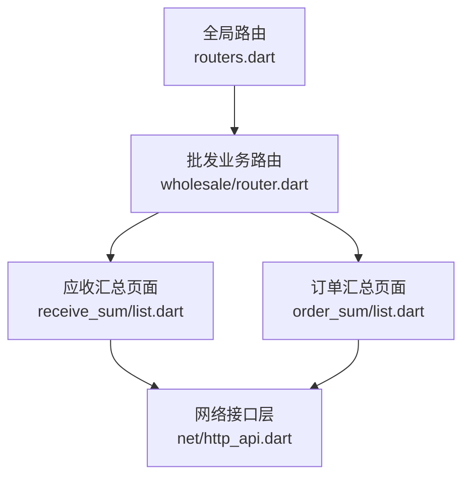
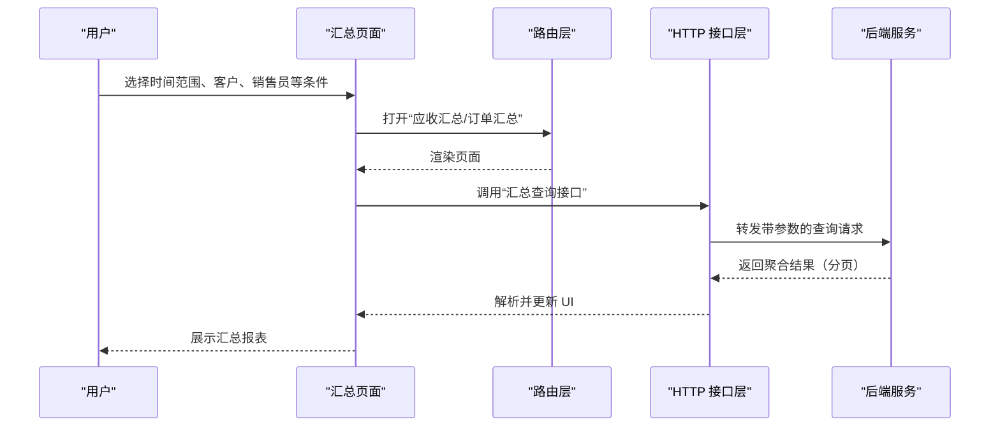
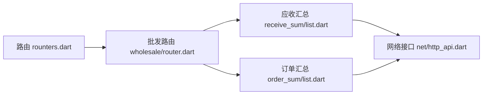
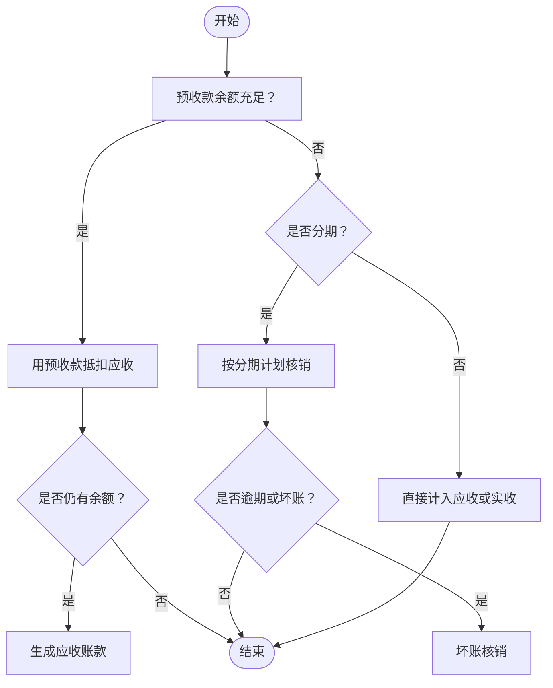

# 结算汇总

<cite>
**本文引用的文件列表**   
- [lib/pages/business/wholesale/receive_sum/list.dart](file://lib/pages/business/wholesale/receive_sum/list.dart)
- [lib/pages/business/wholesale/order_sum/list.dart](file://lib/pages/business/wholesale/order_sum/list.dart)
- [lib/pages/business/wholesale/router.dart](file://lib/pages/business/wholesale/router.dart)
- [lib/routers/routers.dart](file://lib/routers/routers.dart)
- [lib/net/http_api.dart](file://lib/net/http_api.dart)
- [lib/pages/business/wholesale/pf_order/search.dart](file://lib/pages/business/wholesale/pf_order/search.dart)
- [lib/pages/business/wholesale/pf_sale/search.dart](file://lib/pages/business/wholesale/pf_sale/search.dart)
- [lib/pages/business/wholesale/pf_return/search.dart](file://lib/pages/business/wholesale/pf_return/search.dart)
- [lib/pages/business/finance/customer_pay/list.dart](file://lib/pages/business/finance/customer_pay/list.dart)
- [lib/pages/home/widgets/approval_reminder_helper.dart](file://lib/pages/home/widgets/approval_reminder_helper.dart)
</cite>

## 目录
1. [引言](#引言)
2. [项目结构与入口](#项目结构与入口)
3. [核心组件](#核心组件)
4. [架构总览](#架构总览)
5. [详细组件分析](#详细组件分析)
6. [依赖关系分析](#依赖关系分析)
7. [性能与统计口径](#性能与统计口径)
8. [对账机制与复杂结算场景](#对账机制与复杂结算场景)
9. [异常处理与数据修正](#异常处理与数据修正)
10. [结论](#结论)

## 引言
本文件面向批发业务模块的“结算汇总”能力，围绕应收汇总与订单汇总两大核心报表展开，说明其在资金回笼管理与订单完成统计中的业务意义；梳理按客户、时间段、销售员、商品类别等维度的汇总分析思路；解释预收款抵扣、分期付款、坏账处理等结算对账机制；并总结汇总报表的数据聚合算法、统计口径与展示规范。需要特别说明的是：仓库中已存在批发业务的订单、销售、退货与结算相关页面，但关于服务端聚合逻辑、字段定义及完整规则由后端实现，本文在无法从前端代码确证时明确标注为“以服务端为准”。

## 项目结构与入口
批发结算汇总功能位于批发业务域下，包含两个关键入口：
- 应收汇总：对应“收款汇总”视图，用于资金回笼跟踪与应收账款管理。
- 订单汇总：对应“订单汇总”视图，用于订单量、金额与完成状态统计。

路由层将批发业务子模块注册到全局路由表中，从而通过统一导航进入相应页面。

图表来源
- [lib/routers/routers.dart:1-200](file://lib/routers/routers.dart#L1-L200)
- [lib/pages/business/wholesale/router.dart:1-200](file://lib/pages/business/wholesale/router.dart#L1-L200)

章节来源
- [lib/routers/routers.dart:1-200](file://lib/routers/routers.dart#L1-L200)
- [lib/pages/business/wholesale/router.dart:1-200](file://lib/pages/business/wholesale/router.dart#L1-L200)

## 核心组件
- 应收汇总（收款汇总）
  - 作用：统计指定时间范围内的实际收款、预收款抵扣、分期回款、坏账核销等，形成资金回笼看板。
  - 典型维度：客户、销售员、时间段、支付方式、门店/仓库、商品大类等。
  - 输出指标：累计应收、累计实收、未结清余额、逾期金额、坏账金额、回款率等。
- 订单汇总
  - 作用：统计订单数量、销售额、毛利率、完成率、取消率等，衡量订单流转效率与业务规模。
  - 典型维度：客户、销售员、时间段、商品类别、渠道等。
  - 输出指标：下单数、有效单数、发货数、签收数、退单数、销售额、毛利额、完成率等。

章节来源
- [lib/pages/business/wholesale/receive_sum/list.dart:1-200](file://lib/pages/business/wholesale/receive_sum/list.dart#L1-L200)
- [lib/pages/business/wholesale/order_sum/list.dart:1-200](file://lib/pages/business/wholesale/order_sum/list.dart#L1-L200)

## 架构总览
前端采用“页面 + 路由 + 网络接口”的分层组织：
- 页面层：负责筛选条件输入、表格展示、分页加载与交互。
- 路由层：负责将批发业务子模块接入全局路由。
- 网络层：封装 HTTP 请求、参数组装与错误处理。
- 后端服务：承担多表关联、过滤、分组聚合、排序与分页，返回标准化 JSON。

图表来源
- [lib/pages/business/wholesale/receive_sum/list.dart:1-200](file://lib/pages/business/wholesale/receive_sum/list.dart#L1-L200)
- [lib/pages/business/wholesale/order_sum/list.dart:1-200](file://lib/pages/business/wholesale/order_sum/list.dart#L1-L200)
- [lib/net/http_api.dart:1-200](file://lib/net/http_api.dart#L1-L200)

## 详细组件分析

### 应收汇总（收款汇总）
- 业务目标
  - 追踪应收账款与资金回笼，识别逾期与坏账，支持按多维度钻取。
- 数据来源
  - 订单主表、订单明细、收款单、预收款、分期计划、坏账记录等。
- 统计口径建议
  - 应收金额：以已确认出库且未完全回款的订单为主。
  - 实收金额：以实际入账的收款单为主，含预收款抵扣与分期到账。
  - 逾期：超过约定账期仍未结清的余额。
  - 坏账：经审批核销的金额。
- 前端交互要点
  - 支持日期区间、客户、销售员、支付方式等筛选。
  - 表格列包含：客户名称、销售员、期初应收、本期新增应收、本期实收、期末应收、逾期、坏账、回款率等。
  - 支持导出、钻取至明细或单笔收款单。

章节来源
- [lib/pages/business/wholesale/receive_sum/list.dart:1-200](file://lib/pages/business/wholesale/receive_sum/list.dart#L1-L200)

### 订单汇总
- 业务目标
  - 衡量订单规模、完成质量与销售效率，支撑经营分析与绩效考核。
- 数据来源
  - 订单主表、订单明细、发货单、退货单、价格与成本表等。
- 统计口径建议
  - 订单数：按订单号去重计数。
  - 销售额：不含税或含税需统一口径，避免重复计算折扣、运费、税费。
  - 完成率：已签收/已完成的订单数 / 有效订单数。
  - 退单率：退单数 / 有效订单数。
- 前端交互要点
  - 支持日期区间、客户、销售员、商品类别、渠道等筛选。
  - 表格列包含：订单号、客户、销售员、商品类别、下单时间、金额、状态、完成率等。
  - 支持钻取至订单明细、发货与退货明细。

章节来源
- [lib/pages/business/wholesale/order_sum/list.dart:1-200](file://lib/pages/business/wholesale/order_sum/list.dart#L1-L200)

### 路由与导航
- 批发业务路由集中注册“应收汇总”和“订单汇总”路径，便于从业务菜单或快捷入口直达。
- 全局路由表将批发子模块挂载至业务域，保证命名空间一致。

章节来源
- [lib/pages/business/wholesale/router.dart:1-200](file://lib/pages/business/wholesale/router.dart#L1-L200)
- [lib/routers/routers.dart:1-200](file://lib/routers/routers.dart#L1-L200)

## 依赖关系分析
- 页面依赖
  - 汇总页面依赖筛选组件、表格组件、分页组件与通用工具函数（日期、数值格式化等）。
- 网络依赖
  - 通过 http_api 暴露统一的接口方法，隐藏底层请求细节。
- 外部系统
  - 后端服务承担跨表聚合、权限校验与审计日志记录。

图表来源
- [lib/routers/routers.dart:1-200](file://lib/routers/routers.dart#L1-L200)
- [lib/pages/business/wholesale/router.dart:1-200](file://lib/pages/business/wholesale/router.dart#L1-L200)
- [lib/pages/business/wholesale/receive_sum/list.dart:1-200](file://lib/pages/business/wholesale/receive_sum/list.dart#L1-L200)
- [lib/pages/business/wholesale/order_sum/list.dart:1-200](file://lib/pages/business/wholesale/order_sum/list.dart#L1-L200)
- [lib/net/http_api.dart:1-200](file://lib/net/http_api.dart#L1-L200)

## 性能与统计口径
- 分页与懒加载
  - 汇总数据量大时采用分页加载，避免一次性拉取导致卡顿。
- 筛选与索引
  - 前端先做轻量级筛选，再向服务端提交精确查询条件，减少无效数据传输。
- 统计口径一致性
  - 所有金额字段应统一币种、精度与是否含税规则；所有数量字段应统一单位与去重策略。
- 缓存与刷新
  - 可考虑短时缓存最近一次查询结果，并提供手动刷新按钮以保证数据新鲜度。

[本节为通用性能建议，不直接分析具体文件]

## 对账机制与复杂结算场景
以下对账机制属于财务与业务规则范畴，前端页面负责采集筛选条件与结果展示，具体扣减顺序、账务分录与审批流由后端实现，建议以服务端文档为准。

- 预收款抵扣
  - 客户预付后产生预收款余额；结算时对应收进行抵扣，剩余部分转为应收账款。
- 分期付款
  - 订单按分期计划生成多个应收节点；每次还款核销对应节点，直至结清。
- 坏账处理
  - 对长期未收回的应收，经审批流程后核销为坏账，影响期末应收与利润。
- 退款与退货冲销
  - 退货产生的退款或红字发票冲减应收；若涉及已付款，则优先冲回实收。
- 差异与调账
  - 发现差异时需走调账流程，保留审计轨迹，确保前后端数据一致。

图表来源
- [lib/pages/business/finance/customer_pay/list.dart:1-200](file://lib/pages/business/finance/customer_pay/list.dart#L1-L200)

章节来源
- [lib/pages/business/finance/customer_pay/list.dart:1-200](file://lib/pages/business/finance/customer_pay/list.dart#L1-L200)

## 异常处理与数据修正
- 常见异常
  - 网络超时或中断、后端返回为空或字段缺失、权限不足、筛选条件非法等。
- 前端处理
  - 统一错误提示与重试机制；空数据时提供引导操作。
- 数据修正
  - 对历史数据的更正应通过审批流完成，并保留变更原因与操作人信息。
- 监控与告警
  - 结合审批提醒与异常监控，及时发现长期未结清或异常波动。

章节来源
- [lib/pages/home/widgets/approval_reminder_helper.dart:1-200](file://lib/pages/home/widgets/approval_reminder_helper.dart#L1-L200)

## 附录：筛选维度与参考页面
- 常用筛选维度
  - 时间段：自然日、周、月、季度、年度。
  - 客户：按客户名称、编码、区域等筛选。
  - 销售员：按销售员姓名、编码、团队等筛选。
  - 商品类别：按一级、二级类目等筛选。
  - 渠道/门店/仓库：按销售渠道、门店或仓库维度划分。
- 参考页面
  - 批发订单搜索：用于定位订单来源与状态。
  - 批发销售搜索：用于核对销售与出库情况。
  - 批发退货搜索：用于核对退货与冲销情况。

章节来源
- [lib/pages/business/wholesale/pf_order/search.dart:1-200](file://lib/pages/business/wholesale/pf_order/search.dart#L1-L200)
- [lib/pages/business/wholesale/pf_sale/search.dart:1-200](file://lib/pages/business/wholesale/pf_sale/search.dart#L1-L200)
- [lib/pages/business/wholesale/pf_return/search.dart:1-200](file://lib/pages/business/wholesale/pf_return/search.dart#L1-L200)

## 结论
应收汇总与订单汇总是批发业务结算的核心报表：前者聚焦资金回笼与风险管控，后者聚焦订单规模与运营效率。前端通过清晰的筛选与展示，配合后端的多维聚合与严谨的对账规则，共同保障财务数据的准确性与可追溯性。建议在后续迭代中完善服务端接口文档与字段字典，并增加数据血缘与审计追踪，进一步提升结算汇总的可解释性与合规性。