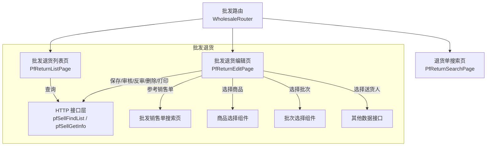
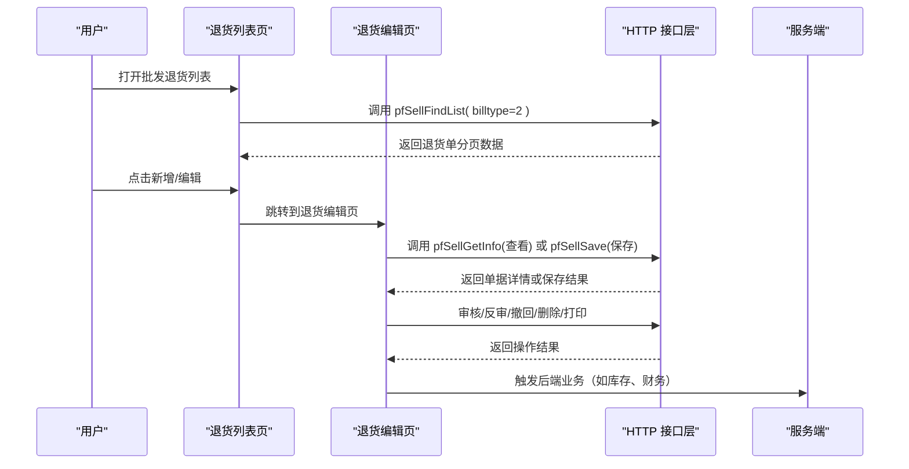
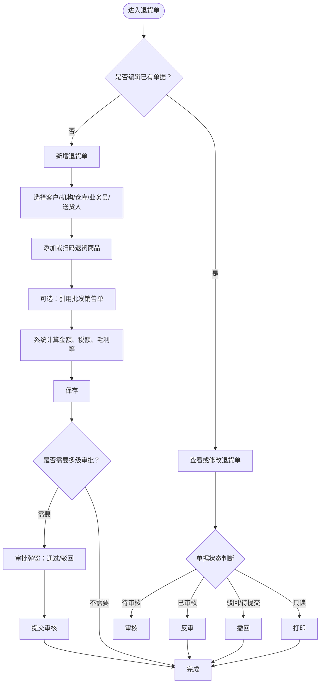
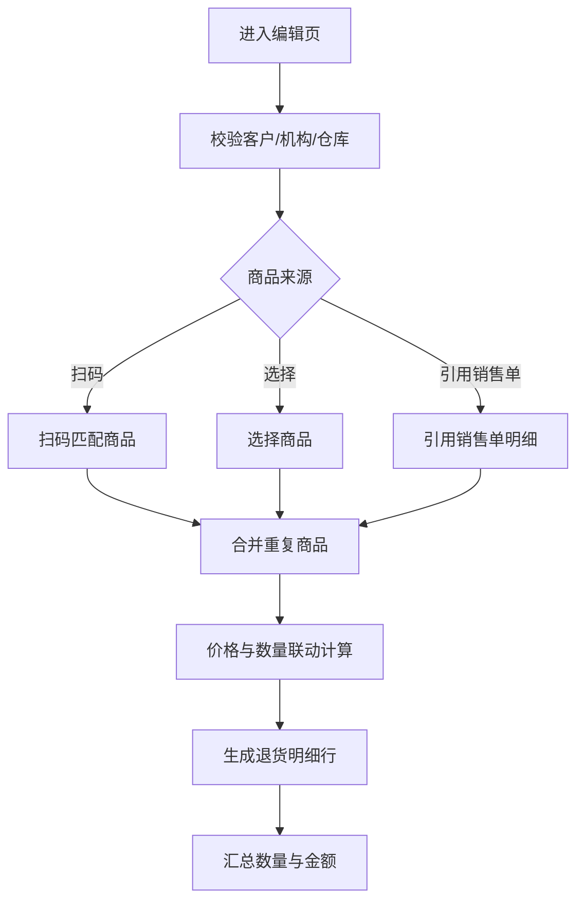
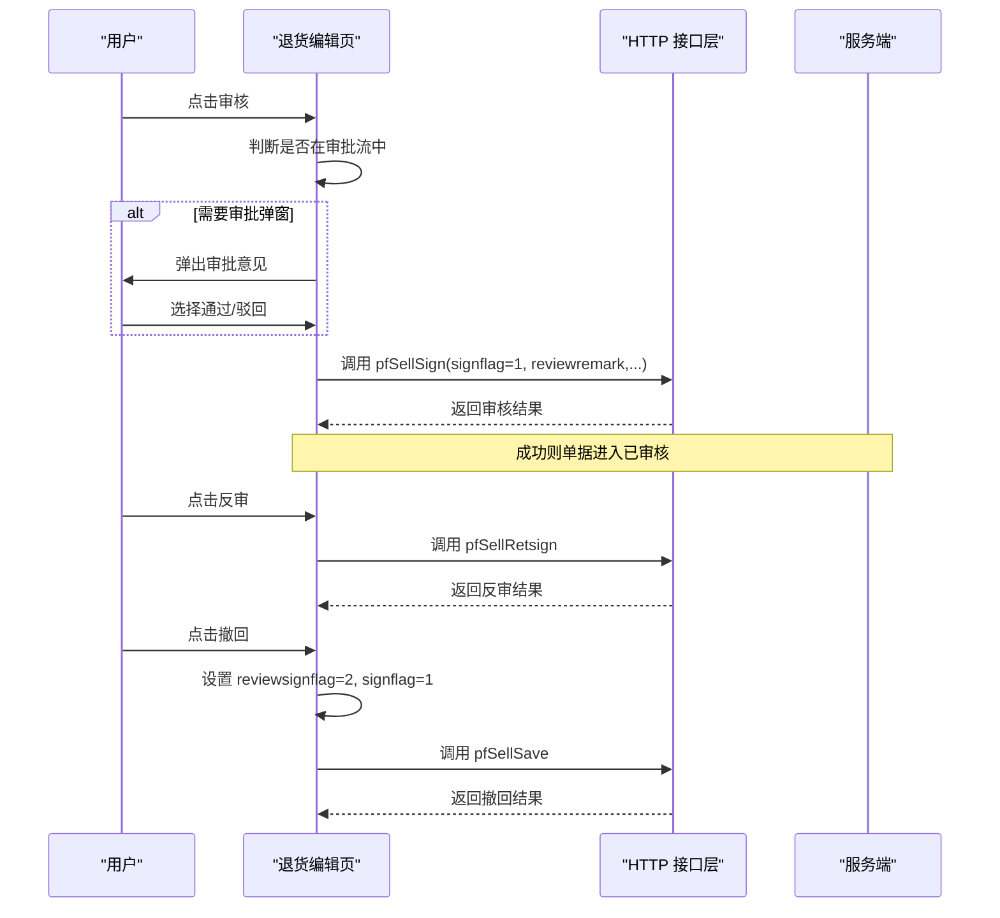
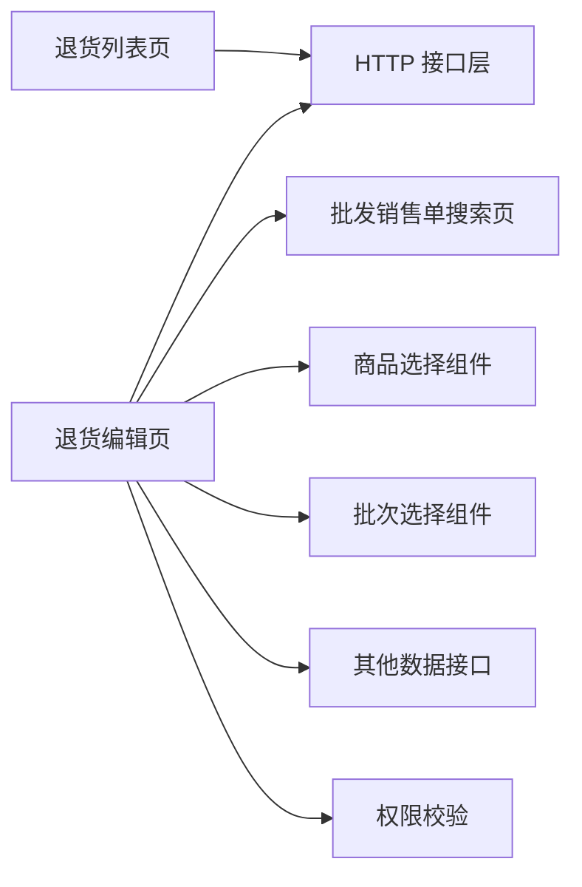

# 退货管理

<cite>
**本文引用的文件 **
- [lib/pages/business/wholesale/router.dart](file://lib/pages/business/wholesale/router.dart)
- [lib/pages/business/wholesale/pf_return/list.dart](file://lib/pages/business/wholesale/pf_return/list.dart)
- [lib/pages/business/wholesale/pf_return/edit.dart](file://lib/pages/business/wholesale/pf_return/edit.dart)
- [lib/pages/business/wholesale/pf_return/search.dart](file://lib/pages/business/wholesale/pf_return/search.dart)
</cite>

## 目录
1. [引言](#引言)
2. [项目结构](#项目结构)
3. [核心组件](#核心组件)
4. [架构总览](#架构总览)
5. [详细组件分析](#详细组件分析)
6. [依赖关系分析](#依赖关系分析)
7. [性能与可用性](#性能与可用性)
8. [故障排查指南](#故障排查指南)
9. [结论](#结论)

## 引言
本文件聚焦于批发业务模块中的“批发退货”功能，面向产品、研发、实施与运营人员，系统化说明退货业务的完整流程、单据数据结构、审批集成、前端交互逻辑及与后端接口之间的协作方式。需要特别说明的是：当前仓库为 Flutter 移动端实现，退货入库、库存回滚、质量检验、报废处理以及财务退款、发票红冲等后端能力由服务端提供；本文件在涉及这些领域时，以现有前端调用和字段为依据进行说明，并对未在代码中体现的流程给出边界提示。

## 项目结构
批发退货相关的前端代码集中在批发业务子模块下，主要包含路由注册、列表页、编辑详情页和搜索选择页：

**图表来源**
- [lib/pages/business/wholesale/router.dart:1-54](file://lib/pages/business/wholesale/router.dart#L1-L54)
- [lib/pages/business/wholesale/pf_return/list.dart:1-120](file://lib/pages/business/wholesale/pf_return/list.dart#L1-L120)
- [lib/pages/business/wholesale/pf_return/edit.dart:1-120](file://lib/pages/business/wholesale/pf_return/edit.dart#L1-L120)
- [lib/pages/business/wholesale/pf_return/search.dart:1-80](file://lib/pages/business/wholesale/pf_return/search.dart#L1-L80)

**章节来源**
- [lib/pages/business/wholesale/router.dart:1-54](file://lib/pages/business/wholesale/router.dart#L1-L54)

## 核心组件
- 批发退货列表页：按状态、时间范围、门店、客户、业务员、结算状态筛选退货单，支持分页加载、快速刷新、扫码或输入单号检索。
- 批发退货编辑页：新增、查看、修改、审核、反审、撤回、删除、打印；支持从批发销售单引用退货明细；支持扫码、批量操作、单位规格切换、批次管理、附件上传、多级审批。
- 退货单搜索页：供其他页面作为“选择器”复用，用于选取已存在的退货单或关联销售单。
- 路由注册：统一暴露退货相关的三个路由地址，供业务入口跳转。

**章节来源**
- [lib/pages/business/wholesale/pf_return/list.dart:1-120](file://lib/pages/business/wholesale/pf_return/list.dart#L1-L120)
- [lib/pages/business/wholesale/pf_return/edit.dart:1-120](file://lib/pages/business/wholesale/pf_return/edit.dart#L1-L120)
- [lib/pages/business/wholesale/pf_return/search.dart:1-80](file://lib/pages/business/wholesale/pf_return/search.dart#L1-L80)
- [lib/pages/business/wholesale/router.dart:1-54](file://lib/pages/business/wholesale/router.dart#L1-L54)

## 架构总览
退货单在前端采用“列表 + 详情编辑”的经典双页模式，通过统一的 HTTP 工具类与后端接口交互。审批能力通过本地存储的用户信息与后端返回的审批流信息共同决定按钮可见性与可执行动作。

**图表来源**
- [lib/pages/business/wholesale/pf_return/list.dart:60-120](file://lib/pages/business/wholesale/pf_return/list.dart#L60-L120)
- [lib/pages/business/wholesale/pf_return/edit.dart:200-420](file://lib/pages/business/wholesale/pf_return/edit.dart#L200-L420)

**章节来源**
- [lib/pages/business/wholesale/pf_return/list.dart:60-120](file://lib/pages/business/wholesale/pf_return/list.dart#L60-L120)
- [lib/pages/business/wholesale/pf_return/edit.dart:200-420](file://lib/pages/business/wholesale/pf_return/edit.dart#L200-L420)

## 详细组件分析

### 退货单数据结构
退货单由“头信息 + 明细行 + 审批信息 + 附件”组成。前端在加载详情时，将后端返回的数据映射到本地表单与明细行模型。

- 头信息关键字段
  - 单据标识：billid、billno
  - 单据类型：billtype=2（退货）
  - 状态：signflag、reviewsignflag
  - 客户：custid、custname
  - 机构：bsid、storename、storetype
  - 仓库：counterid、countername
  - 业务员：salesid、salesname
  - 送货人：sendercode、sendername
  - 参考单据：refbillno、refbillid、refbilltype=1
  - 合计：billqty、billamt
  - 备注：remark
  - 附件：fileLists

- 明细行关键字段
  - 商品标识：prodid/productid、productname/name
  - 数量：qty、presentqty（赠送数量）、jsqty（换算数量）
  - 价格：price、sellprice、retailprice、costprice、inprice、refprice
  - 金额：amt、notaxamt、camt、grossrateamt、grossrate
  - 批次：batchno、birthdate、validdate
  - 单位与规格：unit、size、packagenum
  - 其他：barcode、code、各种价格档 pfprice1/2/3、mprice1/2/3、psprice

- 参考销售单字段
  - incompleteQty、notpresentreturnedqty、notreturnedqty 等字段用于计算未退量与可退量。

该数据结构由编辑页加载详情、选择商品、选择参考销售单、提交保存等环节共同维护。

**章节来源**
- [lib/pages/business/wholesale/pf_return/edit.dart:240-360](file://lib/pages/business/wholesale/pf_return/edit.dart#L240-L360)
- [lib/pages/business/wholesale/pf_return/edit.dart:1100-1250](file://lib/pages/business/wholesale/pf_return/edit.dart#L1100-L1250)
- [lib/pages/business/wholesale/pf_return/edit.dart:1400-1520](file://lib/pages/business/wholesale/pf_return/edit.dart#L1400-L1520)

### 退货业务流程
退货单的核心流程包括：创建/查看 → 填写/引用 → 保存 → 审核 → 可选反审/撤回 → 删除/打印。

**图表来源**
- [lib/pages/business/wholesale/pf_return/edit.dart:200-420](file://lib/pages/business/wholesale/pf_return/edit.dart#L200-L420)
- [lib/pages/business/wholesale/pf_return/edit.dart:700-920](file://lib/pages/business/wholesale/pf_return/edit.dart#L700-L920)
- [lib/pages/business/wholesale/pf_return/edit.dart:920-1126](file://lib/pages/business/wholesale/pf_return/edit.dart#L920-L1126)

**章节来源**
- [lib/pages/business/wholesale/pf_return/edit.dart:200-420](file://lib/pages/business/wholesale/pf_return/edit.dart#L200-L420)
- [lib/pages/business/wholesale/pf_return/edit.dart:700-920](file://lib/pages/business/wholesale/pf_return/edit.dart#L700-L920)
- [lib/pages/business/wholesale/pf_return/edit.dart:920-1126](file://lib/pages/business/wholesale/pf_return/edit.dart#L920-L1126)

### 退货申请与商品录入
退货申请环节重点在于“客户、机构、仓库、业务员、送货人”等基础信息的完整性校验，以及退货商品明细的录入。

- 基础校验
  - 必须选择客户、机构、仓库。
  - 新增时必须至少有一行有效商品，且数量大于零。
- 商品来源
  - 手动选择商品：调用商品选择组件，支持多选、预置已有商品列表。
  - 扫码录入：支持红外扫码枪与摄像头扫描；对重复条码/商品做合并与去重处理。
  - 引用销售单：从批发销售单中选择，自动带入未退数量、赠品未退数量、价格、单位、规格、批次等信息。
- 价格与数量联动
  - 支持零售价、成本价、进价、参考价等多价格维度。
  - 主数量与赠送数量分开录入，总金额按 price × qty 计算，并同步更新不含税金额、成本金额、毛利等衍生字段。
  - 支持折扣率、优惠价格等字段的联动计算。

**图表来源**
- [lib/pages/business/wholesale/pf_return/edit.dart:1100-1250](file://lib/pages/business/wholesale/pf_return/edit.dart#L1100-L1250)
- [lib/pages/business/wholesale/pf_return/edit.dart:1400-1520](file://lib/pages/business/wholesale/pf_return/edit.dart#L1400-L1520)
- [lib/pages/business/wholesale/pf_return/edit.dart:2200-2593](file://lib/pages/business/wholesale/pf_return/edit.dart#L2200-L2593)

**章节来源**
- [lib/pages/business/wholesale/pf_return/edit.dart:1100-1250](file://lib/pages/business/wholesale/pf_return/edit.dart#L1100-L1250)
- [lib/pages/business/wholesale/pf_return/edit.dart:1400-1520](file://lib/pages/business/wholesale/pf_return/edit.dart#L1400-L1520)
- [lib/pages/business/wholesale/pf_return/edit.dart:2200-2593](file://lib/pages/business/wholesale/pf_return/edit.dart#L2200-L2593)

### 退货审核、反审与撤回
退货单支持多级审批，审核通过后可以进行反审，处于特定状态的单据可以撤回重新处理。

- 审核
  - 保存后可直接审核，或通过“保存并审核”流程进入审批弹窗。
  - 审批弹窗支持“通过/驳回”与备注。
  - 若存在审批流，则根据当前用户是否为审批节点人员决定是否允许审核。
- 反审
  - 已审核单据可反审，反审成功后重新进入待审核态。
- 撤回
  - 当 reviewsignflag=2 表示撤回待处理；signflag=2 在批发模块中表示驳回/待提交。
  - 撤回会将 signflag 设置为 1，reviewsignflag 设置为 2，然后调用保存接口触发撤回。

**图表来源**
- [lib/pages/business/wholesale/pf_return/edit.dart:700-920](file://lib/pages/business/wholesale/pf_return/edit.dart#L700-L920)
- [lib/pages/business/wholesale/pf_return/edit.dart:920-1126](file://lib/pages/business/wholesale/pf_return/edit.dart#L920-L1126)

**章节来源**
- [lib/pages/business/wholesale/pf_return/edit.dart:700-920](file://lib/pages/business/wholesale/pf_return/edit.dart#L700-L920)
- [lib/pages/business/wholesale/pf_return/edit.dart:920-1126](file://lib/pages/business/wholesale/pf_return/edit.dart#L920-L1126)

### 退货类型区分与处理策略
在当前前端实现中，退货单的 billtype 固定为 2，未见到显式的“退货原因”“退货类型”字段用于区分质量退货、错发退货、滞销退货等业务场景。因此，现有流程对所有退货单走相同的保存、审核、反审、撤回路径。

如果需要按退货类型差异化处理，建议在后端或前端扩展以下能力：
- 增加“退货原因/类型”字段，并在列表和详情页展示。
- 针对不同退货类型，在审批规则、库存处理、财务结算上配置不同策略。
- 在引用销售单时，依据退货类型调整可退数量与赠品处理逻辑。

由于这些差异化处理在当前前端代码中未出现，本节属于扩展建议而非现有实现。

**章节来源**
- [lib/pages/business/wholesale/pf_return/edit.dart:300-420](file://lib/pages/business/wholesale/pf_return/edit.dart#L300-L420)
- [lib/pages/business/wholesale/pf_return/list.dart:60-120](file://lib/pages/business/wholesale/pf_return/list.dart#L60-L120)

### 退货库存处理逻辑
前端没有直接实现库存回滚、质量检验、报废处理等库存操作。退货单保存后，库存与质检、报废等后续处理应由服务端根据业务规则完成。前端侧可通过以下方式间接参与：
- 通过“选择商品”“选择批次”组件携带 counterid（仓库）与 productid，确保退货明细与仓库、批次一致。
- 通过“商品详情抽屉”显示 stockqty/stock 等库存字段，帮助录入人员判断可退数量与库存情况。
- 若后端提供了库存状态字段，可在列表中增加库存状态筛选与展示。

目前未发现前端直接调用库存增减接口的逻辑，因此“库存回滚、质量检验、报废处理”应视为后端职责。

**章节来源**
- [lib/pages/business/wholesale/pf_return/edit.dart:1400-1520](file://lib/pages/business/wholesale/pf_return/edit.dart#L1400-L1520)
- [lib/pages/business/wholesale/pf_return/edit.dart:2200-2593](file://lib/pages/business/wholesale/pf_return/edit.dart#L2200-L2593)

### 退货与财务系统的集成
退货单在保存时会汇总 billqty 与 billamt，并提交 detaillist、fileLists、客户、机构、仓库、业务员、送货人等字段。这些字段可作为财务结算的依据，但当前前端并未直接调用财务退款或发票红冲接口。

- 退款金额计算
  - 前端按 qty × price 计算每行金额，再汇总 billamt。
  - 同时计算不含税金额、成本金额、毛利等辅助字段，便于财务核对。
- 发票红冲
  - 前端未包含发票红冲逻辑；通常由后端在退货审核后触发开票系统接口完成红冲。
- 财务结算
  - 退货单可与付款模块对接，例如采购退货对应供应商应付调整；但当前退货模块未直接调用付款编辑页的结算逻辑。

本节中“财务退款、发票红冲”的具体实现不在前端代码中体现，应结合后端接口文档进一步确认。

**章节来源**
- [lib/pages/business/wholesale/pf_return/edit.dart:300-420](file://lib/pages/business/wholesale/pf_return/edit.dart#L300-L420)
- [lib/pages/business/wholesale/pf_return/edit.dart:1100-1250](file://lib/pages/business/wholesale/pf_return/edit.dart#L1100-L1250)

## 依赖关系分析
退货模块依赖的主要外部能力包括：
- HTTP 接口层：用于查询退货单列表、获取退货单详情、保存退货单、审核、反审、删除、打印。
- 批发销售单搜索页：用于引用销售单退货明细。
- 商品选择组件：用于批量选择退货商品。
- 批次选择组件：用于选择商品批次、生产日期、有效期。
- 其他数据接口：用于选择送货人。
- 权限系统：通过权限码控制新增、反审、打印等操作。

**图表来源**
- [lib/pages/business/wholesale/pf_return/list.dart:60-120](file://lib/pages/business/wholesale/pf_return/list.dart#L60-L120)
- [lib/pages/business/wholesale/pf_return/edit.dart:1100-1250](file://lib/pages/business/wholesale/pf_return/edit.dart#L1100-L1250)
- [lib/pages/business/wholesale/pf_return/edit.dart:2200-2593](file://lib/pages/business/wholesale/pf_return/edit.dart#L2200-L2593)

**章节来源**
- [lib/pages/business/wholesale/pf_return/list.dart:60-120](file://lib/pages/business/wholesale/pf_return/list.dart#L60-L120)
- [lib/pages/business/wholesale/pf_return/edit.dart:1100-1250](file://lib/pages/business/wholesale/pf_return/edit.dart#L1100-L1250)
- [lib/pages/business/wholesale/pf_return/edit.dart:2200-2593](file://lib/pages/business/wholesale/pf_return/edit.dart#L2200-L2593)

## 性能与可用性
- 列表分页与防抖
  - 列表使用分页加载，滚动到底部自动加载更多。
  - 搜索框输入使用防抖定时器，避免频繁请求。
- 扫码体验
  - 针对 PDA 红外扫码枪做了按键与输入法通道时序优化，防止漏掉末尾字符。
  - 扫码焦点空闲时自动回到扫码输入框，提升连续扫码效率。
- 未保存变更保护
  - 通过构建表单快照比对是否修改，退出时提示保存或放弃，避免误删。
- 多设备适配
  - 底部操作栏根据是否已审核、是否编辑态动态显示按钮。
  - 商品详情抽屉与审批弹窗采用底部弹窗与可拖拽高度，适配不同屏幕尺寸。

**章节来源**
- [lib/pages/business/wholesale/pf_return/list.dart:60-120](file://lib/pages/business/wholesale/pf_return/list.dart#L60-L120)
- [lib/pages/business/wholesale/pf_return/edit.dart:200-260](file://lib/pages/business/wholesale/pf_return/edit.dart#L200-L260)
- [lib/pages/business/wholesale/pf_return/edit.dart:3100-3468](file://lib/pages/business/wholesale/pf_return/edit.dart#L3100-L3468)

## 故障排查指南
- 无权限查看或操作
  - 列表页会检查“批发退货”权限，若无权限则提示在后台修改权限。
  - 反审、打印等操作也有独立权限码校验。
- 扫码无法识别商品
  - 检查扫码输入框是否获得焦点；注意红外扫码枪与键盘输入通道的异步时序问题。
  - 检查商品是否存在、条码/货号/规格是否正确。
- 选择参考销售单失败
  - 需先选择机构、仓库、客户；若已有明细，再次选择会提示清空当前商品。
- 审核失败或审批人错误
  - 检查当前用户是否属于审批流节点；管理员默认具有审批权限。
- 数据未保存丢失
  - 利用未保存变更拦截提示；建议在离开前明确选择保存或放弃。

**章节来源**
- [lib/pages/business/wholesale/pf_return/list.dart:40-120](file://lib/pages/business/wholesale/pf_return/list.dart#L40-L120)
- [lib/pages/business/wholesale/pf_return/edit.dart:200-260](file://lib/pages/business/wholesale/pf_return/edit.dart#L200-L260)
- [lib/pages/business/wholesale/pf_return/edit.dart:700-920](file://lib/pages/business/wholesale/pf_return/edit.dart#L700-L920)
- [lib/pages/business/wholesale/pf_return/edit.dart:920-1126](file://lib/pages/business/wholesale/pf_return/edit.dart#L920-L1126)

## 结论
批发退货模块在前端实现了完整的退货单生命周期管理，涵盖列表查询、新增编辑、商品录入、参考销售单、多级审批、反审、撤回、删除与打印。退货单数据结构围绕 billtype=2 的退货单展开，包含头信息、明细行、审批信息与附件。库存回滚、质量检验、报废处理、财务退款与发票红冲等能力在当前前端未直接体现，应主要由后端服务承担。若未来需要按退货类型差异化处理，可在前后端共同扩展退货原因/类型字段，并据此配置审批、库存与财务流程。