# 销售管理

<cite>
**本文引用的文件**   
- [lib/pages/business/wholesale/router.dart](file://lib/pages/business/wholesale/router.dart)
- [lib/pages/business/wholesale/pf_sale/list.dart](file://lib/pages/business/wholesale/pf_sale/list.dart)
- [lib/pages/business/wholesale/pf_sale/edit.dart](file://lib/pages/business/wholesale/pf_sale/edit.dart)
- [lib/pages/business/wholesale/pf_order/list.dart](file://lib/pages/business/wholesale/pf_order/list.dart)
- [lib/pages/business/wholesale/pf_order/edit.dart](file://lib/pages/business/wholesale/pf_order/edit.dart)
- [lib/pages/business/wholesale/pf_return/list.dart](file://lib/pages/business/wholesale/pf_return/list.dart)
- [lib/pages/business/wholesale/pf_return/edit.dart](file://lib/pages/business/wholesale/pf_return/edit.dart)
- [lib/pages/business/wholesale/order_sum/list.dart](file://lib/pages/business/wholesale/order_sum/list.dart)
- [lib/pages/business/wholesale/receive_sum/list.dart](file://lib/pages/business/wholesale/receive_sum/list.dart)
- [lib/pages/data/businessReport/businessAnalysis/business_analysis_page.dart](file://lib/pages/data/businessReport/businessAnalysis/business_analysis_page.dart)
- [lib/pages/data/businessReport/businessAnalysis/subpage/pffx_page.dart](file://lib/pages/data/businessReport/businessAnalysis/subpage/pffx_page.dart)
- [lib/pages/data/businessReport/businessAnalysis/subpage/spfx_page.dart](file://lib/pages/data/businessReport/businessAnalysis/subpage/spfx_page.dart)
- [lib/pages/data/businessReport/businessAnalysis/subpage/top_bill_page.dart](file://lib/pages/data/businessReport/businessAnalysis/subpage/top_bill_page.dart)
</cite>

## 目录
1. [引言](#引言)
2. [项目结构定位](#项目结构定位)
3. [核心业务概念](#核心业务概念)
4. [架构总览](#架构总览)
5. [详细组件分析](#详细组件分析)
6. [依赖关系分析](#依赖关系分析)
7. [性能与交互特征](#性能与交互特征)
8. [审核、权限与审计日志](#审核权限与审计日志)
9. [退货与调整处理方案](#退货与调整处理方案)
10. [统计分析与报表能力](#统计分析与报表能力)
11. [故障排查指南](#故障排查指南)
12. [结论](#结论)

## 引言
本文件面向批发业务模块中的销售管理功能，聚焦以下目标：
- 解释“销售单”的业务含义，包括销售出库、开票、收款等关键流程在系统中的体现。
- 说明销售单与批发订单的关联关系，包括从订货到销售单的生成、引用和冲销思路。
- 梳理销售数据统计与分析能力，包括销售额、客户排行、商品分析等。
- 总结销售单的审核流程、权限控制及审计日志记录机制。
- 给出销售退货、销售调整等业务场景的处理建议。

## 项目结构定位
批发销售相关的前端页面集中在 Flutter 应用的 `lib/pages/business/wholesale` 目录下，并以路由入口统一注册；经营分析类报表集中在 `lib/pages/data/businessReport/businessAnalysis` 下。

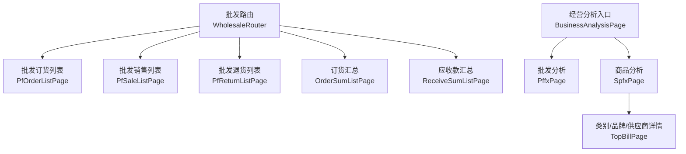

**图表来源**
- [lib/pages/business/wholesale/router.dart:1-54](file://lib/pages/business/wholesale/router.dart#L1-L54)
- [lib/pages/data/businessReport/businessAnalysis/business_analysis_page.dart:1-200](file://lib/pages/data/businessReport/businessAnalysis/business_analysis_page.dart#L1-L200)
- [lib/pages/data/businessReport/businessAnalysis/subpage/pffx_page.dart:1-200](file://lib/pages/data/businessReport/businessAnalysis/subpage/pffx_page.dart#L1-L200)
- [lib/pages/data/businessReport/businessAnalysis/subpage/spfx_page.dart:1-200](file://lib/pages/data/businessReport/businessAnalysis/subpage/spfx_page.dart#L1-L200)
- [lib/pages/data/businessReport/businessAnalysis/subpage/top_bill_page.dart:1-200](file://lib/pages/data/businessReport/businessAnalysis/subpage/top_bill_page.dart#L1-L200)

**章节来源**
- [lib/pages/business/wholesale/router.dart:1-54](file://lib/pages/business/wholesale/router.dart#L1-L54)

## 核心业务概念
- 批发订单：表示客户对商品的订购意向，是销售前端的业务起点。
- 批发销售单：表示实际发生的销售业务，通常对应销售出库、开票、收款等后续财务与仓储环节。
- 批发退货单：针对已发生销售的退回或冲减业务。
- 订货汇总与应收款汇总：分别用于统计订单规模与客户欠款情况，辅助管理与催收。
- 经营分析：围绕零售、批发、门店、业绩、商品等多维度进行数据分析。

在前端中，这些概念通过各自列表页与编辑页实现数据查询、筛选、新增、修改、提交、打印等操作，并通过统一的网络层调用后端接口。

**章节来源**
- [lib/pages/business/wholesale/pf_order/list.dart:1-200](file://lib/pages/business/wholesale/pf_order/list.dart#L1-L200)
- [lib/pages/business/wholesale/pf_sale/list.dart:1-200](file://lib/pages/business/wholesale/pf_sale/list.dart#L1-L200)
- [lib/pages/business/wholesale/pf_return/list.dart:1-200](file://lib/pages/business/wholesale/pf_return/list.dart#L1-L200)
- [lib/pages/business/wholesale/order_sum/list.dart:1-200](file://lib/pages/business/wholesale/order_sum/list.dart#L1-L200)
- [lib/pages/business/wholesale/receive_sum/list.dart:1-200](file://lib/pages/business/wholesale/receive_sum/list.dart#L1-L200)

## 架构总览
批发销售管理的整体前端架构由“路由 → 页面组件 → 网络请求 → 后端接口”组成：
- 路由负责将 URL 映射到具体业务页面。
- 列表页负责分页加载、筛选、状态标签切换。
- 编辑页负责表单填写、计算校验、附件上传、多级审批流展示、保存/审核/撤回/打印/删除等操作。
- 所有数据均通过 HTTP 工具类发起请求，并统一解析响应结构。

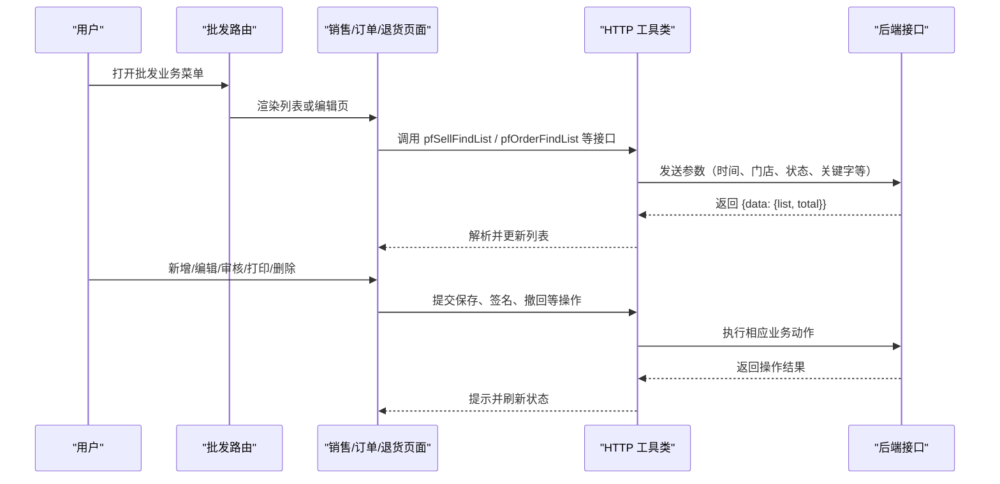

**图表来源**
- [lib/pages/business/wholesale/router.dart:1-54](file://lib/pages/business/wholesale/router.dart#L1-L54)
- [lib/pages/business/wholesale/pf_sale/list.dart:1-200](file://lib/pages/business/wholesale/pf_sale/list.dart#L1-L200)
- [lib/pages/business/wholesale/pf_order/list.dart:1-200](file://lib/pages/business/wholesale/pf_order/list.dart#L1-L200)
- [lib/pages/business/wholesale/pf_return/list.dart:1-200](file://lib/pages/business/wholesale/pf_return/list.dart#L1-L200)

## 详细组件分析

### 批发销售单
批发销售单用于记录实际销售业务，支持按单据号、日期范围、门店、客户、业务员、柜台、支付状态等条件筛选；支持待审核、已审核、已驳回等状态标签。

#### 列表页行为
- 使用 Tab 切换全部、待审核、已审核、已驳回。
- 支持上拉加载更多。
- 默认最近 30 天时间范围，可按门店筛选。
- 调用销售列表接口，传入 signflag、billtype、notwx、starttime、endtime 等参数。

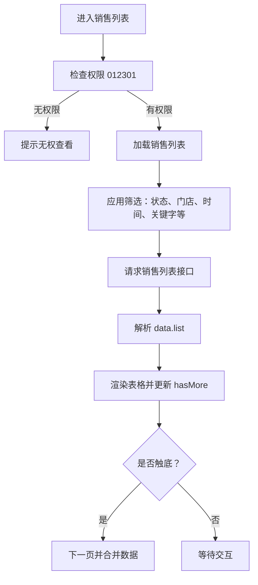

**图表来源**
- [lib/pages/business/wholesale/pf_sale/list.dart:1-200](file://lib/pages/business/wholesale/pf_sale/list.dart#L1-L200)

**章节来源**
- [lib/pages/business/wholesale/pf_sale/list.dart:1-200](file://lib/pages/business/wholesale/pf_sale/list.dart#L1-L200)

#### 编辑页行为
- 支持选择客户、门店、仓库、业务员、柜台、发货人等基础信息。
- 支持扫码录入商品明细。
- 支持参考单据引用，如订货单或入库单。
- 支持多级审批流程显示、电子签名、保存、审核、撤回、打印、删除、退货签出等操作。
- 明细行包含数量、包装数、赠品数量、含税/不含税金额、毛利率、进价金额、售价等计算逻辑。

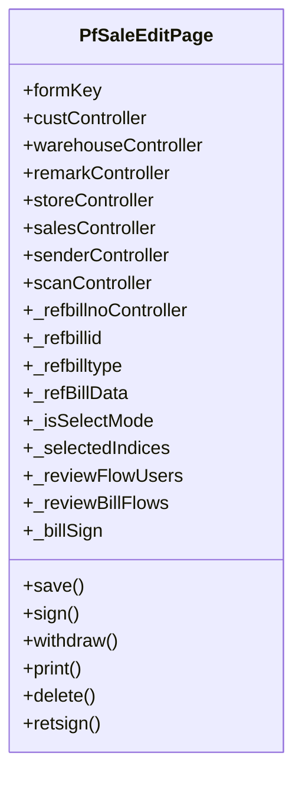

**图表来源**
- [lib/pages/business/wholesale/pf_sale/edit.dart:1-200](file://lib/pages/business/wholesale/pf_sale/edit.dart#L1-L200)

**章节来源**
- [lib/pages/business/wholesale/pf_sale/edit.dart:1-200](file://lib/pages/business/wholesale/pf_sale/edit.dart#L1-L200)

### 批发订单
批发订单是客户下单的业务起点，列表页支持按订单号、日期范围、门店、客户、业务员、柜台、订货标记等筛选；同样具备待审核、已审核、已驳回状态标签。

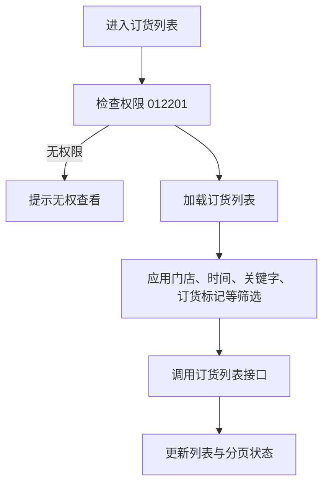

**图表来源**
- [lib/pages/business/wholesale/pf_order/list.dart:1-200](file://lib/pages/business/wholesale/pf_order/list.dart#L1-L200)

**章节来源**
- [lib/pages/business/wholesale/pf_order/list.dart:1-200](file://lib/pages/business/wholesale/pf_order/list.dart#L1-L200)

#### 订单与销售的关系
- 销售编辑页存在“参考单据”字段，支持引用订货单或入库单，从而建立销售单与批发订单之间的关联。
- 典型流程为：客户创建批发订单 → 销售人员基于订单生成销售单 → 销售单审核后触发出库、开票、收款等后续流程。
- 若需冲销，可通过退货单或销售调整方式实现。

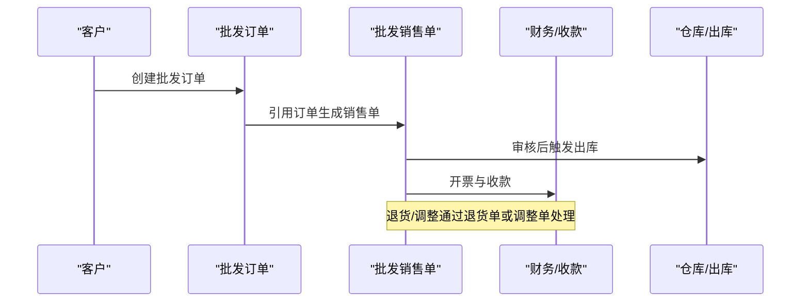

[此图为概念流程示意，不对应单一代码文件]

### 批发退货单
批发退货单用于处理销售退回或冲减，列表页结构与销售列表类似，但 billtype 不同；编辑页支持与退货相关的保存、审核、撤回、打印、删除、退货签出等操作。

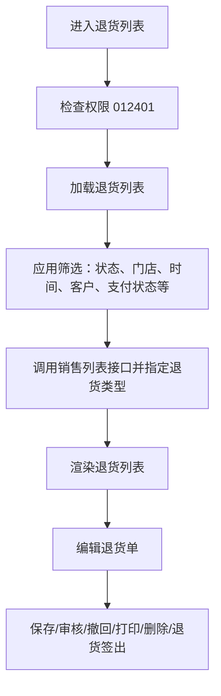

**图表来源**
- [lib/pages/business/wholesale/pf_return/list.dart:1-200](file://lib/pages/business/wholesale/pf_return/list.dart#L1-L200)
- [lib/pages/business/wholesale/pf_return/edit.dart:1-200](file://lib/pages/business/wholesale/pf_return/edit.dart#L1-L200)

**章节来源**
- [lib/pages/business/wholesale/pf_return/list.dart:1-200](file://lib/pages/business/wholesale/pf_return/list.dart#L1-L200)
- [lib/pages/business/wholesale/pf_return/edit.dart:1-200](file://lib/pages/business/wholesale/pf_return/edit.dart#L1-L200)

### 订货汇总与应收款汇总
- 订货汇总：按客户维度或商品维度统计订货情况，支持快速时间标签、门店筛选、分类筛选等。
- 应收款汇总：按客户与业务员维度统计未结清款项，支持客户分类、业务员、客户状态等筛选。

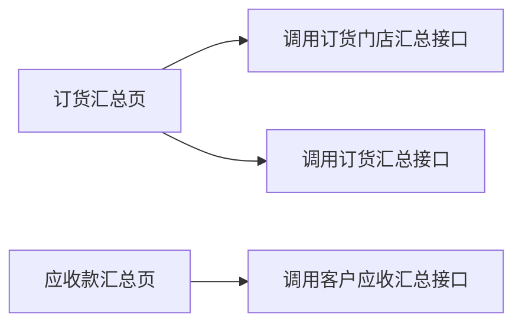

**图表来源**
- [lib/pages/business/wholesale/order_sum/list.dart:1-200](file://lib/pages/business/wholesale/order_sum/list.dart#L1-L200)
- [lib/pages/business/wholesale/receive_sum/list.dart:1-200](file://lib/pages/business/wholesale/receive_sum/list.dart#L1-L200)

**章节来源**
- [lib/pages/business/wholesale/order_sum/list.dart:1-200](file://lib/pages/business/wholesale/order_sum/list.dart#L1-L200)
- [lib/pages/business/wholesale/receive_sum/list.dart:1-200](file://lib/pages/business/wholesale/receive_sum/list.dart#L1-L200)

## 依赖关系分析
- 路由层：`WholesaleRouter` 集中注册批发业务的所有页面路径，包括客户管理、批发订单、批发销售、批发退货、订货汇总、应收款汇总以及选择器页面。
- 页面层：各列表页与编辑页通过 `HttpApi` 与 `http_helper.request` 调用后端接口，并解析 `data.list` 结构。
- 分析层：经营分析入口聚合多个子分析页面，批发分析与商品分析通过独立接口获取数据。

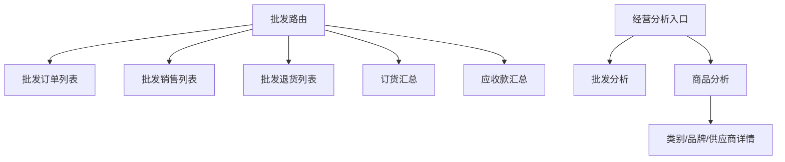

**图表来源**
- [lib/pages/business/wholesale/router.dart:1-54](file://lib/pages/business/wholesale/router.dart#L1-L54)
- [lib/pages/data/businessReport/businessAnalysis/business_analysis_page.dart:1-200](file://lib/pages/data/businessReport/businessAnalysis/business_analysis_page.dart#L1-L200)
- [lib/pages/data/businessReport/businessAnalysis/subpage/pffx_page.dart:1-200](file://lib/pages/data/businessReport/businessAnalysis/subpage/pffx_page.dart#L1-L200)
- [lib/pages/data/businessReport/businessAnalysis/subpage/spfx_page.dart:1-200](file://lib/pages/data/businessReport/businessAnalysis/subpage/spfx_page.dart#L1-L200)
- [lib/pages/data/businessReport/businessAnalysis/subpage/top_bill_page.dart:1-200](file://lib/pages/data/businessReport/businessAnalysis/subpage/top_bill_page.dart#L1-L200)

**章节来源**
- [lib/pages/business/wholesale/router.dart:1-54](file://lib/pages/business/wholesale/router.dart#L1-L54)

## 性能与交互特征
- 分页加载：列表页普遍采用 `_page` 与 `_hasMore` 控制，结合滚动监听实现上拉加载更多。
- 防抖搜索：输入框变更使用定时器延迟 500ms 触发查询，减少频繁请求。
- 权限前置校验：进入页面时先检查权限码，无权限直接提示，避免无效请求。
- 时间范围默认：多数页面默认最近 30 天或当天，便于快速查看近期数据。
- 横向滚动同步：分析页面的表格与汇总区域通过水平滚动控制器同步滚动位置，提升阅读体验。

**章节来源**
- [lib/pages/business/wholesale/pf_sale/list.dart:1-200](file://lib/pages/business/wholesale/pf_sale/list.dart#L1-L200)
- [lib/pages/business/wholesale/pf_order/list.dart:1-200](file://lib/pages/business/wholesale/pf_order/list.dart#L1-L200)
- [lib/pages/business/wholesale/pf_return/list.dart:1-200](file://lib/pages/business/wholesale/pf_return/list.dart#L1-L200)
- [lib/pages/data/businessReport/businessAnalysis/subpage/pffx_page.dart:1-200](file://lib/pages/data/businessReport/businessAnalysis/subpage/pffx_page.dart#L1-L200)
- [lib/pages/data/businessReport/businessAnalysis/subpage/spfx_page.dart:1-200](file://lib/pages/data/businessReport/businessAnalysis/subpage/spfx_page.dart#L1-L200)

## 审核、权限与审计日志

### 审核流程
- 列表页通过 Tab 切换“全部、待审核、已审核、已驳回”，并通过 `signflag` 参数区分状态。
- 编辑页支持多级审批流展示、电子签名、保存、审核、撤回、打印、删除、退货签出等操作。
- 审批流数据通过 `_reviewFlowUsers` 与 `_reviewBillFlows` 维护，结合 `_billSign` 控制签名状态。

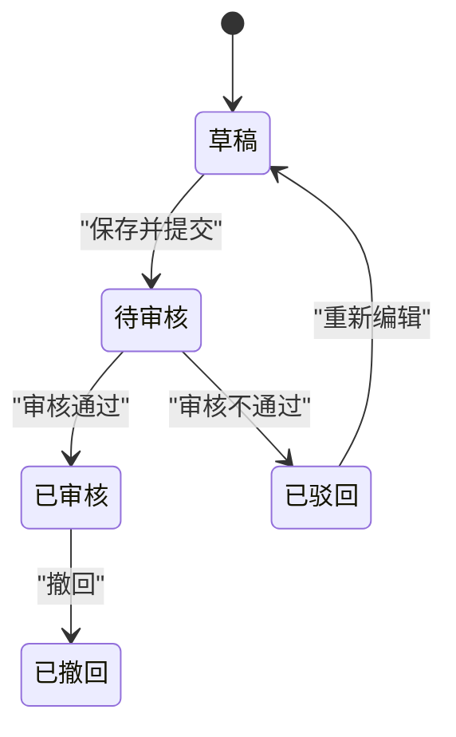

**图表来源**
- [lib/pages/business/wholesale/pf_sale/edit.dart:1-200](file://lib/pages/business/wholesale/pf_sale/edit.dart#L1-L200)
- [lib/pages/business/wholesale/pf_order/edit.dart:1-200](file://lib/pages/business/wholesale/pf_order/edit.dart#L1-L200)
- [lib/pages/business/wholesale/pf_return/edit.dart:1-200](file://lib/pages/business/wholesale/pf_return/edit.dart#L1-L200)

### 权限控制
- 批发销售列表：权限码 `012301`。
- 批发订货列表：权限码 `012201`。
- 批发退货列表：权限码 `012401`。
- 订货汇总：权限码 `012501`。
- 应收款汇总：权限码 `012601`。
- 权限不足时统一提示“你无权查看……请在后台修改权限”。

**章节来源**
- [lib/pages/business/wholesale/pf_sale/list.dart:1-200](file://lib/pages/business/wholesale/pf_sale/list.dart#L1-L200)
- [lib/pages/business/wholesale/pf_order/list.dart:1-200](file://lib/pages/business/wholesale/pf_order/list.dart#L1-L200)
- [lib/pages/business/wholesale/pf_return/list.dart:1-200](file://lib/pages/business/wholesale/pf_return/list.dart#L1-L200)
- [lib/pages/business/wholesale/order_sum/list.dart:1-200](file://lib/pages/business/wholesale/order_sum/list.dart#L1-L200)
- [lib/pages/business/wholesale/receive_sum/list.dart:1-200](file://lib/pages/business/wholesale/receive_sum/list.dart#L1-L200)

### 审计日志记录
- 列表页与编辑页混入 `LogPageMixin`，提供 `logPageName` 与 `logQuery` 等方法，用于记录页面访问与查询行为。
- 日志写入通过 `FileLogWriter` 等工具完成，便于问题回溯。

**章节来源**
- [lib/pages/business/wholesale/pf_sale/list.dart:1-200](file://lib/pages/business/wholesale/pf_sale/list.dart#L1-L200)
- [lib/pages/business/wholesale/pf_order/list.dart:1-200](file://lib/pages/business/wholesale/pf_order/list.dart#L1-L200)
- [lib/pages/business/wholesale/pf_return/list.dart:1-200](file://lib/pages/business/wholesale/pf_return/list.dart#L1-L200)

## 退货与调整处理方案

### 销售退货
- 通过批发退货列表与编辑页实现退货单的创建、编辑、审核、撤回、打印、删除、退货签出等操作。
- 退货单与批发销售单形成反向关系，可用于冲减销售数量与金额。

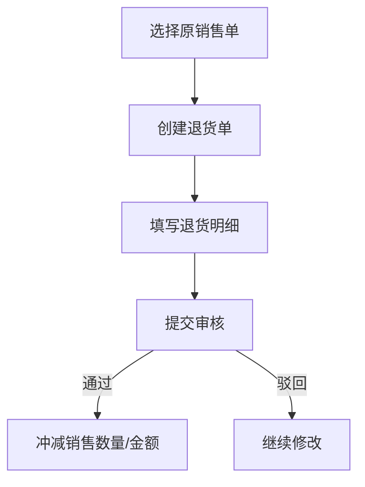

**图表来源**
- [lib/pages/business/wholesale/pf_return/edit.dart:1-200](file://lib/pages/business/wholesale/pf_return/edit.dart#L1-L200)

### 销售调整
- 当前代码库未提供独立的“销售调整单”页面，但销售编辑页与退货编辑页具备金额、税率、毛利率等计算逻辑，可在必要时通过退货或关联单据引用进行调整。
- 建议在业务层面明确“调整单”的数据模型与接口，并在前端新增对应页面与路由。

[本节为业务建议，不对应现有特定代码文件]

## 统计分析与报表能力

### 经营分析入口
经营分析入口聚合多个分析卡片，包括零售分析、客单分析、会员分析、商品分析、销售退货、采购分析、批发分析、门店分析、业绩分析等。批发分析卡片展示销售额、毛利额、毛利率等指标。

**章节来源**
- [lib/pages/data/businessReport/businessAnalysis/business_analysis_page.dart:1-200](file://lib/pages/data/businessReport/businessAnalysis/business_analysis_page.dart#L1-L200)

### 批发分析
批发分析页面根据时间粒度（日、周、月）展示销售趋势图，并提供列表数据与汇总数据。

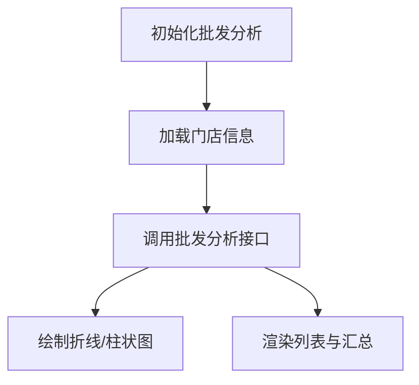

**图表来源**
- [lib/pages/data/businessReport/businessAnalysis/subpage/pffx_page.dart:1-200](file://lib/pages/data/businessReport/businessAnalysis/subpage/pffx_page.dart#L1-L200)

**章节来源**
- [lib/pages/data/businessReport/businessAnalysis/subpage/pffx_page.dart:1-200](file://lib/pages/data/businessReport/businessAnalysis/subpage/pffx_page.dart#L1-L200)

### 商品分析
商品分析页面支持按销量、金额、毛利额、毛利率、均价等维度排行，并支持分类、品牌、供货商维度的钻取详情。

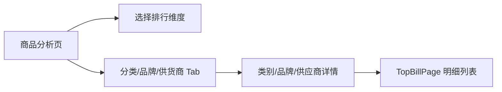

**图表来源**
- [lib/pages/data/businessReport/businessAnalysis/subpage/spfx_page.dart:1-200](file://lib/pages/data/businessReport/businessAnalysis/subpage/spfx_page.dart#L1-L200)
- [lib/pages/data/businessReport/businessAnalysis/subpage/top_bill_page.dart:1-200](file://lib/pages/data/businessReport/businessAnalysis/subpage/top_bill_page.dart#L1-L200)

**章节来源**
- [lib/pages/data/businessReport/businessAnalysis/subpage/spfx_page.dart:1-200](file://lib/pages/data/businessReport/businessAnalysis/subpage/spfx_page.dart#L1-L200)
- [lib/pages/data/businessReport/businessAnalysis/subpage/top_bill_page.dart:1-200](file://lib/pages/data/businessReport/businessAnalysis/subpage/top_bill_page.dart#L1-L200)

## 故障排查指南
- 无权限查看：检查用户权限配置是否包含对应权限码（012201、012301、012401、012501、012601）。
- 列表为空：确认时间范围、门店筛选、关键字是否正确；检查网络请求是否成功返回 `data.list`。
- 审核失败：检查审批流配置与签名状态；确认当前单据未被其他操作锁定。
- 计算异常：核对单价、数量、包装数、赠品数量、税率等字段是否合理；检查金额计算公式是否与业务规则一致。
- 分析图表无数据：确认所选时间范围与门店是否正确；检查接口返回的 `list` 与 `sumdata` 是否为空。

**章节来源**
- [lib/pages/business/wholesale/pf_order/list.dart:1-200](file://lib/pages/business/wholesale/pf_order/list.dart#L1-L200)
- [lib/pages/business/wholesale/pf_sale/list.dart:1-200](file://lib/pages/business/wholesale/pf_sale/list.dart#L1-L200)
- [lib/pages/business/wholesale/pf_return/list.dart:1-200](file://lib/pages/business/wholesale/pf_return/list.dart#L1-L200)
- [lib/pages/data/businessReport/businessAnalysis/subpage/pffx_page.dart:1-200](file://lib/pages/data/businessReport/businessAnalysis/subpage/pffx_page.dart#L1-L200)

## 结论
本项目的批发销售管理功能以 Flutter 页面为核心，围绕批发订单、销售单、退货单展开，配合订货汇总与应收款汇总，形成完整的批发业务闭环。经营分析模块进一步提供批发与商品多维分析能力。系统在权限控制、审核流程、审计日志方面已有较好支撑，后续可在此基础上扩展销售调整单、更细粒度的权限策略与更丰富的报表维度。