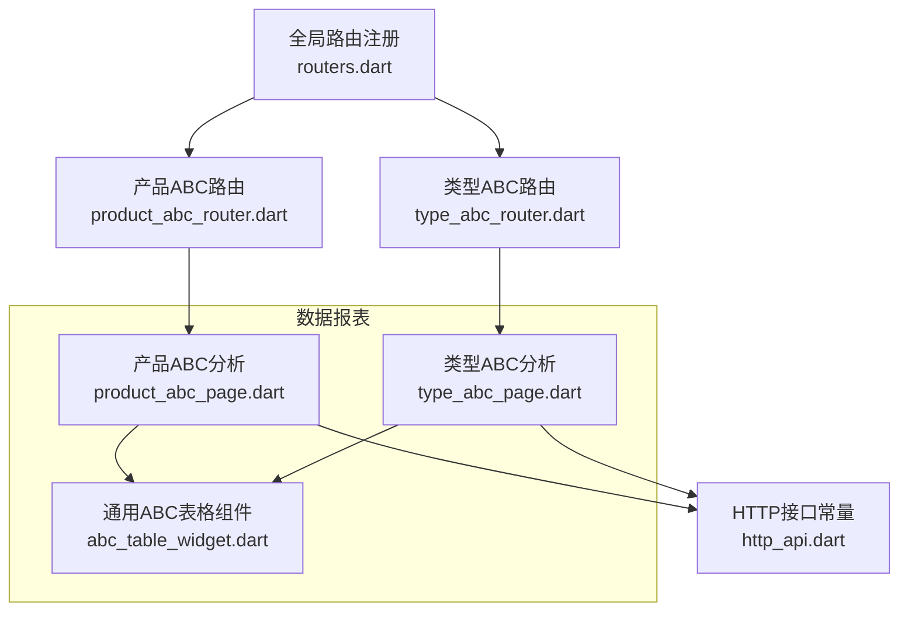
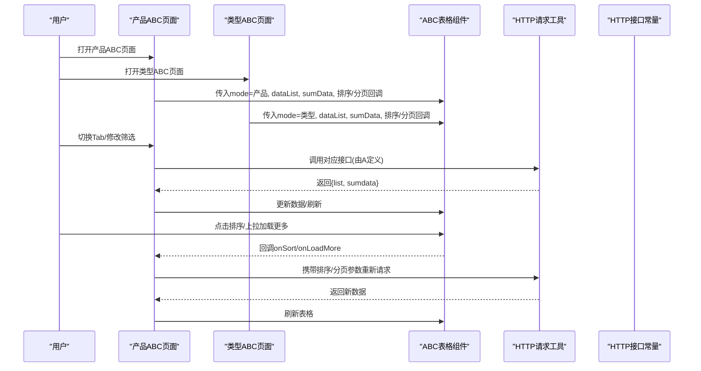
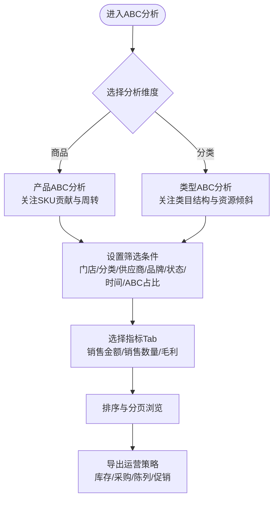
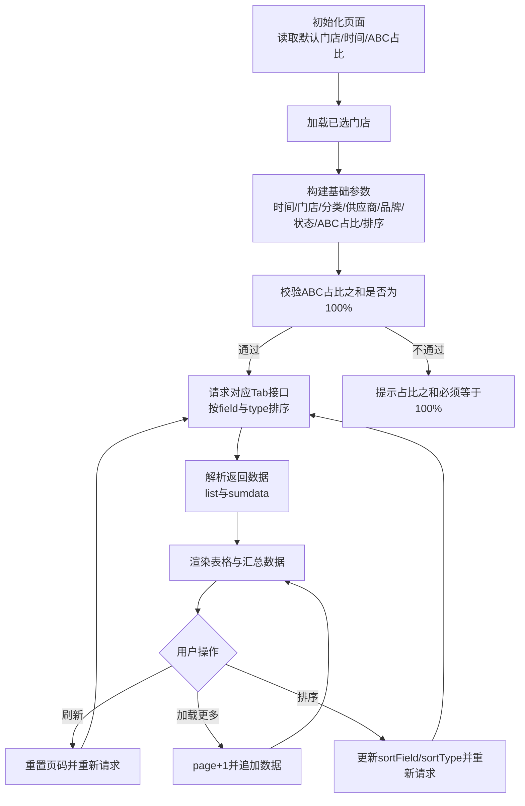
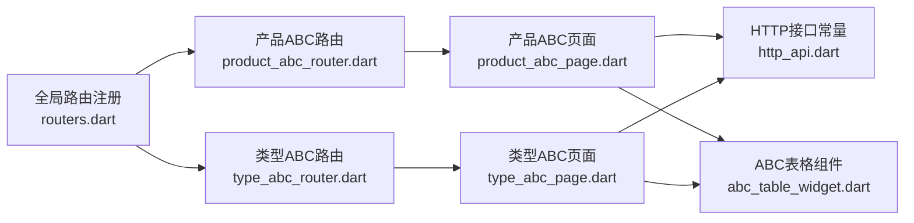

# ABC分析

<cite>
**本文引用的文件**   
- [routers.dart](file://lib/routers/routers.dart)
- [product_abc_router.dart](file://lib/pages/data/businessReport/productABC/product_abc_router.dart)
- [type_abc_router.dart](file://lib/pages/data/businessReport/typeABC/type_abc_router.dart)
- [product_abc_page.dart](file://lib/pages/data/businessReport/productABC/product_abc_page.dart)
- [type_abc_page.dart](file://lib/pages/data/businessReport/typeABC/type_abc_page.dart)
- [http_api.dart](file://lib/net/http_api.dart)
</cite>

## 目录
1. [引言](#引言)
2. [项目结构](#项目结构)
3. [核心组件](#核心组件)
4. [架构总览](#架构总览)
5. [详细组件分析](#详细组件分析)
6. [依赖关系分析](#依赖关系分析)
7. [性能与可用性考虑](#性能与可用性考虑)
8. [故障排查指南](#故障排查指南)
9. [结论](#结论)
10. [附录：ABC分类的业务策略与资源配置](#附录abc分类的业务策略与资源配置)

## 引言
本文面向灵犀管店 Flutter 项目的 ABC 分析功能，围绕“类型 ABC 分析”和“产品 ABC 分析”两大报表页面，系统梳理其理论基础、划分标准、权重计算方式、数据展示与排序交互，以及与库存、采购等业务的联动策略。文档同时从代码实现角度解释页面路由、筛选条件、分页加载、汇总数据展示等关键流程，帮助开发者与业务用户共同理解并优化该功能的使用效果。

## 项目结构
ABC 分析功能位于“数据报表”模块下，包含两个独立子模块：
- 产品 ABC 分析：按商品维度进行 ABC 分类统计与列表展示。
- 类型 ABC 分析：按商品分类（类目）维度进行 ABC 分类统计与列表展示。

两者共用一个通用的 ABC 表格组件，负责统一的数据展示、排序与分页交互。

图表来源
- [routers.dart:1-176](file://lib/routers/routers.dart#L1-L176)
- [product_abc_router.dart:1-12](file://lib/pages/data/businessReport/productABC/product_abc_router.dart#L1-L12)
- [type_abc_router.dart:1-12](file://lib/pages/data/businessReport/typeABC/type_abc_router.dart#L1-L12)
- [product_abc_page.dart:1-200](file://lib/pages/data/businessReport/productABC/product_abc_page.dart#L1-L200)
- [type_abc_page.dart:1-200](file://lib/pages/data/businessReport/typeABC/type_abc_page.dart#L1-L200)
- [http_api.dart](file://lib/net/http_api.dart)

章节来源
- [routers.dart:1-176](file://lib/routers/routers.dart#L1-L176)
- [product_abc_router.dart:1-12](file://lib/pages/data/businessReport/productABC/product_abc_router.dart#L1-L12)
- [type_abc_router.dart:1-12](file://lib/pages/data/businessReport/typeABC/type_abc_router.dart#L1-L12)

## 核心组件
- 产品 ABC 分析页面：聚焦“商品”维度，支持销售金额、销售数量、毛利三个维度的 ABC 分析；提供门店、分类、供应商、品牌、状态、时间范围、ABC 占比等筛选条件；具备分页加载、下拉刷新、列排序能力。
- 类型 ABC 分析页面：聚焦“分类”维度，在商品 ABC 的基础上增加“分类级别”筛选（一级/二级/三级/四级分类），其余交互与产品 ABC 高度一致。
- 通用 ABC 表格组件：抽象了 ABC 结果表的数据展示、汇总信息展示、排序触发、分页加载回调等 UI 行为。

章节来源
- [product_abc_page.dart:1-200](file://lib/pages/data/businessReport/productABC/product_abc_page.dart#L1-L200)
- [type_abc_page.dart:1-200](file://lib/pages/data/businessReport/typeABC/type_abc_page.dart#L1-L200)

## 架构总览
ABC 分析采用“页面 + 表格组件 + HTTP 接口”的三层协作模式：
- 页面层：负责筛选参数构建、Tab 切换、日期选择、分页控制、UI 组装。
- 表格组件层：渲染 ABC 明细列表、汇总卡片、排序与加载更多逻辑。
- 接口层：通过 HTTP 接口常量获取不同维度与指标的 ABC 数据，返回分页列表与汇总数据。

图表来源
- [product_abc_page.dart:201-650](file://lib/pages/data/businessReport/productABC/product_abc_page.dart#L201-L650)
- [type_abc_page.dart:1-200](file://lib/pages/data/businessReport/typeABC/type_abc_page.dart#L1-L200)
- [http_api.dart](file://lib/net/http_api.dart)

## 详细组件分析

### 理论基础与划分标准（80/20法则与权重）
- 理论依据：ABC 分析法基于帕累托原则（80/20法则），即少数关键项贡献大部分价值。在零售与供应链场景中，通常将销售额、销量或毛利等指标的前段累计占比划分为 A 类，中段为 B 类，尾段为 C 类。
- 划分标准：本功能允许用户在筛选面板中自定义 A/B/C 三类占比，默认值分别为 A=70%、B=20%、C=10%，且要求三者之和等于 100%。页面会在请求前校验该约束，不满足时给出提示并阻止请求。
- 权重计算：具体权重分段与累计占比算法由后端接口完成；前端仅负责传递 aprop、bprop、cprop 等比例参数，并按不同 Tab（销售金额、销售数量、毛利）选择对应字段作为排序基准。

章节来源
- [product_abc_page.dart:1-200](file://lib/pages/data/businessReport/productABC/product_abc_page.dart#L1-L200)
- [product_abc_page.dart:201-650](file://lib/pages/data/businessReport/productABC/product_abc_page.dart#L201-L650)
- [type_abc_page.dart:1-200](file://lib/pages/data/businessReport/typeABC/type_abc_page.dart#L1-L200)

### 产品类型差异与应用场景
- 产品 ABC 分析
  - 分析对象：商品（SKU/货品）。
  - 典型用途：识别高贡献商品、滞销商品，指导备货、促销、清仓与淘汰策略。
  - 主要维度：销售金额、销售数量、毛利。
  - 筛选条件：门店、分类、供应商、品牌、商品状态、时间范围、ABC 占比、排序字段与方向。
- 类型 ABC 分析
  - 分析对象：商品分类（类目）。
  - 典型用途：评估品类结构与贡献度，指导品类规划、货架布局、资源倾斜与营销预算分配。
  - 额外能力：支持“分类级别”筛选（一级/二级/三级/四级分类）。
  - 其他筛选条件与产品 ABC 基本一致。

[本图为概念流程图，不对应具体源码文件]

### ABC 表格组件：数据展示、排序与交互
- 数据展示
  - 以列表形式呈现 ABC 分类结果，包含 A/B/C 标记及对应指标数值。
  - 顶部汇总区展示 sumData 中的聚合信息，便于快速把握整体规模与结构。
- 排序功能
  - 支持多列点击排序，当前 Tab 有默认排序字段：销售金额 Tab 默认按销售金额降序，销售数量 Tab 默认按销售数量降序，毛利 Tab 默认按毛利额降序。
  - 排序字段与方向会作为参数传递给后端接口，保证服务端排序的一致性。
- 交互操作
  - 下拉刷新：重置页码并重新拉取首屏数据。
  - 上拉加载更多：当返回数据长度达到阈值时继续拉取下一页数据，直到 no more。
  - 筛选变更：门店、分类、供应商、品牌、状态、时间、ABC 占比等任一变化都会重置页码并重新加载。

章节来源
- [product_abc_page.dart:201-650](file://lib/pages/data/businessReport/productABC/product_abc_page.dart#L201-L650)
- [type_abc_page.dart:1-200](file://lib/pages/data/businessReport/typeABC/type_abc_page.dart#L1-L200)

### 页面工作流与数据流

#### 产品 ABC 页面工作流

图表来源
- [product_abc_page.dart:201-650](file://lib/pages/data/businessReport/productABC/product_abc_page.dart#L201-L650)

#### 类型 ABC 页面工作流
类型 ABC 页面与产品 ABC 页面的工作流基本一致，区别在于：
- 多了“分类级别”筛选（一级/二级/三级/四级分类）。
- 调用的接口不同，分别对应分类维度的金额、数量、毛利 ABC 接口。

章节来源
- [type_abc_page.dart:1-200](file://lib/pages/data/businessReport/typeABC/type_abc_page.dart#L1-L200)

### 筛选条件与参数构造
- 基础参数包括：
  - 时间范围：起止时间字符串，格式为“yyyy-MM-dd HH:mm:ss”。
  - 门店：支持单店或多店（实际传参为 sids 列表）。
  - 分类：支持多选分类，传参为 typeid 列表。
  - 供应商：可选 supid。
  - 品牌：brandname，内部以逗号分隔拼接。
  - 商品状态：itemstatusin，以逗号分隔拼接。
  - ABC 占比：aprop、bprop、cprop，三者之和必须等于 100%。
  - 排序：field 与 type（升序/降序）。
- 类型 ABC 页面在此基础上增加 level（分类级别）参数。

章节来源
- [product_abc_page.dart:1-200](file://lib/pages/data/businessReport/productABC/product_abc_page.dart#L1-L200)
- [type_abc_page.dart:1-200](file://lib/pages/data/businessReport/typeABC/type_abc_page.dart#L1-L200)

## 依赖关系分析
- 路由依赖
  - 全局路由注册中心引入并初始化产品 ABC 与类型 ABC 的路由提供者。
  - 各子路由定义 root 路径，并在 FluroRouter 中绑定对应页面。
- 页面依赖
  - 两个页面均依赖 HTTP 接口常量与网络请求工具。
  - 两个页面均使用通用 ABC 表格组件渲染结果。
- 外部库
  - 本地存储用于保存当前门店等信息。
  - 日期选择器、弹窗、SVG 图标等通用 UI 组件。

图表来源
- [routers.dart:1-176](file://lib/routers/routers.dart#L1-L176)
- [product_abc_router.dart:1-12](file://lib/pages/data/businessReport/productABC/product_abc_router.dart#L1-L12)
- [type_abc_router.dart:1-12](file://lib/pages/data/businessReport/typeABC/type_abc_router.dart#L1-L12)
- [product_abc_page.dart:1-200](file://lib/pages/data/businessReport/productABC/product_abc_page.dart#L1-L200)
- [type_abc_page.dart:1-200](file://lib/pages/data/businessReport/typeABC/type_abc_page.dart#L1-L200)
- [http_api.dart](file://lib/net/http_api.dart)

章节来源
- [routers.dart:1-176](file://lib/routers/routers.dart#L1-L176)
- [product_abc_router.dart:1-12](file://lib/pages/data/businessReport/productABC/product_abc_router.dart#L1-L12)
- [type_abc_router.dart:1-12](file://lib/pages/data/businessReport/typeABC/type_abc_router.dart#L1-L12)

## 性能与可用性考虑
- 分页加载：每次请求一页数据（例如 20 条），避免一次性加载过多数据导致卡顿；通过 hasMore 控制是否继续加载。
- 排序一致性：排序字段与方向同步到后端，减少前端排序误差，提高大数据量下的准确性。
- 筛选组合：筛选条件变化时重置页码，避免旧页数据与新筛选不一致的问题。
- 用户体验：提供快捷时间选项（昨日/今日/本周/本月/自定义），以及左右箭头移动时间段，提升检索效率。
- 错误处理：网络异常时关闭“可加载更多”标志，防止无限重试；ABC 占比校验失败时即时提示。

[本节为通用建议，未直接分析具体源码文件]

## 故障排查指南
- ABC 占比之和不等于 100%
  - 现象：无法发起请求，界面弹出提示。
  - 原因：aprop + bprop + cprop 不等于 100。
  - 解决：在筛选面板中调整三类占比，使总和为 100。
- 数据为空或无更多数据
  - 现象：列表为空或提示没有更多数据。
  - 可能原因：筛选条件过严、时间范围无交易、分类/品牌/供应商过滤后无结果。
  - 排查：逐步放宽筛选条件，检查时间范围与门店是否正确。
- 排序异常
  - 现象：点击排序后数据未按预期排列。
  - 排查：确认 field 与 type 是否正确传入后端；必要时切换 Tab 后再试。
- 门店信息异常
  - 现象：默认门店未显示或筛选无效。
  - 排查：检查本地存储的门店信息是否正确写入；尝试重新选择门店。

章节来源
- [product_abc_page.dart:201-650](file://lib/pages/data/businessReport/productABC/product_abc_page.dart#L201-L650)
- [type_abc_page.dart:1-200](file://lib/pages/data/businessReport/typeABC/type_abc_page.dart#L1-L200)

## 结论
灵犀管店的 ABC 分析功能通过“产品 ABC”和“类型 ABC”两条主线，结合灵活的筛选、排序与分页能力，帮助商家从 SKU 与类目两个视角识别关键贡献者与长尾项，从而制定差异化的库存管理、采购计划与运营策略。通用 ABC 表格组件有效降低了重复开发成本，提升了体验一致性；前后端分工明确，前端专注交互与参数构造，后端负责权重分段与累计占比计算。

[本节为总结性内容，未直接分析具体源码文件]

## 附录：ABC分类的业务策略与资源配置
- 业务意义
  - A 类：核心贡献项，需重点保障供应与陈列曝光，优先保障安全库存与热销期备货。
  - B 类：中坚力量，维持合理库存与稳定周转，适时参与营销活动以提升贡献。
  - C 类：长尾与尾部项，控制库存占用，定期清理与优化，降低资金占用。
- 库存管理策略
  - A 类：提高安全库存、缩短补货周期、加强缺货预警；对高波动商品增加预测频次。
  - B 类：常规安全库存与补货策略；结合促销节奏做阶段性增量。
  - C 类：低库存或按单采购；对长期滞销进行清仓或下架。
- 采购计划指导
  - A 类：建立稳定的供应商合作关系，签订保供协议；设置自动补货与最小起订量优化。
  - B 类：批量采购与联合采购，平衡价格与库存成本。
  - C 类：按需采购或小批量试采，降低呆滞风险。
- 差异化运营与资源配置
  - 商品 ABC：针对 A 类商品加大首页推荐、搜索加权、会员专享价与导购主推；对 C 类商品做组合销售与打包促销。
  - 分类 ABC：对 A 类类目倾斜流量与广告预算，优化类目页结构与关联推荐；对 C 类类目精简 SKU，聚焦爆款。
  - 人员与时间资源：店长与采购员优先跟进 A 类商品的动销与断货风险；排班与盘点优先覆盖 A 类区域。

[本节为通用业务建议，未直接分析具体源码文件]