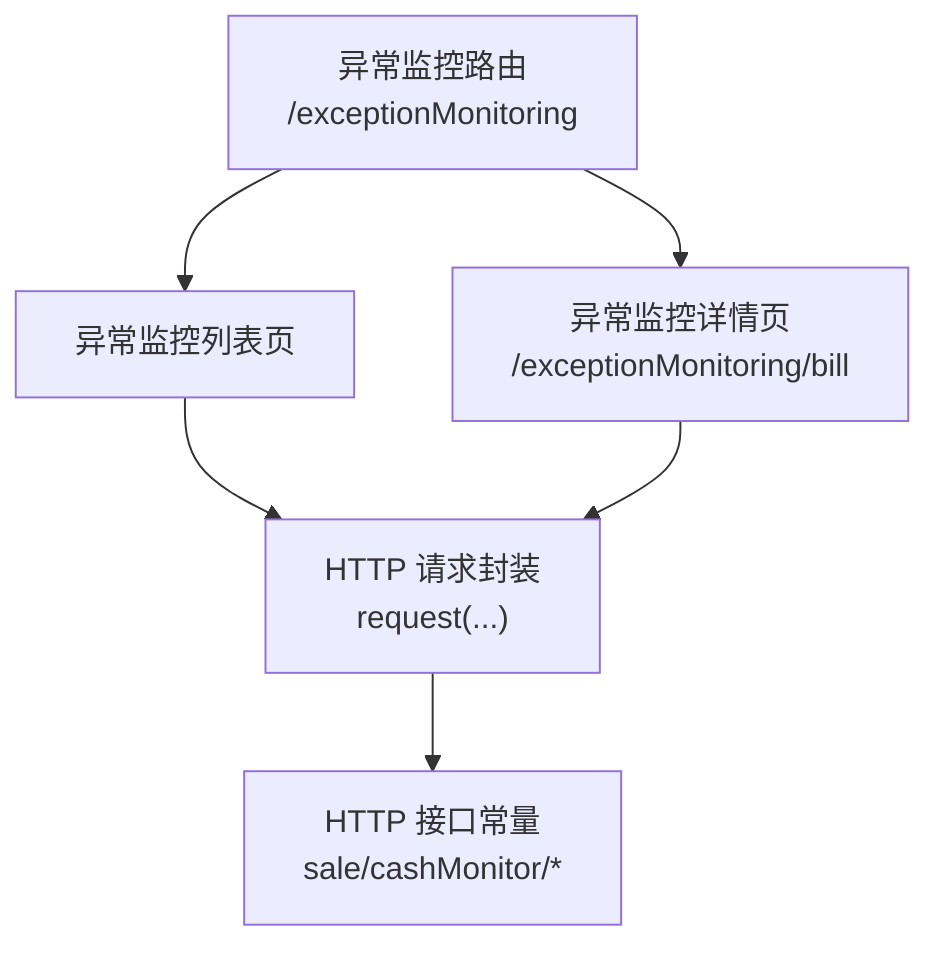
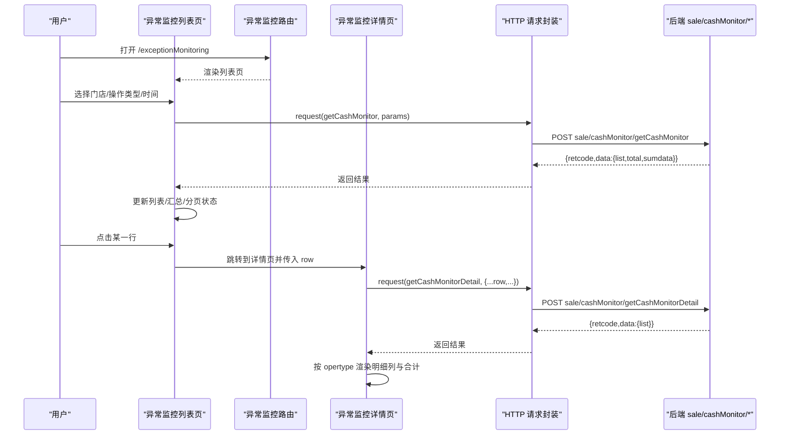
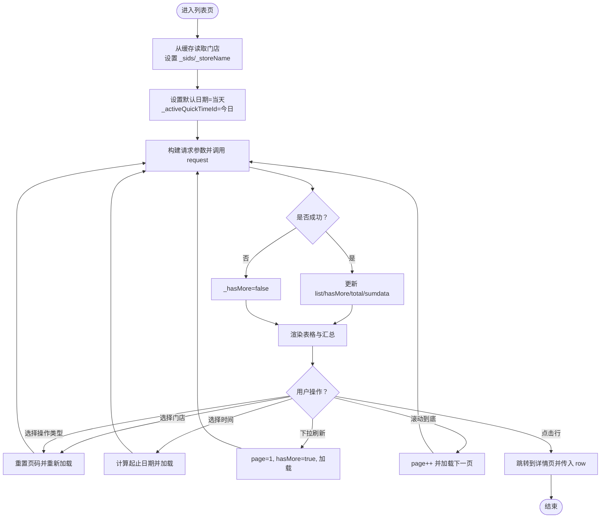
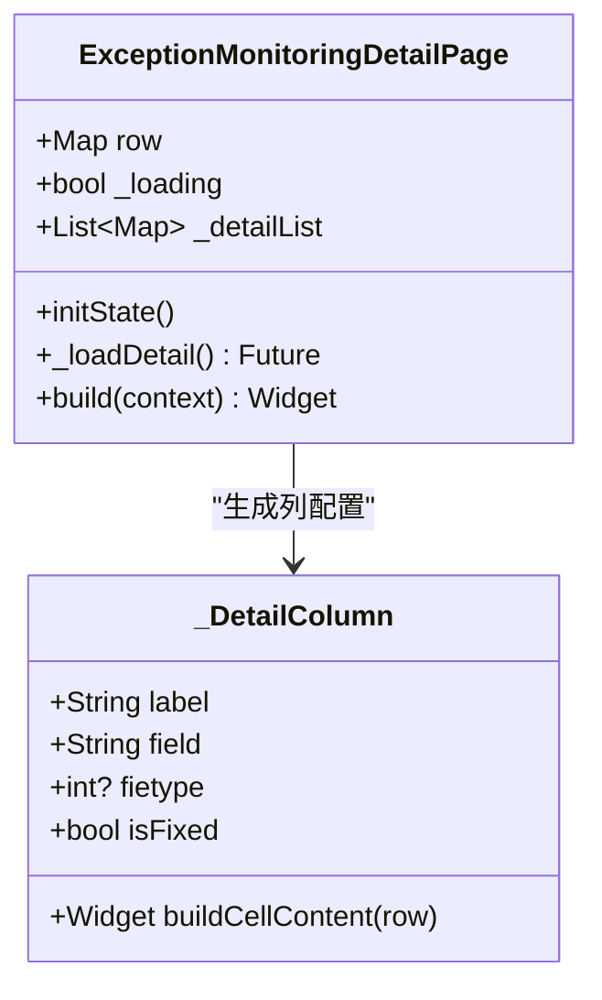
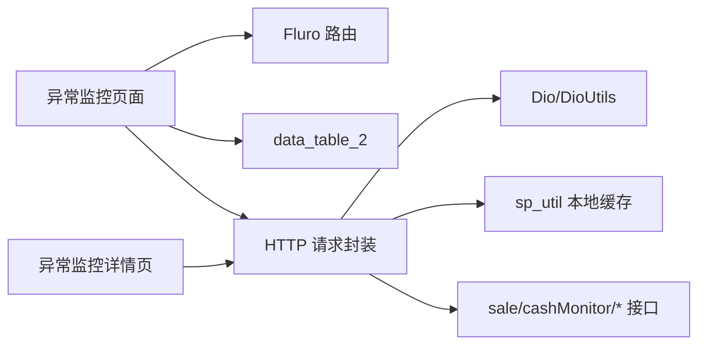

# 异常监控

<cite>
**本文引用的文件**   
- [异常监控页面](file://lib/pages/data/businessReport/exceptionMonitoring/exception_monitoring_page.dart)
- [异常监控详情页](file://lib/pages/data/businessReport/exceptionMonitoring/exception_monitoring_detail_page.dart)
- [异常监控路由](file://lib/pages/data/businessReport/exceptionMonitoring/exception_monitoring_router.dart)
- [HTTP 接口常量](file://lib/net/http_api.dart)
- [HTTP 请求封装](file://lib/net/http_helper.dart)
</cite>

## 目录
1. [简介](#简介)
2. [项目结构定位](#项目结构定位)
3. [核心组件](#核心组件)
4. [架构总览](#架构总览)
5. [详细组件分析](#详细组件分析)
6. [依赖关系分析](#依赖关系分析)
7. [性能与可用性特征](#性能与可用性特征)
8. [排障指南](#排障指南)
9. [结论](#结论)
10. [附录：异常类型、告警规则与治理建议](#附录异常类型告警规则与治理建议)

## 简介
本文件围绕灵犀管店 Flutter 项目中的“异常监控”能力进行系统化说明。该功能用于展示销售现金环节的异常业务记录，支持按门店、时间范围和操作类型筛选，并提供异常明细的逐条查看。它属于数据报表模块下的“异常监控”子功能，通过统一 HTTP 客户端调用后端接口获取列表与明细数据。

需要特别说明的是：当前仓库中异常监控更偏向“业务异常流水查询与展示”，并未直接实现前端侧的崩溃日志上报、严重程度分级、工单流转或 SLA 时效等完整 APM 体系。相关“检测算法、告警规则配置、根因定位、应急预案”等内容在现有代码中没有直接实现；文档将在附录给出基于现有能力的扩展建议与最佳实践。

## 项目结构定位
异常监控位于 `lib/pages/data/businessReport/exceptionMonitoring` 目录下，包含三个核心文件：
- 列表页：负责筛选、分页、汇总与点击跳转。
- 详情页：根据操作类型动态渲染商品级明细列与合计行。
- 路由：注册 `/exceptionMonitoring` 与 `/exceptionMonitoring/bill` 两个路由，并把列表行数据透传给详情页。

图表来源
- [异常监控路由：1-21](file://lib/pages/data/businessReport/exceptionMonitoring/exception_monitoring_router.dart#L1-L21)
- [异常监控页面：240-270](file://lib/pages/data/businessReport/exceptionMonitoring/exception_monitoring_page.dart#L240-L270)
- [异常监控详情页：25-45](file://lib/pages/data/businessReport/exceptionMonitoring/exception_monitoring_detail_page.dart#L25-L45)
- [HTTP 接口常量：292-295](file://lib/net/http_api.dart#L292-L295)
- [HTTP 请求封装：1-120](file://lib/net/http_helper.dart#L1-L120)

章节来源
- [异常监控路由：1-21](file://lib/pages/data/businessReport/exceptionMonitoring/exception_monitoring_router.dart#L1-L21)
- [异常监控页面：1-120](file://lib/pages/data/businessReport/exceptionMonitoring/exception_monitoring_page.dart#L1-L120)
- [异常监控详情页：1-60](file://lib/pages/data/businessReport/exceptionMonitoring/exception_monitoring_detail_page.dart#L1-L60)
- [HTTP 接口常量：292-295](file://lib/net/http_api.dart#L292-L295)
- [HTTP 请求封装：1-120](file://lib/net/http_helper.dart#L1-L120)

## 核心组件
- 异常监控列表页
  - 提供“门店选择”“操作类型选择”“快速时间（昨天/今日/本周/本月/自定义）”“日期导航”“下拉刷新”“触底加载更多”。
  - 维护分页状态 `_page`、加载状态 `_loading`、是否有更多数据 `_hasMore`、已加载一次标记 `_hasLoadedOnce`。
  - 显示“异常总笔数”和“异常总金额”汇总信息。
- 异常监控详情页
  - 接收列表行数据 `row`，以固定左列 + 多列数值的方式展示商品级明细。
  - 根据 `opertype` 动态切换字段：原售价、最新价、单价、变动金额、删除金额、退货金额、赠送金额、挂单金额等。
  - 底部追加“合计”行，对数值列做汇总。
- 异常监控路由
  - 定义根路径 `/exceptionMonitoring` 与单据详情路径 `/exceptionMonitoring/bill`。
  - 将列表选中行的 JSON 字符串解析为 Map 并传入详情页。
- HTTP 层
  - 接口常量：`sale/cashMonitor/getCashMonitor`（列表）、`sale/cashMonitor/getCashMonitorDetail`（明细）。
  - 请求封装：统一组装 sid/spid/token/client/sign/requestId/params，处理 retcode/code 响应、登录过期、错误 Toast 与日志落盘。

章节来源
- [异常监控页面：120-865](file://lib/pages/data/businessReport/exceptionMonitoring/exception_monitoring_page.dart#L120-L865)
- [异常监控详情页：60-344](file://lib/pages/data/businessReport/exceptionMonitoring/exception_monitoring_detail_page.dart#L60-L344)
- [异常监控路由：1-21](file://lib/pages/data/businessReport/exceptionMonitoring/exception_monitoring_router.dart#L1-L21)
- [HTTP 接口常量：292-295](file://lib/net/http_api.dart#L292-L295)
- [HTTP 请求封装：120-351](file://lib/net/http_helper.dart#L120-L351)

## 架构总览
异常监控采用典型的前端页面 → 网络请求封装 → 后端接口的分层结构。页面只关心 UI 状态、用户交互与数据渲染；具体请求细节由 `request` 方法统一处理。

图表来源
- [异常监控路由：10-21](file://lib/pages/data/businessReport/exceptionMonitoring/exception_monitoring_router.dart#L10-L21)
- [异常监控页面：240-270](file://lib/pages/data/businessReport/exceptionMonitoring/exception_monitoring_page.dart#L240-L270)
- [异常监控详情页：25-45](file://lib/pages/data/businessReport/exception_monitoring_detail_page.dart#L25-L45)
- [HTTP 接口常量：292-295](file://lib/net/http_api.dart#L292-L295)
- [HTTP 请求封装：120-351](file://lib/net/http_helper.dart#L120-L351)

## 详细组件分析

### 异常监控列表页
职责要点：
- 初始化默认时间为当天，并从本地缓存读取当前门店信息。
- 支持选择全部机构或指定门店，改变后重置分页并重新加载。
- 操作类型使用内置枚举值，包括单品改价、单品删除、商品退货、整单折扣、整单删除、商品赠送、挂单、删除挂单等。
- 快速时间选择器提供昨天、今日、本周、本月、自定义五种模式，内部计算起止日期。
- 日期导航支持按日/周/月步进切换。
- 列表请求参数包含 field/type/is_page/page/pagesize/sids/starttime/endtime/opertype。
- 列表成功返回后更新 list、hasMore、totalCount、totalAmount。
- 下拉刷新重置到第 1 页；滚动到底部时自动加载更多。
- 表格列包括单号、操作类型、操作金额、操作员、门店。
- 点击单号跳转到详情页，传入原始行数据。

图表来源
- [异常监控页面：25-118](file://lib/pages/data/businessReport/exceptionMonitoring/exception_monitoring_page.dart#L25-L118)
- [异常监控页面：240-320](file://lib/pages/data/businessReport/exceptionMonitoring/exception_monitoring_page.dart#L240-L320)
- [异常监控页面：320-500](file://lib/pages/data/businessReport/exceptionMonitoring/exception_monitoring_page.dart#L320-L500)
- [异常监控页面：501-865](file://lib/pages/data/businessReport/exceptionMonitoring/exception_monitoring_page.dart#L501-L865)

章节来源
- [异常监控页面：25-118](file://lib/pages/data/businessReport/exceptionMonitoring/exception_monitoring_page.dart#L25-L118)
- [异常监控页面：240-320](file://lib/pages/data/businessReport/exceptionMonitoring/exception_monitoring_page.dart#L240-L320)
- [异常监控页面：320-500](file://lib/pages/data/businessReport/exceptionMonitoring/exception_monitoring_page.dart#L320-L500)
- [异常监控页面：501-865](file://lib/pages/data/businessReport/exceptionMonitoring/exception_monitoring_page.dart#L501-L865)

### 异常监控详情页
职责要点：
- 接收 `row`，解析其中的 `opertype`。
- 调用 `getCashMonitorDetail`，并以 `{...row, is_page:1, page:1, pagesize:999, field:'', type:'', name:'', cond:''}` 的形式传递参数。
- 成功后取 `data.list` 作为明细列表。
- 根据 `opertype` 动态生成三组辅助列：价格类、数量类、金额类。
- 表格左侧固定“商品名称/条码”列，其他列右对齐或居中。
- 最后一行显示“合计”，对数值列求和并按类型格式化。

图表来源
- [异常监控详情页：10-45](file://lib/pages/data/businessReport/exceptionMonitoring/exception_monitoring_detail_page.dart#L10-L45)
- [异常监控详情页：201-344](file://lib/pages/data/businessReport/exception_monitoring_detail_page.dart#L201-L344)

章节来源
- [异常监控详情页：10-45](file://lib/pages/data/businessReport/exception_monitoring_detail_page.dart#L10-L45)
- [异常监控详情页：201-344](file://lib/pages/data/businessReport/exception_monitoring_detail_page.dart#L201-L344)

### 异常监控路由
职责要点：
- 定义两个路由：根路径与账单详情路径。
- 详情路由从 URL 参数中取出 `row` 的 JSON 字符串，解码为 Map 后创建详情页实例。

章节来源
- [异常监控路由：1-21](file://lib/pages/data/businessReport/exceptionMonitoring/exception_monitoring_router.dart#L1-L21)

### HTTP 接口与请求流程
- 列表接口：`sale/cashMonitor/getCashMonitor`
- 明细接口：`sale/cashMonitor/getCashMonitorDetail`
- 请求体统一包含 `sid/spid/client/token/sign/requestId/params`。
- 响应体优先识别 `retcode`，0 表示成功；-2/-3 触发登录过期处理；非 0 且允许显示错误时弹出 Toast。
- 所有成功与失败请求都会写入 crash_log 分类，便于问题排查。

章节来源
- [HTTP 接口常量：292-295](file://lib/net/http_api.dart#L292-L295)
- [HTTP 请求封装：120-351](file://lib/net/http_helper.dart#L120-L351)

## 依赖关系分析
异常监控模块对外依赖主要包括：
- Fluro 路由系统：用于页面跳转与参数传递。
- data_table_2 表格组件：用于列表与明细表格渲染。
- Dio/DioUtils：底层网络请求。
- sp_util：读取本地缓存中的 store/user/token 等信息。
- 统一 HTTP 封装：统一鉴权、签名、错误处理与日志。

图表来源
- [异常监控路由：1-21](file://lib/pages/data/businessReport/exceptionMonitoring/exception_monitoring_router.dart#L1-L21)
- [异常监控页面：1-20](file://lib/pages/data/businessReport/exceptionMonitoring/exception_monitoring_page.dart#L1-L20)
- [异常监控详情页：1-10](file://lib/pages/data/businessReport/exceptionMonitoring/exception_monitoring_detail_page.dart#L1-L10)
- [HTTP 请求封装：1-120](file://lib/net/http_helper.dart#L1-L120)
- [HTTP 接口常量：292-295](file://lib/net/http_api.dart#L292-L295)

章节来源
- [异常监控页面：1-20](file://lib/pages/data/businessReport/exceptionMonitoring/exception_monitoring_page.dart#L1-L20)
- [异常监控详情页：1-10](file://lib/pages/data/businessReport/exception_monitoring_detail_page.dart#L1-L10)
- [异常监控路由：1-21](file://lib/pages/data/businessReport/exceptionMonitoring/exception_monitoring_router.dart#L1-L21)
- [HTTP 请求封装：1-120](file://lib/net/http_helper.dart#L1-L120)

## 性能与可用性特征
- 列表分页加载：默认每页 20 条，通过滚动监听判断接近底部时自动加载下一页。
- 首次加载优化：通过 `_hasLoadedOnce` 避免空数据刷新时的表格闪屏，并使用居中加载卡片提升体验。
- 下拉刷新：重置页码并重新拉取数据。
- 详情页一次性拉取 999 条明细：适用于小中型异常明细场景；若未来明细量很大，应改为分页或虚拟列表。
- 表格固定首列：提高宽表可读性。
- 数值格式化：详情页根据字段类型统一格式化数量、单价、金额。

[本节为通用性能讨论，不直接分析具体代码片段]

## 排障指南
常见问题与处理思路：
- 登录后无数据或频繁跳转登录页
  - 检查本地 store/user/token 是否正确，确认 `HttpApi.baseUrlYlx` 指向云端环境。
  - 关注 HTTP 封装中 `-2/-3` 登录过期分支，确认是否触发清除缓存与跳转登录。
- 列表为空但接口有数据
  - 检查列表请求参数：sids、starttime、endtime、opertype 是否符合预期。
  - 检查后端返回结构中 `data.list`、`data.total`、`data.sumdata.amt` 是否存在。
- 详情页列名不符合预期
  - 核对 `opertype` 值是否与后端一致；详情页根据 opertype 动态切换字段。
- 无法打开详情页
  - 检查路由定义 `/exceptionMonitoring/bill` 以及传入的 `row` JSON 是否有效。
- 接口报错或 Toast 提示
  - 查看 HTTP 封装日志输出，确认 retcode/message 与实际后端返回一致。

章节来源
- [HTTP 请求封装：120-351](file://lib/net/http_helper.dart#L120-L351)
- [异常监控页面：240-270](file://lib/pages/data/businessReport/exceptionMonitoring/exception_monitoring_page.dart#L240-L270)
- [异常监控详情页：25-45](file://lib/pages/data/businessReport/exception_monitoring_detail_page.dart#L25-L45)
- [异常监控路由：10-21](file://lib/pages/data/businessReport/exceptionMonitoring/exception_monitoring_router.dart#L10-L21)

## 结论
异常监控在当前仓库中是一个面向运营与管理的业务报表功能，主要解决以下问题：
- 可视化查看销售现金环节中的异常操作记录。
- 按门店、时间、操作类型筛选异常流水。
- 查看异常明细的商品级价格与数量变动。
- 通过统一 HTTP 封装获得稳定的鉴权、错误处理和日志能力。

它尚未覆盖完整的“异常监控平台”的全部能力，如崩溃采集、严重等级、SLA 工单、趋势分析看板、根因定位与应急预案管理等。这些能力更适合在后端或独立的运维平台中建设，再由 Flutter 前端对接展示。

[本节为总结性内容，不直接分析具体代码片段]

## 附录：异常类型、告警规则与治理建议
本节为基于现有能力的扩展建议，并非仓库已有实现。

- 异常类型定义标准
  - 以 `opertype` 为核心维度，区分单品改价、单品删除、商品退货、整单折扣、整单删除、商品赠送、挂单、删除挂单等业务行为。
  - 建议在列表与明细中统一暴露 `opertype` 与 `opertypename`，并在前端增加类型标签与颜色标识，便于快速识别。

- 检测算法与数据来源
  - 当前检测由后端完成，Flutter 仅消费 `getCashMonitor` 与 `getCashMonitorDetail` 的数据。
  - 前端可在必要时增加本地二次过滤，例如按金额阈值过滤、按门店聚合统计等。

- 告警规则配置
  - 可基于列表汇总 `totalCount`、`totalAmount` 与明细金额列，建立规则引擎，例如：
    - 单日异常金额超过阈值。
    - 单一操作员高频异常。
    - 同一商品频繁改价或删除。
  - 规则建议在后端或独立告警服务中配置，Flutter 侧展示告警列表与入口。

- 异常事件分类体系、严重程度与影响范围
  - 分类：可按操作类型、门店、操作员、商品类目、时间段划分。
  - 严重度：建议结合金额、频次、影响面（全店/单仓/全渠道）制定 P0-P3 分级。
  - 影响范围：从单张单据扩展到门店、仓库、渠道、时段。

- 工单流程、责任分配与解决时效
  - 工单建议由后端或外部系统管理，Flutter 可提供“异常转工单”入口。
  - 责任分配：门店负责人、财务审核、运营风控、技术排查。
  - 时效要求：P0 分钟级、P1 小时级、P2 天级、P3 周级，应在系统中体现 SLA 倒计时。

- 异常趋势分析与改进措施跟踪
  - 列表页可增加趋势图：按日/周/月展示异常笔数与金额走势。
  - 详情页可扩展“关联变更记录”“相似异常”“历史处置结果”。
  - 改进措施：针对高频异常类型沉淀知识库，纳入产品规范与权限控制。

- 异常预防机制、风险预警与应急预案
  - 预防：限制敏感操作权限、增加二次确认、价格修改审批流。
  - 预警：实时推送异常指标，达到阈值即通知。
  - 应急：明确回滚策略、冻结异常门店操作、紧急补录与审计流程。

[本节为概念性扩展建议，不包含具体代码实现]