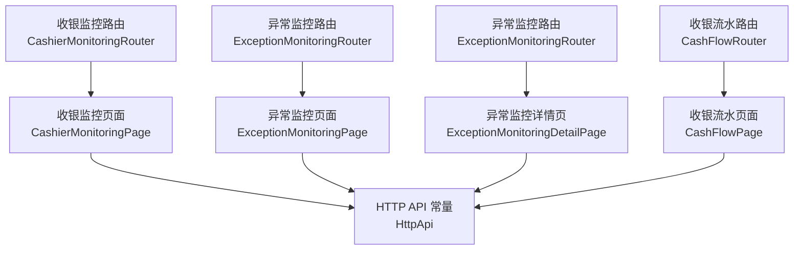
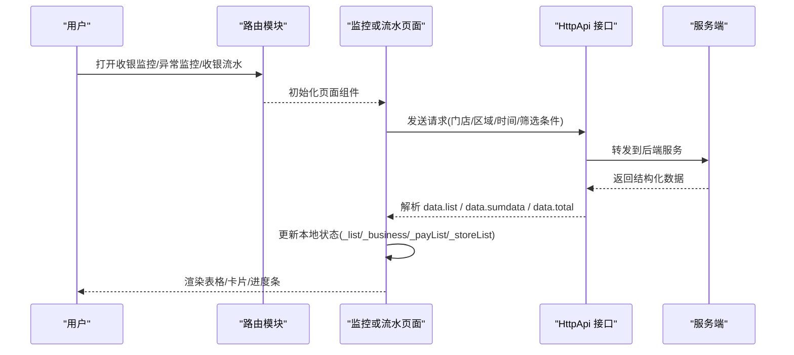
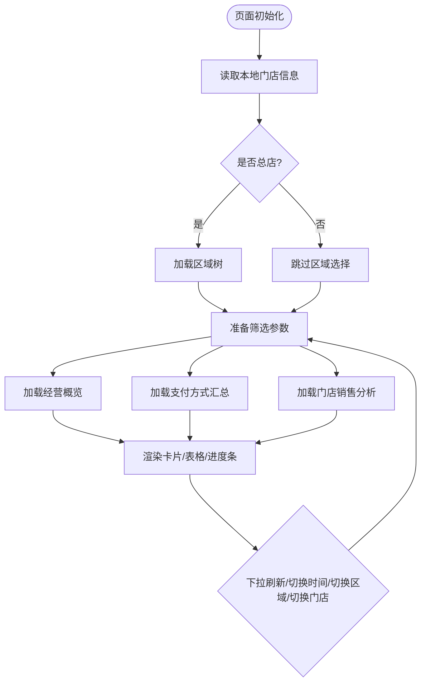
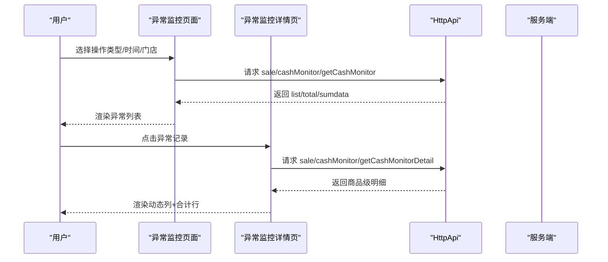
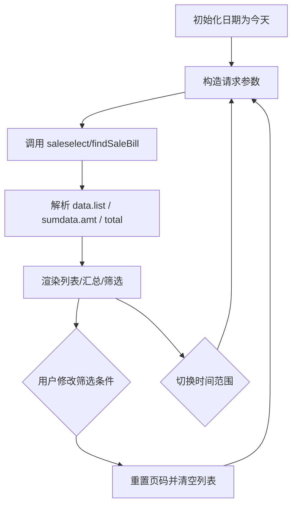
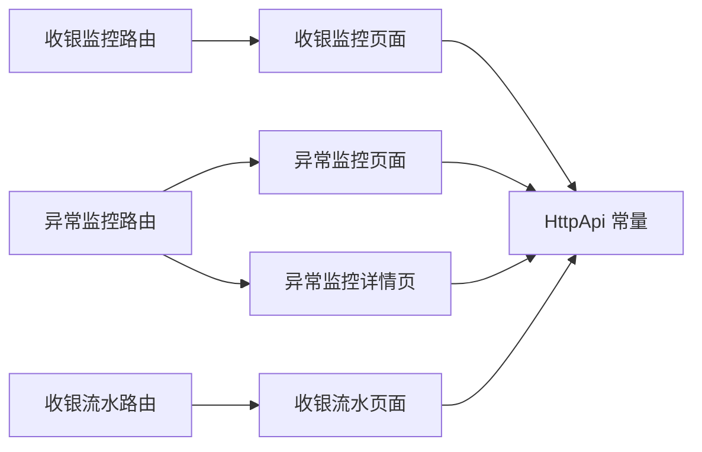
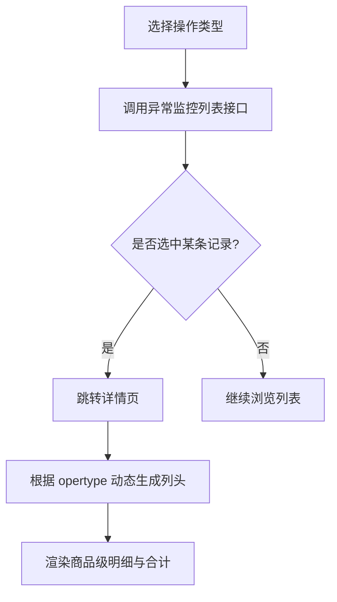

# 收银监控

<cite>
**本文引用的文件**   
- [cashier_monitoring_page.dart](file://lib/pages/data/businessReport/cashierMonitoring/cashier_monitoring_page.dart)
- [cashier_monitoring_router.dart](file://lib/pages/data/businessReport/cashierMonitoring/cashier_monitoring_router.dart)
- [exception_monitoring_page.dart](file://lib/pages/data/businessReport/exceptionMonitoring/exception_monitoring_page.dart)
- [exception_monitoring_detail_page.dart](file://lib/pages/data/businessReport/exceptionMonitoring/exception_monitoring_detail_page.dart)
- [exception_monitoring_router.dart](file://lib/pages/data/businessReport/exceptionMonitoring/exception_monitoring_router.dart)
- [cash_flow_page.dart](file://lib/pages/home/cash_flow/cash_flow_page.dart)
- [cash_flow_router.dart](file://lib/pages/home/cash_flow/cash_flow_router.dart)
- [http_api.dart](file://lib/net/http_api.dart)
</cite>

## 目录
1. [引言](#引言)
2. [项目结构](#项目结构)
3. [核心组件](#核心组件)
4. [架构总览](#架构总览)
5. [详细组件分析](#详细组件分析)
6. [依赖关系分析](#依赖关系分析)
7. [性能与实时性特征](#性能与实时性特征)
8. [异常交易识别与处理流程](#异常交易识别与处理流程)
9. [操作日志与数据可追溯性](#操作日志与数据可追溯性)
10. [收银台管理规范与培训要点](#收银台管理规范与培训要点)
11. [应急处理预案](#应急处理预案)
12. [故障排查指南](#故障排查指南)
13. [结论](#结论)

## 引言
本文件围绕灵犀管店 Flutter 项目的“收银监控”能力，聚焦以下业务场景：
- 实时监控界面：经营概况、支付方式占比、会员分析、门店销售分析。
- 交易流水展示：收银流水分页列表、筛选条件（单号、单据来源、收银员、机号、支付方式等）。
- 异常交易监控：按操作类型过滤异常记录，查看明细并汇总金额。
- 相关数据入口：通过路由模块进入收银监控、异常监控和收银流水页面。
- 数据刷新机制：下拉刷新、时间范围切换、区域与门店维度切换、分页加载。

需要特别说明的是，当前仓库中并未发现“收银员状态管理、班次管理和交接班流程”的独立实现代码；因此文档在对应章节提供基于现有数据模型的推演建议，而非直接代码解读。

## 项目结构
收银监控相关功能分布在以下目录与文件中：
- 收银监控页面：`lib/pages/data/businessReport/cashierMonitoring/cashier_monitoring_page.dart`
- 收银监控路由：`lib/pages/data/businessReport/cashierMonitoring/cashier_monitoring_router.dart`
- 异常监控页面与详情：`lib/pages/data/businessReport/exceptionMonitoring/exception_monitoring_page.dart`、`exception_monitoring_detail_page.dart`
- 异常监控路由：`lib/pages/data/businessReport/exceptionMonitoring/exception_monitoring_router.dart`
- 收银流水页面：`lib/pages/home/cash_flow/cash_flow_page.dart`
- 收银流水路由：`lib/pages/home/cash_flow/cash_flow_router.dart`
- HTTP API 常量：`lib/net/http_api.dart`

**图表来源**
- [cashier_monitoring_page.dart:1-60](file://lib/pages/data/businessReport/cashierMonitoring/cashier_monitoring_page.dart#L1-L60)
- [exception_monitoring_page.dart:1-60](file://lib/pages/data/businessReport/exceptionMonitoring/exception_monitoring_page.dart#L1-L60)
- [exception_monitoring_detail_page.dart:1-40](file://lib/pages/data/businessReport/exceptionMonitoring/exception_monitoring_detail_page.dart#L1-L40)
- [cash_flow_page.dart:1-40](file://lib/pages/home/cash_flow/cash_flow_page.dart#L1-L40)
- [cashier_monitoring_router.dart:1-13](file://lib/pages/data/businessReport/cashierMonitoring/cashier_monitoring_router.dart#L1-L13)
- [exception_monitoring_router.dart:1-21](file://lib/pages/data/businessReport/exceptionMonitoring/exception_monitoring_router.dart#L1-L21)
- [cash_flow_router.dart:1-12](file://lib/pages/home/cash_flow/cash_flow_router.dart#L1-L12)
- [http_api.dart:257-293](file://lib/net/http_api.dart#L257-L293)

**章节来源**
- [cashier_monitoring_page.dart:1-1186](file://lib/pages/data/businessReport/cashierMonitoring/cashier_monitoring_page.dart#L1-L1186)
- [exception_monitoring_page.dart:1-865](file://lib/pages/data/businessReport/exceptionMonitoring/exception_monitoring_page.dart#L1-L865)
- [exception_monitoring_detail_page.dart:1-344](file://lib/pages/data/businessReport/exceptionMonitoring/exception_monitoring_detail_page.dart#L1-L344)
- [cash_flow_page.dart:1-1381](file://lib/pages/home/cash_flow/cash_flow_page.dart#L1-L1381)
- [cashier_monitoring_router.dart:1-13](file://lib/pages/data/businessReport/cashierMonitoring/cashier_monitoring_router.dart#L1-L13)
- [exception_monitoring_router.dart:1-21](file://lib/pages/data/businessReport/exceptionMonitoring/exception_monitoring_router.dart#L1-L21)
- [cash_flow_router.dart:1-12](file://lib/pages/home/cash_flow/cash_flow_router.dart#L1-L12)
- [http_api.dart:257-293](file://lib/net/http_api.dart#L257-L293)

## 核心组件
- 收银监控页面：聚合经营概览、支付方式汇总、会员分析和门店销售分析；支持区域选择、门店选择、时间范围切换和下拉刷新。
- 异常监控页面：按日期、门店和操作类型查询异常交易列表，支持分页加载和汇总统计。
- 异常监控详情页：根据异常类型动态展示商品名称、数量、价格、变动金额或退货金额等字段，并提供合计行。
- 收银流水页面：查询销售订单流水，支持多条件筛选（单号、单据来源、收银员、机号、支付方式）和时间范围切换。
- 路由模块：使用 Fluro 定义收银监控、异常监控、收银流水页面的路由。
- HTTP API：集中声明后端接口地址，包括经营概览、支付方式汇总、门店销售分析、异常监控列表及明细、收银流水查询。

**章节来源**
- [cashier_monitoring_page.dart:1-1186](file://lib/pages/data/businessReport/cashierMonitoring/cashier_monitoring_page.dart#L1-L1186)
- [exception_monitoring_page.dart:1-865](file://lib/pages/data/businessReport/exceptionMonitoring/exception_monitoring_page.dart#L1-L865)
- [exception_monitoring_detail_page.dart:1-344](file://lib/pages/data/businessReport/exceptionMonitoring/exception_monitoring_detail_page.dart#L1-L344)
- [cash_flow_page.dart:1-1381](file://lib/pages/home/cash_flow/cash_flow_page.dart#L1-L1381)
- [cashier_monitoring_router.dart:1-13](file://lib/pages/data/businessReport/cashierMonitoring/cashier_monitoring_router.dart#L1-L13)
- [exception_monitoring_router.dart:1-21](file://lib/pages/data/businessReport/exceptionMonitoring/exception_monitoring_router.dart#L1-L21)
- [cash_flow_router.dart:1-12](file://lib/pages/home/cash_flow/cash_flow_router.dart#L1-L12)
- [http_api.dart:257-293](file://lib/net/http_api.dart#L257-L293)

## 架构总览
收银监控相关功能的整体调用链如下：
- 用户通过路由进入收银监控、异常监控或收银流水页面。
- 页面组件负责维护筛选参数（门店、区域、时间、操作类型、收银员等）。
- 页面通过 `request(HttpApi.xxx, params)` 调用后端接口。
- 后端返回结构化数据后，页面更新本地状态并渲染表格、卡片或进度条。

**图表来源**
- [cashier_monitoring_page.dart:430-520](file://lib/pages/data/businessReport/cashierMonitoring/cashier_monitoring_page.dart#L430-L520)
- [exception_monitoring_page.dart:230-310](file://lib/pages/data/businessReport/exceptionMonitoring/exception_monitoring_page.dart#L230-L310)
- [cash_flow_page.dart:60-120](file://lib/pages/home/cash_flow/cash_flow_page.dart#L60-L120)
- [http_api.dart:257-293](file://lib/net/http_api.dart#L257-L293)

## 详细组件分析

### 收银监控页面
收银监控页面承担四类核心展示：
- 经营概况：销售金额、收银金额、充值金额、售卡金额、退款金额。
- 支付方式：按支付金额降序展示支付方式、金额与比例，支持展开全部。
- 会员分析：新增数量、售卡金额、充值金额、赠送金额、消费金额。
- 门店分析：门店名称、销售金额、销售毛利。

关键行为：
- 区域选择：仅对总店显示区域选择器；选择区域后拉取该区域下所有机构 ID，用于 `sids` 传参。
- 门店选择：可从全局门店中选择，默认从本地存储读取当前门店信息。
- 时间选择：昨天、今日、本周、本月、自定义；支持左右箭头翻页。
- 数据加载：同时加载经营概览、支付方式汇总、门店销售分析；首次加载成功后避免刷新时内容闪屏。
- 下拉刷新：统一触发 `_loadAll`，并行请求三个接口。

**图表来源**
- [cashier_monitoring_page.dart:20-120](file://lib/pages/data/businessReport/cashierMonitoring/cashier_monitoring_page.dart#L20-L120)
- [cashier_monitoring_page.dart:430-520](file://lib/pages/data/businessReport/cashierMonitoring/cashier_monitoring_page.dart#L430-L520)
- [cashier_monitoring_page.dart:561-700](file://lib/pages/data/businessReport/cashierMonitoring/cashier_monitoring_page.dart#L561-L700)
- [cashier_monitoring_page.dart:981-1186](file://lib/pages/data/businessReport/cashierMonitoring/cashier_monitoring_page.dart#L981-L1186)

**章节来源**
- [cashier_monitoring_page.dart:1-1186](file://lib/pages/data/businessReport/cashierMonitoring/cashier_monitoring_page.dart#L1-L1186)
- [http_api.dart:257-293](file://lib/net/http_api.dart#L257-L293)

### 异常监控页面与详情页
异常监控页面按操作类型筛选异常交易，并分页展示：
- 操作类型包括：单品改价、单品删除、商品退货、整单折扣、整单删除、商品赠送、挂单、删除挂单。
- 列表字段包含单据日期、异常摘要、总金额等，并提供总计条数与总金额。
- 点击某一行跳转到异常监控详情页，根据 `opertype` 动态生成列头和数据字段。

详情页逻辑：
- 将列表行的完整数据作为参数传入，调用明细接口获取商品级明细。
- 列头随 `opertype` 变化：例如单品改价展示原售价、最新价、变动金额；商品退货展示单价、退货数量、退货金额等。
- 表格底部提供合计行，按数值类型格式化输出。

**图表来源**
- [exception_monitoring_page.dart:230-310](file://lib/pages/data/businessReport/exceptionMonitoring/exception_monitoring_page.dart#L230-L310)
- [exception_monitoring_detail_page.dart:1-40](file://lib/pages/data/businessReport/exceptionMonitoring/exception_monitoring_detail_page.dart#L1-L40)
- [exception_monitoring_detail_page.dart:201-344](file://lib/pages/data/businessReport/exceptionMonitoring/exception_monitoring_detail_page.dart#L201-L344)
- [http_api.dart:292-293](file://lib/net/http_api.dart#L292-L293)

**章节来源**
- [exception_monitoring_page.dart:1-865](file://lib/pages/data/businessReport/exceptionMonitoring/exception_monitoring_page.dart#L1-L865)
- [exception_monitoring_detail_page.dart:1-344](file://lib/pages/data/businessReport/exceptionMonitoring/exception_monitoring_detail_page.dart#L1-L344)
- [exception_monitoring_router.dart:1-21](file://lib/pages/data/businessReport/exceptionMonitoring/exception_monitoring_router.dart#L1-L21)
- [http_api.dart:292-293](file://lib/net/http_api.dart#L292-L293)

### 收银流水页面
收银流水页面用于查询销售订单流水，核心能力包括：
- 分页列表：每次加载 20 条，追加模式或重置模式。
- 汇总信息：总金额与总单量。
- 筛选抽屉：单号、单据来源、单据类型、收银员、机号、支付方式。
- 时间选择器：昨天、今日、本周、本月、自定义，支持日期导航。
- 数据接口：`saleselect/findSaleBill`，按时间范围和筛选条件查询。

**图表来源**
- [cash_flow_page.dart:1-120](file://lib/pages/home/cash_flow/cash_flow_page.dart#L1-L120)
- [cash_flow_page.dart:201-568](file://lib/pages/home/cash_flow/cash_flow_page.dart#L201-L568)
- [http_api.dart:273](file://lib/net/http_api.dart#L273)

**章节来源**
- [cash_flow_page.dart:1-1381](file://lib/pages/home/cash_flow/cash_flow_page.dart#L1-L1381)
- [cash_flow_router.dart:1-12](file://lib/pages/home/cash_flow/cash_flow_router.dart#L1-L12)
- [http_api.dart:273](file://lib/net/http_api.dart#L273)

## 依赖关系分析
收银监控相关页面依赖统一的 HTTP API 常量，避免硬编码 URL；路由层通过 Fluro 注册页面入口。

**图表来源**
- [cashier_monitoring_page.dart:1-60](file://lib/pages/data/businessReport/cashierMonitoring/cashier_monitoring_page.dart#L1-L60)
- [exception_monitoring_page.dart:1-60](file://lib/pages/data/businessReport/exceptionMonitoring/exception_monitoring_page.dart#L1-L60)
- [exception_monitoring_detail_page.dart:1-40](file://lib/pages/data/businessReport/exceptionMonitoring/exception_monitoring_detail_page.dart#L1-L40)
- [cash_flow_page.dart:1-40](file://lib/pages/home/cash_flow/cash_flow_page.dart#L1-L40)
- [cashier_monitoring_router.dart:1-13](file://lib/pages/data/businessReport/cashierMonitoring/cashier_monitoring_router.dart#L1-L13)
- [exception_monitoring_router.dart:1-21](file://lib/pages/data/businessReport/exceptionMonitoring/exception_monitoring_router.dart#L1-L21)
- [cash_flow_router.dart:1-12](file://lib/pages/home/cash_flow/cash_flow_router.dart#L1-L12)
- [http_api.dart:257-293](file://lib/net/http_api.dart#L257-L293)

**章节来源**
- [cashier_monitoring_page.dart:1-1186](file://lib/pages/data/businessReport/cashierMonitoring/cashier_monitoring_page.dart#L1-L1186)
- [exception_monitoring_page.dart:1-865](file://lib/pages/data/businessReport/exceptionMonitoring/exception_monitoring_page.dart#L1-L865)
- [exception_monitoring_detail_page.dart:1-344](file://lib/pages/data/businessReport/exceptionMonitoring/exception_monitoring_detail_page.dart#L1-L344)
- [cash_flow_page.dart:1-1381](file://lib/pages/home/cash_flow/cash_flow_page.dart#L1-L1381)
- [cashier_monitoring_router.dart:1-13](file://lib/pages/data/businessReport/cashierMonitoring/cashier_monitoring_router.dart#L1-L13)
- [exception_monitoring_router.dart:1-21](file://lib/pages/data/businessReport/exceptionMonitoring/exception_monitoring_router.dart#L1-L21)
- [cash_flow_router.dart:1-12](file://lib/pages/home/cash_flow/cash_flow_router.dart#L1-L12)
- [http_api.dart:257-293](file://lib/net/http_api.dart#L257-L293)

## 性能与实时性特征
- 并发加载：收银监控页面同时发起经营概览、支付方式汇总、门店销售分析三个请求，减少首屏等待时间。
- 防抖与重复请求保护：收银流水页面在 `_loading` 为真时直接返回，避免重复请求。
- 分页加载：异常监控和收银流水均采用分页策略，按页追加数据，控制内存占用。
- 可视化性能优化：支付方式比例在客户端计算，避免服务端四舍五入导致极小值显示为 0%；进度条对小值设置最小可见高度，保证视觉稳定。
- 无全屏遮罩的加载体验：多个页面采用居中加载卡片，避免全页面泛白，提升交互流畅度。
- 时间选择器一致性：收银监控、异常监控、收银流水共享类似的时间选择交互，降低学习成本。

这些特性共同构成一个“可刷新、可分页、可筛选”的数据看板体系，适合店长或运营人员快速掌握门店收银情况。

[本节为通用性能说明，不直接分析具体代码片段]

## 异常交易识别与处理流程
异常交易识别由后端决定，前端通过操作类型进行展示和筛选。当前代码中的操作类型包括：
- 单品改价
- 单品删除
- 商品退货
- 整单折扣
- 整单删除
- 商品赠送
- 挂单
- 删除挂单

前端职责：
- 提供操作类型筛选。
- 展示异常交易列表与汇总。
- 根据 `opertype` 动态展示明细列。

**图表来源**
- [exception_monitoring_page.dart:230-310](file://lib/pages/data/businessReport/exceptionMonitoring/exception_monitoring_page.dart#L230-L310)
- [exception_monitoring_detail_page.dart:1-40](file://lib/pages/data/businessReport/exceptionMonitoring/exception_monitoring_detail_page.dart#L1-L40)
- [exception_monitoring_detail_page.dart:201-344](file://lib/pages/data/businessReport/exceptionMonitoring/exception_monitoring_detail_page.dart#L201-L344)

**章节来源**
- [exception_monitoring_page.dart:1-865](file://lib/pages/data/businessReport/exceptionMonitoring/exception_monitoring_page.dart#L1-L865)
- [exception_monitoring_detail_page.dart:1-344](file://lib/pages/data/businessReport/exceptionMonitoring/exception_monitoring_detail_page.dart#L1-L344)
- [http_api.dart:292-293](file://lib/net/http_api.dart#L292-L293)

## 操作日志与数据可追溯性
收银监控相关页面主要承担“数据展示与分析”，并不直接实现操作日志采集。但以下机制有助于追溯：
- 收银流水记录：通过 `saleselect/findSaleBill` 可查询销售单、退货单、整单退货等交易流水，结合收银员、机号、支付方式等筛选条件定位问题。
- 异常监控明细：异常交易详情页按商品维度展示价格变动、数量变动和金额变动，便于审计。
- 时间范围与门店维度：所有列表均支持时间范围与门店筛选，便于回溯特定时间段和门店的经营情况。

若需完善“系统健康检查”和“性能监控指标”，可在现有基础上增加：
- 页面加载耗时统计。
- 网络请求成功率与失败原因分类。
- 数据刷新频率与缓存命中情况。
- 表格渲染行数与内存占用监控。

[本节为概念性扩展建议，不直接分析具体代码片段]

## 收银台管理规范与培训要点
由于仓库未包含“收银员状态管理、班次管理和交接班流程”的具体实现，以下规范基于现有数据模型提出建议：

- 收银员状态管理建议：
  - 在收银流水筛选中增加“收银员在线状态”字段，区分登录、空闲、忙碌、离线。
  - 结合机号与收银员关联，确保每个机号只对应一个活跃收银员。
  - 当收银员长时间无交易且处于忙碌状态时，发出提醒。

- 班次管理建议：
  - 以时间范围为基础划分早班、中班、晚班。
  - 班次开始与结束时间写入本地配置，并在收银流水中自动标注所属班次。
  - 报表维度增加“班次销售额、退款率、异常交易次数”。

- 交接班流程建议：
  - 交接班前生成交接单，包含现金、刷卡、微信、支付宝等渠道金额。
  - 交接双方确认无误后签名留痕。
  - 交接班异常（如金额不符）自动标记为异常交易并推送预警。

这些规范可作为后续迭代方向，与现有收银流水和异常监控页面配合使用。

[本节为业务规划建议，不直接分析具体代码片段]

## 应急处理预案
针对收银监控相关场景，建议制定以下应急预案：

- 网络中断：
  - 收银流水和异常监控页面应提示“网络不可用”，并允许查看最近一次缓存数据。
  - 恢复网络后自动重试未成功请求。

- 数据不一致：
  - 以收银流水为准，核对异常监控中的退款、折扣、删除等异常记录。
  - 若差异较大，导出流水和异常明细交由财务复核。

- 异常交易激增：
  - 立即检查是否存在批量改价、批量删除或异常退货。
  - 暂停相关权限操作，保留现场数据供审计。

- 系统卡顿或崩溃：
  - 限制单次加载数据量，优先展示关键汇总数据。
  - 后台任务降级，暂停非核心数据刷新。

[本节为通用应急建议，不直接分析具体代码片段]

## 故障排查指南
常见问题与排查思路：

- 页面空白或数据不刷新：
  - 检查门店选择是否正确，特别是总店区域选择与机构 ID 映射。
  - 检查时间范围是否有效，尤其是“自定义”日期区间。
  - 查看 `_hasLoadedOnce` 标志位是否阻止了空数据时的刷新表现。

- 支付方式比例为 0%：
  - 确认客户端已对极小比例做最小可见值处理。
  - 检查服务端返回的 `payamt` 是否为空或非法字符串。

- 异常监控列表为空：
  - 确认操作类型筛选是否过严。
  - 检查时间范围和门店筛选是否排除了目标数据。

- 收银流水筛选无效：
  - 检查筛选抽屉中临时变量是否最终赋值到页面状态。
  - 确认分页重置逻辑是否在筛选确认后执行。

- 路由无法跳转：
  - 检查 Fluro 路由是否注册成功。
  - 检查路由路径与 `IRouterProvider` 实现是否匹配。

**章节来源**
- [cashier_monitoring_page.dart:20-120](file://lib/pages/data/businessReport/cashierMonitoring/cashier_monitoring_page.dart#L20-L120)
- [cashier_monitoring_page.dart:430-520](file://lib/pages/data/businessReport/cashierMonitoring/cashier_monitoring_page.dart#L430-L520)
- [exception_monitoring_page.dart:230-310](file://lib/pages/data/businessReport/exceptionMonitoring/exception_monitoring_page.dart#L230-L310)
- [cash_flow_page.dart:60-120](file://lib/pages/home/cash_flow/cash_flow_page.dart#L60-L120)
- [cashier_monitoring_router.dart:1-13](file://lib/pages/data/businessReport/cashierMonitoring/cashier_monitoring_router.dart#L1-L13)
- [exception_monitoring_router.dart:1-21](file://lib/pages/data/businessReport/exceptionMonitoring/exception_monitoring_router.dart#L1-L21)
- [cash_flow_router.dart:1-12](file://lib/pages/home/cash_flow/cash_flow_router.dart#L1-L12)

## 结论
灵犀管店 Flutter 项目的收银监控功能以“收银监控页面、异常监控页面、收银流水页面”为核心，通过统一 HTTP API 获取经营概览、支付方式、会员分析、门店销售、异常交易和销售流水数据。页面具备下拉刷新、时间范围切换、门店与区域筛选、分页加载和动态列展示等能力。

当前仓库未实现“收银员状态管理、班次管理和交接班流程”的独立逻辑；相关能力可通过收银流水筛选、异常监控明细以及后续扩展的状态与班次模块逐步完善。对于实时监控、异常识别、数据可视化和可追溯性，现有代码提供了坚实基础，适合在后续版本中加入更完善的监控指标、健康检查和应急处理机制。

[本节为总结性内容，不直接分析具体代码片段]