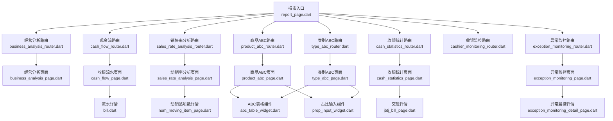
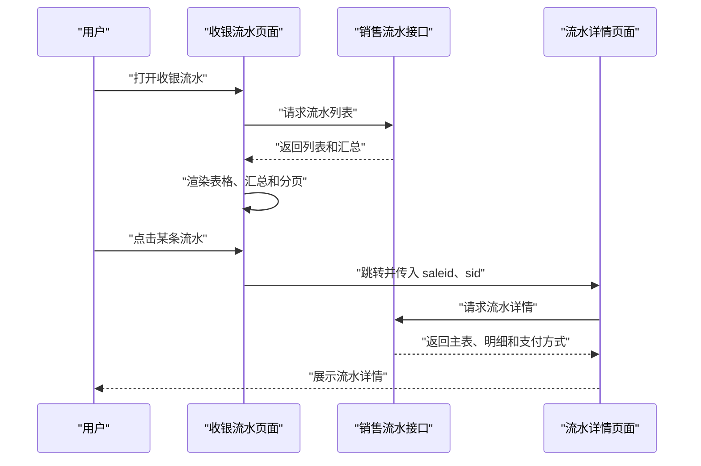
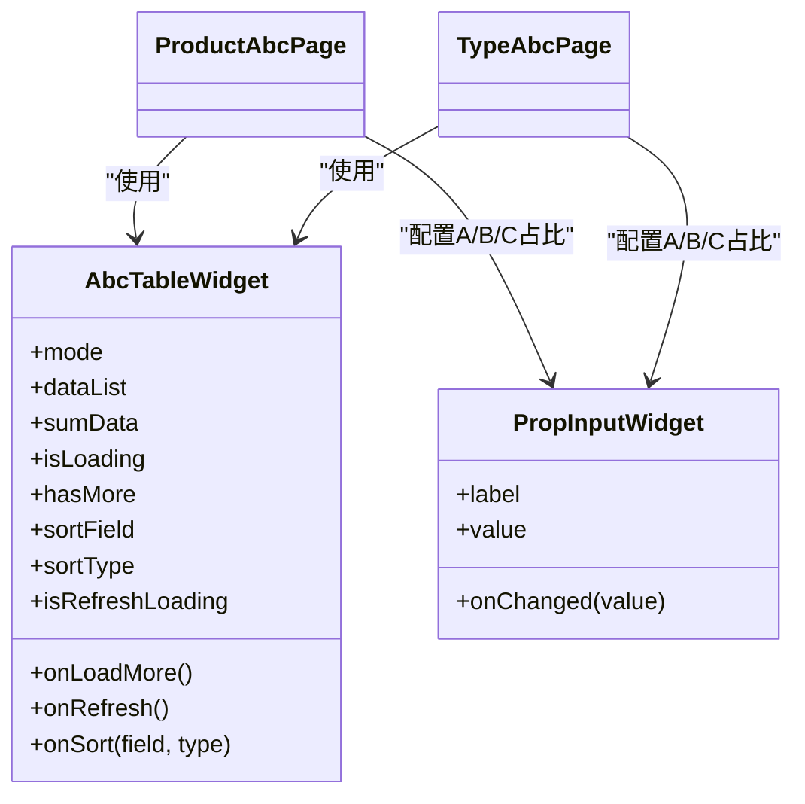
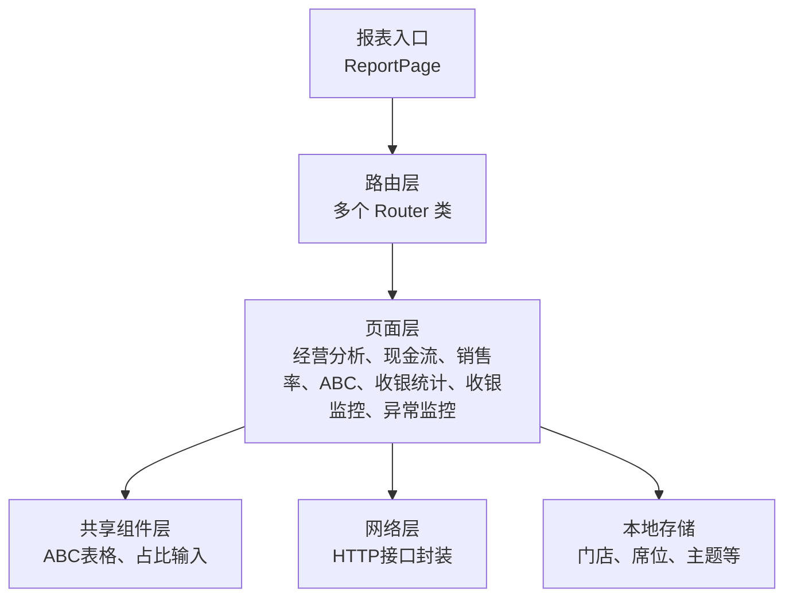
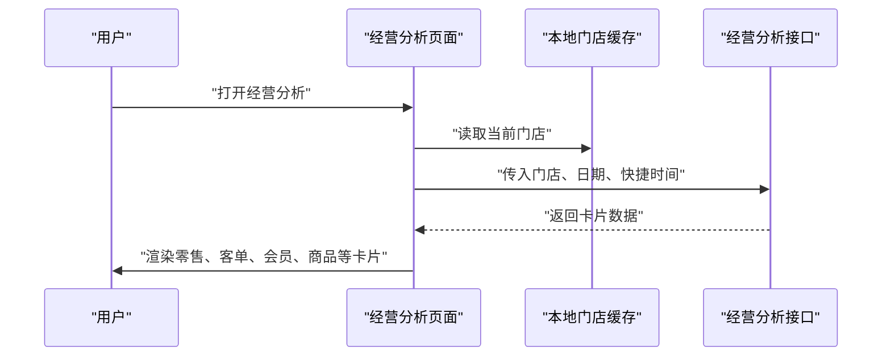
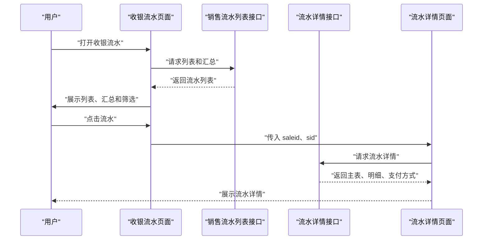
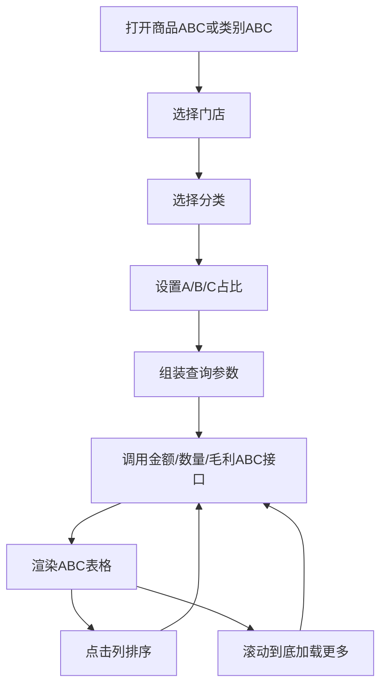
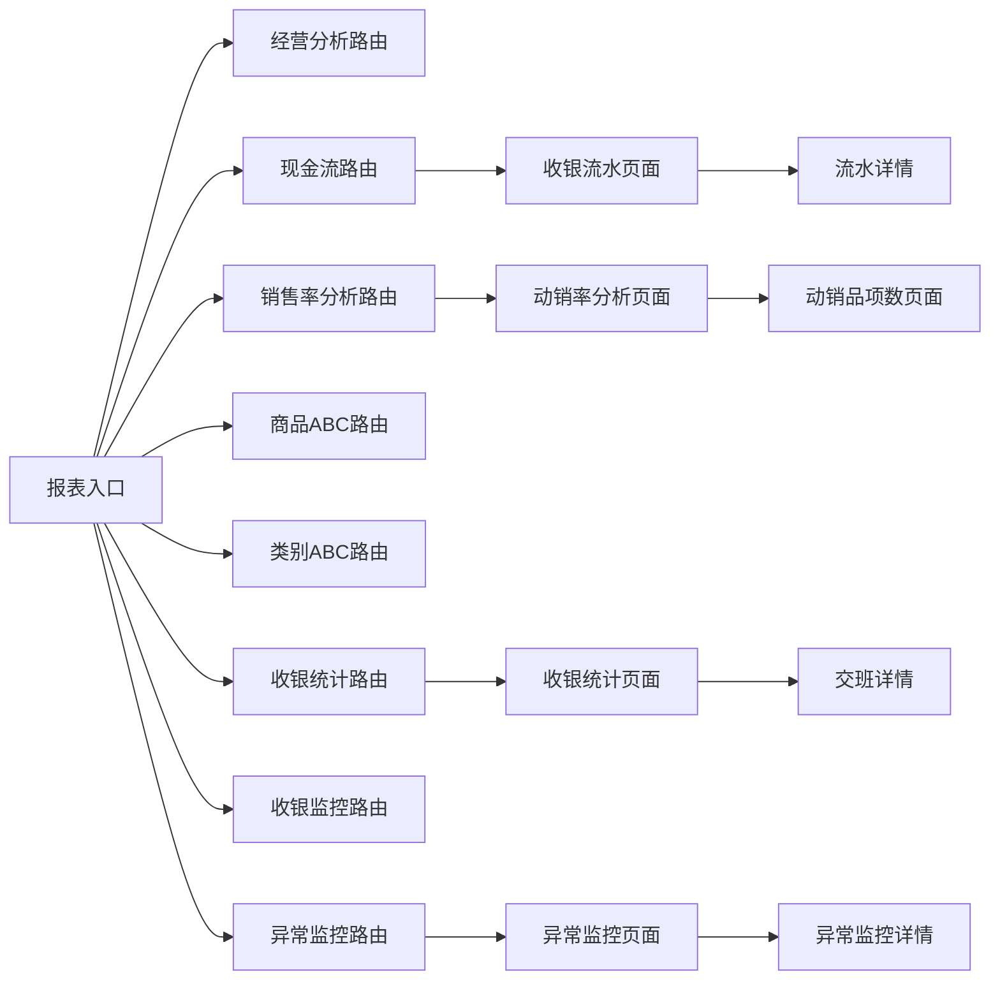

# 数据分析模块

<cite>
**本文引用的文件**   
- [report_page.dart](file://lib/pages/home/report_page.dart)
- [business_analysis_router.dart](file://lib/pages/data/businessReport/businessAnalysis/business_analysis_router.dart)
- [business_analysis_page.dart](file://lib/pages/data/businessReport/businessAnalysis/business_analysis_page.dart)
- [cash_flow_router.dart](file://lib/pages/data/businessReport/cashFlow/cash_flow_router.dart)
- [cash_flow_page.dart](file://lib/pages/data/businessReport/cashFlow/cash_flow_page.dart)
- [bill.dart](file://lib/pages/data/businessReport/cashFlow/bill.dart)
- [sales_rate_analysis_router.dart](file://lib/pages/data/businessReport/salesRateAnalysis/sales_rate_analysis_router.dart)
- [sales_rate_analysis_page.dart](file://lib/pages/data/businessReport/salesRateAnalysis/sales_rate_analysis_page.dart)
- [num_moving_item_page.dart](file://lib/pages/data/businessReport/salesRateAnalysis/num_moving_item_page.dart)
- [product_abc_router.dart](file://lib/pages/data/businessReport/productABC/product_abc_router.dart)
- [product_abc_page.dart](file://lib/pages/data/businessReport/productABC/product_abc_page.dart)
- [type_abc_router.dart](file://lib/pages/data/businessReport/typeABC/type_abc_router.dart)
- [type_abc_page.dart](file://lib/pages/data/businessReport/typeABC/type_abc_page.dart)
- [cash_statistics_router.dart](file://lib/pages/data/businessReport/cashStatistics/cash_statistics_router.dart)
- [cash_statistics_page.dart](file://lib/pages/data/businessReport/cashStatistics/cash_statistics_page.dart)
- [jbtj_bill_page.dart](file://lib/pages/data/businessReport/cashStatistics/jbtj_bill_page.dart)
- [cashier_monitoring_router.dart](file://lib/pages/data/businessReport/cashierMonitoring/cashier_monitoring_router.dart)
- [cashier_monitoring_page.dart](file://lib/pages/data/businessReport/cashierMonitoring/cashier_monitoring_page.dart)
- [exception_monitoring_router.dart](file://lib/pages/data/businessReport/exceptionMonitoring/exception_monitoring_router.dart)
- [exception_monitoring_page.dart](file://lib/pages/data/businessReport/exceptionMonitoring/exception_monitoring_page.dart)
- [exception_monitoring_detail_page.dart](file://lib/pages/data/businessReport/exceptionMonitoring/exception_monitoring_detail_page.dart)
- [abc_table_widget.dart](file://lib/pages/data/businessReport/abcAnalysis/abc_table_widget.dart)
- [prop_input_widget.dart](file://lib/pages/data/businessReport/abcAnalysis/prop_input_widget.dart)
</cite>

## 目录

1. [引言](#引言)
2. [项目结构](#项目结构)
3. [核心报表组件](#核心报表组件)
4. [架构总览](#架构总览)
5. [关键报表详解](#关键报表详解)
6. [依赖与路由关系](#依赖与路由关系)
7. [性能与实时性](#性能与实时性)
8. [数据导出与可视化](#数据导出与可视化)
9. [业务洞察与决策支持](#业务洞察与决策支持)
10. [常见问题排查](#常见问题排查)
11. [结论](#结论)

## 引言

灵犀管店 Flutter 项目的数据分析模块位于 `lib/pages/data/businessReport`，主要面向门店经营分析、现金流监控、销售率分析、商品与类别 ABC 分析、收银统计、收银监控和异常监控等高频管理场景。这些页面共同承担以下职责：

- 提供按门店、日期、分类、供应商、品牌、操作类型等多维度的数据筛选能力。
- 将后端接口返回的流水、汇总、明细和趋势数据，以卡片、表格、分页列表和详情页形式呈现。
- 通过统一的路由入口进入“报表”页，并根据专业版或基础版控制功能可见性与交互行为。
- 在移动端适配大数据量表格、横向滚动合计行、空状态、加载状态和下拉刷新体验。

从整体上看，该模块不是单一类，而是围绕多个业务报表页面组成的子系统：每个报表通常包含一个路由提供者、一个主页面、可选的子页面或详情页，以及部分共享的表格和输入组件。

## 项目结构

数据分析模块的文件组织采用“报表目录 + 路由 + 页面 + 子页面 + 共享组件”的方式：

**图表来源**
- [report_page.dart:1-653](file://lib/pages/home/report_page.dart#L1-L653)
- [business_analysis_router.dart:1-39](file://lib/pages/data/businessReport/businessAnalysis/business_analysis_router.dart#L1-L39)
- [cash_flow_router.dart:1-19](file://lib/pages/data/businessReport/cashFlow/cash_flow_router.dart#L1-L19)
- [sales_rate_analysis_router.dart:1-12](file://lib/pages/data/businessReport/salesRateAnalysis/sales_rate_analysis_router.dart#L1-L12)
- [product_abc_router.dart:1-12](file://lib/pages/data/businessReport/productABC/product_abc_router.dart#L1-L12)
- [type_abc_router.dart:1-12](file://lib/pages/data/businessReport/typeABC/type_abc_router.dart#L1-L12)
- [cash_statistics_router.dart:1-21](file://lib/pages/data/businessReport/cashStatistics/cash_statistics_router.dart#L1-L21)
- [cashier_monitoring_router.dart:1-13](file://lib/pages/data/businessReport/cashierMonitoring/cashier_monitoring_router.dart#L1-L13)
- [exception_monitoring_router.dart:1-21](file://lib/pages/data/businessReport/exceptionMonitoring/exception_monitoring_router.dart#L1-L21)

### 报表入口与版本控制

`ReportPage` 是“报表”Tab 的主入口，它负责：

- 显示“报表（专业版/基础版）”标题。
- 从本地缓存读取当前门店信息，并调用增值服务工具获取席位信息。
- 根据专业版状态决定功能是否被锁定。
- 对基础版用户，仅白名单内的报表可点击，其余灰显并提示功能受限。
- 调整分区顺序：基础版将“库存分析”移动到“经营报表”之后。

这使数据分析模块既能在专业版完整展示所有报表，也能在基础版保留高频免费能力，如收银流水、收银统计、销售监控、异常监控、经营分析等。

**章节来源**
- [report_page.dart:1-653](file://lib/pages/home/report_page.dart#L1-L653)

### 报表路由注册

各报表通过独立的 Router 类实现统一路由规范：

| 报表 | 路由类 | 主要路由 |
|---|---|---|
| 经营分析 | `BusinessAnalysisRouter` | `/businessAnalysis` 及多个子分析路由 |
| 现金流 | `CashFlowRouter` | `/cashflow/list`、`/cashflow/bill` |
| 销售率分析 | `SalesRateAnalysisRouter` | `/salesRateAnalysis` |
| 商品ABC | `ProductAbcRouter` | `/productABC` |
| 类别ABC | `TypeAbcRouter` | `/typeABC` |
| 收银统计 | `CashStatisticsRouter` | `/cashStatistics/list`、`/cashStatistics/jbtjBill` |
| 收银监控 | `CashierMonitoringRouter` | `/cashierMonitoring` |
| 异常监控 | `ExceptionMonitoringRouter` | `/exceptionMonitoring`、`/exceptionMonitoring/bill` |

**章节来源**
- [business_analysis_router.dart:1-39](file://lib/pages/data/businessReport/businessAnalysis/business_analysis_router.dart#L1-L39)
- [cash_flow_router.dart:1-19](file://lib/pages/data/businessReport/cashFlow/cash_flow_router.dart#L1-L19)
- [sales_rate_analysis_router.dart:1-12](file://lib/pages/data/businessReport/salesRateAnalysis/sales_rate_analysis_router.dart#L1-L12)
- [product_abc_router.dart:1-12](file://lib/pages/data/businessReport/productABC/product_abc_router.dart#L1-L12)
- [type_abc_router.dart:1-12](file://lib/pages/data/businessReport/typeABC/type_abc_router.dart#L1-L12)
- [cash_statistics_router.dart:1-21](file://lib/pages/data/businessReport/cashStatistics/cash_statistics_router.dart#L1-L21)
- [cashier_monitoring_router.dart:1-13](file://lib/pages/data/businessReport/cashierMonitoring/cashier_monitoring_router.dart#L1-L13)
- [exception_monitoring_router.dart:1-21](file://lib/pages/data/businessReport/exceptionMonitoring/exception_monitoring_router.dart#L1-L21)

## 核心报表组件

本节聚焦八个核心报表的数据来源、计算逻辑、可视化方式和分析维度。

### 经营分析

经营分析页面是门店经营数据的聚合入口，主要包含零售分析、客单分析、会员分析、商品分析、销售退货、采购分析、批发分析、门店分析和业绩分析等卡片。

#### 数据来源

- 默认从本地存储中读取当前门店信息。
- 查询参数包括门店 ID、门店名称、开始时间、结束时间和快捷时间类型。
- 调用经营分析数据接口，将返回的卡片字段映射为 UI 卡片指标。

#### 计算逻辑

前端主要负责参数组装和数值格式化；核心金额、数量、毛利率等业务指标由后端计算后返回。前端会根据字段是否存在进行容错处理，例如空值时输出默认数字或百分比占位。

#### 可视化展示

- 顶部选择门店和日期。
- 使用卡片分组展示不同分析主题。
- 每张卡片列出关键指标，如销售额、毛利额、毛利率、客单价、新增会员、消费金额等。

#### 关键业务指标

| 指标 | 含义 | 分析维度 |
|---|---|---|
| 销售额 | 指定时间段内销售总额 | 门店、日期、分类、品牌、供应商 |
| 毛利额 | 销售毛利金额 | 同上 |
| 毛利率 | 毛利占销售额比例 | 同上 |
| 客单数 | 结算订单数量 | 渠道、收银员、支付方式 |
| 客单价 | 平均客单金额 | 同上 |
| 新增会员 | 新增会员数量 | 渠道、地区、来源 |
| 消费金额 | 会员消费金额 | 会员等级、消费频次 |
| 销售退货数量 | 退货商品数量 | 退货原因、商品分类 |
| 采购数量 | 采购商品数量 | 供应商、仓库、品类 |
| 批发销售额 | 批发业务销售额 | 客户、渠道、区域 |
| 业绩销售金额 | 员工销售业绩金额 | 销售员、提成规则 |

#### 分析维度

- 门店维度：单店、多店、总店。
- 时间维度：昨日、今日、本周、本月、自定义。
- 商品维度：商品、分类、品牌、供应商。
- 业务维度：零售、批发、采购、退货、会员、员工业绩。

**章节来源**
- [business_analysis_router.dart:1-39](file://lib/pages/data/businessReport/businessAnalysis/business_analysis_router.dart#L1-L39)
- [business_analysis_page.dart:1-200](file://lib/pages/data/businessReport/businessAnalysis/business_analysis_page.dart#L1-L200)

### 现金流分析

现金流分析即收银流水分析，用于查看销售、退货、整单退货等结算单据列表，并可跳转到单据详情。

#### 数据来源

- 调用销售流水查询接口，传入门店、日期、单号、单据标志、销售渠道、收银员、机号和支付方式等筛选条件。
- 列表数据来自接口的 `list` 字段。
- 汇总金额来自接口的 `sumdata.amt`。
- 总记录数来自接口的 `total`。

#### 计算逻辑

- 前端负责分页、筛选条件拼接、空数据保护、下拉刷新和加载更多。
- 金额字段统一做数值解析和格式化，避免空字符串或非数字导致显示异常。
- 首次加载与后续刷新通过 `_hasLoadedOnce` 控制空态和加载卡片的显示，减少闪屏。

#### 可视化展示

- 列表页提供筛选抽屉，支持按单号、单据类型、销售渠道、收银员、机号、支付方式筛选。
- 列表顶部显示总金额和总笔数。
- 点击某条流水进入收银流水详情页。

#### 关键业务指标

| 指标 | 含义 | 分析用途 |
|---|---|---|
| 流水总数 | 筛选条件下的订单数量 | 评估交易活跃度 |
| 流水总金额 | 筛选条件下销售金额合计 | 评估收入规模 |
| 单据类型 | 销售单、退货单、整单退货 | 区分正向与负向交易 |
| 销售渠道 | PC端、微信商城、APP、自助收银等 | 分析渠道贡献 |
| 支付方式 | 现金、银行卡、会员余额等 | 结合收银统计看资金构成 |

#### 时序流程

**图表来源**
- [cash_flow_page.dart:1-200](file://lib/pages/data/businessReport/cashFlow/cash_flow_page.dart#L1-L200)
- [cash_flow_router.dart:1-19](file://lib/pages/data/businessReport/cashFlow/cash_flow_router.dart#L1-L19)
- [bill.dart:1-200](file://lib/pages/data/businessReport/cashFlow/bill.dart#L1-L200)

**章节来源**
- [cash_flow_page.dart:1-200](file://lib/pages/data/businessReport/cashFlow/cash_flow_page.dart#L1-L200)
- [bill.dart:1-200](file://lib/pages/data/businessReport/cashFlow/bill.dart#L1-L200)

### 销售率分析

销售率分析关注动销率和未动销情况，分为门店动销率和商品类别动销率两个 Tab，并提供动销品项数和未动销品项数的明细页。

#### 数据来源

- 门店动销率和商品类别动销率分别调用对应接口。
- 动销品项数和未动销品项数通过独立页面加载，传入父页面选择的门店、分类、供应商、品牌、商品状态和时间范围。
- 商品分类多选结果会转换为分类 ID 列表参与查询。

#### 计算逻辑

- 动销率通常基于“有销售的商品数 / 可销售商品数”或类似口径，具体计算在后端完成。
- 前端负责维护 Tab 切换、横滚同步、分页、空数据和加载状态。
- 动销/未动销品项数页面使用相同参数，仅通过 `selectflag` 区分动销或未动销。

#### 可视化展示

- 第一个 Tab 展示门店维度动销率。
- 第二个 Tab 展示商品类别维度动销率。
- 点击进入“动销品项数”或“未动销品项数”页面，查看具体商品和机构分布。

#### 关键业务指标

| 指标 | 含义 | 分析用途 |
|---|---|---|
| 门店动销率 | 门店内有销售的商品占比 | 评估门店商品活跃程度 |
| 类别动销率 | 分类内有销售的商品占比 | 评估品类健康度 |
| 动销品项数 | 有销售的 SKU 数量 | 指导补货和促销 |
| 未动销品项数 | 无销售的 SKU 数量 | 识别滞销和清仓对象 |
| 商品状态 | 在售、停售、下架等 | 过滤无效 SKU |

**章节来源**
- [sales_rate_analysis_router.dart:1-12](file://lib/pages/data/businessReport/salesRateAnalysis/sales_rate_analysis_router.dart#L1-L12)
- [sales_rate_analysis_page.dart:1-200](file://lib/pages/data/businessReport/salesRateAnalysis/sales_rate_analysis_page.dart#L1-L200)
- [num_moving_item_page.dart:1-200](file://lib/pages/data/businessReport/salesRateAnalysis/num_moving_item_page.dart#L1-L200)

### ABC 分析

ABC 分析用于按照金额、数量或毛利对商品或类别进行 A/B/C 分层，帮助识别重点商品和重点分类。

#### 数据来源

- 商品 ABC 分析使用三类接口：金额 ABC、数量 ABC、毛利 ABC。
- 类别 ABC 分析使用三类接口：类别金额 ABC、类别数量 ABC、类别毛利 ABC。
- 查询参数包括时间范围、门店、分类、供应商、品牌、商品状态和 ABC 占比阈值。

#### 计算逻辑

- ABC 占比由用户在界面设置 A、B、C 三个百分比。
- 前端将 `aprop`、`bprop`、`cprop` 传给后端。
- 后端根据排序字段和累计占比将条目划分为 A、B、C 类。
- 前端负责分页、排序、汇总展示和表格渲染。

#### 可视化展示

- 商品 ABC 和类别 ABC 共用 `AbcTableWidget`。
- 表格列包括序号、商品或分类名称、销售数量、销售成本、销售金额、毛利额、毛利率、销售金额占比、累计占比和 ABC 类型。
- 商品视图额外显示单位和规格。
- 占比输入使用 `PropInputWidget`，避免父组件重建导致输入失焦。

#### 关键业务指标

| 指标 | 含义 | 分析维度 |
|---|---|---|
| 销售数量 | 统计期内销售件数 | 商品、分类、供应商 |
| 销售成本 | 销售对应的成本金额 | 同上 |
| 销售金额 | 统计期内销售总额 | 同上 |
| 毛利额 | 销售金额减去成本 | 同上 |
| 毛利率 | 毛利占销售金额比例 | 同上 |
| 销售金额占比 | 单项占总体销售金额比例 | 同上 |
| 累计占比 | 按排序累计的占比 | 判断 ABC 层级 |
| ABC 类型 | A、B 或 C | 重点、次重点、长尾 |

#### 共享组件关系

**图表来源**
- [abc_table_widget.dart:1-200](file://lib/pages/data/businessReport/abcAnalysis/abc_table_widget.dart#L1-L200)
- [prop_input_widget.dart:1-95](file://lib/pages/data/businessReport/abcAnalysis/prop_input_widget.dart#L1-L95)
- [product_abc_page.dart:1-200](file://lib/pages/data/businessReport/productABC/product_abc_page.dart#L1-L200)
- [type_abc_page.dart:1-200](file://lib/pages/data/businessReport/typeABC/type_abc_page.dart#L1-L200)

**章节来源**
- [product_abc_page.dart:1-200](file://lib/pages/data/businessReport/productABC/product_abc_page.dart#L1-L200)
- [type_abc_page.dart:1-200](file://lib/pages/data/businessReport/typeABC/type_abc_page.dart#L1-L200)
- [abc_table_widget.dart:1-200](file://lib/pages/data/businessReport/abcAnalysis/abc_table_widget.dart#L1-L200)
- [prop_input_widget.dart:1-95](file://lib/pages/data/businessReport/abcAnalysis/prop_input_widget.dart#L1-L95)

### 现金统计

现金统计页面包含三个 Tab：收银员统计、币种统计和交班统计。

#### 数据来源

- 收银员统计调用收银员日汇总接口。
- 币种统计加载支付方式、会员充值方式和会员卡方式字典。
- 交班统计调用交班汇总接口。
- 交班详情通过路由传递行数据，再调用交班明细接口。

#### 计算逻辑

- 收银员统计按收银员聚合当日收款、退款、支付方式和会员相关金额。
- 交班统计按当班聚合收款合计、应交合计、中途提款等。
- 交班详情根据交易类型进行本地筛选，不重新请求接口。

#### 可视化展示

- 收银员统计表格支持分页和横向滚动。
- 币种统计展示支付方式分布。
- 交班统计表格支持分页，点击行进入交班详情。
- 交班详情展示收银员、当班时间、交班时间、当班金额、中途提款、收款合计、应交合计和明细列表。

#### 关键业务指标

| 指标 | 含义 | 分析用途 |
|---|---|---|
| 收银员收款 | 收银员在统计期内的收款总额 | 评估收银员业绩 |
| 支付方式分布 | 各支付方式金额占比 | 分析资金结构 |
| 会员充值金额 | 会员充值总额 | 观察预收资金 |
| 当班金额 | 交班期间应收金额 | 核对现金 |
| 中途提款 | 交班过程中提取现金 | 风险控制 |
| 收款合计 | 实际收款金额 | 财务对账 |
| 应交合计 | 应上交金额 | 财务对账 |

**章节来源**
- [cash_statistics_router.dart:1-21](file://lib/pages/data/businessReport/cashStatistics/cash_statistics_router.dart#L1-L21)
- [cash_statistics_page.dart:1-200](file://lib/pages/data/businessReport/cashStatistics/cash_statistics_page.dart#L1-L200)
- [jbtj_bill_page.dart:1-200](file://lib/pages/data/businessReport/cashStatistics/jbtj_bill_page.dart#L1-L200)

### 收银监控

收银监控关注门店实时经营概况、支付方式分布和门店分析列表。若当前账户为总店，还可选择区域并按区域下所有机构聚合数据。

#### 数据来源

- 经营概况、支付方式、门店列表等数据分别调用对应接口。
- 区域树通过系统区域接口加载。
- 选中区域后，调用门店列表接口获取该区域下所有机构 ID，用于后续 sids 传参。

#### 计算逻辑

- 总店模式下优先展示区域选择，而非单店。
- 区域选择后，把区域下所有门店 ID 合并到查询参数中。
- 非总店模式直接使用当前登录门店。

#### 可视化展示

- 顶部显示经营概况概览。
- 支付方式支持展开全部或收起。
- 门店分析列表展示各门店的经营表现。
- 支持按区域、门店、日期筛选。

#### 关键业务指标

| 指标 | 含义 | 分析用途 |
|---|---|---|
| 经营概况 | 当前区域的综合经营指标 | 快速掌握大盘 |
| 支付方式 | 各支付方式占比 | 分析收款结构 |
| 门店分析 | 各门店营业额、毛利等 | 对比门店表现 |
| 区域聚合 | 区域下所有门店汇总 | 连锁门店管理 |

**章节来源**
- [cashier_monitoring_router.dart:1-13](file://lib/pages/data/businessReport/cashierMonitoring/cashier_monitoring_router.dart#L1-L13)
- [cashier_monitoring_page.dart:1-200](file://lib/pages/data/businessReport/cashierMonitoring/cashier_monitoring_page.dart#L1-L200)

### 异常监控

异常监控用于追踪可能影响营收和库存准确性的异常操作，如单品改价、单品删除、商品退货、整单折扣、整单删除、商品赠送、挂单、删除挂单等。

#### 数据来源

- 列表页调用异常监控列表接口。
- 详情页接收列表行数据，并追加分页参数后调用异常监控详情接口。
- 详情列根据操作类型动态生成，不同操作类型展示原售价、最新价、变动金额、删除金额、退货金额、折扣金额、赠送金额或挂单金额等字段。

#### 计算逻辑

- 前端只负责筛选和操作类型过滤。
- 金额、数量等字段由后端计算。
- 详情页统一使用较大 pagesize 拉取明细，便于一次性查看异常操作关联的商品明细。

#### 可视化展示

- 列表页支持操作类型下拉选择。
- 列表包含摘要信息和分页。
- 点击行进入异常监控详情，查看商品名称、条码、价格变动和金额变动。

#### 关键业务指标

| 指标 | 含义 | 分析用途 |
|---|---|---|
| 操作类型 | 改价、删除、退货、折扣、赠送、挂单等 | 定位异常行为 |
| 原售价 | 修改前的商品价格 | 对比价格变动 |
| 最新价 | 修改后的商品价格 | 检查价格合规 |
| 变动金额 | 因操作导致的金额变化 | 评估损失或风险 |
| 删除金额 | 删除订单涉及的金额 | 防损审计 |
| 退货金额 | 退货涉及的金额 | 风控与售后分析 |
| 折扣金额 | 整单折扣金额 | 防止过度让利 |
| 赠送金额 | 赠送商品价值 | 防滥用赠品 |
| 挂单金额 | 挂单涉及金额 | 跟踪未完成交易 |

**章节来源**
- [exception_monitoring_router.dart:1-21](file://lib/pages/data/businessReport/exceptionMonitoring/exception_monitoring_router.dart#L1-L21)
- [exception_monitoring_page.dart:1-200](file://lib/pages/data/businessReport/exceptionMonitoring/exception_monitoring_page.dart#L1-L200)
- [exception_monitoring_detail_page.dart:1-200](file://lib/pages/data/businessReport/exceptionMonitoring/exception_monitoring_detail_page.dart#L1-L200)

## 架构总览

数据分析模块的整体架构可以分为四层：

1. **入口层**：`ReportPage` 负责版本控制和报表入口导航。
2. **路由层**：每个报表提供独立 Router，定义路由常量并注册页面处理器。
3. **页面层**：每个报表页面负责筛选、状态管理、分页、数据加载和 UI 渲染。
4. **共享组件层**：ABC 表格和占比输入组件被商品 ABC 与类别 ABC 复用。

**图表来源**
- [report_page.dart:1-653](file://lib/pages/home/report_page.dart#L1-L653)
- [business_analysis_router.dart:1-39](file://lib/pages/data/businessReport/businessAnalysis/business_analysis_router.dart#L1-L39)
- [cash_flow_router.dart:1-19](file://lib/pages/data/businessReport/cashFlow/cash_flow_router.dart#L1-L19)
- [abc_table_widget.dart:1-200](file://lib/pages/data/businessReport/abcAnalysis/abc_table_widget.dart#L1-L200)
- [prop_input_widget.dart:1-95](file://lib/pages/data/businessReport/abcAnalysis/prop_input_widget.dart#L1-L95)

**章节来源**
- [report_page.dart:1-653](file://lib/pages/home/report_page.dart#L1-L653)

## 关键报表详解

### 经营分析数据流

经营分析的数据流相对简单：页面初始化后加载门店信息，然后发起一次聚合查询，将返回的卡片数据映射为 UI 卡片。

**图表来源**
- [business_analysis_page.dart:1-200](file://lib/pages/data/businessReport/businessAnalysis/business_analysis_page.dart#L1-L200)

### 收银流水数据流

收银流水是典型列表+详情的数据流，同时承担筛选、分页、汇总和跳转功能。

**图表来源**
- [cash_flow_page.dart:1-200](file://lib/pages/data/businessReport/cashFlow/cash_flow_page.dart#L1-L200)
- [bill.dart:1-200](file://lib/pages/data/businessReport/cashFlow/bill.dart#L1-L200)

### ABC 分析数据流

ABC 分析的数据流强调用户配置和后端分类：

**图表来源**
- [product_abc_page.dart:1-200](file://lib/pages/data/businessReport/productABC/product_abc_page.dart#L1-L200)
- [type_abc_page.dart:1-200](file://lib/pages/data/businessReport/typeABC/type_abc_page.dart#L1-L200)
- [abc_table_widget.dart:1-200](file://lib/pages/data/businessReport/abcAnalysis/abc_table_widget.dart#L1-L200)

**章节来源**
- [business_analysis_page.dart:1-200](file://lib/pages/data/businessReport/businessAnalysis/business_analysis_page.dart#L1-L200)
- [cash_flow_page.dart:1-200](file://lib/pages/data/businessReport/cashFlow/cash_flow_page.dart#L1-L200)
- [product_abc_page.dart:1-200](file://lib/pages/data/businessReport/productABC/product_abc_page.dart#L1-L200)
- [type_abc_page.dart:1-200](file://lib/pages/data/businessReport/typeABC/type_abc_page.dart#L1-L200)

## 依赖与路由关系

### 路由依赖图

**图表来源**
- [report_page.dart:1-653](file://lib/pages/home/report_page.dart#L1-L653)
- [cash_flow_router.dart:1-19](file://lib/pages/data/businessReport/cashFlow/cash_flow_router.dart#L1-L19)
- [sales_rate_analysis_router.dart:1-12](file://lib/pages/data/businessReport/salesRateAnalysis/sales_rate_analysis_router.dart#L1-L12)
- [cash_statistics_router.dart:1-21](file://lib/pages/data/businessReport/cashStatistics/cash_statistics_router.dart#L1-L21)
- [exception_monitoring_router.dart:1-21](file://lib/pages/data/businessReport/exceptionMonitoring/exception_monitoring_router.dart#L1-L21)

### 组件耦合分析

- 报表入口与路由类之间是松耦合：入口只负责导航，路由只负责注册页面。
- 页面与 HTTP 接口之间通过统一的网络封装调用，而不是直接拼 URL。
- ABC 页面与 `AbcTableWidget`、`PropInputWidget` 之间是组合关系，降低重复代码。
- 列表页与详情页之间通过路由参数传递少量关键标识，避免跨页面传递大量状态。

**章节来源**
- [business_analysis_router.dart:1-39](file://lib/pages/data/businessReport/businessAnalysis/business_analysis_router.dart#L1-L39)
- [abc_table_widget.dart:1-200](file://lib/pages/data/businessReport/abcAnalysis/abc_table_widget.dart#L1-L200)
- [prop_input_widget.dart:1-95](file://lib/pages/data/businessReport/abcAnalysis/prop_input_widget.dart#L1-L95)

## 性能与实时性

### 分页与滚动优化

多个报表使用 `DataTable2` 或列表分页加载，避免一次性渲染大数据：

- 收银流水、收银员统计、交班统计、动销品项数等均采用分页。
- 列表页通过 `_page`、`_hasMore`、`_loading` 控制分页状态。
- 滚动到底部时触发加载更多，避免频繁请求。
- 首次加载完成后，再次刷新不会清空已加载数据，减少闪烁。

### 横向滚动合计行同步

表格合计行需要与数据行保持横向滚动一致。代码中明确避免把外部 `ScrollController` 传给 `DataTable2`，因为插件在重建或卸载时会访问已销毁控制器导致崩溃。改用内部控制器配合滚动通知，或在页面级使用安全的跳跃方法重置滚动位置。

### 加载状态优化

报表普遍采用“居中加载图标卡片”策略：

- 首次加载为空时显示全局进度条。
- 已有数据后刷新时，只在表格中央显示小卡片，避免全屏泛白。
- 空状态使用统一图标和文案，提升用户体验。

### 实时性要求

- 经营分析、收银流水、收银统计、收银监控、异常监控等报表默认以当天为时间范围。
- 数据来自云端接口，刷新时重新请求，适合 T+0 经营看板需求。
- 如果后端存在延迟，建议在刷新前增加“加载中”状态，避免用户误判为空数据。
- 对于 ABC 分析、销售率分析等历史分析场景，建议允许用户选择较长历史区间，但提醒用户数据量越大请求越慢。

**章节来源**
- [cash_flow_page.dart:1-200](file://lib/pages/data/businessReport/cashFlow/cash_flow_page.dart#L1-L200)
- [cash_statistics_page.dart:1-200](file://lib/pages/data/businessReport/cashStatistics/cash_statistics_page.dart#L1-L200)
- [num_moving_item_page.dart:1-200](file://lib/pages/data/businessReport/salesRateAnalysis/num_moving_item_page.dart#L1-L200)
- [abc_table_widget.dart:1-200](file://lib/pages/data/businessReport/abcAnalysis/abc_table_widget.dart#L1-L200)

## 数据导出与可视化

### 数据导出

在当前源码中，未发现通用的“导出 Excel”或“导出 PDF”按钮。现有能力更接近“移动端数据浏览”：

- 列表数据可通过下拉刷新重新拉取。
- 报表详情可通过页面跳转查看更细粒度信息。
- 若未来需要导出，建议复用现有筛选参数，将后端返回的 `list` 数据序列化为 CSV 或 Excel，并通过系统分享机制导出。

### 可视化方式

当前报表以结构化表格为主，辅以卡片和简单图表：

- 经营分析以卡片指标为主。
- 收银流水、收银员统计、交班统计、ABC 分析以表格为主。
- 动销率分析提供 Tab 和明细页。
- 收银监控提供经营概况和支付方式概览。
- 异常监控提供操作类型筛选和明细表格。

若未来需要增强可视化，可以考虑：

- 在经营分析中加入销售额、毛利额趋势折线图。
- 在收银统计中加入支付方式饼图。
- 在 ABC 分析中加入销售金额累计占比曲线。
- 在异常监控中加入异常操作趋势图。

**章节来源**
- [business_analysis_page.dart:1-200](file://lib/pages/data/businessReport/businessAnalysis/business_analysis_page.dart#L1-L200)
- [cash_statistics_page.dart:1-200](file://lib/pages/data/businessReport/cashStatistics/cash_statistics_page.dart#L1-L200)
- [abc_table_widget.dart:1-200](file://lib/pages/data/businessReport/abcAnalysis/abc_table_widget.dart#L1-L200)

## 业务洞察与决策支持

### 使用经营分析制定经营目标

- 关注销售额和毛利率变化，判断门店经营质量。
- 结合会员消费金额和消费占比，评估会员运营效果。
- 结合采购和销售退货，评估供应链健康和退货风险。
- 结合批发和门店分析，判断线上线下或多门店协同效果。

### 使用现金流分析追踪资金流向

- 通过收银流水定位大额订单、异常退货和高频退货订单。
- 结合销售渠道分析线上与线下贡献。
- 结合支付方式分析资金到账结构，提前准备对账。

### 使用销售率分析优化商品结构

- 高动销率说明商品结构健康，低动销率需排查滞销。
- 动销品项数可用于选品和促销计划。
- 未动销品项数可用于清仓、捆绑销售或淘汰。

### 使用 ABC 分析聚焦重点商品

- A 类商品应保证库存、价格和陈列优先级。
- B 类商品可作为补充和交叉销售对象。
- C 类商品应控制库存深度，避免积压。
- 通过调整 A/B/C 占比阈值，适应不同门店的商品结构。

### 使用收银统计监督收银合规

- 对比收银员收款和应交合计，发现差异及时核查。
- 分析支付方式，评估现金管理和电子支付效率。
- 通过交班详情核对当班金额、中途提款和交易明细。

### 使用异常监控防范经营风险

- 重点关注单品改价、整单折扣、整单删除和商品赠送。
- 对频繁异常操作的收银员或门店进行培训或权限管控。
- 结合收银流水和异常监控，追溯问题订单。

**章节来源**
- [business_analysis_page.dart:1-200](file://lib/pages/data/businessReport/businessAnalysis/business_analysis_page.dart#L1-L200)
- [cash_flow_page.dart:1-200](file://lib/pages/data/businessReport/cashFlow/cash_flow_page.dart#L1-L200)
- [sales_rate_analysis_page.dart:1-200](file://lib/pages/data/businessReport/salesRateAnalysis/sales_rate_analysis_page.dart#L1-L200)
- [product_abc_page.dart:1-200](file://lib/pages/data/businessReport/productABC/product_abc_page.dart#L1-L200)
- [type_abc_page.dart:1-200](file://lib/pages/data/businessReport/typeABC/type_abc_page.dart#L1-L200)
- [cash_statistics_page.dart:1-200](file://lib/pages/data/businessReport/cashStatistics/cash_statistics_page.dart#L1-L200)
- [exception_monitoring_page.dart:1-200](file://lib/pages/data/businessReport/exceptionMonitoring/exception_monitoring_page.dart#L1-L200)

## 常见问题排查

### 报表入口无法点击

- 基础版用户只能点击白名单中的报表。
- 若功能灰显，可能是当前账户未开通专业版席位。
- 可检查本地席位缓存和网络拉取的增值服务列表。

**章节来源**
- [report_page.dart:1-653](file://lib/pages/home/report_page.dart#L1-L653)

### 报表数据为空

- 检查门店是否正确选择。
- 检查时间范围是否为当天或合理区间。
- 检查筛选条件是否过严。
- 确认后端接口返回的是空列表而非接口错误。

**章节来源**
- [business_analysis_page.dart:1-200](file://lib/pages/data/businessReport/businessAnalysis/business_analysis_page.dart#L1-L200)
- [cash_flow_page.dart:1-200](file://lib/pages/data/businessReport/cashFlow/cash_flow_page.dart#L1-L200)
- [exception_monitoring_page.dart:1-200](file://lib/pages/data/businessReport/exceptionMonitoring/exception_monitoring_page.dart#L1-L200)

### 表格刷新闪屏

- 报表普遍使用 `_hasLoadedOnce` 控制空态和加载卡片。
- 如果仍出现闪屏，检查是否在刷新时过早清空列表。
- 对 ABC 表格，注意不要传入外部 `horizontalScrollController`。

**章节来源**
- [cash_flow_page.dart:1-200](file://lib/pages/data/businessReport/cashFlow/cash_flow_page.dart#L1-L200)
- [abc_table_widget.dart:1-200](file://lib/pages/data/businessReport/abcAnalysis/abc_table_widget.dart#L1-L200)

### 横滚合计错位

- 使用 `ScrollNotification` 或安全跳跃方法同步合计行。
- 避免在 `DataTable2` 重建时访问已销毁的控制器。
- 切换 Tab 前重置合计行滚动位置。

**章节来源**
- [cash_statistics_page.dart:1-200](file://lib/pages/data/businessReport/cashStatistics/cash_statistics_page.dart#L1-L200)
- [abc_table_widget.dart:1-200](file://lib/pages/data/businessReport/abcAnalysis/abc_table_widget.dart#L1-L200)

### 异常监控详情字段不符预期

- 详情列根据 `opertype` 动态生成。
- 不同操作类型对应不同字段，如原售价、最新价、变动金额、删除金额、退货金额等。
- 如果字段缺失，检查后端返回的操作类型是否超出已知范围。

**章节来源**
- [exception_monitoring_detail_page.dart:1-200](file://lib/pages/data/businessReport/exceptionMonitoring/exception_monitoring_detail_page.dart#L1-L200)

## 结论

灵犀管店 Flutter 的数据分析模块围绕八个核心报表构建，覆盖门店经营、现金流、销售率、商品与类别 ABC、收银统计、收银监控和异常监控等关键业务场景。其设计特点包括：

- 清晰的报表入口与路由结构。
- 统一的门店、日期和筛选模型。
- 以表格为主、卡片为辅的移动端数据展示方式。
- 对大数据量表格的分页、滚动和加载状态优化。
- 通过共享组件复用 ABC 表格和占比输入逻辑。
- 将核心业务计算放在后端，前端专注筛选、渲染和用户交互。

对于使用者而言，最实用的方法是：先通过经营分析把握整体经营态势，再通过现金流和异常监控发现问题订单，最后通过销售率分析和 ABC 分析优化商品结构和库存策略。对于开发者而言，后续可在不破坏现有筛选参数的基础上，逐步引入趋势图表、数据导出和多维度联动分析，进一步提升决策支持能力。